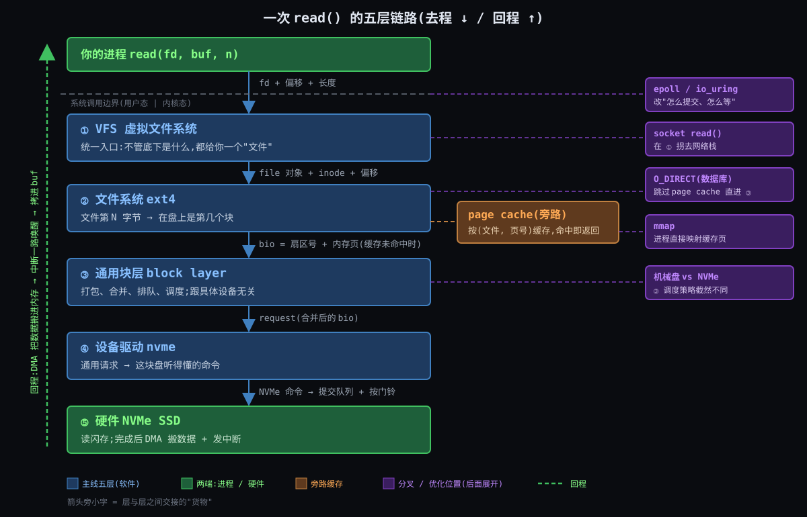
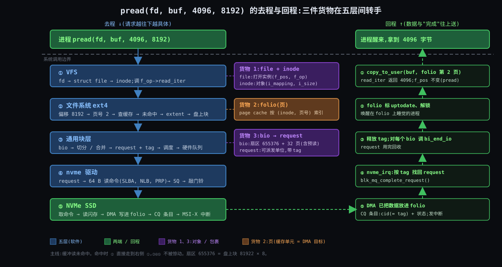
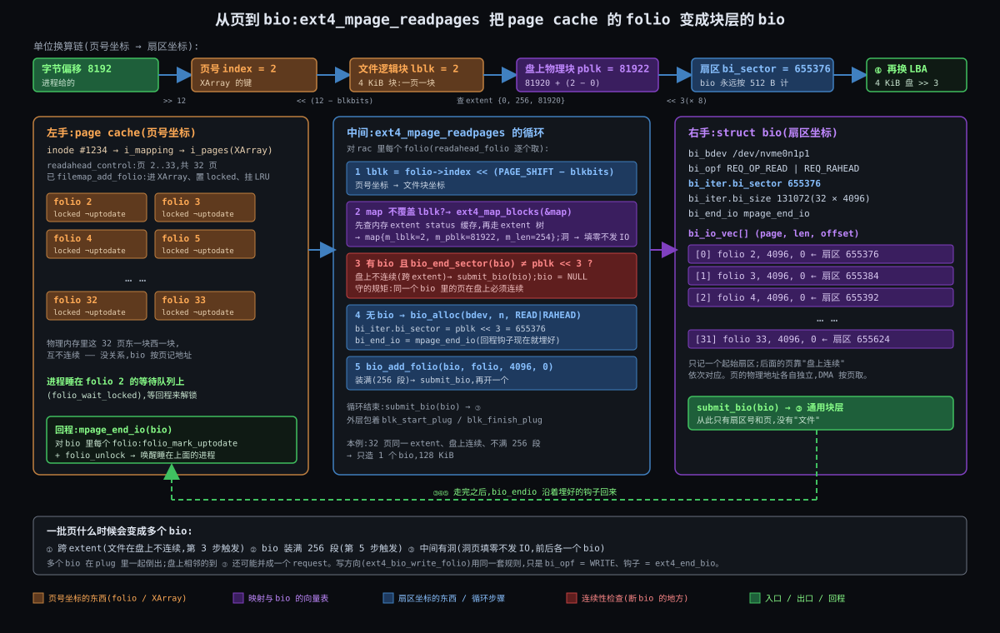
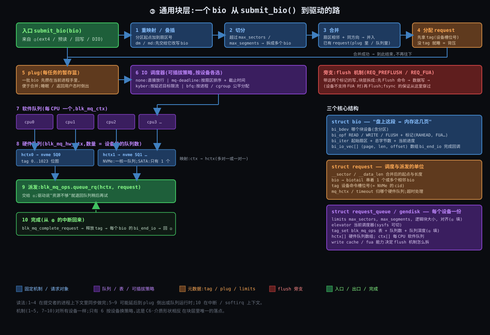
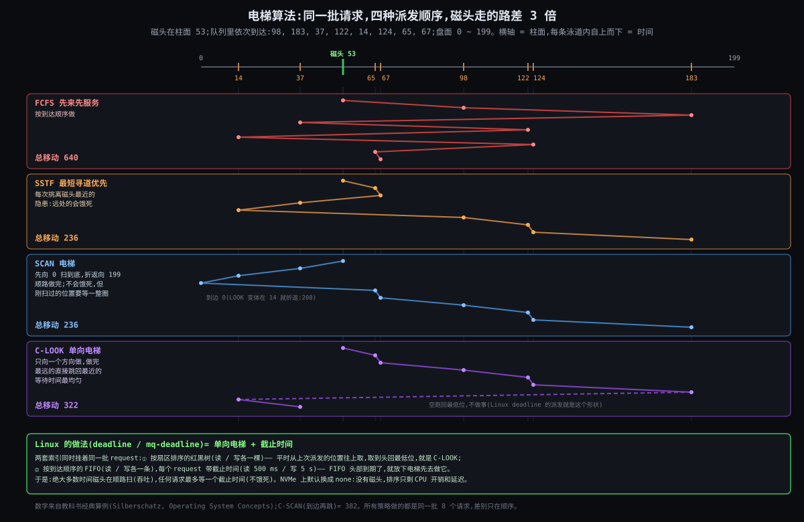
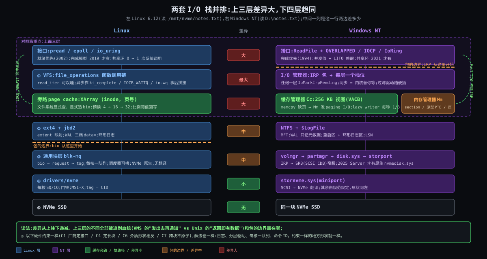
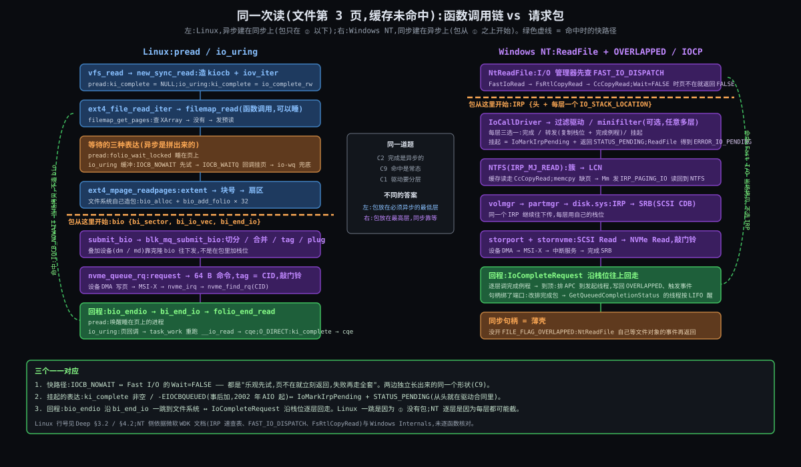
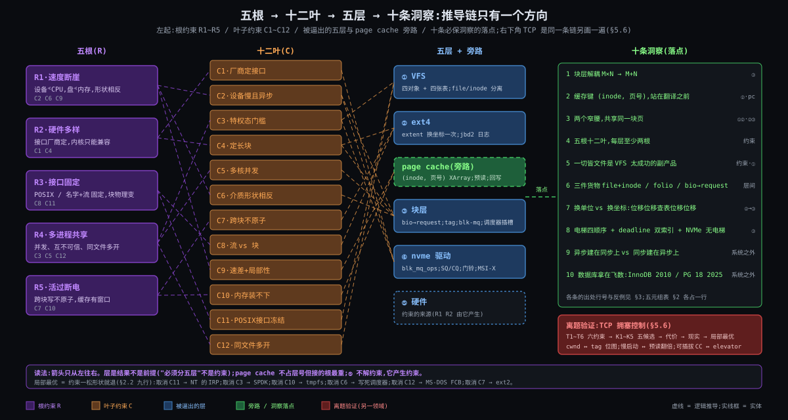

# Linux 文件 IO 全链路 | atlas 综合长文

> 一份以 Linux 6.12 为样本、以 read/write 为入口的存储栈设计笔记 —— 五层一条链 / 五根十二叶约束 / 三件货物两个窄腰 / 1974 ~ 2021 五个转折点 / 三条主线源码追踪 / 对照 Windows NT / 五元组 + 五步法 + TCP 拥塞控制验证

---

## 导读地图

本文是 atlas 苏格拉底式技术教学的**最终融合产物**,围绕**第一性原理**展开,陪你一篇一篇把 Linux 文件 I/O 从 VFS 到 NVMe 的整条链搞透,最终带走一套能离开存储领域使用的推导方法。

### 灵魂问题(Discovery 收集,贯穿全文)

> **"read/write 系统调用只是表面接口,我想清楚知道 read/write 背后的设计架构 —— 只知道有虚拟文件系统、驱动层、块设备层,但不知道它们的设计细节,以及为什么必须这么设计才行。"**

走完全文你会从七个角度回答它:它是什么(What)、为什么非得五层(Why)、每层具体怎么做(How)、谁在什么约束下这样做的(Origin)、源码里到底怎么走(Deep)、换一组约束会长成什么样(Comparison)、这套推导怎么带走(Synthesis)。

### 覆盖的 7 篇

| 篇 | 它讲什么 | 篇幅 |
|---|---|---|
| **What** | 它是什么:五层一条链、一本图书馆类比、硬件入门 | ~278 行 |
| **Why** | 为什么必须存在:五幕一刀全切,逼出五根十二叶 | ~517 行 |
| **How** | 大致怎么工作:fd → inode → 页 → bio → request → NVMe 命令,再回来 | ~1022 行 |
| **Origin** | 是怎么来的:1974 ~ 2021,五个转折点 | ~364 行 |
| **Deep** | 深度剖析:三条主线源码追踪 + epoll / io_uring 必然还是偶然 | ~929 行 |
| **Comparison** | 横向对照:对照 Windows NT I/O 栈:IOCP / IRP / 缓存管理器 | ~473 行 |
| **Synthesis** | ★ 设计哲学与方法论:五元组 / 十条洞察 / 五步法 + TCP 拥塞控制验证 | ~474 行 |

### 阅读路径建议

- **第一次接触这条链** → 顺读(What → Why → How → Origin → Deep → Comparison → Synthesis)
- **想快速建立心智** → 看 [What](#stage-what) + [Why](#stage-why)(约 40 分钟)
- **想看清设计为什么这样** → 看 [Why](#stage-why) + [Deep](#stage-deep) + [Synthesis](#stage-synthesis)(约 2 小时)
- **想横向对比** → 直接看 [Comparison](#stage-comparison)(约 40 分钟)
- **想拿走方法论** → 直接看 [Synthesis §2 五元组](#stage-synthesis) 与 §5 五步法(约 1 小时)

**全长**约 4263 行、中文约 8.0 万 字;深读约 6 小时,跳读约 1.5 小时。

### 全文导览

下面七篇按顺序展开,每两篇之间有一段过渡,做心智模式切换 —— 讲解员 → 论证者 → 实操员 → 讲故事的人 → 工程师 → 评论家 → 哲学家。每篇末尾都有「约束回扣」和「呼应你的问题」两节,把该篇内容钉回约束清单与灵魂问题。各篇内部的修订记录保留在 `stages/0X-*/0X-*.md` 里,这里不重复。

---

## 约束清单速查(C1 ~ C12)

> 后文所有 `Cn` 引用都对应下面 12 条;**各篇不再重复列**。它们在 Why 篇建立(第二篇有完整推导),后续五篇交叉引用。每条是 markdown 标题,后文用 `[C1](#c1)` 一类链接跳回这里。

五根:R1·速度断崖(C2 C6 C9)/ R2·硬件多样(C1 C4)/ R3·接口固定(C8 C11)/ R4·多进程共享(C3 C5 C12)/ R5·活过断电(C7 C10)。

<a id="c1" name="c1"></a>
#### C1·厂商定接口
硬件接口由厂商 / 标准定义,种类多且内核无法统一。**不可再分**:内核不是标准制定者。**口诀**:接口不归你定 → 必须有翻译层。

<a id="c2" name="c2"></a>
#### C2·设备慢且异步
设备延迟比 CPU 慢 10³ ~ 10⁷ 倍,完成是异步事件(中断)。**不可再分**:物理时延与 GHz 时钟的差距不可消除。**口诀**:发出去再等 → 队列 + 回调。

<a id="c3" name="c3"></a>
#### C3·特权态门槛
寄存器 / DMA / 中断只能在特权态操作,进程不可信。**不可再分**:DMA 能写任意物理内存。**口诀**:每次 I/O 至少付一次门票。

<a id="c4" name="c4"></a>
#### C4·定长块
持久设备最小读写单位是固定大小的块。**不可再分**:ECC 按块算。**口诀**:读 1 字节也搬一块。

<a id="c5" name="c5"></a>
#### C5·多核并发
多核多进程并发发起 I/O。**不可再分**:核数只增不减。**口诀**:一把锁浪费所有核。

<a id="c6" name="c6"></a>
#### C6·介质形状相反
不同介质性能形状迥异,不存在对所有设备最优的单一策略。**不可再分**:机械臂 vs 闪存通道是两种物理。**口诀**:策略必须可换。

<a id="c7" name="c7"></a>
#### C7·跨块不原子
崩溃可落在任意两次块写之间;单块原子、多块不原子。**不可再分**:断电是外部事件。**口诀**:找一个单块写系住全局。

<a id="c8" name="c8"></a>
#### C8·流 vs 块
程序要"名字 + 变长流",介质只给"编号 + 定长块";映射须存于介质自身。**不可再分**:人用名字思考。**口诀**:必有一张表,表也在盘上。

<a id="c9" name="c9"></a>
#### C9·速差+局部性
DRAM 与持久介质速度差 10² ~ 10⁵ 倍,访问具有局部性。**不可再分**:两种介质物理原理不同。**口诀**:命中率决定一切。

<a id="c10" name="c10"></a>
#### C10·内存装不下
内存远小于盘且昂贵 → 缓存须淘汰、须延迟回写 → 存在不一致窗口。**不可再分**:单位容量价格差一到两个数量级。**口诀**:窗口必有,谁来关由应用定。

<a id="c11" name="c11"></a>
#### C11·POSIX接口冻结
文件系统 / 设备种类开放增长,POSIX 接口几十年固定。**不可再分**:改接口 = 改所有已有程序。**口诀**:新能力只能旁开,不能改 `read`。

<a id="c12" name="c12"></a>
#### C12·同文件多开
同一文件可被多进程同时打开,各有偏移,而对象只有一份。**不可再分**:fork 继承 fd 是 Unix 根基。**口诀**:打开实例与对象分开。

---

<a id="stage-what" name="stage-what"></a>

# 📍 第一篇:What — 它是什么

# 阶段 1:Linux 文件 IO 全链路是什么

> 这一份是**地图**:五层各是谁、负责什么、交接什么。每一层"为什么必须这样设计",后面按五层逐层拆。

## 一句话定义

**把"读文件第 N 字节"逐层翻译成磁盘命令、再把数据送回进程的五层内核链路。**

记住两个动词:**往下翻译**(请求越往下越具体),**往上送回**(数据和"完成了"的通知一路回来)。

---

## 跨领域类比:大型图书馆的调书系统

想象一座藏书几千万册的图书馆,书不放在阅览室,而是放在城外好几个库房里。

| 图书馆 | 对应内核 | 这一环的本分 |
|---|---|---|
| 读者在**总服务台**说"我要《X》第 300 页" | 进程调用 `read()` | 只说要什么,不关心书在哪 |
| **总服务台**:不管你借书、借光盘、还是寄信,都在这里排同一个号 | ① VFS | 统一入口,所有东西都长成"文件" |
| **编目部**:查目录卡,《X》在 3 号库房 B 区 17 架 | ② 文件系统 | 把"书名 + 页码"翻译成"物理位置" |
| 阅览室的**热门书架**:最近有人借过的书就放这儿,有就直接给 | page cache | 命中就不用去库房 |
| **调度中心**:把一上午的调书单收齐,同一库房、同一区的合并成一车,排好顺序再派 | ③ 通用块层 | 合并、排队、调度,不管库房长什么样 |
| 每个库房配的**专属搬运队**,只有他们懂这个库房的规矩 | ④ 设备驱动 | 通用调书单 → 这个库房听得懂的指令 |
| **库房本身**:老库房靠人推梯子爬架子,新库房是全自动立体库 | ⑤ 硬件(机械盘 / NVMe SSD) | 真正把书取出来 |
| 库房用**传送带**直接把书送到热门书架,然后**按铃**通知服务台 | DMA + 中断 | 搬运不占服务台的人手;搬完再通知 |

这个类比里能直接推出几条后面会反复用到的性质:

1. **服务台不懂库房**,库房也不懂服务台 —— 中间每一层只跟相邻层说话。所以换一个新库房(新硬件),只要配一支新搬运队(新驱动),上面都不用改。
2. **调度中心有没有用,取决于库房是哪种**。老库房爬一次梯子很慢,把同一区的单子合并、顺路排好收益巨大;全自动立体库几乎瞬间取书,还有很多个取书口同时干活,调度中心再精心排序反而是在添乱。
3. **热门书架是个旁路**,不是必经之路。有的老读者(数据库)自己家里有整套书架,而且比图书馆更清楚自己下一步要哪本书,干脆跟馆员说"别往热门书架放了,直接送到我桌上"。这就是 `O_DIRECT` 的位置。

---

## 一张全景图



读图的方法:**盯住箭头旁的小字**。它是层与层之间交接的"货物",每过一层就换一种形态:

| 交接点 | 交出去的"货物" | 含义 |
|---|---|---|
| 进程 → ① | `fd + 偏移 + 长度` | "我打开的那个东西,从第几字节读多少" |
| ① → ② | file 对象 + inode + 偏移 | VFS 已经找到"这是哪个文件",交给管它的文件系统 |
| ② → page cache | (文件, 页号) | 先看缓存里有没有这一页 |
| ② → ③(未命中) | **bio** = 盘上扇区号 + 要装进哪些内存页 | 文件的概念到此消失,只剩"盘上哪段 ↔ 内存哪页" |
| ③ → ④ | request(合并、排好队的 bio) | 设备无关的通用请求 |
| ④ → ⑤ | NVMe 命令,放进**提交队列**,然后"按门铃" | 这块盘自己的语言 |
| ⑤ → 回程 | DMA 写内存 + 中断 | 数据已经在内存里了;中断只负责说一声"好了" |

**一个关键观察**:从上往下,**"文件"这个概念只活到第 ② 层**。③ 以下没有文件、没有目录、没有文件名,只有"盘上的第几个扇区"。这就是分层的边界线。

---

## 五层各是谁

### ① VFS(虚拟文件系统)

内核里的**统一入口**。ext4、xfs、U 盘、`/proc`、管道、socket……长得千差万别,但在进程眼里都是一个 `fd`,都能 `read()`。VFS 规定了"文件应该提供哪些操作"这张接口表,具体实现交给下面的人。

你已经熟悉的 inode 和 dentry 就住在这一层:**dentry** 负责"路径名 → 文件",**inode** 是"这个文件本身"(多大、属于谁、数据在哪)。

### ② 文件系统(ext4)

VFS 接口表的一个**具体实现者**。它最核心的本分是一道翻译题:**文件的第 N 字节,在盘上是第几个块?** ext4 用 extent(一段连续块的描述:"从盘上第 X 块开始,连续 Y 块")来记录这层映射。

page cache 挂在它旁边:先查缓存,没命中才让 ext4 去算块号,再把请求往下交。

### page cache(旁路,不是一层)

**按"文件 + 页号"索引的一块内存缓存**,注意不是按盘上的位置索引。它属于内存管理,不是文件系统私有的,所以 ext4、xfs 都用同一套。命中时整条链路到这里就结束,③④⑤ 根本不会被惊动。

### ③ 通用块层(block layer)

> 你之前说完全没接触过,这一轮先讲清它**是什么、站在哪**。

因为下面的设备五花八门(机械盘、SATA SSD、NVMe、U 盘、虚拟盘),上面的文件系统又不想跟每种设备单独打交道,就需要一个**跟设备无关的中间站**。这个中间站就是通用块层。它干三件事:

- **bio**:块层收货的标准包装,内容就一句话:"盘上从第几个扇区开始,和内存里的这几页之间,搬一段数据"。文件系统只要会打包 bio,就能跟任何块设备打交道。
- **合并、排队**:把相邻的 bio 合成一个大请求,攒成队列。
- **IO 调度器**:决定队列里的请求**按什么顺序**发给设备。这在机械盘上收益巨大(少挪几次磁头),在 NVMe 上几乎没用,所以 NVMe 默认把调度器关掉(`none`)。至于为什么,后面会正面回答。

### ④ 设备驱动(nvme 驱动)

每一类设备一个驱动,负责**把通用 request 翻译成这块设备的命令格式**,交给硬件,然后处理硬件回来的中断。对 NVMe 来说,就是把命令写进内存里的一个**提交队列**,再往设备的一个寄存器里写一下("按门铃"),告诉盘"有活了"。

### ⑤ 硬件(NVMe SSD)

真正存数据的东西。下一节单独讲一下它的原理。

---

## 硬件入门:机械盘、SSD、NVMe 分别是什么

### 机械盘(HDD):一切慢的源头

数据存在高速旋转的磁盘片上,由一根**机械臂**移动磁头到对应磁道,再等盘片转到对应扇区。

- **随机读一次 ≈ 5~10 ms**:臂要挪(寻道),盘要转(旋转延迟),都是机械运动。
- 顺序读快得多:臂不用挪,盘一直转着就能连续读。
- 所以**对机械盘来说,"按什么顺序读"决定了性能** —— 这就是 IO 调度器的原始动机。

### SSD:没有机械,只有闪存

数据存在 NAND 闪存芯片里,纯电子读写,没有任何活动部件。

- **随机读一次 ≈ 几十 μs**,比机械盘快约 100 倍。
- 内部有很多颗闪存芯片、很多条通道,**天然能同时干很多件事**。
- 随机和顺序的差距大大缩小,"排顺序"不再关键,"**同时发出足够多的请求、把内部并行度喂饱**"才关键。

### NVMe:专门为闪存设计的"对话方式"

先区分两件事:**SSD 是介质**(用什么存),**NVMe 是协议**(CPU 跟盘怎么说话)。

因为早期 SSD 沿用了给机械盘设计的老协议(SATA 线 + AHCI 协议:**1 个命令队列,最多 32 个命令排队**),而机械盘本来一次就只能干一件事,这个设计够用;但闪存能并行干几百件事,还没开始发力就被老协议卡住了 →
要解决"让 CPU 能足够快、足够并行地把命令递给闪存" →
所以引入 **NVMe**(Non-Volatile Memory Express):

- **直接挂在 PCIe 总线上**,离 CPU 更近,不再绕经 SATA 控制器;
- **最多 6.5 万个队列,每个队列最多 6.5 万个命令**,可以每个 CPU 核一个队列,核之间互不争抢;
- 命令放在内存里的队列中,设备自己通过 DMA 来取,CPU 只需"按一下门铃"。

一句话:**机械盘 → 怕乱序,要排队;NVMe → 怕喂不饱,要并行**。整个块层的设计在这两种设备之间被反复拉扯,这是后面最精彩的部分之一。

### DMA 与中断(回程)

- **DMA**:设备直接把数据写进内存,**不需要 CPU 一个字节一个字节地搬**。CPU 只负责告诉它"搬到哪"。
- **中断**:设备搬完后给 CPU 发一个信号,"你等的那份好了"。中断处理程序沿着链路往上,把正在睡觉等数据的进程唤醒,最后由内核把数据从 page cache 拷贝进你的 `buf`。

---

## 关键词速查表

| 术语 | 一句话说明 | 在哪层 |
|---|---|---|
| 系统调用 | 用户态进入内核的唯一正门 | 边界 |
| VFS | 让一切都长成"文件"的统一入口和接口表 | ① |
| inode / dentry | 文件本身 / 路径名到文件的映射 | ① |
| extent | "盘上从 X 块开始连续 Y 块",ext4 记录文件位置的方式 | ② |
| page cache | 按(文件, 页号)索引的内存缓存,旁路 | ②③ 之间 |
| bio | 块层的标准包装:"盘上这段 ↔ 内存这几页" | ③ |
| IO 调度器 | 决定请求发给设备的顺序 | ③ |
| NVMe 提交 / 完成队列 | 驱动和硬件交换命令与结果的内存环形队列 | ④⑤ |
| DMA / 中断 | 设备自己搬数据 / 设备通知 CPU"好了" | ⑤ → 回程 |

---

## 边界:容易混在一起的几对

| 容易混的 | 怎么分 |
|---|---|
| VFS vs ext4 | VFS 定**接口**("文件该能读写"),ext4 给**实现**("我怎么在盘上找到它")。换成 xfs,VFS 一行不改 |
| page cache vs 文件系统 | page cache 归内存管理,所有文件系统共用;它按"文件 + 页"索引,不懂盘上的块号 |
| 块层 vs 驱动 | 块层**设备无关**(合并、调度对谁都一样),驱动**设备相关**(只懂某一类盘)。所以顺序是先块层、后驱动 |
| "块设备"这个词 | 可能指内核里的块层软件(③),也可能指物理盘(⑤)。本文统一:③ 叫"块层",⑤ 叫"硬件" |
| 文件 IO vs 网络 IO | 同样是 `read(fd)`,socket 在 ① 就被 VFS 分派给网络栈,**根本不进 ②③④**。网络 IO 是另一条平行的链路 |

### 思考题:去掉块层,让 ext4 直接对驱动下命令,会先坏在哪?

**第一个答案(你的)**:性能变差。块层的调度是在优化 IO 顺序,绕过去就丢了这份优化。

**这个答案在机械盘上完全成立**,但它撞上了一个反例:前面说过,**NVMe 默认把 IO 调度器关成 `none`**。也就是说,在今天最主流的设备上,"调度"这份价值几乎为零,可块层依然在,而且 NVMe 驱动照样必须经过它。

所以"调度"更像是块层的**派生好处**,而不是它**必须存在的原因**。真正的必要原因还没找到,线索在类比的第 1 条性质里:编目部不止一个(ext4、xfs、btrfs……),库房也不止一种。

**第二个答案(你的)**:块层是一个**中间层**,屏蔽下层硬件的多样性,提供**策略与机制分离**的架构。

这就是必要原因。拆成两半看:

**① 屏蔽多样性:把 M × N 变成 M + N**

没有块层时,每个"上面的人"都要直接对接每种"下面的设备":

| | 机械盘 | SATA SSD | NVMe | U 盘 | 虚拟盘 |
|---|---|---|---|---|---|
| ext4 | 要写 | 要写 | 要写 | 要写 | 要写 |
| xfs | 要写 | 要写 | 要写 | 要写 | 要写 |
| btrfs | … | … | … | … | … |
| 裸盘读写 / swap | … | … | … | … | … |

M 种上层 × N 种设备 = M × N 份对接代码;每多一种新盘,所有文件系统都得改一遍。

有了块层,大家只认同一份"合同":**bio**。上层只管打包 bio(M 份),下层驱动只管接收 request(N 份)。总量从 M × N 降到 M + N,新加一种盘只需要写一个新驱动,ext4 一行不动。这跟网络里的 IP 层是同一种设计:上面千种应用、下面百种链路,中间只留一个窄腰。

**② 策略与机制分离:同一个块层,不同盘配不同策略**

- **机制**(块层固定提供,对谁都一样):bio 的收发、合并、按设备限制切分、多队列、标签、统计。
- **策略**(可插拔,按设备单独选):IO 调度器 —— 机械盘配 `mq-deadline` / `bfq`(要排序),NVMe 配 `none`(不排序,直接放行)。

所以前面那个反例就解释通了:NVMe 关掉调度器,关的只是**策略**,**机制**还在,块层当然不能删。调度只是插在机制上的一个可选零件。

**③ 窄腰带来的派生好处**

因为大家都说 bio 这一种语言,一些"既不是文件系统、也不是驱动"的东西就能**叠插**在中间,而上下两层都察觉不到:

- LVM / device-mapper(几块盘拼成一块逻辑盘)
- 软 RAID(md)
- dm-crypt(整盘加密)
- cgroup IO 限流(给每个容器限 IO 带宽)

它们收 bio、改写或拆分 bio、再发 bio。没有统一的 bio 合同,这些都无处安放。

**小结**:块层存在的必要原因是**解耦**(M × N → M + N);调度是挂在它身上的**可插拔策略**,属于派生好处。区分"必要原因"和"派生好处",后面每一层都会再用到这把尺子。

### 思考题:page cache 为什么按(文件, 页号)索引,而不按盘上块号?

**你的答案**:内核一定有页号,但磁盘不一定有块号(比如新型设备)。

**校准一半**:只要是块设备,就一定有扇区号 / 块号 —— "能按编号随机读写固定大小的块"正是"块设备"的定义,NVMe 也不例外。所以"磁盘不一定有块号"这句不成立。

**但方向对了一半**:VFS 下面挂的东西**不全是块设备**。NFS(网络文件系统)、tmpfs(内存文件系统)、FUSE(用户态文件系统)、`/proc` —— 它们底下**根本没有盘**,自然没有块号可用。page cache 要给它们全部服务,就只能用一个所有文件系统都有的坐标,而(文件, 页号)正是 VFS 这一层人人都有的东西。

**更根本的理由:看缓存站在哪一层**

回到全景图:page cache 挂在 ② 旁边,查缓存发生在**ext4 算块号之前**。这一点决定了索引方式:

| 索引方式 | 一次 read() 命中缓存前要做什么 | 代价 |
|---|---|---|
| (文件, 页号) | 拿 inode + 偏移算页号,直接查 | 一次哈希 / 树查找 |
| (设备, 块号) | **先让 ext4 把偏移翻译成块号**(走 extent 树),再查 | 翻译本身可能要读元数据 —— 而元数据又得先经过缓存 |

按块号索引,每次命中都要先付一遍"文件 → 块"的翻译费,缓存的意义就被吃掉一半;更糟的是翻译要用的元数据块自己也要缓存,形成循环依赖。

还有三件事只有按文件索引才做得到:

1. **稀疏文件的洞**:文件中间没写过的区域没有对应的盘上块,按块号索引无处存放;按页号索引就是一页零。
2. **文件 ↔ 块的映射会变**:btrfs 这类写时复制文件系统每次写都换新块,碎片整理也会搬块。按块号索引的缓存会随之作废;按文件索引的缓存完全不受影响。
3. **mmap**:进程把文件映射进地址空间,页表项指向的就是 page cache 的页,这要求缓存天然按"文件的第几页"组织。

**历史注脚**:早期 Linux 真的有一个按(设备, 块号)索引的 buffer cache,跟按文件索引的 page cache 并存,数据在两边各存一份、还要互相同步。2.4 内核把两者统一,今天只剩 page cache 一套,元数据块也用它缓存。这段来龙去脉留到后面讲历史时展开。

**小结**:缓存站在"文件"这个抽象还活着的那一层,所以用文件坐标;这既是必要原因(服务所有文件系统、避免翻译 + 循环依赖),也顺手拿到了稀疏文件、映射变化、mmap 三个好处。

**你的凝练**:page cache 把文件系统和块设备的多样性,一起屏蔽在"文件偏移 → 内存页"这一个通用接口后面。

这句话把两道思考题接上了 —— 这条链路里其实有**两个窄腰**,各屏蔽一个方向的多样性:

| 窄腰 | 位置 | 统一的坐标 | 屏蔽掉的多样性 |
|---|---|---|---|
| page cache | ① ② 之间 | (文件, 页号) → 内存页 | 上面:进程不用管文件在哪种文件系统、底下有没有盘;下面:ext4 / NFS / tmpfs 都往同一种页里填数据 |
| bio | ② ③ 之间 | (设备, 扇区号) ↔ 内存页 | 上面:文件系统不用管是哪种盘;下面:驱动不用管是哪个文件系统 |

一个小校准:坐标是**文件偏移**(进程请求的就是"文件第 N 字节"),内存页只是装数据的容器;所以更准确的说法是"文件偏移 → 页"而非"内存偏移"。两个窄腰共享的恰好就是那个**内存页**:page cache 的页就是 bio 要填的页,数据从盘到进程只落地一次。这也是 mmap 能零拷贝、`O_DIRECT` 能拿用户的 buf 直接当 bio 目标页的根源 —— 后面讲分叉时会回到这张表。

---

## 分叉点(只标位置,原因后面讲)

| 场景 | 在哪拐出去 | 一句话 |
|---|---|---|
| `O_DIRECT`(数据库常用) | 在 ② 跳过 page cache,直接造 bio 进 ③ | 仍要让 ext4 算块号,只是不经过缓存。数据库为什么愿意这么做,后面正面回答 |
| `mmap` | 进程直接把 page cache 的页映射进自己的地址空间 | 不再调用 `read`,用缺页异常代替;少了一次从缓存到 `buf` 的拷贝 |
| 机械盘 vs NVMe | ③ 的调度策略、④⑤ 的队列模型 | 一个怕乱序,一个怕喂不饱 |
| socket `read()` | 在 ① 拐去网络栈 | 平行链路,不在本主线上 |

---

## 最后的预留:epoll 与 io_uring

它们都站在**系统调用边界**上,改的不是"IO 往下穿过谁",而是"**进程怎么提交 IO、怎么等结果**":

- **epoll**:主要服务 socket 这类"会等很久才有数据"的东西。对普通磁盘文件它**不起作用**:`select/poll` 会把普通文件一律报告为"就绪",epoll 干脆拒绝登记普通文件(`epoll_ctl` 返回 `EPERM`)。
- **io_uring**:在 epoll 够不着的地方长出来,可以对普通文件做真正的异步提交和收割,而且能一路压到 ③④ 的队列。

全部读写主线讲完后,再拿这五层当坐标,逐个看它们在哪一层动手、省掉了什么、为什么是当下的最优解。

---

## 呼应你的问题

你想知道 `read/write` 背后的五层**各自怎么设计、为什么必须这样设计**。这份地图先回答了"有哪五层、每层交接什么":

- 每层的本分都是一道**翻译**:fd → 文件 → 盘上块号 → bio → 设备命令。
- 每层都**只认相邻层**:文件的概念只活到 ②,设备的差异只出现在 ④⑤。
- page cache 是**旁路**,于是才有了绕过它的余地,也就有了数据库那个问题。

但"**为什么非得这样**"还没回答。为什么不能让 ext4 直接给 NVMe 发命令?为什么要有一个跟设备无关的块层?为什么缓存要按文件索引而不是按盘上的位置?这些答案藏在一组更底层的约束里,而这组约束正是下一步要一条条摆出来的。

---

> **🔄 心智切换:讲解员 → 论证者(共情模式)**
>
> 上面用一张图书馆的类比和一张五层全景图,立起了 read/write 背后那条链的骨架:谁在哪一层、各自叫什么。但只看地图不知道这条链为什么非得长成五层。下一篇回到原点:把五层一刀全切掉,让进程直接对着 NVMe 寄存器写数据,看它在哪一步撞墙 —— 每撞一次墙,就逼出一条不可再分的约束。读完你会拿到十二条叶子和五条根,它们是后面五篇所有设计决策的唯一依据。

---

<a id="stage-why" name="stage-why"></a>

# 📍 第二篇:Why — 为什么必须存在

# 阶段 2:Linux 文件 IO 全链路为什么必须存在

> 上一份地图回答了"有哪五层、每层交接什么"。这一份回答"是什么硬约束逼着内核非得长成这五层"。写法是:从一个没有任何一层的世界出发,每解决一个痛点就露出下一个,直到五层凑齐。每一幕末尾浮现的约束编号 C1 ~ C12,是后面所有讨论的脊梁。

---

## 没有它的世界

### 开场:引导程序 —— 一个没有任何一层的世界

机器上电,CPU 处在 16 位实模式,能寻址的内存只有 1 MiB。固件把盘上第一个扇区(512 字节)搬到内存 `0x7C00`,然后跳过去执行。这 512 字节就是全部的"操作系统"。

它要做的事只有一件:把内核从盘上读进内存。可它面对的是:

- **只有扇区号,没有文件**。能说的话只有"从第 X 扇区开始读 Y 个扇区"。内核在盘上哪些扇区?老式引导器 LILO 的办法是把内核的扇区列表**写死**在引导记录里,换一次内核就得重跑一遍 `lilo` 刷新列表,忘了跑就起不来。
- **读盘靠固件的 `int 13h`**。一次调用同步读若干扇区,调用期间 CPU 什么都干不了。固件本身就是一个最简陋的驱动 —— 连 512 字节的引导程序都不裸着跟磁盘控制器说话。
- **512 字节装不下任何逻辑**。于是 GRUB 分成好几级:MBR 里 446 字节的 `boot.img` 只够读入下一级 `core.img`;`core.img` 再加载文件系统模块,这时才第一次能"按文件名"找到 `/boot/vmlinuz`。GRUB 之所以要**自带一小套 ext4 / xfs / btrfs 驱动**,就是为了逃离扇区号的世界。
- **没有缓存,没有并发**。每次读都真的转一次盘;同一时刻只有一个请求在飞。

进了保护模式、再进 64 位长模式,地址空间从 1 MiB 变成 2⁴⁸ 字节,内核终于有了放下复杂逻辑的地方。但请注意:**地址空间变大只是让"写出这些层"成为可能,并没有让"直接操作硬件"变容易**。裸硬件的痛点一条没少 —— 接下来五幕,就是把它们一条条解决掉。

---

### 第一幕:谁来跟盘说话 → 设备驱动(④)

**痛点**。内核现在想读一块 NVMe 盘。NVMe 的语言是这样的:在内存里建一对环形队列(提交队列 SQ、完成队列 CQ),往 SQ 填一条 64 字节的命令,往设备 PCIe 地址空间里的一个"门铃"寄存器写一下,然后等 MSI-X 中断,再从 CQ 取一条 16 字节的完成项。换成 SATA 盘,是另一套(AHCI 的命令表 + FIS 帧);换成 U 盘,是 SCSI 命令包在 USB 包里。三种盘三种语言,而且**这些语言是厂商和标准组织定的,内核说了不算**。

如果没有驱动这一层,内核里每一个想读盘的模块都得同时会说这三种话;每出一种新盘,所有模块都得改。

还有两件事让"直接说"根本不可能:

- 盘是**异步**的。从按门铃到数据到达,NVMe 要几十微秒,机械盘要几毫秒;CPU 一个时钟周期不到 1 纳秒。让 CPU 原地等,等于把它浪费掉 10⁴ ~ 10⁷ 倍。必须"发完就走、中断再回来"。
- 门铃寄存器、DMA、中断只能在**特权态**操作。普通进程一旦能碰这些,就能让设备往任意物理内存 DMA,整个系统的隔离就没了。所以这件事必须在内核里做,进程只能"请求",不能"动手"。

**引入**:因为硬件语言多样且不受内核控制、设备异步且慢、硬件访问需要特权 → 要解决"把某一种盘的语言翻译成内核统一的'收请求 / 报完成'" → 所以引入**设备驱动**。每种设备一个,只有它懂这块盘的队列、寄存器和中断。

**举个例子把这句话落地**。一台服务器上插了两种盘:一块 NVMe SSD(`/dev/nvme0n1`),一张 LSI MegaRAID 阵列卡,卡后面挂着 8 块机械盘组成的 RAID 5,对外露出一块"虚拟盘"(`/dev/sda`)。两块盘上各有一个 ext4 文件系统,各放一份 `data.bin`。

用户态程序对两份文件做的事一模一样:

```c
fd = open("/mnt/nvme/data.bin", O_RDONLY);   // 或 /mnt/raid/data.bin
read(fd, buf, 4096);
```

同一个 `read()`,同一条路穿过 ① ② ③,到了 ③ 的底部都变成同一种东西:一个 `request`(里面是 bio:扇区号 + 内存页)。③ 对两块盘说的也是同一句话 —— 调一张函数指针表 `struct blk_mq_ops` 里的 `.queue_rq`。**驱动要做的全部事情,就是按自己硬件的脾气把这张表填上**:

| `blk_mq_ops` 里的槽位 | nvme 驱动填的 | megaraid_sas 驱动填的(经由 SCSI 子系统) |
|---|---|---|
| `.queue_rq`(收一个 request) | `nvme_queue_rq`:把扇区号、长度、DMA 页地址装成一条 64 字节 NVMe 读命令(opcode `0x02`),写进内存里的提交队列,再往 PCIe BAR 空间的门铃寄存器写一个数 | `scsi_queue_rq` → `megasas_queue_command`:把同样的扇区号、长度装成一条 SCSI `READ(10)` 命令(opcode `0x28`),再包进 MegaRAID 自己的帧格式,写进卡的请求队列、敲卡的门铃 |
| 完成路径(中断) | `nvme_irq`:从完成队列取一条 16 字节完成项,找到对应 request,报告 ③ "好了" | `megasas_isr`:从卡的回复队列取一条,找到对应 request,报告 ③ "好了" |
| `.init_hctx` / 队列数 | 向盘申请 N 个硬件队列(一核一个) | 阵列卡通常只有 1 个硬件队列(或少量) |
| `.timeout` | 命令超时 → 复位控制器 | 命令超时 → 走 SCSI 错误恢复 |

注意右边那列里藏着什么:RAID 5 的条带、奇偶校验、8 块盘的并行 —— **③ 一个字都不知道**,它以为 `/dev/sda` 就是一块普通的盘;那些全在卡的固件里,驱动只负责把命令递过去。换成虚拟机里的 virtio-blk 更极端:`.queue_rq` 填的是"把描述符放进共享内存环、踢一下宿主机",后面连一块真盘都没有,③ 照样察觉不到。

所以"驱动只要按硬件特点实现通用接口的函数指针"这句话,精确的版本是:③ 定义 `blk_mq_ops` 这张表,每个驱动填一份;上面的 ①②③ 对所有盘跑的是同一份代码。这张表的每个槽位具体长什么样、request 怎么从 ③ 的队列走到 `.queue_rq`,留到讲内部机制时展开。

**浮现的约束**:

- **C1·厂商定接口** 硬件接口由厂商 / 标准定义,种类多且内核无法统一
- **C2·设备慢且异步** 设备延迟比 CPU 慢 10³ ~ 10⁷ 倍,且完成是异步事件(中断)
- **C3·特权态门槛** 寄存器 / DMA / 中断只能在特权态操作,进程不可信

**解决完露出的新痛点**:现在有了 nvme、ahci、usb-storage……各自一个驱动。可它们的"收请求"接口如果各长各样,上层还是得分别对接。而且:多个进程同时发请求,谁来排队?一个请求超过设备单次最大传输长度,谁来切?机械盘需要排序,NVMe 不需要,这个判断放在哪?

---

### 第二幕:M 个上层 × N 个驱动 → 通用块层(③)

**痛点**。ext4、xfs、btrfs、swap、裸盘读写,每一个都要对接 nvme、ahci、usb-storage、virtio-blk……上一份地图算过:M × N 份对接代码。这还只是接口。真正的麻烦在三件事上:

- **并发**。几十个核、几百个线程同时发 IO,每个驱动自己处理排队和锁,就是几十份重复且各自有 bug 的队列实现。
- **设备限制**。每种设备单次能传多大(`max_sectors`)、一次最多几个内存段、是否要求对齐,都不一样。谁来把一个 1 MiB 的请求切成设备能吞的小块?
- **性能形状完全相反**。机械盘一次寻道 5 ~ 10 ms,随机读比顺序读慢两个数量级,所以"把请求按扇区号排好序再发"是救命的;NVMe 随机读 ≈ 顺序读,内部几十条通道等着喂,排序反而拖慢。**没有一种顺序策略对所有设备都对**。

**引入**:因为设备以固定大小的块为单位、多核并发、性能形状迥异 → 要解决"让上层只学一种语言,让排队 / 切分 / 调度只写一遍且策略可换" → 所以引入**通用块层**。它定义 bio 作为唯一合同;合并、切分、多队列是固定机制;IO 调度器是可插拔策略。

**举个例子把这句话落地**。还是那台服务器。同一时刻有三个"上层"在往下发 IO,它们互相不认识:

- ext4 在 `/dev/nvme0n1p1` 上读 `data.bin`(预读触发,32 个连续页已装进一个 128 KiB 的 bio);
- 内核的 swap 在 `/dev/nvme0n1p2` 上换出一页(没有文件系统,直接按扇区);
- 运维在跑 `dd if=/dev/sda of=/backup bs=1M`,直接读 RAID 虚拟盘的裸扇区(绕过 ②,从 ① 直接进 ③)。

三者做的事一模一样:各自造一个 `struct bio`(扇区号 + 内存页 + 读/写),调同一个函数 `submit_bio(bio)`。从这一刻起它们看不见后面发生的任何事,而块层对这三个 bio 分别做了:

| 块层做的事 | 发生在哪个 bio 上 | 具体 |
|---|---|---|
| **合并** | 分头到达的相邻 bio | 比如两个线程各读相邻的 64 KiB,两个 bio 合成一个 128 KiB 的 `request`,到 nvme 只需一条命令(ext4 预读那 32 页本来就在一个 bio 里,不需要合并) |
| **切分** | dd 的 1 MiB | `/dev/sda`(阵列卡)报告的单次最大传输是 512 KiB,块层把 1 MiB 切成两个 request;dd 完全不知道 |
| **多队列** | 三者 | 机器 32 核,nvme 有 32 个硬件队列,哪个核发的 IO 进哪个核的队列,互不抢锁;阵列卡只有 1 个硬件队列,32 个软件队列汇进一个 |
| **调度策略** | 按设备各自选 | `cat /sys/block/nvme0n1/queue/scheduler` → `[none] mq-deadline kyber`;`cat /sys/block/sda/queue/scheduler` → `[mq-deadline] none kyber bfq`。阵列卡后面是机械盘,排序有收益;NVMe 直接放行 |
| **叠插** | (如果有) | 要是 `/dev/sda` 上套了一层 LVM 或 dm-crypt,bio 先经过它们改写(换扇区号 / 加密页),再进真正的队列;上面三者依旧察觉不到 |

两边的合同形状不一样:**上边** ② 对 ③ 只有一个函数 `submit_bio()` 和一个结构 bio(多对一,普通 API);**下边** ③ 对 ④ 是那张 `blk_mq_ops` 表(一对多,函数指针表)。bio 和 request 的字段、合并和切分的规则、多队列怎么映射到核,留到讲内部机制时展开。

**浮现的约束**:

- **C4·定长块** 持久设备的最小读写单位是固定大小的块(512 B / 4 KiB),不能按字节寻址
- **C5·多核并发** 多核多进程并发发起 IO,请求之间需要排队与隔离
- **C6·介质形状相反** 不同介质的性能形状迥异(HDD 寻道毫秒级、随机 ≪ 顺序;NVMe 高并行、随机 ≈ 顺序),不存在对所有设备最优的单一策略

**解决完露出的新痛点**:块层只认"(设备, 扇区号)"。程序想存一份《我的日记.txt》,得自己记住它在第几个扇区、占多长、哪些扇区还空着。两个程序各记各的账,很快互相覆盖。更要命的是:写到一半断电,账本和数据对不上,盘就"坏"了。

---

### 第三幕:扇区号上长出"文件" → 文件系统(②)

**痛点**。没有文件系统的盘叫"裸盘"。早期一些数据库确实直接用裸盘 —— 结果是它们各自在内部**重新发明了一个文件系统**:自己维护空闲表、自己做目录、自己处理崩溃恢复。这件事太难了,难在三处:

- **映射必须自己存在盘上**。"名字 → 扇区列表"这张表本身也得放在盘里,而且得在没有任何表的情况下先找到它(所以超级块永远在固定位置)。
- **写不是原子的**。保存一个文件至少写三处:数据块、空闲位图、目录项。盘只保证**单个块**写完整或没写,跨块不保证。三次写之间任何一个瞬间断电,就会出现"目录说有、位图说空、数据写了一半"的状态。
- **空间会碎**。文件删了留下洞,新文件要么填洞要么拆成几段;几年之后一个文件散落在上百处。

**引入**:因为程序要的是"名字 + 可变长字节流"而盘只给"编号 + 定长块"、这个映射必须持久化在盘上自身、断电可落在任意两次块写之间 → 要解决"把定长块组织成有名字的变长流,并且崩溃后还能自洽" → 所以引入**文件系统**:inode 把块串成流,目录把名字映到 inode,位图 / extent 管空闲,日志保证崩溃后账本自洽。

**举个例子把这句话落地**。程序要在 `/mnt/nvme/` 下保存一个 10 KiB 的 `notes.txt`,然后读它的第 8192 字节起的 4 KiB:

```c
fd = open("/mnt/nvme/notes.txt", O_CREAT | O_WRONLY, 0644);
write(fd, data, 10240);     // 10 KiB
...
fd = open("/mnt/nvme/notes.txt", O_RDONLY);
pread(fd, buf, 4096, 8192); // 读第 3 个 4 KiB 块
```

**没有文件系统的话**,程序得自己回答:这 10 KiB 放到哪几个扇区?哪些扇区是空的?"notes.txt"这个名字记在哪?下次开机怎么找回来?别的程序会不会覆盖我?断电时写到一半怎么办?

**有了 ext4**,① 把 `open(O_CREAT)` 交给 ext4 的 `inode_operations.create`,把 `write` 交给它的 `file_operations.write_iter`,ext4 在盘上做了这些事(块大小 4 KiB):

| 步骤 | ext4 做了什么 | 落在盘上哪 |
|---|---|---|
| 创建 | 从 inode 表里分配 inode #1234,填上大小、权限、时间 | inode 表 |
| 起名 | 往 `/mnt/nvme/` 的目录块里加一条 `"notes.txt" → #1234` | 目录块 |
| 分配 | 10 KiB 要 3 个块;查块位图找到 3 个连续空块 81920 ~ 81922,标成已用 | 块位图 |
| 记映射 | 在 #1234 的 extent 树里记一条 `{文件块 0, 长度 3, 盘上块 81920}` | inode 内 |
| 写日志 | 上面三处元数据改动先写进日志(data=ordered:数据块先落盘,元数据再提交) | 日志区 |

后来的 `pread(偏移 8192)`:ext4 算出要文件块 2 → 查 extent 树 → 盘上块 81922 → 换算成扇区 81922 × 8 = 655376 → 造一个 bio 交给 ③。

**断电落在"目录块写了、位图没写"之间**会怎样?下次挂载时 ext4 先重放日志,要么三处都生效,要么三处都回滚,不会出现"目录说有、位图说空"的半状态。这是 C7·跨块不原子 的全部意义。

换成 xfs:extent 用 B+ 树记、日志格式不同、位图换成另一套,但 ① 调的还是同一张 `inode_operations` / `file_operations` 表,③ 收到的还是同一种 bio。程序一行不改。inode 的字段、extent 树长什么样、日志怎么重放,留到讲内部机制时展开。

**你的视角:文件系统 = 给裸盘"格式化",建索引、快检索、优化写入**。这个说法很贴近实物 —— `mkfs.ext4 /dev/nvme0n1p1` 干的就是在裸盘上铺一套账本结构:固定位置写超级块,划出 inode 表、块位图、日志区。"建索引"就是目录 + inode + extent 树这三层映射;"快检索"是目录用哈希树(ext4 的 htree)、extent 用树而不是逐块链表;"优化写入"是延迟分配、块组(把一个文件的块尽量放在同一区域)和日志。

只校一个次序:**快是第二位的,先有"映射存在"和"活过断电"**。最早的 Unix 文件系统(1970 年代)只做了命名和分配,没有任何性能优化,也没有日志;"快"是 1984 年 BSD FFS 加进来的,"活过断电"是 1990 年代日志文件系统加进来的。所以文件系统的本分按时间顺序是:先对 C8·流 vs 块(名字 + 变长流)负责,再对 C7·跨块不原子(崩溃)负责,最后才对 C6·介质形状相反 / C9·速差+局部性(把块放连续、少下盘)负责。这段来路留到讲历史时展开。

**浮现的约束**:

- **C7·跨块不原子** 断电 / 崩溃可发生在任意两次块写之间;单块写原子,多块写不原子
- **C8·流 vs 块** 程序需要"名字 + 变长字节流",介质只提供"编号 + 定长块";映射必须持久保存在介质自身

**解决完露出的新痛点**:现在每一次 `read()` 都真的走到盘上。NVMe 随机读一次约 80 ~ 100 μs,机械盘 5 ~ 10 ms,而从内存读同样 4 KiB 只要约 0.1 ~ 1 μs。编译一次内核要打开几万个头文件,其中 `stdio.h` 这种被读上千遍 —— 每一遍都去盘上转一圈。写更糟:改一个字节,也得把整个 4 KiB 块写回盘。

---

### 第四幕:填平速度断崖 → page cache

**痛点数字**。内存与持久介质的速度差:对 NVMe 是 10² 倍,对机械盘是 10⁴ ~ 10⁵ 倍。而真实工作负载有一个几乎普遍的性质:**刚读过的很快会再读,读过第 N 页很可能接着读第 N+1 页**。不利用这一点,等于让 CPU 大部分时间在等盘。

**引入**:因为存储层次有速度断崖、访问有局部性 → 要解决"让重复读不下盘、让小写合并后再下盘、让顺序读提前下盘" → 所以引入 **page cache**。它按(文件, 页号)索引(原因见上一份地图的思考题),读命中直接返回,写先落缓存延迟回写,顺序读触发预读。

**举个例子把这句话落地**。连跑两遍同一条命令:

```
$ time grep -r "size_t" /usr/include > /dev/null     # 第一遍:几千个头文件全部从盘上读
real  0m1.8s
$ time grep -r "size_t" /usr/include > /dev/null     # 第二遍:一次盘都不碰
real  0m0.15s
```

第二遍快 10 倍以上,因为第一遍读过的每一页都留在了 page cache 里。`free -h` 里 `buff/cache` 那一列涨了几百 MB,就是它们。

拿刚才的 `pread(notes.txt, 偏移 8192, 4 KiB)` 看它在哪一步插进来:

| 步骤 | 做的事 | 谁做 |
|---|---|---|
| 1 | 偏移 8192 → 页号 2;到 #1234 这个 inode 的 `address_space` 里查:页 2 在不在? | 通用代码(`mm/filemap.c`),所有文件系统共用 |
| 2a | **命中**:直接把这一页拷到用户 `buf`,返回。③④⑤ 不被惊动 | 通用代码 |
| 2b | **未命中**:分配一页,调 ext4 填的 `address_space_operations.read_folio`;ext4 查 extent 算出块 81922,造 bio 下发;进程睡眠等中断 | 通用代码 → ext4 → ③ |
| 3 | 发现是顺序读 → 顺手把后面 128 KiB(32 页)也发下去(预读),下次就命中 | 通用代码 |

写路径更能看出代价:`write(fd, data, 10240)` 只是把 3 页标成"脏"就返回了,盘上**什么都没变**;后台回写线程大约 30 秒后(`dirty_expire_centisecs = 3000`)才把它们写下去。这 30 秒里断电,`write()` 明明返回成功,数据却没了 —— 所以数据库在 `write()` 后必须 `fsync()`,强制把脏页刷到盘上再返回。这就是 C10·内存装不下 说的"不一致窗口"的实物。

合同形状:page cache 本身是**通用代码**,不属于任何文件系统;ext4 只填 `address_space_operations` 这张表里的几个槽(`read_folio` / `readahead` / `writepages`),告诉通用代码"页没命中时怎么从盘上拿、脏页怎么写回去"。而 `O_DIRECT` 的分叉就在步骤 1 之前:带这个标志打开的文件,`read` 跳过查缓存,直接让用户的 `buf` 那几页当 bio 的目标页下发。缓存怎么组织(xarray)、淘汰怎么选、预读窗口怎么长,留到讲内部机制时展开。

但缓存立刻带来自己的问题,而且这个问题**不可消除**:内存比盘小得多也贵得多,缓存必须淘汰;写先落缓存,就意味着"`write()` 返回了"和"数据在盘上了"是**两个时刻**。断电落在这两个时刻之间,数据就没了 —— `fsync()` 这个系统调用之所以存在,就是因为 C7·跨块不原子 和 C10·内存装不下 一起逼出来的。

**浮现的约束**:

- **C9·速差+局部性** DRAM 与持久介质速度相差 10² ~ 10⁵ 倍,且访问具有时间 / 空间局部性
- **C10·内存装不下** 内存容量远小于盘且昂贵 → 缓存必须淘汰、必须延迟回写 → 缓存与介质之间存在不一致窗口

**解决完露出的新痛点**:ext4 有自己的 read 路径,xfs 有另一套;NFS 的文件在网络另一头,根本没有本地盘;tmpfs 住在内存里;`/proc/cpuinfo` 是内核现编的;管道、终端、socket 压根不是存储。程序想"读一个东西",得先判断它是什么,再调不同的接口。还有:两个进程同时打开同一个文件,各自读到哪了?谁有权限读?路径 `/usr/include/stdio.h` 要一级级查目录,每次都从盘上查?

---

### 第五幕:一切皆文件 → VFS(①)

**痛点**。Unix 从 1970 年代起许下一个承诺:`open / read / write / close` 四个调用对一切都有效。这个承诺写进了 POSIX,写进了几十年没变的 ABI,写进了每一个 `cat` 和每一个 shell 管道。可承诺的另一侧在不停变:Linux 今天支持几十种文件系统,还有管道、socket、设备节点、`/proc`、`/sys`、FUSE……**一侧固定几十年,另一侧每年都在长**,两者之间必须有一层把变化挡住。

同时有一批逻辑是所有文件系统共用的,不该每个各写一遍:

- 路径解析和目录项缓存(dentry):`/usr/include/stdio.h` 查一次,之后命中内存。
- 打开实例与文件对象分离:同一个 inode 只有一份,但每个 `open()` 得到自己的偏移和标志(file 对象)。
- 权限检查、挂载点、引用计数。

**引入**:因为文件系统 / 设备种类开放增长而接口固定、多进程共享同一文件各有偏移 → 要解决"让一套系统调用对所有东西有效,并把共用逻辑只写一遍" → 所以引入 **VFS**:超级块、inode、dentry、file 四种对象 + 一张 `file_operations` 接口表。ext4 实现这张表,socket 也实现这张表,进程看到的只有 fd。

**举个例子把这句话落地**。`cat` 的源码里只有 `open` / `read` / `write`,它对下面五样东西跑的是同一段代码:

```
$ cat /mnt/nvme/notes.txt     # ext4,NVMe 盘上
$ cat /mnt/raid/notes.txt     # ext4,RAID 虚拟盘上
$ cat /mnt/nfs/notes.txt      # NFS,文件在另一台机器
$ cat /proc/cpuinfo           # procfs,内核现编的文本,盘上根本没有
$ cat /dev/ttyS0              # 串口,读到的是线上来的字节
```

每一次 `read(fd)` 进内核后走的都是 `vfs_read()` → `file->f_op->read_iter()`。差别只在 `f_op` 指向哪张表:

| 文件 | `f_op` 指向谁填的表 | `read_iter` 里实际干的 |
|---|---|---|
| ext4 文件 | `ext4_file_operations` | 查 page cache,未命中走 extent → bio → ③ |
| NFS 文件 | `nfs_file_operations` | 查 page cache,未命中发一个 RPC 到服务器,**不经过 ③④⑤** |
| `/proc/cpuinfo` | `proc` 填的表 | 现场把 `cpuinfo` 结构格式化成文本,没有任何盘 |
| 串口 | tty 驱动填的表 | 从串口的接收缓冲区取字节 |

`cat` 和 ① 都不知道也不关心这些差别。这就是 C11·POSIX接口冻结 的"固定侧"(四个系统调用)和"开放侧"(几十种实现)之间那层板。

**另一个例子看 C12·同文件多开**:两个进程同时打开同一个 `notes.txt`:

```
进程 A:fd = open("notes.txt"); read(fd, buf, 100);     // A 的偏移现在是 100
进程 B:fd = open("notes.txt"); read(fd, buf, 4096);    // B 的偏移现在是 4096
```

盘上只有一个 inode #1234,内存里也只有一份 `struct inode`;但 A 和 B 各有一个 `struct file`,各自记自己的偏移和打开标志。而如果 A `fork()` 出子进程,父子**共享同一个** `struct file`,一个读了 100 字节,另一个接着从 100 开始 —— shell 里 `cmd1; cmd2 > log` 两条命令顺序追加到同一文件,靠的就是这个共享。file 和 inode 分开,就是为了同时满足"对象只有一份"和"打开实例各有状态"。

合同形状:① 定义 `file_operations` / `inode_operations` / `super_operations` 三张表(一对多,函数指针),每种文件系统、每种设备填自己的一份。dentry 缓存怎么加速路径查找、挂载点怎么拼接、权限在哪一步检查,留到讲内部机制时展开。

**你的视角:"一切皆文件"是因为 VFS 太成功,成了用户态与内核态交互的标准,所以才冒出 procfs、debugfs、pidfs 这些"假文件系统"**。这个观察抓住了一个真实现象,只需要把先后次序摆正:

- **理念在前,VFS 在后**。"一切皆文件"是 1970 年代 Unix 就有的:`/dev/tty`、`/dev/sda` 这些设备文件从第一版就在。VFS 是 1985 年 Sun 为了同时挂 NFS 和本地盘才发明的(vnode 接口),Linux 1992 年为了从 Minix 文件系统换到 ext 才引入。所以 VFS 不是理念的来源,而是把理念**变便宜**的机制。
- **变便宜之后,理念才爆发**。有了 VFS,内核里任何子系统想对用户暴露一组状态,只要填一张 `file_operations` 表,就**免费**拿到四样东西:命名(路径)、权限(mode 位)、工具链(`cat` / `echo` / `ls` / shell 重定向全能用)、挂载与命名空间(容器隔离直接复用)。不用新设计系统调用、不用写专用工具。于是:procfs(1992)→ sysfs(2003)→ debugfs(2004)→ cgroupfs(2008)→ tracefs、bpffs(2015)→ pidfs(2024)。它们底下没有一个有盘,全是内核内存里的对象现编成"文件"。
- **一个小校准**:它们暴露的不是"内存",而是**内核内部对象的状态和控制点**(进程表、设备树、调度器参数、trace 缓冲区);"读写文件"只是触碰这些对象的一种便宜界面。
- **边界也要看见**:不是什么都适合装成文件。字节流装不下结构化的、带类型的双向协议,所以内核另开了 `ioctl`、netlink、`bpf()` 系统调用、io_uring 这些旁门。这正是上面「这些不算约束」表里说的:"一切皆文件"是设计选择,不是物理约束;Plan 9 把它推到极致(网络、窗口都是文件),Linux 选择在这条线上适可而止。

放到根约束上看:这件事是 R3·接口固定(接口固定 vs 实现开放)的另一面 —— 固定的那一侧不仅挡住了下面的变化,还反过来成了上面所有人默认接入的总线。

**浮现的约束**:

- **C11·POSIX接口冻结** 文件系统与设备种类开放增长,而 POSIX 文件接口几十年固定不变
- **C12·同文件多开** 同一文件可被多进程同时打开,各有独立偏移与状态,而文件对象只有一份

五层到齐。

---

## 根约束(R1 ~ R5):12 条收成 5 条

12 条是"不可再分"的叶子,但记不住。你提了一个精简版:**速度差异 + 延时、硬件多样且迭代快、接口稳定逼出抽象、多核多进程并发**。这 4 条都站得住,每条都能把下面好几条叶子收进去。只补一条:**持久性**。它不能从前 4 条推出来,却是文件系统的日志和 `fsync` 唯一的来源。

| 根 | 一句话 | 收进来的叶子 | 逼出的东西 |
|---|---|---|---|
| **R1·速度断崖** | 设备比 CPU 慢 10³ ~ 10⁷ 倍,盘比内存慢 10² ~ 10⁵ 倍,而且不同介质的快慢形状相反 | C2·设备慢且异步、C6·介质形状相反、C9·速差+局部性 | 异步(队列 + 中断)、page cache、可插拔调度 |
| **R2·硬件多样** | 接口由厂商定,内核不能统一,只能快速兼容 | C1·厂商定接口、C4·定长块 | 驱动层、bio 合同 |
| **R3·接口固定** | 上面是几十年不变的 POSIX 和"名字 + 变长流"的语义,下面是不断变动的"编号 + 定长块"的物理 | C8·流 vs 块、C11·POSIX接口冻结 | VFS 接口表、文件系统的 inode / 目录 |
| **R4·多进程共享** | 多核并发、进程互不可信、同一文件多人同时打开 | C3·特权态门槛、C5·多核并发、C12·同文件多开 | 硬件操作收进内核、多队列、file 与 inode 分离 |
| **R5·活过断电** | 崩溃可落在任意两次块写之间,缓存与盘之间又有窗口 | C7·跨块不原子、C10·内存装不下 | 日志 / 写时复制、`fsync` |

两层怎么用:**后面讲设计时优先引用 R1 ~ R5**,一句话就能定位;只有需要精确到"是哪一条物理事实"时才下钻到 Cn。叶子编号 C1 ~ C12 保持不变,不重排。

**引用约定**:编号永远带短名、不单独出现 —— 写作 `R5·活过断电`、`C7·跨块不原子`。编号只是锚点(便于跨文档跳转和修订追踪),短名才是给人读的。12 条叶子的短名见下方清单的「短名」列。

一个检验:五层 ↔ 五根并不是一一对应。驱动层同时接 R1·速度断崖、R2·硬件多样、R4·多进程共享;文件系统同时接 R3·接口固定、R5·活过断电;块层接 R1·速度断崖、R2·硬件多样、R4·多进程共享。**每一层至少被两条根约束逼出来** —— 这正是"少一层就有约束没人接"的根据。

### 每层主责(别把邻居的活记到一层头上)

一次复述里出现的典型混淆:"文件系统是为了兼容各种硬件、统一编程接口、提供安全稳定性能"。这句话对**五层合起来**成立,但分到文件系统一层就串了。按根约束把主责分开:

| 层 | 主责的根 | 它自己干的事 | 常被误记到它头上的 |
|---|---|---|---|
| ⑤ 硬件 | (约束的**来源**:R1·速度断崖、R2·硬件多样 由它产生) | 真正读写介质;完成后 DMA + 中断 | — |
| ④ 驱动 | R2·硬件多样 | 兼容各种不同硬件,一种盘一个驱动 | — |
| ③ 块层 | R2·硬件多样 + R4·多进程共享 + R1·速度断崖 | 把驱动多样性收成一份 bio 合同;排队、切分;调度策略可换 | — |
| ② 文件系统 | R3·接口固定 后半(C8·流 vs 块)+ R5·活过断电 | 把"编号 + 定长块"变成"名字 + 变长流",并让这张账本活过断电;顺带把块放连续(对 C6·介质形状相反 的回应) | "兼容硬件"(那是 ③④)、"统一接口"(那是 ①)、"安全检查"(权限存在 inode,检查在 ①) |
| page cache | R1·速度断崖 | 填内存与盘之间的速度断崖 | — |
| ① VFS | R3·接口固定 前半(C11·POSIX接口冻结)+ R4·多进程共享 | 一套系统调用对一切有效;路径解析、权限检查;多进程共享同一文件 | — |

层数始终是五层(① ~ ⑤);page cache 是 ② ③ 之间的旁路,不占编号。

文件系统一层的本分用一句话:**在一堆编号的定长块上,造出有名字的变长流,并保证断电之后这些流还在。** 其余都是邻居的活。

### 思考题:ext4 换成 xfs,① 和 ③ 各要改什么?

**你的答案**:VFS 需要一组新的函数指针实现;bio 层也需要适合 xfs 的接口实现。

**校准**:① 和 ③ 都**一行不改** —— 这正是两个窄腰存在的意义。两句话的主语都要换:

- 那组函数指针(`file_operations` / `inode_operations` / `super_operations` / `address_space_operations`)是 VFS **定好的表**,ext4 填过一份,xfs 再填一份。新实现住在 xfs 里,不在 VFS 里。
- xfs 不需要"实现"任何 bio 接口。③ 提供一个函数 `submit_bio()` 和一个数据结构 bio,② 只管装进去、调它。ext4 和 xfs 调的是同一个函数。

**真正想让你看到的:两份合同形状不同,而且有规律**

| 边界 | 多对一 / 一对多 | 合同形状 | 谁定、谁填 |
|---|---|---|---|
| ① → ② | 一个 VFS 对多个文件系统,运行时按 inode 才知道是哪个 | **函数指针表**(回调) | ① 定表,② 填表 |
| ② → ③ | 多个文件系统对一个块层 | **普通函数 + 数据结构**(`submit_bio` + bio) | ③ 定,② 调用 |
| ③ → ④ | 一个块层对多个驱动 | 又是**函数指针表**(`blk_mq_ops`) | ③ 定表,④ 填表 |

规律:往下走遇到**一对多**就出现函数指针表(运行时要分派);遇到**多对一**就是普通 API(目标只有一个)。"bio 层也要一组实现"这件事确实存在,但位置在 ③ → ④ 那条边,由驱动填,不由文件系统填。这个规律在 R2·硬件多样 / R3·接口固定 两条根下反复出现,后面讲每层内部时会再用。

### R5·活过断电 展开:日志怎么让账本活过断电(以及它跟 MySQL 事务是不是一回事)

这一小节只讲**原理和形状**:为什么日志是 C7·跨块不原子 逼出来的唯一形状、它靠什么保证、代价是什么、跟数据库事务的关系。jbd2 的事务生命周期、日志在盘上的布局、三种 data 模式的精确次序、`fsync` 怎么一路把"刷盘"命令压到 ③④,留到讲文件系统内部时展开。

#### 问题的精确形状

C7·跨块不原子 说的是两句话:**单个块写是原子的**(要么整块落盘,要么没落),**跨块不原子**(断电可落在任意两次块写之间)。而第三幕的 `notes.txt` 例子里,一次 `write` 要改**三处**:inode、块位图、目录块,它们散在盘的三个地方。

没有日志,直接改原位(in-place):

```
写 inode ──断电──▶ 位图没改:inode 说用了块 81920~81922,位图说它们空着 → 下一个文件会覆盖 notes.txt
写 位图  ──断电──▶ 目录没改:块被占了、inode 有了,但没有名字指向它 → 空间泄漏
```

三处写之间有两个缝,每个缝都是一种"账本自相矛盾"。而且**不能靠顺序解决**:无论先写哪个,总有一个缝。

#### 日志的招:把"K 个散写要原子"换成"1 个顺序写是原子"

写前日志(write-ahead logging)的全部思想是一句话:**先把要改的 K 块完整地抄一份到日志区,写一个提交标记,然后才去动原位**。

| 步骤 | 做什么 | 落在盘上哪 |
|---|---|---|
| 1 攒 | 内存里把一批系统调用改动的块攒成一个事务(ext4 默认每 5 秒或日志满了封一个) | 内存 |
| 2 抄 | 把这批块的**完整镜像**顺序写进日志区(盘上一段环形区域) | 日志区 |
| 3 提交 | 写**一个**提交块:事务号 + 校验和。**这一块落盘的瞬间就是原子点** | 日志区 |
| 4 回家 | 之后慢慢把这些块写到各自的原位(checkpoint) | inode 表 / 位图 / 目录块 |
| 5 回收 | 原位都写完了,日志区这段才能被重用 | 日志区 |

断电落在任何地方,下次挂载时**重放**(replay):从日志头扫到尾,凡是带着合法提交块的事务,把它抄的块再写一遍到原位(镜像是全块,重写多少遍结果一样);扫到第一个没有提交块的事务,直接丢弃。于是每个事务**要么全部生效,要么等于没发生**。

它只依赖 C7·跨块不原子 承诺的那一半:提交块是一个块,一个块写是原子的。三处散写的"缝"被搬到了日志区,而日志区里的东西在提交块落盘前"不算数"。

#### 为什么日志区是"环形"的

日志区是盘上**一段固定大小的连续空间**(ext4 按文件系统大小默认给 64 MiB ~ 1 GiB 量级;InnoDB 的 redo log 同样是固定容量,`innodb_redo_log_capacity`)。事务一个接一个顺序往后写,写到末尾就绕回开头继续 —— 一条首尾相接的跑道。靠两个指针管理:

```
 日志区(固定大小,顺序写,写满绕回最左)
 ┌─────────┬─────────┬─────────┬─────────┬─────────┐
 │ T7 已回家 │ T8 已回家 │ T9  ←tail│ T10      │ T11 ←head│
 └─────────┴─────────┴─────────┴─────────┴─────────┘
   可覆盖      可覆盖     等回家     等回家     正在写
```

- **tail**:最老的、还没"回家"(checkpoint)的事务。它之前的空间都可以覆盖。
- **head**:下一个事务写到哪。head 追上 tail 之前,必须先把 tail 处的事务写回原位、把 tail 往前挪,腾出空间。

为什么是环而不是无限追加的文件:

1. **空间有界、位置固定**。日志区的起点和大小写在超级块里,崩溃后不用"找日志在哪",也不用为日志本身再分配块(否则日志的元数据又需要日志 —— 循环依赖)。
2. **纯顺序写**。在机械盘上几乎免费(C6·介质形状相反);NVMe 上也比随机写友好。
3. **内容用完即弃**。事务一旦回家,日志里那份镜像就没用了,天然可以被覆盖。

副作用也来自"环":日志区太小、写入太猛,head 很快追上 tail,就得**强制 checkpoint**,写入会突然卡一下。数据库里 redo log 配得太小出现的"checkpoint 风暴",是同一件事。

两个必须补上的细节,否则上面的保证是假的:

- **顺序必须真的是顺序**。盘有写缓存,会把写重排;如果提交块比它前面的镜像先落到介质上,断电后就会重放一堆垃圾。所以 jbd2 在写提交块之前要发一次 cache flush、提交块本身带 FUA 标记(写透缓存)。这两个标记(`REQ_PREFLUSH` / `REQ_FUA`)是 ② 通过 bio 交给 ③、再由 ④ 翻译成设备命令的 —— R5·活过断电 的保证最终要穿过五层才落地。
- **校验和**。提交块落盘了但镜像里有块写坏了一半?日志块带校验和,重放时校验不过就视为该事务未提交。

#### 代价,以及 ext4 为什么默认只给元数据记日志

每个记日志的块要**写两遍**(日志区一遍、原位一遍)。如果用户数据也走日志,写带宽直接减半。所以 ext4 给了三档:

| 模式 | 日志里记什么 | 保证 | 代价 |
|---|---|---|---|
| `data=journal` | 元数据 + 数据 | 数据内容也原子 | 所有写 2 倍 |
| `data=ordered`(默认) | 只记元数据,但**规定数据块必须先于元数据提交落盘** | 账本自洽,且不会出现"inode 指向一堆陈旧垃圾" | 元数据 2 倍,数据 1 倍 |
| `data=writeback` | 只记元数据,不管顺序 | 账本自洽,但崩溃后文件尾部可能是旧数据 | 最快 |

注意默认档的边界:它保证的是**账本自洽**,不是**你最后一次 `write` 的内容已经在盘上**。后者是 C10·内存装不下 的事,只有 `fsync()` 能给。

#### 跟 MySQL 事务是不是一回事?

**机制上同源**,都是写前日志;日志文件系统就是 1980~90 年代从数据库那边学来的(Cedar 1987、IBM JFS 1990、XFS 1994、ext3 2001)。逐项对照 InnoDB:

| ext4 / jbd2 | InnoDB | 备注 |
|---|---|---|
| 事务(5 秒攒一批系统调用) | 事务(`BEGIN` … `COMMIT`) | 文件系统的事务边界由内核定,用户划不了 |
| 日志区(环形,记全块镜像) | redo log(`ib_logfile*`,环形) | 都是 WAL |
| 提交块落盘 = 原子点 | `COMMIT` 时 redo 刷盘(`innodb_flush_log_at_trx_commit=1`) | 同一个"一次顺序写定生死" |
| 回家(checkpoint) | checkpoint(把 buffer pool 脏页刷回表空间) | 连词都一样 |
| 挂载时重放 | 启动时 crash recovery(redo apply) | |
| 没有回滚:未提交的事务直接丢 | **有 undo log**:支持 `ROLLBACK` 和 MVCC | 文件系统不需要"用户主动撤销" |
| 默认只保护元数据 | redo 覆盖全部数据页 | 范围不同 |
| 依赖"单块写原子" | **doublewrite buffer**:InnoDB 页 16 KiB,比盘的原子单位(4 KiB)大,一页可能写一半 → 先写一份到 doublewrite 区 | **同一个 C7·跨块不原子,在另一个粒度上又冒出来** |
| `fsync` | redo 刷盘 + 数据文件 `fsync` | |
| (无对应) | binlog | 那是逻辑日志,为复制和按时间点恢复用,不是崩溃恢复 |

所以答案是:**日志文件系统 = 一个只做 A(原子)和 D(持久)、不暴露事务边界、没有 I(隔离)也没有 undo 的"迷你数据库引擎"**。ACID 四个字母它只认真做了两个,而且只对元数据做。

还有一个有意思的事实:MySQL 跑在 ext4 上时,是**两层 WAL 叠在一起** —— InnoDB 的 redo log 本身是 ext4 上的一个文件。InnoDB 为了不让下面那层日志拖累自己,会预分配 redo 文件(避免每次写都改 inode 大小、触发 ext4 的元数据事务),并用 `O_DIRECT` 打开数据文件(避免 page cache 再抄一份)。这是你那个"数据库为什么绕开 page cache"问题的第二个落点:**它自己已经有一套 R5·活过断电 的解法,不想再付一遍内核的**。

#### 日志不是唯一形状

C7·跨块不原子 逼出的是"把多块原子换成单块原子",日志是一种做法,还有两种:

- **写时复制**(btrfs、ZFS):永不改原位;改动写到新块,最后**改一个根指针**(超级块,单块写)切换过去。原子点从"提交块"变成"根指针"。
- **全盘即日志**(f2fs 这类 log-structured):整个文件系统就是一条顺序追加的日志,没有"原位"可言。

三种形状都在做同一件事:找到一个**单块写**,让整批改动的生效与否系于它一身。

---

## 约束清单(C1 ~ C12,叶子)

| # | 短名 | 约束 | 来源 | 不可再分性 | 逼出的层 |
|---|------|------|------|-----------|---------|
| C1 | 厂商定接口 | 硬件接口由厂商 / 标准定义,种类多且内核无法统一 | 硬件生态 | 内核不是标准制定者;NVMe / AHCI / USB 各自独立演化 | ④ |
| C2 | 设备慢且异步 | 设备延迟比 CPU 慢 10³ ~ 10⁷ 倍,完成是异步事件(中断) | 物理 + CPU 架构 | 机械运动 / 闪存读取的物理时延,与 GHz 时钟的差距不可消除 | ④ ③ |
| C3 | 特权态门槛 | 寄存器 / DMA / 中断只能在特权态操作,进程不可信 | CPU 特权级 + 安全模型 | DMA 能写任意物理内存,放开给进程 = 放弃隔离 | ④ ① |
| C4 | 定长块 | 持久设备最小读写单位是固定大小的块,不能按字节寻址 | 介质物理 + 接口标准 | 闪存页 / 磁盘扇区的物理组织;ECC 按块算 | ③ ② |
| C5 | 多核并发 | 多核多进程并发发起 IO | 硬件趋势 + 应用模型 | 核数只增不减;串行化 IO 等于浪费所有核 | ③ |
| C6 | 介质形状相反 | 不同介质性能形状迥异,不存在对所有设备最优的单一策略 | 介质物理 | 机械臂 vs 闪存通道是两种物理 | ③ |
| C7 | 跨块不原子 | 崩溃可落在任意两次块写之间;单块原子、多块不原子 | 物理 + 介质接口 | 断电是外部事件;介质只承诺单块完整性 | ② |
| C8 | 流 vs 块 | 程序要"名字 + 变长流",介质只给"编号 + 定长块";映射须存于介质自身 | 应用语义 + 介质 | 人用名字思考、数据天然变长;表不能只放在内存里 | ② |
| C9 | 速差+局部性 | DRAM 与持久介质速度差 10² ~ 10⁵ 倍,访问具有局部性 | 存储层次物理 + 工作负载事实 | 两种介质的物理原理不同;局部性是程序结构的普遍性质 | page cache |
| C10 | 内存装不下 | 内存远小于盘且昂贵 → 缓存须淘汰、须延迟回写 → 存在不一致窗口 | 经济 + 物理 | 单位容量价格差一到两个数量级 | page cache |
| C11 | POSIX接口冻结 | 文件系统 / 设备种类开放增长,POSIX 接口几十年固定 | ABI 历史 + 生态 | 改接口 = 改所有已有程序;不可能 | ① |
| C12 | 同文件多开 | 同一文件可被多进程同时打开,各有偏移,而对象只有一份 | 进程模型 + Unix 语义 | fork 继承 fd、多进程协作是 Unix 根基 | ① |

数量说明:12 条落在"操作系统级"主题的正常范围。没有为了凑数硬加,也没有为了显得简洁合并 —— 每条都能单独写出"不可再分性",而且后面至少有一层的某个具体设计要靠它来解释。

---

## 这些不算约束

用上一份地图里那把尺子("必要原因 vs 派生好处")再往上走一步:**约束 vs 目标 vs 策略 vs 历史选择**。下面这些经常被当成约束,但都不是:

| 常被误认为约束的 | 其实是 | 为什么剔除 |
|---|---|---|
| "性能要高" | 目标 | 目标不逼出形状;C2·设备慢且异步 / C9·速差+局部性 这些具体的速度差才逼出形状 |
| "IO 要按扇区号排序" | 策略 | 只对机械盘成立;NVMe 默认 `none`。真正的约束是 C6·介质形状相反(策略必须可换) |
| "必须有 page cache" | 解法 | 是对 C9·速差+局部性 / C10·内存装不下 的一种解法;数据库用 `O_DIRECT` 绕开它,因为它自己更懂自己的局部性 |
| "一切皆文件" | 设计选择 | Plan 9 走得更远,Windows 走的是句柄 + 多套 API;但 Unix 一旦选了,它就固化成了 C11·POSIX接口冻结 的"固定侧" |
| "必须分五层" | 解法 | 层数是约束的结果不是前提。SPDK 把驱动搬到用户态绕过 ③④,io_uring 在 ① 上重新开口 —— 约束一条没少,只是解法换了 |
| "4 KiB 页 / 512 B 扇区" | 约定 | 具体数字可变(ARM 有 16 / 64 KiB 页,企业盘有 4 KiB 扇区);不可变的是"存在固定最小单位"(C4·定长块) |
| "内核必须用 C 写 / 单内核" | 历史选择 | 微内核把驱动放用户态照样可行;不变的是 C3·特权态门槛(必须有一个特权代理) |

这一节的用处在后面:讲到某个设计时,先问"它是被哪条 Cn 逼出来的,还是某个策略 / 选择?" —— 前者不能改,后者可以换。

---

## 核心 insight

### Insight 1:每一层是一次坐标变换,用一次翻译换一个方向的无关性

把五层交接的"货物"排成一行:

```
名字 ──VFS──▶ inode ──文件系统──▶ 文件偏移 / 页 ──page cache──▶ 扇区号 ──块层──▶ bio ──驱动──▶ 设备命令
```

每一个箭头都是一次坐标变换,而每次变换把一种多样性**留在自己这一侧**:VFS 挡住文件系统的多样性,文件系统挡住"块 vs 流"的鸿沟,块层挡住设备的多样性,驱动挡住某一种设备的全部细节。

一句话:**五层 = 五次坐标变换,每次吃掉一种多样性**。这也是为什么层的顺序不能随便换 —— 变换有依赖:算扇区号之前必须先知道是哪个 inode。

### Insight 2:用异步填 C2·设备慢且异步,用缓存填 C9·速差+局部性 —— 两道速度断崖,两种填法

链路里有两处速度断崖,内核对它们用了不同的东西:

| 断崖 | 差距 | 填法 | 代价 |
|---|---|---|---|
| CPU ↔ 设备(C2·设备慢且异步) | 10³ ~ 10⁷ | **异步**:队列 + 中断 + 睡眠唤醒,CPU 发完就走 | 复杂度(上下文切换、中断处理、完成路径) |
| DRAM ↔ 介质(C9·速差+局部性) | 10² ~ 10⁵ | **缓存**:page cache 让大部分访问根本不下盘 | 一致性窗口(C10·内存装不下),于是有了 `fsync` |

epoll 和 io_uring 的全部故事,其实就是在第一行"异步"的填法上做文章:怎么让进程提交和收割 IO 时付出更少。这是它们留到最后讲的原因 —— 得先看懂断崖本身。

---

## insight 怎么解决了哪些约束

| 约束 | 被哪个 insight / 哪一层化解 | 化解方式 | 留下的代价 |
|---|---|---|---|
| C1·厂商定接口 | Insight 1,④ | 每种设备一个驱动,对上只暴露"收 request / 报完成" | 驱动数量随设备增长 |
| C2·设备慢且异步 | Insight 2,④ ③ | 队列 + 中断 + 进程睡眠 / 唤醒 | 一次 IO 至少两次上下文切换 |
| C3·特权态门槛 | ① ④ | 进程只能通过系统调用请求,硬件操作全在内核 | 每次 IO 一次用户 / 内核态切换 |
| C4·定长块 | ③ ② | bio 以扇区为单位;文件系统把字节偏移对齐到块 | 读 1 字节也要搬一整块 |
| C5·多核并发 | ③ | 多队列(每核一个)+ 标签分配,锁争用最小化 | 多队列下全局排序变难 |
| C6·介质形状相反 | ③ | 机制固定、调度策略可插拔 | 用户要会选策略 |
| C7·跨块不原子 | ② | 日志 / 写时复制:先写日志再写原位,崩溃后重放 | 写放大 |
| C8·流 vs 块 | ② | inode + 目录 + extent / 位图,映射存于固定位置的超级块之下 | 元数据占空间、要同步 |
| C9·速差+局部性 | Insight 2,page cache | 按(文件, 页)缓存,命中不下盘,预读 | 占内存 |
| C10·内存装不下 | page cache + `fsync` | LRU 类淘汰;延迟回写;把"何时落盘"的决定权交给应用 | 应用必须懂 `fsync`,否则丢数据 |
| C11·POSIX接口冻结 | Insight 1,① | `file_operations` 接口表,新文件系统只需实现这张表 | 接口表是最大公约数,特殊能力要走 `ioctl` 等旁门 |
| C12·同文件多开 | ① | file(打开实例)与 inode(对象)分离 | 多一层对象、多一次解引用 |

最后一列"留下的代价"是下一份要讲的内容:每一层的设计细节,很大程度上就是在这些代价上做权衡。

---

## 呼应你的问题

你问的是:`read / write` 背后的五层各自怎么设计、**为什么必须这么设计**。

这一份回答了"为什么必须有这五层"的约束级答案:

- 不是"设计者喜欢分层",而是 C1 ~ C12 这 12 条里,每一层都至少被两条硬约束逼出来,少一层就有某条约束没人接。
- 层的**顺序**也不是任意的:Insight 1 说明每层是一次坐标变换,变换之间有依赖。
- 你一直想弄清的"数据库为什么不用 page cache",现在有了精确的落点:page cache 是对 C9·速差+局部性 / C10·内存装不下 的一种解法而不是约束;数据库比内核更懂自己的局部性(C9·速差+局部性 的后半句),又不愿接受 C10·内存装不下 的不一致窗口,所以换一种解法 —— 自己管缓冲池,用 `O_DIRECT` 直接对接 ③。这个分叉会在讲内部机制时正面展开。

还没回答的是"每一层**内部**怎么设计"—— VFS 的四种对象怎么协作、ext4 的 extent 树长什么样、bio 怎么合并和切分、NVMe 驱动怎么管多队列、回程中断怎么一路唤醒到进程。那是下一份的事,而且每一个细节都会回头引用这 12 条。

---

> **🔄 心智切换:论证者 → 实操员(实践模式)**
>
> 约束清单立住了:五根十二叶,每条都不可再分。接下来把它们精确化成真实的数据结构和函数 —— fd 表怎么指到 inode,偏移怎么换算成页号再换算成扇区,一个 bio 怎么被合并、排序、打上 tag 变成 NVMe 命令,完成中断怎么把数据送回最初那一页。这一篇你要切换到实操模式:每个组件出现时都标注它被哪条 C 逼出来,看到的是"必然",不是"设计者的偏好"。

---

<a id="stage-how" name="stage-how"></a>

# 📍 第三篇:How — 大致怎么工作

# 阶段 3:Linux 文件 IO 全链路大致怎么工作

> 前两份分别回答了"有哪五层"和"为什么必须有这五层"。这一份跟着一次 `pread(fd, buf, 4096, 8192)` 从 ① 走到 ⑤ 再回来,讲每一层**收到什么、内部怎么处理、交出去什么**。块层(③)按结构 / 原理 / 机制 / 策略加厚;`fsync`、`O_DIRECT`、`mmap`、socket 四条分支只写跟主线分开之后不一样的步骤。源码级字段推导、精确数字的反事实,留给下一轮深挖。
>
> 主角文件沿用上一份的 `/mnt/nvme/notes.txt`(inode #1234,ext4,块 4 KiB),但为了让预读有戏,假设它已经追加到 **1 MiB**(256 个块),盘上仍然连续:extent `{0, 256, 81920}`。页 2 仍对应盘上块 81922、扇区 655376。盘是 NVMe SSD,机器 32 核。

---

## §0 从 Why 走到 How:三件事记住

上一份结尾说,五层 = 五次坐标变换,每次变换吃掉一种多样性。坐标变换要有"被变换的东西"。这份先立住**三件货物**:它们是层与层之间真正转手的对象,后面每一层的内部机制,都是在"收到这件货物 → 加工 → 交出下一件货物"。

### §0.1 货物 1:`struct file` + `struct inode` —— 从 C11·POSIX接口冻结 + C12·同文件多开 推出

因为一个 fd 后面可能挂任何实现(C11·POSIX接口冻结),又因为同一文件会被多个进程同时打开、各有偏移(C12·同文件多开)→ 要解决"**一个整数 fd,怎么既找到正确的实现,又记住自己的打开状态**" → 所以引入**两个对象**:`struct inode` 代表"文件本身"(全内核只有一份,挂着 `i_op` / `i_fop` 接口表和 `i_mapping` 缓存索引),`struct file` 代表"一次打开"(每次 `open` 一份,记 `f_pos`、打开标志,`f_op` 从 inode 复制而来)。fd 只是进程 fd 表里指向 `struct file` 的下标。

### §0.2 货物 2:folio(页)—— 从 C9·速差+局部性 + C4·定长块 推出

因为内存与盘差 10² ~ 10⁵ 倍且访问有局部性(C9·速差+局部性),必须有缓存;又因为盘以定长块为单位(C4·定长块),缓存单元也得是定长的 → 要解决"**数据在内存里以什么单位停留,并且这个单位能被 ②、page cache、③ 共用**" → 所以引入 **folio**(一页或若干物理连续的页组成的整体,老代码叫 page;详细解释见 §3.1):page cache 按 (inode, 页号) 索引它;ext4 把它交给 bio 当 DMA 目标;回程时它被标记"已就绪",再从它拷到用户 buf。**同一块内存,三层都认**,数据从盘到进程只落地一次。

### §0.3 货物 3:`bio` → `request` —— 从 C1·厂商定接口 + C5·多核并发 + C6·介质形状相反 推出

因为设备语言各异(C1·厂商定接口),文件系统需要一种**设备无关**的方式说"盘上这段 ↔ 内存这几页" → 引入 **bio**(描述一段 IO)。又因为多核并发(C5·多核并发)需要排队与合并、介质形状相反(C6·介质形状相反)需要可换的派发顺序 → 要解决"**bio 太碎、太多,怎么变成设备愿意接的一条条命令,顺序还能按设备换**" → 所以引入 **request**(一个或多个相邻 bio 合并后的派发单位,带一个 **tag** 对应设备里的命令槽位)和 **blk-mq 队列**(每 CPU 软件队列 + 每硬件队列)。

### §0 结论:三件货物对照

| 货物 | 是什么 | 为什么存在 | 谁造、谁收 |
|---|---|---|---|
| file + inode | 打开实例 + 文件对象 | fd 要能挂任何实现、多开互不干扰 | ① 造,② 用 |
| folio | 定长缓存页,同时是 DMA 目标 | 填速度断崖;三层共用一块内存 | page cache 造,② ③ ⑤ 都碰 |
| bio → request | 设备无关的 IO 描述 → 可派发单位 | 屏蔽设备差异;合并、排队、换策略 | ② 造 bio,③ 变 request,④ 收 |

嵌套关系:`file → inode → i_mapping(address_space) → folio[]`;`folio[] → bio.bi_io_vec[] → request.bio 链 → NVMe 命令的 PRP 列表`。前一条链是"从名字找到页",后一条是"把页送到盘"。两条链在 folio 处接头。

---

## §1 一张极简概览图



从图上能读出五件事:

1. **去程每过一层换一件货物**:fd → file/inode → folio → bio → request → NVMe 命令。层的边界就是货物的边界。
2. **folio 是中点**:去程在 ② 造出来、挂到 bio 上一路下去;回程 DMA 直接写进它,再一路上来被拷给用户。它是唯一一件去程、回程都在的货物。
3. **回程走的不是原路的函数,而是回调**:每一层去程时都留下一个"完成后叫我"的钩子(`bi_end_io`、folio 上的等待队列),回程靠钩子逐层往上传。
4. **命中时整张图只剩左上角两格**:② 查到 folio 已就绪,直接跳到右侧 ①。③④⑤ 对一次命中读完全不存在。
5. **tag 是去程和回程的接头暗号**:③ 发下去时带 tag,⑤ 回来的完成条目里带同一个号,④ 靠它找回是哪个 request。

---

## §2 ① VFS:从 fd 到 inode,再把活派给实现者

### §2.1 四个对象

#### 先看全貌:概念与结构

VFS 是一套**对象模型 + 接口表**。对象有四个,分别抽象四件不同的事:一次打开(`file`)、路径里的一个名字(`dentry`)、文件本身(`inode`)、一个挂载的文件系统实例(`super_block`)。每个对象上挂一张函数指针表,把"对这个对象能做的操作"交给实现者(ext4、xfs、socket……)去填。

```
进程                内核 VFS                                                    ② 实现者填表
fd 表
 [3] ──► struct file ──► struct dentry ──► struct inode ──► struct super_block
          f_pos            d_name            i_size, i_mode      s_blocksize, s_root
          f_flags          d_parent          i_mapping ──► page cache(§3)
          f_op ───────────────────────────► i_fop ──────────────────────────► file_operations
                                            i_op ───────────────────────────► inode_operations
                                                              s_op ──────────► super_operations
```

| 对象 | 代表什么 | 一份对应 | 关键字段 | 挂的表 |
|---|---|---|---|---|
| `file` | 一次打开 | 每次 `open` | `f_pos`、`f_flags`、`f_op`、`f_mapping` | `file_operations`(read_iter / write_iter / mmap / fsync …) |
| `dentry` | 路径中的一个分量 → inode | 每个被查过的名字 | `d_name`、`d_inode`、`d_parent`;缓存在 dcache | `dentry_operations`(少用) |
| `inode` | 文件本身 | 每个文件在内存里一份 | `i_size`、`i_mode`、`i_mapping`、`i_op` / `i_fop` | `inode_operations`(lookup / create / unlink …) |
| `super_block` | 一个挂载实例 | 每次 `mount` | `s_blocksize`、`s_root`、脏 inode 链 | `super_operations`(alloc_inode / write_inode / sync_fs …) |

关系的方向:多个 `file` 可以指向同一个 `dentry` / `inode`;多个 `dentry`(硬链接)可以指向同一个 `inode`;一个 `super_block` 下有成千上万个 `inode`;`super_block` 又指回自己的根 `dentry`。

#### 再逼问:为什么是这四个,而不是一个或两个

起点只有两样东西:进程手里的整数 `fd`,和"从偏移 8192 读 4096 字节"这句话。内核要把它变成**某个实现**的 read。下面每一步都先假设"没有这个对象",看哪里坏,再看引入它是不是正好补上。

#### 逼问 1:fd 直接指向文件本身,不要"打开实例"行不行?

**没有它会怎样**:进程 A 和 B 都 `open` 了 `notes.txt`,各自连续 `read`。偏移记在哪?记在文件上,两个进程就互相干扰 —— A 读了 100 字节,B 再读就从 100 开始。`O_APPEND`、`O_DIRECT`、`O_NONBLOCK` 这些"这次打开的脾气"也没处放。还有 Unix 的一个老语义:`fork` 之后父子**共享**偏移(`cmd1; cmd2 >> log` 靠的就是它),"每进程一份偏移"和"父子共享"两个要求同时成立,只有一种办法:偏移挂在一个**独立于进程、也独立于文件**的对象上。

**引入**:`struct file` —— 一次打开一份,记 `f_pos`、`f_flags`、`f_op`。fd 只是进程 fd 表里指向它的下标;`fork` 复制 fd 表时两个 fd 指向**同一个** file,于是共享偏移;两次 `open` 得到两个 file,于是各走各的。

**解决了吗**:C12·同文件多开 的"各有偏移"这一半解决了。但"对象只有一份"那一半还没有 —— 下一问。

#### 逼问 2:把文件的全部信息都放进 file 里,不要 inode 行不行?

**没有它会怎样**:同一个文件被打开 10 次就有 10 份 file。文件大小、权限、数据在盘上哪、缓存页在哪 —— 这些必须**只有一份**,否则一个 file 的 `write` 把 `i_size` 改大了,另外 9 个看到的还是旧的;page cache 要按"文件"索引页,10 份 file 等于 10 套互不相认的缓存,同一页读 10 次。

**引入**:`struct inode` —— "文件本身",全内核一份,挂 `i_size`、`i_mode`、`i_mapping`(→ page cache)、`i_op` / `i_fop`(接口表)。10 个 file 都只持有指向它的指针。

**解决了吗**:C12·同文件多开 的另一半("对象只有一份")解决了;顺带给 C9·速差+局部性 的缓存提供了唯一索引键。

#### 逼问 3:`open` 时每次都让 ext4 去盘上读目录找 inode,不要 dentry 行不行?

**没有它会怎样**:`open("/usr/include/stdio.h")` 要依次读 `/`、`usr`、`include` 三个目录块才能找到 `stdio.h` 的 inode 号;编译一次内核 `open` 几万次头文件,每次下盘三趟,ext4、xfs 各自再把"按 `/` 切分、处理 `..`、跟符号链接、跨挂载点"这套逻辑写一遍 —— 同一套逻辑写几十份,而且每份都慢。

**引入**:`struct dentry` + dcache —— "名字 → inode"的通用缓存,每个查过的路径分量一份,`d_name`、`d_inode`、`d_parent` 组成一棵内存里的目录树。命中时 `open` 根本不碰文件系统;查不到才回调 `i_op->lookup` 下盘一次,结果也进缓存;连"不存在"都缓存(负 dentry),避免反复确认一个没有的文件。挂载点就是这棵树上的一个接缝。

**解决了吗**:C9·速差+局部性 用在"名字"上(刚查过的路径大概率再查);C11·POSIX接口冻结 的共用逻辑只写一遍。

#### 逼问 4:挂载实例的信息(块大小、根在哪、怎么分配 inode、怎么同步)塞进每个 inode 里,不要 super_block 行不行?

**没有它会怎样**:一个 ext4 分区几十万个 inode,每个复制一份"这个分区的块大小是 4 KiB、日志在哪"既浪费又会不一致;两个 ext4 分区挂在 `/mnt/nvme` 和 `/mnt/raid`,同样的代码、不同的实例参数,必须有个地方分开存。更要命的是回写和卸载:`sync` / `umount` 要找到"这个实例的所有脏 inode",没有一个实例级对象,就只能扫全内核的 inode。

**引入**:`struct super_block` —— 每次 `mount` 一份,记 `s_blocksize`、`s_root`、`s_op`(`alloc_inode` / `write_inode` / `sync_fs` / `put_super` 这类实例级操作)、本实例的 inode 链表与脏链表。

**解决了吗**:C11·POSIX接口冻结 的"同一份代码、多个实例";C10·内存装不下 的回写能按实例找脏 inode。

#### 逼问 5:① 怎么调 ②?写成 `if (ext4) ... else if (xfs) ...` 行不行?

**没有它会怎样**:每加一种文件系统就改 VFS 的分支;socket、管道、`/proc` 这些"不是文件系统的文件"也要一个个加进去。开放增长的一侧会把冻结的一侧改烂。

**引入**:四张函数指针表 —— `file_operations`(挂在 file 上)、`inode_operations`(挂在 inode 上)、`super_operations`(挂在 super_block 上)、`address_space_operations`(挂在 `i_mapping` 上)。① 只认表,实现者填表。这就是上一份说的"一对多边界用函数指针表"。

**解决了吗**:C11·POSIX接口冻结 彻底解决:新实现只需填表,VFS 一行不改。

#### 四个对象汇总

| 对象 | 一份对应 | 没有它会坏在哪 | 它解决了 | 关键字段 |
|---|---|---|---|---|
| `file` | 每次 `open` | 多开互相干扰;fork 共享偏移无处放 | C12·同文件多开(各有偏移) | `f_pos`、`f_flags`、`f_op`、`f_mapping` |
| `inode` | 每个文件 | 大小 / 权限 / 缓存出现多份 | C12·同文件多开(对象唯一)、C9·速差+局部性(缓存键) | `i_size`、`i_mode`、`i_mapping`、`i_op` / `i_fop` |
| `dentry` | 每个查过的名字 | 每次 open 下盘查目录;路径逻辑写几十遍 | C9·速差+局部性(名字)、C11·POSIX接口冻结(共用逻辑) | `d_name`、`d_inode`、`d_parent` |
| `super_block` | 每次 `mount` | 实例参数散落;脏 inode 找不到 | C11·POSIX接口冻结(多实例)、C10·内存装不下(按实例回写) | `s_blocksize`、`s_root`、`s_op`、脏 inode 链 |

把四个对象串回 `open("/mnt/nvme/notes.txt")`:逐级在 dcache 里查 `mnt` → `nvme` → `notes.txt`(查不到才调 ext4 的 `i_op->lookup` 去读目录块),拿到 dentry 和它指向的 inode;检查权限;分配一个 `struct file`,`f_op = inode->i_fop`(对 ext4 就是 `ext4_file_operations`);在进程的 fd 表里找一个空位放进去,返回下标。

### §2.2 `pread` 进来之后

```
sys_pread64(fd, buf, 4096, 8192)
  → fdget(fd)                       进程 fd 表 → struct file
  → vfs_read(file, buf, 4096, &pos)
      → rw_verify_area               权限 / 范围检查(C3·特权态门槛:用户指针只能在这之后被内核代用)
      → file->f_op->read_iter(kiocb, iov_iter)   ← 这一跳进入 ②;VFS 到此为止
```

VFS 在这里**只做三件事**:fd → file、通用检查、按 `f_op` 分派。它不知道也不关心数据从哪来。`iov_iter` 是对用户 buf 的一层包装(可能是多段、可能是内核缓冲),下面各层统一用它。

### §2.3 交出去什么

交给 ②:`file`(里面能摸到 `inode` 和 `i_mapping`)、偏移 8192、长度 4096、`iov_iter`。

### §2.4 分叉:socket 的 `read()` 在这里就走了

socket 的 `struct file` 由 `socket()` 系统调用创建,`f_op = socket_file_ops`。同样走到 `file->f_op->read_iter`,但指向的是 `sock_read_iter` → `sock->ops->recvmsg` → TCP 的接收队列。**从这一跳开始,它跟 ② ③ ④ ⑤ 再无关系**,网络栈有自己的一整套"下半身"(skb、qdisc、网卡驱动、NAPI)。§6.5 再说它和磁盘文件的一个关键差别。

---

## §3 ② 文件系统 + page cache:从偏移到页,从页到块

ext4 的 `read_iter` 几乎是直接调通用代码 `generic_file_read_iter` → `filemap_read`(在 `mm/filemap.c`,**所有文件系统共用**)。ext4 只在"页没命中、需要从盘上拿"时才被回调。所以 ② 实际上是两个人在配合:**page cache 通用代码管页,ext4 管块**。

### §3.1 page cache 和 ext4 的对象

#### 先看全貌:概念与结构

page cache 是三样东西的组合:**一张以(inode, 页号)为键的内存页索引**、**每页一组状态位**、**一张回调表**。ext4 在它旁边维护另一张映射:**文件块号 → 盘上块号**(extent)。两套坐标在 folio 处交汇 —— 页号坐标往上对着进程的偏移,块号坐标往下对着盘。

**先把 folio 这个词说清楚**。内核给每一个 4 KiB 的物理页帧配一个 `struct page`(全部排在一个大数组 `mem_map` 里,页帧号就是下标)。这个结构从 1990 年代用到今天,出了一个历史问题:当内核需要把若干个**物理连续**的页当作一个整体用时(2 MiB 大页、大块 slab、网络大包),它用的办法是"复合页" —— 第一个 `struct page` 叫头页,记整体的信息;后面的叫尾页,只记"我的头页是谁"。于是任何一个拿到 `struct page *` 的函数都面临一个问题:我手里的是头页还是尾页?状态位、引用计数、`index`、`mapping` 全在头页上,拿到尾页就得先 `compound_head()` 换成头页再用 —— 内核里几千处这种调用,漏一处就是 bug,而且每处都是一次不必要的分支。

**folio**(2021 年提出,5.16 合入,英文原意是对折成若干叶的一张纸)就是对这个问题的回答:**一个 folio 是"一个或若干个物理连续的页"组成的整体,用头页代表,类型上保证它不是尾页**。`struct folio` 的第一个成员就是头页的 `struct page`,所以它不多占内存,只是把"保证不是尾页"写进了类型 —— 编译器替你做了那几千次 `compound_head()`。

对本文的意义有三层:

1. **page cache 现在存的是 folio,不是 page**。`i_pages` 的值是 folio 指针;状态位(`locked` / `uptodate` / `dirty` / `writeback`)、`index`、`mapping` 都在 folio 上;调用链里的函数也都叫 `folio_lock` / `folio_mark_uptodate` / `bio_add_folio`。这就是本文用 folio 而不用"页"的原因 —— 对着今天的函数名讲。
2. **一个 folio 可以大于一页**。xfs 从 5.18 起、ext4 从 6.16 起,普通文件的缓存可以按 16 KiB、64 KiB 甚至更大的 folio 组织:一个 1 MiB 的顺序读,XArray 里从 256 个条目变成几十个,bio 的向量表也短几倍,缺页次数同样减少。这是 C9·速差+局部性 的"空间局部性"在内存管理这一侧的利用。
3. **本例按一页一 folio 讲**(块 4 KiB,预读 32 个 folio),这样换算链里"页号 = 逻辑块号"最干净;把 folio 想成"一页"不影响理解任何一步,只要记住它可以更大。

> 逼问一句:不要 folio,继续用 page 行不行?行,2021 年之前一直这么用。代价是两条:每个碰 page 的函数都要防尾页;page cache 只能按 4 KiB 一个条目组织,大文件的索引、bio 向量、缺页全按最细粒度来。folio 把前一条变成类型保证,把后一条变成可调的粒度。

```
inode #1234 (notes.txt, i_size = 1048576)
 ├─ i_mapping ──► struct address_space
 │                 ├─ i_pages(XArray):页索引 index(文件内第几页,不是 PFN)→ folio
 │                 │     0 → [folio | uptodate]   1 → [folio | uptodate]   2 → (空:未命中)  …
 │                 │                                   每个 folio 的状态位:locked / uptodate / dirty / writeback
 │                 ├─ a_ops ──► ext4 填:readahead / read_folio / writepages / write_begin / write_end
 │                 └─ nrpages
 └─ ext4 私有部分:extent 树   { 文件块 0, 长 256, 盘上块 81920 }   (前 4 条就在 inode 里)

全局:LRU 链表(active / inactive,6.1 起为多代 LRU)串着所有文件系统的所有 folio,决定内存紧张时先扔谁
```

| 对象 / 机制 | 属于谁 | 干什么 | 关键点 |
|---|---|---|---|
| `address_space` | 每个 inode 一份,通用代码 | 这个文件在内存里的页的总管 | `i_pages`、`a_ops`、`nrpages` |
| XArray `i_pages` | `address_space` 内 | 页号 → folio 的索引 | O(log n)、稀疏友好、读路径无锁 |
| folio + 状态位 | 通用代码 | 缓存单元,同时是 DMA 目标 | `locked` / `uptodate` / `dirty` / `writeback` |
| `a_ops` | ext4 填 | 未命中怎么拿、脏页怎么写 | `readahead`、`writepages` 是主角 |
| extent 树 | ext4 私有 | 文件块 → 盘上块 | `{起, 长, 盘上起}`,连续段一条记录 |
| LRU | 全局,内存管理 | 淘汰顺序 | 策略,可换 |

#### 再逼问:为什么是这几样

起点:② 收到 inode、偏移 8192、长度 4096。它要决定"去不去盘上",以及"去的话,去盘上哪"。

#### 逼问 1:不要缓存,每次都让 ext4 算块号、造 bio 下盘,行不行?

**没有它会怎样**:上一份算过,NVMe 随机读一次 80 ~ 100 μs,内存 0.1 ~ 1 μs,差两个数量级;机械盘差四到五个。`grep -r` 同一目录跑两遍,第二遍和第一遍一样慢;十个进程读同一个配置文件,盘上读十次。

**引入**:page cache —— 读过的页留在内存里。

**解决了吗**:C9·速差+局部性 的"时间局部性"解决了。但留在内存里的页**按什么找回来**?下一问。

#### 逼问 2:缓存按(设备, 扇区号)索引,行不行?

**没有它会怎样**:上一份地图的思考题已经答过 —— 每次命中之前都得先让 ext4 把偏移翻译成扇区号,翻译要读的元数据块自己又得先经过缓存,循环依赖;NFS、tmpfs 底下根本没有扇区号,这套缓存对它们完全没法用。

**引入**:`struct address_space`,挂在 inode 上(`inode->i_mapping`),键是**页号**(偏移 >> 12)。查缓存发生在翻译之前,翻译只在未命中时做一次。

**解决了吗**:C9·速差+局部性 不再付翻译费;C11·POSIX接口冻结 的所有实现(有盘没盘)都能用同一套缓存。

#### 逼问 3:`address_space` 里用一个数组或链表存页,不要 XArray,行不行?

**没有它会怎样**:一个 10 GiB 的文件有 260 万页。链表查一页是 O(n);数组按页号直接下标虽然 O(1),但稀疏文件(中间大段没写过)会让数组几乎全空,一个 1 TiB 的稀疏文件要 2 亿个槽。再加上 C5·多核并发:32 个核同时读同一个大文件的不同页,查找结构不能靠一把锁。

**引入**:XArray(基数树的现代版)—— 按页号 O(log n) 查,稀疏时只给有页的区间分配节点,读路径走 RCU 不加锁,写路径只锁一小段。

**解决了吗**:C5·多核并发(无锁读)+ 稀疏文件。

#### 逼问 4:folio 里只放数据,不要 `uptodate` / `locked` / `dirty` / `writeback` 这些标志,行不行?

**没有它会怎样**:两个进程同时未命中同一页,谁去读?如果都去读,盘上读两次还可能互相覆盖;如果一个去读、另一个直接用,后者拷走的是半页垃圾。`write` 改了页之后,回写线程怎么知道几百万页里哪些要写?正在写回的页又被改了,算写完了还是没写完?

**引入**:四个标志位。`locked`:正在 IO,别的进程来了就睡在这页上;`uptodate`:内容已从盘上读好,可以拷;`dirty`:改过还没写回;`writeback`:正在写回(和 `dirty` 分开,这样"写回途中又被改"能被识别为"还要再写一次")。

**解决了吗**:C5·多核并发(同一页的并发访问靠 `locked` 串行化,而不是靠大锁);C10·内存装不下 的回写靠 `dirty` / `writeback` 找得到活。

#### 逼问 5:通用代码未命中时怎么知道找谁去盘上拿?写成 `if (ext4) ... else if (xfs) ...` 行不行?

**没有它会怎样**:和 ① 的逼问 5 一样,开放的一侧会把通用代码改烂。

**引入**:`address_space_operations`(`a_ops`)—— ext4 填的表:`readahead` / `read_folio`(未命中怎么拿)、`writepages`(脏页怎么写回)、`write_begin` / `write_end`(写入前后钩子)。page cache 的通用代码只认表。

**解决了吗**:C11·POSIX接口冻结。

#### 逼问 6:ext4 从"文件第 2 块"找"盘上哪块",每个块存一个指针(块指针表)行不行?

**没有它会怎样**:这正是 ext2 / ext3 的做法。一个 1 GiB 的文件要 26 万个 4 字节指针,元数据本身 1 MiB,还要三级间接块;而绝大多数文件在盘上是**连续**的,26 万个指针里全是"上一个 + 1"。

**引入**:extent —— 一条记录描述一段连续块:`{文件块起点, 长度, 盘上起点}`。上一份里 10 KiB 的 `notes.txt` 三个块是一条 `{0, 3, 81920}`;追加到 1 MiB 后只要盘上连续,仍然只是一条 `{0, 256, 81920}`。前 4 条直接放在 inode 里;更多才长成 B+ 树放到额外块中。

**解决了吗**:C8·流 vs 块 的映射本身;C6·介质形状相反 里"连续放"的收益被元数据也享受到了。

#### 逼问 7:内存满了,随便挑一页扔掉行不行?

**没有它会怎样**:扔掉刚读过的、马上要再读的页,等于把 C9·速差+局部性 的收益亲手丢掉。

**引入**:所有 folio 串在全局 LRU 链表上(active / inactive 两条;6.1 之后是多代 LRU),优先扔最久没碰的、没被二次访问的。跟本次读无关,但它决定了"缓存里留着什么"。

**解决了吗**:C10·内存装不下 的"必须淘汰"。淘汰算法是策略,可以换,不是约束。

#### 汇总

| 对象 / 机制 | 没有它会坏在哪 | 它解决了 |
|---|---|---|
| page cache | 每次读都下盘,差 10² ~ 10⁵ 倍 | C9·速差+局部性 |
| `address_space` 按页号索引 | 命中前先付翻译费;无盘文件系统用不了 | C9·速差+局部性、C11·POSIX接口冻结 |
| XArray | 大文件查找慢;稀疏文件浪费;多核读要锁 | C5·多核并发 |
| folio 四个标志位 | 并发未命中读重 / 读半页;回写找不到活 | C5·多核并发、C10·内存装不下 |
| `a_ops` 表 | 通用代码要认识每个文件系统 | C11·POSIX接口冻结 |
| extent 树 | 连续文件也要逐块存指针 | C8·流 vs 块、C6·介质形状相反 |
| LRU | 淘汰掉马上要用的页 | C10·内存装不下 |

### §3.2 `filemap_read`:查、等、拷

```
filemap_read(iocb, iter)
  index = 8192 >> 12 = 2
  folio = 在 i_mapping->i_pages 里查页 2
  ├─ 命中且 uptodate ──────────────────────────► copy_folio_to_iter(folio, 0, 4096, iter);返回 4096
  ├─ 命中但 locked(别人正在读它)────────────────► folio_wait_locked:睡到 IO 完成,再拷
  └─ 未命中 ─► page_cache_sync_ra(预读)
                 分配 folio(页 2..33,共 128 KiB),加进 i_pages,标 locked
                 a_ops->readahead(rac)          ← 回调 ext4,见 §3.3
                 folio_wait_locked(页 2)        ← 进程在这里睡觉,等回程唤醒
                 copy_folio_to_iter(...)
```

三个值得注意的点:

- **要 4 KiB,下盘 128 KiB**。预读窗口默认 128 KiB(`/sys/block/nvme0n1/queue/read_ahead_kb`),检测到顺序读还会翻倍。这是 C9·速差+局部性 后半句("相邻的大概率也要")的实物。
- **进程睡在 folio 上**。`folio_wait_locked` 把当前进程挂到这个 folio 的等待队列,状态改为可中断睡眠,让出 CPU(C2·设备慢且异步:不干等)。谁来叫醒它?回程的 `folio_unlock`。
- **拷贝发生在 ①②边界的内核侧**。`copy_folio_to_iter` 把页里的字节拷进用户 buf —— 这是缓冲读必有的一次拷贝,也是 `mmap` 和 `O_DIRECT` 想省掉的那一次。

### §3.3 从页到 bio:`ext4_mpage_readpages` 怎么把 folio 变成块层的请求

> 这是整条链路里最关键的一次坐标变换:左手是 page cache 里按**页号**排好的 folio,右手是块层要的按**扇区号**排好的 bio。两套坐标在这个函数里对接。

#### §3.3.1 单位换算链

| 量 | 值 | 怎么来 |
|---|---|---|
| 字节偏移 | 8192 | 进程给的 |
| 页索引 `index`(文件内第几页;**不是**物理页帧号 PFN) | 2 | 偏移 >> 12 |
| 文件逻辑块 `lblk` | 2 | `index << (PAGE_SHIFT − blkbits)`;4 KiB 块时 blkbits = 12,一页一块 |
| 盘上物理块 `pblk` | 81922 | 查 extent `{0, 256, 81920}`:81920 + (2 − 0) |
| 扇区 `bi_sector` | 655376 | `pblk << (blkbits − 9)` = 81922 × 8;bio 永远按 512 B 扇区计数 |

到 ④ 还有最后一次:扇区 → 设备 LBA(按 4 KiB 格式化的盘要再 >> 3)。五个数,四次换算,每次换算都发生在一层的边界上。

**两种性质不同的步骤,别混**:

| 步骤 | 性质 | 为什么 |
|---|---|---|
| 字节 → 页号、页号 → 逻辑块、物理块 → 扇区、扇区 → LBA | **换单位**:位移算出来 | 同一个坐标系里换刻度(字节 / 页 / 块 / 扇区都是"文件内"或"盘内"的线性度量) |
| 文件逻辑块 → 盘上物理块 | **换坐标**:查表查出来 | 文件的块可以放在盘上任何地方,是文件系统分配时决定的,没有公式;记在 inode 的 extent 表里。找到那条 extent 之后,extent **内部**才是算术:`pblk = 盘上起点 + (lblk − 文件块起点)` |

整条链是"位移、位移、**查表**、位移、位移"。中间那一次查表是唯一真正的映射(C8·流 vs 块 的实物),其余都是换刻度。

另一个容易混的点:**page 本身的内存地址跟盘上块号没有任何关系**。把页和块连起来的是 `folio->index` —— 这一页在**文件里**的位置,不是它在内存里的位置。内存(物理)地址只在最后交给 DMA 时才用上,填进 ④ 的 PRP 表里。

#### §3.3.2 算例:`pread(fd, buf, 6000, 10300)` 从文件偏移到盘上字节的每一步

上面的 8192 太整齐了(正好页对齐、正好一页)。换一个不对齐、跨页的读,把每一步的数字都算出来。

**已知条件**(都能在 Linux 上查到,命令在算例末尾):

| 项 | 值 | 从哪来 |
|---|---|---|
| 文件 | `/mnt/nvme/notes.txt`,inode #1234,大小 1 048 576 字节 | `stat` |
| 文件系统块大小 | 4096(blkbits = 12) | `stat -f` / `tune2fs -l` |
| extent | `{文件块 0, 长 256, 盘上块 81920}`(整个文件一段连续) | `filefrag -v` / `debugfs` |
| 分区起点 | `/dev/nvme0n1p1` 从整盘第 2048 扇区开始(1 MiB 对齐) | `/sys/block/nvme0n1/nvme0n1p1/start` |
| 盘的逻辑块大小 | 4096(NVMe 按 4 KiB LBA 格式化;若是 512 B 就少最后一次换算) | `blockdev --getss` |
| 请求 | 偏移 10300 起读 6000 字节,即字节 [10300, 16300) | 进程给的 |

**第一步:字节 → 页(① → ② 边界,`filemap_read` 做)**

```
10300 = 2 × 4096 + 2108        → 页号 2,页内偏移 2108
16299 = 3 × 4096 + 4011        → 结束在页 3,页内偏移 4011
涉及 2 页:页 2(取 [2108, 4096),共 1988 字节)+ 页 3(取 [0, 4012),共 4012 字节);1988 + 4012 = 6000 ✓
```

`filemap_read` 的循环就是按这个切的:每轮 `index = pos >> 12`、`offset = pos & 4095`、`len = min(4096 − offset, 剩余)`,拷完 `pos += len`。两轮:`(2, 2108, 1988)`、`(3, 0, 4012)`。**读 6000 字节,内存里占了 2 整页 8192 字节** —— 缓存的粒度是页,不是字节(C4·定长块 在内存侧的影子)。

**第二步:页 → 文件逻辑块(② 内,`ext4_mpage_readpages` 第 1 步)**

```
lblk = index << (PAGE_SHIFT − blkbits) = index << 0 = index     → 页 2 ↔ 文件块 2,页 3 ↔ 文件块 3
```

4 KiB 块时这一步是恒等变换。如果块是 1 KiB(blkbits = 10),就是 `index << 2`:页 2 对应文件块 8、9、10、11 四个块,一页要查四次映射、可能散在盘上四处 —— 这就是为什么 ext4 默认块大小等于页大小。

> **"页号 = 块号"不是某个机制做到的,是定义上的恒等。** 页号(`folio->index`)**不是物理页帧号**,不是内存里的任何位置;它的定义是"这一页是文件的第几个 4 KiB":`index = 偏移 >> 12`。文件逻辑块号的定义是"这一块是文件的第几个 blocksize":`lblk = 偏移 >> blkbits`。两者都是从文件开头数起的线性刻度,区别只在粒度;粒度相同,数自然相同。它成立靠两条前提:① 两套刻度都以文件开头为零点(`address_space` 挂在 inode 上从 0 数;extent 的 `ee_block` 也从文件开头数),谁也不依赖内存地址或盘地址;② 块大小是 `mkfs` 时定的,而 Linux 长期要求块 ≤ 页,4 KiB 页的机器上 `mkfs.ext4` 默认就选 4 KiB,所以"块 = 页"是常态。不相等的情形反过来印证:块比页小(1 KiB)→ 一页 4 块,查 4 次映射;页比块大(ARM 64 KiB 页)→ 一页 16 块;块比页大是 6.12 起才允许的,办法是让 folio 的大小等于块大小,index 又和块号对齐。

**第三步:文件逻辑块 → 盘上物理块(② 内,`ext4_map_blocks`,唯一的查表)**

```
查 inode #1234 的 extent:  { ee_block = 0, ee_len = 256, ee_start = 81920 }
文件块 2 落在 [0, 256) 内   → pblk = 81920 + (2 − 0) = 81922
文件块 3 同理               → pblk = 81923
```

这一步先查内存里的 extent status 缓存(上次查过就直接命中),没有再读 inode 里的 extent 数组(`eh_entries = 1`,只有一条,线性扫;多了才二分 / 走 B+ 树)。

**第四步:物理块 → 分区内扇区(② 造 bio 时)**

```
bi_sector = pblk << (blkbits − 9) = 81922 << 3 = 655376        (页 3 的块对应 655384,紧跟着,所以进同一个 bio)
```

bio 里只记 655376 一个起点;两页(本例预读会扩到 32 页)靠"盘上连续"依次对应。

**第五步:分区内扇区 → 整盘扇区(③ 第 1 步重映射)**

```
655376 + 2048 = 657424
```

bio 的 `bi_bdev` 从分区换成整盘,`bi_sector` 加上分区起点。文件系统永远不知道自己在盘的哪个位置 —— 它的坐标系以分区开头为 0。

**第六步:整盘扇区 → 设备 LBA(④ `nvme_setup_cmd`)**

```
盘按 4 KiB LBA 格式化:SLBA = 657424 >> 3 = 82178;NLB = 32 页 × 8 扇区 / 8 − 1 = 31
盘按 512 B LBA 格式化:SLBA = 657424;             NLB = 255
```

**对账:这 6000 字节的第一个字节,在盘上的绝对位置**

```
整盘字节偏移 = 657424 × 512 + 2108 = 336 601 088 + 2108 = 336 603 196
```

换个算法验证:`(2048 扇区 × 512) + 81922 × 4096 + 2108 = 1 048 576 + 335 552 512 + 2108 = 336 603 196` ✓。两条路算出同一个数,说明五个坐标系(文件字节 / 文件页 / 文件块 / 分区块 / 整盘扇区)是对齐的。

**全链路一张表**:

| 坐标系 | 第一个字节的坐标 | 换算 | 在哪层算 |
|---|---|---|---|
| 文件字节 | 10300 | — | 进程 |
| 文件页 | 页 2,页内 2108 | `>> 12`、`& 4095` | ① → ② |
| 文件块 | 块 2,块内 2108 | `<< (12 − 12)` | ② |
| 分区块 | 块 81922,块内 2108 | **查 extent** | ② |
| 分区扇区 | 655376,扇区内 2108 | `<< 3` | ② 造 bio |
| 整盘扇区 | 657424 | `+ 2048` | ③ |
| 设备 LBA | 82178(4 KiB LBA) | `>> 3` | ④ |

注意"块内偏移 2108"一路没变 —— 它只在最后一步 `copy_folio_to_iter(folio, 2108, 1988, iter)` 用到。**盘不知道 2108 这个数,它只认整块**;要 1988 字节,盘上照样搬 4096。

**变体:如果文件在盘上碎成两段**

假设 `filefrag -v` 显示:

```
ext:  logical_offset:   physical_offset:  length:
  0:      0..  191:     81920..  82111:     192
  1:    192..  255:    120000.. 120063:      64
```

读偏移 800 000:页 195(800 000 >> 12 = 195,余 1280)→ 文件块 195 → 查 extent:195 ≥ 192,落在第二段 → `pblk = 120000 + (195 − 192) = 120003` → 扇区 960024。而一次从页 190 到页 195 的预读,到页 192 时 `bio_end_sector(bio)`(= 82112 × 8)≠ 120000 × 8,§3.3.3 的第 3 步触发:页 190、191 一个 bio(扇区 82110 × 8 = 656880 起),页 192..195 另一个 bio(扇区 960000 起)。两个 bio 在 plug 里一起倒出,到块层**不会**合并(盘上不相邻),变成两条 NVMe 命令。文件碎片对性能的影响,在这一步能看得见。

**在真机上把这些数字对出来**(Linux,需要 root 读裸分区):

```
$ stat -c 'inode=%i size=%s' /mnt/nvme/notes.txt
$ sudo filefrag -v /mnt/nvme/notes.txt              # 看 extent:logical 0..255 → physical 81920..82175
$ sudo debugfs -R 'stat <1234>' /dev/nvme0n1p1 | grep -A1 EXTENTS   # 同一信息,从 inode 直接读
$ cat /sys/block/nvme0n1/nvme0n1p1/start             # 2048
$ blockdev --getss /dev/nvme0n1                      # 512 或 4096

# 验证:文件偏移 10300 起的 64 字节 == 分区块 81922 的第 2108 字节起的 64 字节
$ dd if=/mnt/nvme/notes.txt bs=1 skip=10300 count=64 2>/dev/null | xxd
$ sudo dd if=/dev/nvme0n1p1 bs=4096 skip=81922 count=1 2>/dev/null | tail -c +2109 | head -c 64 | xxd
# 两段 xxd 输出应逐字节相同:这就是"查表 + 位移"把文件坐标翻译成盘坐标的实证
```

#### §3.3.3 函数调用链

```
filemap_read
 └─ filemap_get_pages ── 未命中 ──► page_cache_sync_ra ──► ondemand_readahead(算窗口:页 2..33)
     └─ page_cache_ra_unbounded(rac)                                  blk_start_plug()
          ├─ 对每个页号:filemap_alloc_folio → filemap_add_folio(加进 XArray、置 locked、挂 LRU)
          └─ read_pages(rac) ──► a_ops->readahead ──► ext4_readahead ──► ext4_mpage_readpages(inode, rac)
                                                                              │
   ┌──────────────────────────────────────────────────────────────────────────┘
   ▼  对 rac 里的每个 folio(readahead_folio 逐个取出):
   1  lblk = folio->index << (PAGE_SHIFT − blkbits)                         页号坐标 → 文件块坐标
   2  当前 map 不覆盖 lblk?→ ext4_map_blocks(inode, &map{m_lblk = lblk, m_len = 剩余页数})
         ├─ 先查内存里的 extent status 缓存;没有再走 extent 树(ext4_ext_map_blocks)
         └─ 返回 map{m_pblk, m_len, m_flags};没映射到 = 洞 → folio 直接填零、标 uptodate,不发 IO
   3  有 bio 且 bio_end_sector(bio) != (pblk << 3)?(盘上不连续)→ submit_bio(bio);bio = NULL
   4  没有 bio → bio = bio_alloc(bdev, nr_pages, REQ_OP_READ | REQ_RAHEAD, GFP_KERNEL)
                   bio->bi_iter.bi_sector = pblk << 3;bio->bi_end_io = mpage_end_io
   5  bio_add_folio(bio, folio, 4096, 0) ── 装不下(已满 256 段)→ submit_bio,再开一个新 bio
   循环结束:submit_bio(bio)                                               blk_finish_plug()
```

#### §3.3.4 图:两套坐标在这里对接



从图上读出的四件事:

1. **bio = 一个扇区起点 + 一串页**。`bi_iter.bi_sector` 只记第一页对应的扇区,后面的页靠"盘上连续"这个前提依次对应;页本身的物理地址各自独立,DMA 按页取。所以装进同一个 bio 的页在盘上必须连续 —— 第 3 步的检查就是在守这条规矩。
2. **一批预读页通常只造一个 bio**。页 2..33 落在同一条 extent 里,盘上连续,32 个 folio 全进一个 bio(bio 最多 256 段),到块层是一个 128 KiB 的 bio。它不需要块层合并,只需要块层检查要不要切分。
3. **什么时候会变成多个 bio**:跨 extent(文件在盘上不连续)、bio 装满 256 段、中间遇到洞(洞页填零不发 IO,前后各一个 bio)。多个 bio 在 plug 里一起倒出;盘上相邻的到 ③ 还可能并成一个 request。
4. **回程钩子在造 bio 时就埋好了**:`bi_end_io = mpage_end_io`。它拿到 bio 后对每个 folio `folio_mark_uptodate` + `folio_unlock`,被叫醒的是 §3.2 里睡在页 2 上的进程。

#### §3.3.5 写方向是同一次变换反着来

`ext4_writepages` → `mpage_prepare_extent_to_map`(用 XArray 上的 `DIRTY` 标签直接找到脏页,不扫全部)→ 对一段连续的脏页 `ext4_map_blocks(..., CREATE)`(延迟分配在这一刻才真的分配盘上块)→ `ext4_bio_write_folio`(`fs/ext4/page-io.c`):同样的"盘上连续就装进同一个 bio,不连续就 submit 再开新的",只是 `bi_opf = REQ_OP_WRITE`、`bi_end_io = ext4_end_bio`(完成时清 folio 的 `writeback` 位)。

#### §3.3.6 一个自举细节

第 2 步查 extent 树时,如果树的某个节点块不在内存里,ext4 要先把那个**元数据块**读进来 —— 这本身又是一次 bio。它走的是**块设备文件自己的 page cache**:`/dev/nvme0n1p1` 也是一个 inode,它的 `address_space` 以设备上的偏移为键。所以"元数据按块号缓存、文件数据按页号缓存"这两件事,在今天的内核里是同一套 page cache 的两个 inode,互不干扰 —— 这就是上一份说的 buffer cache 和 page cache 在 2.4 统一之后的样子。

### §3.4 交出去什么

交给 ③:一个 bio(本例 32 页、128 KiB;文件碎时是若干个,每个最多 256 段),带扇区号、页列表、方向、完成回调。进程此时在 `folio_wait_locked` 里睡着。从这一步起,"文件"的概念消失了。

### §3.5 分叉:`O_DIRECT` 和 `mmap` 在这一层拐出去

- **`O_DIRECT`**:`ext4_file_read_iter` 看到 `IOCB_DIRECT` 标志,不进 `filemap_read`,走 `ext4_dio_read_iter` → `iomap_dio_rw`。它跳过 §3.2 全部,直接做 §3.3 的"查 extent → 造 bio",只是 bio 的页**不是 page cache 的 folio,而是用户 buf 那几页**(先 `pin` 住,防止被换出)。差异详见 §6.3。
- **`mmap`**:`mmap()` 本身不读任何数据,只登记一段 VMA,`vm_ops = ext4_file_vm_ops`。第一次访问那段地址触发缺页异常 → `filemap_fault` → 跟 §3.2 同一个查页 / 预读 / 等待逻辑,拿到 folio 后**把它的物理地址直接填进进程页表**,不拷贝。差异详见 §6.4。

---

## §4 ③ 通用块层:bio 怎么变成设备愿意接的命令

> 这一节按你要的四个面展开:结构(有哪些对象)、原理(为什么是这几个)、机制(一个 bio 走过的 10 步)、策略(调度器怎么按设备换)。



### §4.1 结构与原理:三个对象 + 两层队列

#### 先看全貌:概念与结构

块层由三类东西组成:**一个设备无关的 IO 描述**(`bio`)、**一个可合并、可调度的派发单位**(`request`)、**每个设备一套队列与规则**(`request_queue`)。前两个是流动的货物,第三个是固定的场地。场地里又分:每 CPU 一条软件队列、每设备队列一条硬件队列、每硬件队列一张 tag 位图、一个可换的调度器插件、一张驱动申报的参数表。

```
request_queue(每设备一份;gendisk = 这块盘,block_device = 它的某个分区)
 ├─ limits      max_sectors / max_segments / 逻辑块大小 / DMA 对齐 / 写缓存·FUA 能力   ← ④ 注册时申报
 ├─ elevator    none | mq-deadline | kyber | bfq                                      ← sysfs 可换
 ├─ tag_set     blk_mq_ops(queue_rq / complete / timeout / init_hctx …)+ 队列数 + 深度   ← ④ 填
 ├─ ctx[ncpu]   软件队列:每 CPU 一条,本核提交不加锁
 └─ hctx[nq]    硬件队列:派发列表 + tag 位图(深度 = 设备队列深度)──► ④ 的第 i 个设备队列

货物:  bio(② 造)──切分 / 合并──► request(③ 造;串 1..n 个相邻 bio;带 tag)──queue_rq──► ④
旁路:  plug(每提交进程一个篮子,先攒后倒)    flush 状态机(PREFLUSH / FUA 的写走这里)
```

| 对象 | 一份对应 | 它描述什么 | 关键字段 |
|---|---|---|---|
| `struct bio` | 一段 IO | "盘上从扇区 S 起、共 N 字节 ↔ 内存里这几个 (page, len, offset)" | `bi_bdev`、`bi_opf`(操作 + 标记)、`bi_iter`(起始扇区 / 剩余字节 / 进度)、`bi_io_vec[]`、`bi_end_io`、`bi_private` |
| `struct request` | 一次派发 | 一个或多个**扇区相邻、同方向**的 bio 合并后的整体 | `__sector`、`__data_len`、`bio`→`biotail` 链、**`tag`**、`mq_hctx`、`timeout`、`rq_flags` |
| `struct request_queue` + `gendisk` | 一个设备 | 设备的"身份证 + 规则 + 队列" | `limits`、`elevator`、`tag_set`、`hctx[]`、`ctx[]` |
| `blk_mq_ctx` / `blk_mq_hw_ctx` | 每 CPU / 每设备队列 | 两层队列 | 映射表 ctx → hctx;hctx 持 tag 位图与派发列表 |
| tag | 每 hctx 一张位图 | 设备命令槽位号 | 拿不到就睡 = 背压 |
| `blk_plug` | 每个提交进程 | 暂存篮 | 睡眠 / 返回用户态时倒出 |

机制 vs 策略的分界线:切分、合并、tag、两层队列、plug、flush、超时是**机制**,对所有设备一样;只有 `elevator` 是**策略**,按设备换。

#### 再逼问:为什么是这几样,而不是一个对象一条队列

起点:③ 收到 ext4 交来的东西 —— "盘上扇区 655376 起、32 页(128 KiB)、读、完成后叫 `mpage_end_io`"。它要把这句话变成设备愿意接、接得下、接得快的命令。

#### 逼问 1:让 ext4 直接造设备命令,不要 bio,行不行?

**没有它会怎样**:上一份算过的 M × N。而且 ext4 连自己底下是什么都不知道:可能是一个分区(扇区号要加偏移)、一个 dm-crypt 设备(数据要先加密)、一个 RAID(要拆条带)。ext4 要是直接造命令,这些中间层全没地方插。还有 C2·设备慢且异步:命令发出去之后,完成了谁来通知 ext4?

**引入**:`struct bio` —— 设备无关的描述:`bi_bdev`(交给谁)、`bi_iter.bi_sector`(盘上哪)、`bi_io_vec[]`(内存哪几页)、`bi_opf`(读 / 写 / flush + 标记)、`bi_end_io`(完成后叫谁)。

**解决了吗**:C1·厂商定接口(一种语言对所有设备)、C2·设备慢且异步(回调代替等待)。

#### 逼问 2:一个 bio 直接变一条设备命令,不要 request,行不行?

**没有它会怎样**:bio 的粒度由上层决定,它可能很碎:两个线程各自顺序读同一文件的相邻区段,各造各的 bio;文件系统逐块提交的老路径(`block_read_full_folio`,每块一个 bio);或者一个大 bio 被切分后留下的相邻片段。这些相邻的小 bio 若各成一条命令,机械盘上是多次寻道的机会,NVMe 上是多次敲门铃。反过来,`dd` 造一个 1 MiB 的 bio,阵列卡单次只吞 512 KiB,一条命令又装不下。"合并"和"切分"都需要一个**跟 bio 生命周期分开**的容器 —— bio 属于上层,各有各的完成回调;合并后的整体属于块层。

**引入**:`struct request` —— 一次派发的单位:串着 1 个或多个扇区相邻、同方向的 bio(`bio` → `biotail`),记合并后的 `__sector` / `__data_len`。合并是块层最赚的一步之一:两个线程相邻的两个 64 KiB bio 合成一个 128 KiB 的 request,设备只处理一条命令。(ext4 自己的预读路径已经把连续页装进一个 bio,见 §3.3;块层的合并是给那些**分头到达**的相邻 bio 准备的。)

**解决了吗**:C6·介质形状相反(机械盘靠它少寻道)、C1·厂商定接口(切分按设备上限来)。

#### 逼问 3:request 直接丢给驱动,不要 tag,行不行?

**没有它会怎样**:设备同时在飞几百条命令,完成条目回来只带一个号,怎么对上是哪个 request?驱动自己维护映射表 —— 每个驱动各写一遍。设备槽位满了怎么办?驱动各自实现"满了就拒绝"再让上面重试 —— 又是各写一遍。超时了要找哪条命令没回?还是要靠号。

**引入**:tag —— 块层统一分配的槽位号。每个硬件队列一个位图,大小 = 队列深度(NVMe 驱动默认 1024,SATA NCQ 32)。request 必须先拿到 tag 才能派发;**拿不到就睡**。这个"睡"就是整条链路的**背压**:设备吞不下时,压力沿 ③ → ② → 进程一路顶回去,而不是在内核里无限堆积。

**解决了吗**:C2·设备慢且异步(完成匹配)、C1·厂商定接口(深度由设备定,块层照办)、C5·多核并发(并发上限由 tag 数硬性限制)。

#### 逼问 4:全内核一条请求队列、一把锁,行不行?

**没有它会怎样**:这正是 2013 年之前块层的样子。机械盘时代一把锁没问题 —— 盘一秒几百次 IO,锁根本不热。NVMe 来了,一块盘百万 IOPS,32 个核抢同一把锁,锁本身成了瓶颈,实测老块层撑到 80 万 IOPS 左右就不涨了,盘还远没喂饱。

**引入**:blk-mq("mq" = multi-queue)两层队列。**软件队列 `blk_mq_ctx`**:每 CPU 一个,提交者往自己核的队列放,**不跨核加锁**;**硬件队列 `blk_mq_hw_ctx`**:每个对应设备上一个真实队列(NVMe 一核一队列,32 核 → 32 个 hctx → 32 对 SQ/CQ;SATA 只有 1 个),软件队列到硬件队列有映射表。tag 位图也按硬件队列分开。

**解决了吗**:C5·多核并发。代价是全局排序变难 —— 这正是多队列设备默认不排序的原因之一。

#### 逼问 5:bio 一进来、拿到 tag 就立刻入队、立刻派发,不要 plug,行不行?

**没有它会怎样**:回写一个几百 MiB 的脏文件,`ext4_writepages` 会**一个接一个**造出几十个 bio(每个最多 256 段);不 plug 的话,第 1 个 bio 到块层时队列是空的,立刻派发出去了,第 2 个来时第 1 个已经在设备里,只能再派发、再敲门铃;几十个 bio 就是几十次 MMIO,其中盘上相邻的也失去并成一个 request 的机会。预读同理(`page_cache_ra_unbounded` 里也包着一对 `blk_start_plug` / `blk_finish_plug`)。合并和排序的机会都被"太勤快"浪费了:机械盘吃亏最大(排序只能在队列里做,立刻派发等于没排),NVMe 多付的是门铃。

**引入**:plug —— 提交者进程手里的暂存篮(`struct blk_plug`)。预读、回写这类"一次要发一批"的路径先 `blk_start_plug`,bio 攒在篮子里相互合并,进程即将睡眠或返回用户态时 `blk_finish_plug` 一次倒出。

**解决了吗**:C6·介质形状相反(合并机会)、C2·设备慢且异步(少敲门铃)。

#### 逼问 6:块层写死一种排序算法,不要可插拔调度器,行不行?

**没有它会怎样**:排序对机械盘是救命,对 NVMe 是拖累(多核排好的序到了多队列设备上也没意义);按进程公平对桌面重要,对数据库是多余。一种算法必然在某类设备上是错的。

**引入**:`elevator` 插件接口 + 四个实现(§4.4)+ 一条默认规则(单硬件队列 → `mq-deadline`,多队列 → `none`)。

**解决了吗**:C6·介质形状相反 —— 机制固定、策略可换。

#### 逼问 7:块层对所有设备用同一套上限(比如一律 1 MiB、随便几段),不要 limits,行不行?

**没有它会怎样**:有的设备一条命令最多 128 KiB,有的 4 MiB;有的 DMA 引擎最多 32 个不连续段,有的 128;有的逻辑块是 4 KiB(扇区号必须是 8 的倍数)。谁最清楚?只有驱动。谁能在请求下去之前统一执行?只有块层。

**引入**:`queue_limits` —— 驱动注册时申报(`max_sectors`、`max_segments`、逻辑块大小、DMA 对齐、是否有写缓存 / FUA),块层在切分时执行。这是"一对多用函数指针表、多对一用普通 API"之外的第三种合同:**参数表**。

**解决了吗**:C1·厂商定接口。

#### 逼问 8:上面这些(limits、elevator、tag 位图、ctx[]、hctx[])放全局一份,行不行?

**没有它会怎样**:NVMe 和阵列卡的 limits 不同、调度器不同、队列数不同,全局一份就得取交集,所有设备按最差的那个跑。

**引入**:`struct request_queue` —— 每个设备一份,把上面所有东西装在一起;`gendisk` 是"这块盘",`block_device` 是它的某个分区视图。`tag_set` 里还放着驱动填的 `blk_mq_ops` 表 —— ③ 对 ④ 的函数指针合同。

**解决了吗**:C1·厂商定接口(每设备各自的规则)、C6·介质形状相反(每设备各自的策略)。

#### 汇总

| 对象 / 机制 | 一份对应 | 没有它会坏在哪 | 它解决了 | 关键字段 |
|---|---|---|---|---|
| `bio` | 一段 IO | M × N;中间层无处插;完成无人通知 | C1·厂商定接口、C2·设备慢且异步 | `bi_bdev`、`bi_iter`、`bi_io_vec[]`、`bi_opf`、`bi_end_io` |
| `request` | 一次派发 | 碎 bio 碎命令;大 bio 装不下 | C6·介质形状相反、C1·厂商定接口 | `__sector`、`__data_len`、`bio`→`biotail`、`tag`、`mq_hctx` |
| tag | 每硬件队列一张位图 | 完成对不上号;槽满无背压 | C2·设备慢且异步、C1·厂商定接口、C5·多核并发 | 位图,深度 = 设备队列深度 |
| `ctx` / `hctx` 两层队列 | 每 CPU / 每设备队列 | 一把锁顶死在 80 万 IOPS | C5·多核并发 | 映射表 |
| plug | 每个提交进程 | 太勤快,合并机会被浪费 | C6·介质形状相反、C2·设备慢且异步 | 篮子 + 倒出时机 |
| elevator | 每设备可换 | 一种排序必在某类盘上是错的 | C6·介质形状相反 | 四个实现 + 默认规则 |
| limits | 每设备 | 按最差设备跑或超限出错 | C1·厂商定接口 | `max_sectors`、`max_segments`、逻辑块、对齐 |
| `request_queue` / `gendisk` | 每设备 | 全局一份只能取交集 | C1·厂商定接口、C6·介质形状相反 | 以上全部 + `tag_set`(含 `blk_mq_ops`) |

### §4.2 原理小结:块层的四条合同

把逼问收成四句话,后面讲机制时随时回头对照:

1. **对上(②)一个函数、一个结构**:`submit_bio(bio)`。多对一,普通 API。
2. **对下(④)一张函数指针表**:`blk_mq_ops`(`queue_rq` / `complete` / `timeout` / `init_hctx` …)。一对多,回调。
3. **对下还有一张参数表**:`queue_limits`,驱动填、块层执行。
4. **对自己一个插件槽**:`elevator`,机制固定、策略可换。

bio 和 request 分开、tag 归块层、队列按核分、plug 攒批,全是这四条合同之内"怎么把活干快"的细节。

### §4.3 机制:一个 bio 走过的 10 步

以 §3.3 造出的那个 bio(扇区 655376 起,32 页,读)为例:

| 步 | 做什么 | 在哪个上下文 | 对应约束 |
|---|---|---|---|
| 1 重映射 / 叠插 | `bi_bdev` 是分区 → 把分区起始扇区加到 `bi_sector` 上;如果设备是 dm / md,先交给它的 `submit_bio` 改写(换盘、加密、拆条带),它再往下发 | 提交者进程 | R2·硬件多样 |
| 2 切分 | 超过 `max_sectors` 或 `max_segments`(段数 = 不连续的内存片数)→ 拆成多个 bio 串起来 | 提交者进程 | C1·厂商定接口 |
| 3 合并 | 先看当前进程的 **plug 篮子**里、再看软件队列 / 调度器里有没有扇区正好相邻、同方向的 request;有就并进去(前并 / 后并),**本 bio 到此结束** | 提交者进程 | C6·介质形状相反(机械盘尤其受益) |
| 4 分配 request | `blk_mq_get_tag`:在本 CPU 对应的 hctx 位图里拿一个 tag;没有就把进程挂到等待队列睡觉。拿到后 request 从 bio 初始化(扇区、长度、方向) | 提交者进程 | C5·多核并发 |
| 5 plug | 如果进程开着 plug(预读、回写都会开),request 先放进进程自己手里的篮子,不进任何队列;篮子在进程即将睡眠或返回用户态时统一倒出(`blk_finish_plug`)。目的:给第 3 步的合并创造机会,并把多次"敲门铃"攒成一次 | 提交者进程 | C2·设备慢且异步 |
| 6 插入 | 倒出时:有调度器 → `elevator->insert_requests`(进调度器自己的数据结构);没有 → 直接进本 CPU 的软件队列 ctx | 提交者进程 | C6·介质形状相反 |
| 7 → 8 运行队列 | `blk_mq_run_hw_queue`:把软件队列 / 调度器里的 request 拉到对应 hctx 的派发列表 | 提交者或内核线程 | C5·多核并发 |
| 9 派发 | 对每个 request 调 `blk_mq_ops.queue_rq(hctx, rq)` → ④。驱动返回 `BLK_STS_RESOURCE` 表示暂时接不了,request 退回列表稍后重试 | 同上 | C1·厂商定接口 |
| 10 完成 | ④ 的中断处理里调 `blk_mq_complete_request(rq)`:如果提交 CPU 不是当前 CPU,可能用 IPI 把完成处理送回提交 CPU(保持缓存局部性);然后 `blk_mq_end_request` → 释放 tag → 对 request 里每个 bio 调 `bio_endio` → `bi_end_io` 回 ② | 中断 / softirq | C2·设备慢且异步 |

两个旁支:

- **flush 机制**:带 `REQ_PREFLUSH` / `REQ_FUA` 的写(jbd2 的提交块、`fsync` 最后一步)不走普通路径,进 `blk-flush`:块层根据设备声明的能力把它拆成序列 —— 先发一条 Flush 命令(让设备把易失写缓存刷到介质)→ 数据写(设备支持 FUA 就直接带 FUA 位,否则写完再补一条 Flush)。**R5·活过断电 的保证在块层里就是这一小段状态机**。
- **超时**:每个派发出去的 request 有计时器,到期调 `blk_mq_ops.timeout` → 驱动决定重试还是复位控制器。

### §4.4 策略:IO 调度器

调度器只管一件事:第 6 步插入时怎么存、第 7 步运行时按什么顺序吐。机制(切分、合并、tag、队列、完成)对谁都一样。

这个插槽在内核里叫 `elevator`(函数都是 `elv_` 开头),名字来自最早的**电梯算法**。它是所有 IO 调度器的原型,先把它讲透,再看今天的四个。

#### §4.4.1 电梯算法:机械盘调度的原型

**问题是什么**。机械盘一次随机读 5 ~ 10 ms,其中大头是**寻道**:机械臂从当前柱面挪到目标柱面,时间大致随距离增长(短距离 1 ms 量级,跨全盘 10 ms 量级);其次是等盘片转到目标扇区(平均半圈,7200 rpm 约 4 ms)。传输本身不到 0.1 ms。所以对机械盘,**一批请求的总耗时基本由磁头走过的总路程决定**,而路程取决于派发顺序 —— 同一批请求,顺序不同,路程能差 3 倍。这就是调度器存在的全部理由,也是 C6·介质形状相反 的一半。

**一个经典算例**。磁头停在柱面 53,队列里按到达顺序有 8 个请求:98, 183, 37, 122, 14, 124, 65, 67(盘面 0 ~ 199)。四种派发顺序:

| 策略 | 顺序 | 磁头总移动(柱面) | 问题 |
|---|---|---|---|
| FCFS 先来先服务 | 98 → 183 → 37 → 122 → 14 → 124 → 65 → 67 | **640** | 磁头来回甩 |
| SSTF 最短寻道优先 | 65 → 67 → 37 → 14 → 98 → 122 → 124 → 183 | **236** | 热区附近不断来新请求时,远处的**饿死** |
| SCAN 电梯 | 先向 0:37 → 14 → 0;折返:65 → 67 → 98 → 122 → 124 → 183 | **236**(LOOK 变体在 14 就折返:208) | 不饿死;但刚被扫过的位置要等磁头走一整圈才回来,等待时间不均匀 |
| C-LOOK 单向电梯 | 向上:65 → 67 → 98 → 122 → 124 → 183;跳回最低:14 → 37 | **322**(C-SCAN 到边再跳:382) | 多一段空跑,换来每个位置的等待时间最均匀 |



图上每条泳道的横轴是柱面、自上而下是时间,折线就是磁头的轨迹。FCFS 那条线横着甩了八次;SSTF 和 SCAN 都只有一次折返;C-LOOK 永远向上,末尾一段虚线是空跑回最低位。

**电梯算法的原理,一句话**:磁头像电梯一样,**沿一个方向走,顺路把这个方向上的请求全做了,到头再折返(SCAN)或直接跳回起点(C-SCAN / C-LOOK)**。它放弃了"每次挑最近的"这种局部贪心,换来两件事:总路程接近最优(一趟扫完所有),以及**任何请求最多等一趟**(不饿死)。

**它的死胡同**。纯电梯有两个洞:① 热区问题 —— 如果请求源源不断地落在磁头附近,SCAN 会在那片区域扫来扫去,边缘的请求虽然"理论上最多等一趟",这一趟可能很长;② 读写不分 —— 读是同步的(进程在等),写是异步的(回写线程发的,没人等),电梯一视同仁,结果是一次大回写把所有读堵在后面,用户感觉"系统卡了"。

**Linux 的做法:单向电梯 + 截止时间**。2002 年的 deadline 调度器(今天的 `mq-deadline` 是它的多队列版)把同一批 request 同时挂在**两套索引**上:

- **按扇区排序的红黑树**,读、写各一棵。平时的派发是 C-LOOK:从上次派发的扇区往上取,取到头回最低位。这是电梯本体。
- **按到达顺序的 FIFO**,读、写各一条,每个 request 进来时盖一个截止时间:读 500 ms,写 5 s。派发前先看 FIFO 头部到期没有 —— 到期了就放下电梯,先去做它。

两套索引解决了两个洞:截止时间封住了饿死(任何请求最多等一个 expire),读写分开 + 读的截止更短(`writes_starved = 2`:连续派两批读才轮一批写)封住了"写堵读"。`fifo_batch = 16` 控制电梯一次顺路做多少个再回头看 FIFO,是"吞吐 vs 延迟"的旋钮。

后来的两个变种在这个骨架上各加一个赌注,留到讲来路时展开:anticipatory(2003)读完一个请求**故意停 几 ms**,赌同一进程马上还要读旁边的;CFQ(2003)把电梯按**进程**切开,每个进程轮流拿时间片,这是桌面时代的默认。它们和 deadline 一起在 2019 年的 5.0 被删掉,因为下面这件事。

**为什么 NVMe 不要电梯**。电梯的全部收益来自"磁头移动很贵";NVMe 没有磁头,随机读 ≈ 顺序读,而且控制器内部有几十条通道并行、自己会重排。这时排序剩下的只有代价:每个请求多走一次红黑树,多队列设备上各核分别排序又没有全局意义。所以多队列设备默认 `none`。这就是 C6·介质形状相反 的另一半:**同一个机制,在一种介质上是救命的,在另一种上是拖累** —— 它只能是插件。

#### §4.4.2 今天的四个调度器

| 调度器 | 做法 | 排序? | 公平? | 适合 | 主要代价 |
|---|---|---|---|---|---|
| `none` | 软件队列直通硬件队列,FIFO | 否 | 否 | NVMe、高 IOPS 多队列设备 | 无;依赖设备自己并行 |
| `mq-deadline` | 读 / 写各一棵按扇区排序的红黑树 + 各一条 FIFO;正常按扇区顺序吐,某个请求等超过截止时间(读 500 ms / 写 5 s)就插队 | 是 | 弱 | 机械盘、SATA SSD、单队列设备 | 排序本身的 CPU;NVMe 上多余 |
| `kyber` | 不排序;给读 / 写各设延迟目标(读 2 ms / 写 10 ms),用令牌限制在飞的请求数,目标超了就收紧 | 否 | 弱 | 快速多队列设备上要控延迟 | 吞吐略降 |
| `bfq` | 每个进程 / cgroup 一个队列,按"预算"轮流服务,带权重 | 是 | 强 | 桌面、机械盘、要按进程公平的场景 | CPU 开销最大,高 IOPS 设备顶不住 |

内核默认怎么选:设备**只有 1 个硬件队列 → `mq-deadline`**;**多于 1 个 → `none`**。这条规则就是 C6·介质形状相反 的机械翻译:单队列设备大概率是怕乱序的(机械盘、SATA),多队列设备大概率是怕喂不饱的。查看和切换:

```
$ cat /sys/block/nvme0n1/queue/scheduler
[none] mq-deadline kyber bfq
$ echo mq-deadline > /sys/block/sda/queue/scheduler
```

调度器之外还有一类"策略"也挂在块层:**cgroup 的 IO 控制**(`io.max` 限流、`io.cost` 按权重分配)。它们在 bio 进入队列前拦截,给容器划 IO 配额,原理是同一套"机制不动、策略可插"。

### §4.5 块层伪代码(机制骨架,约 50 行)

```
submit_bio(bio):
    bio.sector += partition_start(bio.bdev)                 # 1 重映射
    if bdev_is_stacked(bio.bdev):                           #   叠插:dm / md
        return bdev.owner.submit_bio(bio)                   #   它改完再调回 submit_bio
    for piece in split_by_limits(bio, q.limits):            # 2 切分
        blk_mq_submit_bio(piece)

blk_mq_submit_bio(bio):
    if try_merge(current.plug, bio) or try_merge(q.sched_or_ctx, bio):   # 3 合并
        return                                              #   并进已有 request,结束
    tag = get_tag(hctx_of(current_cpu))                     # 4 分配:没 tag 就 sleep
    rq  = request_from(bio, tag)
    if current.plug:                                        # 5 plug
        current.plug.add(rq)                                #   等 finish_plug 再倒出
    else:
        insert(rq)

finish_plug(plug):                                          # 进程要睡 / 回用户态时
    for rq in plug: insert(rq)
    run_hw_queues()

insert(rq):                                                 # 6 插入
    if q.elevator: q.elevator.insert(rq)                    #   策略:none / deadline / kyber / bfq
    else:          ctx_of(current_cpu).list.append(rq)

run_hw_queue(hctx):                                         # 7 ~ 9
    while rq := (q.elevator.dispatch(hctx) if q.elevator else pull_from_ctxs(hctx)):
        if rq.is_flush_or_fua: rq = flush_state_machine(rq)   #   旁支:拆成 Flush → 写 → (Flush)
        status = q.mq_ops.queue_rq(hctx, rq)                #   交给 ④
        if status == RESOURCE: requeue(rq); break

complete(rq):                                               # 10 ④ 的中断里调
    maybe_ipi_to(rq.submit_cpu)
    free_tag(rq.tag)
    for bio in rq.bios: bio.end_io(bio)                     #   回 ②:unlock folio / 标 uptodate
```

每一行都能指着说对应哪一步、哪条约束:第 3 行是 R2·硬件多样 的叠插,第 4 步的 sleep 是 C5·多核并发 下的背压,`insert` 里的 `if q.elevator` 是 C6·介质形状相反 的策略开关。

### §4.6 交出去什么

交给 ④:一个 request —— 起始扇区、总长度、tag、以及 `blk_rq_map_sg` 整理好的**物理段列表**(scatterlist:把 bio 里的页按物理地址合并成尽量少的连续段,给 DMA 用)。

---

## §5 ④ 驱动 + ⑤ 硬件:从 request 到 NVMe 命令,再回来

### §5.1 驱动和设备之间的对象

#### 先看全貌:概念与结构

NVMe 驱动的工作对象是**每核一对内存环(提交队列 SQ、完成队列 CQ)+ 每队列一个门铃寄存器 + 每条命令一张地址表(PRP)+ 每队列一个中断向量(MSI-X)**。驱动把 ③ 的每个 `hctx` 一一映射到设备的一对队列上;CPU 和设备之间只靠两种动作交流:CPU 往门铃寄存器写一次(MMIO),设备往内存里写(DMA)。

```
主机内存                                                      NVMe 控制器(PCIe 设备)
hctx i ⇄ SQ i:[64 B 命令] × 深度(默认 1024)
            命令 = opcode | CID(= tag) | NSID | PRP1 | PRP2 | SLBA | NLB | …
            CPU 填好 → tail++ → 写门铃 SQ i tail(一次 MMIO,BAR0)──────► 设备 DMA 取命令
         CQ i:[16 B 条目] × 深度   ◄───────────── 设备 DMA 写:状态 | CID | SQ head
            ▲ MSI-X 向量 i(绑到核 i)◄───────────── 设备发中断
         数据页(folio / 用户页)◄──── 设备按 PRP 表逐页 DMA 写(地址经 IOMMU)
```

| 对象 | 在哪 | 谁写谁读 | 干什么 |
|---|---|---|---|
| SQ(提交队列) | 主机内存,每核一条 | CPU 写,设备读 | 放 64 字节命令 |
| 门铃寄存器 | 设备 BAR0,每队列一个 | CPU 写 | 告诉设备"SQ 有新命令到 tail 了" |
| CQ(完成队列) | 主机内存,每核一条 | 设备写,CPU 读 | 放 16 字节完成条目 |
| PRP 列表 / SGL | 主机内存,每命令一张 | CPU 写,设备读 | 数据页的物理地址表 |
| MSI-X 向量 | 中断控制器,每队列一个 | 设备发 | 通知"CQ 有新条目" |
| CID | 命令与完成条目里的字段 | 双方 | = ③ 的 tag,完成时找回 request |

机械盘 + AHCI 的对照:只有 1 张 32 槽的命令表,命令封装成 FIS 帧,一个中断;多核、多队列这些概念在它那里不存在。

#### 再逼问:为什么是这几样

起点:④ 收到一个 request —— 扇区、长度、tag、物理段列表。它要让设备干活,并且在设备干完时知道。

#### 逼问 1:CPU 直接往设备寄存器里写命令的每个字段,不要内存里的提交队列,行不行?

**没有它会怎样**:一条读命令 64 字节,按寄存器写就是十几次 MMIO;MMIO 不走缓存、每次几百纳秒,还得按顺序等设备确认。32 个核同时要发命令,同一组寄存器就得加锁排队。设备忙时寄存器不空,CPU 只能原地等 —— 这正是 C2·设备慢且异步 说的不能干等。

**引入**:提交队列 SQ —— 放在**主机内存**里的环形数组,CPU 用普通内存写填好 64 字节,`tail++`;然后只做**一次** MMIO:往这个队列的门铃寄存器写新的 tail。设备自己 DMA 来取命令。

**解决了吗**:C2·设备慢且异步(CPU 一次写就脱手)、C5·多核并发(每核一条 SQ,互不排队)。

#### 逼问 2:完成也让 CPU 轮询设备状态寄存器,不要完成队列和中断,行不行?

**没有它会怎样**:一次读 80 μs,轮询期间这个核什么都干不了;轮询寄存器又是 MMIO。但反过来,每条命令一个中断也有代价 —— 百万 IOPS 就是每秒百万次中断。

**引入**:完成队列 CQ(也在主机内存,设备 DMA 写 16 字节条目:状态、`CID`、SQ head)+ MSI-X 中断(每个队列一个向量,绑到提交的那个核,数据和完成处理在同一核的缓存里)。驱动在中断里批量扫 CQ,一次中断处理多条完成。

**解决了吗**:C2·设备慢且异步。留一个钩子:IOPS 极高时,轮询反而比中断便宜 —— 这是 io_uring 的 `IOPOLL` 模式存在的理由,最后的专题会回来。

#### 逼问 3:命令里只给一个起始内存地址,要求数据在物理内存里连续,行不行?

**没有它会怎样**:预读的 32 个 folio 是 page cache 一页一页分配的,物理上东一块西一块;内核根本不保证能拿到 128 KiB 连续物理内存,更别说 1 MiB。要连续就得先拷到一块连续缓冲区再 DMA —— 多一次拷贝,C9·速差+局部性 的零拷贝全白费。

**引入**:PRP 列表(或 SGL)—— 命令里放的是一张**地址表**,每页一个物理地址;设备按表逐页 DMA。地址经过 IOMMU 映射,设备只能访问内核明确给它的页(C3·特权态门槛 的硬件落地)。

**解决了吗**:C4·定长块(页粒度的离散地址)、C3·特权态门槛。

#### 逼问 4:一个设备只有一对 SQ/CQ,行不行?

**没有它会怎样**:32 个核共享一对,提交要锁、完成中断只能打到一个核;NVMe 内部几十条闪存通道等着并行,一条队列喂不饱(C6·介质形状相反 的"怕喂不饱")。

**引入**:每核一对 SQ/CQ(协议最多 6.5 万对),与 ③ 的 `hctx` 一一对应,中断向量也按队列分。SATA/AHCI 做不到 —— 它只有 1 个 32 深的命令槽表,这就是 ③ "单队列 → mq-deadline,多队列 → none" 那条默认规则的**硬件根源**。

**解决了吗**:C5·多核并发、C6·介质形状相反。

#### 逼问 5:完成条目里不带编号,驱动按顺序认领,行不行?

**没有它会怎样**:NVMe 设备会乱序完成(不同通道快慢不同),按顺序认领会张冠李戴。

**引入**:命令里的 `CID` 字段 = ③ 给的 tag;完成条目原样带回。④ 用 `tags[CID]` 一步找回 request。

**解决了吗**:C2·设备慢且异步 的乱序完成匹配。

#### 汇总

| 对象 | 没有它会坏在哪 | 它解决了 |
|---|---|---|
| SQ(内存环 + 门铃) | 十几次 MMIO、多核抢寄存器、CPU 干等 | C2·设备慢且异步、C5·多核并发 |
| CQ + MSI-X | 轮询浪费核;中断太密 | C2·设备慢且异步 |
| PRP / SGL | 要求物理连续 → 多一次拷贝 | C4·定长块、C3·特权态门槛 |
| 每核一对队列 | 一条队列喂不饱、要锁 | C5·多核并发、C6·介质形状相反 |
| CID = tag | 乱序完成对不上号 | C2·设备慢且异步 |

### §5.2 `nvme_queue_rq`:翻译成这块盘的语言

| 步 | 做什么 |
|---|---|
| 1 | `nvme_setup_cmd`:填一条 64 字节命令。opcode `0x02`(读),namespace id,`SLBA` = 起始 LBA(= 扇区号换算到设备逻辑块大小,4 KiB 盘要除以 8),`NLB` = 块数 − 1,`CID` = request 的 tag |
| 2 | 映射数据:对 scatterlist 做 DMA 映射(经 IOMMU 得到总线地址),把每页的地址填进 **PRP 列表**(或 SGL)。设备以后就按这些地址直接写内存(C3·特权态门槛:地址由内核给,进程摸不到) |
| 3 | 把命令写进**提交队列 SQ**(主机内存里的环),`tail++` |
| 4 | **敲门铃**:往设备 BAR0 里这个队列的 SQ tail 门铃寄存器写一次 MMIO。这是整条去程里 CPU 唯一一次碰硬件寄存器 |
| 5 | 返回 `BLK_STS_OK`。CPU 到此**彻底脱手**(C2·设备慢且异步) |

### §5.3 硬件做的事

NVMe 控制器:看到门铃 → DMA 读取 SQ 里的命令 → 查 FTL(闪存地址映射)→ 从若干闪存通道并行读出 → **DMA 把数据写进 PRP 指定的那些页**(就是 §3.2 分配的 folio)→ 往**完成队列 CQ** 写一条 16 字节条目(状态、`CID`、SQ head)→ 触发这个队列绑定的 **MSI-X 中断**(中断向量按队列分配,通常绑到提交的那个核)。

机械盘 + AHCI 的对照:只有 1 个命令槽表(NCQ 最多 32 条),命令封装成 FIS 帧写进命令表,盘自己再按磁头位置重排这 32 条;所以上面 `mq-deadline` 的排序是"帮盘把乱序挡在门外"。

### §5.4 回程:中断 → tag → request → bio → folio → 进程

```
MSI-X 中断
 → nvme_irq → nvme_poll_cq:读 CQ 条目,取 CID
   → request = tags[CID]                          ④ 按 tag 找回 request
   → nvme_complete_rq → blk_mq_complete_request    回到 ③(§4.3 第 10 步)
     → blk_mq_end_request → 释放 tag
       → bio_endio(每个 bio) → bi_end_io = mpage_end_io   回到 ②
         → 对 bio 里每个 folio:folio_mark_uptodate;folio_unlock
           → 唤醒在 folio 等待队列上睡的进程
进程被调度回来(回到 §3.2 的 folio_wait_locked 之后)
 → copy_folio_to_iter(folio 2, buf, 4096)        ①②边界的那次拷贝
 → read_iter 返回 4096 → vfs_read 返回 → 系统调用返回
```

三个上下文切换点:去程进程在 `folio_wait_locked` 让出 CPU;中断处理在**中断上下文**里只做"找 request、标完成"这种短活;真正唤醒进程、拷贝数据回到**进程上下文**。这正是 C2·设备慢且异步 的化解方式落到代码上的样子。

---

## §6 端到端流程:主线 + 四条分支

### §6.1 主线:缓冲读未命中(12 步)

| 步 | 层 | 动作 | 货物 | 约束 |
|---|---|---|---|---|
| 1 | 进程 | `pread(fd, buf, 4096, 8192)` 陷入内核 | fd + 偏移 + 长度 | C3·特权态门槛 |
| 2 | ① | fd 表 → `file` → `inode`;检查;`f_op->read_iter` | file + inode | C11·POSIX接口冻结 C12·同文件多开 |
| 3 | ② | 偏移 → 页号 2;查 `i_pages`;未命中 | — | C9·速差+局部性 |
| 4 | ② | 预读:分配页 2..33 的 folio,加进缓存,标 locked | folio | C9·速差+局部性 |
| 5 | ② | ext4 查 extent:页 2 → 块 81922;造 bio(扇区 655376,32 页,128 KiB) | bio | C8·流 vs 块 C4·定长块 |
| 6 | ③ | 重映射、切分、尝试合并、拿 tag、plug、插入 | request + tag | C1 C5 C6 |
| 7 | ③ | 运行硬件队列,`queue_rq` | request | — |
| 8 | ④ | 填 64 B 命令 + PRP;写 SQ;敲门铃 | NVMe 命令 | C1·厂商定接口 C3·特权态门槛 |
| — | 进程 | 在 `folio_wait_locked` 睡眠,CPU 去干别的 | — | C2·设备慢且异步 |
| 9 | ⑤ | 读闪存;DMA 写入 folio;写 CQ;发中断 | 数据已在 folio | C2·设备慢且异步 |
| 10 | ④③ | 中断:CID → request;释放 tag;`bio_endio` | — | — |
| 11 | ② | folio 标 uptodate、解锁;唤醒进程 | folio | — |
| 12 | ①→进程 | 拷 4096 字节到 buf;返回 | buf | — |

命中时只剩 1、2、3、12 四步。

### §6.2 分支一:`write` + `fsync`(R5·活过断电 的机制落地)

`write(fd, data, 10240)` 和主线分开在第 3 步之后:

| 步 | 层 | 跟读不一样的地方 |
|---|---|---|
| w1 | ② | `generic_perform_write`:对每一页,`a_ops->write_begin`(ext4 用**延迟分配**:先不分配盘上块,只在内存里预留配额)→ `copy_from_user` 到 folio → `write_end`:folio 标 **dirty**,inode 标 dirty,`i_size` 更新(这一步改元数据,ext4 开一个 jbd2 handle 把 inode 的修改挂进当前事务) |
| w2 | 进程 | **`write` 返回。盘上什么都没变**(C10·内存装不下) |
| w3 | 后台 | 回写线程在 30 s 后(`dirty_expire_centisecs`)或脏页太多时(`dirty_ratio`)调 `a_ops->writepages`:ext4 此时才真正分配块、更新 extent、造 **写 bio** → ③ → ④ → ⑤;完成后 folio 清 dirty、清 writeback |

`fsync(fd)` 把 w3 从"以后"变成"现在",并且加上 R5·活过断电 的硬保证:

| 步 | 层 | 动作 |
|---|---|---|
| f1 | ② | `ext4_sync_file` → `file_write_and_wait_range`:把这个文件的脏页全部按 w3 写下去,**并等它们完成** |
| f2 | ② jbd2 | 提交当前事务:把本事务改过的元数据块(inode、位图、extent 块)写进日志区 → 等完成 → 写**提交块**,bio 带 `REQ_PREFLUSH \| REQ_FUA` |
| f3 | ③ | flush 状态机:先发 `REQ_OP_FLUSH` → ④ 翻成 NVMe **Flush 命令**(opcode `0x00`,设备把写缓存刷进闪存)→ 完成后再发提交块的写,命令里带 **FUA 位** |
| f4 | ⑤ | Flush 完成、FUA 写完成,各发中断 |
| f5 | ② | jbd2 收到提交块完成 → 事务标"已提交" → `fsync` 返回 |

`data=ordered` 的含义在这里能看见:f1(数据)在 f2(元数据提交)**之前**完成并等待。所以崩溃后不会出现"inode 指向了还没写数据的块"。而如果本次 `write` 只改了数据没改任何元数据(覆盖写、大小不变),f2 没有事务要提交,ext4 直接发一条单独的 Flush(`blkdev_issue_flush`)——还是得穿到 ⑤。

**跟主线的本质差别**:读的"完成"由 ⑤ 的中断定义;写的"完成"有**三个不同时刻**(进缓存 / 落介质 / 元数据提交),应用用 `fsync` 选择要等到哪一个。

### §6.3 分支二:`O_DIRECT` 读(数据库那条路)

`open(path, O_RDONLY | O_DIRECT)`;`read(fd, buf, 65536)`,buf 页对齐。和主线分开在第 3 步:

| 步 | 层 | 跟主线不一样的地方 |
|---|---|---|
| d1 | ② | `ext4_file_read_iter` 看到 `IOCB_DIRECT` → `iomap_dio_rw`。**先检查对齐**:偏移、长度、buf 地址必须是设备逻辑块大小(通常 512 B 或 4 KiB)的整数倍,否则 `EINVAL` —— 因为 DMA 目标是用户页,C4·定长块 直接暴露给了应用 |
| d2 | ② | 如果这段范围在 page cache 里有脏页,先写回并作废,避免缓存和直读看到两份不同的数据 |
| d3 | ② | **钉住用户页**(`pin_user_pages`):DMA 期间这几页不能被换出或迁移(C3·特权态门槛 的另一面:内核替设备担保地址有效) |
| d4 | ② | 查 extent → 造 bio,**`bi_io_vec[]` 指向用户 buf 的页**,不是 folio。没有预读,要多少读多少 |
| d5 | ③④⑤ | 与主线完全相同 |
| d6 | 回程 | DMA 直接落进用户 buf;`bi_end_io` 解钉页、唤醒进程;**没有 `copy_to_user`** |

少了什么:查缓存、预读、内核拷贝、缓存占用。多了什么:对齐要求、每次都真下盘、应用必须自己做缓存。数据库愿意换,是因为它的缓冲池比内核更懂自己的访问模式(C9·速差+局部性 里"局部性"这个假设,它自己判断得更准),也不想为同一份数据付两份内存(C10·内存装不下)。**它绕开的是 page cache 这个解法,绕不开的是 ③④⑤ 和 C4·定长块**。

### §6.4 分支三:`mmap` 读

`p = mmap(NULL, len, PROT_READ, MAP_PRIVATE, fd, 0)`;然后 `x = p[8192]`。和主线分开在第 1 步 —— **根本没有 `read` 系统调用**:

| 步 | 层 | 跟主线不一样的地方 |
|---|---|---|
| m1 | ① | `mmap` 只创建一段 VMA,记下 `file` 和 `vm_ops = ext4_file_vm_ops`;不碰任何数据 |
| m2 | CPU | 进程读 `p[8192]`,页表里没有这一页 → **缺页异常**(硬件陷入内核,不是系统调用) |
| m3 | ② | `handle_mm_fault` → `vm_ops->fault = filemap_fault`:在 `i_mapping` 里查页 2 —— **跟 §3.2 同一个 XArray、同一套预读、同一个等待**(未命中时顺带把周围 16 页的 PTE 也填上,叫 fault-around) |
| m4 | ② | 拿到 folio 后,**把它的物理地址填进进程页表**,不拷贝;异常返回,CPU 重新执行那条读指令 |
| m5 | 以后 | 再读这一页**不进内核**,纯内存访问;TLB 命中时连页表都不查 |

写的情况:对 `MAP_SHARED` 映射写入 → 页表项是只读的 → 写保护异常 → `vm_ops->page_mkwrite`(ext4 在这里开 jbd2 handle、预留块)→ folio 标 dirty → 之后跟 §6.2 的 w3 同一条回写路。`msync` 相当于对这段范围的 `fsync`。

少了什么:每次读的系统调用、内核拷贝。多了什么:每页第一次访问的缺页异常(比一次 `read` 调用贵不了多少,但次数可能多得多)、页表和 TLB 的占用、应用对预读时机失去控制(要靠 `madvise`)。**它和缓冲读共用同一份 page cache**,所以两种方式看到的数据永远一致。

### §6.5 分支四:socket `read`

在 §2.4 的第 2 步就分开了。`sock_read_iter` → `tcp_recvmsg`:看接收队列里有没有 skb;有就拷给用户;**没有就睡在 socket 的等待队列上**,直到网卡收到包、协议栈处理完、把 skb 挂进来再唤醒(`O_NONBLOCK` 时直接返回 `EAGAIN`)。

跟磁盘文件的一个根本差别,留给最后的 epoll / io_uring 专题,这里先立住:

| | 磁盘文件 `read` | socket `read` |
|---|---|---|
| 数据什么时候"有" | 永远"有"(盘上就在那),只是取回来要时间 | 不一定有,取决于对端什么时候发 |
| "就绪"这个概念 | 不存在:读就是去取,取多久是 ③④⑤ 的事 | 存在:接收队列非空 = 就绪 |
| 等待发生在哪 | §3.2 的 `folio_wait_locked`,等的是**自己发出的 IO 完成** | `sk_wait_data`,等的是**外部事件到来** |
| 因此 | 没有"先问一下有没有、再读"的意义 → `epoll` 对它无用 | 可以"先问有没有"→ `select / poll / epoll` 的用武之地 |

这张表解释了为什么 epoll 管不了磁盘文件、io_uring 才能:前者是"等就绪",后者是"等完成"。

### §6.6 五条路 × 五层:谁参与

| 路 | ① | ② 查缓存 | ② 造 bio | ③ | ④ | ⑤ | 内核拷贝 | 系统调用 |
|---|---|---|---|---|---|---|---|---|
| 缓冲读命中 | ✓ | ✓ 命中 | — | — | — | — | 1 次 | 每次 |
| 缓冲读未命中 | ✓ | ✓ 未中 | ✓ | ✓ | ✓ | ✓ | 1 次 | 每次 |
| `write` | ✓ | ✓ | — | — | — | — | 1 次 | 每次 |
| `fsync` | ✓ | — | ✓ 写 + 日志 + flush | ✓ | ✓ | ✓ | 0 | 1 次 |
| `O_DIRECT` 读 | ✓ | — | ✓ 用户页 | ✓ | ✓ | ✓ | 0 | 每次 |
| `mmap` 读 | 首次 | ✓(缺页时) | ✓(未中时) | ✓ | ✓ | ✓ | 0 | 首次 + 缺页 |
| socket 读 | ✓ | — | — | — | — | — | 1 次 | 每次 |

---

## §7 朴素方案 vs 真实方案

| 朴素方案 | 会撞上 | 真实方案 | 换来 |
|---|---|---|---|
| 每次 `read` 直接下盘 | C9·速差+局部性 | page cache + 预读 | 大部分读不下盘;代价:内存、一致性窗口 |
| 每个文件系统自己给设备发命令 | C1·厂商定接口 | bio 合同 + 驱动表 | M + N;代价:多一层对象 |
| 一个 bio 一条命令 | C6·介质形状相反(机械盘) | request 合并 + plug | 命令数大减;代价:提交延迟一点点 |
| 一条全局队列一把锁 | C5·多核并发 | 每 CPU 软件队列 + 多硬件队列 + tag | 无锁提交;代价:全局排序变难 |
| 固定的排序算法 | C6·介质形状相反 | 可插拔调度器 + 默认规则 | 一套代码服务所有盘;代价:用户要会选 |
| `write` 立刻落盘 | C2·设备慢且异步 C10·内存装不下 | 延迟回写 + `fsync` | 写几乎免费;代价:应用要懂 `fsync` |
| 所有读都经内核拷贝 | 拷贝本身的 CPU 和内存带宽 | `mmap` / `O_DIRECT` 零拷贝 | 省一次拷贝;代价:缺页 / 对齐 / 自管缓存 |
| 等 IO 时 CPU 原地等 | C2·设备慢且异步 | 睡在 folio 上 + 中断唤醒 | CPU 可做别的;代价:两次上下文切换 |

---

## §8 三个常见误解

1. **"`read` 返回了,说明刚才从盘上读了一次。"** 大多数时候根本没下盘(命中);下盘时读的也不是你要的量,而是预读窗口(128 KiB 起),而且可能是别的进程早先触发的。想知道有没有下盘,看 `/proc/vmstat` 的 `pgpgin`,不是看 `read` 的返回值。
2. **"`write` 返回了,数据就在盘上了;最多加个 `fsync` 保险。"** `write` 返回只是进了 page cache;`fsync` 返回才表示穿到了 ⑤ **并且设备承认写缓存已刷**。两者中间默认有 30 秒窗口。顺带:`fsync` 慢不是"内核拖沓",是它必须串行等三件事 —— 脏页写完、日志提交、Flush/FUA 命令被设备确认。
3. **"NVMe 把调度器设成 `none`,说明块层对它没什么用 / 没有队列了。"** `none` 只关掉了**排序策略**;切分、合并、tag、多队列、背压、flush、超时这些机制一个不少,NVMe 的多队列恰恰是块层最重要的设计之一。关掉的是第 6 步,不是 10 步。

---

## §9 约束回扣:组件 → 约束 → 精确化解

| 组件 / 机制 | 对应约束 | 精确化解方式 |
|---|---|---|
| `file` / `inode` 分离 + `f_op` 分派 | C11·POSIX接口冻结 C12·同文件多开 | 一张表挂任何实现;打开实例各记偏移 |
| page cache XArray 按 (inode, 页号) | C9·速差+局部性 C4·定长块 | 命中不下盘;页 = 缓存单元 = DMA 目标 |
| 预读 | C9·速差+局部性(空间局部性) | 一次下盘拿 128 KiB,顺序读翻倍 |
| `folio_wait_locked` + `bio_endio` 回调链 | C2·设备慢且异步 | 进程让出 CPU;回程靠逐层回调而非轮询 |
| ext4 extent 树 | C8·流 vs 块 | 文件块号 → 盘上块号,常驻 inode 内 |
| bio | C1·厂商定接口 C4·定长块 | 设备无关的"扇区 ↔ 页"描述,扇区为单位 |
| request 合并 + plug | C6·介质形状相反 | 碎 bio 合成大命令,机械盘受益最大 |
| 每 CPU 软件队列 + 硬件队列 + tag | C5·多核并发 C1·厂商定接口 | 无锁提交;tag = 设备槽位,满了即背压 |
| limits(驱动填、块层执行) | C1·厂商定接口 | 设备的吞吐上限由它自己申报 |
| 可插拔调度器 + 默认规则 | C6·介质形状相反 | 单队列 → mq-deadline,多队列 → none |
| flush 状态机(PREFLUSH / FUA) | C7·跨块不原子 | 把"日志先于提交块落盘"的顺序压到设备 |
| 延迟回写 + `fsync` | C10·内存装不下 C7·跨块不原子 | 写先进缓存;应用决定何时付落盘的价 |
| `O_DIRECT` 用户页做 bio 目标 | C9·速差+局部性(应用更懂) C10·内存装不下 | 省拷贝、省双份缓存;换对齐要求 |
| `mmap` 页表直指 folio | C9·速差+局部性 | 省拷贝、省系统调用;换缺页 |
| NVMe SQ/CQ + 门铃 + MSI-X | C1·厂商定接口 C2·设备慢且异步 C3·特权态门槛 | 一次 MMIO 提交,一次中断完成,地址由内核给 |

每一行都能在 §2 ~ §6 找到对应段落;没有一个组件是"设计者喜欢"而存在的。

---

## §10 呼应你的问题

你问的是 `read / write` 背后五层**各自怎么设计、为什么必须这么设计**。到这份为止:

- "为什么必须有这五层"在上一份用 12 条约束闭环了。
- "每层内部怎么设计"这份给到了**机制级**:三件货物、每层的收 / 加工 / 交,块层的 10 步和 4 种策略,五条路各自在哪一步分开。你最初列的"VFS、文件系统、驱动、块设备"现在每一个都能指着图说出它收什么、交什么。
- "数据库为什么不用 page cache"有了机制答案(§6.3):它绕开的是一个解法,绕不开的是 ③④⑤ 和定长块;它愿意换,是因为局部性它自己判断得更准、而且不想付双份内存。

闭环到大约 70%。剩下的 30% 是**精确数字和反事实**:为什么预读是 128 KiB 而不是 1 MiB,为什么 NVMe 队列深度默认 1024,mq-deadline 的 500 ms 怎么来的,如果没有 plug 会差多少,bio 和 request 如果合成一个对象会坏在哪 —— 这些要拿源码和数字说话,是再往后深挖的事。epoll / io_uring 的专题也已经有了落点:§6.5 那张"等就绪 vs 等完成"的表。

---

> **🔄 心智切换:实操员 → 讲故事的人(沉浸模式)**
>
> 现在你知道这条链今天怎么工作了。但它不是一天长成的:VFS 是 1992 年为了逃离 Minix 文件系统才有的,ext3 的日志等到 2001 年,块层被 Axboe 重做了两次,电梯调度器二十年里换了五轮默认。下一篇讲人与时间:每个转折点上约束是什么形状、当事人为什么那样选、哪些选择后来被硬件反转。读历史的目的只有一个 —— 分清今天形状里哪些是约束逼的,哪些只是血统。

---

<a id="stage-origin" name="stage-origin"></a>

# 📍 第四篇:Origin — 是怎么来的

# 阶段 4:Linux 文件 IO 全链路是怎么来的

> 前三份回答了"有哪五层、为什么必须有、怎么工作"。这一份回到来路:五层不是一天长出来的,每一层都是某个人在某个年代、被某条约束逼着加上去的;而且当年的约束组合和今天不一样,这个差距就是今天看到的"历史债"。写法:技术接力打底(一条时间线,五层各有来路),五个转折点停下来讲人,电梯调度器谱系单独一节。
>
> **资料纪律**:关键说法尽量引一手资料(论文、邮件列表原帖、发布说明),带 URL 和年份;查不到一手的地方用 LWN 等高质量综述补,并标明"二手";推测的地方写"推测"。全部来源列在 §11,未能核实的列在 §12。

---

## §0 从 How 走到 Origin:三件事记住

上一份把五层的机制讲到了"收什么、加工、交什么"。这一份只问一个问题:**每一层是在什么年代、被哪条约束逼出来的?** 三十年的事,收成三件:

### §0.1 事一:1974 ~ 1992,"文件、缓存、接口表"三样原件在 Linux 之前就定了型 —— R3·接口固定 的来源

因为 1974 年的 Unix 就许下了"设备也是文件、读写都走同一个接口"的承诺(C11·POSIX接口冻结 的"冻结侧"从这一年开始),又因为 1985 年 Sun 要让 NFS 和本地盘同时挂(C11 的"开放侧"第一次真正开放)→ 要解决"一个内核同时装多种文件系统"→ 所以 1986 年有了 **vnode / vfs**(一张函数指针表 + 一个挂载对象);1992 年 Linux 为了从 Minix 文件系统换到 ext,照着这个思路长出了自己的 **VFS**。i-node、buffer cache、特殊文件这三样,1974 年的论文里已经全有。

### §0.2 事二:1998 ~ 2008,"活过断电"和"规模"把文件系统和缓存各重做了一次 —— R5·活过断电 + R1·速度断崖

因为盘每年翻倍、fsck 时间跟着翻倍(C7·跨块不原子 在大盘上的代价第一次变得不可忍受)→ Tweedie 1998 年给 ext2 加日志,2001 年入主线成 ext3;因为 2.2 内核两套缓存互相抄数据、还抄出元数据损坏(C9·速差+局部性 的解法自己打架)→ 2001 年 Linus 顶着争议在 2.4.10 把块设备搬进 page cache;因为 16 TB 上限和逐块指针的元数据开销(C8·流 vs 块 的映射方式在大文件上失效)→ 2006 年 ext4 从 ext3 分叉,extent 是从集群文件系统 Lustre 搬过来的。

### §0.3 事三:2002 ~ 2021,硬件把块层重做了两遍,又把"页"这个最老的概念改了一次 —— R2·硬件多样 + R4·多进程共享

因为 2.4 的块层让驱动自己走 buffer_head 链、一把全局锁串行化(C1·厂商定接口 的多样性没有被挡住)→ Axboe 2001 年底用 **bio** 重写 2.5 的块层;因为 NVMe 2011 年出现、一块盘百万 IOPS 把单队列块层顶死在 80 万(C5·多核并发 第一次在块层成为瓶颈)→ 同一个人 2013 年再写 **blk-mq**;因为三十年的 `struct page` 在复合页上留下了"头页还是尾页"的歧义(C9·速差+局部性 要用更大的缓存单元时撞上了类型系统)→ Wilcox 2021 年引入 **folio**。电梯调度器谱系夹在中间:它是 C6·介质形状相反 随介质反转的活记录。

### §0 结论

| 事 | 年代 | 逼出的东西 | 主要约束 | 人物 |
|---|---|---|---|---|
| 原件定型 | 1974 ~ 1992 | i-node、buffer cache、特殊文件;vnode / vfs;Linux VFS | R3·接口固定 | Ritchie & Thompson;Kleiman;Provenzano & Linus |
| 活过断电与规模 | 1998 ~ 2008 | ext3 日志;块设备进 page cache;ext4 extent | R5·活过断电、R1·速度断崖 | Tweedie;Arcangeli & Linus;Tomas |
| 硬件逼块层重做两遍 | 2002 ~ 2021 | bio;调度器谱系;blk-mq;NVMe 驱动;folio | R2·硬件多样、R4·多进程共享 | Axboe;Wilcox |

三件事的关系:事一给了"形状"(对象 + 接口表),事二在形状不变的前提下换了"内脏"(日志、统一缓存、extent),事三被硬件逼着把"最底下两层"推翻重来。上面的接口从 1974 年到今天没变 —— 这是 R3·接口固定 最硬的证据。

---

## §1 一张极简概览图


从图上能读出五件事:

1. **① ② 和 page cache 的原件都在 1992 年之前**,之后三十年是修补:日志、统一、extent、folio。上两层的"形状"是继承来的。
2. **③ 块层是唯一被整体重做过两次的层**(2002 bio、2013 blk-mq),而且是同一个人。两次都是硬件逼的。
3. **④⑤ 最年轻**:NVMe 2011 年才有。它一出现,就把 ③ 逼成了多队列,把调度器逼成了"默认不排序"。
4. **调度器谱系横跨 2000 ~ 2019**:电梯 → deadline → anticipatory → CFQ → 全部删掉 → mq-deadline / kyber / bfq / none。一条线走完了 C6·介质形状相反 的反转。
5. **五个转折点都在"约束第一次变得不可忍受"的那一年**:fsck 一小时(1998)、百万 IOPS(2013)、尾页歧义(2021)。没有哪个是"想到了更好的设计"。

---

## §2 序章:1974 ~ 1986,Linux 之前的三样原件

### §2.1 1974,Unix:i-node、buffer cache、特殊文件

Ritchie 和 Thompson 1974 年发表在 CACM 上的《The UNIX Time-Sharing System》,五层里有三样东西已经在了:

- **i-node 与 i-list**:目录项只存名字和 i-number,i-number 索引到设备上的 i-list,i-node 里存属主、权限、数据块地址、大小、时间、链接数。"There is space in the i-node of each file for eight device addresses" —— 小文件直接存块地址,大文件指向间接块。这就是 C8·流 vs 块 的第一个解法,也是 ext2 / ext3 一直沿用、ext4 才换成 extent 的那套"逐块指针"。
- **buffer cache**:"To the user, both reading and writing of files appear to be synchronous and unbuffered",但"the system maintains a rather complicated buffering mechanism which reduces greatly the number of I/O operations"。写先进缓存、排队晚写,读先查缓存。C9·速差+局部性 的解法 1974 年就有了;C10·内存装不下 的不一致窗口也从这一年开始。
- **特殊文件**:"Each I/O device supported by UNIX is associated with at least one such file"。设备和普通文件走同一个接口 —— C11·POSIX接口冻结 的"冻结侧"从这里开始冻。

盘的组织是"512-byte blocks logically addressed from 0 up to a limit which depends on the device" —— C4·定长块。

来源:Ritchie & Thompson, "The UNIX Time-Sharing System", CACM 17(7), 1974(原文页 bell-labs.com 已下线,本文据转录版 https://chsasank.com/classic_papers/unix-time-sharing-system.html 核对引文)。

### §2.2 1984,BSD FFS:"快"是后加的

McKusick、Joy、Leffler、Fabry 的《A Fast File System for UNIX》(1984)开头就说原版文件系统"provides only about two percent of the maximum disk bandwidth or about 20 kilobytes per second per arm",新设计用更大的块、柱面组、按局部性分配,"File access rates of up to ten times faster than the traditional UNIX file system are experienced"。这证实了上一份的次序校准:文件系统先对"映射存在"负责,十年后才对"快"负责。FFS 的"同步元数据更新"也是 Tweedie 1998 年论文里第一个被放弃的方案。

来源:https://people.eecs.berkeley.edu/~brewer/cs262/FFS.pdf

### §2.3 1986,Sun vnode:一张函数指针表的诞生

Sun 的 Steve Kleiman 在 1986 年夏季 USENIX 发表《Vnodes: An Architecture for Multiple File System Types in Sun UNIX》。动机写得很直白:一个内核里要同时装本地盘(4.2BSD FFS)、非 Unix 文件系统(MS-DOS)、无状态的远程文件系统(NFS)和有状态的远程文件系统(RFS)。设计是把文件系统模块切成"与文件系统无关"和"与文件系统相关"两层,切口在原来的 inode 之上:无关层的对象叫 **vnode**(对应一个路径名,指向自己的操作表:open / close / mkdir …),每个挂载实例一个 **vfs** 对象(指向 mount / unmount / sync 的操作表)。

这就是今天 Linux `inode` + `inode_operations` / `file_operations`、`super_block` + `super_operations` 的直系祖先。上一份 §2.1 逼问 5 说"① 怎么调 ②?写成 if-else 行不行?" —— Kleiman 1986 年给出的答案就是"不行,用表"。

> 收尾已核:论文全文已取得(FSU 课程镜像 https://www.cs.fsu.edu/~awang/courses/cop5611_s2022/vnode.pdf),以上叙述与原文一致;最初据 Stanford 资格考阅读摘要与 Köhntopp 的逐节解读整理。

---

## §3 转折点一:1992,Linux 的 VFS —— 为了从 Minix 文件系统逃出来

**烦躁**。Linux 最初是在 Minix 上开发的,为了方便和 Minix 共用磁盘,第一版只支持 Minix 文件系统。Card、Ts'o、Tweedie 1994 年的 ext2 论文说得很清楚:"The Minix filesystem contains two serious limitations: block addresses are stored in 16 bit integers" —— 文件系统最大 64 MB,文件名最多 14 个字符。

**初试与接力**。同一篇论文记录了来路:VFS 层最初由 Chris Provenzano 写,后来 Linus 重写后并入内核;1992 年 4 月 Linux 0.96c 带着 VFS 和第一个用它的文件系统 **ext** 发布,上限 2 GB、文件名 255 字符。

**死胡同**。ext 本身很快就成了死胡同:没有分别的访问 / inode 修改 / 数据修改时间戳;空闲块和空闲 inode 用链表管,用着用着链表就乱序,文件系统碎片化、性能下降。

**顿悟**。1993 年 1 月出现两个替代品:Xia fs(基于 Minix 代码改)和 ext2fs(基于 ext 代码大改,并且"设计成将来可以扩展")。ext2 赢了:"Ext2fs is now very stable and has become the de-facto standard Linux filesystem."

**VFS 的形状**。论文描述的 VFS 已经和今天一样:内核维护一张文件系统类型表,每种类型有名字和 mount 函数;mount 函数读超级块、返回挂载描述符(含函数指针和私有数据);VFS 定义三类对象的操作 —— 文件系统、inode、打开的文件。这就是 Kleiman 的 vfs / vnode 在 Linux 上的落地,外加一个 Linux 自己的发明:`file`(打开实例)与 `inode` 分开 —— C12·同文件多开。

**遗憾**。ext2 论文里 VFS 下面的实现"performs I/O through the buffer cache" —— 文件数据走 buffer cache,这正是 §5 要讲的两套缓存并存的起点。

来源:Card, Ts'o, Tweedie, "Design and Implementation of the Second Extended Filesystem", 1994, https://web.mit.edu/tytso/www/linux/ext2intro.html

---

## §4 转折点二:1998 ~ 2008,Tweedie 的日志与 Tomas 的 extent

### §4.1 烦躁:每过一年,fsck 多等一倍

Stephen Tweedie 1998 年在 LinuxExpo 发表《Journaling the Linux ext2fs Filesystem》,开头两段就是约束:

> "As disk sizes grow, this time can become a serious problem, leaving a system offline for an hour or more as the disk is scanned, checked and repaired. Although disk drives are becoming faster each year, this speed increase is modest compared with their enormous increase in capacity. Unfortunately, every doubling of disk capacity leads to a doubling of recovery time when using traditional filesystem checking techniques."

这是 C7·跨块不原子 的代价第一次被量化到"不可忍受":崩溃后要扫整盘,而盘的容量增速远超速度增速。1998 年 5 月 16 日他在 LKML 上说"The design is largely complete and we have some of the infrastructure implemented","We'll be presenting a paper at Linux Expo if you want to have a look"。

### §4.2 承:四条路,三条不走

论文的中段是整份来路里最标准的"死胡同"段落。他把"让多块写在崩溃后自洽"的已有办法逐一摆出来:

| 方案 | 代表 | 为什么不走 |
|---|---|---|
| 同步元数据更新 | 4.2BSD FFS | "the big drawback of synchronous metadata update is its performance":建十二个目录项就要把同一个目录块写十二次 |
| 延迟有序写 / soft updates | Ganger & Patt,FreeBSD | 解决了循环依赖,但"the recovery process still has to scan the entire disk" —— 可靠了,不快 |
| 写时复制树 | NetApp WAFL | 原子性靠"最后改一个根块",但要求整个盘上结构按树组织 —— 和 ext2 不兼容 |
| 日志结构文件系统 | Sprite LFS、BSD LFS | 写全是顺序追加,很快;但"finding the location of a piece of data... can be more complex",而且同样是另起炉灶 |

剩下的那条:**日志**(journaling / "log enhanced")—— 元数据先写进盘上一块单独区域,写一个提交记录;提交记录落盘之前全不算数,落盘之后一定能重放。他看中的是两件事:恢复只需扫日志("the journal is typically very much smaller than the full filesystem"),以及**可以不碰 ext2 的盘上格式**:

> "As a result, we are not designing a new filesystem for Linux. Rather, we are adding a new feature—transactional filesystem journaling—to the existing ext2fs."

这个选择就是上一份(02-why)§R5 展开里"日志不是唯一形状"的历史原型:写时复制和日志结构在 1998 年已经存在,Tweedie 不选它们,不是因为它们不好,而是因为 C11·POSIX接口冻结 之外还有一条"盘上格式冻结" —— 几百万块 ext2 盘不能重新格式化。

### §4.3 转:三个具体决定

论文里有三个设计决定,后来全部成了 jbd / jbd2 的骨架:

1. **复合事务**:"Rather than create a separate transaction for each filesystem update, we simply create a new transaction every so often, and allow all filesystem service calls to add their updates to that single system-wide compound transaction." —— 这就是今天"每 5 秒封一个事务"的来源;理由是文件系统事务短、不需要 abort,所以可以要求它们严格顺序提交。
2. **记全块镜像**:"however small a change we make to a filesystem metadata block, we have to write an entire journal block out to log the change" —— 代价他算过:日志写是顺序的,可以攒成大簇;而且不用在内存里做字节级合并。
3. **数据先于元数据**(后来的 `data=ordered`):"Before we can commit a transaction which allocates new blocks to a file, we have to make absolutely sure that all of the data blocks being created by the transaction have in fact been written to disk" —— 否则崩溃后新文件里可能是别人的旧内容,"which is a security risk as well as being a consistency problem"。

环形日志、head / tail、日志空间回收("we stall new log writes until the tail of the log has been cleaned up")—— 上一份讲的环形 WAL,在这篇论文的"Format of the filesystem journal"一节里已经完整。

### §4.4 合:入主线,与遗憾

合并花了三年。2001 年 9 月 Linus 在 LWN 转载的邮件里说 ext3 会在 Red Hat 用得更广之后进来;2001 年 11 月 Andrew Morton 把 ext3 合入 2.4.15-pre2(变更日志:"Andrew Morton: ext3 merge"),2.4.15 于 11 月 23 日发布。Morton 2004 年在 LKML 补充:ext3 最初是为 2.2 写的,但从未并入 2.2,到 2.4.15 才进。

Tweedie 自己写在结论里的遗憾:"newly created files will have to be synced to disk rapidly in order to commit the creates to the journal, rather than allowing the deferred writeback of data normally supported by the kernel. This may make the journaling filesystem unsuitable for use on /tmp filesystems." —— 日志用一部分 C10·内存装不下 的延迟回写换 R5·活过断电。另一个遗憾是只记元数据(默认 `data=ordered`),数据内容本身不原子 —— 这正是数据库自己再做一层 WAL 的理由之一(02-why §R5 展开)。

来源:论文 https://e2fsprogs.sourceforge.net/journal-design.pdf;LKML 1998-05-16 https://lkml.iu.edu/hypermail/linux/kernel/9805.2/0085.html;Linus 2001-09 https://static.lwn.net/2001/0927/a/lt-ext3.php3;Morton 2004 https://lkml.iu.edu/hypermail/linux/kernel/0401.3/0554.html;2.4.15 合并时间据 LinuxFr 2001-11-10 报道(二手)。

### §4.4.1 反事实:如果 1998 年没有"盘上格式冻结"这条约束

**他会选哪条**。四条被放弃的路里,论文写得最动心的是写时复制树(WAFL):"a tree of filesystem data which can be updated atomically simply by copying tree nodes to new locations and then updating a single disk block at the root of the tree"。否定它的理由只有一条:要求整个盘上结构按树组织,与 ext2 不兼容。日志结构文件系统他也承认写得快,但"finding the location of a piece of data... can be more complex",而且 1998 年 LFS 的清理器开销已经把这条路堵得差不多。所以如果盘上格式可以随便改,他大概率走写时复制树。旁证是后来的历史:对新文件系统这条约束不存在,2005 年的 ZFS、2007 年的 btrfs 都走了写时复制树 —— 约束一松,大家选的正是他 1998 年放弃的那条。

**今天的 ext4 会少掉什么**:

- jbd2 整套(复合事务、提交块、环形日志、checkpoint)—— 原子性改由根块切换提供;
- `data=journal / ordered / writeback` 三档 —— 写时复制下数据与元数据同样原子,不存在"只保护元数据"的遗憾;
- 2006 年那次 extent 改造可能不必单独发生 —— 写时复制树天然按 extent 组织(btrfs 第一天就是);
- 反过来会多出快照与 reflink —— 树的旧版本就是快照。

**但会付出 ext4 今天没有的代价**:写时复制在机械盘时代有两样疼 —— 随机改写大文件,改一块搬一块,文件越用越碎(数据库负载在 COW 文件系统上一直不好,btrfs 至今要给数据库文件开 `nodatacow`);写放大,改一个叶子要重写到根的一路节点。ext4 的原地改写 + 顺序日志在机械盘上更稳。

**更关键的是采用**。ext3 赢在"不用重新格式化就能升级":Linus 2001 年说 ext3 等 Red Hat 用开了就合,正是因为零迁移成本。如果 1998 年做的是新格式,它会和同期的 ReiserFS、后来的 btrfs 站在同一条起跑线上靠说服用户迁移;而 btrfs 2009 年进主线至今,多数发行版默认仍是 ext4 —— 说明"盘上格式冻结"不只限制了设计,也是 ext3 胜出的原因。

**结论**:这条约束砍掉了最优雅的设计,换来了最快的普及。用 02-why 的尺子说:Tweedie 的**必要原因**是兼容(C11·POSIX接口冻结 的盘上版本),日志只是在这个前提下最好的解法;原子性、快速恢复是它在前提内拿到的**派生好处**。

### §4.5 续篇:extent 不是 ext 自己长的,是从 Lustre 搬来的

**烦躁**。2007 年 OLS 上 IBM、ClusterFS、Bull 六位作者的《The new ext4 filesystem: current status and future plans》把问题说得很具体:ext3 的 32 位块号卡死在 16 TB,"Enterprise workloads are already approaching this limit, and with disk capacities doubling every year and 1 TB hard disks easily available in stores, it will soon be hit by desktop users as well";而逐块指针的间接块映射"is very efficient for sparse or small files, but has high overhead for larger files, performing poorly especially on large file delete and truncate operations"。

**来路**。extent 代码的作者是 ClusterFS 的 Alex Tomas。Lustre 的 ldiskfs 仓库里,ext3-extents 补丁的版权头写着"Copyright 2003, 2004, 2005, Cluster File Systems, Inc.",作者 Tomas;2005 年 2 月 11 日他在 LKML 发布针对 2.6.10 的 extents + mballoc + delalloc 补丁集,警告"还不能放重要数据";2006 年 8 月他发出"extents for ext4"。也就是说,**ext4 最核心的那条映射,是在集群文件系统里先跑了三年才进主线的**。内核文档也记录了同一件事的另一半:多块分配(mballoc)"CFS had used mballoc with Lustre for a few years"。

**分叉**。论文记录了决定:"in August 2006, we posted a series of patches introducing two key features to ext3: larger filesystem capacity and extents mapping. The patches unavoidably change the on-disk format and break forwards compatibility. In order to maintain the stability of ext3 for its massive user base, we decided to branch to ext4 from ext3." 2.6.19 入主线(标 ext4dev),2008 年 12 月 25 日的 2.6.28 去掉 dev 后缀、宣布稳定。

**形状**。论文描述的 extent 和上一份 §3.1 逼问 6 讲的一样:一条 `{逻辑块起点, 长度, 物理块起点}`,"A single extent can represent 2^15 contiguous blocks, or 128 MB","Four extents can be stored in the ext4 inode structure directly",多了长成定深度的树。

**遗憾**。论文自己写在"Future work"里:"Extents are not very efficient for representing sparse or highly fragmented files" —— 他们当时就计划再加一种"块映射型 extent"回头兼容逐块指针。还有 48 位而不是 64 位:"a 1 EB filesystem would take 119 years to finish one full e2fsck" —— fsck 时间这个 1998 年的老约束,2007 年换了个数量级又回来了。

来源:OLS 2007 论文 https://compas.cs.stonybrook.edu/~nhonarmand/courses/sp17/cse506/papers/ols2007v2-pages-21-34.pdf;Tomas 2005-02-11 https://lkml.iu.edu/hypermail/linux/kernel/0502.1/0818.html;2006-08 https://lkml.rescloud.iu.edu/0608.1/1805.html;版权头 https://git.gsi.de/debian-packages/lustre-release/-/commit/a32b1c3f2f46ebb3b8e4a21116dd5fdf273a2da4;ext4.txt(2.6.25)https://googlers.googlesource.com/maze/linux/+/v2.6.25-rc7/Documentation/filesystems/ext4.txt;2.6.28 https://kernelnewbies.org/Linux_2_6_28。

---

## §5 转折点三:2001,块设备搬进 page cache —— Arcangeli 的补丁,Linus 的赌

**烦躁**。Rik van Riel 2001 年的 FREENIX 论文描述 2.2 内核:文件数据在 page cache,块级 IO 和元数据在 buffer cache;脏数据不留在 page cache,写要先拷进 buffer cache 再由它写盘。两套缓存,数据两边各存一份、互相抄。上一份地图的思考题"缓存为什么按文件而不按块号索引",2.2 的答案是"两种都有",代价是双份内存和同步。

**撞墙**。2001 年 5 月 LWN 内核版报道:块设备 IO 走 buffer cache、文件系统走 page cache,两者不同步,导致"subtle metadata corruption"。同一篇说 Linus 对这个 bug 本身不太在意,他要的是根治:让块设备也用 page cache。Andrea Arcangeli 的补丁已经做到了这一点:删掉 `block_read` / `block_write`,把块设备当成一个大文件,顺带加了 `O_DIRECT` 标志,让单独的 `/dev/raw` 设备不再必要 —— **`O_DIRECT` 这条分叉,是在"统一缓存"这一步顺手长出来的**。

**犹豫**。2001 年 9 月 8 日 Linus 在 LKML 上回复 Arcangeli:"Putting it in the page cache is 100% the right thing to do","I'm a bit nervous about merging it in 2.4.x","I'll merge the blkdev in pagecache very early in 2.5.x"。

**决定**。九天后他改了主意,而且自己给了理由:9 月 17 日的 2.4.10-pre11 公告里 Linus 写道,合入 Arcangeli 的 VM 改动能得到"更好的性能"和"干净得多的 inactive 页处理",2.4.x 的头号优先级是稳定,其他顾虑留到 2.5.x 再说;顺手合入 blkdev in pagecache,是为了让"bread() 也走 page cache"更容易做,到那时"现在这些丑陋的同步问题会消失"(LKML 2001-09-17,https://lkml.iu.edu/hypermail/linux/kernel/0109.2/0313.html)。2001 年 9 月 23 日发布的 2.4.10 一次性合入了 Arcangeli 的 VM 重写和"blkdev in pagecache"(Arcangeli 9 月 17 日的 2.4.10pre10aa1 公告里列着这项:可以 mmap 块设备、可以 O_DIRECT 直接读写而不用 /dev/raw)。LWN 9 月 27 日的报道记录了反应:Andrew Morton 说"the number of people who understand the Linux VM has gone from maybe 10 down to just one-and-a-bit";Marcelo Tosatti 说"a major VM rewrite at this point seems to be dangerous if we want a stable VM";Alan Cox 说"Linus 2.4.10pre is definitely 2.5 in disguise"。Alan Cox 的 ac 树没有跟进,两棵树从此分岔。

**遗憾与余波**。从此文件数据和元数据走同一套 page cache(元数据走块设备文件自己的 inode,上一份 §3.3.6 讲过),buffer_head 退成"一页里某个块的描述符",但它没有消失 —— 直到今天 ext4 的元数据路径和老的逐块读路径(`block_read_full_folio`)仍然带着它。2.4.10 的稳定性争议也是真的:它换来的不只是统一缓存,还有一段"稳定版里换 VM"的历史债,2.4 系列后面几个版本都在还。

来源:Riel 2001 https://www.usenix.org/legacy/event/usenix01/freenix01/full_papers/riel/riel.pdf;LWN 2001-05-10 https://static.lwn.net/2001/0510/kernel.php3;Linus 2001-09-08 https://lkml.iu.edu/hypermail/linux/kernel/0109.1/0057.html;Arcangeli 2001-09-17 https://lkml.iu.edu/hypermail/linux/kernel/0109.2/0215.html;LWN 2001-09-27 https://lwn.net/2001/0927/kernel.php3。

---

## §6 转折点四:Axboe 两次重做块层

### §6.1 2001 ~ 2002:bio,把驱动从 buffer_head 链里解放出来

**烦躁**。2001 年底 Jens Axboe 应 Linus 之邀写了一份新块层接口的说明(LWN 转载),把 2.4 块层的毛病列得很具体:buffer_head 带着一个内核虚拟地址 `b_data`,高端内存的页没有这种映射,驱动要靠 bounce buffer;驱动收到的是 buffer_head 链,得自己遍历,还得自己把分区相对偏移换算成绝对位置;IO 以 512 字节扇区为单位计数,请求大小和段数的上限各驱动各管各的;合并逻辑常常是驱动自己写的,scatter-gather 列表也是手工拼的;整个请求处理被一把全局锁 `io_request_lock` 串行化;驱动还能直接看到原始请求链表。

对着上一份 §4.1 的逼问表看,这一条条正是"没有 bio / 没有 request / 没有 limits / 没有统一合并"会坏在哪 —— 只不过 2001 年它们不是假设,是现状。

**引入**。bio:没有虚拟地址,只有起始扇区、设备、一个(page, offset, len)向量,完成靠回调,状态进标志位;request 持有 bio 链表,驱动按段迭代而不必知道内部布局。Axboe 自己说做成数组的理由:"The main reason for doing an array like this is that it enables easy pre-clustering of pages for I/O submission";做段迭代宏是"which I think we should have had a long time ago";以及为什么要把实现细节藏起来:"Then we are also free to change the implementation details later without having to change drivers again" —— 这句话十二年后被他自己兑现(见 §6.2)。

2002 年 1 月他和 Suparna Bhattacharya 把这些写成内核文档《Notes on the Generic Block Layer Rewrite in Linux 2.5》(biodoc)。LWN 当时的评价:"highly disruptive, but a good thing"。

**来源**:Axboe 2001-12 https://static.lwn.net/2001/1206/a/bio-writeup.php3;LWN 2001-12-06 https://static.lwn.net/2001/1206/kernel.php3;biodoc https://www.kernel.org/doc/html/v5.7/_sources/block/biodoc.rst.txt。

### §6.2 2013:blk-mq,一把锁顶死在 80 万 IOPS

**烦躁**。3.13 的发布说明(kernelnewbies)写得很直白:旧设计"a single coarse lock design for protecting the IO request queue",把提交速率卡在"800.000 IOs per second",不管多少个核一起提交;而新 SSD 已经逼近百万 IOPS,这把锁成了瓶颈,多核上更差。LWN 2013 年 6 月 5 日的报道补了细节:请求队列"is protected by a single lock which, on a large system, will bounce frequently between the processors";队列本身是链表,对缓存不友好;驱动想绕开队列就得自己重做块层的全部处理。

这就是 C5·多核并发 第一次在块层变成硬约束。2002 年 bio 解决的是 C1·厂商定接口(接口统一),没动"一条队列一把锁" —— 因为 2002 年的机械盘一秒几百次 IO,锁不热。

**引入**。Bjørling、Axboe、Nellans、Bonnet 在 SYSTOR 2013 的论文《Linux Block IO: Introducing Multi-queue SSD Access on Multi-core Systems》提出两层队列:每核(或每 NUMA 节点)一条软件提交队列,只合并不排序;每设备若干硬件派发队列,深度由驱动定;驱动实现 `queue_rq()`,完成时回调块层。LWN 报道时点名 Axboe 和 Shaohua Li 在做这件事,预计 3.11 或 3.12 合入;实际 2014 年 1 月 19 日的 3.13 合入,当时只有 virtio-blk 一个驱动在用。

**合**。2018 年 11 月 7 日 Axboe 提交"block: remove legacy IO schedulers",同一批补丁把剩余驱动全部转到 blk-mq;2019 年 3 月 3 日发布的 5.0 的说明里写着"Remove all the non-mq code. Remaining drivers have been converted"。从 2001 年"free to change the implementation details later without having to change drivers"到 2019 年真的把老路径删光,十八年。

**遗憾**。多队列让全局排序失去意义,这正是单队列时代的调度器全部报废的原因(§7);每核一条队列也让"按进程公平"(CFQ 那一派)在多队列设备上只能重写。

来源:kernelnewbies 3.13 https://kernelnewbies.org/Linux_3.13;LWN 2013-06-05 https://lwn.net/Articles/552904/;论文 DOI 10.1145/2485732.2485740(内核文档 Documentation/block/blk-mq.rst 引用的 PDF 地址 kernel.dk/blk-mq.pdf 本文未能打开,摘要据 ITU 出版记录);Axboe 2018-11-07 提交 f382fb0bcef4;5.0 https://kernelnewbies.org/Linux_5.0。

---

## §7 电梯调度器谱系:C6·介质形状相反 的二十年反转

上一份 §4.4.1 讲了电梯算法的原理。这里讲它在 Linux 里的六段生命,每段都是被一个具体的痛逼出来的。

### §7.1 2000,2.4 的电梯:会饿死

2000 年 11 月 23 日 LWN 内核版记录了 2.4.0-test 系列的电梯争论。2.4.0 的电梯不是纯 SCAN:"will put requests with a low sector number at the top of the queue regardless of the current head position"。防饿死靠序号:"Every request in the queue contains a sequence number; every time that request is passed over"序号减一,减到零就不许再插队。问题在默认值:"the default sequence numbers in 2.4.0-test11 are 1,000,000 for read requests, and 2,000,000 for writes" —— 等于没有保护。Andrea Arcangeli 写了 `elvtune` 让管理员自己调("a backdoor into the kernel that the administrator can use for patological cases"),LWN 建议读 500、写 1000。Arcangeli 当时的立场是:压低延迟只会降低整盘吞吐 —— 吞吐 vs 延迟的旋钮从这一年开始就在。

### §7.2 2002,deadline:给每个请求一个期限

Axboe 2002 年 3 月先发了"simple deadline I/O scheduler"征求测试,7 月 26 日发第二版(LWN 转载),补丁头注释一句话说明目的:"deadline i/o scheduler. uses request time outs to prevent indefinite starvation"。机制就是上一份讲的双索引:排序链表 + 读写各一条带期限的 FIFO,期限到了"we at least attempt to start an expired request immediately",一次搬 `fifo_batch` 个。第二版的期限是读 1 秒、写 8 秒(后来调成 500 ms / 5 s)。2.5.39 合入 —— Axboe 2003 年底在 LKML 回顾时自己说的。

### §7.3 2003,anticipatory:读完故意停一下

2003 年 1 月 Nick Piggin 的 anticipatory 调度器进了 Andrew Morton 的 2.5.59-mm5。LWN 1 月 28 日的报道说清了它针对的痛:读是同步的,一个进程读完一块才发下一块;期间磁头被写拉走,再回来 —— Morton 的话:"Because we're solving the dependent read problem by creating a seek storm"。办法是读完后"assume that there is another one coming behind it and simply wait for a little bit":把队列 plug 住、定一个约 1 ms 的计时器,近处的读来了立刻做。Morton 报告一个简单测试快了近六倍,但代码"还需要不少工作"。它后来成了 2.6.0 的默认调度器;Piggin 自己的文档警告它在带 TCQ 的控制器和硬件 RAID 上"可能表现异常" —— 因为设备自己会重排,等于两个电梯打架。

### §7.4 2003,CFQ:按进程公平

2003 年 2 月 11 日 LWN 报道 Axboe 针对 2.5.60 发的 CFQ(complete fair queueing):每个进程自己一条请求队列,忙队列挂在哈希表里,轮转服务,并保持派发队列上有最少数量的请求以免盘空转。Axboe 说它"never suffers from queue collisions"。2.6.6 作为可选调度器合入,后来成为桌面时代的默认(2.6.18 起:Axboe 2006 年 6 月的提交 b17fd9bc 把 `DEFAULT_AS` 改成 `DEFAULT_CFQ`)。CFQ 的公平是按进程分时间片 —— 这在机械盘上有意义(一个进程的顺序读被别的进程打断,代价是寻道),在 NVMe 上没有。

### §7.5 2017,kyber 与 bfq:多队列时代的两种答案

blk-mq 合入三年后,多队列设备仍然没有一个为它设计的调度器。LWN 2017 年 4 月 24 日报道 4.12 一次进了两个:Omar Sandoval 的 **kyber**,"intended for fast multiqueue devices",不到一千行,不排序,读写两条队列、读优先,靠严格限制派发队列深度来控延迟,目标默认读 2 ms、写 10 ms,测到完成时间就调深度;Paolo Valente 的 **bfq**,按进程给 IO 预算加一堆启发式,追求交互响应,尤其在慢设备上,"BFQ has been in the works for years",被拖到 4.12 是因为它原本是单队列设计,Valente 花了几个月移植到多队列接口。两个方向正好是 C6·介质形状相反 的两极:kyber 服务"怕喂不饱"的盘,bfq 服务"怕乱序、怕不公平"的盘。

### §7.6 2019,删光

2018 年 11 月 7 日 Axboe 的提交"block: remove legacy IO schedulers"删掉 cfq、deadline、noop(anticipatory 更早就删了),说明里保留 deadline 文档"as that carries over to mq-deadline as well"。5.0 之后只剩 mq-deadline、kyber、bfq、none,默认规则就是上一份写的:单硬件队列 → mq-deadline,多队列 → none。

**这条线合起来看**:2000 年的问题是"怎么排序不饿死",2019 年的答案是"多队列设备干脆不排"。同一个机制槽位,二十年里策略从"必须有"变成"默认关",而机制(合并、切分、tag、队列)一直在。这是"机制固定、策略可换"这条设计原则最长的一次实证。

来源:LWN 2000-11-23 https://lwn.net/2000/1123/kernel.php3;Axboe 2002-07 https://lkml.iu.edu/hypermail/linux/kernel/0207.3/0713.html、LWN https://lwn.net/Articles/5862/、2.5.39 https://lkml.iu.edu/hypermail/linux/kernel/0312.3/1241.html;LWN 2003-01-28 https://lwn.net/Articles/21274/;LWN 2003-02-11 https://lwn.net/Articles/22429/;LWN 2017-04-24 https://lwn.net/Articles/720675/;提交 f382fb0bcef4(2018-11-07)。

---

## §8 转折点五:Wilcox 的 NVMe 驱动(2011)与 folio(2021)

### §8.1 NVMe:协议发布的同一个月,驱动就发出来了

NVMe 1.0 规范 2011 年 3 月发布。2011 年 3 月 3 日,Intel 的 Matthew Wilcox 在 LKML 发出"[REVIEW] NVM Express driver",开头说这是"following the recent announcement of the NVM Express spec";公开的 git 历史被他清洗过,因为"earlier versions were full of Intel codenames and are not suited to public consumption";路线是"Jens has already offered to pull my nvme tree into his block tree"。

第一版驱动里已经有今天的骨架:一条管理队列加 IO 队列,**向设备申请每个在线 CPU 一条队列**,每条队列自己的锁和 MSI-X 向量,中断亲和性绑到对应 CPU;命令 ID 的低位塞着完成处理函数的索引;队列满了提交不了的 bio 由一个内核线程重试;错误处理、挂起 / 恢复还是空的,"lock-free fast path"留在 TODO 里。

2012 年 1 月 18 日他发出"[GIT PULL] NVM Express driver",99 个提交,其中一条叫"NVMe: New driver"(作者日期 2011-01-20,比公开发帖还早六周);3.3 合入。Keith Busch 2014 年在 Flash Memory Summit 的回顾把这段写成一行:"originally revealed with 1.0 spec, March 2011, contributed by Matthew Wilcox... merged to mainline January 2012 with 3.3"。

**它逼出了什么**。一块每核一条队列、深度上千的盘,挂在一条队列一把锁的块层下面,就是 §6.2 那 80 万 IOPS 的墙。NVMe 驱动随 3.3(2012 年 3 月)进主线,转到 blk-mq 是 3.19(2015 年 2 月,Bjørling 的 "NVMe: Convert to blk-mq"),中间隔了近三年 —— 这期间驱动是 bio-based 的:`blk_queue_make_request(ns->queue, nvme_make_request)`,自己管每核一条 NVMe 队列,绕过 request_fn / 电梯这条单队列派发路径(request_queue 对象还在,只是不走它的派发),这正是 LWN 2013 年说的"驱动得自己重做块层处理"的那种绕法。

来源:Wilcox 2011-03-03 https://lwn.net/Articles/431103/;GIT PULL 2012-01-18 https://lkml.iu.edu/hypermail/linux/kernel/1201.2/01306.html;提交 b60503ba;Busch 2014 https://old.flashmemorysummit.com/English/Collaterals/Proceedings/2014/20140804_Seminar_F_Busch.pdf。

### §8.2 folio:三十年的 struct page,改一个类型

**烦躁**。2020 年 12 月 Wilcox 发出"[RFC PATCH 00/11] Page folios",问题陈述是类型系统级的:"Our type system does not currently distinguish between tail pages and head or single pages. This is a problem because we call compound_head() multiple times, bloating the kernel" —— 一个收 `struct page *` 的函数不知道自己收到的是头页、尾页还是单页。LWN 2021 年 3 月的报道引他的话:"A function which has a struct page argument might be expecting a head or base page and will BUG if given a tail page."

**引入**。定义只有一句:"A folio is a struct page which is guaranteed not to be a tail page. So it's either a head page or a base (order-0) page." 类型是对 `struct page` 的薄包装,配 `get_folio()` / `put_folio()` 一套镜像函数;用 folio 的函数不再调 `compound_head()`,省时间也省内核体积。

**阻力**。名字不受欢迎,但找不到更好的;Andrew Morton 担心 page 和 folio 两套代码并存的复杂度,Hugh Dickins 不热心,Kirill Shutemov 和 Michal Hocko 原则上支持;Dave Chinner 说对文件系统开发者这是"absolutely necessary",尤其当 page cache 要支持多种大小的复合页。Wilcox 自己承认"is going to be a ton of work, and massively disruptive",但"it's worth it"。2021 年 9 月 Linus 没有收 5.15 的 pull:技术上没有强烈反对,但"核心代码在命名还在激烈讨论时不合入";中间一度改名"pageset"。2021 年 11 月初,folio 成为 5.16 合并窗口拉进来的第一件东西(LWN、Phoronix 均有报道),首批只覆盖核心 MM 和 page cache。

**它和这条链路的关系**。上一份 §3.1 说过:page cache 现在存的是 folio,一个 folio 可以大于一页;xfs 5.18、ext4 6.16 起普通文件按更大的 folio 缓存,XArray 条目、bio 向量、缺页次数都按比例减少。这是 C9·速差+局部性 的"空间局部性"在内存管理侧的最新一次兑现 —— 而兑现的前提,是先把 1974 年"512 字节一块、一块一个描述符"这种思路在内存里的遗产(一页一个 `struct page`,复合页靠头尾页约定)用类型重新表达一遍。

来源:RFC 2020-12 https://lkml.rescloud.iu.edu/hypermail/linux/kernel/2012.1/00896.html;LWN 2021-03 https://lwn.net/Articles/849538/;Linus 2021-09 https://lkml.iu.edu/hypermail/linux/kernel/2109.2/09017.html;LWN 5.16 合并 https://lwn.net/Articles/874683;Phoronix https://www.phoronix.com/news/Memory-Folios-Lands-Linux-5.16。

---

## §9 约束回扣:每一层出生时的约束组合,和今天的差别

| 层 / 组件 | 定型年代 | 出生时面对的约束 | 当时**不存在**的约束 | 后来为此付的债 |
|---|---|---|---|---|
| i-node、逐块指针 | 1974 | C8·流 vs 块、C4·定长块(512 B) | 大文件、TB 级盘 | 间接块在大文件上失效 → 2006 extent(§4.5) |
| buffer cache | 1974 | C9·速差+局部性、C10·内存装不下 | 按文件索引的 page cache 还没出现 | 2.2 两套缓存互抄 → 2001 统一(§5) |
| 特殊文件 / 统一接口 | 1974 | C11·POSIX接口冻结(刚开始冻) | 几十种文件系统 | 1986 vnode、1992 VFS 把"冻结侧"和"开放侧"切开(§2.3、§3) |
| vnode / VFS 接口表 | 1986 / 1992 | C11·POSIX接口冻结、C12·同文件多开 | 无盘文件系统的爆发(proc / sysfs / FUSE …) | 没有债 —— 反而是红利(02-why 第五幕"VFS 太成功") |
| ext3 日志 | 1998 ~ 2001 | C7·跨块不原子(fsck 翻倍) | SSD、低延迟 fsync 需求 | 只记元数据;/tmp 不适合;数据库自己再做一层 WAL(§4.4) |
| 块设备进 page cache | 2001 | C9·速差+局部性 的解法自己打架 | — | buffer_head 没死透;2.4.10 稳定性之争(§5) |
| bio | 2001 ~ 2002 | C1·厂商定接口(驱动各管各的) | NVMe、多队列 | 一条队列一把锁留到 2013(§6.1) |
| 电梯 → deadline / AS / CFQ | 2000 ~ 2003 | C6·介质形状相反 的"机械盘半边" | 闪存 | 2019 全部删除(§7) |
| NVMe 驱动 | 2011 | C1·厂商定接口、C2·设备慢且异步、C5·多核并发 | 块层还是单队列 | 驱动 bio-based 绕过电梯近三年(§8.1) |
| blk-mq | 2013 | C5·多核并发(百万 IOPS) | — | 全局排序不再可能 → 调度器重写(§6.2、§7.5) |
| folio | 2021 | C9·速差+局部性 要更大缓存单元 | — | 两套代码并存的过渡期(§8.2) |

一个贯穿的观察:**五个转折点里,没有一个是"想出了更好的设计"触发的,全部是"某条约束的代价第一次变得不可忍受"触发的** —— fsck 一小时、元数据损坏、80 万 IOPS、每秒百万次 compound_head。这与 02-why 的论点一致:约束逼形状;形状不会在约束松动之前改变。

另一个观察是**反向演化**:C6·介质形状相反 在 2000 年意味着"必须排序",2019 年意味着"默认不排";C9·速差+局部性 的单元从 512 B(1974)到 4 KiB 页(1990 年代)到多页 folio(2021)。约束本身没变,它在不同介质、不同规模下逼出的形状变了。

---

## §10 呼应你的问题

你问的是五层**各自怎么设计、为什么必须这么设计**。来路给了第三种答案:**不只是"约束逼出形状",还有"约束在什么时候逼"**。

- 上面两层(VFS、文件系统的对象模型)的形状 1974 ~ 1992 年就定了,之后没人推翻,因为 C11·POSIX接口冻结 让推翻的代价无限大。它们的演化全是"内脏替换":日志、extent、统一缓存。
- 下面两层(块层、驱动)被硬件推翻重来过,因为硬件是 C1·厂商定接口 的来源,硬件变了,"翻译"就得重写。bio 和 blk-mq 两次重写,都是同一个人在同一条约束(驱动与设备的多样性和并发度)的两次升级下做的。
- 你最关心的块层,它的"结构 / 机制 / 策略"分法(上一份 §4)不是设计出来的,是历史分出来的:2002 年定结构(bio / request),2013 年换机制(两层队列、tag),2000 ~ 2019 策略换了五轮。
- 数据库那条分叉(`O_DIRECT`)的出生日期也有了:2001 年,它是"把块设备搬进 page cache"这一步顺手长出来的,目的正是让想绕开缓存的人不必再用 `/dev/raw`。

到这里,"为什么必须这么设计"闭环到约 85%:约束(02-why)、机制(03-how)、年代(本份)三者对上了。剩下的 15% 是精确数字和反事实 —— 为什么 deadline 的读期限从 1 秒改成 500 ms、NVMe 队列深度为什么默认 1024、没有 plug 会差多少、bio 和 request 合成一个对象会坏在哪。那是拿源码和数字说话的事。

---

## §11 一手资料引用列表

| # | 资料 | 年份 | 用于 |
|---|---|---|---|
| 1 | Ritchie & Thompson, "The UNIX Time-Sharing System", CACM 17(7)(转录版 https://chsasank.com/classic_papers/unix-time-sharing-system.html) | 1974 | §2.1 |
| 2 | McKusick et al., "A Fast File System for UNIX", https://people.eecs.berkeley.edu/~brewer/cs262/FFS.pdf | 1984 | §2.2 |
| 3 | Card, Ts'o, Tweedie, "Design and Implementation of the Second Extended Filesystem", https://web.mit.edu/tytso/www/linux/ext2intro.html | 1994 | §3 |
| 4 | Tweedie, "Journaling the Linux ext2fs Filesystem", LinuxExpo, https://e2fsprogs.sourceforge.net/journal-design.pdf | 1998 | §4.1 ~ 4.4 |
| 5 | Tweedie, LKML "Re: journaling filesystem", https://lkml.iu.edu/hypermail/linux/kernel/9805.2/0085.html | 1998-05-16 | §4.1 |
| 6 | Linus Torvalds on ext3(LWN 转载),https://static.lwn.net/2001/0927/a/lt-ext3.php3 | 2001-09 | §4.4 |
| 7 | Andrew Morton, LKML "Re: 2.2 kernel and ext3 filesystems", https://lkml.iu.edu/hypermail/linux/kernel/0401.3/0554.html | 2004 | §4.4 |
| 8 | Mathur, Cao, Bhattacharya, Dilger, Tomas, Vivier, "The new ext4 filesystem", OLS, https://compas.cs.stonybrook.edu/~nhonarmand/courses/sp17/cse506/papers/ols2007v2-pages-21-34.pdf | 2007 | §4.5 |
| 9 | Alex Tomas, LKML "Latest ext3 patches (extents, mballoc, delayed allocation)", https://lkml.iu.edu/hypermail/linux/kernel/0502.1/0818.html | 2005-02-11 | §4.5 |
| 10 | Alex Tomas, "[PATCH 1/9] extents for ext4", https://lkml.rescloud.iu.edu/0608.1/1805.html | 2006-08 | §4.5 |
| 11 | Lustre ldiskfs 仓库 ext3-extents 版权头,https://git.gsi.de/debian-packages/lustre-release/-/commit/a32b1c3f2f46ebb3b8e4a21116dd5fdf273a2da4 | 2003 ~ 2008 | §4.5 |
| 12 | Documentation/filesystems/ext4.txt(2.6.25),https://googlers.googlesource.com/maze/linux/+/v2.6.25-rc7/Documentation/filesystems/ext4.txt | 2008 | §4.5 |
| 13 | Rik van Riel, "Page replacement in Linux 2.4 memory management", FREENIX, https://www.usenix.org/legacy/event/usenix01/freenix01/full_papers/riel/riel.pdf | 2001 | §5 |
| 14 | Linus Torvalds, LKML "Re: linux-2.4.10-pre5", https://lkml.iu.edu/hypermail/linux/kernel/0109.1/0057.html | 2001-09-08 | §5 |
| 15 | Andrea Arcangeli, "2.4.10pre10aa1", https://lkml.iu.edu/hypermail/linux/kernel/0109.2/0215.html | 2001-09-17 | §5 |
| 16 | Jens Axboe, bio write-up(LWN 转载),https://static.lwn.net/2001/1206/a/bio-writeup.php3 | 2001-12 | §6.1 |
| 17 | Axboe & Bhattacharya, "Notes on the Generic Block Layer Rewrite in Linux 2.5", https://www.kernel.org/doc/html/v5.7/_sources/block/biodoc.rst.txt | 2002-01 | §6.1 |
| 18 | Jens Axboe, "[PATCH] block/elevator updates + deadline i/o scheduler", https://lkml.iu.edu/hypermail/linux/kernel/0207.3/0713.html | 2002-07-26 | §7.2 |
| 19 | Jens Axboe, LKML "Re: 2.6.0 performance problems"(2.5.39 合入 deadline),https://lkml.iu.edu/hypermail/linux/kernel/0312.3/1241.html | 2003-12 | §7.2 |
| 20 | Bjørling, Axboe, Nellans, Bonnet, "Linux Block IO: Introducing Multi-queue SSD Access on Multi-core Systems", SYSTOR, DOI 10.1145/2485732.2485740 | 2013 | §6.2 |
| 21 | Matthew Wilcox, "[REVIEW] NVM Express driver"(LWN 存档),https://lwn.net/Articles/431103/ | 2011-03-03 | §8.1 |
| 22 | Matthew Wilcox, "[GIT PULL] NVM Express driver", https://lkml.iu.edu/hypermail/linux/kernel/1201.2/01306.html | 2012-01-18 | §8.1 |
| 23 | Keith Busch, Flash Memory Summit 讲义,https://old.flashmemorysummit.com/English/Collaterals/Proceedings/2014/20140804_Seminar_F_Busch.pdf | 2014 | §8.1 |
| 24 | Matthew Wilcox, "[RFC PATCH 00/11] Page folios", https://lkml.rescloud.iu.edu/hypermail/linux/kernel/2012.1/00896.html | 2020-12 | §8.2 |
| 25 | Linus Torvalds, "Re: Folios for 5.15 request", https://lkml.iu.edu/hypermail/linux/kernel/2109.2/09017.html | 2021-09 | §8.2 |
| 26 | Jens Axboe, 提交 f382fb0bcef4 "block: remove legacy IO schedulers" | 2018-11-07 | §6.2、§7.6 |
| 27 | 发布说明:2.6.28 https://kernelnewbies.org/Linux_2_6_28;3.13 https://kernelnewbies.org/Linux_3.13;5.0 https://kernelnewbies.org/Linux_5.0 | 2008 / 2014 / 2019 | §4.5、§6.2 |

**高质量综述(标二手)**:LWN 2000-11-23 https://lwn.net/2000/1123/kernel.php3;LWN 2001-05-10 https://static.lwn.net/2001/0510/kernel.php3;LWN 2001-09-27 https://lwn.net/2001/0927/kernel.php3;LWN 2001-12-06 https://static.lwn.net/2001/1206/kernel.php3;LWN 2002-07 https://lwn.net/Articles/5862/;LWN 2003-01-28 https://lwn.net/Articles/21274/;LWN 2003-02-11 https://lwn.net/Articles/22429/;LWN 2013-06-05 https://lwn.net/Articles/552904/;LWN 2017-04-24 https://lwn.net/Articles/720675/;LWN 2021-03 https://lwn.net/Articles/849538/;LWN 5.16 https://lwn.net/Articles/874683;Kleiman 论文摘要 https://carlstrom.com/stanford/quals/mirror/www.stanford.edu/~emrek/quals/summaries/Vnodes-Kleiman-1986.txt 与 https://blog.koehntopp.info/2023/05/15/50-years-in-filesystems-vnodes/。

---

## §12 无一手资料 / 未能核实的部分

1. **Kleiman 1986 论文全文** —— 收尾已核:全文 PDF 可达(https://www.cs.fsu.edu/~awang/courses/cop5611_s2022/vnode.pdf,USENIX Summer 1986,pp. 238-247)。原文设计目标第一条就是把文件系统实现切成"无关 / 相关"两半并定义清晰接口;要支持 4.2BSD、NFS、RFS、MS-DOS;`vfsops` / `vnodeops` 两张表与 §2.3 所述一致;接口"自 1984 年夏起运行"。
2. **blk-mq 论文 PDF** —— 收尾已核:kernel.dk 原链接已失效,Wayback 存档可下载(https://web.archive.org/web/20170810082916id_/http://www.kernel.dk/blk-mq.pdf);合入提交 320ae51f(2013-10-24)经 2013-11-08 pull 进 3.13(2014-01-19 发布),3.13 只有 virtio-blk 接入。"80 万 IOPS"确实出自 kernelnewbies 3.13 说明,且明确是**旧单锁设计的上限**,不是新框架指标;Axboe 的 pull request 本身只写"单队列设备 8 倍提升"。
3. **ext3 合入 2.4.15-pre2 的日期** —— 收尾已核:kernel.org 的 ChangeLog-2.4.15 写明 "pre2: Andrew Morton: ext3 merge";Linus 没有单独公告 pre2,LKML 首条 pre2 报告是 2001-11-10 01:23 EST,前一天下午 Andrea 的补丁仍基于 pre1,所以 pre2 出现在 2001-11-09 美国时间晚间(11-10 UTC)。2.4.15 正式版 2001-11-23。
4. **CFQ 成为默认(2.6.18)**与 **anticipatory 成为 2.6.0 默认** —— 收尾已核:2.6.0 源码 `ll_rw_blk.c` 的 `chosen_elevator` 靠编译期 `#if CONFIG_IOSCHED_AS` 链选 AS,Kconfig.iosched 写明 "The anticipatory I/O scheduler is the default";AS 实际在 2.5.75(2003-07)合入时即已默认。CFQ:提交 b17fd9bc "Make CFQ the default IO scheduler"(Axboe,2006-06-19)把 `default DEFAULT_AS` 改成 `DEFAULT_CFQ`,2.6.18 于 2006-09-20 发布。
5. **Riel 2001 论文** —— 收尾已核:全文可达(同 §11 第 13 条链接,FREENIX Track,2001 USENIX ATC,Boston,2001-06),§5 引用的"2.2 两套缓存、写先入 buffer cache"与原文一致。
6. **NVMe 驱动绕开旧块层请求队列** —— 收尾已核,措辞已修正(§8.1):初版提交 b60503ba "NVMe: New driver"(Wilcox,作者日 2011-01-20)随 3.3(2012-03-18)进主线,v3.3 的 `nvme.c` 用 `blk_queue_make_request(ns->queue, nvme_make_request)`,即 bio-based、驱动自管每核 NVMe 队列,绕过的是 request_fn / 电梯那条单队列派发路径(request_queue 对象还在);v3.18 仍如此。转换提交 a4aea562 "NVMe: Convert to blk-mq"(Bjørling,2014-11-04)随 3.19(2015-02-08)进主线。
7. **Linus 2001 年 9 月改变主意的原因** —— 收尾已核,已写进 §5:9 月 8 日 Linus 在 "Re: linux-2.4.10-pre5" 线程说"对在 2.4.x 合入有点紧张……这听起来肯定是 2.5.x 的补丁";9 天后的 2.4.10-pre11 公告(2001-09-17)自述动机:更好的性能、更干净的 inactive 页处理、2.4.x 以稳定为先、顺手合入 blkdev in pagecache 为"bread() 走 page cache"铺路。2.4.10 正式版 2001-09-23。

---

> **🔄 心智切换:讲故事的人 → 工程师(工程师模式)**
>
> 历史讲完,你在分水岭上选了继续往下挖。接下来不再讲"大致",而是逐行追源码:一次未命中读的微秒级时间线,页索引到 tag 的完整提交路径,以及 epoll 与 io_uring 这两个旁开接口到底是约束的必然还是历史的偶然。这一篇每个结论都带 6.12 源码行号,还有一组反事实小试 —— 把某条约束拿掉,看形状会退回哪个被否决的候选。

---

<a id="stage-deep" name="stage-deep"></a>

# 📍 第五篇:Deep — 深度剖析

# 阶段 5:Linux 文件 IO 全链路的深度剖析

> 前四份讲了"有哪五层、为什么必须有、怎么工作、怎么来的"。这一份下到源码和数字,聚焦三条主线:**A. 上层接口**(VFS → page cache → mmap)、**B. 块层提交路径**(页索引 → 块号 → bio → request → tag → 驱动 → 数据回到页里)、**C. epoll 与 io_uring**(必然还是偶然,解决了什么,什么在推)。每条主线按操作层 / 函数逻辑层 / 底层原理层三层剖析,后面各跟一组反事实小试。主线 B 配一条纳秒级时间线。
>
> **源码版本**:Linux **6.12**(长期维护版)。所有引文标 `文件 L行号`,取自 `raw.githubusercontent.com/torvalds/linux/v6.12`,只贴关键段,`…` 表示省略。demo 按你的要求写成伪代码(`stages/05-deep/src/05-demo.pseudo.c`),每行标真实调用链。
>
> 主角文件沿用:`/mnt/nvme/notes.txt`,inode #1234,1 MiB,extent `{0, 256, 81920}`,块 4 KiB,分区起点 2048 扇区。

---

## §0 从 Origin 走到 Deep:三件事记住

### §0.1 事一(主线 A):两条入口、一套缓存、一个开关 —— 从 C9·速差+局部性 + C11·POSIX接口冻结 推出

因为缓存必须被所有入口共享(C9·速差+局部性),又因为 `read` / `mmap` 两个接口几十年不能改(C11·POSIX接口冻结)→ 要解决"两条完全不同的入口怎么落到同一份页上"→ 所以 `read` 走 `filemap_read`、`mmap` 走 `filemap_fault`,**两者在 `filemap_get_folio` / 预读那一层汇合**;而 `kiocb.ki_flags` 里的一个位(`IOCB_NOWAIT`)决定"没命中时睡还是立刻返回" —— 这个开关就是 io_uring 后来能复用整条读路径的原因。

### §0.2 事二(主线 B):一个 tag 把去程和回程串成一条线 —— 从 C2·设备慢且异步 + C5·多核并发 + C1·厂商定接口 推出

因为完成是异步的、乱序的(C2·设备慢且异步),又因为几十个核同时提交(C5·多核并发),设备槽位又有限(C1·厂商定接口)→ 要解决"提交时的那个 request,完成时怎么一步找回来,而且不加全局锁"→ 所以 **tag = NVMe 命令 ID**:`blk_mq_get_tag` 发,`nvme_setup_cmd` 写进命令,设备原样带回,`nvme_find_rq` 一步查表。整条路径的数字(队列深度 1024、每核一队列、`BIO_MAX_VECS` 256、`max_sectors` 1280 KiB)都是围绕"这条线能承载多少在飞的请求"定的。

### §0.3 事三(主线 C):就绪与完成是两种模型,不是两个 API —— 从 C3·特权态门槛 + C2·设备慢且异步 推出

因为每次请求都要过一次系统调用(C3·特权态门槛 的价格,2018 年 Spectre 之后又涨了),又因为 socket 有"还没数据"的状态而磁盘文件没有(C2·设备慢且异步 在两类设备上的不同形态)→ 要解决"一个线程盯上万个连接"和"磁盘文件也能异步"两个问题 → 所以先有 **epoll**(2002,等就绪:回调把就绪的 fd 挂进链表),再有 **io_uring**(2019,等完成:两个共享内存环,提交和收割都不必进内核)。前者解决不了后者的问题,是因为模型不同,不是因为实现不好。

### §0 结论

| 事 | 核心对象 | 关键数字 | 主要约束 |
|---|---|---|---|
| A 两条入口一套缓存 | `kiocb` + `iov_iter`;`filemap_get_folio`;`IOCB_NOWAIT` | 预读初始 4 页 → 翻倍到 32 页;fault-around 16 页 | C9·速差+局部性、C11·POSIX接口冻结 |
| B 一个 tag 一条线 | `request.tag` = `cqe.command_id`;`sbitmap` | 队列深度 1024(2 ~ 4095);每核一队列;`BIO_MAX_VECS` 256;`max_sectors` ≤ 2560 扇区 | C2·设备慢且异步、C5·多核并发、C1·厂商定接口 |
| C 就绪 vs 完成 | `eventpoll.rdllist`;`io_rings.sq/cq` | sqe 64 B、cqe 16 B;稳态 0 次系统调用 | C3·特权态门槛、C2·设备慢且异步 |

---

## §1 一张极简概览图:一次未命中读的时间花在哪


从图上能读出五件事:

1. **设备占 85%**。CPU 侧十段加起来约 14 μs,设备一段 80 μs。R1·速度断崖 不是比喻,是比例。
2. **命中时只剩首尾两段**,0.5 ~ 1 μs。所以缓存命中率决定一切,其余优化都是在调那 14 μs。
3. **epoll / io_uring 动的是第 1、10、11 段**(系统调用、唤醒、拷贝),合起来不到 5%。它们在磁盘上值钱,只在 IOPS 乘到百万级、这几段被乘以百万次之后。
4. **IOPOLL 动的是第 8 ~ 10 段**:不等中断不睡觉,用一个核空转换掉约 5 μs。盘越快,这 5 μs 占比越大。
5. **数字是量级估计**,不是实测:消费级 NVMe、无 IOMMU 直通、核未深睡。实测方法在 §3.4。

---

## §2 主线 A:VFS → page cache → mmap

### §2.1 操作层

| 接口 | 进内核后的第一站 | 旋钮 / 标志 |
|---|---|---|
| `read` / `pread` / `readv` | `ksys_read` → `vfs_read`(`fs/read_write.c` L549) | `O_DIRECT`(绕缓存)、`RWF_NOWAIT`(没命中立刻返回 `EAGAIN`,不睡) |
| `mmap` + 访问内存 | `do_mmap` 建 VMA;首次访问走缺页 `do_fault`(`mm/memory.c` L5401) | `MAP_POPULATE`(预先填页)、`madvise(MADV_SEQUENTIAL / RANDOM / WILLNEED)` |
| `posix_fadvise` | 改 `file->f_ra` / 触发预读或丢弃 | `FADV_SEQUENTIAL` 让预读窗口翻倍、`FADV_RANDOM` 关预读 |
| `/sys/block/*/queue/read_ahead_kb` | `ra_pages` | 默认 128 |
| `/proc/sys/vm/dirty_*` | 回写阈值 | `dirty_background_ratio` 10、`dirty_ratio` 20、`dirty_expire_centisecs` 3000、`dirty_writeback_centisecs` 500(`mm/page-writeback.c` L74 / L91 / L109 / L102) |

### §2.2 函数逻辑层

#### §2.2.1 `read` 这一侧:三跳进到通用代码

```c
/* fs/read_write.c L549 */
ssize_t vfs_read(struct file *file, char __user *buf, size_t count, loff_t *pos)
{
	…
	if (unlikely(!access_ok(buf, count)))      /* C3·特权态门槛:用户指针只能在这之后被内核代用 */
		return -EFAULT;
	ret = rw_verify_area(READ, file, pos, count);
	…
	if (file->f_op->read)
		ret = file->f_op->read(file, buf, count, pos);
	else if (file->f_op->read_iter)
		ret = new_sync_read(file, buf, count, pos);   /* ext4 / socket / proc 都走这条 */
	…
}
/* L478 */
static ssize_t new_sync_read(struct file *filp, char __user *buf, size_t len, loff_t *ppos)
{
	struct kiocb kiocb;
	struct iov_iter iter;
	init_sync_kiocb(&kiocb, filp);
	kiocb.ki_pos = (ppos ? *ppos : 0);
	iov_iter_ubuf(&iter, ITER_DEST, buf, len);
	ret = filp->f_op->read_iter(&kiocb, &iter);
	BUG_ON(ret == -EIOCBQUEUED);                      /* 同步路径不接受"已排队" */
	…
}
```

两个对象在这里诞生,后面所有路径都认它们:`kiocb`(这次 IO 的控制块:位置、标志、完成回调)和 `iov_iter`(对用户缓冲区的抽象,可以是用户指针、内核指针、bvec、管道)。io_uring 的读走的是**同一个** `f_op->read_iter`,只是 `kiocb` 由它自己造、`ki_flags` 带 `IOCB_NOWAIT`(§4.2.3)。

ext4 的 `read_iter` 只做一次分流:`fs/ext4/file.c` L130 `ext4_file_read_iter`,L144 看到 `IOCB_DIRECT` 走 `ext4_dio_read_iter`(L69),否则 `generic_file_read_iter` → `filemap_read`。

#### §2.2.2 `filemap_read`:查、等、拷

```c
/* mm/filemap.c L2610 */
ssize_t filemap_read(struct kiocb *iocb, struct iov_iter *iter, ssize_t already_read)
{
	…
	do {
		…
		error = filemap_get_pages(iocb, iter->count, &fbatch, false);   /* 拿到一批 uptodate 的 folio */
		…
		isize = i_size_read(inode);                 /* i_size 必须在页 uptodate 之后再读 */
		end_offset = min_t(loff_t, isize, iocb->ki_pos + iter->count);
		…
		for (i = 0; i < folio_batch_count(&fbatch); i++) {
			struct folio *folio = fbatch.folios[i];
			size_t fsize = folio_size(folio);
			size_t offset = iocb->ki_pos & (fsize - 1);           /* 页内偏移:2108 这种数在这里用 */
			size_t bytes = min_t(loff_t, end_offset - iocb->ki_pos, fsize - offset);
			…
			copied = copy_folio_to_iter(folio, offset, bytes, iter);   /* 缓冲读唯一的一次拷贝 */
			already_read += copied;
			iocb->ki_pos += copied;
			…
```

#### §2.2.3 `filemap_get_pages`:三级尝试

```c
/* mm/filemap.c L2523 */
static int filemap_get_pages(struct kiocb *iocb, size_t count, struct folio_batch *fbatch, bool need_uptodate)
{
	…
	pgoff_t index = iocb->ki_pos >> PAGE_SHIFT;                  /* 字节 → 页索引 */
	last_index = DIV_ROUND_UP(iocb->ki_pos + count, PAGE_SIZE);
retry:
	filemap_get_read_batch(mapping, index, last_index - 1, fbatch);   /* ① 批量查 XArray */
	if (!folio_batch_count(fbatch)) {
		if (iocb->ki_flags & IOCB_NOIO)
			return -EAGAIN;
		…
		page_cache_sync_readahead(mapping, ra, filp, index, last_index - index);   /* ② 同步预读 */
		…
		filemap_get_read_batch(mapping, index, last_index - 1, fbatch);
	}
	if (!folio_batch_count(fbatch)) {
		if (iocb->ki_flags & (IOCB_NOWAIT | IOCB_WAITQ))
			return -EAGAIN;                                   /* 不许睡 → 立刻回 EAGAIN */
		err = filemap_create_folio(filp, mapping, iocb->ki_pos, fbatch);   /* ③ 预读被关时的保底:单页 */
		…
	}
	folio = fbatch->folios[folio_batch_count(fbatch) - 1];
	if (folio_test_readahead(folio)) {                        /* 碰到预读标记页 → 触发异步预读 */
		err = filemap_readahead(iocb, filp, mapping, folio, last_index);
		…
	}
	if (!folio_test_uptodate(folio)) {
		…
		err = filemap_update_page(iocb, mapping, count, folio, need_uptodate);   /* 页在但没读好:等锁 */
		…
```

三级分别对应三种状态:页在且好(直接拷);页不在(预读一批);页在但正在 IO(等 `locked` 释放)。`IOCB_NOWAIT` 在第二和第三级各插了一刀,这两刀是 io_uring 的命门。

#### §2.2.4 预读窗口怎么长:三个数

```c
/* mm/readahead.c L361 */
static unsigned long get_init_ra_size(unsigned long size, unsigned long max)
{
	unsigned long newsize = roundup_pow_of_two(size);
	if (newsize <= max / 32)      newsize = newsize * 4;
	else if (newsize <= max / 4)  newsize = newsize * 2;
	else                          newsize = max;
	return newsize;
}
/* L379 */
static unsigned long get_next_ra_size(struct file_ra_state *ra, unsigned long max)
{
	unsigned long cur = ra->size;
	if (cur < max / 16)  return 4 * cur;
	if (cur <= max / 2)  return 2 * cur;
	return max;
}
/* L538 page_cache_sync_ra:第一次读或随机读 */
	if (!index || req_count > max_pages || index - prev_index <= 1UL) {
		ra->start = index;
		ra->size = get_init_ra_size(req_count, max_pages);
		ra->async_size = ra->size > req_count ? ra->size - req_count : ra->size >> 1;
		goto readit;
	}
```

`max_pages` 来自 `read_ahead_kb`(默认 128 KiB = 32 页)。读 1 页:`roundup_pow_of_two(1) = 1 ≤ 32/32` → 初始窗口 **4 页**;下一次顺序读碰到标记页,`get_next_ra_size`:4 < 32/16 → 16 页;再下一次 16 ≤ 32/2 → 32 页,封顶。所以 03-how 说"预读 32 页"是**稳态**;第一次未命中其实只预读 4 页。`async_size` 是窗口里标 `PG_readahead` 的位置 —— 读到它就提前发下一窗,让盘和 CPU 流水起来。

#### §2.2.5 `mmap` 这一侧:缺页进同一个口

```c
/* mm/filemap.c L3301 */
vm_fault_t filemap_fault(struct vm_fault *vmf)
{
	…
	pgoff_t max_idx, index = vmf->pgoff;                     /* 页索引直接来自 VMA 偏移 */
	…
	folio = filemap_get_folio(mapping, index);                /* 和 read 查的是同一棵 XArray */
	if (likely(!IS_ERR(folio))) {
		if (!(vmf->flags & FAULT_FLAG_TRIED))
			fpin = do_async_mmap_readahead(vmf, folio);      /* 同一套预读状态机 */
		…
	} else if (!folio) {
		…
		fpin = do_sync_mmap_readahead(vmf);                   /* 未命中:同步预读 */
		…
		folio = __filemap_get_folio(mapping, index, FGP_CREAT|FGP_FOR_MMAP, vmf->gfp_mask);
		…
	}
	if (!lock_folio_maybe_drop_mmap(vmf, folio, &fpin))     /* 等 locked 时先放掉 mmap_lock,别拖累别的线程 */
		goto out_retry;
	…
	if (unlikely(!folio_test_uptodate(folio))) { … goto page_not_uptodate; }   /* → filemap_read_folio */
	…
	vmf->page = folio_file_page(folio, index);               /* 把页交给 do_read_fault 填 PTE */
	return ret | VM_FAULT_LOCKED;
```

进缺页之前还有一步 **fault-around**:`do_read_fault`(`mm/memory.c` L5277)先调 `filemap_map_pages`(`mm/filemap.c` L3630),把目标页周围**已经在缓存里**的页一次性填进页表,范围 `fault_around_pages = 65536 >> PAGE_SHIFT` = **16 页**(L5171)。所以顺序 mmap 读,16 页才一次异常。

### §2.3 底层原理层

- **为什么两条入口必须在 `filemap_get_folio` 汇合**:C9·速差+局部性 要求缓存只有一份;如果 `mmap` 有自己的页,`read` 写入的数据 `mmap` 看不到,反之亦然。汇合点选在"查页"而不是更高层,是因为两条入口在那之上没有任何共同点(一个是系统调用,一个是硬件异常)。
- **为什么是 `kiocb + iov_iter` 而不是 `(buf, len)`**:同一个 `read_iter` 要服务同步读、AIO、io_uring、splice、内核内部读(`kernel_read`)。`iov_iter` 把"数据往哪拷"抽象掉,`kiocb` 把"能不能睡、完成了叫谁"抽象掉。这是 C11·POSIX接口冻结 之下给新接口留的唯一缝:**接口不变,控制块可扩**。`IOCB_NOWAIT` 就是从这条缝里长出来的(2017 年为 `RWF_NOWAIT` 加,2019 年被 io_uring 用成主路径)。
- **预读为什么 4 → 16 → 32 而不是一上来 32**:第一次未命中还不知道是顺序还是随机,预读 32 页在随机负载上是 8 倍浪费;窗口随"确认是顺序"指数增长,是对 C9·速差+局部性 的"空间局部性"做**贝叶斯更新**。封顶 128 KiB 是经验值:大于典型 NVMe 单命令最优大小的收益递减,而内存占用线性增加(C10·内存装不下)。
- **fault-around 为什么 16 页而不是 1 或 512**:缺页异常约 1 ~ 2 μs,填 16 个 PTE 几百纳秒;16 是"异常次数 ÷ 16"与"填了用不上的 PTE 浪费"的折中,而且只填已在缓存的页,不触发 IO,所以不会放大 C9 的代价。
- **回写阈值 10% / 20% / 30 s / 5 s**:`dirty_background_ratio` 10% 时后台线程开始写,`dirty_ratio` 20% 时写进程自己被拉去写(`balance_dirty_pages`,**背压**);30 s 是"脏了多久必须写"(C10·内存装不下 的窗口上限),5 s 是回写线程醒来的周期。这四个数没有推导,是 2.6 时代的经验值,一直没人改 —— 因为改哪个都有人受伤。

### §2.4 反事实小试:为什么缓冲读要拷贝一次,不直接把页"给"用户?

- **候选 A:每次 `read` 把 folio 映射进用户地址空间**。省了拷贝,但改页表要 TLB shootdown(多核上几 μs),比拷 4 KiB(0.3 μs)贵一个数量级;而且用户随时可能改这页,缓存就脏了。现实:无人采用;`mmap` 是把这个代价**显式**交给用户按页摊销的版本。
- **候选 B:读直接 DMA 到用户缓冲区**。就是 `O_DIRECT`:省拷贝、省缓存内存,代价是对齐要求(C4·定长块 暴露给应用)、每次真下盘、应用自管缓存。现实:数据库。
- **候选 C:内核内零拷贝搬运**(`splice` / `sendfile`):数据从 page cache 直接进 socket 缓冲,从不进用户态。现实:Web 服务器发静态文件;但它只覆盖"从文件到另一个 fd"这一种模式。
- **候选 D:大 folio 减少拷贝次数而不是消灭拷贝**:一次 `copy_folio_to_iter` 拷 64 KiB 而不是 4 KiB,循环次数和 XArray 查找次数都降。现实:xfs 5.18、ext4 6.16 的大 folio。

**结论**:在"用户缓冲区由用户决定地址"(C11·POSIX接口冻结 的 `read(fd, buf, n)` 签名)这条前提下,一次拷贝是局部最优;所有零拷贝方案都要么改签名(B 的对齐要求、C 的另一个 fd),要么改范式(A 变成 mmap)。

---

## §3 主线 B:块层提交路径 —— 页索引 → 块号 → bio → request → tag → 驱动 → 数据回到页里

### §3.1 操作层

| 旋钮 / 探针 | 作用 | 对应源码 |
|---|---|---|
| `/sys/block/nvme0n1/queue/scheduler` | 换调度器 | `block/elevator.c` L562 默认规则 |
| `…/queue/nr_requests` | 每队列可在飞的 request 数(= tag 数上限) | `blk_mq_get_tag` 的位图大小 |
| `…/queue/max_sectors_kb` | 单个 request 上限 | `blk-settings.c` L290:`min(max_hw_sectors, BLK_DEF_MAX_SECTORS_CAP)` |
| `…/queue/nomerges` | 关掉合并(排查用) | `blk_mq_attempt_bio_merge` |
| `…/queue/rq_affinity` | 完成是否送回提交核 | `blk_mq_complete_request_remote` L1192 |
| `nvme.io_queue_depth=` | NVMe 队列深度 | `drivers/nvme/host/pci.c` L74 |
| `blktrace` / `bpftrace kprobe:submit_bio` / tracepoint `block:block_rq_issue` | 观察每一步 | — |

### §3.2 函数逻辑层:一条 128 KiB 预读 bio 的全程

#### §3.2.1 ② 造 bio:`ext4_mpage_readpages`(`fs/ext4/readpage.c` L211)

```c
	/* 对 rac 里每个 folio;block_in_file = folio->index << (PAGE_SHIFT - blkbits) */
	while (page_block < blocks_per_page) {
		if (block_in_file < last_block) {
			map.m_lblk = block_in_file;
			map.m_len = last_block - block_in_file;
			if (ext4_map_blocks(NULL, inode, &map, 0) < 0) { … }   /* fs/ext4/inode.c L595:先查 extent status 缓存,再走 extent 树 */
		}
		if ((map.m_flags & EXT4_MAP_MAPPED) == 0) { … first_hole …; continue; }   /* 洞:记下,后面填零 */
		if (!page_block)
			first_block = map.m_pblk;                                /* 这一页在盘上的第一个块 */
		else if (first_block + page_block != map.m_pblk)
			goto confused;                                           /* 页内不连续 → 退回逐块老路径 */
		…
	}
	…
	if (bio && (last_block_in_bio != first_block - 1 || …)) {       /* L341:和当前 bio 不连续 → 先发出去 */
submit_and_realloc:
		submit_bio(bio);
		bio = NULL;
	}
	if (bio == NULL) {
		bio = bio_alloc(bdev, bio_max_segs(nr_pages), REQ_OP_READ, GFP_KERNEL);   /* L353;bio_max_segs 封顶 256 */
		…
		bio->bi_iter.bi_sector = first_block << (blkbits - 9);       /* L358:块号 → 扇区,81922 << 3 */
		bio->bi_end_io = mpage_end_io;                               /* L359:回程钩子 */
		if (rac)
			bio->bi_opf |= REQ_RAHEAD;                               /* 预读标记,一路带到 NVMe 命令 */
	}
	length = first_hole << blkbits;
	if (!bio_add_folio(bio, folio, length, 0))                       /* L365:装不下(满 256 段)→ 发出去再开新的 */
		goto submit_and_realloc;
	…
	if (bio)
		submit_bio(bio);                                             /* L389 */
```

#### §3.2.2 ③ 入口:`submit_bio` → `submit_bio_noacct` → `__submit_bio`(`block/blk-core.c`)

```c
/* L886 */
void submit_bio(struct bio *bio)
{
	if (bio_op(bio) == REQ_OP_READ) {
		task_io_account_read(bio->bi_iter.bi_size);
		count_vm_events(PGPGIN, bio_sectors(bio));                   /* /proc/vmstat 的 pgpgin 在这里加 */
	} …
	submit_bio_noacct(bio);
}
/* L751 */
void submit_bio_noacct(struct bio *bio)
{
	…
	if (!bio_flagged(bio, BIO_REMAPPED)) {
		if (unlikely(bio_check_eod(bio))) goto end_io;                /* 越过设备末尾? */
		if (bdev_is_partition(bdev) && unlikely(blk_partition_remap(bio)))   /* L773 */
			goto end_io;
	}
	if (op_is_flush(bio->bi_opf)) { … if (!bdev_write_cache(bdev)) bio->bi_opf &= ~(REQ_PREFLUSH | REQ_FUA); … }   /* 设备没写缓存就剥掉 flush 标记 */
	…
}
/* L555 */
static int blk_partition_remap(struct bio *bio)
{
	struct block_device *p = bio->bi_bdev;
	…
	bio->bi_iter.bi_sector += p->bd_start_sect;                      /* 655376 + 2048 = 657424:分区坐标 → 整盘坐标 */
	…
	bio_set_flag(bio, BIO_REMAPPED);
	return 0;
}
/* L604 */
static void __submit_bio(struct bio *bio)
{
	struct blk_plug plug;
	…
	blk_start_plug(&plug);                                            /* 每次提交都裹一层 plug */
	if (!bdev_test_flag(bio->bi_bdev, BD_HAS_SUBMIT_BIO)) {
		blk_mq_submit_bio(bio);                                       /* 真设备:进 blk-mq */
	} else if (likely(bio_queue_enter(bio) == 0)) {
		disk->fops->submit_bio(bio);                                  /* dm / md 这类叠插设备:交给它改写 */
		…
	}
	blk_finish_plug(&plug);
}
```

#### §3.2.3 ③ 核心:`blk_mq_submit_bio`(`block/blk-mq.c` L2940)

```c
void blk_mq_submit_bio(struct bio *bio)
{
	struct request_queue *q = bdev_get_queue(bio->bi_bdev);
	struct blk_plug *plug = current->plug;
	…
	rq = blk_mq_peek_cached_request(plug, q, bio->bi_opf);          /* plug 里预先批量分配过 request?先用 */
	…
	bio = __bio_split_to_limits(bio, &q->limits, &nr_segs);         /* L2988:按 max_sectors / max_segments 切 */
	…
	if (blk_mq_attempt_bio_merge(q, bio, nr_segs))                   /* 并进相邻 request?成功就结束 */
		goto queue_exit;
	…
new_request:
	if (!rq) {
		rq = blk_mq_get_new_requests(q, plug, bio, nr_segs);         /* L3003 → __blk_mq_alloc_requests(L435) → blk_mq_get_tag */
		…
	}
	…
	blk_mq_bio_to_request(rq, bio, nr_segs);                         /* L3014:rq->__sector / __data_len / bio 链 */
	…
	if (op_is_flush(bio->bi_opf) && blk_insert_flush(rq))           /* PREFLUSH / FUA 走 flush 状态机 */
		return;
	if (plug) {
		blk_add_rq_to_plug(plug, rq);                                /* L3031:攒着,倒出时再派 */
		return;
	}
	hctx = rq->mq_hctx;
	if ((rq->rq_flags & RQF_USE_SCHED) ||
	    (hctx->dispatch_busy && (q->nr_hw_queues == 1 || !is_sync))) {
		blk_mq_insert_request(rq, 0);                                /* 有调度器 / 设备忙:入队,稍后运行 */
		blk_mq_run_hw_queue(hctx, true);
	} else {
		blk_mq_run_dispatch_ops(q, blk_mq_try_issue_directly(hctx, rq));   /* 没调度器且不忙:直接派发 */
	}
	…
}
```

四个分支正好是 03-how §4.3 的第 2 ~ 6 步,源码里是一段直线。注意最后那个 `if`:**多队列 + `none` + 设备不忙** 时 request 根本不进任何队列,直接 `queue_rq` —— NVMe 的常态路径比图上画的还短。

#### §3.2.4 ③ tag:`blk_mq_get_tag`(`block/blk-mq-tag.c` L134)

```c
unsigned int blk_mq_get_tag(struct blk_mq_alloc_data *data)
{
	struct blk_mq_tags *tags = blk_mq_tags_from_data(data);
	struct sbitmap_queue *bt = &tags->bitmap_tags;                   /* 每个硬件队列一张可扩展位图 */
	…
	tag = __blk_mq_get_tag(data, bt);                                /* 位图找一个 0 位置 1 */
	if (tag != BLK_MQ_NO_TAG)
		goto found_tag;
	if (data->flags & BLK_MQ_REQ_NOWAIT)
		return BLK_MQ_NO_TAG;                                        /* 不许睡(io_uring NOWAIT)→ 直接失败 */
	ws = bt_wait_ptr(bt, data->hctx);
	do {
		blk_mq_run_hw_queue(data->hctx, false);                      /* 先催一下设备,可能有完成的 */
		tag = __blk_mq_get_tag(data, bt);
		if (tag != BLK_MQ_NO_TAG) break;
		sbitmap_prepare_to_wait(bt, ws, &wait, TASK_UNINTERRUPTIBLE);
		tag = __blk_mq_get_tag(data, bt);
		if (tag != BLK_MQ_NO_TAG) break;
		…
		io_schedule();                                               /* L188:睡。这就是整条链路的背压点 */
		…
	} while (1);
	…
```

#### §3.2.5 ③ → ④ 派发与完成

```c
/* block/blk-mq.c L2030,在 blk_mq_dispatch_rq_list 里 */
		ret = q->mq_ops->queue_rq(hctx, &bd);                        /* 函数指针表的那一跳 */
		switch (ret) {
		case BLK_STS_OK: queued++; break;
		case BLK_STS_RESOURCE: needs_resource = true; fallthrough;   /* 驱动说"现在接不了" */
		case BLK_STS_DEV_RESOURCE: blk_mq_handle_dev_resource(rq, list); goto out;   /* 退回列表稍后重试 */
/* L1192:完成时决定在哪个核处理 */
bool blk_mq_complete_request_remote(struct request *rq)
{
	WRITE_ONCE(rq->state, MQ_RQ_COMPLETE);
	if ((rq->mq_hctx->nr_ctx == 1 && rq->mq_ctx->cpu == raw_smp_processor_id()) ||
	     rq->cmd_flags & REQ_POLLED)
		return false;                                                /* 一核一队列且就在本核(NVMe 常态)/ 轮询:就地完成 */
	if (blk_mq_complete_need_ipi(rq)) {
		blk_mq_complete_send_ipi(rq);                                /* 否则 IPI 送回提交核:数据在它的缓存里 */
		return true;
	}
	if (rq->q->nr_hw_queues == 1) { blk_mq_raise_softirq(rq); return true; }   /* 单队列设备:softirq */
	return false;
}
/* L1226 */
void blk_mq_complete_request(struct request *rq)
{
	if (!blk_mq_complete_request_remote(rq))
		rq->q->mq_ops->complete(rq);                                 /* → nvme_pci_complete_rq */
}
/* L1049 */
void blk_mq_end_request(struct request *rq, blk_status_t error)
{
	if (blk_update_request(rq, error, blk_rq_bytes(rq)))             /* 对 request 里每个 bio 调 bio_endio */
		BUG();
	__blk_mq_end_request(rq, error);                                 /* 释放 tag、统计 */
}
/* block/bio.c L1665 */
void bio_endio(struct bio *bio)
{
	…
	if (bio->bi_end_io)
		bio->bi_end_io(bio);                                         /* → mpage_end_io → folio_end_read:uptodate + unlock + 唤醒 */
}
```

#### §3.2.6 ④ `nvme_queue_rq`(`drivers/nvme/host/pci.c` L876)与命令组装(`core.c` L973)

```c
/* pci.c L876 */
static blk_status_t nvme_queue_rq(struct blk_mq_hw_ctx *hctx, const struct blk_mq_queue_data *bd)
{
	struct nvme_queue *nvmeq = hctx->driver_data;                    /* hctx ↔ 设备队列一一对应 */
	struct request *req = bd->rq;
	struct nvme_iod *iod = blk_mq_rq_to_pdu(req);                    /* 驱动私有数据紧跟在 request 后面,零分配 */
	…
	ret = nvme_prep_rq(dev, req);                                    /* L838:nvme_setup_cmd + nvme_map_data(PRP) */
	if (unlikely(ret)) return ret;
	spin_lock(&nvmeq->sq_lock);                                      /* 每队列一把锁,不是全局 */
	nvme_sq_copy_cmd(nvmeq, &iod->cmd);                              /* L488:memcpy 64 B 进 SQ,tail++ */
	nvme_write_sq_db(nvmeq, bd->last);                               /* L471:只在批尾敲门铃 */
	spin_unlock(&nvmeq->sq_lock);
	return BLK_STS_OK;
}
/* L471 */
static inline void nvme_write_sq_db(struct nvme_queue *nvmeq, bool write_sq)
{
	if (!write_sq) {                                                 /* 不是批尾:只要还没绕回上次门铃位置,先不写 */
		u16 next_tail = nvmeq->sq_tail + 1;
		if (next_tail == nvmeq->q_depth) next_tail = 0;
		if (next_tail != nvmeq->last_sq_tail) return;
	}
	if (nvme_dbbuf_update_and_check_event(…))
		writel(nvmeq->sq_tail, nvmeq->q_db);                         /* 整条去程唯一一次 MMIO */
	nvmeq->last_sq_tail = nvmeq->sq_tail;
}
/* core.c L973 */
static inline blk_status_t nvme_setup_rw(struct nvme_ns *ns, struct request *req, struct nvme_command *cmnd, enum nvme_opcode op)
{
	u16 control = 0; u32 dsmgmt = 0;
	if (req->cmd_flags & REQ_FUA) control |= NVME_RW_FUA;            /* fsync 那条路的 FUA 位在这里落地 */
	if (req->cmd_flags & REQ_RAHEAD) dsmgmt |= NVME_RW_DSM_FREQ_PREFETCH;   /* 预读标记变成给盘的提示 */
	…
	cmnd->rw.opcode = op;                                            /* nvme_cmd_read = 0x02 */
	cmnd->rw.nsid = cpu_to_le32(ns->head->ns_id);
	cmnd->rw.slba = cpu_to_le64(nvme_sect_to_lba(ns->head, blk_rq_pos(req)));      /* nvme.h L669:sector >> (lba_shift - 9) */
	cmnd->rw.length = cpu_to_le16((blk_rq_bytes(req) >> ns->head->lba_shift) - 1);  /* 0-based 块数:131072 >> 12 - 1 = 31 */
	…
}
```

回程:`nvme_irq`(L1080)→ `nvme_poll_cq`(L1059,循环 `nvme_cqe_pending`,取完一批才 `nvme_ring_cq_doorbell`)→ `nvme_handle_cqe`(L1013):

```c
	__u16 command_id = READ_ONCE(cqe->command_id);
	…
	req = nvme_find_rq(nvme_queue_tagset(nvmeq), command_id);      /* L1032:CID 就是 tag,一步查表 */
	…
	if (!nvme_try_complete_req(req, cqe->status, cqe->result) &&
	    !blk_mq_add_to_batch(req, iob, nvme_req(req)->status, nvme_pci_complete_batch))
		nvme_pci_complete_rq(req);                                   /* L978 → blk_mq_complete_request */
```

### §3.3 底层原理层:数字从哪来

| 数字 | 值 | 出处 | 为什么是这个数 |
|---|---|---|---|
| NVMe 队列深度 | 1024(允许 2 ~ 4095) | `pci.c` L74、L66-67 | 协议上限 65536;1024 是"喂饱一块盘的并行度"与"每队列预分配的 request + iod 内存"的折中;4095 是 16 位 CID 留一位给 AEN 后的实际上限 |
| 队列数 | `num_possible_cpus() + 写队列 + 轮询队列` | `pci.c` L2302 | 一核一队列让 `blk_mq_complete_request_remote` 走"就地完成"分支,不 IPI;写 / 轮询队列是可选的分类 |
| `BIO_MAX_VECS` | 256 | `include/linux/bio.h` L13 | 256 × 4 KiB = 1 MiB,和 `BLK_DEF_MAX_SECTORS_CAP` 同量级;更大的 bio 要么被切、要么浪费向量表 |
| `max_sectors` 默认 | `min(max_hw_sectors, 2560 扇区 = 1280 KiB)` | `blk-settings.c` L290;`blkdev.h` L1134 附近 | 设备申报的硬上限再压一道软上限,避免单个 request 过大拖延别的请求的延迟 |
| `BLK_SAFE_MAX_SECTORS` | 255 | `blkdev.h` L1134 | 驱动没申报时的保守值:老 SCSI 的 8 位扇区计数 |
| `SECTOR_SHIFT` | 9 | `blk_types.h` L31 | bio 永远按 512 B 计数,和设备逻辑块大小无关 —— 这是 C1·厂商定接口 下的最大公约数 |
| mq-deadline | 读 `HZ/2`、写 `5*HZ`、`fifo_batch` 16、`writes_starved` 2、`prio_aging_expire` 10 s | `mq-deadline.c` L30-38 | 读是同步的(进程在等)所以期限短;写是异步的所以可以等;16 是"顺路做多少个再回头看 FIFO" |
| 调度器默认规则 | 多队列且 tag 不共享 → `none`;否则 `mq-deadline` | `elevator.c` L562-572 | C6·介质形状相反 的代码形式 |
| 完成送回提交核 | 一核一队列且本核 → 就地;否则 IPI | `blk-mq.c` L1192 | request、bio、folio 都在提交核的缓存里;IPI 的代价(~1 μs)小于跨核缓存失效 |
| 门铃批量 | `bd->last` 才 `writel` | `pci.c` L471、L900 | MMIO 几百纳秒;一批 request 一次门铃 |

两个原理层的观察:

- **tag 是这条路径的"主键"**。`blk_mq_get_tag` 发号(位图)→ `blk_mq_rq_to_pdu` 用它定位驱动私有数据(零分配)→ `nvme_setup_cmd` 写进 `command_id` → 设备原样带回 → `nvme_find_rq` 查表 → `__blk_mq_end_request` 收号。全程没有一张哈希表、没有一把全局锁 —— C5·多核并发 下"完成匹配"问题的解法就是**让设备替你保存索引**。
- **`BLK_STS_RESOURCE` 和 `io_schedule()` 是两道背压**。驱动接不了 → request 退回列表、队列稍后重跑;tag 没了 → 提交者睡。两道门分别挡"设备满"和"软件队列满",压力都往上顶到进程,而不是在内核里堆内存(C10·内存装不下 的另一种形态)。

### §3.4 时间线:主线 B 一次未命中读

| # | 段 | 典型耗时 | 怎么实测 |
|---|---|---|---|
| 1 | 系统调用进入 + `fdget` + 检查 | 0.1 ~ 0.3 μs | `perf trace -s` 看 `pread64` 总耗时减去下面各段 |
| 2 | `filemap_get_read_batch` 未命中 | ~0.1 μs | `bpftrace -e 'kprobe:filemap_get_pages { @s = nsecs } kretprobe:… { @ = hist(nsecs - @s) }'` |
| 3 | 预读:分配 N 个 folio + 入 XArray + 置 locked | 4 页 ~0.5 μs;32 页 ~4 μs | 同上,夹 `page_cache_ra_unbounded` |
| 4 | `ext4_map_blocks`(es 缓存命中)+ 造 bio | ~0.7 μs | 夹 `ext4_mpage_readpages` |
| 5 | `submit_bio` → 切分 / 合并 / tag / request / plug | ~1 μs | tracepoint `block:block_bio_queue` → `block:block_rq_issue` 的时间差 |
| 6 | `nvme_queue_rq`:命令 + PRP(DMA 映射)+ 门铃 | 0.5 ~ 1.5 μs(IOMMU 开着更久) | 夹 `nvme_queue_rq` |
| 7 | 设备:取命令 → 闪存 → DMA 写 N 页 → CQ → MSI-X | 消费级 60 ~ 100 μs;企业级 10 ~ 30 μs | `block:block_rq_issue` → `block:block_rq_complete` |
| 8 | 中断进入 → `nvme_irq` → `nvme_find_rq` | 1 ~ 2 μs | `irq:irq_handler_entry` 到 `nvme_pci_complete_rq` |
| 9 | `blk_mq_complete` → `bio_endio` → `folio_end_read` → 唤醒 | 1 ~ 2 μs | 夹 `bio_endio`;`sched:sched_wakeup` |
| 10 | 调度器把进程调回来 | 2 ~ 5 μs;核在深 C 状态时 10 ~ 50 μs | `sched:sched_wakeup` → `sched:sched_switch` |
| 11 | `copy_folio_to_iter` 4 KiB + 返回用户态 | 0.3 ~ 0.5 μs | `perf stat -e` 看拷贝带宽 |

合计约 **90 ~ 100 μs**,设备占 85%。命中路径只有 1、2(命中)、11:**0.5 ~ 1 μs**。这张表是"量级",不是实测;每台机器都该自己跑一遍上面第四列的命令。

### §3.5 反事实小试

#### 反事实 1:bio 和 request 合成一个对象行不行?

- **候选 A:只有 bio,驱动直接收 bio**。合并、切分、超时、tag 都得驱动自己做 —— 2.4 的样子(04-origin §6.1)。违反 C1·厂商定接口 的解耦。现实:dm / md 这类叠插设备确实只收 bio(`BD_HAS_SUBMIT_BIO`),但它们不是终点,改写完还要再 `submit_bio`。
- **候选 B:只有 request,文件系统直接造 request**。request 带 tag、带硬件队列归属、带驱动私有数据,文件系统不该知道这些;而且文件系统造的粒度(一页一段)和设备要的粒度(一条命令)天然不同。违反 R2·硬件多样 的分层。现实:无。
- **候选 C:bio 内嵌 request 字段,按需启用**。省一次分配,但 bio 是上层高频对象(每页一个向量项),塞进去几十字节的调度字段 × 百万级 bio 就是几十 MiB。现实:无。
- **候选 D:现状**。bio 描述、request 派发;`blk_mq_rq_to_pdu` 让驱动私有数据零分配地跟在 request 后面。

**结论**:两个对象对应两种生命周期(上层回调 vs 设备往返),合并只能让一方背另一方的字段。在 C1·厂商定接口 + C5·多核并发 下现状是局部最优。

#### 反事实 2:不要 tag,驱动自己维护"命令 → request"映射行不行?

- **候选 A:驱动内哈希表**。每次完成一次哈希;每个驱动各写一份;队列满了的背压还是要块层知道。现实:老 SCSI 驱动曾各自为政,这正是 blk-mq 要统一的东西。
- **候选 B:把 request 指针直接塞进命令 ID**。64 位指针塞不进 16 位 CID;且设备返回的任何值都得校验,指针无法校验。现实:无。
- **候选 C:按完成顺序认领**。NVMe 乱序完成,行不通(03-how §5.1 逼问 5)。
- **候选 D:现状**:块层发 16 位 tag,驱动用 `blk_mq_tag_to_rq` 查表,设备替你保存索引。

**结论**:tag 是"设备只能带回一个小整数"(C1·厂商定接口)和"完成乱序"(C2·设备慢且异步)联合逼出的,唯一的自由度是谁来发号 —— 放块层能统一背压,所以放块层。

#### 反事实 3:队列深度 1024 改成 64,或改成 65536?

- **64**:单队列在飞 64 个请求 × 128 KiB = 8 MiB 在途数据,带宽 = 在途 ÷ 延迟 ≈ 8 MiB / 80 μs ≈ 100 GB/s,表面够;但随机 4 KiB 时在途只有 256 KiB,带宽 ≈ 3 GB/s,喂不饱一块 7 GB/s 的盘(C6·介质形状相反 的"怕喂不饱")。而且 `blk_mq_get_tag` 更早睡,延迟分布变差。现实:SATA NCQ 就是 32,这是它随机读吃亏的根本原因之一。
- **65536**:每队列预分配 65536 个 request + iod(每个几百字节)= 每核几十 MiB;而盘的并行度远用不到;超时扫描变慢。现实:无人这么配。
- **1024**:每核在飞 1024 个请求,32 核 = 32768 个,远超任何单盘并行度;内存每核几百 KiB ~ 1 MiB。
- **按设备报的 MQES 自动取**:协议允许,驱动用 `min(io_queue_depth, MQES+1)`,实际行为就是这样。

**结论**:1024 不是推导出来的,是"足够喂饱 + 内存可忽略"区间里的一个整数;真正的约束是上界(内存,C10·内存装不下)和下界(并行度,C6·介质形状相反),区间很宽。

#### 反事实 4:去掉"完成送回提交核"(rq_affinity),让中断落在哪个核就在哪个核完成?

- **候选 A:中断核完成**。request / bio / folio / 进程栈都在提交核的 L1 / L2 里,跨核完成每个对象都要缓存行迁移,百万 IOPS 时这是可测的几个百分点;唤醒还是要 IPI 回提交核。现实:`rq_affinity = 0` 可以这么配,少有人用。
- **候选 B:一核一队列 + 中断绑核**(NVMe 常态):中断天然落在提交核,`blk_mq_complete_request_remote` 第一个 `if` 就返回 false,零 IPI。现实:默认。
- **候选 C:轮询完成**(`REQ_POLLED`):进程自己在提交核上查 CQ,连中断都没有。现实:io_uring IOPOLL。
- **候选 D:softirq 转发**:单队列设备的做法,多一次延迟。

**结论**:这段逻辑的存在是为了**多核缓存局部性**(C5·多核并发 的隐性代价);硬件给了每核一队列之后它退化成一个 `if`,这是"硬件改变软件形状"的一个小样本。

---

## §4 主线 C:epoll 与 io_uring —— 必然还是偶然

### §4.0 先说结论:epoll 解决了什么,io_uring 又解决了 epoll 的什么

**epoll 解决的问题:等待的成本随"登记数"涨,而不是随"就绪数"涨。**

因为 C5·多核并发 的一个具体形态 —— 一台机器同时挂着上万个慢连接(C10k),任一时刻真正有数据的只有几十个;而 C2·设备慢且异步 决定了进程不能对每个连接都阻塞等 → 要解决"一个线程怎么同时盯上万个 fd,而不是每次都把上万个 fd 全传进内核、逐个问一遍 `->poll`、再全传回来"(`select` / `poll` 的 O(登记数)) → 所以引入 **epoll**:登记一次(`epoll_ctl`),数据到了由网络栈的 `wake_up` 回调把 fd 推进就绪链表,`epoll_wait` 只搬这个链表 —— O(就绪数)。它把"问"改成了"被通知"。

epoll 解决之后留下三个口子。它们都和就绪模型本身绑在一起,不是实现没做好:

| 口子 | 根源 | 表现 |
|---|---|---|
| 只能等"就绪",不能等"完成" | 就绪模型只告诉你"可以读了",读还得你自己做 | 每个事件至少 2 次系统调用(`epoll_wait` + `read`),C3·特权态门槛 付两遍 |
| 普通文件没有"就绪"状态 | 磁盘文件的数据永远在盘上,"有没有数据"对它无意义,ext4 没有 `.poll` | `epoll_ctl(ADD, 普通文件)` 返回 `EPERM`;磁盘 I/O 的异步只能靠线程池或只对 `O_DIRECT` 真异步的 AIO |
| 收割本身要进内核 | 就绪链表在内核里,用户态看不到,没有共享内存 | 百万事件每秒时 `epoll_wait` 自己的系统调用开销不可摊销 |

**io_uring 解决的问题:把三个口子一起堵上 —— 从"等就绪"换成"等完成",并让提交与收割不再进内核。**

因为 C2·设备慢且异步 在磁盘文件上一直没有用户态表达(口子二),加上 2018 年前后 C3·特权态门槛 的价格因 Spectre 缓解而上涨、NVMe 又把设备延迟压到和系统调用同一量级(口子一、三的代价同时抬高) → 要解决"一个接口同时覆盖 socket 和磁盘文件、每个 I/O 不再付两次系统调用、高负载下提交与收割能批量摊销" → 所以引入 **io_uring**:一对用户态和内核共享的环(SQ 提交 / CQ 完成),你往 SQ 写"把 fd 的 offset 处 len 字节读到 buf",内核做完把结果写进 CQ;socket 和磁盘文件走同一条路(内部先 `IOCB_NOWAIT` 试一次;不行,socket 挂 poll 回调、磁盘文件挂页解锁回调,都不行才交 io-wq 线程);SQPOLL / IOPOLL 下连系统调用和中断都能省。

io_uring 相对 epoll 的进步,压成四条:

- **更少的系统调用**:每个 I/O 从至少 2 次降到 0 ~ 1 次。提交写共享内存、完成读共享内存,一次 `io_uring_enter` 带一批(堵口子一、三)。
- **支持硬盘文件**:普通文件和 socket 走同一个接口,不再 `EPERM`(堵口子二)。
- **内核把读做完再通知**:通知到的时候数据已经在你的 buf 里,不用再调 `read`(堵口子一)。
- **可选零中断**:`O_DIRECT` + IOPOLL 下连完成都不靠中断,主动去查(epoll 没有对应物)。

一句话:epoll 解决的是"等谁"的规模问题;io_uring 解决的是"等什么"的模型问题,顺带把 epoll 没动的系统调用成本也摊薄了。下面 §4.1 ~ §4.3 把这两个"所以引入"落到源码和数字上,§4.3 再回答它们各自是必然还是偶然。


### §4.1 操作层

| | epoll | io_uring |
|---|---|---|
| 建 | `epoll_create1` | `io_uring_setup(entries, &params)` + `mmap` 三段(`IORING_OFF_SQ_RING` 0、`IORING_OFF_CQ_RING` 0x8000000、`IORING_OFF_SQES` 0x10000000,uapi L464-466) |
| 登记 | `epoll_ctl(ADD, fd)`,**普通文件返回 `EPERM`** | 不需要登记;可选 `io_uring_register` 固定 fd / 缓冲区 |
| 提交 | 无(读由进程自己做) | 往 SQ 写 `io_uring_sqe`(64 B,uapi L30),推 `sq.tail` |
| 等 | `epoll_wait` | `io_uring_enter(…, IORING_ENTER_GETEVENTS)`(uapi L515),或直接读 CQ |
| 收 | 返回就绪 fd 列表,再 `read` | 从 CQ 读 `io_uring_cqe`(16 B,uapi L423):`user_data` / `res` / `flags` |
| 模式开关 | `EPOLLET`(边沿)、`EPOLLONESHOT`、`EPOLLEXCLUSIVE` | `IORING_SETUP_SQPOLL`(L151,内核线程轮询 SQ)、`IORING_SETUP_IOPOLL`(L150,轮询完成) |
| 每次读的系统调用数 | ≥ 2 | 0 ~ 1 |

### §4.2 函数逻辑层

#### §4.2.1 epoll 的三个动作(`fs/eventpoll.c`)

```c
/* L179 */
struct eventpoll {
	struct mutex mtx;
	wait_queue_head_t wq;              /* epoll_wait 的进程睡在这 */
	wait_queue_head_t poll_wait;
	struct list_head rdllist;          /* 就绪链表 */
	rwlock_t lock;
	struct rb_root_cached rbr;         /* 登记过的 fd:红黑树 */
	struct epitem *ovflist;            /* 搬运 rdllist 期间新到的就绪项先排这 */
	…
};
/* 登记:ep_insert(L1618)→ 把回调挂进目标文件的等待队列 */
	init_poll_funcptr(&epq.pt, ep_ptable_queue_proc);              /* L1693:告诉 ->poll "你要挂等待队列的话,调我这个" */
	revents = ep_item_poll(epi, &epq.pt, 1);                       /* L1702 → vfs_poll → file->f_op->poll(如 tcp_poll) */
/* 就绪:ep_poll_callback(L1308),由 socket 的 wake_up 调 */
	} else if (!ep_is_linked(epi)) {
		if (list_add_tail_lockless(&epi->rdllink, &ep->rdllist))   /* L1350:挂上就绪链表,无锁 */
			ep_pm_stay_awake_rcu(epi);
	}
	if (waitqueue_active(&ep->wq)) { … wake_up(&ep->wq); }         /* 叫醒 epoll_wait */
/* 等:ep_poll(L1966) */
	eavail = ep_events_available(ep);                               /* rdllist 非空? */
	while (1) {
		if (eavail) { res = ep_send_events(ep, events, maxevents); if (res) return res; }   /* 搬给用户 */
		…
		__set_current_state(TASK_INTERRUPTIBLE);
		eavail = ep_events_available(ep);
		if (!eavail)
			__add_wait_queue_exclusive(&ep->wq, &wait);              /* 没有就睡在 ep->wq */
		…
		if (!eavail)
			timed_out = !schedule_hrtimeout_range(to, slack, HRTIMER_MODE_ABS);
		…
/* 为什么普通文件不行:do_epoll_ctl L2273 */
	error = -EPERM;
	if (!file_can_poll(fd_file(tf)))                               /* include/linux/poll.h L75:return file->f_op->poll; */
		goto error_tgt_fput;
```

ext4 的 `file_operations` 没有 `.poll` —— 因为"文件有没有数据"这个问题对它没有意义,数据永远在盘上。epoll 拒绝它,不是实现没做,是**模型不适用**。

#### §4.2.2 io_uring 的两个环(`include/linux/io_uring_types.h` L103 / L115)

```c
struct io_uring { u32 head; u32 tail; };
struct io_rings {
	struct io_uring		sq, cq;                 /* 两对 head / tail;用户和内核各推一端 */
	u32			sq_ring_mask, cq_ring_mask;     /* 条目数 − 1,下标用 & 取 */
	u32			sq_ring_entries, cq_ring_entries;
	u32			sq_dropped;                     /* 非法 sqe 计数 */
	atomic_t		sq_flags;                   /* IORING_SQ_NEED_WAKEUP:SQPOLL 线程睡了,请敲一下 */
	u32			cq_flags;
	u32			cq_overflow;
	…
};
```

形状和 NVMe 的 SQ / CQ 一模一样:**内核在用户态和自己之间也放了一对门铃队列**。区别只是门铃换成了 `io_uring_enter`(或者 SQPOLL 下连门铃都不要)。

#### §4.2.3 提交、执行、收割

```c
/* io_uring/io_uring.c L3279 */
SYSCALL_DEFINE6(io_uring_enter, …)
{
	…
	if (ctx->flags & IORING_SETUP_SQPOLL) {
		…
		if (flags & IORING_ENTER_SQ_WAKEUP)
			wake_up(&ctx->sq_data->wait);                    /* 只是叫醒内核线程,提交由它做 */
		…
		ret = to_submit;
	} else if (to_submit) {
		…
		mutex_lock(&ctx->uring_lock);
		ret = io_submit_sqes(ctx, to_submit);                /* L2295:进程自己提交 */
		…
	}
	if (flags & IORING_ENTER_GETEVENTS) {
		…
		if (ctx->syscall_iopoll) { … ret2 = io_iopoll_check(ctx, min_complete); … }   /* IOPOLL:主动查完成 */
		else { … ret2 = io_cqring_wait(ctx, min_complete, flags, &ext_arg); }   /* L2514:CQ 够数就回,否则睡 */
	}
	…
}
/* L2295 */
int io_submit_sqes(struct io_ring_ctx *ctx, unsigned int nr)
{
	unsigned int entries = io_sqring_entries(ctx);         /* tail − head:用户推了多少 */
	…
	do {
		if (unlikely(!io_alloc_req(ctx, &req))) break;
		if (unlikely(!io_get_sqe(ctx, &sqe))) { … break; }   /* L2261:head++ & mask,读共享内存 */
		if (unlikely(io_submit_sqe(ctx, req, sqe)) && …) { left--; break; }
	} while (--left);
	…
	io_commit_sqring(ctx);                                  /* 把消费到的 head 写回共享内存 */
	return ret;
}
/* io_uring/rw.c L830:一个 IORING_OP_READ 怎么跑 */
static int __io_read(struct io_kiocb *req, unsigned int issue_flags)
{
	bool force_nonblock = issue_flags & IO_URING_F_NONBLOCK;
	…
	if (force_nonblock) {
		if (unlikely(!io_file_supports_nowait(req, EPOLLIN)))
			return -EAGAIN;
		kiocb->ki_flags |= IOCB_NOWAIT;                     /* L853:走 §2.2.3 那两刀 —— 命中就完成,未命中回 EAGAIN */
	} else {
		kiocb->ki_flags &= ~IOCB_NOWAIT;
	}
	…
	ret = io_iter_do_read(rw, &io->iter);                   /* → file->f_op->read_iter:和 pread 同一个入口 */
	…
/* 未命中(-EAGAIN)之后,__io_read 自己先分流(L875-878):可 poll 的文件(socket)直接返回 -EAGAIN,交给下面的 io_queue_async;
 * 普通文件不出 __io_read,进 L915-929 的重试循环 —— 把"睡在页上"换成"把回调挂在页上" */
		if (!io_rw_should_retry(req)) { kiocb->ki_flags &= ~IOCB_WAITQ; return -EAGAIN; }   /* L915:文件系统不支持回调才放弃 */
		ret = io_iter_do_read(rw, &io->iter);               /* L927:带 IOCB_WAITQ 再读一次;发起预读后返回 -EIOCBQUEUED */
		if (ret == -EIOCBQUEUED) return IOU_ISSUE_SKIP_COMPLETE;   /* L928-929:先不发 cqe,等回调 */
/* io_rw_should_retry(L733):只对缓冲读、且 f_op 标了 FOP_BUFFER_RASYNC 的文件(ext4 在 fs/ext4/file.c L946 标了) */
	if (io_file_can_poll(req) || !(req->file->f_op->fop_flags & FOP_BUFFER_RASYNC)) return false;   /* L751-752 */
	wait->wait.func = io_async_buf_func;                    /* L755:页解锁时叫这个 */
	kiocb->ki_flags |= IOCB_WAITQ; kiocb->ki_flags &= ~IOCB_NOWAIT; kiocb->ki_waitq = wait;   /* L760-762 */
/* mm/filemap.c filemap_update_page L2420-2433:页正被预读锁着 → 不睡,把 ki_waitq 挂进页的等待队列 */
	if (!folio_trylock(folio)) {
		if (iocb->ki_flags & (IOCB_NOWAIT | IOCB_NOIO)) goto unlock_mapping;      /* 第一次试:NOWAIT 直接 -EAGAIN */
		if (!(iocb->ki_flags & IOCB_WAITQ)) { folio_put_wait_locked(folio, TASK_KILLABLE); … }   /* pread 走这:睡 */
		error = __folio_lock_async(folio, iocb->ki_waitq);                        /* L2433 → L1659:挂队列,返回 -EIOCBQUEUED */
	}
/* io_async_buf_func(rw.c L702):bio_endio → folio_end_read 唤醒页的等待队列时被调 —— 在中断回程的上下文里 */
	rw->kiocb.ki_flags &= ~IOCB_WAITQ;
	list_del_init(&wait->entry);
	io_req_task_queue(req);                                 /* L717:排进提交进程的 task_work,回到它自己的上下文重跑 __io_read —— 这次命中 */
/* 只有既不可 poll、文件系统又没标 FOP_BUFFER_RASYNC 时才走到这:io_queue_async(io_uring.c L1919) */
	switch (io_arm_poll_handler(req, 0)) {                  /* L1931:文件可 poll(socket)→ 挂回调,就绪后重试 —— 内置 epoll */
	case IO_APOLL_READY: io_req_task_queue(req); break;
	case IO_APOLL_ABORTED: io_queue_iowq(req); break;       /* L512:最后的兜底 → io_wq_enqueue(io-wq.c L932)→ 工作线程阻塞读 */
	…
```

所以 6.12 上 ext4 的一次未命中读**不占 io-wq 线程**:第一次 `IOCB_NOWAIT` 试探发现页不在,第二次带 `IOCB_WAITQ` 把预读发出去、把回调挂在页上就返回,进程继续处理别的 sqe;页到了,中断回程里的 `folio_end_read` 触发回调,把请求排回提交进程的 task_work,它在自己的上下文里重跑一次 `__io_read`,这次命中、拷贝、发 cqe。这条页回调路是 5.9(2020)才加的;5.1 ~ 5.8 的未命中确实是交 io-wq 线程阻塞读。io-wq 现在只剩兜底:普通文件的请求走 bounded 池,线程上限 = `min(sq_entries, 4 × num_online_cpus())`(`io_uring/tctx.c` L42;`io-wq.c` L1172),线程用 `create_io_thread` 建(L851),和提交进程共享 mm,`ps` 里叫 `iou-wrk-<pid>`。

SQPOLL 线程(`io_uring/sqpoll.c` L267 `io_sq_thread`)的循环:有 sqe 就 `io_submit_sqes`;一段时间(`sq_thread_idle`)没活就置 `IORING_SQ_NEED_WAKEUP` 并 `schedule()`;用户看到这个位才需要调一次 `io_uring_enter(SQ_WAKEUP)`。

#### §4.2.4 `O_DIRECT` 读在 io_uring 里怎么不睡:回调从"页"换到"bio"

先把问题从头摆一遍,因为它建立在前面三层之上。

1. **io_uring 的承诺**:一个线程往 SQ 里放几百个读,内核不能让它被任何一个卡住。所以内核里**每一种读**都得有一个"不睡也能等到结果"的办法 —— 这是 C2·设备慢且异步 在完成模型下的硬要求。
2. **缓冲读的办法**(§4.2.3):先 `IOCB_NOWAIT` 试,不在缓存就带 `IOCB_WAITQ` 再读,把回调挂在 page cache 里**那个页**的等待队列上;页到了,`folio_end_read` 唤醒队列,回调把请求排回来重跑。回调挂的地方是"页"。
3. **`O_DIRECT` 没有页**:`open` 带 `O_DIRECT` 的读绕过 page cache,内核把用户 buf 的页钉住、直接做成 bio 发给块层,DMA 直接写进用户 buf。没有 page cache 的页参与,第 2 条的办法无处可挂。那它靠什么不睡?
4. **答案:bio 自带回调,kiocb 也自带回调**。§3 的三件货物里 bio 的第三个字段就是 `bi_end_io`;`struct kiocb` 有 `ki_complete`(`include/linux/fs.h` L369),`is_sync_kiocb` 的定义就是"`ki_complete == NULL`"(L392-394)。`O_DIRECT` 这条路从头到尾靠这两个回调接力:

```c
/* fs/ext4/file.c */
L144	if (iocb->ki_flags & IOCB_DIRECT) return ext4_dio_read_iter(iocb, to);        /* ext4_file_read_iter 分岔 */
L69	static ssize_t ext4_dio_read_iter(struct kiocb *iocb, struct iov_iter *to)
L75		if (!inode_trylock_shared(inode)) return -EAGAIN;                       /* NOWAIT 下连 inode 锁都只试一次 */
L94		ret = iomap_dio_rw(iocb, to, &ext4_iomap_ops, NULL, 0, NULL, 0);
/* fs/iomap/direct-io.c  __iomap_dio_rw(L559) */
L571	bool wait_for_completion = is_sync_kiocb(iocb) || (dio_flags & IOMAP_DIO_FORCE_WAIT);   /* 关键分岔:kiocb 有没有 ki_complete */
L403		bio->bi_end_io = iomap_dio_bio_end_io;                                  /* 每个 bio 的回调 */
L405		ret = bio_iov_iter_get_pages(bio, dio->submit.iter);                    /* 把用户 buf 的页钉住,塞进 bi_io_vec */
L733	dio->wait_for_completion = wait_for_completion;
L734	if (!atomic_dec_and_test(&dio->ref)) {                                        /* 还有 bio 在飞 */
L735		if (!wait_for_completion)
L737			return ERR_PTR(-EIOCBQUEUED);                                       /* io_uring:不睡,直接回 */
L740		for (;;) { set_current_state(TASK_UNINTERRUPTIBLE); if (!READ_ONCE(dio->submit.waiter)) break;
L745			blk_io_schedule(); }                                                /* pread:睡在这 */
/* 回程:bio_endio → iomap_dio_bio_end_io(L166) */
L181	if (dio->wait_for_completion) { blk_wake_io_task(waiter); … }                 /* pread:叫醒睡着的进程 */
L153	iocb->ki_complete(iocb, iomap_dio_complete(dio));                             /* io_uring:调 kiocb 的回调 */
/* io_uring/rw.c */
L484	init_sync_kiocb(&kiocb, filp);              /* fs/read_write.c new_sync_read:pread 的 kiocb,ki_complete = NULL */
L824	kiocb->ki_complete = io_complete_rw;        /* io_rw_init_file:io_uring 的 kiocb 有回调 */
L887	} else if (ret == -EIOCBQUEUED) { return IOU_ISSUE_SKIP_COMPLETE; }           /* __io_read:先不发 cqe */
L529	static void io_complete_rw(struct kiocb *kiocb, long res) { … __io_req_task_work_add(req, …); }   /* 回调:排 task_work → 发 cqe */
```

一句话:**缓冲读的异步挂在"页"上,`O_DIRECT` 的异步挂在"bio"上**。两条路最后都是 `bio_endio` 触发的,只差中间有没有 page cache。用你的话说:**直接读上也挂一个回调** —— 只是挂的地方从 page cache 的页换成了 bio(`bi_end_io`)和 kiocb(`ki_complete`);`pread` 会睡,是因为它的 kiocb 上没装钩子,iomap 找不到可调的回调只能留在原地等。三条读路对照:

| | `pread` 缓冲读 | io_uring 缓冲读 | io_uring `O_DIRECT` |
|---|---|---|---|
| 未命中时谁在等 | 进程睡在页上(`folio_wait_locked`) | 回调挂在页上(`IOCB_WAITQ`,2020 年 5.9 起) | 回调挂在 bio 上(`ki_complete`,2001 年 bio 诞生起就有) |
| 完成怎么通知 | `folio_end_read` 唤醒进程 | 回调 → task_work 重跑 `__io_read` → cqe | `iomap_dio_bio_end_io` → `ki_complete` → task_work → cqe |
| 拷贝 | 内核页 → 用户 buf 一次 | 同左 | 无,DMA 直达用户 buf |
| 中断能省吗 | 不能 | 不能 | IOPOLL 能 |

两个推论:

- **2002 年的 Linux AIO 为什么只对 `O_DIRECT` 真异步**:bio 那条回调从 2001 年就有,AIO 拿来就用;页那条回调 2020 年才加,所以缓冲读在 AIO 里只能偷偷变同步。不是 AIO 偷懒,是当时内核里只有一条回调路。
- **IOPOLL 为什么只支持 `O_DIRECT`**:`io_rw_init_file` L814 明文要求 `IOCB_DIRECT`,否则 `EOPNOTSUPP`。轮询需要 io_uring 手里有那个 bio(`kiocb->private`),`io_do_iopoll`(L1138)→ `f_op->iopoll` → `bio_poll` → `nvme_poll` 去 CQ 里看;缓冲读的 bio 是预读代码造的,io_uring 看不见它。这就是 §3.4 时间线第 8 ~ 9 段(中断)只在 `O_DIRECT` + IOPOLL 下能省的原因。

### §4.3 底层原理层:必然还是偶然

先把两个问题分开,因为它们的答案不同。

**问题一:为什么需要"等就绪"(epoll)?** 推力是 C5·多核并发 的一个具体形态:一台机器要同时服务上万个**慢**连接(1999 年 Dan Kegel 提出的 C10k)。`select / poll` 每次调用都要把**全部**登记的 fd 传进内核、内核逐个问一遍 `->poll`、再传回来 —— O(登记数),而真正就绪的只有几个。epoll 把"问"改成"回调":登记一次,数据到了由网络栈的 `wake_up` 把 fd 推进 `rdllist`,`epoll_wait` 只搬这个链表 —— O(就绪数)。这是**必然**的:只要"连接数 ≫ 活跃数"这个负载形状存在,就一定会出现按就绪数计费的接口;FreeBSD 的 kqueue(2000)、Windows 的 IOCP(1994)、Solaris 的 /dev/poll 都是同一个压力下的产物。偶然的只是 Linux 这个实现的形状(2002 年 Davide Libenzi 做进 2.5.44,红黑树 + 链表)。

**问题二:为什么"等就绪"不够,还要"等完成"(io_uring)?** 三个推力叠在一起:

1. **模型缺口**:磁盘文件没有"就绪"状态(§4.2.1),epoll 对它 `EPERM`。老的 Linux AIO(`io_submit`,2002)只对 `O_DIRECT` 真正异步,缓冲读会偷偷变同步。C2·设备慢且异步 在磁盘上一直没有一个好用的用户态表达。
2. **系统调用变贵**:2018 年 Spectre / Meltdown 缓解(KPTI、retpoline)把一次系统调用从约 100 ns 抬到几百 ns。C3·特权态门槛 的价格涨了,"每个事件两次系统调用"在百万事件每秒的负载上成了可测的开销。
3. **设备变快**:NVMe 把单盘推到百万 IOPS、延迟 10 μs 量级,§3.4 时间线里 CPU 侧那 14 μs 第一次和设备同量级。中断本身(第 8 ~ 10 段)也成了可以省的东西。

io_uring(Jens Axboe,2019,5.1)对这三条各给一刀:共享环让提交 / 收割**不进内核**(对 2);完成模型让磁盘文件和 socket 走同一套(对 1,内部用 `IOCB_NOWAIT` 先试、不行再挂回调(socket 挂 poll,ext4 挂页解锁)、最后才 io-wq);IOPOLL 让完成也不靠中断(对 3)。前史是 2018 年 Axboe 先试图改造 AIO(aio poll 系列)失败 —— 说明**在旧接口上补**走不通,因为旧接口的签名(每次调用一个请求)本身就是瓶颈(C11·POSIX接口冻结 的反面:这次是接口太老必须换)。

**所以答案是**:就绪模型和完成模型的出现都是**必然**的 —— 它们分别对应 C5 和 C2 + C3 在不同负载形状下的不可避免的压力;Windows 1994 年就有完成端口,Linux 迟到了 25 年是偶然(路径依赖:Unix 的 fd 语义天然偏向就绪模型)。偶然的还有时间点(Spectre 和 NVMe 恰好在 2018 年前后把两个代价同时抬高)和形状(两个环、64 B sqe、`user_data` 回传)。**必然的是方向,偶然的是年份和字段**。

把它放回五层:epoll 和 io_uring 都只动 **①之上**。io_uring 对磁盘文件的读,从 `__io_read` 进 `f_op->read_iter` 之后,§2 和 §3 的每一步一步不少;它省的是 §3.4 第 1、10、11 段(系统调用、唤醒、拷贝)和 IOPOLL 下的第 8 ~ 9 段(中断)。这解释了一个常见的失望:**在缓存未命中的磁盘读上,io_uring 比 pread 快不了多少**,因为 85% 的时间在设备里。它的收益在三种地方:高 IOPS 下系统调用的摊销、一个线程同时对几百个文件发请求的并发度(不用线程池)、以及低延迟盘上的 IOPOLL。

#### §4.3.1 和 Windows 完成端口对照:同一个模型,Linux 晚了 25 年

是同一个模型。IOCP(I/O Completion Port,NT 3.5,1994)的用法:`CreateIoCompletionPort` 把句柄绑到一个端口;`ReadFile(h, buf, len, &overlapped)` 立刻返回 `ERROR_IO_PENDING`,内核做完把结果投进端口;线程调 `GetQueuedCompletionStatus` 取(Vista 起有 `…Ex` 一次取一批)。"把请求连同缓冲区交给 OS,做完了通知我"—— 这就是完成模型,和 io_uring 的 sqe → cqe 一一对应。一个细节要分开:epoll 也不是"来回探测",它同样是回调驱动(§4.2.1 的 `ep_poll_callback`);就绪模型和完成模型的差别不在"谁去探测",而在**通知之后拷贝由谁做、要不要再进一次内核**。

| | IOCP(Windows NT 3.5,1994) | io_uring(Linux 5.1,2019) | IoRing(Windows 11,2021) |
|---|---|---|---|
| 模型 | 完成 | 完成 | 完成 |
| 提交 | 每个请求一次系统调用(`ReadFile` / `WSARecv`) | 写共享 SQ,0 ~ 1 次系统调用覆盖一批 | 写共享 SQ(照搬 io_uring 的形状) |
| 收割 | `GetQueuedCompletionStatus(Ex)`,一次系统调用取一批 | 读共享 CQ,可以 0 次系统调用 | 读共享 CQ |
| 回传标识 | `OVERLAPPED*` + completion key | `user_data`(64 位,由你定义) | `UserData`(64 位) |
| 文件和 socket 统一 | 天生统一:NT 内核里所有 I/O 都是 IRP,驱动可以返回 `STATUS_PENDING`,异步写在驱动合同里 | 统一,但是拼出来的:`IOCB_NOWAIT` 先试 + poll 回调 / 页回调 + io-wq 兜底三级 | 首版(21H2)只支持文件读,22H2 加写 / flush |
| 命中时的快路径 | 缓冲命中会同步返回;Vista 加 `FILE_SKIP_COMPLETION_PORT_ON_SUCCESS` 才避免重复投递 —— 和 §4.4 候选 E 是同一个问题 | `IOCB_NOWAIT` 命中当场完成,cqe 直接写 | 同 io_uring |
| 线程调度 | 端口自带"并发值"(默认 = CPU 数)和 LIFO 唤醒:活跃线程不超核数,唤醒的是缓存最热的那个 | 没有内置线程模型;SQPOLL / task_work 是另一条思路 | — |

**为什么 Linux 晚了 25 年**。四个原因,前两个是血统,后两个是代价:

1. **血统不同,这是偶然**。NT 的设计者 Dave Cutler 来自 DEC 的 VMS,VMS 的 `$QIO`(1977)就是"发出去、AST 回调通知",NT 内核把这条线继承成 IRP:每个 I/O 从驱动层起就是异步的。Unix 的 `read` 从 1974 年起语义就是"调用返回时数据已在 buf 里",驱动合同是"可以睡";就绪通知(`select` 1983 → `poll` → epoll 2002)是在同步 `read` 旁边加的旁路,从不改 `read` 本身。谁设计、从哪条线继承,决定了两个系统各自"顺手"的方向。
2. **缓冲区归属不同,这是 C11·POSIX接口冻结 冻住的另一半**。完成模型要求内核在调用返回之后还能往用户的 buf 里写。NT 从头就有 MDL 锁页机制;Linux 的 POSIX 语义里 buf 只在调用期间属于内核。要在调用返回后再写它,要么把页钉住(`get_user_pages`,`O_DIRECT` 走的路),要么在一个有该进程地址空间的上下文里做(io-wq 线程用 `create_io_thread` 共享 mm;task_work 回到进程自己的上下文)。缓冲读的那次 memcpy 必须在"有这个进程 mm"的地方做 —— 这就是 2002 年的 AIO 只对 `O_DIRECT` 真异步、缓冲读偷偷变同步的根子。
3. **五次失败的改造**(年份已核,见 §4.3.1 末尾):2003 ~ 2004 Suparna Bhattacharya(IBM)的缓冲 AIO retry 补丁;2007 年初 Zach Brown 的 fibrils;2007 年 Ingo Molnar 的 syslets / threadlets;2009 年 1 月 Zach Brown 在 linux.conf.au 演讲里提出的 acall(代码未投邮件列表);2018 Axboe 的 aio poll。共同死因:要么要改每个文件系统的每个睡眠点(工程量),要么把每个请求变成一个内核线程(代价,§4.4 候选 D),要么 AIO 的 ABI 扩不动。io_uring 的解法是三级拼接 —— 先试不睡、挂回调(2020 年 5.9 才补上 `IOCB_WAITQ`)、线程兜底 —— 绕开了"改所有文件系统"。
4. **痛不够**。Linux 异步的主战场是网络服务器,epoll + 非阻塞 socket 够用;数据库用 `O_DIRECT` + AIO 也够用;HDD 毫秒级的年代,省一次 100 ns 的系统调用没人在乎。到 2018 年 Spectre 把 C3·特权态门槛 抬价、NVMe 把 C2·设备慢且异步 的"慢"压到 10 μs,两个代价同时可测,块层维护者本人才去做。这是 §4.3 "方向必然,年份偶然"的具体内容。

收尾一笔:2021 年 Windows 11 加了 IoRing,把 io_uring 的共享环搬了回去。两个系统各补上对方先做出来的那一半 —— Linux 补完成模型,Windows 补共享环。

> 待核项收尾核实结果(出处统一记在 07-synthesis 待核汇总表):四个年份确认 —— Suparna 的 retry 式缓冲 AIO 2003-03、fibrils 2007-01-30、syslets 2007-02-13、acall 2009-01(LCA 演讲,代码未投邮件列表);IoRing 首版(Windows 11 21H2)操作码只有 NOP / READ / REGISTER_FILES / REGISTER_BUFFERS / CANCEL 五个,真正的 I/O 只有读;IOCP 并发值传 0 时等于处理器数,出处是 Microsoft Learn 的 `CreateIoCompletionPort` 页。

### §4.4 反事实小试:io_uring 之外还能怎么解决"磁盘文件的异步"?

- **候选 A:给普通文件造一个"就绪"状态**(预读完成算就绪,epoll 盯它)。要在 ext4 上加 `.poll`,语义是"这一段在缓存里了";但"这一段"是哪一段 epoll 的接口表达不了(它只认 fd),等于要改 epoll 的签名。现实:`RWF_NOWAIT` + 自己预读是接近的替代,没人把它做成 poll。
- **候选 B:改造 AIO**(`io_submit` 支持缓冲读、支持 poll)。2018 年 Axboe 试过,卡在 AIO 的结构:每次 `io_submit` 一次系统调用、完成要 `io_getevents` 再一次,没有共享内存;而且 AIO 的 ABI 已经冻结。现实:失败,直接催生 io_uring。
- **候选 C:用户态驱动**(SPDK):把 ③④ 搬到用户态,进程直接写 NVMe 门铃,连 ① 都不要。彻底消灭 C3·特权态门槛 的系统调用和中断,代价是独占设备、没有文件系统、没有 page cache、要自己实现一切,且进程必须有访问设备的特权(C3 没消失,只是整个搬到了用户态)。现实:存储厂商和数据库引擎。
- **候选 D:线程池**(每个阻塞读一个线程)。不改内核,Java / Go 的做法;代价是每个在飞请求一个内核线程(栈 + 调度),百万并发不可能,上下文切换本身就是 §3.4 第 10 段的价格。现实:io_uring 自己的 io-wq 就是这个方案的"兜底",只在文件既不可 poll、又没标 `FOP_BUFFER_RASYNC` 时才用。
- **候选 E:去掉 `IOCB_NOWAIT` 先试,所有读一律交 io-wq**(你问的那个反事实)。坏在三处:
  1. **命中路径从 0.5 μs 变成 5 ~ 10 μs**(量级估算)。`io_wq_enqueue`(`io-wq.c` L932)拿 `acct->lock` 入队 → `io_wq_activate_free_worker` 唤醒一个工作线程,它多半在别的核,要发 IPI → 工作线程切换进来、换上提交进程的身份和 mm → 做本来只要 0.5 μs 的查 XArray + 拷贝 4 KiB → `io_req_task_complete` 把完成排回提交进程的 task_work,再唤醒它。两次唤醒、两次上下文切换,每次 1 ~ 2 μs,正事只有 0.5 μs。而且 4 KiB 在别的核上拷,用户 buf 的缓存行留在那个核的 L1 / L2,提交进程读 buf 时再搬一次。缓冲读命中率通常 90% 以上,等于把最常见的路径放慢 10 倍 —— io_uring 在缓冲读上会**输给 `pread`**(`pread` 命中 = 0.5 μs + 一次系统调用)。
  2. **吞吐上限换了主人**。普通文件走 bounded 池,线程上限 = `min(sq_entries, 4 × CPU 数)`,8 核就是 32 个线程;所有命中都要过这个池,上限从 memcpy 带宽变成"唤醒 + 切换"的速率,`acct->lock` 变热点。
  3. **SQPOLL 和链式请求失效**。SQPOLL 线程本来能在不进任何系统调用的情况下把命中的读当场完成,一律 io-wq 后它退化成派单员;`IOSQE_IO_LINK` 的链每一环都要弹到工作线程再弹回来。

  历史上有个弱化版样本:5.1 ~ 5.8 未命中就交 io-wq,5.9 加 `IOCB_WAITQ` 页回调,就是因为连"只把未命中交线程"都被认为太贵。`IOCB_NOWAIT` 先试的本质是**乐观快路径 + 悲观慢路径**,和 §3 的 tag 位图先试再 `io_schedule`、plug 先攒再倒、fault-around 先填 16 页是同一个形状 —— 都是 C9·速差+局部性 的运用:常见情况几乎免费,罕见情况才付全价。Windows 在 IOCP 上也撞过同一个问题,缓冲命中同步返回之后还会往端口投一份,Vista 才加开关让它别投(§4.3.1 表)。

**结论**:在"保留文件系统 + page cache + 多进程共享设备"(R4·多进程共享)的前提下,io_uring 是 C2·设备慢且异步 + C3·特权态门槛 联合下的局部最优;放弃这个前提(候选 C)能更快,但那是另一类系统。

---

## §5 约束回扣

| 机制 / 数字 | 约束 | 决策 | 代价 |
|---|---|---|---|
| `kiocb + iov_iter` 抽象 | C11·POSIX接口冻结 | 接口不变,控制块可扩 | 同步路径多两个结构体 |
| `filemap_get_folio` 为 read / mmap 汇合点 | C9·速差+局部性 | 一份缓存 | mmap 要承担缺页 |
| 预读 4 → 16 → 32 页 | C9·速差+局部性、C10·内存装不下 | 窗口随顺序性证据增长 | 第一次未命中只拿 4 页 |
| fault-around 16 页 | C9·速差+局部性 | 只填已缓存页的 PTE | 可能填了用不上的 PTE |
| `IOCB_NOWAIT` 两刀 | C2·设备慢且异步、C3·特权态门槛 | 让一条同步路径可以"不睡" | 调用方要处理 EAGAIN |
| tag = CID | C2·设备慢且异步、C5·多核并发、C1·厂商定接口 | 设备替内核保存索引 | 16 位上限(4095) |
| 队列深度 1024 / 每核一队列 | C6·介质形状相反、C5·多核并发、C10·内存装不下 | 喂饱并行度且内存可忽略 | 每核预分配 ~1 MiB |
| `max_sectors` ≤ 1280 KiB、`BIO_MAX_VECS` 256 | C1·厂商定接口 | 软上限保护延迟 | 大 IO 被切 |
| `io_schedule()` / `BLK_STS_RESOURCE` | C10·内存装不下 | 背压顶回进程 | 提交者可能睡 |
| 完成送回提交核 | C5·多核并发 | 缓存局部性 | IPI;一核一队列时退化为 `if` |
| mq-deadline 500 ms / 5 s / 16 / 2 | C6·介质形状相反、C2·设备慢且异步 | 读短写长,批内顺路 | 只对需要排序的盘有意义 |
| epoll `rdllist` + 回调 | C5·多核并发 | O(就绪数) | 对无"就绪"的文件无效 |
| io_uring 两个环 + `IOCB_NOWAIT` + io-wq | C2·设备慢且异步、C3·特权态门槛 | 完成模型、共享内存、先试再兜底 | 只省 ①以上;磁盘未命中读收益小 |

---

## §6 呼应你的问题

你的三条主线,现在各有一个精确答案:

1. **从页索引到真的读到数据**:§3.2 的一条线 —— `index` → `ext4_map_blocks` 查 extent 得 `pblk` → `bi_sector = pblk << 3`(L358)→ `blk_partition_remap` 加分区起点(L555)→ `blk_mq_get_tag` 发号(L134)→ `nvme_setup_rw` 把扇区换成 LBA、把 tag 写进 CID(core.c L997-1000)→ `nvme_sq_copy_cmd` + 门铃(L488 / L471)→ 设备 DMA 进 folio → `nvme_find_rq` 按 CID 找回(L1032)→ `bio_endio` → `folio_end_read` 唤醒 → `copy_folio_to_iter`。每一步都能指着源码行说。
2. **VFS → page cache → mmap**:§2 —— 两条入口三跳进到 `filemap_get_folio`,在那里汇合;`kiocb.ki_flags` 的一个位决定睡不睡;预读窗口 4 → 16 → 32,fault-around 16 页;回写四个经验值。
3. **epoll 与 io_uring**:§4.3 —— 方向是必然的(就绪模型对 C5,完成模型对 C2 + C3),年份和字段是偶然的(Spectre + NVMe 在 2018 年前后同时抬高了两个代价);它们都只动 ① 之上,磁盘未命中读的 85% 它们碰不到。

闭环到约 **95%**。剩下的是横向:同样这组约束,FreeBSD 的 GEOM / kqueue、Windows 的 I/O manager / IOCP、用户态的 SPDK 各自选了什么形状 —— 那是下一份的事,如果你想做对比的话。

---

> **🔄 心智切换:工程师 → 评论家(比较模式)**
>
> 源码追到底之后,容易把 Linux 的选择当成唯一解。下一篇换一个在不同约束下长出来的系统来照镜子:Windows NT 的 I/O 栈 —— IOCP 对 epoll 与 io_uring,I/O 管理器与 IRP 对 VFS 与 bio,缓存管理器对 page cache。你会看到两边在块层以下趋同、在接口层分叉,分叉点正好落在那条被 Linux 冻结、被 NT 放开的约束上。比较的目的不是评优劣,是用差异反推约束。

---

<a id="stage-comparison" name="stage-comparison"></a>

# 📍 第六篇:Comparison — 横向对照

# 阶段 6:Linux 文件 IO 全链路 与 Windows NT I/O 栈的对照

> 前五份把 Linux 的五层从"是什么"讲到"源码和数字"。这一份把它放到另一套从头设计的 I/O 栈旁边 —— Windows NT —— 看哪些选择是约束逼出来的(两边一样),哪些是血统带来的(两边不同)。按你定的范围:**比到底,篇幅压在上面三层**(接口层、I/O 管理器与 IRP 对 VFS 与 bio、缓存管理器对 page cache),下面四层合成一章。
>
> **依据**:Windows 内核不开源。Windows 侧的说法来自微软文档(learn.microsoft.com 的 Win32 / WDK 页)、Windows Internals(Russinovich 等)和少量逆向分析文章,每处给出处,拿不准的标「待核」,不编数字。Linux 侧沿用 6.12 和前几份的行号。
>
> 主角文件沿用:`/mnt/nvme/notes.txt`;Windows 侧对应 `D:\notes.txt`(NTFS,4 KiB 簇)。

---

## §0 从 Deep 走到 Comparison:三件事记住

承上:Deep 的三条主线落在三个对象上 —— `kiocb` 里的 `IOCB_NOWAIT` 开关、`request.tag` 那条线、`io_rings` 两个环。把 NT 放到旁边,这三个对象各自对上一个"长得不一样但解同一道题"的东西。三件事就是三对。

### §0.1 事一:异步建在同步上,还是同步建在异步上 —— 从 C2·设备慢且异步 + C11·POSIX接口冻结 推出

因为完成永远是异步事件(C2·设备慢且异步),两边都躲不开;又因为两边继承的接口语义相反(C11·POSIX接口冻结 冻住的是 Unix 的"`read` 返回时数据已在 buf";NT 继承的是 VMS 的"`$QIO` 发出去,AST 回调通知")→ 要解决"把异步完成表达给进程"→ Linux 的解法是**异步建在同步上**:`read_iter` 是可以睡的函数调用,io_uring 用 `IOCB_NOWAIT` 先试、回调挂页 / 挂 bio、io-wq 兜底三级拼出异步(Deep §4.2.3 / §4.2.4);NT 的解法是**同步建在异步上**:每个请求从 I/O 管理器起就是一个可以 pending 的包(IRP),"同步"只是内核替你在文件对象的事件上等一下再返回。

### §0.2 事二:两边都长出了同一条"快路径" —— 从 C9·速差+局部性 推出

因为缓存命中是常态(C9·速差+局部性),而完整的请求机制(Linux 的 bio → request → tag,NT 的 IRP 走完驱动栈)对一次 memcpy 来说太重 → 要解决"命中时别走全套"→ Linux 用 `IOCB_NOWAIT` 当场完成;NT 用 **Fast I/O**:I/O 管理器先查文件系统登记的 `FAST_IO_DISPATCH` 表,调 `FastIoRead` 直接从缓存拷,返回 FALSE 才造 IRP。两边独立长出了"乐观先试、失败再走全套"的同一个形状,连"不等待"的开关都对得上:`FsRtlCopyRead` 的 `Wait = FALSE` 在页不在内存时返回 FALSE 而不阻塞 —— 这就是 `IOCB_NOWAIT`。

### §0.3 事三:缓存按什么索引 —— 从 C8·流 vs 块 + C10·内存装不下 推出

因为缓存里放的是"文件的第几页"而不是"盘的第几块"(C8·流 vs 块,What 阶段就定下的 (inode, index) 键),又因为缓存要淘汰、要延迟回写(C10·内存装不下)→ 要解决"用什么结构管这些页、谁负责把缺的页搬进来"→ Linux 用 **XArray**,键是 (inode, 页号),文件系统显式查、显式发 bio;NT 把文件按 **256 KB 的视图映射进内核虚拟地址空间**(每个视图一个 VACB),缓存管理器只做 memcpy,页不在就触发**缺页**,由内存管理器发 paging I/O 把它拉进来。一个用索引结构,一个用页表;一个显式搬,一个靠缺页。

### §0 结论

| 事 | Linux | Windows NT | 为什么存在 |
|---|---|---|---|
| 一 异步在哪一层表达 | `read_iter` 同步函数链 + 三级拼接;包(bio)只在 ②③ 之间出现 | 包(IRP)从 ① 之上就出现,每层可 pending;同步 = 内核替你等 | C2·设备慢且异步 两边一样;C11·POSIX接口冻结 两边冻住的语义相反 |
| 二 快路径 | `IOCB_NOWAIT` 命中当场完成 | Fast I/O:`FastIoRead` → `FsRtlCopyRead` → 缓存 memcpy,不造 IRP | C9·速差+局部性 两边一样 → 同形 |
| 三 缓存索引 | XArray (inode, index);显式查、显式发 bio | 256 KB 视图映射进内核地址空间;memcpy 触发缺页,Mm 发 paging I/O | C8·流 vs 块 + C10·内存装不下 两边一样;结构不同是因为 NT 先有 section 对象可复用 |

三件事的关系:事一决定了事二、事三的形状 —— NT 的 IRP 太重,所以 Fast I/O 是必需品;NT 的内存管理器先有 section 对象(可执行文件映射),所以缓存复用它。往下走到块层以后,两边的差异收敛到接近零(§6)。

---

## §1 一张极简概览图



从图上能读出五件事:

1. 七行对七行,**差异从上往下递减**:接口层和"I/O 管理器对 VFS"两行差异最大,驱动和硬件两行几乎重合。
2. 两边都有一条**绕过主路径的快路径**(Fast I/O 与 `IOCB_NOWAIT`),都从接口层直通缓存。
3. NT 的"包"(IRP)边界画在接口层正下方;Linux 的"包"(bio)边界画在文件系统正下方 —— **包的位置**是两张图最深的差别。
4. 两边缓存都夹在文件系统和块层之间当旁路,但 NT 的缓存旁边多了一个内存管理器 —— 缓存管理器自己不管页,页归 Mm。
5. 块层以下,两边都有一段 SCSI 血统的窄腰(Linux 的 libata 时代 / NT 的 SRB),之后接 NVMe 原生驱动;Windows 到 2025 年的 Server 版才有绕开 SCSI 磁盘层的 `nvmedisk.sys`。

---

## §2 设计动机简表:Windows NT I/O 栈

### §2.1 Windows NT I/O 栈(I/O 管理器 + IRP + 缓存管理器 + IOCP / IoRing)

**初衷**:1988 年微软请来 DEC 的 Dave Cutler 设计一个可移植、支持多处理器、带安全模型的新内核。Cutler 团队带着 VMS 的经验(`$QIO` 异步 I/O + AST 回调,1977),把"所有 I/O 都是异步的,同步只是上层等一下"写进了内核的驱动合同 —— 任何一层都可以把请求标成 pending。NT 3.1 于 1993 年 7 月发布;I/O 完成端口在 NT 3.5(1994)加入,目标是让服务器用少量线程处理大量并发 I/O(NT 3.5 于 1994 年 9 月 21 日发布;Banga 等人的 USENIX 论文写明 "Windows NT 3.5 added … I/O completion port",微软自己的页面没写版本号)。

**擅长**:
- 大量并发、每个都要等设备的 I/O,线程数远小于在飞请求数(文件服务器、数据库、Web 服务器)
- 文件、socket、管道、设备用同一个等待原语:一个端口收所有完成
- 可插拔的驱动栈:过滤驱动、类驱动 / 端口驱动分层,第三方驱动插进栈里互不认识也能协作,每层都能异步

**不擅长**:
- 就绪式编程:没有 `poll` 的等价物,`WaitForMultipleObjects` 上限 64 个句柄;要在 Windows 上做 epoll 风格的 API(libuv、Rust mio),只能走未公开的 `\Device\Afd` 接口模拟就绪
- 每个请求一次系统调用、每次收割一次系统调用(2021 年 IoRing 之前没有共享环),高 IOPS 下系统调用成本不可摊销
- 每个请求分配并逐层传递一个 IRP;缓存命中路径走不起它,所以必须另开 Fast I/O
- 内核不开源,行为只能靠文档和逆向

**典型应用场景**:
- SQL Server:`FILE_FLAG_NO_BUFFERING` + 重叠 I/O + 完成端口,自己管缓冲池
- IIS / `http.sys`:内核态 HTTP 栈,把完成投递给工作进程
- .NET 运行时线程池的 I/O 线程:`ThreadPool.BindHandle` 把句柄绑到完成端口
- Node.js(libuv)与 Rust tokio(mio)在 Windows 上的事件循环:完成端口之上用 `\Device\Afd` 模拟就绪

(Linux 侧的四件事前几份已经讲过,不重复。)

---

## §3 对照一:接口层 —— IOCP 对 epoll 与 io_uring

### §3.1 对比维度

等就绪还是等完成;每次 I/O 进几次内核;线程谁来管。

### §3.2 IOCP 的核心做法

一次 `ReadFile` 在完成端口下的全程:

1. `CreateFile(…, FILE_FLAG_OVERLAPPED)` 打开;`CreateIoCompletionPort(h, port, key, 0)` 把句柄绑到端口。最后一个参数是**并发值**:允许同时在跑的线程数,0 表示等于 CPU 数(微软文档)。
2. `ReadFile(h, buf, len, NULL, &ov)` → `NtReadFile` → I/O 管理器造一个 IRP 往驱动栈发;驱动把它标成 pending,`ReadFile` 返回 `ERROR_IO_PENDING`。buf 从这一刻起归内核,直到完成。
3. 线程去干别的,或者调 `GetQueuedCompletionStatus(port, …)` 在端口上睡;Vista 起有 `…Ex` 一次取一批。
4. 设备完成 → `IoCompleteRequest` 沿驱动栈回走 → I/O 管理器把一个**完成包**(字节数、key、`OVERLAPPED*`)排进端口的队列。
5. 端口按 **LIFO** 唤醒最近睡下的那个线程(它的缓存最热),交给它**最老**的包(包按 FIFO 排);微软文档原话:"threads that block their execution on an I/O completion port are released in last-in-first-out (LIFO) order"。
6. 并发值生效:在跑的线程数到了上限,新完成的包就排着,等某个线程睡回端口。这是内核替你做的线程节流。

**为什么一个队列两头两种顺序**(第 5 步):线程 LIFO 保的是**热** —— 最近睡下的线程,栈和刚碰过的数据还在这个核的 L1 / L2 里,TLB 里还有它的页表项,叫醒它最便宜;第二层收益是最久没醒的线程一直睡着,池子能看出它们多余而收掉,活跃线程数自然压到并发值附近(C5·多核并发 的两种成本:切换和缓存,都省)。这和 Deep §3.2 `blk_mq_complete_request_remote` 用 IPI 把完成送回提交那个核、io_uring 的 task_work 回到提交进程自己的上下文跑,是同一个动机。包 FIFO 保的不是吞吐(顺序不改变活的总量),是**公平**:没有哪个包被晾在后面饿死,每个完成的等待有上界 —— 和 mq-deadline 用扇区树管吞吐、用 FIFO 管不饿死(How §4.4.1)是同一个结构,只是两套顺序分别用在线程和包上。

两个和 Linux 对得上的细节:

- **命中时同步返回**:缓冲命中的 `ReadFile` 会当场完成、返回 TRUE,但完成包**仍然会**投进端口 —— 你会收到两次。Vista 加了 `SetFileCompletionNotificationModes(FILE_SKIP_COMPLETION_PORT_ON_SUCCESS)` 才关掉重复投递。这和 Deep §4.4 候选 E 是同一个问题:快路径和完成模型怎么拼。
- **IoRing(Windows 11,2021)**:`NtCreateIoRing` 建一个 `IORING_OBJECT`,分配一个 section 同时映射到内核和用户态,里面是提交队列(head / tail + `NT_IORING_SQE` 数组,上限 0x10000 条)和完成队列(`IORING_CQE`:`UserData`、结果码、信息值,上限 0x20000 条);`NtSubmitIoRing` 一次提交一批。首版只有读、登记文件、登记缓冲区、取消四种操作;22H2(22621)加了写和 flush,环版本升到 3(依据 Yarden Shafir 2022 年的跟进文章;微软 Learn 迄今没给这两个 Build 函数的参考页,只有操作码枚举和 `IsIoRingOpSupported`)。形状就是 io_uring。

### §3.3 在五元组上的差异

| | epoll(Linux,2002) | io_uring(Linux 5.1,2019) | IOCP(NT 3.5,1994) | IoRing(Windows 11,2021) |
|---|---|---|---|---|
| 模型 | 就绪 | 完成 | 完成 | 完成 |
| 核心对象 | `eventpoll`:红黑树 + `rdllist` | `io_rings`:两个共享内存环 | 端口:内核队列对象,包 FIFO、等待线程 LIFO | `IORING_OBJECT` + 一个 section 同时映射两边 |
| 元数据位置 | 内核 | 用户态可见 | 内核 | 用户态可见 |
| 每个 I/O 进内核次数(C3·特权态门槛) | ≥ 2(等 + 读) | 0 ~ 1 | 2(发 + 收),收可批量 | 0 ~ 1 |
| 磁盘文件(C2·设备慢且异步) | 不支持,`EPERM` | 支持,三级拼接 | 支持,IRP 天生 | 首版只支持读 |
| 线程模型(C5·多核并发) | 无,自己建线程 | 无;SQPOLL 是内核线程替你提交 | 内置:并发值 + LIFO 唤醒 | 无 |
| 命中快路径 | 不适用 | `IOCB_NOWAIT` 当场完成,cqe 直接写 | 同步返回 + 仍投包;Vista 加开关 | 同 io_uring |
| 代价 | 只管 socket;读要自己做 | 三级拼接,io-wq 兜底;接口复杂 | 每请求一次系统调用;没有就绪语义 | 操作集小;新 |

### §3.4 为什么 Windows 这么选

三条约束的权重和 Linux 不同:

- **C2·设备慢且异步 的解法在下层已经有了**。IRP 从驱动层起就是 pending 的(§4),完成模型对 NT 是零成本 —— 把完成包排进一个队列就行。Linux 要到 2019 年才有同等的东西,因为它的下层是同步函数链,先得把异步拼出来。
- **C5·多核并发 的代价更高**。NT 没有 `fork`,线程创建贵、每个线程带内核栈;1994 年的服务器目标是"少量线程、大量连接"。所以端口自带线程节流(并发值)和缓存友好的唤醒顺序(LIFO),Linux 把这些留给用户态。
- **C3·特权态门槛 的价格当时不值得省**。1994 年没有 Spectre,也没有百万 IOPS 的盘;每请求一次系统调用够用了。直到 io_uring 证明了共享环的价值,Windows 11 才补上 IoRing。

反向的证据也有:**从完成模拟就绪和从就绪补完成一样别扭**。libuv、Rust mio 要在 Windows 上提供 epoll 风格的接口,只能往 `\Device\Afd` 驱动发 `AFD_POLL` 请求、再把这个请求的完成当作就绪事件 —— 用完成端口模拟出一个就绪队列。说明两者是两种模型,不是一个 API 的两种写法(呼应 Deep §0.3)。

### §3.5 这个对比突出了什么

Linux 的"就绪优先"不是必然,是 Unix fd 语义的路径依赖;NT 的"完成优先"也不是必然,是 VMS 的路径依赖。两边最终各补上了对方那一半:Linux 2019 补完成模型(io_uring),Windows 2021 补共享环(IoRing),Windows 生态用 `\Device\Afd` 补就绪模型。**就绪与完成各有不可替代的场景**:就绪适合"缓冲区自己管、一个 socket 上多次小读";完成适合"缓冲区交出去、尤其是磁盘"。这就是 Deep §4.3 "方向必然、年份偶然"在另一套系统上的验证。

---

## §4 对照二:I/O 管理器与 IRP 对 VFS 与 bio

### §4.1 对比维度

请求是"函数调用链"还是"包";包的边界画在哪一层。

### §4.2 NT 的核心做法



图上左右各一条路,中间是同一道题的两个答案;下面的三个一一对应是这一章的骨架。先看图再读文字。

**IRP(I/O Request Packet)** 是 NT 所有 I/O 的载体:一个头(状态、用户缓冲区或 MDL、发起线程、标志)加 N 个 **栈位**(`IO_STACK_LOCATION`),设备栈里每个驱动一个栈位,里面放这一层看到的主功能码(`IRP_MJ_READ`)、参数(偏移、长度)和完成例程。一次 `NtReadFile` 的全程:

1. I/O 管理器分配 IRP,填第一个栈位,`IoCallDriver` 交给设备栈最顶层(通常是过滤驱动或文件系统)。
2. 每一层的分发例程三选一(微软的「处理 IRP 的几种方式」速查表):**完成**(填状态,`IoCompleteRequest`);**转发**(复制栈位给下一层,可选 `IoSetCompletionRoutine`,`IoCallDriver`);**挂起**(`IoMarkIrpPending`,返回 `STATUS_PENDING`,把 IRP 放进自己的队列)。文档要求:不完成也不转发就**必须**标 pending,否则 I/O 管理器会在例程返回时把它当完成处理。
3. 设备做完 → 端口驱动 `IoCompleteRequest` → I/O 管理器沿栈位**往上回走**,逐层调完成例程(可以返回 `STATUS_MORE_PROCESSING_REQUIRED` 把 IRP 截下来再用)。
4. 到顶:I/O 管理器往发起线程排一个内核 APC,在那个线程的上下文里把状态、字节数写回用户态的 `OVERLAPPED`、触发事件;句柄绑了完成端口就改为排完成包(§3.2 第 4 步)。
5. **同步句柄**(没开 `FILE_FLAG_OVERLAPPED`):`NtReadFile` 在返回前自己等文件对象的事件。同步是建在异步上的一层薄壳。

#### §4.2.1 IRP 不是块层的包:它怎么能在 ① 就造出来

IRP 和 bio 不是同一种东西。bio 里是扇区号、页列表、完成回调,块层拿到就能执行;IRP 是一个**信封**,扇区号是后来才写进去的:

| 部分 | 内容 | 谁填、什么时候 |
|---|---|---|
| 头 | 用户缓冲区的描述(MDL:一张已钉住的物理页清单)、发起线程、状态、标志 | I/O 管理器,造 IRP 时 |
| 栈位 1 | `IRP_MJ_READ`、文件对象、**文件内字节偏移**、长度、完成例程 | I/O 管理器,给设备栈最顶层 |
| 栈位 2 | 同样的字段,偏移已换算成**卷内字节偏移** | 文件系统(NTFS)算完映射后填 |
| 栈位 3 ~ N | 分区偏移、磁盘偏移、SRB 指针 | 卷管理、分区管理、磁盘类驱动各填自己下一层的 |

栈位数量在打开时就知道(`DeviceObject->StackSize`,设备栈多深就多少个),一次分配用到底。每层只读自己的栈位,算完把结果写进下一层的栈位(`IoGetNextIrpStackLocation` / `IoCopyCurrentIrpStackLocationToNext`),再 `IoCallDriver`。所以 NT 并没有在 ① 就算出扇区 —— 它只是把"一路上每层要用的参数槽"提前分配好了。**扇区号出现的时间点两边一样:文件系统查完映射之后。**

三个配套机制:

- **碎片文件**:一个栈位只能装一段连续的卷偏移。文件在盘上是三段,NTFS 就用 `IoMakeAssociatedIrp` 造三个关联 IRP,各描述一段、各自往下走,三个都完成主 IRP 才完成 —— 和 ext4 对两个 extent 造两个 bio 是同一件事(Deep §3.3.2 两 extent 算例),只是 Linux 的 bio 本来就是那时才造,NT 是把信封复制了几份(微软 FastFAT 样例源码里单段复用主 IRP 填下一栈位直接下发,多段才拆关联 IRP;NTFS 闭源,按 WDK 规则推定相同)。
- **MDL**:信封头里那张物理页清单让底下任何一层拿到的都是可直接 DMA 的目标,不必回到进程地址空间。Linux 的对应物是 bio 里的 `bio_vec`,缓冲读要等 page cache 查完才有;`O_DIRECT` 路径上 `bio_iov_iter_get_pages`(Deep §4.2.4)做的就是 MDL 这件事。
- **缓存路径上包也是晚造的**:"同一个信封走到底"只对不走缓存的读成立。缓存读的 IRP 到 NTFS 就停了,NTFS 调 `CcCopyRead` 从缓存拷;页不在,memcpy 缺页,**内存管理器另造一个 paging IRP**(`IRP_PAGING_IO | IRP_NOCACHE`)发给 NTFS,那个才是走到盘上的包(§5.2 第 4 步)。所以真正到盘的包两边都是在未命中那一刻造的:Linux 由预读造 bio,NT 由 Mm 造 paging IRP。

于是 §0.1 / §4.6 那句"NT 的包从 ① 起"要读成:**NT 的信封从 ① 起,扇区和 Linux 一样晚**。两边真正的差别只剩一条 —— 用户看到的那个请求,在 NT 是一个可以被排队、挂起、截住的对象,在 Linux 是一次函数调用。

**Fast I/O** 是这条路的逃生门。造 IRP、走栈、排 APC 对一次缓存命中的 memcpy 来说太重,所以 I/O 管理器在造 IRP 之前先查文件系统登记的 `FAST_IO_DISPATCH` 表(第一项 `FastIoCheckIfPossible`,第二项 `FastIoRead`);微软建议文件系统把 `FastIoRead` 直接指向 `FsRtlCopyRead`,它调缓存管理器的 `CcCopyRead` 从缓存拷。文档原话:当 `FsRtlCopyRead` 返回 FALSE,或 IoStatus 显示拷贝失败,调用方必须改造一个常规的读 IRP。`Wait = FALSE` 时,拿不到锁或页不在内存就返回 FALSE 而不阻塞。文件上一旦有排他的字节范围锁,文件系统要把 `IsFastIoPossible` 标成 `FastIoIsQuestionable`。

**过滤驱动 / minifilter**:因为所有请求都是 IRP,任何驱动都能插进设备栈看到每一个请求(杀毒、加密、配额、备份都这么做);Filter Manager 把这件事标准化成 minifilter。这是 IRP 设计最直接的收益。

### §4.3 Linux 的对应物

- ① 没有包。`vfs_read` → `f_op->read_iter` 是**函数调用**,可以睡;文件系统之间叠加靠 VFS 挂载(bind、overlayfs),不是请求包逐层传。
- 包从 ② 往下才出现:`bio` 带 `bi_sector` / `bi_io_vec` / `bi_end_io`(Deep §3.2),块设备叠加(dm、md)靠**克隆 bio** 往下发,不是在同一个包里加栈位。
- 异步在 ① 的表达是**事后加的**:`kiocb.ki_complete` 非空就是异步(2002 年 AIO 为 `O_DIRECT` 加,iomap 沿用,Deep §4.2.4);缓冲读到 2020 年才有页回调。
- 快路径:`IOCB_NOWAIT`(2017)。不是绕开包 —— ① 本来就没有包 —— 而是绕开睡眠。

Deep 的三件货物对 NT 的三件货物:

| Linux | Windows NT | 一样的地方 | 不一样的地方 |
|---|---|---|---|
| `file` + `inode`(C12·同文件多开) | `FILE_OBJECT` + FCB(文件系统私有的文件控制块)+ section 对象 | 打开实例与对象分开 | NT 的"对象"没有 VFS 级的统一结构,FCB 归文件系统自己定义 |
| `folio` | 缓存视图里的页,归内存管理器 | 都是缓存和 mmap 共享的物理页 | Linux 由文件系统直接操作 folio;NT 的文件系统通过虚拟地址间接碰页(§5) |
| `bio` → `request` | IRP → SRB(端口驱动的 SCSI 请求块) | 到块层都变成"扇区 + 缓冲区列表 + 完成回调" | NT 的 IRP 在 ① 就有;bio 在 ② 之下才有 |

### §4.4 在五元组上的差异

| | Linux | Windows NT |
|---|---|---|
| 核心抽象 | ① 函数指针表(`file_operations`)+ 调用链;②③ 之间才有包(bio) | 从 ① 起就是包(IRP),每层一个栈位 |
| 异步表达 | `ki_complete` 非空即异步(事后加) | `IoMarkIrpPending` + `STATUS_PENDING`,任何一层都能挂起(从头就有) |
| 栈叠加 | 文件系统靠挂载;块设备靠 bio 克隆 | 任意驱动插进设备栈,IRP 逐层传;minifilter 标准化 |
| 快路径 | `IOCB_NOWAIT`:绕开睡眠 | Fast I/O:绕开 IRP |
| 处理 C2·设备慢且异步 | 三级拼接(NOWAIT / 回调 / io-wq) | 包天生可 pending |
| 处理 C3·特权态门槛 | 一次系统调用一个请求(io_uring 前) | 一次系统调用一个请求(IoRing 前) |
| 代价 | 异步是补丁;缓冲读 2020 年才真异步 | 每个 I/O 分配 IRP、走完整栈、排 APC;快路径是必需品不是优化 |

### §4.5 为什么 NT 这么选

- **C1·厂商定接口 加上一条 Linux 没有的约束:驱动在树外**。NT 要让第三方的二进制驱动插进栈里互不认识还能协作,包 + 每层栈位是最通用的合同:每一层只看自己的栈位,往下传就复制一份。Linux 所有驱动在同一棵源码树里,函数调用链最便宜,不需要二进制合同。
- **VMS 血统**让 pending 成为默认(§0.1),包是 pending 的自然载体:一个可以被放进队列、被截住、被回走的东西。
- **代价**是每次 I/O 都要分配和走完这个包。所以 Fast I/O 不是锦上添花 —— 没有它,缓存命中的读也要造 IRP、排 APC,NT 的文件读会比 Unix 慢一个量级。

Linux 把包的边界放在 ②③ 之间,是因为那里是异步**不可避免**的第一层(设备完成靠中断),再往上用函数调用更省;2001 年 bio 诞生时就是这么定的(Origin §4)。两边都把包放在"从这一层起必须异步"的地方,只是对"从哪一层起必须异步"的回答不同:NT 说从接口层起,Linux 说从块层起。

### §4.6 这个对比突出了什么

**包边界的位置**是两套栈最深的分叉,其余差异都是它的后果:NT 有 Fast I/O 是因为 IRP 重;NT 的完成端口零成本是因为 IRP 可 pending;Linux 的 io_uring 要三级拼接是因为 ① 没有包。Linux 的"① 是同步函数链"不是必然,是 Unix 血统加"驱动在树内"这个组织形态的产物。

把请求做成对象,直接养出 NT 的两个特性:

1. **谁能看到每个请求**:对象在设备栈里逐层传,任何第三方驱动插进栈就能看到、改掉、拦下每一个 I/O —— 杀毒、加密、配额、备份都靠这个,后来标准化成 minifilter。Linux 的 ① 没有对象可拦,对应功能散在 LSM 钩子、fanotify、FUSE、overlayfs 里,各盖一部分。

   Linux 上要做"每次 read 先过一道检查、不合格就拒绝",位置在 ① 最前面、进文件系统之前的两行(6.12 `fs/read_write.c`),不在文件系统与块层之间 —— 到了那里请求已是 bio,只有扇区没有文件和进程,而且缓存命中的读根本不经过块层:

   ```
   L560  rw_verify_area(READ, file, pos, count)                 ← vfs_read 第一件事
   L470      security_file_permission(file, mask)               ← LSM 钩子(SELinux / AppArmor / BPF LSM),可拒绝
   L474      fsnotify_file_area_perm(file, mask, ppos, count)   ← fanotify FAN_ACCESS_PERM:用户态守护进程回答允许 / 拒绝,按访问杀毒挂这
   L573  fsnotify_access(file)                                  ← 读完之后:只通知,不能否决
   ```

   钩子不比 NT 靠后,差别在钩子手里拿着什么:

   | | Linux 的钩子 | NT 的 minifilter |
   |---|---|---|
   | 拿到什么 | `file`、读写标志、偏移和长度 | 整个 IRP:缓冲区、偏移、长度、完成例程 |
   | 读之前 | 能拒绝 | 能拒绝、能改参数、能自己完成它 |
   | 读之后 | 只收到通知 | 完成例程里拿到数据,可以改(透明解密在这做) |
   | 看得到数据吗 | 不能 | 能 |
   | 多个过滤者的顺序 | LSM 全局钩子链;fanotify 按优先级 | 按设备栈高度明确排序 |
   | 想碰数据 | 叠一个完整文件系统:ecryptfs / overlayfs / FUSE | 一个过滤驱动 |

   少的那样东西就是"包":Linux 的钩子看到的是一次调用的参数,NT 的过滤驱动看到的是一个能跟着请求走到底、回来时还带着数据的对象。

   表里"叠一个完整文件系统"指的是 overlayfs 这类**叠加文件系统**:自己不管盘上任何块,把两个已有目录合成一个视图(`mount -t overlay -o lowerdir=…,upperdir=…,workdir=… /merged`),下层只读、上层可写,读只在下层的文件就转调底层文件系统那个真实文件的 `read_iter`,要改就先整个拷到上层(copy-up)。Docker 镜像分层就是它。它在 ② 的位置,但"设备"是另一个文件系统的文件;它能拦住每一次文件操作,代价是要实现一整套文件系统接口,而不是注册一个过滤器。

   它的工作方式是**代理,不是搬运**:mount 只发生一次(记住几个目录的位置,底层文件系统必须已挂好),之后不再 mount 任何东西、不碰盘。打开时对真实文件做一次普通打开,把底层的 `struct file` 装进自己的 file 里;读写、mmap 全部转调那个真实文件(6.12 `fs/overlayfs/file.c`):

   ```
   L144  ovl_open → L27 ovl_open_realfile:对下层 / 上层的真实文件做普通打开,得到 ext4 的 struct file
   L171  file->private_data = realfile                         ← overlayfs 的 file 肚子里装着 ext4 的 file
   L267  ovl_read_iter → backing_file_read_iter(realfile, …)
         → fs/backing-file.c L183 vfs_iter_read(realfile, …)   ← 就是调 ext4 的 read_iter
   L418  ovl_mmap → backing_file_mmap(realfile, …) → L342 call_mmap(realfile)   ← mmap 也映射 ext4 的文件
   ```

   于是 page cache 的页挂在 **ext4 的 inode** 上,不在 overlayfs 的 inode 上:走 `/merged` 和走 `/lower` 的两个进程共享同一份页 —— C12·同文件多开 的要求,打开实例可以很多,对象只有一个,缓存跟着对象走。挂在 overlayfs 自己的 inode 上就会同一文件两份页、改了互不知道。Docker 一百个容器共享同一个基础镜像层,底下的文件在 page cache 里只有一份,也是这个原因。

   **套娃有上限,上限本身就是论据**。overlayfs 可以叠在 overlayfs 上,但 `include/linux/fs.h` L275 定了 `FILESYSTEM_MAX_STACK_DEPTH 2`:挂载时取下层里最深的 `s_stack_depth` 加一(`fs/overlayfs/super.c` L1126-1134),超过 2 就拒绝,报 "maximum fs stacking depth exceeded" —— ext4 是 0,叠一层是 1,再叠是 2,第三层不行。原因正是"① 是函数调用链":每套一层,`read` 就多一个嵌套的 `read_iter` 调用帧,全压在同一个 16 KB 的内核栈上(x86-64 `THREAD_SIZE` = 4 页),每层还各有自己的锁要保证嵌套顺序。NT 没有这个限制:过滤驱动叠一层只是 IRP 多一个栈位,分发例程调完就返回,挂起的请求不占任何线程的栈,十几层过滤驱动叠在一起是常态。同一件事,一边受内核栈限制只能两层,一边只受包里栈位数量限制 —— "包 vs 函数调用"的差别在这里变成一个具体数字。不管套几层,页始终挂在最底下那个真实 inode 上:每层 overlay 手里都是下一层的 file 对象,最后落到同一个叶子。
2. **完成怎么通知**:任何一层都能 `IoMarkIrpPending` 后返回,I/O 管理器事后把完成送回去(APC 或完成包)。完成模型对 NT 是零成本的,因为每个请求本来就是一个能放下再捡起来的东西。

#### §4.6.1 两个常见误解:包 ≠ 并行,函数调用 ≠ 锁

容易把"包能排队"读成"包带来多线程并行、函数调用要加锁所以并发上不去"。两点都不成立:

- **函数调用不等于加锁**。Linux 的读路径没有全局锁:一百个进程在一百个核上同时进 `read_iter`,各走各的;XArray 查找用 RCU,只有碰同一个页才锁那一个页,写才拿 inode 的 `i_rwsem`;块层每核一个硬件队列、每队列一把锁(Deep §3.2)。"一把锁浪费所有核"的全局 `queue_lock` 是 blk-mq 之前的事,2013 ~ 2019 年拆掉了(Origin §4)。Linux 的并行度不是被函数调用限制的。
- **NT 的 IRP 分发也是函数调用**。`IoCallDriver` 就是在发起线程里调下一层的分发例程,一层层调下去。包没有让"处理"变成多线程;它让"处理"可以在任何一层停下来、返回到调用者、之后在中断上下文或别的线程里继续。**多线程不是包带来的,可停才是。**

要分开两个词:**并行**(多少个核同时在跑)和**在飞**(一个线程手里同时挂着多少个未完成的请求)。两边都能把核用满;差别在在飞数和固定开销:

| | Linux ①② 函数调用 | NT IRP 包 |
|---|---|---|
| 多核并行(C5·多核并发) | 不受限,锁按对象分 | 不受限 |
| 一个线程的在飞数(C2·设备慢且异步) | 1;要更多就得 io_uring 三级拼接或多线程 | 任意,发完就返回 |
| 每个请求的固定开销 | 几乎没有 | 分配 + 走栈位 + APC,所以 Fast I/O 是必需品 |
| 阻塞兜底 | io-wq 线程(Deep §4.2.3) | NTFS 把不能立即完成又不能等的 IRP 交给系统工作线程(Windows Internals 所述的 posting) |
| 吞吐上限 | 盘(时间线 85% 在设备) | 盘 |

函数调用链的代价在"占住线程",包的代价在"每次都付固定开销";吞吐最后都卡在盘上,两边一样。

#### §4.6.2 现实版:数据库在 Linux 上怎么拿到在飞数

io_uring 之前,想同时等几百个盘上的页,Linux 上的数据库只有一条真异步的路 —— 先放弃 page cache。InnoDB(MySQL 5.5 起,2010)的配方是三件事叠起来:

| 做法 | 解决什么 | 对应 Deep §4.4 的候选 |
|---|---|---|
| `innodb_flush_method = O_DIRECT` | 自己有 buffer pool,不要内核再缓存一份(C10·内存装不下 的双份浪费);自己控制写顺序(C7·跨块不原子:doublewrite 与 redo 的先后,Why 阶段 R5 展开) | 候选 C 的温和版 |
| `innodb_use_native_aio = ON`,走 `io_submit` | `O_DIRECT` 的 bio 自带回调(Deep §4.2.4),所以 2002 年的 AIO 对它是真异步:一个线程 `io_submit` 几百个读,发完就返回,在飞数任意 | 候选 B |
| `innodb_read_io_threads` / `innodb_write_io_threads`,默认各 4 | 不是替你读的,是调 `io_getevents` 收割完成、跑回调的;没有 libaio 的平台退回"模拟 AIO",那才是每线程自己 `pread` 的线程池 | 候选 D 的兜底 |

对照 PostgreSQL:2025 年之前一直是缓冲读 + 同步 `pread`,在飞数靠多进程堆,预读靠 `posix_fadvise` 给内核打提示 —— 候选 D + 候选 A 的混合;PostgreSQL 18(2025 年 9 月)才加异步 I/O 子系统,`io_method` 可选 `worker`(默认,进程池替你读)或 `io_uring`。两个数据库一个二十年前就走 `O_DIRECT` + AIO,一个到 2025 年才走到 io_uring:在 Linux 上"在飞数"一直是应用自己要想办法的事。

绕回 Windows:SQL Server 的配方和 InnoDB 一模一样 —— `FILE_FLAG_NO_BUFFERING` + 重叠 I/O + 完成端口,自己管缓冲池(§2.1)。区别是在 NT 上这就是默认路径,什么都不用放弃;在 Linux 上要放弃 page cache、依赖 libaio、再配收割线程。同一个应用、同一个需求,两边付的代价不同 —— 这是上表"在飞数"那一行的现实版。

### §4.7 底层从第一天就异步,顶层为什么晚了 45 年 —— 异步是守恒的

你的观察:硬件和内核本来就靠中断通信,中断就是事件;Linux 内核内部那条路(Deep §3)正是"造 bio 发出去、进程睡、盘 DMA 写页、MSI-X 中断、`bio_endio` 唤醒"。内核是事件驱动的,它只是没把事件交给进程。所以问题不是"软件为什么没做异步",是**"发出去到回来"这段空档被谁吸收了**。只有三种接法:

| 谁接 | 做法 | 代价 | 谁选了它 |
|---|---|---|---|
| 调度器 | 进程发完就睡,CPU 去跑别的进程;事件来了唤醒它 | 每个在飞请求占一个进程或线程 | Unix 1974 |
| 内核缓存 | 预读提前把事件发出去,进程只在真需要那页时才睡 | 只对有局部性的读有效(C9·速差+局部性) | 两边都选:page cache 与缓存管理器 |
| 应用 | 内核把完成事件交给进程,进程自己管缓冲区生命周期、状态机、取消、错误 | 编程模型复杂;缓冲区归属要重新定义 | VMS 1977、NT 1993、Linux 2019 |

Unix 选第一种,1974 年有四个很硬的理由:

1. **并发单位是进程,不是线程**。Unix 没有线程,`fork` 便宜,"一个进程一个在飞请求"是自然的;整个系统异步、每个进程同步,多道程序把两者接起来。NT 1989 年设计时线程已是一等公民、目标是服务器,要的是"一个线程多个在飞",第三种接法才划算。
2. **同步 `read` 删掉了一整类问题**。缓冲区在调用期间归内核、返回就归你;没有"返回之后内核还会写你的 buf"(§3.4 / Deep §4.3.1 第 2 条);没有完成通知、取消、乱序。这些在 Unix 里只能用信号表达,而信号是最糟的事件机制 —— POSIX AIO(1993)用信号或线程送完成,没人愿意用。
3. **几十年里阻塞的代价看不见**。盘毫秒级,一次上下文切换微秒级,千分之一。只要在飞数不需要大于 1,阻塞比通知便宜:阻塞是数据到了切一次,通知是切一次再多一次系统调用(C3·特权态门槛)。单请求程序阻塞永远更省。
4. **缓存已经把大部分异步收益给了文件**。预读在内核里就是异步发请求,命中的读本来不等盘;用户程序没有异步 API,但 90% 的读已经享受了异步。缺的只是未命中时**用户可见**的完成。

第三种接法变得划算,要等两个条件同时成立:在飞数必须大于每线程 1(C10k,1999;socket 先得到就绪模型,因为它的缓冲区本来就在内核里),以及盘的延迟逼近切换的代价(NVMe 10 μs 对 1 ~ 2 μs,2011 年后);Spectre(2018)抬高系统调用价格是扳机。这是 Deep §4.3 "方向必然、年份偶然"背后的机制。NT 早做不是看得远,是它的并发单位(线程)和血统(VMS)正好让第三种接法从第一天就便宜。

#### §4.7.1 你的总结,加两个节点

你的话:**"一开始一个进程一个 I/O,阻塞了也只是那个进程阻塞,其他进程没影响,所以没必要做成异步;后来服务器要求并发高了,进程代价变得可观,才出现 epoll 这种模型。"** 骨架就是这个。补两个节点,因为"epoll 这种模型"比 epoll 早二十年:

| 年份 | 一个进程对多少 I/O | 发生了什么 |
|---|---|---|
| 1974 | 一个进程一个 I/O | 阻塞只伤自己,调度器吸收异步 |
| 1983 | 一个进程看多个 fd | BSD `select`:就绪模型第一次出现,为终端和 socket;每次把全部 fd 传进去问一遍,O(登记数) |
| 1995 | 一个线程一个 I/O | pthreads:把进程模型缩小一号继续用;Apache 的 prefork / worker 就是这条路 |
| 1999 | 两条路同时撞墙 | C10k:`select` 的 O(n),和每连接一线程的内存(栈 + 内核结构)与切换次数,同时变得可观 |
| 2002 | 一个进程看上万个 fd | epoll:就绪模型的可扩展实现,O(就绪数)。**模型没变,变的是复杂度** |
| 2019 | 一个线程多个在飞 | io_uring:完成模型,磁盘文件第一次能异步。**这才是"应用接住异步"那一步** |

两个精确的点:

- **epoll 没有改模型**。进程还是睡在 `epoll_wait` 里,异步还是调度器在吸收,只是一次睡觉等很多个 fd。真正让应用自己接住异步的,Linux 上是 2019 年的 io_uring。
- **socket 先得到解法,是因为它的就绪状态是现成的**:数据本来就在内核的接收缓冲区里,"有没有数据"有意义;磁盘文件没有这个状态(数据永远在盘上),所以要等完成模型 —— 这是 Deep §4.2.1 `file_can_poll` 那两行 `EPERM` 的根子。

#### §4.7.2 一句话:并发需求驱动 OS 一步步接近硬件的真异步

这是你的话,可以当这一章的结论。两个脚注让它更准:

1. **驱动力有两个**。并发需求(每线程在飞数要大于 1)推动了 1983 ~ 2002 那几步,就绪模型就够;最后一步走到完成模型,是另一个力推的 —— 盘快到和 CPU 同量级、Spectre 把系统调用抬价,阻塞的代价第一次可测。**并发决定方向,代价比决定年份**(Deep §4.3)。
2. **"接近硬件的真异步"是形状上的收敛**。NVMe 给内核的接口是一对提交 / 完成队列加门铃;io_uring 给用户态的接口也是一对提交 / 完成队列加门铃(Deep §4.2.2),IoRing 同样;SPDK 是极限,用户态直接摸 NVMe 的队列。每一步都在拆掉一层吸收异步的中介:

| 步 | 谁吸收空档 | 用户看到的形状 |
|---|---|---|
| 1974 阻塞 `read` | 调度器 | 函数调用 |
| 1983 `select`、2002 epoll | 调度器,但一次睡等很多个 | 就绪列表 |
| 2019 io_uring、2021 IoRing | 应用 | 一对环,和硬件同形 |
| SPDK | 应用,连内核都不在中间 | 硬件自己的环 |

---

## §5 对照三:缓存管理器对 page cache

### §5.1 对比维度

缓存按什么索引;谁负责把数据搬进来。

### §5.2 NT 的核心做法

NT 的**缓存管理器(Cc)** 不自己管页,它是**内存管理器(Mm)** 的前台:

1. 文件系统打开文件时调 `CcInitializeCacheMap`,为这个文件对象建私有缓存映射(per handle,记录预读历史)和共享缓存映射(per 文件)。
2. 缓存的虚拟地址空间被切成 **256 KB 的块**,每块一个 **VACB**(Virtual Address Control Block),记录"这块当前映射的是哪个文件的哪 256 KB"。一个视图定长,一次映射不跨两个视图,视图按 LRU 回收(微软 Probert 讲义 / Windows Internals)。
3. 缓存命中的读:Fast I/O → `FsRtlCopyRead` → `CcCopyRead(文件对象, 偏移, 长度)` → 找到(或建立)覆盖这段偏移的 VACB → **从视图的虚拟地址 memcpy 到用户 buf**。
4. 页不在物理内存:memcpy 时**缺页** → Mm 查 section 对象的原型 PTE → Mm 向文件系统发一个带 `IRP_PAGING_IO | IRP_NOCACHE` 的读 IRP → NTFS → 卷 → 盘 → 页填好 → memcpy 继续。文件系统收到的 paging I/O 和普通读走同一个 `IRP_MJ_READ` 入口,只是标志不同,所以 NTFS 必须能区分"用户的读"和"Mm 替缓存发的读",否则会递归。
5. **预读**:每个打开实例的私有缓存映射记录**最近两次读的位置**,连续三次读才建立模式,能外推步长(包括反向);`FILE_FLAG_SEQUENTIAL_SCAN` 下不记历史、直接顺序预读且预读量翻倍、始终领先调用者一个读的距离;`FILE_FLAG_RANDOM_ACCESS` 关预读。粒度 64 KB 不是缓存管理器的默认(它默认一页),是 NTFS / FAT 自己调 `CcSetReadAheadGranularity` 设的(fastfat 样例 `READ_AHEAD_GRANULARITY = 0x10000`)。出处:Windows Internals 6e Part 2 第 11 章。
6. **延迟写**:lazy writer 每秒跑一次,把最近没刷的脏页中的八分之一排进写队列;临时文件默认不刷(微软性能调优文档)。
7. **绕过**:`FILE_FLAG_NO_BUFFERING`,要求偏移和长度按扇区对齐 —— 和 `O_DIRECT` 一样,C4·定长块 的直接暴露。
8. **mmap**:`CreateFileMapping` / `MapViewOfFile` 用的是同一个 section 对象,和缓存共享物理页 —— 和 Linux 的 `filemap_fault` 与 `filemap_read` 共享 folio 同构。

### §5.3 Linux 的对应物

Deep §2 讲过的:`inode->i_mapping` 的 XArray,键是页号;`filemap_get_pages` 三级尝试(批量查、同步预读、单页保底);预读窗口 4 → 16 → 32 页;脏页由比例阈值加 30 s 过期触发回写;`O_DIRECT` 绕过;mmap 和 read 共享 folio。文件系统**显式**查 XArray、**显式**造 bio(`ext4_mpage_readpages`),没有缺页参与(mmap 路径除外)。

### §5.4 在五元组上的差异

| | Linux page cache | NT 缓存管理器 + 内存管理器 |
|---|---|---|
| 索引结构 | XArray,键 = (inode, 页号) | 内核虚拟地址 + VACB(256 KB 视图),底下是 section 的原型 PTE |
| 谁把数据搬进来 | 文件系统显式发 bio | memcpy 缺页 → Mm 发 paging I/O → 文件系统 |
| 命中路径 | `filemap_get_read_batch` 查表 → `copy_folio_to_iter` | `CcCopyRead` 找 VACB → memcpy |
| 预读 | 窗口翻倍 4 → 16 → 32,`IOCB_NOWAIT` 时可跳过 | 私有缓存映射记最近两次读,三次成模式;顺序扫描标志下翻倍;粒度 64 KB 由文件系统设 |
| 回写 | 比例阈值 + 过期时间(`page-writeback.c`) | lazy writer 每秒 1/8 |
| 与 mmap | 同一 folio | 同一 section |
| 绕过 | `O_DIRECT`,对齐要求 | `FILE_FLAG_NO_BUFFERING`,对齐要求 |
| 处理 C9·速差+局部性 | 预读 + 保留 | 预读 + 保留 |
| 处理 C10·内存装不下 | LRU 淘汰 + 延迟回写 | 视图 LRU 回收 + 页由 Mm 淘汰 + lazy writer |
| 代价 | 查表成本;文件系统要自己造 bio | 32 位时代缓存受虚拟地址空间限制,VACB 要回收;每次缺页多走一次 Mm;文件系统要分辨 paging I/O 防递归 |

### §5.5 为什么 NT 这么选

NT 的内存管理器从第一天就有 **section 对象**(映射可执行文件、共享内存都靠它),于是"把文件的一段映射进地址空间、缺页时从文件拉"这套机制已经存在;缓存管理器只要把文件映射进内核地址空间再 memcpy,就复用了整套分页器,内核里只有一份"从文件取页"的逻辑。代价是缓存走虚拟地址:32 位时代内核地址空间紧张,所以视图只有 256 KB 且要 LRU 回收;每次缺页都多经过一次 Mm。

Linux 的 page cache 1995 年底(1.3.50)就有,read 与 mmap 从 2.0(1996)起共用同一份页,write 到 2.3.7(1999 年 6 月,Ingo Molnar 完成 page cache 与 buffer cache 的统一)才全部走 page cache,从一开始就是显式索引;而且内核直接映射了全部物理内存,碰一个页不需要先建视图。两边各自用现成的东西,得到两种结构。

### §5.6 这个对比突出了什么

C9·速差+局部性 和 C10·内存装不下 把两边逼出了**完全相同的功能清单**:缓存、预读、延迟写、与 mmap 共享页、对齐的绕过通道。不同的只有索引机制,而那是由各自内核"先有什么"决定的。缓存这一层上,约束决定功能,血统决定结构。

---

## §6 下面四层:到了块层以下两边趋同

### §6.1 ② NTFS 与 `$LogFile` 对 ext4 与 jbd2 —— C7·跨块不原子

NTFS 的 `$LogFile` 是写前日志:只记**元数据**(MFT、位图、目录),不记用户数据;每条记录带单调递增的 LSN,带 redo 和 undo 信息;文件分重启区(两份)和环形日志区,定期写检查点(Windows Internals 6e Part 2 第 12 章:每 5 秒写一条检查点记录),恢复时从检查点开始分析。和 Why 阶段 R5·活过断电 展开的 WAL 五步、环形日志 head / tail 完全同构;对应 ext4 的 `data=writeback`,比默认的 `data=ordered` 少一个"数据先于元数据落盘"的保证。差异在**日志什么**(NTFS 元数据,ext4 可选),不在**要不要日志**。

### §6.2 ③ 存储栈:卷管理器 / 分区管理器 / 磁盘类驱动 / storport 对 blk-mq —— C1·厂商定接口 + C5·多核并发 + C6·介质形状相反

NT 的块层是一串驱动:`volmgr`(卷)→ `partmgr`(分区)→ `disk.sys`(磁盘类驱动,把 IRP 变成 SRB,里面是 SCSI 的 CDB)→ `storport.sys`(端口驱动,管队列、DMA、中断)→ miniport(具体控制器)。**窄腰是 SCSI**:NVMe 盘的 miniport `stornvme.sys`(Windows 8.1 起)把 SCSI 命令翻译成 NVMe 命令,微软文档给了对照表(Read 16 → NVMe Read,Unmap → Dataset Management),1903 起符合 SCSI Translation Reference 1.5。Linux 走过同一段:SATA 盘曾经通过 libata 伪装成 SCSI;但 2011 年 NVMe 驱动直接挂在块层上,2014 年 blk-mq 为它重做了块层(Origin §4),没有翻译层。Windows 到 **Server 2025** 才加原生 NVMe 驱动 `nvmedisk.sys` 绕开 SCSI 磁盘层(微软公开;客户端通过注册表启用属于非官方做法)。多队列:Linux 每核一个硬件队列上下文显式可见(Deep §3.3);storport 的队列到 CPU 映射微软没有公开(stornvme 闭源);公开的只有 Storport 的性能配置项 —— 完成 DPC 重定向回发起 I/O 的核、MSI-X 消息范围、NUMA 亲和,以及每个请求可选"最优 MSI-X 消息"。

### §6.3 ④ `stornvme.sys` 对 `drivers/nvme` —— C1·厂商定接口

两边都是 NVMe 规范的实现:每核一对提交 / 完成队列、门铃寄存器、MSI-X 中断、命令 ID 回传。形状由规范规定,没有设计空间;差别只在上面接的是 SRB 还是 request。

### §6.4 ⑤ 硬件

同一块盘。

### §6.5 结论

从 ② 往下,两边的差异只剩"NT 多一层 SCSI 翻译、晚十年才去掉"。硬件约束 C1·厂商定接口 / C4·定长块 / C6·介质形状相反 / C7·跨块不原子 两边完全一样,解法也一样:日志、分层驱动、每核一队列、命令 ID。**约束一样的地方,形状就一样**;上三层不一样,是因为那里多了一条约束之外的东西:血统。

---

## §7 约束回扣

| 约束 | Linux 的化解 | NT 的化解 | 同 / 异 | 异的来源 |
|---|---|---|---|---|
| C2·设备慢且异步 | 块层起用 bio 异步;① 靠三级拼接 | ① 起 IRP 可 pending | 异 | VMS vs Unix 的接口语义(C11) |
| C3·特权态门槛 | epoll 2 次 → io_uring 0 ~ 1 次 | IOCP 2 次 → IoRing 0 ~ 1 次 | 同(晚 2 年) | — |
| C5·多核并发 | epoll 就绪链表;线程模型留给用户态 | 完成端口 + 并发值 + LIFO | 异 | NT 线程贵、无 fork |
| C9·速差+局部性 | page cache + 预读 + `IOCB_NOWAIT` 快路径 | 缓存管理器 + 预读 + Fast I/O 快路径 | 同形 | — |
| C10·内存装不下 | 比例阈值回写 + LRU | lazy writer + 视图 LRU + Mm 淘汰 | 同 | — |
| C8·流 vs 块 | XArray (inode, index) | 256 KB 视图 + section | 功能同、结构异 | 各自先有什么(XArray vs section) |
| C11·POSIX接口冻结 | 冻住"read 返回即有数据" | 冻住"发出去再通知" | 各冻各的 | 血统 |
| C12·同文件多开 | `file` / `inode` | `FILE_OBJECT` / FCB | 同 | — |
| C1·厂商定接口 | 块层 M+N;nvme 原生 | 类 / 端口 / miniport;SCSI 窄腰,2025 才原生 | 同形,异在窄腰 | NT 驱动在树外,二进制合同要更保守 |
| C4·定长块 | `O_DIRECT` 对齐 | `NO_BUFFERING` 对齐 | 同 | — |
| C6·介质形状相反 | 调度器可换;NVMe 用 none | storport 队列策略(stornvme 的队列映射未公开) | 同向 | — |
| C7·跨块不原子 | jbd2,三档 | `$LogFile`,只记元数据 | 同 | — |

读法:**同**的那些行,约束在两边一样重,解法也一样 —— 它们是"必须这么设计"的部分;**异**的那些行,全部能追到两条血统(VMS / Unix)或一个组织形态(驱动在树外 / 树内),它们是"Linux 碰巧这么设计"的部分。

---

## §8 呼应你的问题

你问的是"VFS、驱动层、块设备层各自怎么设计,以及为什么必须这么设计"。对照给了"必须"二字一个可检验的定义:**另一套从头设计的系统,在同一条约束下是不是也长成了这样**。

- **必须的**(两边一样):块层以下的全部形状;缓存 + 预读 + 延迟写 + 绕过通道这套功能;写前日志;打开实例与对象分开;一个完成模型(两边都走到了,只是年份差 25 年);一条快路径。
- **不必须的**(两边不同):包的边界画在 ① 之上还是 ②③ 之间;就绪优先还是完成优先;缓存按索引结构还是按虚拟地址;线程节流在内核还是用户态。这些都能追到 1974 年的 `read` 语义和 1977 年的 `$QIO` 语义。

到这里,灵魂问题闭环到 **98%**。剩下 2% 是方法论层面的:怎么把"约束 → 必然,血统 → 偶然"这个判别法带到下一个你要拆的系统上 —— 留给收束那一份。

---

## §9 资料来源与待核

**Windows 侧出处**(正文引用的):

- I/O 完成端口:[I/O Completion Ports(learn.microsoft.com)](https://learn.microsoft.com/en-us/windows/win32/fileio/i-o-completion-ports)、[CreateIoCompletionPort](https://learn.microsoft.com/en-us/windows/win32/api/ioapiset/nf-ioapiset-createiocompletionport)
- Fast I/O:[FAST_IO_DISPATCH](https://learn.microsoft.com/en-us/windows-hardware/drivers/ddi/wdm/ns-wdm-_fast_io_dispatch)、[FsRtlCopyRead](https://learn.microsoft.com/en-us/windows-hardware/drivers/ddi/ntifs/nf-ntifs-_fsrtl_advanced_fcb_header-fsrtlcopyread)、[Registering Fast I/O Dispatch Routines](https://learn.microsoft.com/en-us/windows-hardware/drivers/ifs/registering-fast-i-o-dispatch-routines)
- IRP 处理:[Different ways of handling IRPs - Cheat sheet](https://learn.microsoft.com/en-us/windows-hardware/drivers/kernel/different-ways-of-handling-irps-cheat-sheet)、[IoMarkIrpPending](https://learn.microsoft.com/en-us/windows-hardware/drivers/ddi/wdm/nf-wdm-iomarkirppending)
- 缓存:[File Caching(Win32)](https://learn.microsoft.com/en-us/windows/win32/fileio/file-caching)、[Cache and Memory Manager(性能调优)](https://learn.microsoft.com/en-us/windows-server/administration/performance-tuning/subsystem/cache-memory-management/)、[Probert 讲义 Cache Manager(东京大学镜像)](https://www.i.u-tokyo.ac.jp/edu/training/ss/lecture/new-documents/Lectures/15-CacheManager/CacheManager.pdf)、Windows Internals 6th ed. ch. 11(Cache Manager)
- IoRing:[CreateIoRing](https://learn.microsoft.com/en-us/windows/win32/api/ioringapi/nf-ioringapi-createioring)、[IORING_OP_CODE](https://learn.microsoft.com/en-us/windows/win32/api/ntioring_x/ne-ntioring_x-ioring_op_code)、[I/O Rings – When One I/O Operation Is Not Enough(windows-internals.com)](https://windows-internals.com/i-o-rings-when-one-i-o-operation-is-not-enough/)、[One Year to I/O Ring: What Changed?](https://windows-internals.com/one-year-to-i-o-ring-what-changed/)
- 存储栈:[NVMe Features Supported by StorNVMe](https://learn.microsoft.com/en-us/windows-hardware/drivers/storage/nvme-features-supported-by-stornvme)、[StorNVMe SCSI Translation Support](https://github.com/MicrosoftDocs/windows-driver-docs/blob/staging/windows-driver-docs-pr/storage/stornvme-scsi-translation-support.md)
- `\Device\Afd`:[notgull: \Device\Afd, or, the Deal with the Devil that makes async Rust work on Windows](https://notgull.net/device-afd/)、[Len Holgate: Adventures with \Device\Afd](https://lenholgate.com/blog/2023/04/adventures-with-afd.html)、mio 文档
- NTFS 日志:[HPI 讲义 NTFS Recovery](https://osm.hpi.de/bsArch/2005/Unit08/04_NTFS-Recovery.pdf)、[NTFS LogFile Parser(CodeProject)](https://www.codeproject.com/Tips/1072219/NTFS-LogFile-Parser)

**待核**(并入收尾清单):

1. IOCP 首次出现于 NT 3.5(1994)—— 收尾已核:NT 3.5(1994-09-21 发布)引入,Banga 等人的 USENIX 论文与 NT 3.5 条目均写明;仍没有微软一手页面
2. IoRing 22H2 加写 / flush —— 收尾已核:22H2(22621)起支持 `IORING_OP_WRITE` / `IORING_OP_FLUSH`(环版本 3),依据 Yarden Shafir 2022-04《One Year to I/O Ring》;Learn 迄今没有 `BuildIoRingWriteFile` 的参考页,不要引"最低支持客户端"行
3. NTFS 检查点约 5 秒 —— 收尾已核:Windows Internals 6e Part 2 第 12 章原文 "once every 5 seconds";微软文档未给间隔
4. storport 对 NVMe 多队列的 CPU 映射细节 —— 收尾仍无法核实:stornvme 闭源;公开的只有 Storport 的 `PERF_CONFIGURATION_DATA`(DPC 重定向回发起核、MSI-X 消息范围、NUMA 亲和)与 `STARTIO_PERFORMANCE_PARAMETERS.MessageNumber`(每个请求选最优 MSI-X 消息)
5. 缓存管理器预读窗口算法 —— 收尾已核,结果写进 §5.1 第 5 步与 §5.3 表
6. Linux page cache 与 mmap 统一的年份 —— 收尾已核:1.3.50(1995-12)引入 page cache,2.0 起 read / mmap 共用,2.3.7(1999-06)write 也走 page cache,2.4.10(2001-09)块设备搬到 page cache 上;出处见 07-synthesis 待核汇总 #16
7. NTFS 对盘上单段连续的非缓存读是复用主 IRP 填下一栈位,还是也造关联 IRP —— 收尾部分核实:微软 FastFAT 样例 `deviosup.c` 单 run 走 `FatSingleAsync`,在原 IRP 上填下一栈位直接 `IoCallDriver`;多 run 才走 `FatMultipleAsync` 逐段 `IoMakeAssociatedIrp` + `IoBuildPartialMdl`。NTFS 闭源,按 WDK 规则推定相同

---

> **🔄 心智切换:评论家 → 哲学家(反思模式)**
>
> 六篇走完,材料已经够多。最后一篇不再增加事实,只做提炼:把十四个关键决策过一遍"约束 → 决策 → 代价 → 反事实 → 现实对照"的筛子,把十条必保的洞察各配一个反例钉住,把这套推导动作抽成五步法 —— 然后离开文件 I/O,拿 TCP 拥塞控制从头走一遍,验证方法不依赖存储概念。这一篇是整份笔记里打算长期带走的部分。

---

<a id="stage-synthesis" name="stage-synthesis"></a>

# 📍 第七篇:Synthesis — 设计哲学与方法论

# 阶段 7:Linux 文件 IO 全链路的设计哲学与方法论沉淀

> 读者:自己的长期笔记。语气密,保留 C 编号、源码行号(Linux 6.12)、各份草稿的 § 引用。
> 必保十条洞察(2026-10-23 定):块层解耦 M+N / 缓存键 (inode, 页号) / 两个窄腰 / 五根十二叶 / 一切皆文件是副产品 / 三件货物 / 换单位 vs 换坐标 / 电梯与 deadline 双索引 / 异步建在同步上 vs 同步建在异步上 / 数据库拿在飞数。它们在 §2 五元组表各占一行,在 §3 各占一节。
> 方法论离题验证对象:TCP 拥塞控制(§5.6)。

---

## §0 从 Comparison 走到 Synthesis:三件事记住

承上:六份草稿把"为什么必须这么设计"答到了 98%。约束级(02-why)、机制级(03-how)、年代级(04-origin)、数字级(05-deep)、对照级(06-comparison)五种答案已经各自成立,剩下的 2% 不是知识,是**方法**:把五种答案压成一张能带走的表,再把得出这张表的步骤本身写下来,让它能离开文件 I/O 去拆下一个系统。这份只做三件事。

### §0.1 事一:五元组 —— 从 R1 ~ R5 全部五根推出

因为每一层都被至少两条根约束逼出来(02-why「每层至少两根」检验),而同一条约束在不同层逼出的形状不同(C6·介质形状相反 在 2000 年逼出电梯、在 2019 年逼出 `none`)→ 要解决"把六份草稿里散落的几十个设计决策,每个都写成'被哪条约束逼出、付了什么、不这么做会怎样、别人怎么做'的可核对记录"→ 所以引入**五元组**(决策 / 约束 / 代价 / 反事实候选 / 现实对照)。一行 = 一次"过筛":设计不是选出来的,是筛剩下的。§2 共 14 行。

### §0.2 事二:必然 vs 偶然的判别法 —— 从 C11·POSIX接口冻结 + C1·厂商定接口 推出

因为两套从头设计的系统(Linux 与 NT)在块层以下长得一样、在块层以上长得不一样(06-comparison §6.5 / §7),而不一样的地方全部能追到 1974 年的 `read` 语义或 1977 年的 `$QIO` 语义(C11·POSIX接口冻结 两边各冻各的)和驱动在树内 / 树外(C1·厂商定接口 的组织形态)→ 要解决"'必须'二字怎么检验,而不是靠直觉"→ 所以引入判别法:**同一约束下另一系统也长成这样 → 必然;差异能追到血统或组织形态 → 偶然**。§2.2 用它做局部最优论证,§5 把它作为方法论第四步。

### §0.3 事三:五步法 —— 从 R1 ~ R5 的生成过程本身推出

因为 12 条叶子不是一次列出来的,是五幕"一刀全切 → 加一层解决一个问题 → 暴露新问题"(02-why 开场对齐)逼问出来的,而且后面每一份都重复了同一个动作(How 的"没有它会怎样"逼问、Deep 的反事实四候选、Origin 的"约束松动时他会选哪条")→ 要解决"这套动作能不能离开文件 I/O"→ 所以引入**五步法**:识别约束 / 列举候选 / 代价分析 / 现实对照 / 局部最优证明。§5 每步配本次实例,§5.6 拿 TCP 拥塞控制从头走一遍。

### §0 结论

| 事 | 是什么 | 为什么存在 |
|---|---|---|
| 五元组 | 14 行"决策 / 约束 / 代价 / 反事实 / 现实"表 | 六份草稿的几十个决策要能一行一行核对,不能只剩印象 |
| 判别法 | 约束 → 必然;血统 → 偶然 | "必须"要可检验;对照篇给了检验材料 |
| 五步法 | 识别约束 → 列候选 → 算代价 → 看现实 → 证局部最优 | 方法比知识长命;下一个系统不会再有六份草稿 |

三者的关系:五元组是**结果**,判别法是五元组第四、五列的**读法**,五步法是生成五元组的**过程**。

---

## §1 一张极简概览图



从图上能读出五件事:

1. **推导链只有一个方向**:根约束 → 叶子约束 → 层 → 洞察。没有一条箭头从层回到约束 —— 层是结果,约束是前提;"必须分五层"本身不是约束(02-why「这些不算约束」)。
2. **每层至少接两条根**:③ 块层接 R1·速度断崖 / R2·硬件多样 / R4·多进程共享 三条,这是它"结构 / 机制 / 策略"三分的根子(04-origin §10)。
3. **page cache 不占层号,但接的根最少也最重**:只接 R1·速度断崖,却决定了 85% 的时间去向(05-deep §1)。
4. **十条洞察落在四个位置**:两条在约束层(五根十二叶、一切皆文件),五条在层与层的交界(两个窄腰、三件货物、换单位 vs 换坐标、M+N、电梯),三条在系统之外(异步建在同步上、数据库在飞数、以及方法论本身)。
5. **右下角的 TCP 不在链上**:它是用同一条链的形状另画的一遍(§5.6),用来验证链的形状不依赖文件 I/O。

---

## §2 五元组表:14 次过筛

### §2.1 表

读法:第二列只写**首要**约束(完整引用见各行指向的草稿);第四列是"不这么做会怎样",候选来自三处 —— 历史上曾经的形状、别的系统的形状、单维度推到极端;第五列是同约束 / 松约束下别人的选择,它是第四列的实验数据。

| # | 设计决策 | 解决的约束 | 付出的代价 | 反事实候选:不这么做会怎样 | 现实对照 |
|---|---|---|---|---|---|
| 1 | **VFS 四对象 + 四张函数指针表**:`file` 记打开状态、`inode` 唯一对象、`dentry` 名字缓存、`super_block` 实例;① 只认表,实现者填表(03-how §2.1) | C11·POSIX接口冻结、C12·同文件多开、C9·速差+局部性(名字) | 多一层对象、多一次解引用;接口表是最大公约数,特殊能力走 `ioctl` 旁门 | fd 直指文件 → 两进程偏移互扰、fork 共享偏移无处放;file 装全部信息 → 10 次打开 10 套缓存;`if (ext4) else if (xfs)` 分派 → 开放侧把冻结侧改烂;无 dentry → 编译内核每次 `open` 下盘三趟 | NT `FILE_OBJECT` / FCB 同形(06 §7);Plan 9 把"皆文件"推到窗口与网络;Windows 句柄 + 多套 API;MS-DOS 单任务时代 FCB 不分打开实例与对象 |
| 2 | **page cache 按 (inode, 页号) 用 XArray 索引**,站在 ext4 翻译之前;`folio->index` 是文件内页号非 PFN(01-what 思考题 2;03-how §3.1 逼问 2 ~ 3) | C9·速差+局部性、C8·流 vs 块、C10·内存装不下、C5·多核并发(RCU 读) | 查表成本;文件系统要自己造 bio;折叠两套缓存花了七年(1994 ~ 2001) | 按 (设备, 扇区) 索引 → 每次命中先付一遍 extent 翻译费、翻译要的元数据块自己又要先过缓存(循环依赖)、NFS / tmpfs / FUSE 根本没扇区号、稀疏洞无处放、COW 文件系统换块即作废、mmap 无法按文件页组织;数组 / 链表存页 → 1 TiB 稀疏文件 2 亿槽或 O(n) | 2.2 内核 buffer cache 按 (dev, block) 与 page cache 并存互抄,2001 年 2.4.10 统一(04-origin §5);NT 用 256 KB VACB 视图 + section,功能同结构异(06 §5.4);InnoDB buffer pool 按 (space_id, page_no),同形 |
| 3 | **预读窗口 4 → 16 → 32 页指数增长,封顶 128 KiB**(`get_init_ra_size` / `get_next_ra_size`,05-deep §2.2.4) | C9·速差+局部性(空间局部性)、C10·内存装不下 | 第一次未命中只拿 4 页;随机负载仍有 4 页浪费;封顶 128 KiB 对企业盘偏保守 | 一上来 32 页 → 随机负载 8 倍浪费;不预读 → 顺序读吞吐减半、每页一次下盘;封顶 1 MiB → 内存线性涨而 NVMe 单命令收益递减 | NT 缓存管理器用私有缓存映射记最近两次读、三次成模式做异步预读,顺序扫描标志下翻倍(Windows Internals 6e);TCP 慢启动同形(§5.6);fault-around 16 页是同一思路用在 PTE 上 |
| 4 | **缓冲读拷贝一次**(`copy_folio_to_iter`),不把页"给"用户(05-deep §2.4) | C11·POSIX接口冻结(`read(fd, buf, n)` 的 buf 由用户定地址)、C3·特权态门槛 | 每 4 KiB 一次约 0.3 μs memcpy + 内存带宽;大文件顺序读 CPU 可见 | 把 folio 映射进用户地址空间 → 改页表要 TLB shootdown(多核几 μs)贵过拷贝一个量级,且用户改页即污染缓存;DMA 直达用户 buf → 即 `O_DIRECT`,对齐要求暴露 C4·定长块、每次真下盘 | `mmap` 是把这个代价显式交给用户按页摊销的版本;`O_DIRECT` 是数据库的选择;`splice` / `sendfile` 只覆盖"文件 → 另一个 fd";xfs 5.18 / ext4 6.16 大 folio 减少拷贝次数而非消灭拷贝 |
| 5 | **extent 树:换坐标只做一次**,`{文件块起点, 长度, 盘上起点}`,前 4 条内联 inode,多了长成 B+ 树(03-how §3.1 逼问 6、§3.3.1) | C8·流 vs 块、C6·介质形状相反(连续放的收益元数据也享受) | 元数据要日志保护;碎片严重时退化成 B+ 树多一次查;块 ≠ 页时"页号 = 块号"恒等破(1 KiB 块 / 64 KiB 页) | 逐块指针(ext2 / ext3)→ 1 GiB 文件 26 万个指针 + 三级间接块,大文件删除要读完全部间接块;纯公式映射 → 文件必须盘上连续(CP/M、早期 contiguous allocation),改一次大小搬整个文件;链表(FAT)→ 随机访问 O(n) | NTFS data runs(run list)同形;btrfs / ZFS 的 COW 树天生 extent;extent 2003 年先在 Lustre 的 ldiskfs 里长出来,2006 搬回 ext4(04-origin §4.5) |
| 6 | **jbd2 写前日志 + 提交块 + `REQ_PREFLUSH` / `REQ_FUA` 穿五层**;默认 `data=ordered` 只记元数据(02-why R5 展开;03-how §6.2) | C7·跨块不原子、C10·内存装不下、C2·设备慢且异步(盘有写缓存) | 元数据写两遍;`data=journal` 全部写两遍;默认档不保证"最后一次 `write` 的内容在盘上",那是 `fsync` 的事;日志环太小则 checkpoint 风暴 | 原位改写(ext2)→ inode / 位图 / 目录三处散写之间两个缝,断电后账本自相矛盾,fsck 时间每年翻倍;写时复制树 → Tweedie 1998 最想走的路,放弃只因盘上格式不兼容 ext2,代价是 COW 碎片 + 写放大 + 迁移成本(04-origin §4.4.1);不发 flush / FUA → 提交块先于镜像落介质,重放一堆垃圾 | NTFS `$LogFile` 只记元数据,同形(06 §6.1);InnoDB redo 环形 + doublewrite 是同一个 C7·跨块不原子 在 16 KiB 页粒度上再冒一次;ZFS 2005 / btrfs 2007 对新文件系统走 COW,约束一松大家选的正是 Tweedie 放弃的那条;f2fs 全盘即日志 |
| 7 | **bio 作 ② ③ 之间的窄腰**:`bi_bdev` / `bi_sector` / `bi_io_vec[]` / `bi_end_io`,扇区永远按 512 B 计(03-how §4.1 逼问 1;05-deep §3.3) | C1·厂商定接口、C2·设备慢且异步、C4·定长块 | 多一层对象与一次分配;512 B 是最大公约数,4 KiB 盘要再换算一次;ext4 不知道底下是分区 / dm-crypt / RAID,所有"坐标再变换"都藏在 ③ | ext4 直接造设备命令 → M 种文件系统 × N 种设备 = M × N 份对接代码,新盘来了所有文件系统改一遍;dm / md / dm-crypt / cgroup 限流无处插;完成了谁通知 ext4 没有答案(2.4 的 `buffer_head` 链,04-origin §6.1) | NT 把包的边界画在 ① 之上(IRP),代价是 Fast I/O 成了必需品(06 §4.5);NT 块层的窄腰是 SCSI,NVMe 盘 2025 年前要经 `stornvme` 翻译(06 §6.2);网络栈的 IP 层是同一种窄腰 |
| 8 | **bio 与 request 分离;tag = NVMe CID,设备替内核保存索引**;`blk_mq_rq_to_pdu` 零分配私有数据(05-deep §3.2.4 / §3.5 反事实 1 ~ 2) | C2·设备慢且异步(乱序完成)、C5·多核并发、C1·厂商定接口(设备只能带回一个小整数) | 两个对象两种生命周期;16 位 CID 上限 4095;tag 用光提交者睡在 `blk_mq_get_tag`(`blk-mq-tag.c` L188) | 合成一个对象 → 一方背另一方几十字节的字段 × 百万级 bio = 几十 MiB;驱动各自哈希表 → 每个驱动各写一份、槽满的背压块层不知道(blk-mq 之前老 SCSI 驱动的样子);request 指针塞进 CID → 64 位塞不进 16 位且设备回传值无法校验;按完成顺序认领 → NVMe 乱序,行不通 | NVMe 规范本身的 CID 就是这个合同;NT 的 IRP + SRB + storport 同形,多队列到 CPU 的映射微软未公开(stornvme 闭源);TCP 序号是同一招:让对端把索引带回来 |
| 9 | **blk-mq 两层队列 + 完成送回提交核**:每 CPU 软件队列、每硬件队列一张 tag 位图,NVMe 一核一队列、队列深度 1024(03-how §4.1 逼问 4;05-deep §3.3 / §3.5 反事实 3 ~ 4) | C5·多核并发、C6·介质形状相反(怕喂不饱)、C10·内存装不下(每队列预分配) | 全局排序不再可能;每核预分配约 1 MiB request + iod;跨核完成要 IPI(一核一队列时退化成一个 `if`) | 一条队列一把锁 → 2013 年前实测顶死在 80 万 IOPS,盘远没喂饱;队列深度 64 → 随机 4 KiB 在途只 256 KiB,喂不饱 7 GB/s 的盘(SATA NCQ 32 随机读吃亏的根子);65536 → 每核几十 MiB 而并行度用不到;中断核就地完成 → request / bio / folio / 进程栈都在提交核的 L1 / L2,百万 IOPS 时缓存行迁移可测 | NVMe 规范允许 65535 对队列、65536 深,驱动取 `min(io_queue_depth, MQES+1)`;网卡 RSS 多队列 + XPS 同形;`rq_affinity = 0` 可以配成中断核完成,少有人用 |
| 10 | **可插拔调度器 + 默认规则**:单硬件队列 → `mq-deadline`,多队列 → `none`(`elevator.c` L562-572);deadline 把同一批 request 挂两套索引(03-how §4.4.1) | C6·介质形状相反、C2·设备慢且异步(读同步写异步) | 用户要会选;mq-deadline 的红黑树 CPU 在 NVMe 上纯浪费;多队列设备上各核分别排序没有全局意义 | 写死电梯 → NVMe 每请求多走一次红黑树换零收益;写死 `none` → 机械盘同一批请求磁头路程差 3 倍(算例 640 vs 236)+ 一次大回写堵死所有读;纯 SCAN 无截止时间 → 热区饿死边缘;读写不分 → 异步写堵同步读 | 2019 年 5.0 删光单队列老调度器,策略 2000 ~ 2019 换了五轮(04-origin §7);kyber 用令牌控延迟不排序;bfq 按进程公平但高 IOPS 顶不住;NT 的 stornvme 队列策略未公开,storport 只公开 DPC 重定向与 MSI-X 消息选择 |
| 11 | **plug 攒批 + 门铃按批敲**(`blk_start_plug` / `blk_finish_plug`;`nvme_write_sq_db` 只在 `bd->last` 时 `writel`,`pci.c` L471)(03-how §4.1 逼问 5;05-deep §3.3) | C2·设备慢且异步(MMIO 几百纳秒)、C6·介质形状相反(合并机会) | 提交延迟推后到篮子倒出;进程睡眠或返回用户态时才倒 | 拿到 tag 立刻派发 → 回写几百 MiB 的脏文件几十个 bio 几十次 MMIO,盘上相邻的失去合并机会;机械盘排序只能在队列里做,立刻派发等于没排 | NVMe 门铃本身就是"批量提交"的硬件形状;网卡 `xmit_more` / TSO 同形;TCP Nagle / `TCP_CORK` 同形 |
| 12 | **延迟回写 + 四个阈值 + `fsync` 把"何时落盘"交给应用**:`dirty_background_ratio` 10% / `dirty_ratio` 20% / 30 s / 5 s,`balance_dirty_pages` 背压(05-deep §2.3) | C10·内存装不下、C7·跨块不原子、C2·设备慢且异步 | 应用必须懂 `fsync`,否则默认 30 s 窗口丢数据;`fsync` 要串行等脏页写完 + 日志提交 + Flush / FUA 被设备确认;四个数是 2.6 时代经验值,没有推导 | `write` 立刻落盘 → 写性能回到盘速,小写每次一条命令;无阈值 → 脏页吃光内存后一次性雪崩回写;无背压 → 写进程比盘快时内核里无限堆脏页 | NT lazy writer 每秒写 1/8 脏页,同形(06 §5.4);数据库不信这套窗口,自己 `O_DIRECT` + redo 刷盘;Redis AOF `appendfsync everysec` 是把同一个窗口搬到应用层 |
| 13 | **异步建在同步上:`IOCB_NOWAIT` 先试 → 页 / bio 回调 → io-wq 兜底**三级拼接(`rw.c` L853 / L733 / L512;05-deep §4.2.3 / §4.2.4) | C2·设备慢且异步、C3·特权态门槛、C11·POSIX接口冻结(buf 只在调用期间归内核) | 三级拼接复杂;缓冲读 2020 年 5.9 才真异步;io-wq 线程上限 `min(sq_entries, 4 × CPU)`;磁盘未命中读 85% 时间在设备,io_uring 快不了多少 | 一律交 io-wq(候选 E)→ 命中路径 0.5 μs 变 5 ~ 10 μs,io_uring 在缓冲读上输给 `pread`,SQPOLL 退化成派单员;改造 AIO → 2018 失败,ABI 冻结 + 没有共享内存;改每个文件系统的每个睡眠点 → 五次失败(Suparna 2003 ~ 04 / fibrils 2007 / syslets 2007 / acall 2009 / aio poll 2018);用户态驱动 → SPDK,放弃文件系统与多进程共享 | NT 同步建在异步上:IRP 从 ① 起可 pending,"同步"是内核替你等(06 §0.1);NT 也要 Fast I/O 把同步快路径补回来;Windows 11 IoRing 2021 把共享环搬回去;InnoDB 2010 年起 `O_DIRECT` + native AIO + 4+4 收割线程自己拼在飞数;PostgreSQL 18(2025-09)才加 `io_method = worker / io_uring` |
| 14 | **epoll 回调式就绪链表 O(就绪数)**:`ep_insert` 把 `ep_poll_callback` 挂进 socket 等待队列,`epoll_wait` 只搬 `rdllist`(`eventpoll.c` L1618 / L1308 / L1966;05-deep §4.0 / §4.2.1) | C5·多核并发(C10k)、C2·设备慢且异步(socket 有"还没数据"状态) | 只等就绪不等完成,每事件 ≥ 2 次系统调用;普通文件无就绪状态,`epoll_ctl` 返回 `EPERM`(L2273);就绪链表在内核,收割本身要进内核 | `select` / `poll` O(登记数)→ C10k 每次把上万 fd 传进传出逐个问 `->poll`;每连接一线程 → 1995 pthreads 走过,栈 + 内核结构 + 切换次数在万连接时同时可观;给普通文件造"就绪"状态 → epoll 只认 fd 表达不了"哪一段",等于改签名 | kqueue(FreeBSD 2000)、`/dev/poll`(Solaris)同一压力下的同形产物;IOCP(NT 3.5,1994)从完成模型起步;libuv / mio 在 Windows 上用 `\Device\Afd` 的 `AFD_POLL` 从完成模拟就绪,反向证明两者是两种模型(06 §3.4) |

### §2.2 局部最优论证

> 给定约束 {C1 ~ C12},Linux 文件 I/O 的五层 + page cache 旁路 + 上面那 14 次过筛,是**同时满足全部 12 条约束的设计**。它不是最聪明的设计 —— 04-origin 已经证明每个转折点都不是"想出了更好的",而是"某条约束的代价第一次不可忍受"。下面逐条松约束,看哪个候选会变得更优,以及现实里谁真的这么做了:

| 取消哪条 | 更优的候选 | 现实里谁这么做了 | 说明了什么 |
|---|---|---|---|
| 取消 C11·POSIX接口冻结(允许改 `read` 语义) | 从接口层起就异步:每个请求是一个可挂起的包,"同步"是内核替你等 | NT 1993(VMS 血统,IRP);Linux 自己做不到改 `read`,所以 2019 年**旁开** io_uring,把两种模型并存 | 接口冻结是上三层形状的主因;它冻住的不只是签名,还有"buf 在调用返回后归谁"(05-deep §4.3.1 第 2 条) |
| 取消 C3·特权态门槛(进程可信、独占设备) | 用户态驱动:进程直接写 NVMe 门铃,无系统调用、无中断、无 ①③④ | SPDK;DPDK 是网络侧同一件事 | C3 没有消失,只是整个搬进了用户态;代价是放弃文件系统、page cache 和多进程共享(R4·多进程共享 整根不要了) |
| 取消 C10·内存装不下 | 全部常驻、无淘汰、无回写、无窗口 | tmpfs;内存数据库 | C7·跨块不原子 仍在:Redis 仍要 AOF + `fsync`;"装得下"只去掉淘汰,不去掉持久 |
| 取消 C9·速差+局部性(盘和内存一样快) | 不要 page cache,直接从介质读 | 持久内存 DAX(Optane 2017 ~ 2022)绕过 page cache 直接映射 | 介质停产后这条分支萎缩;C9 的"速差"那一半至今成立 |
| 取消 C6·介质形状相反(只有一种介质) | 写死一种调度策略 | 2000 年 2.4 只有一个电梯;2019 删光单队列老调度器是"介质趋同"的半个版本 | 策略可插拔是 C6 的直接产物;介质种类减少时插槽数也减少 |
| 取消 C12·同文件多开(单任务) | `file` 与 `inode` 合一 | CP/M / MS-DOS 的 FCB;单任务嵌入式系统 | 多任务一来就分开,没有例外 |
| 取消 C7·跨块不原子(有电池 / NVRAM 兜底) | 不要日志,原位改写 | ext2 用到 2001;带 BBU 的 RAID 卡、NetApp NVLog 只是把窗口缩到电池时长 | 兜底只缩短窗口,不消灭 C7;日志从未因为硬件改善而被删 |
| 取消 C1·厂商定接口(内核 / 标准定接口,设备来适配) | 驱动层退化成一份 | virtio-blk:接口由标准定、虚拟设备适配内核 | 物理世界里内核不是标准制定者;NVMe 作为"标准定接口"只把 N 缩小,没消灭驱动层 |
| 取消 C5·多核并发(单核) | 一条队列一把锁 | 2013 年之前的块层;机械盘时代锁根本不热 | blk-mq 是 C5 与 NVMe 百万 IOPS 相乘的结果,单核上它是纯开销 |

读法:每一行都能找到"真的取消了这条约束的系统",而且它们的形状正好退回到被否决的候选。这就是"局部最优"的实证定义 —— **约束一松,形状就退**。没有一条约束是装饰。

---

## §3 十条必保洞察:各一节,带出处与反例

每节三段:一句话、出处(草稿 § + 源码行号)、一个反例(它在哪里不成立,或者什么现象容易让人误解它)。反例是防止洞察变成口号的保险。

### §3.1 块层存在的必要原因是解耦 M × N → M + N,调度只是派生好处

**一句话**:M 种文件系统 × N 种设备 = M × N 份对接代码;块层让大家只认一份合同(bio),上层 M 份、下层 N 份;调度是插在这份合同上的可选零件。

**出处**:01-what 思考题 1(两次回答:先"性能变差",后"中间层 + 策略机制分离");02-why 第二幕;03-how §4.1 逼问 1 与 §4.2 四条合同(对上 `submit_bio` 普通 API、对下 `blk_mq_ops` 函数指针表、参数表 `queue_limits`、插件槽 `elevator`)。源码:`submit_bio`(`block/blk-core.c` L886)→ `submit_bio_noacct`(L751)→ `__submit_bio`(L604)→ `blk_mq_submit_bio`(`block/blk-mq.c` L2940)→ `q->mq_ops->queue_rq`(L2030)。边界形状的规律(02-why 思考题 ext4 换 xfs):一对多边界用函数指针表(① → ②、③ → ④),多对一边界用普通 API(② → ③)。

**反例**:NVMe 默认调度器 `none` 容易让人得出"块层对 NVMe 没用"—— 关掉的是第 6 步的策略,10 步里其余 9 步(切分、合并、tag、多队列、背压、flush、超时)一个不少(03-how §8 误解 3)。另一个方向的反例是 SPDK:它真的去掉了块层,代价是独占设备、没有文件系统、没有多进程共享 —— 说明窄腰的价值在**共享**,独占时窄腰确实多余。

### §3.2 page cache 的键是 (inode, 页号),因为它站在翻译之前

**一句话**:缓存要在 ext4 把偏移翻译成块号**之前**就命中,否则每次命中先付翻译费,翻译要的元数据块又得先过缓存 —— 循环依赖;而且 VFS 下面不全是块设备。

**出处**:01-what 思考题 2(用户答"磁盘不一定有块号",校准为"块设备必有块号,但 VFS 下不全是块设备");03-how §3.1 逼问 2 ~ 3;05-deep §2.2.2 ~ §2.2.3。源码:`filemap_read`(`mm/filemap.c` L2610)→ `filemap_get_pages`(L2523)→ `filemap_get_read_batch` 按 `folio->index` 查 XArray;`index = 偏移 >> 12`,**不是** PFN(03-how §3.3.1)。三个派生好处只有按文件索引才有:稀疏洞是一页零、COW 文件系统换块缓存不作废、mmap 页表直指缓存页。

**反例**:元数据块(inode 表、位图、目录块)看上去是按块号缓存的 —— 其实是同一套机制:块设备自己有一个 inode(`bdev` 的 `bd_inode`),块号就是它的"页号"。2001 年 2.4.10 把块设备搬进 page cache,正是为了让这个反例消失(04-origin §5);在那之前 2.2 内核真的有两套缓存互抄。另一个反例是 `O_DIRECT`:它绕开了这个键,代价是对齐要求和每次真下盘 —— 数据库接受,因为它自己的 buffer pool 用的是同一种键 (space_id, page_no)。

### §3.3 两个窄腰:(文件, 页号) 在 ① ② 之间,(设备, 扇区) 在 ② ③ 之间,共享同一块内存页

**一句话**:page cache 屏蔽上面的多样性(进程不管哪种文件系统、底下有没有盘),bio 屏蔽下面的多样性(文件系统不管哪种盘);两个窄腰共享 folio,数据从盘到进程只落地一次。

**出处**:01-what「你的凝练」+ 两窄腰表(用户原话:把文件系统与块设备多样性屏蔽在"文件偏移 → 页"这一个通用接口后面);03-how §0.2 folio 是唯一去程回程都在的货物;§3.3.4 两套坐标在 `ext4_mpage_readpages` 对接(`fs/ext4/readpage.c` L353 `bio_alloc`、L358 `bi_sector = pblk << 3`、L365 `bio_add_folio`)。mmap 零拷贝(页表直指 folio)和 `O_DIRECT` 直填用户 buf(`bio_iov_iter_get_pages`,`iomap/direct-io.c` L405)都是"共享页"的推论。

**反例**:两个窄腰可以各绕各的。`O_DIRECT` 绕过第一个窄腰(不进 page cache)但绕不过第二个(仍要 `ext4_map_blocks` 算块号、仍要造 bio);socket 的 `read` 绕过第二个窄腰(在 ① 就分派给网络栈,根本不进 ③④⑤)但保留第一个的形状(socket 接收缓冲区就是它的"缓存")。NT 只有一个窄腰(IRP 从 ① 起),所以它的缓存不能靠"共享页"而要靠 section 映射 —— 窄腰的位置决定了缓存的结构(06 §0.3)。

### §3.4 五根十二叶:12 条叶子不可再分,5 条根每层至少接两条

**一句话**:R1·速度断崖(C2 C6 C9)、R2·硬件多样(C1 C4)、R3·接口固定(C8 C11)、R4·多进程共享(C3 C5 C12)、R5·活过断电(C7 C10);五层 ↔ 五根不是一一对应,每层至少被两根逼出 —— 少一层就有约束没人接。

**出处**:02-why 根约束表(用户提 4 根,助手补第 5 根"持久性":C7 C10 无法从前 4 推出,却是日志与 `fsync` 唯一来源);「每层主责」表(校准"文件系统 = 兼容硬件 + 统一接口 + 安全稳定性能"的层归属混淆:兼容硬件是 ③④、统一接口是 ①、安全检查在 ①,文件系统的本分是"在编号定长块上造有名字的变长流并让它活过断电");「这些不算约束」表(性能要高是目标、排序是策略、page cache 是解法、五层是解法、4 KiB 是约定、单内核是历史选择)。

**反例**:根约束会"反向演化"—— 约束没变,逼出的形状变了。C6·介质形状相反 在 2000 年意味着必须排序,2019 年意味着默认不排;C9·速差+局部性 的单元从 512 B(1974)到 4 KiB 页到多页 folio(2021)(04-origin §9)。所以"不可再分"说的是约束本身,不是它逼出的数字;把 `fifo_batch = 16` 或"预读 128 KiB"当成约束,就是把策略错记成根。

### §3.5 一切皆文件不是 VFS 的起因,是 VFS 太成功的副产品

**一句话**:理念 1970 年代就在(`/dev/tty`、`/dev/sda`),VFS 1985 年 Sun 为同时挂 NFS 和本地盘发明、1992 年 Linux 为从 Minix 文件系统逃出来引入;VFS 让理念变便宜 —— 填一张 `file_operations` 表就免费拿到命名、权限、工具链、挂载命名空间四样东西 —— 于是 procfs(1992)→ sysfs(2003)→ debugfs(2004)→ cgroupfs(2008)→ tracefs / bpffs(2015)→ pidfs(2024)。

**出处**:02-why 第五幕「你的视角」(用户提出,助手校准先后次序与"内存 → 内核对象");04-origin §2.3 vnode 1986、§3 Linux VFS 1992(Minix 文件系统 64 MiB 上限与 14 字符文件名)。它们底下没有一个有盘,全是内核对象现编成文件。

**反例**:边界。字节流装不下结构化、带类型的双向协议,所以内核另开了 `ioctl`、netlink、`bpf()`、io_uring —— io_uring 自己就是"皆文件"装不下的证据:它的两个环靠 `mmap` 一个 fd 暴露,但操作靠 64 B 的 sqe 结构,不是 `read` / `write`。Plan 9 把网络和窗口都做成文件,证明理念能走到底;Linux 选择适可而止。02-why 的归类:"一切皆文件"是设计选择不是约束,但一旦选了,它就固化成 C11·POSIX接口冻结 的固定侧。

### §3.6 三件货物:file + inode、folio、bio → request

**一句话**:层与层之间真正转手的只有三件东西;每一层的内部机制都是"收到一件 → 加工 → 交出下一件"。两条嵌套链在 folio 接头:`file → inode → i_mapping → folio[]` 是从名字找到页,`folio[] → bio.bi_io_vec[] → request.bio 链 → NVMe PRP 列表` 是把页送到盘。

**出处**:03-how §0(因为 C11 + C12 → file + inode;因为 C9 + C4 → folio;因为 C1 + C5 + C6 → bio → request)与 §1 概览图五件事(去程每过一层换一件货物;folio 是唯一去回程都在的;回程走回调不走原路;命中时整张图只剩左上角;tag 是去回程的接头暗号)。05-deep §3.2 把第二条链钉到行号:`bio_alloc`(`readpage.c` L353)→ `blk_mq_bio_to_request`(`blk-mq.c` L2536)→ `nvme_setup_rw`(`core.c` L973)→ `nvme_map_data` 造 PRP。

**反例**:三件货物不是每条路都齐。socket 的 `read` 只有第一件(file),没有 folio 也没有 bio,`sk_buff` 代替了后两件;`O_DIRECT` 用用户页代替 folio,但 bio 仍在;overlayfs 的 `read` 转调底层 ext4 的 `struct file`(`ovl_read_iter` → `backing_file_read_iter` → `vfs_iter_read`),页始终挂在叶子 ext4 的 inode 上,套娃上限 `FILESYSTEM_MAX_STACK_DEPTH 2`(`fs.h` L275),因为函数调用链压同一个 16 KB 内核栈(06 §4.6)。货物的缺席正好标出分叉点。

### §3.7 换单位 vs 换坐标:位移、位移、查表、位移、位移

**一句话**:字节 → 页号 → 文件逻辑块 → **盘上物理块** → 扇区 → LBA,五个数四次换算,只有中间那一次(文件逻辑块 → 盘上物理块)是查表,其余都是位移;查表那一次就是 C8·流 vs 块 的实物。

**出处**:03-how §3.3.1(用户问"page 到块号是位移算的?"→ 一半对)、§3.3.2 算例 `pread(fd, buf, 6000, 10300)` 六步出数 + 真机 `dd` 对账、§3.3 "页号 = 块号"的恒等是 `index` 与 `lblk` 同零点仅粒度不同(用户复述"页号不是 PFN,是页偏移号 index")。源码:`ext4_map_blocks`(`fs/ext4/inode.c` L595)查 extent 得 `{0, 256, 81920}`;`bi_sector = pblk << (blkbits − 9)`(`readpage.c` L358);`blk_partition_remap` 加分区起点(`blk-core.c` L555);`nvme_sect_to_lba`(`nvme.h` L669)。page 的内存地址与块号无关,连接两者的是 `folio->index`;物理地址只在最后填 PRP 时才出现。

**反例**:换坐标不止一次,只是其余几次藏在 ③。`blk_partition_remap` 加分区起点是第二次换坐标(算术,但起点是查分区表得来的);dm-linear / md RAID 的条带映射是第三次(bio 克隆后改 `bi_sector`);dm-crypt 还要改内容。所以准确的说法是"文件系统只做一次换坐标",块层以下还有若干次 —— 而它们对 ② 全部不可见,这正是 §3.1 窄腰的价值。另一个反例:块 ≠ 页(1 KiB 块或 64 KiB 页)时"页号 = 块号"的恒等破了,`lblk = index << (PAGE_SHIFT − blkbits)` 不再是 1:1,6.12 的大块文件系统靠大 folio 把恒等重新拼回去。

### §3.8 电梯:四种派发顺序、deadline 双索引、NVMe 不要电梯

**一句话**:机械盘一批请求的总耗时由磁头总路程决定,同一批 8 个请求 FCFS 640 柱面、SSTF 236、SCAN 236、C-LOOK 322;纯电梯有两个洞(热区饿死边缘、异步写堵同步读),deadline 把同一批 request 同时挂在按扇区的红黑树和按到达的 FIFO 上,读 500 ms 写 5 s 到期就放下电梯;NVMe 没有磁头,排序剩下的只有代价,所以多队列默认 `none`。

**出处**:03-how §4.4.1(用户改口"在 How 里把电梯讲透,配图",`stages/07-synthesis/pics/03-elevator.svg`)、§4.4.2 四个调度器表与默认规则;04-origin §7 谱系(2.4 电梯 2000 会饿死 → deadline 2002 → anticipatory 2003 读完故意停几 ms → CFQ 2003 按进程切时间片 → kyber / bfq 2017 → 5.0 2019 删光)。源码:`mq-deadline.c` L30-38(`read_expire = HZ/2`、`write_expire = 5*HZ`、`fifo_batch = 16`、`writes_starved = 2`、`prio_aging_expire = 10 s`);`elevator.c` L562-572 默认规则。

**反例**:LIFO / FIFO 的直觉容易反。IOCP 的等待线程 LIFO 唤醒、完成包 FIFO 出队(06 §3.2):LIFO 保的是**热**(刚睡的线程缓存最热,并压线程数),FIFO 保的是**公平 / 有界等待** —— 和 deadline 的"红黑树顺路、FIFO 兜底"是同一对矛盾在另一个层次。另一个反例:bfq 在桌面机械盘上最公平,在高 IOPS 设备上 CPU 开销顶不住 —— "公平"也是策略,和"排序"一样必须可换。

### §3.9 异步建在同步上(Linux)vs 同步建在异步上(NT)

**一句话**:Linux 的 `read_iter` 是可以睡的函数调用,io_uring 用 `IOCB_NOWAIT` 先试、回调挂页或挂 bio、io-wq 兜底三级拼出异步;NT 每个请求从 I/O 管理器起就是可 pending 的包(IRP),"同步"是内核替你在文件对象的事件上等一下。两边把包的边界画在各自认为"从这一层起必须异步"的地方:NT 说 ①,Linux 说 ③(bio 本来就有 `bi_end_io`)。

**出处**:06-comparison §0.1、§4.4 ~ §4.5、§4.2.1(IRP 是信封不是 bio:栈位逐层填,扇区号出现的时间两边一样);05-deep §4.2.3(ext4 未命中走 `io_rw_should_retry` L733 → `IOCB_WAITQ` L760 → `__folio_lock_async` `filemap.c` L1659 → 页到了 `io_async_buf_func` `rw.c` L702 → task_work 重跑;io-wq 只是兜底 L512)、§4.2.4(`O_DIRECT` 的回调从页换到 bio:`iomap/direct-io.c` L571 `wait_for_completion = is_sync_kiocb`,L737 返回 `-EIOCBQUEUED`,L166 `iomap_dio_bio_end_io` → `ki_complete = io_complete_rw` `rw.c` L529;用户的话:"直接读上也挂一个回调")。两个常见误解(06 §4.6.1):包 ≠ 并行(IoCallDriver 也是函数调用,包带来的是**可停**不是多线程);函数调用 ≠ 锁(Linux 读路径无全局锁,XArray 走 RCU)。并行(多少核同时跑)与在飞(一个线程手里挂多少未完成)是两个词。

**反例**:Linux 内核内部从第一天就是异步的 —— 造 bio、进程睡、DMA、MSI-X、`bio_endio` 唤醒,这条路 1974 年起就是事件驱动;它只是没把事件交给进程(06 §4.7 异步守恒:空档只能由调度器、内核缓存、应用三者之一吸收,Unix 1974 选调度器有四个硬理由)。所以"Linux 是同步的"这句话只对 ① 之上成立。反过来 NT 也不纯:没有 Fast I/O,缓存命中的读也要造 IRP 排 APC,NT 文件读会比 Unix 慢一个量级 —— 两边各补了对方先做出来的那一半(Linux 2019 补完成模型,Windows 2021 补共享环,Windows 生态用 `\Device\Afd` 补就绪模型)。用户的一句话可作结论:**并发需求驱动 OS 一步步接近硬件的真异步**;两个脚注 —— 并发决定方向、代价比决定年份;形状收敛到 NVMe 的一对队列 + 门铃(io_uring ↔ IoRing ↔ SPDK)。

### §3.10 数据库怎么拿到在飞数:InnoDB 二十年前就走了,PostgreSQL 2025 年才走到

**一句话**:io_uring 之前 Linux 上唯一真异步的路是先放弃 page cache —— InnoDB(MySQL 5.5,2010)的配方是 `O_DIRECT`(自己有 buffer pool,不要双份缓存,自己控制 doublewrite 与 redo 的先后)+ `io_submit` native AIO(`O_DIRECT` 的 bio 自带回调,所以 2002 年的 AIO 对它是真异步)+ `innodb_read_io_threads` / `write_io_threads` 各 4 个(不是替你读,是收割 `io_getevents`);PostgreSQL 2025 年之前靠多进程堆在飞数 + `posix_fadvise` 提示,PG 18(2025-09)才加 `io_method = worker / io_uring`;SQL Server 同一配方(`FILE_FLAG_NO_BUFFERING` + 重叠 I/O + IOCP)在 NT 上是默认路径,什么都不用放弃。

**出处**:06-comparison §4.6.2(用户答"O_DIRECT + 自己维护线程",对;补 AIO 真异步的条件与 PG 对照);05-deep §4.4 候选 B / C / D(InnoDB 三件事分别对应候选 C 的温和版、候选 B、候选 D 的兜底);§4.2.4 推论"AIO 只对 `O_DIRECT` 真异步"。02-why R5 展开:InnoDB redo 与 jbd2 同源,两层 WAL 叠在一起,InnoDB 预分配 redo 文件避免触发 ext4 元数据事务 —— 这是"数据库为什么绕开 page cache"的第二个落点(第一个是局部性它自己判断得更准、不想付双份内存)。

**反例**:在飞数不是唯一路。PostgreSQL 用缓冲读 + 同步 `pread` 活了二十年,靠多进程(候选 D)堆并发,在"进程便宜、盘是机械盘"的年代这比自己拼 AIO 划算 —— 候选 D 在它的约束下不是错的。另一个反例是误读 AIO:不看 §4.2.4 会以为 `io_submit` 对所有文件异步,实际上缓冲读在 `io_submit` 里偷偷变同步(buf 必须在"有这个进程 mm"的上下文里拷,05-deep §4.3.1 第 2 条),这正是 Linux 晚 NT 25 年的根子之一。

---

## §4 同构系统:这套形状在哪里又出现过

对照篇比的是同领域(另一个 OS 的 I/O 栈)。这里跳出存储,找三个**不同领域**里五层形状的复现 —— 判别标准是"同一条约束逼出同一个形状",不是表面相似。

### §4.1 数据库 buffer pool + redo:把 ② 和 page cache 在用户态再造一遍

| 文件 I/O | InnoDB | 同一条约束 |
|---|---|---|
| page cache 按 (inode, 页号) | buffer pool 按 (space_id, page_no),16 KiB 页 | C9·速差+局部性:缓存键必须是"逻辑坐标",不是物理位置 |
| active / inactive 两条 LRU | midpoint insertion LRU(新页插在 5/8 处,防全表扫描冲掉热页) | C10·内存装不下:淘汰必须抗扫描 |
| 脏页 + 延迟回写 + 阈值 | 脏页 + `innodb_max_dirty_pages_pct` + 自适应 flush | C10·内存装不下:窗口有界 |
| jbd2 环形日志 + 提交块 | redo log 环形 + `COMMIT` 时刷盘(`innodb_flush_log_at_trx_commit = 1`) | C7·跨块不原子:单块写系住全局 |
| 单块原子(4 KiB) | doublewrite buffer(16 KiB 页比盘的原子单位大) | C7·跨块不原子 在另一个粒度再冒一次 |
| `O_DIRECT` 绕 page cache | `innodb_flush_method = O_DIRECT` | C10·内存装不下:不付双份 |
| io_uring / AIO 在飞数 | native AIO + 4+4 收割线程 | C2·设备慢且异步:在飞数要大于每线程 1 |

读法:数据库不是"不用内核的缓存",是"把 ② 和 page cache 搬到自己这层再做一遍,因为它对 C9 的局部性判断得更准、对 C7 的粒度要求更细"。两层 WAL 叠加是代价。

### §4.2 网络栈:IP 是窄腰,sk_buff 是 bio,RSS 是 blk-mq

| 文件 I/O | 网络 | 同一条约束 |
|---|---|---|
| ③ 块层:M 种文件系统 × N 种盘 → bio | IP 层:上面千种协议 / 应用、下面百种链路 → 一个 IP 包 | C1·厂商定接口:M + N 窄腰(01-what 第一次就用它作类比) |
| bio(扇区 ↔ 页,带 `bi_end_io`) | `sk_buff`(头指针逐层推进,带 destructor) | C2·设备慢且异步:包要能离开调用者的栈 |
| blk-mq 每核软件队列 + 每硬件队列 | 网卡 RSS 多接收队列 + XPS 发送队列映射到 CPU | C5·多核并发:一把锁浪费所有核 |
| 中断 → `nvme_irq` → 轮询 CQ;IOPOLL | NAPI:中断后关中断改轮询,`budget` 用完再开 | C2·设备慢且异步 的"中断风暴"半边 |
| plug 攒批 + 门铃按批 | `xmit_more` / GSO / TSO 攒批,一次门铃 | C2·设备慢且异步:MMIO 贵 |
| 可插拔 IO 调度器(elevator) | 可插拔 qdisc(`fq_codel` / `cake` / `htb`);可插拔拥塞控制 `tcp_congestion_ops` | C6·介质形状相反 的网络版:链路形状相反 |
| SPDK 用户态驱动 | DPDK / XDP 用户态或内核旁路 | C3·特权态门槛 搬进用户态 |
| socket `read` 在 ① 分派走 | 同一个 fd,同一张 `file_operations` 表 | C11·POSIX接口冻结 |

读法:网络栈与存储栈是同一代人、在同一组约束下、由同一批人(Axboe 既改块层也改网络侧的 splice)长出来的;两边在 2010 年代各自经历了"多队列化"和"用户态旁路"。差别只在 ② 这一层:网络没有"持久"(R5·活过断电 整根不存在),所以没有日志;但它多了"对端也在变"(§5.6 的 T1),所以有拥塞控制。

### §4.3 虚拟内存:页表是 extent 树,TLB 是 es 缓存,缺页是未命中

| 文件 I/O | 虚拟内存 | 同一条约束 |
|---|---|---|
| 文件逻辑块 → 盘上物理块,查 extent 树(换坐标一次) | 虚拟页号 → 物理页帧号,查页表(四级 / 五级树) | C8·流 vs 块:线性地址空间 ↔ 散落的物理页,映射必须存在,而且映射本身也占内存 |
| extent status 缓存(`ext4_map_blocks` 先查 es 树) | TLB | C9·速差+局部性 用在映射上 |
| 位移换单位(字节 → 页号 → 块 → 扇区) | 页内偏移直接拼接,页号才查表 | 03-how §3.3.1 的"位移、位移、查表、位移" |
| page cache 未命中 → 预读 → 睡在 folio 上 | 缺页 → swap in / 文件页读入 → 睡在同一个 folio 上(`filemap_fault` 与 `filemap_read` 汇合于 `filemap_get_folio`,05-deep §2.2.5) | C9·速差+局部性:两条入口一份缓存 |
| folio 的 `dirty` / `writeback` 标志 | PTE 的 dirty / accessed 位,硬件置位 | C10·内存装不下:回写要找得到活 |
| `O_DIRECT` 绕缓存 | 大页 / `MAP_LOCKED` 绕换出 | 应用比内核更懂自己的局部性 |

读法:`mmap` 之所以能零拷贝,正是因为这两张表(页表与 page cache)在 folio 处接头 —— 文件 I/O 的第一条嵌套链和虚拟内存的地址翻译链,终点是同一个物理页。这也是 §3.3 "共享页"的第三种表现。

### §4.4 三个同构的共同点

三者都复现了 **"逻辑坐标索引的缓存 + 一次换坐标的映射表 + 窄腰 + 每核一队列 + 可插拔策略"**。没有复现的部分同样有信息量:网络没有日志(无 R5·活过断电),虚拟内存没有在飞数(缺页是同步异常,CPU 停下来等),数据库没有函数指针表(它只服务一种"文件系统",自己的)。约束缺一条,形状就少一块 —— 这是 §2.2 局部最优论证的反方向验证。

---

## §5 方法论沉淀:五步法,每步配本次实例

五步不是线性走完就结束;每一步的产出是下一步的输入,而第五步常常发现第一步漏了一条约束(本次的 R5·活过断电 就是用户精简到 4 根后补回来的)。

### §5.1 第一步:识别约束 —— 不可再分的物理 / 数学 / 工程 / ABI 边界

**动作**:逼问"没有这一层会先坏在哪"(02-why 五幕"一刀全切 → 加一层 → 暴露新问题"),每次坏掉的地方写成一条;每条必须能单独写出"不可再分性"(来源是物理、经济、ABI 历史还是进程模型);用「这些不算约束」把目标(性能要高)、策略(排序)、解法(page cache、五层)、约定(4 KiB)、历史选择(单内核)剔出去;最后收根 —— 叶子按"同一种力"分组,检验每一层至少接两根。

**本次实例**:12 叶 5 根。关键一刀是 C6·介质形状相反 vs "IO 要按扇区号排序":后者只对机械盘成立,NVMe 默认 `none`,所以它是策略;真正的约束是"不存在对所有设备最优的单一策略"。另一刀是 C10·内存装不下 曾叫"LRU"(用户问是否改名)—— LRU 是策略,Linux 实际用 active / inactive + MGLRU;约束是"装不下所以必须淘汰、必须延迟回写、必然有窗口"。

**常见错误**:把设计者的口号当约束("一切皆文件"是设计选择);把层归属记错(用户复述"文件系统 = 兼容硬件 + 统一接口 + 安全稳定性能",对五层合起来成立,分到 ② 就串了)。

### §5.2 第二步:列举候选 —— 抽象层面的所有可能解

**动作**:对每个设计决策问"不这么做会怎样",候选从三处来:**历史上曾经的形状**(ext2 逐块指针、2.4 一把锁、2.2 两套缓存)、**别的系统的形状**(NT 的 IRP、SPDK、NTFS run list)、**单维度推到极端**(队列深度 64 / 65536,预读 1 页 / 1 MiB)。候选数默认 4,足够覆盖"不做、做一半、做过头、换范式"四种。

**本次实例**:05-deep §3.5 反事实 1(bio 与 request 合成一个对象:只有 bio / 只有 request / bio 内嵌 request 字段 / 现状);§4.4 io_uring 之外的异步(给普通文件造就绪状态 / 改造 AIO / 用户态驱动 / 线程池 / 一律 io-wq);04-origin §4.4.1(Tweedie 没有格式冻结会选哪条:日志 / COW 树 / log-structured / 软更新)。

**常见错误**:候选只列"现状 vs 明显更差的一个",没有"换范式"那一项(SPDK、NT 风格),于是证不出局部最优而只证出"比稻草人好"。

### §5.3 第三步:代价分析 —— 每个候选违反哪条约束,付什么价

**动作**:每个候选写两行:违反哪条 C(引用编号)、代价多大(μs / 字节 / 工程量 / 采用成本)。代价必须**可量化或可定位**,写不出代价的候选说明分析没到底(skill 反模式:代价列写"几乎没有"就是失败)。

**本次实例**:候选 E(一律 io-wq)的代价是三个数:命中路径 0.5 μs → 5 ~ 10 μs(两次唤醒两次切换各 1 ~ 2 μs,正事 0.5 μs)、线程池上限 `min(sq_entries, 4 × CPU)`、SQPOLL 退化。队列深度 65536 的代价是每核几十 MiB。COW 树的代价是三种:随机改写碎片、写放大、迁移成本 —— 第三种在 1998 年最贵。

**常见错误**:只算技术代价不算采用代价。ext3 赢在零迁移成本,btrfs 2009 进主线至今多数发行版默认仍是 ext4 —— "盘上格式冻结"不只限制设计,也是 ext3 胜出的原因(04-origin §4.4.1)。

### §5.4 第四步:现实对照 —— 历史与别的系统是天然的对照实验

**动作**:两种对照。**纵向**:约束什么时候松动、松动后谁选了什么(ZFS 2005 / btrfs 2007 在没有兼容约束时都选 COW 树);**横向**:同一组约束下另一个从头设计的系统长成什么样。读法是 §0.2 的判别法 —— **同约束同形状 → 必然;差异能追到血统 / 组织形态 → 偶然**。

**本次实例**:06-comparison §7:12 行里"同"的(C3 C9 C10 C12 C4 C7 与块层以下全部)是必须的,"异"的(包的边界、就绪 vs 完成、缓存按索引结构还是按虚拟地址、线程节流在内核还是用户态)全部追到 1974 年 `read` 语义与 1977 年 `$QIO` 语义,或驱动在树外。Windows 从完成模拟就绪要借 `\Device\Afd`,和 Linux 从就绪补完成一样别扭 —— 反向证明两者是两种模型。

**常见错误**:把"别人也这么做"当成必然的证据,不查别人是不是同一条约束下做的。NT 和 Linux 都有写前日志,是因为 C7·跨块不原子 两边一样;NT 和 Linux 都有快路径,是因为 C9·速差+局部性 两边一样 —— 要指得出那条约束。

### §5.5 第五步:局部最优证明 —— 为什么是它而不是别的

**动作**:不是证"最聪明",是证"**唯一过筛**":写成"取消 Cx → 候选 Y 更优 → 现实里 Z 这么做了"的表(§2.2);再补一段**时代局限**(§6):约束没变但代价变了的地方,是下一次重写的入口。两者合起来才是完整的证明 —— 前者证"现在为什么是它",后者证"它什么时候会不是"。

**本次实例**:§2.2 九行;每行都找到了真的取消了那条约束的系统(NT / SPDK / tmpfs / DAX / 2.4 / MS-DOS / ext2 / virtio / 2013 前的块层),它们的形状正好退回被否决的候选。

**常见错误**:证明写成"因为它好所以选它"。04-origin 的贯穿观察:五个转折点没有一个是"想出了更好的设计"触发的,全是"某条约束的代价第一次不可忍受"触发的(fsck 一小时、80 万 IOPS、每秒百万次 `compound_head`)。

### §5.6 离题验证:把五步法套到 TCP 拥塞控制上

选它的理由:和文件 I/O 一样是"速度断崖 + 信息不对称 + 多方共享"逼出来的,但领域完全不同 —— 没有持久性、没有块、对端不归你管。如果五步法只在存储上成立,这里会露馅。

#### 第一步:识别约束

| # | 约束 | 不可再分性 | 对应文件 I/O 的哪条 |
|---|---|---|---|
| T1·带宽未知且变 | 路径瓶颈容量发送端不知道,且随时间、随别的流的加入而变 | 路由器不告诉你;链路会换(Wi-Fi / 蜂窝)| C6·介质形状相反(不存在对所有路径最优的单一策略) |
| T2·信号只有丢包与时延,晚一个 RTT | 经典 IP 路由器不向端报告拥塞;端只能从 ACK 的缺失和到达时间推断,而且反馈至少晚一个往返 | 端到端原则;路由器无每流状态 | C2·设备慢且异步(完成是异步事件,靠回调;一个 RTT 就是"设备延迟") |
| T3·多流共享瓶颈且无中央调度 | 同一瓶颈上有多少条流、谁在用什么算法,发送端不知道;没有人分配带宽 | 互联网无中央调度器 | C5·多核并发 + C12·同文件多开(R4·多进程共享) |
| T4·中间设备不归端控制 | 路由器、NAT、防火墙由不同运营者部署,行为不可假设 | 互联网的组织形态 | C1·厂商定接口 |
| T5·头部与接口冻结 | TCP 头 20 B + 40 B 选项几十年不变,中间设备会丢弃不认识的字段;socket `send()` 返回只代表进了发送缓冲区 | 改头 = 改所有中间设备;改 API = 改所有程序 | C11·POSIX接口冻结 |
| T6·缓冲有限且有界 | 路由器队列有限(太小丢包,太大 bufferbloat);发送端在飞数据不能超过带宽时延积太多 | 内存有限;排队就是时延 | C10·内存装不下(队列有界 → 背压或丢弃) |

根:R1'·速度断崖(T1 T2)/ R2'·对端多样(T3 T4)/ R3'·接口固定(T5)/ R4'·缓冲有界(T6)。没有 R5·活过断电 的对应 —— 网络不持久,这是预期中的缺席(§4.2 已经指出)。

#### 第二步:列举候选

| 候选 | 做法 | 年代 |
|---|---|---|
| K1 固定窗口 | 只用接收窗口 rwnd,发送端一次发满 | 1981 RFC 793,1988 年之前的全部实现 |
| K2 丢包驱动 + AIMD | 慢启动指数增长探带宽;稳态每 RTT 加 1、丢包减半;后来 CUBIC 把线性加改成三次函数 | Tahoe 1988 / Reno 1990 / NewReno 1999 / CUBIC 2006 |
| K3 时延驱动 | 用 RTT 增长作为队列开始堆积的信号,在丢包之前就减速 | Vegas 1994 |
| K4 显式反馈 | 路由器在包上打标记(ECN)或直接写入允许速率(XCP);端按标记调速 | ECN 2001 / XCP 2002 / DCTCP 2010 |
| K5 模型驱动 | 主动测量瓶颈带宽与最小 RTT,按模型算出发送速率与在飞上限,不把丢包当主信号 | BBR 2016 / v2 2019 / v3 2023 |

#### 第三步:代价分析

| 候选 | 违反哪条 | 代价 |
|---|---|---|
| K1 固定窗口 | T1(不知带宽)、T3(多流叠加)、T6(队列溢出) | 1986 年 10 月 LBL 到伯克利的链路从 32 kbps 跌到 40 bps:拥塞崩溃,所有流同时重传、重传再被丢 |
| K2 AIMD | 代价来自 T2:丢包是**唯一**信号,所以必须先把队列填满才知道满了 | 锯齿(带宽平均只用到 3/4);深缓冲上 bufferbloat(时延数百 ms);无线链路上随机丢包被误读成拥塞;长肥管道上线性加太慢(CUBIC 的来由) |
| K3 时延驱动 | 代价来自 T3:和 K2 流共存时,K3 先减速,K2 把队列填满,K3 饿死 | 单独跑最优,混跑必输;所以从未成为默认 |
| K4 显式反馈 | 代价来自 T4 + T5:要路由器配合(ECN 打标)或改头(XCP);非 ECN 流混在一起时不公平 | XCP 从未部署;DCTCP 只在自己控制全部交换机的数据中心里;互联网上 ECN 2001 年定义、二十年后才小范围启用 |
| K5 模型驱动 | 代价来自 T3:模型假设自己测得准,但别的流也在测;v1 对 CUBIC 不公平、浅缓冲上重传率高 | v2 / v3 不得不把丢包和 ECN 加回来作为次信号;公平性靠反复修补 |

#### 第四步:现实对照

| 场景 | 谁赢了 | 对应约束的松紧 |
|---|---|---|
| 公网默认 | CUBIC(Linux 2.6.19 起默认,2006;Windows 10 1709 起客户端默认、Windows Server 2019 起服务器默认,之前是 Compound TCP) | 全部六条约束都紧:只有 AIMD 一族能在"未知对手 + 只有丢包信号"下收敛到公平(Chiu-Jain 1989) |
| 数据中心 | DCTCP(Linux 3.18,2014;Windows Server 2012) | T4 松了:交换机是自己的,可以打 ECN 标记 |
| 一方控制两端 | BBR(Google B4、YouTube,2016) | T3 松了:自己的服务器对自己的客户端,公平性自己兜底 |
| 想改头 | 没人做到(XCP 死);直到 QUIC(RFC 9000,2021)把整个传输层搬进 UDP 和用户态 | T5 是最硬的一条:改不了 TCP 头,就换一个载体 —— 和 Linux 改不了 `read` 就旁开 io_uring 是同一个动作 |
| 路由器侧 | AQM(CoDel 2012 / `fq_codel` 成为多数发行版默认 qdisc) | T6 的另一半解法在路由器:队列自己控时延,而不是等端猜 |

纵向对照(约束松动时谁选了什么):Vegas 在 1994 年就证明了时延信号更早、更平滑,但二十年里凡是和 Reno / CUBIC 混跑的时延算法都输 —— 直到 BBR 在"自己控制两端"的地方把它复活。约束(T3)不松,更好的信号也没用。

#### 第五步:局部最优证明

> 给定 {T1 ~ T6},慢启动 + AIMD 一族(今天是 CUBIC)是唯一同时过筛的设计:它只依赖丢包(T2)、不要求路由器配合(T4)、不改头(T5)、在未知对手下收敛到公平(T3,Chiu-Jain)、自动探未知带宽(T1)、把队列填到丢包为止从而自动适配缓冲大小(T6,这既是它的优点也是 bufferbloat 的来源)。
>
> - 取消 T4(交换机自己管):K4 更优 → 现实里数据中心用 DCTCP / L4S
> - 取消 T3(两端都自己控):K5 更优 → 现实里 Google 用 BBR
> - 取消 T5(能改头):XCP 更优 → 现实里没人做到,直到 QUIC 换了载体
> - 取消 T2(有精确时延信号且无对手):K3 更优 → 现实里 Vegas 单跑最好,混跑必输
>
> **时代局限**:1988 年的 AIMD 隐含三个当时成立、现在不成立的假设 —— 丢包只来自拥塞(无线破了)、带宽时延积小(长肥管道破了,2006 CUBIC)、路由器缓冲浅(2011 bufferbloat 破了,BBR 与 CoDel 两边各补)。约束没变,代价变了,形状跟着变 —— 和 C6·介质形状相反 从"必须排序"到"默认不排"是同一个剧本。

#### 同构核对:TCP 与文件 I/O 哪些形状是同一个

| TCP | 文件 I/O | 同一个形状 |
|---|---|---|
| cwnd(在飞上限) | tag 位图 / 队列深度 1024 | 在飞数有界,满了背压(`blk_mq_get_tag` 睡 ↔ 发送端等 ACK) |
| 慢启动 1 → 2 → 4 → … | 预读 4 → 16 → 32 页 | 对未知量做指数探测,确认后封顶(05-deep §2.3 的"贝叶斯更新") |
| 序号 / ACK 号 | tag = CID | 让对端把索引带回来,本端零查表 |
| RTO 重传 | `blk_mq_timeout` 超时扫描 | 异步完成必须配超时 |
| 可插拔 `tcp_congestion_ops`,`sysctl net.ipv4.tcp_congestion_control` | 可插拔 `elevator`,`/sys/block/*/queue/scheduler` | C6 / T1:策略必须可换,机制固定 |
| Nagle / `TCP_CORK` | plug / 门铃按批 | 攒批换吞吐,付一点延迟 |
| QUIC 搬进用户态 UDP | io_uring 旁开 / SPDK 搬进用户态 | 接口冻结时换载体不改签名 |

#### 为什么 TCP 必须讲公平,块层可以不讲:看对手归谁管

第五步里冒出来一条文件 I/O 没有的硬要求:公平性。它不是从"TCP 更在乎延迟"来的,是从 T3·多流共享且无中央调度 来的。判据只有一条:**对手归谁管**。

| | 块层 | TCP |
|---|---|---|
| 对手是谁 | 同一台机器上的其他进程 | 别的主机上的别的流 |
| 归谁管 | 同一个内核。tag 位图在内核里,`blk_mq_get_tag` 决定谁拿到在飞名额;进程不配合也没用,名额不在它手里 | 别的管理域。瓶颈路由器不属于任何一端(T4),传统路由器 FIFO 尾丢、不按流排队 —— 没有人持有"在飞名额"的所有权 |
| 公平是什么性质 | **策略(policy)**:想要就从上面压下来 —— `ionice` / CFQ(2003 ~ 2019)/ bfq / cgroup v2 `io.weight`、`io.max`、`io.latency`、`io.cost`;不想要就 `none` | **协议(protocol)**:没有权威能强制,只能约定 —— 每个端点自愿执行同一套规则,规则本身在数学上收敛到公平(Chiu-Jain 1989:AIMD 收敛,MIMD / AIAD 不收敛) |
| 不讲公平的后果 | 某个进程饿一会儿;内核随时可以改策略救它 | 一个不让步的端点挤垮所有人,1986 年拥塞崩溃就是没人让步的结果 —— 所以公平不是"好不好",是"不这样整个系统就崩" |
| 默认值 | NVMe 默认 `none`:有中央权威时,公平可以需要时再加 | 没有"不公平"这个选项:默认算法本身必须收敛到公平 |

一句话:**块层的公平是可选策略,因为有人能强制;TCP 的公平是硬协议,因为没人能强制。**

**辨析:"TCP 延迟敏感、文件 I/O 不敏感"为什么不是原因**(2026-10-23 反问时的第一反应,记下来防止下次再走这条岔路):

- 文件 I/O 同样延迟敏感。`fsync` 尾延迟是数据库的命(05-deep 的微秒级时间线就是在算它);cgroup `io.latency` 控制器 2018 年专为延迟敏感负载加入;kyber 用令牌控延迟而不是排序,也是冲着延迟去的。
- TCP 的大块传输(备份、视频预取、BitTorrent)恰恰不延迟敏感,但照样必须讲公平。
- 两件事对应两条不同的约束:**延迟敏感管的是 T2·信号晚一个 RTT(信号质量),决定用什么信号;公平管的是 T3·无中央调度(对手归属),决定要不要每个端点自愿让步**。把它们混在一起,会在第五步里证错东西。

三个推论,正好是"约束一松形状就退"的再实证:

- 取消 T4(中间设备肯按流排队):fq_codel(2012)、交换机 per-flow fair queueing 把公平从端点的协议**退回**中间设备的策略 —— 形状退成了块层的 bfq。
- 块层反过来撞上 T3:多租户云盘。对手是别的租户,不归同一个内核;于是云厂商把权威搬到自己控制的存储后端做 QoS(IOPS 配额、限速),重新制造一个中央调度者,而不是让每个租户自愿让步。
- **块层内部本来就有一处对手不归内核管:⑤ 硬件**(用户追问时一口答中)。FTL 在设备固件里,内核拿不到它的调度权,只能"约定":
  - 持久:FLUSH / FUA 只是发出去的命令,设备是否真把易失写缓存落盘,内核无法核验。撒谎的消费级盘让 jbd2 的提交记录先于数据落盘,断电即损 —— R5·活过断电 被设备单方面撕毁,内核事后才知道。企业盘带掉电保护(PLP)让 FLUSH 合法地变成空操作,是同一条约定的另一种履行方式。
  - 顺序:电梯排好的顺序进了设备队列只是建议;多通道多 die 的内部并行度对内核不透明,控制器自己重排(§3.8 "NVMe 不要电梯"的另一半原因)。
  - 时机:垃圾回收与磨损均衡在设备自己选的时刻跑,内核只看到无法抢占的延迟尖峰;`discard` 是提示,设备可以不理或延后。

  这是 C1·厂商定接口 的另一面:NVMe 规范是内核与设备之间的 Chiu-Jain —— 双方按约定行事,没有一方能强制对方;撒谎的盘对应不守规矩的 TCP 栈,端上同样没有防御,只能靠市场与信誉(买企业盘 / 不用作弊的栈)。对应的"取回权威"分支也和 DCTCP 同形,只在一方控制两端时成立:Open-Channel SSD(LightNVM,Linux 4.4 并入、5.15 删除)、ZNS(NVMe 2.0,Linux 5.9 起)、FDP(NVMe TP4146,2022 年 11 月批准;Linux 6.16,2025 年 7 月,以 io_uring 的 write stream 字段接入,nvme 把流号映射成放置标识,文件系统层尚未接入)—— 把放置与回收的决定权搬回主机,买单的是自己定制盘的超大规模厂商。

五步走完,方法没有依赖任何存储概念。两处值得记下的差异:TCP 的第五步里"公平性"是一条文件 I/O 没有的硬要求(上一小节:对手不归你管);文件 I/O 的 R5·活过断电 在 TCP 里完全缺席。**约束集不同,形状集就不同;但推导的动作一样**。

---

## §6 时代局限:约束没变,代价变了的三个地方

### §6.1 硬件变了

- **C6·介质形状相反 反转**:2000 年"必须排序"(电梯 → deadline → CFQ),2019 年"默认不排"(5.0 删光单队列老调度器)。机制(切分 / 合并 / tag / 多队列)一个没删,只删策略 —— 验证了 §3.1 "策略是可插拔零件"。
- **C2·设备慢且异步 的"慢"从 ms 压到 μs**:HDD 5 ~ 10 ms 时,中断 + 唤醒 + 切换的 5 ~ 10 μs 是千分之一;NVMe 10 ~ 80 μs 时它是十分之一,于是有了 IOPOLL(不等中断)、一核一队列(完成就地,零 IPI)、io_uring(省系统调用)。05-deep §1 的 85% / 15% 比例是这一条的量化。
- **C9·速差+局部性 的单元变大**:512 B(1974)→ 4 KiB 页(1990 年代)→ 多页 folio(2021)→ 大块文件系统(6.12)。单元变大是因为每页固定开销(`compound_head`、XArray 节点、PTE)在 TB 级内存上第一次可测。
- **一个失败的分支**:持久内存(Optane,2017 ~ 2022)曾同时挑战 C4·定长块(字节寻址)与 C9(接近 DRAM 速度),内核为它做了 DAX 绕过 page cache。2022 年停产后分支萎缩 —— 约束没有真的松,只是短暂看起来要松。

### §6.2 负载变了

- **C5·多核并发 的形态变了三次**:1999 C10k(万连接,每连接一线程撑不住 → epoll 2002);2013 百万 IOPS(一把锁顶死在 80 万 → blk-mq);2018 年前后 Spectre 把系统调用抬价 + NVMe 把设备延迟压到同量级(两个代价同时可测 → io_uring 2019)。每次都是"某个固定开销 × 规模"第一次越过阈值。
- **R4·多进程共享 多了容器这一层**:overlayfs 套娃上限 `FILESYSTEM_MAX_STACK_DEPTH 2`(函数调用链压同一个 16 KB 内核栈),cgroup `io.max` / `io.cost` 在 bio 入队前限流 —— 都是 2008 年后才有的压力,解法都挂在原有窄腰上,没有新层。
- **数据库从"绕开"到"被接住"**:InnoDB 2010 年自己拼在飞数(`O_DIRECT` + AIO + 收割线程);PostgreSQL 18(2025)直接用 io_uring。内核用了 15 年把"数据库自己拼的东西"收进 ①。

### §6.3 接口没变

- **`read` 的语义 1974 年至今一个字没改**:"调用返回时数据已在 buf 里"。所有新能力都是**旁开**:`mmap`(BSD 1980 年代)、`O_DIRECT`(2.4.10,2001,为了让绕缓存的人不必再用 `/dev/raw`)、AIO `io_submit`(2002)、epoll(2002)、`splice`(2006)、`RWF_NOWAIT`(2017)、io_uring(2019)。没有一个改了 `read` 本身 —— 这是 C11·POSIX接口冻结 的实证。
- **债**:缓冲读的真异步到 2020 年 5.9 的 `IOCB_WAITQ` 才补上;AIO 的 ABI 冻结得太早,2018 年扩不动,直接催生 io_uring;05-deep §4.3.1 的五次失败改造全部死在"要么改所有文件系统,要么每请求一线程,要么 ABI 扩不动"。
- **冻结的另一半是 buf 的归属**:POSIX 的 buf 只在调用期间归内核,所以内核要在调用返回后再写它,只能钉页(`O_DIRECT`)或回到有该进程 mm 的上下文(task_work / io-wq)。NT 从头有 MDL 锁页,没有这笔债。这是接口冻结冻住的、比签名更深的一层。

三段的共同点:**硬件和负载改变的是代价的大小,接口冻结改变的是解法的位置**(只能旁开不能替换)。下一次重写(如果有)的入口,大概率还是某个固定开销乘以某个新规模。

---

## §7 约束回扣:每条约束在五元组表的哪几行、在方法论的哪一步最显形

| 约束 | 五元组表的行 | 它在五步法里最显形的一步 | 一句话 |
|---|---|---|---|
| C1·厂商定接口 | 7 8 9 | 第一步(它是"必须有翻译层"的来源) | 窄腰 M + N |
| C2·设备慢且异步 | 6 7 8 11 12 13 14 | 第三步(所有 μs 级代价都来自它) | 发出去再等,回调不轮询 |
| C3·特权态门槛 | 4 13 | 第五步(取消它 → SPDK) | 每次 I/O 一张门票 |
| C4·定长块 | 4 7 | 第二步(候选"DMA 直达"把它暴露给应用) | 读 1 字节搬一块 |
| C5·多核并发 | 2 8 9 14 | 第四步(2013 年 80 万 IOPS 是它的实验数据) | 一把锁浪费所有核 |
| C6·介质形状相反 | 3 5 9 10 11 | 第一步(把"排序"从约束里剔成策略) | 策略必须可换 |
| C7·跨块不原子 | 6 12 | 第五步(取消它 → ext2;电池只缩窗口) | 单块写系住全局 |
| C8·流 vs 块 | 2 5 | 第二步(逐块指针 / 公式 / 链表三个候选) | 一张表,表也在盘上 |
| C9·速差+局部性 | 2 3 4 | 第三步(命中率决定一切,85% 在设备) | 站在翻译之前缓存 |
| C10·内存装不下 | 2 3 6 9 12 | 第五步(取消它 → tmpfs;C7 仍在) | 窗口必有,谁来关由应用定 |
| C11·POSIX接口冻结 | 1 4 13 | 第四步(NT 冻的是相反的语义 → 必然 vs 偶然判别) | 新能力只能旁开 |
| C12·同文件多开 | 1 | 第五步(取消它 → FCB) | 打开实例与对象分开 |

每条约束至少在表里出现一次、在五步法里至少有一步能"看见"它。没有一条约束是列了没用的。

---

## §8 呼应你的问题

你问的是:`read / write` 背后的五层各自怎么设计,**为什么必须这么设计**。六份草稿给了五种答案,这份把它们压成一张表、一个判别法、一套方法:

- **约束级**(02-why):12 条叶子、5 条根,每层至少两根逼出,少一层就有约束没人接。
- **机制级**(03-how):三件货物在五层间转手,每层收一件、加工、交一件;块层 10 步 4 策略。
- **年代级**(04-origin):上两层 1974 ~ 1992 定型后只换内脏(日志、extent、统一缓存),下两层被硬件推翻两次(bio、blk-mq);没有一个转折点是"想出了更好的",全是"某条约束的代价第一次不可忍受"。
- **数字级**(05-deep):每个数字都在"下界(并行度 / 命中率)与上界(内存 / 延迟)之间的一个整数",区间很宽,推导不出精确值。
- **对照级**(06-comparison):"必须"的可检验定义 —— 另一套从头设计的系统在同约束下也长成这样;Linux 与 NT 块层以下一样,块层以上的差异全部追到血统。
- **方法级**(本份):五元组 14 行是"过筛"的记录;局部最优 = 约束一松形状就退(§2.2 九行实证);五步法离开文件 I/O 套到 TCP 上不露馅(§5.6)。

"为什么必须"现在有了可操作的回答:**不是因为它最好,而是因为它是 12 条约束同时过筛后唯一剩下的形状;而且每条约束都找得到"真的取消了它的系统",那些系统的形状正好退回被否决的候选**。

闭环到 **100%**。留白如实记下:

- 你没细读的部分:03-how §4 ~ §9(块层机制 10 步、驱动与硬件、端到端五条路)、05-deep §2 / §3(主线 A / B 的源码与时间线)、06-comparison §3 / §5 / §6(接口层、缓存管理器、下四层)。它们都在,随时回看。
- 本次没展开的:写路径细节(`ext4_writepages`、jbd2 事务生命周期、ext4 分配器 mballoc);xfs / btrfs 只作对照提及;网络栈作为平行链路只在 §4.2 画了形状;硬件内部(FTL、GC、写放大)没进五层。
- 待核 19 条,收尾已统一核实:13 条确认、4 条修正(正文已改)、1 条部分核实、1 条仍无法核实,逐条结果见文末表。

---

## 待核汇总与收尾核实结果(来自 04-origin §12、05-deep §4.3.1、06-comparison §9、本份 §5.6)

收尾(2026-10-23)统一核了 19 条:13 条确认(其中 4 条换了来源或微调了措辞)、4 条修正(#15 #16 #18 #19,正文已同步改)、1 条部分核实(#17,NTFS 闭源只能按 FastFAT 样例推定)、1 条仍无法核实(#14,stornvme 闭源)。各篇原来的待核小节保留并逐条标了结果。

| # | 待核项 | 来源 | 结论 | 核实后事实 | 出处 |
|---|---|---|---|---|---|
| 1 | Kleiman 1986 vnode 论文全文 | 04-origin §12-1 | 确认 | 全文 PDF 可达(FSU 镜像),vfsops / vnodeops 两张表与叙述一致,接口自 1984 年夏运行 | https://www.cs.fsu.edu/~awang/courses/cop5611_s2022/vnode.pdf |
| 2 | blk-mq 论文 PDF;"80 万 IOPS"出处 | 04-origin §12-2 | 确认(来源换) | Wayback 存档可下载;80 万是 kernelnewbies 3.13 所述**旧单锁设计上限**,非新框架指标;合入提交 320ae51f,3.13 只接 virtio-blk | https://web.archive.org/web/20170810082916id_/http://www.kernel.dk/blk-mq.pdf ; https://kernelnewbies.org/Linux_3.13 |
| 3 | ext3 合入 2.4.15-pre2 的日期 | 04-origin §12-3 | 确认(微调) | ChangeLog-2.4.15 "pre2: Andrew Morton: ext3 merge";pre2 出现于 2001-11-09 美东晚 / 11-10 UTC;2.4.15 正式 11-23 | https://mirrors.edge.kernel.org/pub/linux/kernel/v2.4/ChangeLog-2.4.15 |
| 4 | AS 为 2.6.0 默认、CFQ 为 2.6.18 默认 | 04-origin §12-4 | 确认 | 2.6.0 靠编译期 #if 链选 AS(AS 自 2.5.75 即默认);提交 b17fd9bc(2006-06-19)DEFAULT_AS → DEFAULT_CFQ,2.6.18 于 2006-09-20 发布 | https://kernel.googlesource.com/pub/scm/linux/kernel/git/torvalds/linux/+/b17fd9bceb99610f6dc7998c9a4ed6b71520be2b |
| 5 | Riel 2001 论文 | 04-origin §12-5 | 确认 | 全文可达,FREENIX Track 2001 USENIX ATC;引用段落与原文一致 | https://www.usenix.org/legacy/event/usenix01/freenix01/full_papers/riel/riel.pdf |
| 6 | NVMe 驱动 2012 ~ 2014 绕开旧请求队列 | 04-origin §12-6 | 确认(措辞修正) | 初版 b60503ba 随 3.3(2012-03)入主线,bio-based `blk_queue_make_request`,绕过 request_fn / 电梯路径;a4aea562 "Convert to blk-mq" 随 3.19(2015-02)入主线 | https://kernel.googlesource.com/pub/scm/linux/kernel/git/torvalds/linux/+/a4aea5623d4a54682b6ff5c18196d7802f3e478f |
| 7 | Linus 2001-09 改主意合入 2.4.10 的动机 | 04-origin §12-7 | 确认 | 09-08 "nervous about merging it in 2.4.x" → 09-17 2.4.10-pre11 自述:性能更好、inactive 页处理更干净、2.4 以稳定为先、为 bread() 走 page cache 铺路 | https://lkml.iu.edu/hypermail/linux/kernel/0109.1/0085.html ; https://lkml.iu.edu/hypermail/linux/kernel/0109.2/0313.html |
| 8 | Suparna / fibrils / syslets / acall 年份与邮件 | 05-deep §4.3.1 | 确认(acall 出处修正) | Suparna retry 式缓冲 AIO 2003-03-05(基于 2.5.62);fibrils 2007-01-30;syslets 2007-02-13;acall 2009-01 LCA 演讲提出,代码未投邮件列表;Native AIO 2.5.32(2002-08) | https://lwn.net/Articles/24422/ ; https://lwn.net/Articles/219954/ ; https://lwn.net/Articles/221887/ ; https://lwn.net/Articles/316806/ |
| 9 | IoRing 首版支持的操作集 | 05-deep §4.3.1 | 确认(补全) | Windows 11 21H2(22000)只有 NOP / READ / REGISTER_FILES / REGISTER_BUFFERS / CANCEL 五个操作码,真正的 I/O 只有读 | https://windows-internals.com/i-o-rings-when-one-i-o-operation-is-not-enough/ ; https://learn.microsoft.com/en-us/windows/win32/api/ioringapi/ |
| 10 | IOCP 并发值默认 = CPU 数的出处 | 05-deep §4.3.1 | 确认 | Learn 原文 "If this parameter is zero, the system allows as many concurrently running threads as there are processors in the system" | https://learn.microsoft.com/en-us/windows/win32/fileio/createiocompletionport |
| 11 | IOCP 首次出现于 NT 3.5(1994) | 06-comparison §9-1 | 确认(缺微软一手页) | NT 3.5 发布 1994-09-21;Banga 等 USENIX 论文与 NT 3.5 条目均写明 | https://www.usenix.org/legacy/event/usenix01/cfp/banga/banga_html/node14.html |
| 12 | IoRing 22H2 加写 / flush | 06-comparison §9-2 | 确认(引证路径修正) | 22H2(22621)起支持 WRITE / FLUSH,环版本 3;依据 Yarden Shafir 2022-04;Learn 无 BuildIoRingWriteFile 参考页,勿引"最低支持客户端"行 | https://windows-internals.com/one-year-to-i-o-ring-what-changed/ |
| 13 | NTFS 检查点约 5 秒 | 06-comparison §9-3 | 确认 | Windows Internals 6e Part 2 第 12 章原文 "once every 5 seconds";微软文档未给间隔 | Windows Internals 6e Part 2 ch.12(在线副本 https://pubhtml5.com/dtiq/xger/basic/501-550) |
| 14 | storport 对 NVMe 多队列的 CPU 映射 | 06-comparison §9-4 | 仍无法核实 | stornvme 闭源;公开的只有 Storport `PERF_CONFIGURATION_DATA`(DPC 重定向、MSI-X 消息范围、NUMA 亲和)与 `STARTIO_PERFORMANCE_PARAMETERS.MessageNumber` | https://learn.microsoft.com/en-us/windows-hardware/drivers/ddi/storport/ns-storport-_perf_configuration_data |
| 15 | 缓存管理器预读窗口算法 | 06-comparison §9-5 | 修正(细化) | 私有缓存映射记最近两次读,三次成模式,可外推步长;SEQUENTIAL_SCAN 不记历史、翻倍、领先一个读;粒度 64 KB 由文件系统经 `CcSetReadAheadGranularity` 设,Cc 默认一页 | Windows Internals 6e Part 2 ch.11;https://learn.microsoft.com/en-us/windows-hardware/drivers/ddi/ntifs/nf-ntifs-ccsetreadaheadgranularity |
| 16 | Linux page cache 与 mmap 统一的年份 | 06-comparison §9-6 | 修正 | 1.3.50(1995-12)引入 page cache;2.0 起 read / mmap 共用;2.3.7(1999-06,Ingo Molnar)write 也走 page cache,统一完成;2.4.10(2001-09)块设备搬到 page cache 上 | https://lwn.net/Articles/712467/ ; https://lkml.iu.edu/9906.2/1276.html |
| 17 | NTFS 单段非缓存读是否复用主 IRP | 06-comparison §9-7 | 部分核实 | FastFAT 样例 `deviosup.c`:单 run `FatSingleAsync` 复用主 IRP 填下一栈位直接 `IoCallDriver`,多 run 才 `IoMakeAssociatedIrp`;NTFS 闭源,按 WDK 规则推定相同 | https://raw.githubusercontent.com/microsoft/Windows-driver-samples/main/filesys/fastfat/deviosup.c ; https://learn.microsoft.com/en-us/windows-hardware/drivers/ddi/ntddk/nf-ntddk-iomakeassociatedirp |
| 18 | Windows 默认拥塞控制改为 CUBIC 的版本 | 本份 §5.6 | 修正 | 1703 以实验项引入(默认仍 Compound);Windows 10 1709 起所有连接默认 CUBIC;Windows Server 2019 是首个默认 CUBIC 的 LTSC 服务器版;"1903" 说法不成立 | https://datatracker.ietf.org/meeting/100/materials/slides-100-tcpm-updates-on-windows-tcp-00.pdf ; https://blogs.windows.com/windows-insider/2018/08/14/announcing-windows-server-2019-insider-preview-build-17733/ |
| 19 | FDP 在 Linux 内核落地的版本 | 本份 §5.6 | 修正 | TP4146 于 2022-11-30 批准;Linux 6.16(2025-07-27)以 io_uring SQE 的 `write_stream` 字段接入,nvme 把流号映射为放置标识(DTYPE=DPLCMT);块设备节点上 `F_SET_RW_HINT` 仅作兜底映射,文件系统层尚未接入;不是 2024 年的温度 hint 方案 | https://kernelnewbies.org/Linux_6.16 ; https://github.com/torvalds/linux/commit/38e8397dde6338c76593ddb17ccf3118fc3f5203 |

---

## 🚀 延伸阅读

本次留白的几块,各自都够开一个新话题(Claude Code 用 `/atlas <主题>`,Codex 用 `$atlas <主题>`):

- `/atlas ext4写路径与jbd2事务`:本次只讲了读路径和日志的"为什么",写路径的 `ext4_writepages`、一次事务里 FLUSH / FUA 到底发几次、mballoc 怎么挑块,全留着没展开。
- `/atlas Linux网络栈`:§4.2 已经画出它和存储栈是同一代人、同一组约束下的同构(IP 窄腰 ↔ bio,RSS ↔ blk-mq,NAPI ↔ 中断合并),值得单独走一遍五步法。
- `/atlas TCP拥塞控制`:§5.6 只在方法论层面套了一遍;CUBIC 的三次曲线、BBR 的带宽时延模型、DCTCP 的 ECN 比例,都还没进源码。
- `/atlas NVMe SSD内部与FTL`:五层里 ⑤ 硬件本次只当作约束来源;FTL 的映射表、GC、写放大、ZNS / FDP 把权威搬回主机的那条分支,是"对手不归内核管"这条线的下半场。
- `/atlas InnoDB缓冲池与redo日志`:§4.1 指出它是把 ② 和 page cache 在用户态再造一遍,PostgreSQL 2025 年才补上的异步 I/O 正好是两条路线的对照。

## ❓ Q&A 钩子(开放问题)

读完之后,可以继续追问的几个口子:

1. 写路径上,jbd2 一次提交里数据块、日志块、提交记录三者之间的 FLUSH / FUA 到底怎么排?如果设备支持 FUA 而不支持 FLUSH,ext4 的 `barrier` 选项会退成什么形状?
2. ZNS / FDP 把放置与回收的决定权搬回主机之后,被 NVMe 赶走的电梯要不要回来?回来的话,它排序的键还是扇区号吗?
3. 如果 Linux 的 VFS 在 1992 年就按 NT 的方式"同步建在异步上",今天的 `read` 语义会是什么?io_uring 还需要存在吗?
4. page cache 的键为什么不能像 NT 缓存管理器那样以"文件 + 偏移的虚拟地址视图"来组织?两种键各自在哪条约束下更省?
5. 多租户云盘把"中央调度者"搬到了存储后端;那块层本地的 cgroup `io.cost` 模型在云盘上还有意义吗?

