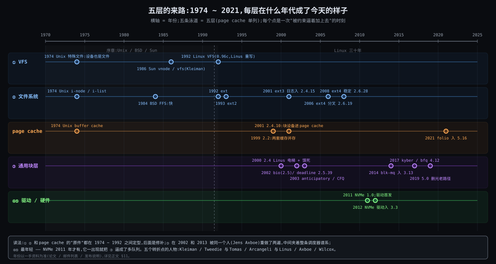

# 阶段 4:Linux 文件 IO 全链路是怎么来的

> 前三份回答了"有哪五层、为什么必须有、怎么工作"。这一份回到来路:五层不是一天长出来的,每一层都是某个人在某个年代、被某条约束逼着加上去的;而且当年的约束组合和今天不一样,这个差距就是今天看到的"历史债"。写法:技术接力打底(一条时间线,五层各有来路),五个转折点停下来讲人,电梯调度器谱系单独一节。
>
> **资料纪律**:关键说法尽量引一手资料(论文、邮件列表原帖、发布说明),带 URL 和年份;查不到一手的地方用 LWN 等高质量综述补,并标明"二手";推测的地方写"推测"。全部来源列在 §11,未能核实的列在 §12。

---

## 约束清单速查(C1 ~ C12)

> 引用约定:编号永远带短名。五条根:R1·速度断崖(C2 C6 C9)/ R2·硬件多样(C1 C4)/ R3·接口固定(C8 C11)/ R4·多进程共享(C3 C5 C12)/ R5·活过断电(C7 C10)。

#### C1·厂商定接口
硬件接口由厂商 / 标准定义,种类多且内核无法统一。**不可再分**:内核不是标准制定者。**口诀**:语言不归我管 → 每种盘一个翻译。

#### C2·设备慢且异步
设备延迟比 CPU 慢 10³ ~ 10⁷ 倍,完成是异步事件。**不可再分**:机械 / 闪存的物理时延。**口诀**:发完就走,中断再回。

#### C3·特权态门槛
寄存器 / DMA / 中断只能在特权态操作,进程不可信。**不可再分**:DMA 能写任意物理内存。**口诀**:进程只能请求,不能动手。

#### C4·定长块
持久设备最小读写单位是固定大小的块。**不可再分**:介质的物理组织。**口诀**:读 1 字节也搬一整块。

#### C5·多核并发
多核多进程并发发起 IO。**不可再分**:核数只增不减。**口诀**:一把锁等于浪费所有核。

#### C6·介质形状相反
不同介质性能形状迥异,不存在对所有设备最优的单一策略。**不可再分**:机械臂 vs 闪存通道。**口诀**:机械盘怕乱序,NVMe 怕喂不饱。

#### C7·跨块不原子
崩溃可落在任意两次块写之间;单块原子、多块不原子。**不可再分**:断电是外部事件。**口诀**:找一个单块写定生死。

#### C8·流 vs 块
程序要"名字 + 变长流",介质只给"编号 + 定长块";映射须存于介质自身。**不可再分**:人用名字思考。**口诀**:账本必须也在盘上。

#### C9·速差+局部性
DRAM 与持久介质速度差 10² ~ 10⁵ 倍,访问具有局部性。**不可再分**:两种介质的物理原理不同。**口诀**:读过的大概率再读。

#### C10·内存装不下
内存远小于盘且昂贵 → 缓存须淘汰、须延迟回写 → 存在不一致窗口。**不可再分**:单位容量价格差一到两个数量级。**口诀**:write 返回 ≠ 在盘上。

#### C11·POSIX接口冻结
文件系统 / 设备种类开放增长,POSIX 接口几十年固定。**不可再分**:改接口 = 改所有已有程序。**口诀**:一侧冻结,一侧生长。

#### C12·同文件多开
同一文件可被多进程同时打开,各有偏移,而对象只有一份。**不可再分**:fork 继承 fd 是 Unix 根基。**口诀**:file 是打开实例,inode 是对象。

---

## §0 从 How 走到 Origin:三件事记住

上一份把五层的机制讲到了"收什么、加工、交什么"。这一份只问一个问题:**每一层是在什么年代、被哪条约束逼出来的?** 三十年的事,收成三件:

### §0.1 事一:1974 ~ 1992,"文件、缓存、接口表"三样原件在 Linux 之前就定了型 —— R3·接口固定 的来源

因为 1974 年的 Unix 就许下了"设备也是文件、读写都走同一个接口"的承诺(C11·POSIX接口冻结 的"冻结侧"从这一年开始),又因为 1985 年 Sun 要让 NFS 和本地盘同时挂(C11 的"开放侧"第一次真正开放)→ 要解决"一个内核同时装多种文件系统"→ 所以 1986 年有了 **vnode / vfs**(一张函数指针表 + 一个挂载对象);1992 年 Linux 为了从 Minix 文件系统换到 ext,照着这个思路长出了自己的 **VFS**。i-node、buffer cache、特殊文件这三样,1974 年的论文里已经全有。

### §0.2 事二:1998 ~ 2008,"活过断电"和"规模"把文件系统和缓存各重做了一次 —— R5·活过断电 + R1·速度断崖

因为盘每年翻倍、fsck 时间跟着翻倍(C7·跨块不原子 在大盘上的代价第一次变得不可忍受)→ Tweedie 1998 年给 ext2 加日志,2001 年入主线成 ext3;因为 2.2 内核两套缓存互相抄数据、还抄出元数据损坏(C9·速差+局部性 的解法自己打架)→ 2001 年 Linus 顶着争议在 2.4.10 把块设备搬进 page cache;因为 16 TB 上限和逐块指针的元数据开销(C8·流 vs 块 的映射方式在大文件上失效)→ 2006 年 ext4 从 ext3 分叉,extent 是从集群文件系统 Lustre 搬过来的。

### §0.3 事三:2002 ~ 2021,硬件把块层重做了两遍,又把"页"这个最老的概念改了一次 —— R2·硬件多样 + R4·多进程共享

因为 2.4 的块层让驱动自己走 buffer_head 链、一把全局锁串行化(C1·厂商定接口 的多样性没有被挡住)→ Axboe 2001 年底用 **bio** 重写 2.5 的块层;因为 NVMe 2011 年出现、一块盘百万 IOPS 把单队列块层顶死在 80 万(C5·多核并发 第一次在块层成为瓶颈)→ 同一个人 2013 年再写 **blk-mq**;因为三十年的 `struct page` 在复合页上留下了"头页还是尾页"的歧义(C9·速差+局部性 要用更大的缓存单元时撞上了类型系统)→ Wilcox 2021 年引入 **folio**。电梯调度器谱系夹在中间:它是 C6·介质形状相反 随介质反转的活记录。

### §0 结论

| 事 | 年代 | 逼出的东西 | 主要约束 | 人物 |
|---|---|---|---|---|
| 原件定型 | 1974 ~ 1992 | i-node、buffer cache、特殊文件;vnode / vfs;Linux VFS | R3·接口固定 | Ritchie & Thompson;Kleiman;Provenzano & Linus |
| 活过断电与规模 | 1998 ~ 2008 | ext3 日志;块设备进 page cache;ext4 extent | R5·活过断电、R1·速度断崖 | Tweedie;Arcangeli & Linus;Tomas |
| 硬件逼块层重做两遍 | 2002 ~ 2021 | bio;调度器谱系;blk-mq;NVMe 驱动;folio | R2·硬件多样、R4·多进程共享 | Axboe;Wilcox |

三件事的关系:事一给了"形状"(对象 + 接口表),事二在形状不变的前提下换了"内脏"(日志、统一缓存、extent),事三被硬件逼着把"最底下两层"推翻重来。上面的接口从 1974 年到今天没变 —— 这是 R3·接口固定 最硬的证据。

---

## §1 一张极简概览图

从图上能读出五件事:

1. **① ② 和 page cache 的原件都在 1992 年之前**,之后三十年是修补:日志、统一、extent、folio。上两层的"形状"是继承来的。
2. **③ 块层是唯一被整体重做过两次的层**(2002 bio、2013 blk-mq),而且是同一个人。两次都是硬件逼的。
3. **④⑤ 最年轻**:NVMe 2011 年才有。它一出现,就把 ③ 逼成了多队列,把调度器逼成了"默认不排序"。
4. **调度器谱系横跨 2000 ~ 2019**:电梯 → deadline → anticipatory → CFQ → 全部删掉 → mq-deadline / kyber / bfq / none。一条线走完了 C6·介质形状相反 的反转。
5. **五个转折点都在"约束第一次变得不可忍受"的那一年**:fsck 一小时(1998)、百万 IOPS(2013)、尾页歧义(2021)。没有哪个是"想到了更好的设计"。

---

## §2 序章:1974 ~ 1986,Linux 之前的三样原件

### §2.1 1974,Unix:i-node、buffer cache、特殊文件

Ritchie 和 Thompson 1974 年发表在 CACM 上的《The UNIX Time-Sharing System》,五层里有三样东西已经在了:

- **i-node 与 i-list**:目录项只存名字和 i-number,i-number 索引到设备上的 i-list,i-node 里存属主、权限、数据块地址、大小、时间、链接数。"There is space in the i-node of each file for eight device addresses" —— 小文件直接存块地址,大文件指向间接块。这就是 C8·流 vs 块 的第一个解法,也是 ext2 / ext3 一直沿用、ext4 才换成 extent 的那套"逐块指针"。
- **buffer cache**:"To the user, both reading and writing of files appear to be synchronous and unbuffered",但"the system maintains a rather complicated buffering mechanism which reduces greatly the number of I/O operations"。写先进缓存、排队晚写,读先查缓存。C9·速差+局部性 的解法 1974 年就有了;C10·内存装不下 的不一致窗口也从这一年开始。
- **特殊文件**:"Each I/O device supported by UNIX is associated with at least one such file"。设备和普通文件走同一个接口 —— C11·POSIX接口冻结 的"冻结侧"从这里开始冻。

盘的组织是"512-byte blocks logically addressed from 0 up to a limit which depends on the device" —— C4·定长块。

来源:Ritchie & Thompson, "The UNIX Time-Sharing System", CACM 17(7), 1974(原文页 bell-labs.com 已下线,本文据转录版 https://chsasank.com/classic_papers/unix-time-sharing-system.html 核对引文)。

### §2.2 1984,BSD FFS:"快"是后加的

McKusick、Joy、Leffler、Fabry 的《A Fast File System for UNIX》(1984)开头就说原版文件系统"provides only about two percent of the maximum disk bandwidth or about 20 kilobytes per second per arm",新设计用更大的块、柱面组、按局部性分配,"File access rates of up to ten times faster than the traditional UNIX file system are experienced"。这证实了上一份的次序校准:文件系统先对"映射存在"负责,十年后才对"快"负责。FFS 的"同步元数据更新"也是 Tweedie 1998 年论文里第一个被放弃的方案。

来源:https://people.eecs.berkeley.edu/~brewer/cs262/FFS.pdf

### §2.3 1986,Sun vnode:一张函数指针表的诞生

Sun 的 Steve Kleiman 在 1986 年夏季 USENIX 发表《Vnodes: An Architecture for Multiple File System Types in Sun UNIX》。动机写得很直白:一个内核里要同时装本地盘(4.2BSD FFS)、非 Unix 文件系统(MS-DOS)、无状态的远程文件系统(NFS)和有状态的远程文件系统(RFS)。设计是把文件系统模块切成"与文件系统无关"和"与文件系统相关"两层,切口在原来的 inode 之上:无关层的对象叫 **vnode**(对应一个路径名,指向自己的操作表:open / close / mkdir …),每个挂载实例一个 **vfs** 对象(指向 mount / unmount / sync 的操作表)。

这就是今天 Linux `inode` + `inode_operations` / `file_operations`、`super_block` + `super_operations` 的直系祖先。上一份 §2.1 逼问 5 说"① 怎么调 ②?写成 if-else 行不行?" —— Kleiman 1986 年给出的答案就是"不行,用表"。

> 收尾已核:论文全文已取得(FSU 课程镜像 https://www.cs.fsu.edu/~awang/courses/cop5611_s2022/vnode.pdf),以上叙述与原文一致;最初据 Stanford 资格考阅读摘要与 Köhntopp 的逐节解读整理。

---

## §3 转折点一:1992,Linux 的 VFS —— 为了从 Minix 文件系统逃出来

**烦躁**。Linux 最初是在 Minix 上开发的,为了方便和 Minix 共用磁盘,第一版只支持 Minix 文件系统。Card、Ts'o、Tweedie 1994 年的 ext2 论文说得很清楚:"The Minix filesystem contains two serious limitations: block addresses are stored in 16 bit integers" —— 文件系统最大 64 MB,文件名最多 14 个字符。

**初试与接力**。同一篇论文记录了来路:VFS 层最初由 Chris Provenzano 写,后来 Linus 重写后并入内核;1992 年 4 月 Linux 0.96c 带着 VFS 和第一个用它的文件系统 **ext** 发布,上限 2 GB、文件名 255 字符。

**死胡同**。ext 本身很快就成了死胡同:没有分别的访问 / inode 修改 / 数据修改时间戳;空闲块和空闲 inode 用链表管,用着用着链表就乱序,文件系统碎片化、性能下降。

**顿悟**。1993 年 1 月出现两个替代品:Xia fs(基于 Minix 代码改)和 ext2fs(基于 ext 代码大改,并且"设计成将来可以扩展")。ext2 赢了:"Ext2fs is now very stable and has become the de-facto standard Linux filesystem."

**VFS 的形状**。论文描述的 VFS 已经和今天一样:内核维护一张文件系统类型表,每种类型有名字和 mount 函数;mount 函数读超级块、返回挂载描述符(含函数指针和私有数据);VFS 定义三类对象的操作 —— 文件系统、inode、打开的文件。这就是 Kleiman 的 vfs / vnode 在 Linux 上的落地,外加一个 Linux 自己的发明:`file`(打开实例)与 `inode` 分开 —— C12·同文件多开。

**遗憾**。ext2 论文里 VFS 下面的实现"performs I/O through the buffer cache" —— 文件数据走 buffer cache,这正是 §5 要讲的两套缓存并存的起点。

来源:Card, Ts'o, Tweedie, "Design and Implementation of the Second Extended Filesystem", 1994, https://web.mit.edu/tytso/www/linux/ext2intro.html

---

## §4 转折点二:1998 ~ 2008,Tweedie 的日志与 Tomas 的 extent

### §4.1 烦躁:每过一年,fsck 多等一倍

Stephen Tweedie 1998 年在 LinuxExpo 发表《Journaling the Linux ext2fs Filesystem》,开头两段就是约束:

> "As disk sizes grow, this time can become a serious problem, leaving a system offline for an hour or more as the disk is scanned, checked and repaired. Although disk drives are becoming faster each year, this speed increase is modest compared with their enormous increase in capacity. Unfortunately, every doubling of disk capacity leads to a doubling of recovery time when using traditional filesystem checking techniques."

这是 C7·跨块不原子 的代价第一次被量化到"不可忍受":崩溃后要扫整盘,而盘的容量增速远超速度增速。1998 年 5 月 16 日他在 LKML 上说"The design is largely complete and we have some of the infrastructure implemented","We'll be presenting a paper at Linux Expo if you want to have a look"。

### §4.2 承:四条路,三条不走

论文的中段是整份来路里最标准的"死胡同"段落。他把"让多块写在崩溃后自洽"的已有办法逐一摆出来:

| 方案 | 代表 | 为什么不走 |
|---|---|---|
| 同步元数据更新 | 4.2BSD FFS | "the big drawback of synchronous metadata update is its performance":建十二个目录项就要把同一个目录块写十二次 |
| 延迟有序写 / soft updates | Ganger & Patt,FreeBSD | 解决了循环依赖,但"the recovery process still has to scan the entire disk" —— 可靠了,不快 |
| 写时复制树 | NetApp WAFL | 原子性靠"最后改一个根块",但要求整个盘上结构按树组织 —— 和 ext2 不兼容 |
| 日志结构文件系统 | Sprite LFS、BSD LFS | 写全是顺序追加,很快;但"finding the location of a piece of data... can be more complex",而且同样是另起炉灶 |

剩下的那条:**日志**(journaling / "log enhanced")—— 元数据先写进盘上一块单独区域,写一个提交记录;提交记录落盘之前全不算数,落盘之后一定能重放。他看中的是两件事:恢复只需扫日志("the journal is typically very much smaller than the full filesystem"),以及**可以不碰 ext2 的盘上格式**:

> "As a result, we are not designing a new filesystem for Linux. Rather, we are adding a new feature—transactional filesystem journaling—to the existing ext2fs."

这个选择就是上一份(02-why)§R5 展开里"日志不是唯一形状"的历史原型:写时复制和日志结构在 1998 年已经存在,Tweedie 不选它们,不是因为它们不好,而是因为 C11·POSIX接口冻结 之外还有一条"盘上格式冻结" —— 几百万块 ext2 盘不能重新格式化。

### §4.3 转:三个具体决定

论文里有三个设计决定,后来全部成了 jbd / jbd2 的骨架:

1. **复合事务**:"Rather than create a separate transaction for each filesystem update, we simply create a new transaction every so often, and allow all filesystem service calls to add their updates to that single system-wide compound transaction." —— 这就是今天"每 5 秒封一个事务"的来源;理由是文件系统事务短、不需要 abort,所以可以要求它们严格顺序提交。
2. **记全块镜像**:"however small a change we make to a filesystem metadata block, we have to write an entire journal block out to log the change" —— 代价他算过:日志写是顺序的,可以攒成大簇;而且不用在内存里做字节级合并。
3. **数据先于元数据**(后来的 `data=ordered`):"Before we can commit a transaction which allocates new blocks to a file, we have to make absolutely sure that all of the data blocks being created by the transaction have in fact been written to disk" —— 否则崩溃后新文件里可能是别人的旧内容,"which is a security risk as well as being a consistency problem"。

环形日志、head / tail、日志空间回收("we stall new log writes until the tail of the log has been cleaned up")—— 上一份讲的环形 WAL,在这篇论文的"Format of the filesystem journal"一节里已经完整。

### §4.4 合:入主线,与遗憾

合并花了三年。2001 年 9 月 Linus 在 LWN 转载的邮件里说 ext3 会在 Red Hat 用得更广之后进来;2001 年 11 月 Andrew Morton 把 ext3 合入 2.4.15-pre2(变更日志:"Andrew Morton: ext3 merge"),2.4.15 于 11 月 23 日发布。Morton 2004 年在 LKML 补充:ext3 最初是为 2.2 写的,但从未并入 2.2,到 2.4.15 才进。

Tweedie 自己写在结论里的遗憾:"newly created files will have to be synced to disk rapidly in order to commit the creates to the journal, rather than allowing the deferred writeback of data normally supported by the kernel. This may make the journaling filesystem unsuitable for use on /tmp filesystems." —— 日志用一部分 C10·内存装不下 的延迟回写换 R5·活过断电。另一个遗憾是只记元数据(默认 `data=ordered`),数据内容本身不原子 —— 这正是数据库自己再做一层 WAL 的理由之一(02-why §R5 展开)。

来源:论文 https://e2fsprogs.sourceforge.net/journal-design.pdf;LKML 1998-05-16 https://lkml.iu.edu/hypermail/linux/kernel/9805.2/0085.html;Linus 2001-09 https://static.lwn.net/2001/0927/a/lt-ext3.php3;Morton 2004 https://lkml.iu.edu/hypermail/linux/kernel/0401.3/0554.html;2.4.15 合并时间据 LinuxFr 2001-11-10 报道(二手)。

### §4.4.1 反事实:如果 1998 年没有"盘上格式冻结"这条约束

**他会选哪条**。四条被放弃的路里,论文写得最动心的是写时复制树(WAFL):"a tree of filesystem data which can be updated atomically simply by copying tree nodes to new locations and then updating a single disk block at the root of the tree"。否定它的理由只有一条:要求整个盘上结构按树组织,与 ext2 不兼容。日志结构文件系统他也承认写得快,但"finding the location of a piece of data... can be more complex",而且 1998 年 LFS 的清理器开销已经把这条路堵得差不多。所以如果盘上格式可以随便改,他大概率走写时复制树。旁证是后来的历史:对新文件系统这条约束不存在,2005 年的 ZFS、2007 年的 btrfs 都走了写时复制树 —— 约束一松,大家选的正是他 1998 年放弃的那条。

**今天的 ext4 会少掉什么**:

- jbd2 整套(复合事务、提交块、环形日志、checkpoint)—— 原子性改由根块切换提供;
- `data=journal / ordered / writeback` 三档 —— 写时复制下数据与元数据同样原子,不存在"只保护元数据"的遗憾;
- 2006 年那次 extent 改造可能不必单独发生 —— 写时复制树天然按 extent 组织(btrfs 第一天就是);
- 反过来会多出快照与 reflink —— 树的旧版本就是快照。

**但会付出 ext4 今天没有的代价**:写时复制在机械盘时代有两样疼 —— 随机改写大文件,改一块搬一块,文件越用越碎(数据库负载在 COW 文件系统上一直不好,btrfs 至今要给数据库文件开 `nodatacow`);写放大,改一个叶子要重写到根的一路节点。ext4 的原地改写 + 顺序日志在机械盘上更稳。

**更关键的是采用**。ext3 赢在"不用重新格式化就能升级":Linus 2001 年说 ext3 等 Red Hat 用开了就合,正是因为零迁移成本。如果 1998 年做的是新格式,它会和同期的 ReiserFS、后来的 btrfs 站在同一条起跑线上靠说服用户迁移;而 btrfs 2009 年进主线至今,多数发行版默认仍是 ext4 —— 说明"盘上格式冻结"不只限制了设计,也是 ext3 胜出的原因。

**结论**:这条约束砍掉了最优雅的设计,换来了最快的普及。用 02-why 的尺子说:Tweedie 的**必要原因**是兼容(C11·POSIX接口冻结 的盘上版本),日志只是在这个前提下最好的解法;原子性、快速恢复是它在前提内拿到的**派生好处**。

### §4.5 续篇:extent 不是 ext 自己长的,是从 Lustre 搬来的

**烦躁**。2007 年 OLS 上 IBM、ClusterFS、Bull 六位作者的《The new ext4 filesystem: current status and future plans》把问题说得很具体:ext3 的 32 位块号卡死在 16 TB,"Enterprise workloads are already approaching this limit, and with disk capacities doubling every year and 1 TB hard disks easily available in stores, it will soon be hit by desktop users as well";而逐块指针的间接块映射"is very efficient for sparse or small files, but has high overhead for larger files, performing poorly especially on large file delete and truncate operations"。

**来路**。extent 代码的作者是 ClusterFS 的 Alex Tomas。Lustre 的 ldiskfs 仓库里,ext3-extents 补丁的版权头写着"Copyright 2003, 2004, 2005, Cluster File Systems, Inc.",作者 Tomas;2005 年 2 月 11 日他在 LKML 发布针对 2.6.10 的 extents + mballoc + delalloc 补丁集,警告"还不能放重要数据";2006 年 8 月他发出"extents for ext4"。也就是说,**ext4 最核心的那条映射,是在集群文件系统里先跑了三年才进主线的**。内核文档也记录了同一件事的另一半:多块分配(mballoc)"CFS had used mballoc with Lustre for a few years"。

**分叉**。论文记录了决定:"in August 2006, we posted a series of patches introducing two key features to ext3: larger filesystem capacity and extents mapping. The patches unavoidably change the on-disk format and break forwards compatibility. In order to maintain the stability of ext3 for its massive user base, we decided to branch to ext4 from ext3." 2.6.19 入主线(标 ext4dev),2008 年 12 月 25 日的 2.6.28 去掉 dev 后缀、宣布稳定。

**形状**。论文描述的 extent 和上一份 §3.1 逼问 6 讲的一样:一条 `{逻辑块起点, 长度, 物理块起点}`,"A single extent can represent 2^15 contiguous blocks, or 128 MB","Four extents can be stored in the ext4 inode structure directly",多了长成定深度的树。

**遗憾**。论文自己写在"Future work"里:"Extents are not very efficient for representing sparse or highly fragmented files" —— 他们当时就计划再加一种"块映射型 extent"回头兼容逐块指针。还有 48 位而不是 64 位:"a 1 EB filesystem would take 119 years to finish one full e2fsck" —— fsck 时间这个 1998 年的老约束,2007 年换了个数量级又回来了。

来源:OLS 2007 论文 https://compas.cs.stonybrook.edu/~nhonarmand/courses/sp17/cse506/papers/ols2007v2-pages-21-34.pdf;Tomas 2005-02-11 https://lkml.iu.edu/hypermail/linux/kernel/0502.1/0818.html;2006-08 https://lkml.rescloud.iu.edu/0608.1/1805.html;版权头 https://git.gsi.de/debian-packages/lustre-release/-/commit/a32b1c3f2f46ebb3b8e4a21116dd5fdf273a2da4;ext4.txt(2.6.25)https://googlers.googlesource.com/maze/linux/+/v2.6.25-rc7/Documentation/filesystems/ext4.txt;2.6.28 https://kernelnewbies.org/Linux_2_6_28。

---

## §5 转折点三:2001,块设备搬进 page cache —— Arcangeli 的补丁,Linus 的赌

**烦躁**。Rik van Riel 2001 年的 FREENIX 论文描述 2.2 内核:文件数据在 page cache,块级 IO 和元数据在 buffer cache;脏数据不留在 page cache,写要先拷进 buffer cache 再由它写盘。两套缓存,数据两边各存一份、互相抄。上一份地图的思考题"缓存为什么按文件而不按块号索引",2.2 的答案是"两种都有",代价是双份内存和同步。

**撞墙**。2001 年 5 月 LWN 内核版报道:块设备 IO 走 buffer cache、文件系统走 page cache,两者不同步,导致"subtle metadata corruption"。同一篇说 Linus 对这个 bug 本身不太在意,他要的是根治:让块设备也用 page cache。Andrea Arcangeli 的补丁已经做到了这一点:删掉 `block_read` / `block_write`,把块设备当成一个大文件,顺带加了 `O_DIRECT` 标志,让单独的 `/dev/raw` 设备不再必要 —— **`O_DIRECT` 这条分叉,是在"统一缓存"这一步顺手长出来的**。

**犹豫**。2001 年 9 月 8 日 Linus 在 LKML 上回复 Arcangeli:"Putting it in the page cache is 100% the right thing to do","I'm a bit nervous about merging it in 2.4.x","I'll merge the blkdev in pagecache very early in 2.5.x"。

**决定**。九天后他改了主意,而且自己给了理由:9 月 17 日的 2.4.10-pre11 公告里 Linus 写道,合入 Arcangeli 的 VM 改动能得到"更好的性能"和"干净得多的 inactive 页处理",2.4.x 的头号优先级是稳定,其他顾虑留到 2.5.x 再说;顺手合入 blkdev in pagecache,是为了让"bread() 也走 page cache"更容易做,到那时"现在这些丑陋的同步问题会消失"(LKML 2001-09-17,https://lkml.iu.edu/hypermail/linux/kernel/0109.2/0313.html)。2001 年 9 月 23 日发布的 2.4.10 一次性合入了 Arcangeli 的 VM 重写和"blkdev in pagecache"(Arcangeli 9 月 17 日的 2.4.10pre10aa1 公告里列着这项:可以 mmap 块设备、可以 O_DIRECT 直接读写而不用 /dev/raw)。LWN 9 月 27 日的报道记录了反应:Andrew Morton 说"the number of people who understand the Linux VM has gone from maybe 10 down to just one-and-a-bit";Marcelo Tosatti 说"a major VM rewrite at this point seems to be dangerous if we want a stable VM";Alan Cox 说"Linus 2.4.10pre is definitely 2.5 in disguise"。Alan Cox 的 ac 树没有跟进,两棵树从此分岔。

**遗憾与余波**。从此文件数据和元数据走同一套 page cache(元数据走块设备文件自己的 inode,上一份 §3.3.6 讲过),buffer_head 退成"一页里某个块的描述符",但它没有消失 —— 直到今天 ext4 的元数据路径和老的逐块读路径(`block_read_full_folio`)仍然带着它。2.4.10 的稳定性争议也是真的:它换来的不只是统一缓存,还有一段"稳定版里换 VM"的历史债,2.4 系列后面几个版本都在还。

来源:Riel 2001 https://www.usenix.org/legacy/event/usenix01/freenix01/full_papers/riel/riel.pdf;LWN 2001-05-10 https://static.lwn.net/2001/0510/kernel.php3;Linus 2001-09-08 https://lkml.iu.edu/hypermail/linux/kernel/0109.1/0057.html;Arcangeli 2001-09-17 https://lkml.iu.edu/hypermail/linux/kernel/0109.2/0215.html;LWN 2001-09-27 https://lwn.net/2001/0927/kernel.php3。

---

## §6 转折点四:Axboe 两次重做块层

### §6.1 2001 ~ 2002:bio,把驱动从 buffer_head 链里解放出来

**烦躁**。2001 年底 Jens Axboe 应 Linus 之邀写了一份新块层接口的说明(LWN 转载),把 2.4 块层的毛病列得很具体:buffer_head 带着一个内核虚拟地址 `b_data`,高端内存的页没有这种映射,驱动要靠 bounce buffer;驱动收到的是 buffer_head 链,得自己遍历,还得自己把分区相对偏移换算成绝对位置;IO 以 512 字节扇区为单位计数,请求大小和段数的上限各驱动各管各的;合并逻辑常常是驱动自己写的,scatter-gather 列表也是手工拼的;整个请求处理被一把全局锁 `io_request_lock` 串行化;驱动还能直接看到原始请求链表。

对着上一份 §4.1 的逼问表看,这一条条正是"没有 bio / 没有 request / 没有 limits / 没有统一合并"会坏在哪 —— 只不过 2001 年它们不是假设,是现状。

**引入**。bio:没有虚拟地址,只有起始扇区、设备、一个(page, offset, len)向量,完成靠回调,状态进标志位;request 持有 bio 链表,驱动按段迭代而不必知道内部布局。Axboe 自己说做成数组的理由:"The main reason for doing an array like this is that it enables easy pre-clustering of pages for I/O submission";做段迭代宏是"which I think we should have had a long time ago";以及为什么要把实现细节藏起来:"Then we are also free to change the implementation details later without having to change drivers again" —— 这句话十二年后被他自己兑现(见 §6.2)。

2002 年 1 月他和 Suparna Bhattacharya 把这些写成内核文档《Notes on the Generic Block Layer Rewrite in Linux 2.5》(biodoc)。LWN 当时的评价:"highly disruptive, but a good thing"。

**来源**:Axboe 2001-12 https://static.lwn.net/2001/1206/a/bio-writeup.php3;LWN 2001-12-06 https://static.lwn.net/2001/1206/kernel.php3;biodoc https://www.kernel.org/doc/html/v5.7/_sources/block/biodoc.rst.txt。

### §6.2 2013:blk-mq,一把锁顶死在 80 万 IOPS

**烦躁**。3.13 的发布说明(kernelnewbies)写得很直白:旧设计"a single coarse lock design for protecting the IO request queue",把提交速率卡在"800.000 IOs per second",不管多少个核一起提交;而新 SSD 已经逼近百万 IOPS,这把锁成了瓶颈,多核上更差。LWN 2013 年 6 月 5 日的报道补了细节:请求队列"is protected by a single lock which, on a large system, will bounce frequently between the processors";队列本身是链表,对缓存不友好;驱动想绕开队列就得自己重做块层的全部处理。

这就是 C5·多核并发 第一次在块层变成硬约束。2002 年 bio 解决的是 C1·厂商定接口(接口统一),没动"一条队列一把锁" —— 因为 2002 年的机械盘一秒几百次 IO,锁不热。

**引入**。Bjørling、Axboe、Nellans、Bonnet 在 SYSTOR 2013 的论文《Linux Block IO: Introducing Multi-queue SSD Access on Multi-core Systems》提出两层队列:每核(或每 NUMA 节点)一条软件提交队列,只合并不排序;每设备若干硬件派发队列,深度由驱动定;驱动实现 `queue_rq()`,完成时回调块层。LWN 报道时点名 Axboe 和 Shaohua Li 在做这件事,预计 3.11 或 3.12 合入;实际 2014 年 1 月 19 日的 3.13 合入,当时只有 virtio-blk 一个驱动在用。

**合**。2018 年 11 月 7 日 Axboe 提交"block: remove legacy IO schedulers",同一批补丁把剩余驱动全部转到 blk-mq;2019 年 3 月 3 日发布的 5.0 的说明里写着"Remove all the non-mq code. Remaining drivers have been converted"。从 2001 年"free to change the implementation details later without having to change drivers"到 2019 年真的把老路径删光,十八年。

**遗憾**。多队列让全局排序失去意义,这正是单队列时代的调度器全部报废的原因(§7);每核一条队列也让"按进程公平"(CFQ 那一派)在多队列设备上只能重写。

来源:kernelnewbies 3.13 https://kernelnewbies.org/Linux_3.13;LWN 2013-06-05 https://lwn.net/Articles/552904/;论文 DOI 10.1145/2485732.2485740(内核文档 Documentation/block/blk-mq.rst 引用的 PDF 地址 kernel.dk/blk-mq.pdf 本文未能打开,摘要据 ITU 出版记录);Axboe 2018-11-07 提交 f382fb0bcef4;5.0 https://kernelnewbies.org/Linux_5.0。

---

## §7 电梯调度器谱系:C6·介质形状相反 的二十年反转

上一份 §4.4.1 讲了电梯算法的原理。这里讲它在 Linux 里的六段生命,每段都是被一个具体的痛逼出来的。

### §7.1 2000,2.4 的电梯:会饿死

2000 年 11 月 23 日 LWN 内核版记录了 2.4.0-test 系列的电梯争论。2.4.0 的电梯不是纯 SCAN:"will put requests with a low sector number at the top of the queue regardless of the current head position"。防饿死靠序号:"Every request in the queue contains a sequence number; every time that request is passed over"序号减一,减到零就不许再插队。问题在默认值:"the default sequence numbers in 2.4.0-test11 are 1,000,000 for read requests, and 2,000,000 for writes" —— 等于没有保护。Andrea Arcangeli 写了 `elvtune` 让管理员自己调("a backdoor into the kernel that the administrator can use for patological cases"),LWN 建议读 500、写 1000。Arcangeli 当时的立场是:压低延迟只会降低整盘吞吐 —— 吞吐 vs 延迟的旋钮从这一年开始就在。

### §7.2 2002,deadline:给每个请求一个期限

Axboe 2002 年 3 月先发了"simple deadline I/O scheduler"征求测试,7 月 26 日发第二版(LWN 转载),补丁头注释一句话说明目的:"deadline i/o scheduler. uses request time outs to prevent indefinite starvation"。机制就是上一份讲的双索引:排序链表 + 读写各一条带期限的 FIFO,期限到了"we at least attempt to start an expired request immediately",一次搬 `fifo_batch` 个。第二版的期限是读 1 秒、写 8 秒(后来调成 500 ms / 5 s)。2.5.39 合入 —— Axboe 2003 年底在 LKML 回顾时自己说的。

### §7.3 2003,anticipatory:读完故意停一下

2003 年 1 月 Nick Piggin 的 anticipatory 调度器进了 Andrew Morton 的 2.5.59-mm5。LWN 1 月 28 日的报道说清了它针对的痛:读是同步的,一个进程读完一块才发下一块;期间磁头被写拉走,再回来 —— Morton 的话:"Because we're solving the dependent read problem by creating a seek storm"。办法是读完后"assume that there is another one coming behind it and simply wait for a little bit":把队列 plug 住、定一个约 1 ms 的计时器,近处的读来了立刻做。Morton 报告一个简单测试快了近六倍,但代码"还需要不少工作"。它后来成了 2.6.0 的默认调度器;Piggin 自己的文档警告它在带 TCQ 的控制器和硬件 RAID 上"可能表现异常" —— 因为设备自己会重排,等于两个电梯打架。

### §7.4 2003,CFQ:按进程公平

2003 年 2 月 11 日 LWN 报道 Axboe 针对 2.5.60 发的 CFQ(complete fair queueing):每个进程自己一条请求队列,忙队列挂在哈希表里,轮转服务,并保持派发队列上有最少数量的请求以免盘空转。Axboe 说它"never suffers from queue collisions"。2.6.6 作为可选调度器合入,后来成为桌面时代的默认(2.6.18 起:Axboe 2006 年 6 月的提交 b17fd9bc 把 `DEFAULT_AS` 改成 `DEFAULT_CFQ`)。CFQ 的公平是按进程分时间片 —— 这在机械盘上有意义(一个进程的顺序读被别的进程打断,代价是寻道),在 NVMe 上没有。

### §7.5 2017,kyber 与 bfq:多队列时代的两种答案

blk-mq 合入三年后,多队列设备仍然没有一个为它设计的调度器。LWN 2017 年 4 月 24 日报道 4.12 一次进了两个:Omar Sandoval 的 **kyber**,"intended for fast multiqueue devices",不到一千行,不排序,读写两条队列、读优先,靠严格限制派发队列深度来控延迟,目标默认读 2 ms、写 10 ms,测到完成时间就调深度;Paolo Valente 的 **bfq**,按进程给 IO 预算加一堆启发式,追求交互响应,尤其在慢设备上,"BFQ has been in the works for years",被拖到 4.12 是因为它原本是单队列设计,Valente 花了几个月移植到多队列接口。两个方向正好是 C6·介质形状相反 的两极:kyber 服务"怕喂不饱"的盘,bfq 服务"怕乱序、怕不公平"的盘。

### §7.6 2019,删光

2018 年 11 月 7 日 Axboe 的提交"block: remove legacy IO schedulers"删掉 cfq、deadline、noop(anticipatory 更早就删了),说明里保留 deadline 文档"as that carries over to mq-deadline as well"。5.0 之后只剩 mq-deadline、kyber、bfq、none,默认规则就是上一份写的:单硬件队列 → mq-deadline,多队列 → none。

**这条线合起来看**:2000 年的问题是"怎么排序不饿死",2019 年的答案是"多队列设备干脆不排"。同一个机制槽位,二十年里策略从"必须有"变成"默认关",而机制(合并、切分、tag、队列)一直在。这是"机制固定、策略可换"这条设计原则最长的一次实证。

来源:LWN 2000-11-23 https://lwn.net/2000/1123/kernel.php3;Axboe 2002-07 https://lkml.iu.edu/hypermail/linux/kernel/0207.3/0713.html、LWN https://lwn.net/Articles/5862/、2.5.39 https://lkml.iu.edu/hypermail/linux/kernel/0312.3/1241.html;LWN 2003-01-28 https://lwn.net/Articles/21274/;LWN 2003-02-11 https://lwn.net/Articles/22429/;LWN 2017-04-24 https://lwn.net/Articles/720675/;提交 f382fb0bcef4(2018-11-07)。

---

## §8 转折点五:Wilcox 的 NVMe 驱动(2011)与 folio(2021)

### §8.1 NVMe:协议发布的同一个月,驱动就发出来了

NVMe 1.0 规范 2011 年 3 月发布。2011 年 3 月 3 日,Intel 的 Matthew Wilcox 在 LKML 发出"[REVIEW] NVM Express driver",开头说这是"following the recent announcement of the NVM Express spec";公开的 git 历史被他清洗过,因为"earlier versions were full of Intel codenames and are not suited to public consumption";路线是"Jens has already offered to pull my nvme tree into his block tree"。

第一版驱动里已经有今天的骨架:一条管理队列加 IO 队列,**向设备申请每个在线 CPU 一条队列**,每条队列自己的锁和 MSI-X 向量,中断亲和性绑到对应 CPU;命令 ID 的低位塞着完成处理函数的索引;队列满了提交不了的 bio 由一个内核线程重试;错误处理、挂起 / 恢复还是空的,"lock-free fast path"留在 TODO 里。

2012 年 1 月 18 日他发出"[GIT PULL] NVM Express driver",99 个提交,其中一条叫"NVMe: New driver"(作者日期 2011-01-20,比公开发帖还早六周);3.3 合入。Keith Busch 2014 年在 Flash Memory Summit 的回顾把这段写成一行:"originally revealed with 1.0 spec, March 2011, contributed by Matthew Wilcox... merged to mainline January 2012 with 3.3"。

**它逼出了什么**。一块每核一条队列、深度上千的盘,挂在一条队列一把锁的块层下面,就是 §6.2 那 80 万 IOPS 的墙。NVMe 驱动随 3.3(2012 年 3 月)进主线,转到 blk-mq 是 3.19(2015 年 2 月,Bjørling 的 "NVMe: Convert to blk-mq"),中间隔了近三年 —— 这期间驱动是 bio-based 的:`blk_queue_make_request(ns->queue, nvme_make_request)`,自己管每核一条 NVMe 队列,绕过 request_fn / 电梯这条单队列派发路径(request_queue 对象还在,只是不走它的派发),这正是 LWN 2013 年说的"驱动得自己重做块层处理"的那种绕法。

来源:Wilcox 2011-03-03 https://lwn.net/Articles/431103/;GIT PULL 2012-01-18 https://lkml.iu.edu/hypermail/linux/kernel/1201.2/01306.html;提交 b60503ba;Busch 2014 https://old.flashmemorysummit.com/English/Collaterals/Proceedings/2014/20140804_Seminar_F_Busch.pdf。

### §8.2 folio:三十年的 struct page,改一个类型

**烦躁**。2020 年 12 月 Wilcox 发出"[RFC PATCH 00/11] Page folios",问题陈述是类型系统级的:"Our type system does not currently distinguish between tail pages and head or single pages. This is a problem because we call compound_head() multiple times, bloating the kernel" —— 一个收 `struct page *` 的函数不知道自己收到的是头页、尾页还是单页。LWN 2021 年 3 月的报道引他的话:"A function which has a struct page argument might be expecting a head or base page and will BUG if given a tail page."

**引入**。定义只有一句:"A folio is a struct page which is guaranteed not to be a tail page. So it's either a head page or a base (order-0) page." 类型是对 `struct page` 的薄包装,配 `get_folio()` / `put_folio()` 一套镜像函数;用 folio 的函数不再调 `compound_head()`,省时间也省内核体积。

**阻力**。名字不受欢迎,但找不到更好的;Andrew Morton 担心 page 和 folio 两套代码并存的复杂度,Hugh Dickins 不热心,Kirill Shutemov 和 Michal Hocko 原则上支持;Dave Chinner 说对文件系统开发者这是"absolutely necessary",尤其当 page cache 要支持多种大小的复合页。Wilcox 自己承认"is going to be a ton of work, and massively disruptive",但"it's worth it"。2021 年 9 月 Linus 没有收 5.15 的 pull:技术上没有强烈反对,但"核心代码在命名还在激烈讨论时不合入";中间一度改名"pageset"。2021 年 11 月初,folio 成为 5.16 合并窗口拉进来的第一件东西(LWN、Phoronix 均有报道),首批只覆盖核心 MM 和 page cache。

**它和这条链路的关系**。上一份 §3.1 说过:page cache 现在存的是 folio,一个 folio 可以大于一页;xfs 5.18、ext4 6.16 起普通文件按更大的 folio 缓存,XArray 条目、bio 向量、缺页次数都按比例减少。这是 C9·速差+局部性 的"空间局部性"在内存管理侧的最新一次兑现 —— 而兑现的前提,是先把 1974 年"512 字节一块、一块一个描述符"这种思路在内存里的遗产(一页一个 `struct page`,复合页靠头尾页约定)用类型重新表达一遍。

来源:RFC 2020-12 https://lkml.rescloud.iu.edu/hypermail/linux/kernel/2012.1/00896.html;LWN 2021-03 https://lwn.net/Articles/849538/;Linus 2021-09 https://lkml.iu.edu/hypermail/linux/kernel/2109.2/09017.html;LWN 5.16 合并 https://lwn.net/Articles/874683;Phoronix https://www.phoronix.com/news/Memory-Folios-Lands-Linux-5.16。

---

## §9 约束回扣:每一层出生时的约束组合,和今天的差别

| 层 / 组件 | 定型年代 | 出生时面对的约束 | 当时**不存在**的约束 | 后来为此付的债 |
|---|---|---|---|---|
| i-node、逐块指针 | 1974 | C8·流 vs 块、C4·定长块(512 B) | 大文件、TB 级盘 | 间接块在大文件上失效 → 2006 extent(§4.5) |
| buffer cache | 1974 | C9·速差+局部性、C10·内存装不下 | 按文件索引的 page cache 还没出现 | 2.2 两套缓存互抄 → 2001 统一(§5) |
| 特殊文件 / 统一接口 | 1974 | C11·POSIX接口冻结(刚开始冻) | 几十种文件系统 | 1986 vnode、1992 VFS 把"冻结侧"和"开放侧"切开(§2.3、§3) |
| vnode / VFS 接口表 | 1986 / 1992 | C11·POSIX接口冻结、C12·同文件多开 | 无盘文件系统的爆发(proc / sysfs / FUSE …) | 没有债 —— 反而是红利(02-why 第五幕"VFS 太成功") |
| ext3 日志 | 1998 ~ 2001 | C7·跨块不原子(fsck 翻倍) | SSD、低延迟 fsync 需求 | 只记元数据;/tmp 不适合;数据库自己再做一层 WAL(§4.4) |
| 块设备进 page cache | 2001 | C9·速差+局部性 的解法自己打架 | — | buffer_head 没死透;2.4.10 稳定性之争(§5) |
| bio | 2001 ~ 2002 | C1·厂商定接口(驱动各管各的) | NVMe、多队列 | 一条队列一把锁留到 2013(§6.1) |
| 电梯 → deadline / AS / CFQ | 2000 ~ 2003 | C6·介质形状相反 的"机械盘半边" | 闪存 | 2019 全部删除(§7) |
| NVMe 驱动 | 2011 | C1·厂商定接口、C2·设备慢且异步、C5·多核并发 | 块层还是单队列 | 驱动 bio-based 绕过电梯近三年(§8.1) |
| blk-mq | 2013 | C5·多核并发(百万 IOPS) | — | 全局排序不再可能 → 调度器重写(§6.2、§7.5) |
| folio | 2021 | C9·速差+局部性 要更大缓存单元 | — | 两套代码并存的过渡期(§8.2) |

一个贯穿的观察:**五个转折点里,没有一个是"想出了更好的设计"触发的,全部是"某条约束的代价第一次变得不可忍受"触发的** —— fsck 一小时、元数据损坏、80 万 IOPS、每秒百万次 compound_head。这与 02-why 的论点一致:约束逼形状;形状不会在约束松动之前改变。

另一个观察是**反向演化**:C6·介质形状相反 在 2000 年意味着"必须排序",2019 年意味着"默认不排";C9·速差+局部性 的单元从 512 B(1974)到 4 KiB 页(1990 年代)到多页 folio(2021)。约束本身没变,它在不同介质、不同规模下逼出的形状变了。

---

## §10 呼应你的问题

你问的是五层**各自怎么设计、为什么必须这么设计**。来路给了第三种答案:**不只是"约束逼出形状",还有"约束在什么时候逼"**。

- 上面两层(VFS、文件系统的对象模型)的形状 1974 ~ 1992 年就定了,之后没人推翻,因为 C11·POSIX接口冻结 让推翻的代价无限大。它们的演化全是"内脏替换":日志、extent、统一缓存。
- 下面两层(块层、驱动)被硬件推翻重来过,因为硬件是 C1·厂商定接口 的来源,硬件变了,"翻译"就得重写。bio 和 blk-mq 两次重写,都是同一个人在同一条约束(驱动与设备的多样性和并发度)的两次升级下做的。
- 你最关心的块层,它的"结构 / 机制 / 策略"分法(上一份 §4)不是设计出来的,是历史分出来的:2002 年定结构(bio / request),2013 年换机制(两层队列、tag),2000 ~ 2019 策略换了五轮。
- 数据库那条分叉(`O_DIRECT`)的出生日期也有了:2001 年,它是"把块设备搬进 page cache"这一步顺手长出来的,目的正是让想绕开缓存的人不必再用 `/dev/raw`。

到这里,"为什么必须这么设计"闭环到约 85%:约束(02-why)、机制(03-how)、年代(本份)三者对上了。剩下的 15% 是精确数字和反事实 —— 为什么 deadline 的读期限从 1 秒改成 500 ms、NVMe 队列深度为什么默认 1024、没有 plug 会差多少、bio 和 request 合成一个对象会坏在哪。那是拿源码和数字说话的事。

---

## §11 一手资料引用列表

| # | 资料 | 年份 | 用于 |
|---|---|---|---|
| 1 | Ritchie & Thompson, "The UNIX Time-Sharing System", CACM 17(7)(转录版 https://chsasank.com/classic_papers/unix-time-sharing-system.html) | 1974 | §2.1 |
| 2 | McKusick et al., "A Fast File System for UNIX", https://people.eecs.berkeley.edu/~brewer/cs262/FFS.pdf | 1984 | §2.2 |
| 3 | Card, Ts'o, Tweedie, "Design and Implementation of the Second Extended Filesystem", https://web.mit.edu/tytso/www/linux/ext2intro.html | 1994 | §3 |
| 4 | Tweedie, "Journaling the Linux ext2fs Filesystem", LinuxExpo, https://e2fsprogs.sourceforge.net/journal-design.pdf | 1998 | §4.1 ~ 4.4 |
| 5 | Tweedie, LKML "Re: journaling filesystem", https://lkml.iu.edu/hypermail/linux/kernel/9805.2/0085.html | 1998-05-16 | §4.1 |
| 6 | Linus Torvalds on ext3(LWN 转载),https://static.lwn.net/2001/0927/a/lt-ext3.php3 | 2001-09 | §4.4 |
| 7 | Andrew Morton, LKML "Re: 2.2 kernel and ext3 filesystems", https://lkml.iu.edu/hypermail/linux/kernel/0401.3/0554.html | 2004 | §4.4 |
| 8 | Mathur, Cao, Bhattacharya, Dilger, Tomas, Vivier, "The new ext4 filesystem", OLS, https://compas.cs.stonybrook.edu/~nhonarmand/courses/sp17/cse506/papers/ols2007v2-pages-21-34.pdf | 2007 | §4.5 |
| 9 | Alex Tomas, LKML "Latest ext3 patches (extents, mballoc, delayed allocation)", https://lkml.iu.edu/hypermail/linux/kernel/0502.1/0818.html | 2005-02-11 | §4.5 |
| 10 | Alex Tomas, "[PATCH 1/9] extents for ext4", https://lkml.rescloud.iu.edu/0608.1/1805.html | 2006-08 | §4.5 |
| 11 | Lustre ldiskfs 仓库 ext3-extents 版权头,https://git.gsi.de/debian-packages/lustre-release/-/commit/a32b1c3f2f46ebb3b8e4a21116dd5fdf273a2da4 | 2003 ~ 2008 | §4.5 |
| 12 | Documentation/filesystems/ext4.txt(2.6.25),https://googlers.googlesource.com/maze/linux/+/v2.6.25-rc7/Documentation/filesystems/ext4.txt | 2008 | §4.5 |
| 13 | Rik van Riel, "Page replacement in Linux 2.4 memory management", FREENIX, https://www.usenix.org/legacy/event/usenix01/freenix01/full_papers/riel/riel.pdf | 2001 | §5 |
| 14 | Linus Torvalds, LKML "Re: linux-2.4.10-pre5", https://lkml.iu.edu/hypermail/linux/kernel/0109.1/0057.html | 2001-09-08 | §5 |
| 15 | Andrea Arcangeli, "2.4.10pre10aa1", https://lkml.iu.edu/hypermail/linux/kernel/0109.2/0215.html | 2001-09-17 | §5 |
| 16 | Jens Axboe, bio write-up(LWN 转载),https://static.lwn.net/2001/1206/a/bio-writeup.php3 | 2001-12 | §6.1 |
| 17 | Axboe & Bhattacharya, "Notes on the Generic Block Layer Rewrite in Linux 2.5", https://www.kernel.org/doc/html/v5.7/_sources/block/biodoc.rst.txt | 2002-01 | §6.1 |
| 18 | Jens Axboe, "[PATCH] block/elevator updates + deadline i/o scheduler", https://lkml.iu.edu/hypermail/linux/kernel/0207.3/0713.html | 2002-07-26 | §7.2 |
| 19 | Jens Axboe, LKML "Re: 2.6.0 performance problems"(2.5.39 合入 deadline),https://lkml.iu.edu/hypermail/linux/kernel/0312.3/1241.html | 2003-12 | §7.2 |
| 20 | Bjørling, Axboe, Nellans, Bonnet, "Linux Block IO: Introducing Multi-queue SSD Access on Multi-core Systems", SYSTOR, DOI 10.1145/2485732.2485740 | 2013 | §6.2 |
| 21 | Matthew Wilcox, "[REVIEW] NVM Express driver"(LWN 存档),https://lwn.net/Articles/431103/ | 2011-03-03 | §8.1 |
| 22 | Matthew Wilcox, "[GIT PULL] NVM Express driver", https://lkml.iu.edu/hypermail/linux/kernel/1201.2/01306.html | 2012-01-18 | §8.1 |
| 23 | Keith Busch, Flash Memory Summit 讲义,https://old.flashmemorysummit.com/English/Collaterals/Proceedings/2014/20140804_Seminar_F_Busch.pdf | 2014 | §8.1 |
| 24 | Matthew Wilcox, "[RFC PATCH 00/11] Page folios", https://lkml.rescloud.iu.edu/hypermail/linux/kernel/2012.1/00896.html | 2020-12 | §8.2 |
| 25 | Linus Torvalds, "Re: Folios for 5.15 request", https://lkml.iu.edu/hypermail/linux/kernel/2109.2/09017.html | 2021-09 | §8.2 |
| 26 | Jens Axboe, 提交 f382fb0bcef4 "block: remove legacy IO schedulers" | 2018-11-07 | §6.2、§7.6 |
| 27 | 发布说明:2.6.28 https://kernelnewbies.org/Linux_2_6_28;3.13 https://kernelnewbies.org/Linux_3.13;5.0 https://kernelnewbies.org/Linux_5.0 | 2008 / 2014 / 2019 | §4.5、§6.2 |

**高质量综述(标二手)**:LWN 2000-11-23 https://lwn.net/2000/1123/kernel.php3;LWN 2001-05-10 https://static.lwn.net/2001/0510/kernel.php3;LWN 2001-09-27 https://lwn.net/2001/0927/kernel.php3;LWN 2001-12-06 https://static.lwn.net/2001/1206/kernel.php3;LWN 2002-07 https://lwn.net/Articles/5862/;LWN 2003-01-28 https://lwn.net/Articles/21274/;LWN 2003-02-11 https://lwn.net/Articles/22429/;LWN 2013-06-05 https://lwn.net/Articles/552904/;LWN 2017-04-24 https://lwn.net/Articles/720675/;LWN 2021-03 https://lwn.net/Articles/849538/;LWN 5.16 https://lwn.net/Articles/874683;Kleiman 论文摘要 https://carlstrom.com/stanford/quals/mirror/www.stanford.edu/~emrek/quals/summaries/Vnodes-Kleiman-1986.txt 与 https://blog.koehntopp.info/2023/05/15/50-years-in-filesystems-vnodes/。

---

## §12 无一手资料 / 未能核实的部分

1. **Kleiman 1986 论文全文** —— 收尾已核:全文 PDF 可达(https://www.cs.fsu.edu/~awang/courses/cop5611_s2022/vnode.pdf,USENIX Summer 1986,pp. 238-247)。原文设计目标第一条就是把文件系统实现切成"无关 / 相关"两半并定义清晰接口;要支持 4.2BSD、NFS、RFS、MS-DOS;`vfsops` / `vnodeops` 两张表与 §2.3 所述一致;接口"自 1984 年夏起运行"。
2. **blk-mq 论文 PDF** —— 收尾已核:kernel.dk 原链接已失效,Wayback 存档可下载(https://web.archive.org/web/20170810082916id_/http://www.kernel.dk/blk-mq.pdf);合入提交 320ae51f(2013-10-24)经 2013-11-08 pull 进 3.13(2014-01-19 发布),3.13 只有 virtio-blk 接入。"80 万 IOPS"确实出自 kernelnewbies 3.13 说明,且明确是**旧单锁设计的上限**,不是新框架指标;Axboe 的 pull request 本身只写"单队列设备 8 倍提升"。
3. **ext3 合入 2.4.15-pre2 的日期** —— 收尾已核:kernel.org 的 ChangeLog-2.4.15 写明 "pre2: Andrew Morton: ext3 merge";Linus 没有单独公告 pre2,LKML 首条 pre2 报告是 2001-11-10 01:23 EST,前一天下午 Andrea 的补丁仍基于 pre1,所以 pre2 出现在 2001-11-09 美国时间晚间(11-10 UTC)。2.4.15 正式版 2001-11-23。
4. **CFQ 成为默认(2.6.18)**与 **anticipatory 成为 2.6.0 默认** —— 收尾已核:2.6.0 源码 `ll_rw_blk.c` 的 `chosen_elevator` 靠编译期 `#if CONFIG_IOSCHED_AS` 链选 AS,Kconfig.iosched 写明 "The anticipatory I/O scheduler is the default";AS 实际在 2.5.75(2003-07)合入时即已默认。CFQ:提交 b17fd9bc "Make CFQ the default IO scheduler"(Axboe,2006-06-19)把 `default DEFAULT_AS` 改成 `DEFAULT_CFQ`,2.6.18 于 2006-09-20 发布。
5. **Riel 2001 论文** —— 收尾已核:全文可达(同 §11 第 13 条链接,FREENIX Track,2001 USENIX ATC,Boston,2001-06),§5 引用的"2.2 两套缓存、写先入 buffer cache"与原文一致。
6. **NVMe 驱动绕开旧块层请求队列** —— 收尾已核,措辞已修正(§8.1):初版提交 b60503ba "NVMe: New driver"(Wilcox,作者日 2011-01-20)随 3.3(2012-03-18)进主线,v3.3 的 `nvme.c` 用 `blk_queue_make_request(ns->queue, nvme_make_request)`,即 bio-based、驱动自管每核 NVMe 队列,绕过的是 request_fn / 电梯那条单队列派发路径(request_queue 对象还在);v3.18 仍如此。转换提交 a4aea562 "NVMe: Convert to blk-mq"(Bjørling,2014-11-04)随 3.19(2015-02-08)进主线。
7. **Linus 2001 年 9 月改变主意的原因** —— 收尾已核,已写进 §5:9 月 8 日 Linus 在 "Re: linux-2.4.10-pre5" 线程说"对在 2.4.x 合入有点紧张……这听起来肯定是 2.5.x 的补丁";9 天后的 2.4.10-pre11 公告(2001-09-17)自述动机:更好的性能、更干净的 inactive 页处理、2.4.x 以稳定为先、顺手合入 blkdev in pagecache 为"bread() 走 page cache"铺路。2.4.10 正式版 2001-09-23。

---

## 修订记录

| 时间 | 修订摘要 | 触发原因 |
|---|---|---|
| 2026-10-23 | 初稿:速查 + §0 三件事(三个年代)+ §1 时间线 SVG + §2 序章(1974 / 1984 / 1986)+ §3 ~ §8 五个转折点(VFS 1992 / Tweedie 与 Tomas / Arcangeli 与 Linus 2.4.10 / Axboe bio 与 blk-mq / Wilcox NVMe 与 folio)+ §7 电梯谱系六段 + §9 约束回扣(出生时约束 vs 今天 + 两条贯穿观察)+ §10 呼应 85% + §11 一手资料 27 条 + §12 未核实 7 条 | 开场对齐收敛(技术接力打底 + 五转折点 + 电梯单独一节 + Unix 短序章 + 严格一手为主) |
| 2026-10-23 | 新增 §4.4.1 反事实:无"盘上格式冻结"约束时 Tweedie 会选写时复制树(论文原话 + ZFS/btrfs 旁证);ext4 会少 jbd2 / 三档模式 / 单独 extent 改造,多快照;代价 = COW 碎片与写放大 + 采用问题;结论"约束砍掉最优雅设计换最快普及",必要原因 = 兼容 | 用户对反问"没有格式冻结他会选哪条"答"不清楚,你说" |
| 2026-10-23 | 收尾核实:§12 七条全部核清(Kleiman 全文、blk-mq 论文存档、ext3 pre2 日期、AS / CFQ 默认提交、Riel 全文、NVMe 驱动 bio-based 绕电梯至 3.19、Linus 2.4.10-pre11 自述动机);§5 补 Linus 动机原话,§8.1 与 §9 表措辞修正 | 导出收尾统一核实 |
