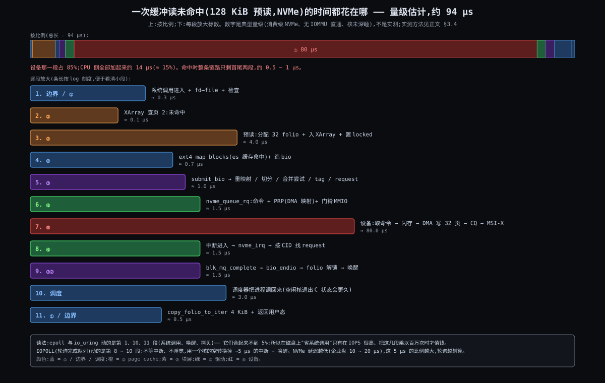
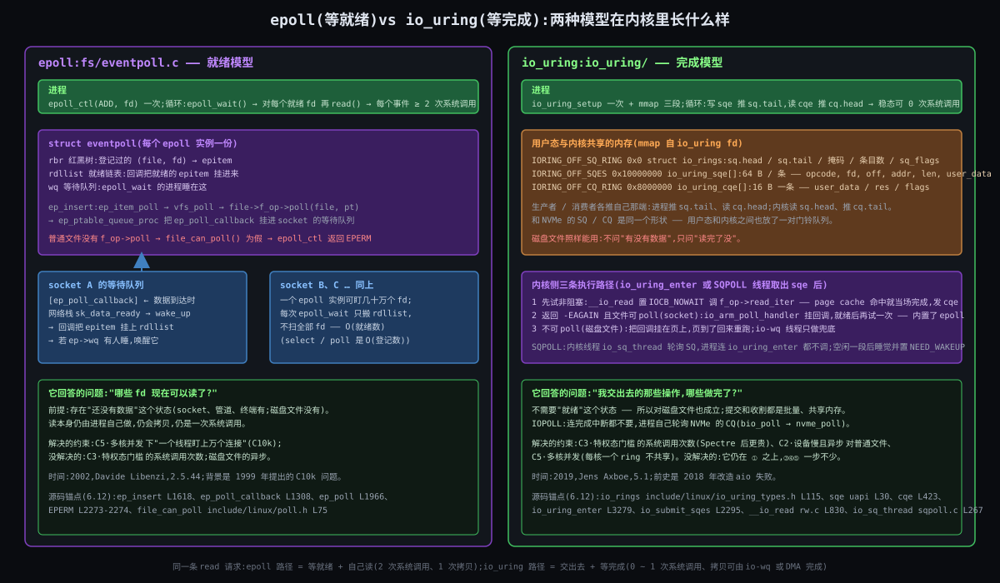

# 阶段 5:Linux 文件 IO 全链路的深度剖析

> 前四份讲了"有哪五层、为什么必须有、怎么工作、怎么来的"。这一份下到源码和数字,聚焦三条主线:**A. 上层接口**(VFS → page cache → mmap)、**B. 块层提交路径**(页索引 → 块号 → bio → request → tag → 驱动 → 数据回到页里)、**C. epoll 与 io_uring**(必然还是偶然,解决了什么,什么在推)。每条主线按操作层 / 函数逻辑层 / 底层原理层三层剖析,后面各跟一组反事实小试。主线 B 配一条纳秒级时间线。
>
> **源码版本**:Linux **6.12**(长期维护版)。所有引文标 `文件 L行号`,取自 `raw.githubusercontent.com/torvalds/linux/v6.12`,只贴关键段,`…` 表示省略。demo 按你的要求写成伪代码(`src/05-demo.pseudo.c`),每行标真实调用链。
>
> 主角文件沿用:`/mnt/nvme/notes.txt`,inode #1234,1 MiB,extent `{0, 256, 81920}`,块 4 KiB,分区起点 2048 扇区。

---

## 约束清单速查(C1 ~ C12)

> 引用约定:编号永远带短名。五条根:R1·速度断崖(C2 C6 C9)/ R2·硬件多样(C1 C4)/ R3·接口固定(C8 C11)/ R4·多进程共享(C3 C5 C12)/ R5·活过断电(C7 C10)。

#### C1·厂商定接口
硬件接口由厂商 / 标准定义,内核无法统一。**口诀**:语言不归我管 → 每种盘一个翻译。
#### C2·设备慢且异步
设备比 CPU 慢 10³ ~ 10⁷ 倍,完成是异步事件。**口诀**:发完就走,中断再回。
#### C3·特权态门槛
寄存器 / DMA / 中断只能在特权态操作。**口诀**:进程只能请求,不能动手 —— 每次请求都要过一次系统调用。
#### C4·定长块
持久设备最小读写单位是固定大小的块。**口诀**:读 1 字节也搬一整块。
#### C5·多核并发
多核多进程并发发起 IO。**口诀**:一把锁等于浪费所有核。
#### C6·介质形状相反
机械盘怕乱序,NVMe 怕喂不饱。**口诀**:没有对所有盘都对的策略。
#### C7·跨块不原子
单块写原子、多块不原子。**口诀**:找一个单块写定生死。
#### C8·流 vs 块
程序要"名字 + 变长流",介质只给"编号 + 定长块"。**口诀**:账本必须也在盘上。
#### C9·速差+局部性
DRAM 与介质差 10² ~ 10⁵ 倍,访问有局部性。**口诀**:读过的大概率再读。
#### C10·内存装不下
缓存须淘汰、须延迟回写,存在不一致窗口。**口诀**:write 返回 ≠ 在盘上。
#### C11·POSIX接口冻结
实现开放增长,接口几十年固定。**口诀**:一侧冻结,一侧生长。
#### C12·同文件多开
同一文件多进程同时打开,各有偏移,对象只有一份。**口诀**:file 是打开实例,inode 是对象。

---

## §0 从 Origin 走到 Deep:三件事记住

### §0.1 事一(主线 A):两条入口、一套缓存、一个开关 —— 从 C9·速差+局部性 + C11·POSIX接口冻结 推出

因为缓存必须被所有入口共享(C9·速差+局部性),又因为 `read` / `mmap` 两个接口几十年不能改(C11·POSIX接口冻结)→ 要解决"两条完全不同的入口怎么落到同一份页上"→ 所以 `read` 走 `filemap_read`、`mmap` 走 `filemap_fault`,**两者在 `filemap_get_folio` / 预读那一层汇合**;而 `kiocb.ki_flags` 里的一个位(`IOCB_NOWAIT`)决定"没命中时睡还是立刻返回" —— 这个开关就是 io_uring 后来能复用整条读路径的原因。

### §0.2 事二(主线 B):一个 tag 把去程和回程串成一条线 —— 从 C2·设备慢且异步 + C5·多核并发 + C1·厂商定接口 推出

因为完成是异步的、乱序的(C2·设备慢且异步),又因为几十个核同时提交(C5·多核并发),设备槽位又有限(C1·厂商定接口)→ 要解决"提交时的那个 request,完成时怎么一步找回来,而且不加全局锁"→ 所以 **tag = NVMe 命令 ID**:`blk_mq_get_tag` 发,`nvme_setup_cmd` 写进命令,设备原样带回,`nvme_find_rq` 一步查表。整条路径的数字(队列深度 1024、每核一队列、`BIO_MAX_VECS` 256、`max_sectors` 1280 KiB)都是围绕"这条线能承载多少在飞的请求"定的。

### §0.3 事三(主线 C):就绪与完成是两种模型,不是两个 API —— 从 C3·特权态门槛 + C2·设备慢且异步 推出

因为每次请求都要过一次系统调用(C3·特权态门槛 的价格,2018 年 Spectre 之后又涨了),又因为 socket 有"还没数据"的状态而磁盘文件没有(C2·设备慢且异步 在两类设备上的不同形态)→ 要解决"一个线程盯上万个连接"和"磁盘文件也能异步"两个问题 → 所以先有 **epoll**(2002,等就绪:回调把就绪的 fd 挂进链表),再有 **io_uring**(2019,等完成:两个共享内存环,提交和收割都不必进内核)。前者解决不了后者的问题,是因为模型不同,不是因为实现不好。

### §0 结论

| 事 | 核心对象 | 关键数字 | 主要约束 |
|---|---|---|---|
| A 两条入口一套缓存 | `kiocb` + `iov_iter`;`filemap_get_folio`;`IOCB_NOWAIT` | 预读初始 4 页 → 翻倍到 32 页;fault-around 16 页 | C9·速差+局部性、C11·POSIX接口冻结 |
| B 一个 tag 一条线 | `request.tag` = `cqe.command_id`;`sbitmap` | 队列深度 1024(2 ~ 4095);每核一队列;`BIO_MAX_VECS` 256;`max_sectors` ≤ 2560 扇区 | C2·设备慢且异步、C5·多核并发、C1·厂商定接口 |
| C 就绪 vs 完成 | `eventpoll.rdllist`;`io_rings.sq/cq` | sqe 64 B、cqe 16 B;稳态 0 次系统调用 | C3·特权态门槛、C2·设备慢且异步 |

---

## §1 一张极简概览图:一次未命中读的时间花在哪



从图上能读出五件事:

1. **设备占 85%**。CPU 侧十段加起来约 14 μs,设备一段 80 μs。R1·速度断崖 不是比喻,是比例。
2. **命中时只剩首尾两段**,0.5 ~ 1 μs。所以缓存命中率决定一切,其余优化都是在调那 14 μs。
3. **epoll / io_uring 动的是第 1、10、11 段**(系统调用、唤醒、拷贝),合起来不到 5%。它们在磁盘上值钱,只在 IOPS 乘到百万级、这几段被乘以百万次之后。
4. **IOPOLL 动的是第 8 ~ 10 段**:不等中断不睡觉,用一个核空转换掉约 5 μs。盘越快,这 5 μs 占比越大。
5. **数字是量级估计**,不是实测:消费级 NVMe、无 IOMMU 直通、核未深睡。实测方法在 §3.4。

---

## §2 主线 A:VFS → page cache → mmap

### §2.1 操作层

| 接口 | 进内核后的第一站 | 旋钮 / 标志 |
|---|---|---|
| `read` / `pread` / `readv` | `ksys_read` → `vfs_read`(`fs/read_write.c` L549) | `O_DIRECT`(绕缓存)、`RWF_NOWAIT`(没命中立刻返回 `EAGAIN`,不睡) |
| `mmap` + 访问内存 | `do_mmap` 建 VMA;首次访问走缺页 `do_fault`(`mm/memory.c` L5401) | `MAP_POPULATE`(预先填页)、`madvise(MADV_SEQUENTIAL / RANDOM / WILLNEED)` |
| `posix_fadvise` | 改 `file->f_ra` / 触发预读或丢弃 | `FADV_SEQUENTIAL` 让预读窗口翻倍、`FADV_RANDOM` 关预读 |
| `/sys/block/*/queue/read_ahead_kb` | `ra_pages` | 默认 128 |
| `/proc/sys/vm/dirty_*` | 回写阈值 | `dirty_background_ratio` 10、`dirty_ratio` 20、`dirty_expire_centisecs` 3000、`dirty_writeback_centisecs` 500(`mm/page-writeback.c` L74 / L91 / L109 / L102) |

### §2.2 函数逻辑层

#### §2.2.1 `read` 这一侧:三跳进到通用代码

```c
/* fs/read_write.c L549 */
ssize_t vfs_read(struct file *file, char __user *buf, size_t count, loff_t *pos)
{
	…
	if (unlikely(!access_ok(buf, count)))      /* C3·特权态门槛:用户指针只能在这之后被内核代用 */
		return -EFAULT;
	ret = rw_verify_area(READ, file, pos, count);
	…
	if (file->f_op->read)
		ret = file->f_op->read(file, buf, count, pos);
	else if (file->f_op->read_iter)
		ret = new_sync_read(file, buf, count, pos);   /* ext4 / socket / proc 都走这条 */
	…
}
/* L478 */
static ssize_t new_sync_read(struct file *filp, char __user *buf, size_t len, loff_t *ppos)
{
	struct kiocb kiocb;
	struct iov_iter iter;
	init_sync_kiocb(&kiocb, filp);
	kiocb.ki_pos = (ppos ? *ppos : 0);
	iov_iter_ubuf(&iter, ITER_DEST, buf, len);
	ret = filp->f_op->read_iter(&kiocb, &iter);
	BUG_ON(ret == -EIOCBQUEUED);                      /* 同步路径不接受"已排队" */
	…
}
```

两个对象在这里诞生,后面所有路径都认它们:`kiocb`(这次 IO 的控制块:位置、标志、完成回调)和 `iov_iter`(对用户缓冲区的抽象,可以是用户指针、内核指针、bvec、管道)。io_uring 的读走的是**同一个** `f_op->read_iter`,只是 `kiocb` 由它自己造、`ki_flags` 带 `IOCB_NOWAIT`(§4.2.3)。

ext4 的 `read_iter` 只做一次分流:`fs/ext4/file.c` L130 `ext4_file_read_iter`,L144 看到 `IOCB_DIRECT` 走 `ext4_dio_read_iter`(L69),否则 `generic_file_read_iter` → `filemap_read`。

#### §2.2.2 `filemap_read`:查、等、拷

```c
/* mm/filemap.c L2610 */
ssize_t filemap_read(struct kiocb *iocb, struct iov_iter *iter, ssize_t already_read)
{
	…
	do {
		…
		error = filemap_get_pages(iocb, iter->count, &fbatch, false);   /* 拿到一批 uptodate 的 folio */
		…
		isize = i_size_read(inode);                 /* i_size 必须在页 uptodate 之后再读 */
		end_offset = min_t(loff_t, isize, iocb->ki_pos + iter->count);
		…
		for (i = 0; i < folio_batch_count(&fbatch); i++) {
			struct folio *folio = fbatch.folios[i];
			size_t fsize = folio_size(folio);
			size_t offset = iocb->ki_pos & (fsize - 1);           /* 页内偏移:2108 这种数在这里用 */
			size_t bytes = min_t(loff_t, end_offset - iocb->ki_pos, fsize - offset);
			…
			copied = copy_folio_to_iter(folio, offset, bytes, iter);   /* 缓冲读唯一的一次拷贝 */
			already_read += copied;
			iocb->ki_pos += copied;
			…
```

#### §2.2.3 `filemap_get_pages`:三级尝试

```c
/* mm/filemap.c L2523 */
static int filemap_get_pages(struct kiocb *iocb, size_t count, struct folio_batch *fbatch, bool need_uptodate)
{
	…
	pgoff_t index = iocb->ki_pos >> PAGE_SHIFT;                  /* 字节 → 页索引 */
	last_index = DIV_ROUND_UP(iocb->ki_pos + count, PAGE_SIZE);
retry:
	filemap_get_read_batch(mapping, index, last_index - 1, fbatch);   /* ① 批量查 XArray */
	if (!folio_batch_count(fbatch)) {
		if (iocb->ki_flags & IOCB_NOIO)
			return -EAGAIN;
		…
		page_cache_sync_readahead(mapping, ra, filp, index, last_index - index);   /* ② 同步预读 */
		…
		filemap_get_read_batch(mapping, index, last_index - 1, fbatch);
	}
	if (!folio_batch_count(fbatch)) {
		if (iocb->ki_flags & (IOCB_NOWAIT | IOCB_WAITQ))
			return -EAGAIN;                                   /* 不许睡 → 立刻回 EAGAIN */
		err = filemap_create_folio(filp, mapping, iocb->ki_pos, fbatch);   /* ③ 预读被关时的保底:单页 */
		…
	}
	folio = fbatch->folios[folio_batch_count(fbatch) - 1];
	if (folio_test_readahead(folio)) {                        /* 碰到预读标记页 → 触发异步预读 */
		err = filemap_readahead(iocb, filp, mapping, folio, last_index);
		…
	}
	if (!folio_test_uptodate(folio)) {
		…
		err = filemap_update_page(iocb, mapping, count, folio, need_uptodate);   /* 页在但没读好:等锁 */
		…
```

三级分别对应三种状态:页在且好(直接拷);页不在(预读一批);页在但正在 IO(等 `locked` 释放)。`IOCB_NOWAIT` 在第二和第三级各插了一刀,这两刀是 io_uring 的命门。

#### §2.2.4 预读窗口怎么长:三个数

```c
/* mm/readahead.c L361 */
static unsigned long get_init_ra_size(unsigned long size, unsigned long max)
{
	unsigned long newsize = roundup_pow_of_two(size);
	if (newsize <= max / 32)      newsize = newsize * 4;
	else if (newsize <= max / 4)  newsize = newsize * 2;
	else                          newsize = max;
	return newsize;
}
/* L379 */
static unsigned long get_next_ra_size(struct file_ra_state *ra, unsigned long max)
{
	unsigned long cur = ra->size;
	if (cur < max / 16)  return 4 * cur;
	if (cur <= max / 2)  return 2 * cur;
	return max;
}
/* L538 page_cache_sync_ra:第一次读或随机读 */
	if (!index || req_count > max_pages || index - prev_index <= 1UL) {
		ra->start = index;
		ra->size = get_init_ra_size(req_count, max_pages);
		ra->async_size = ra->size > req_count ? ra->size - req_count : ra->size >> 1;
		goto readit;
	}
```

`max_pages` 来自 `read_ahead_kb`(默认 128 KiB = 32 页)。读 1 页:`roundup_pow_of_two(1) = 1 ≤ 32/32` → 初始窗口 **4 页**;下一次顺序读碰到标记页,`get_next_ra_size`:4 < 32/16 → 16 页;再下一次 16 ≤ 32/2 → 32 页,封顶。所以 03-how 说"预读 32 页"是**稳态**;第一次未命中其实只预读 4 页。`async_size` 是窗口里标 `PG_readahead` 的位置 —— 读到它就提前发下一窗,让盘和 CPU 流水起来。

#### §2.2.5 `mmap` 这一侧:缺页进同一个口

```c
/* mm/filemap.c L3301 */
vm_fault_t filemap_fault(struct vm_fault *vmf)
{
	…
	pgoff_t max_idx, index = vmf->pgoff;                     /* 页索引直接来自 VMA 偏移 */
	…
	folio = filemap_get_folio(mapping, index);                /* 和 read 查的是同一棵 XArray */
	if (likely(!IS_ERR(folio))) {
		if (!(vmf->flags & FAULT_FLAG_TRIED))
			fpin = do_async_mmap_readahead(vmf, folio);      /* 同一套预读状态机 */
		…
	} else if (!folio) {
		…
		fpin = do_sync_mmap_readahead(vmf);                   /* 未命中:同步预读 */
		…
		folio = __filemap_get_folio(mapping, index, FGP_CREAT|FGP_FOR_MMAP, vmf->gfp_mask);
		…
	}
	if (!lock_folio_maybe_drop_mmap(vmf, folio, &fpin))     /* 等 locked 时先放掉 mmap_lock,别拖累别的线程 */
		goto out_retry;
	…
	if (unlikely(!folio_test_uptodate(folio))) { … goto page_not_uptodate; }   /* → filemap_read_folio */
	…
	vmf->page = folio_file_page(folio, index);               /* 把页交给 do_read_fault 填 PTE */
	return ret | VM_FAULT_LOCKED;
```

进缺页之前还有一步 **fault-around**:`do_read_fault`(`mm/memory.c` L5277)先调 `filemap_map_pages`(`mm/filemap.c` L3630),把目标页周围**已经在缓存里**的页一次性填进页表,范围 `fault_around_pages = 65536 >> PAGE_SHIFT` = **16 页**(L5171)。所以顺序 mmap 读,16 页才一次异常。

### §2.3 底层原理层

- **为什么两条入口必须在 `filemap_get_folio` 汇合**:C9·速差+局部性 要求缓存只有一份;如果 `mmap` 有自己的页,`read` 写入的数据 `mmap` 看不到,反之亦然。汇合点选在"查页"而不是更高层,是因为两条入口在那之上没有任何共同点(一个是系统调用,一个是硬件异常)。
- **为什么是 `kiocb + iov_iter` 而不是 `(buf, len)`**:同一个 `read_iter` 要服务同步读、AIO、io_uring、splice、内核内部读(`kernel_read`)。`iov_iter` 把"数据往哪拷"抽象掉,`kiocb` 把"能不能睡、完成了叫谁"抽象掉。这是 C11·POSIX接口冻结 之下给新接口留的唯一缝:**接口不变,控制块可扩**。`IOCB_NOWAIT` 就是从这条缝里长出来的(2017 年为 `RWF_NOWAIT` 加,2019 年被 io_uring 用成主路径)。
- **预读为什么 4 → 16 → 32 而不是一上来 32**:第一次未命中还不知道是顺序还是随机,预读 32 页在随机负载上是 8 倍浪费;窗口随"确认是顺序"指数增长,是对 C9·速差+局部性 的"空间局部性"做**贝叶斯更新**。封顶 128 KiB 是经验值:大于典型 NVMe 单命令最优大小的收益递减,而内存占用线性增加(C10·内存装不下)。
- **fault-around 为什么 16 页而不是 1 或 512**:缺页异常约 1 ~ 2 μs,填 16 个 PTE 几百纳秒;16 是"异常次数 ÷ 16"与"填了用不上的 PTE 浪费"的折中,而且只填已在缓存的页,不触发 IO,所以不会放大 C9 的代价。
- **回写阈值 10% / 20% / 30 s / 5 s**:`dirty_background_ratio` 10% 时后台线程开始写,`dirty_ratio` 20% 时写进程自己被拉去写(`balance_dirty_pages`,**背压**);30 s 是"脏了多久必须写"(C10·内存装不下 的窗口上限),5 s 是回写线程醒来的周期。这四个数没有推导,是 2.6 时代的经验值,一直没人改 —— 因为改哪个都有人受伤。

### §2.4 反事实小试:为什么缓冲读要拷贝一次,不直接把页"给"用户?

- **候选 A:每次 `read` 把 folio 映射进用户地址空间**。省了拷贝,但改页表要 TLB shootdown(多核上几 μs),比拷 4 KiB(0.3 μs)贵一个数量级;而且用户随时可能改这页,缓存就脏了。现实:无人采用;`mmap` 是把这个代价**显式**交给用户按页摊销的版本。
- **候选 B:读直接 DMA 到用户缓冲区**。就是 `O_DIRECT`:省拷贝、省缓存内存,代价是对齐要求(C4·定长块 暴露给应用)、每次真下盘、应用自管缓存。现实:数据库。
- **候选 C:内核内零拷贝搬运**(`splice` / `sendfile`):数据从 page cache 直接进 socket 缓冲,从不进用户态。现实:Web 服务器发静态文件;但它只覆盖"从文件到另一个 fd"这一种模式。
- **候选 D:大 folio 减少拷贝次数而不是消灭拷贝**:一次 `copy_folio_to_iter` 拷 64 KiB 而不是 4 KiB,循环次数和 XArray 查找次数都降。现实:xfs 5.18、ext4 6.16 的大 folio。

**结论**:在"用户缓冲区由用户决定地址"(C11·POSIX接口冻结 的 `read(fd, buf, n)` 签名)这条前提下,一次拷贝是局部最优;所有零拷贝方案都要么改签名(B 的对齐要求、C 的另一个 fd),要么改范式(A 变成 mmap)。

---

## §3 主线 B:块层提交路径 —— 页索引 → 块号 → bio → request → tag → 驱动 → 数据回到页里

### §3.1 操作层

| 旋钮 / 探针 | 作用 | 对应源码 |
|---|---|---|
| `/sys/block/nvme0n1/queue/scheduler` | 换调度器 | `block/elevator.c` L562 默认规则 |
| `…/queue/nr_requests` | 每队列可在飞的 request 数(= tag 数上限) | `blk_mq_get_tag` 的位图大小 |
| `…/queue/max_sectors_kb` | 单个 request 上限 | `blk-settings.c` L290:`min(max_hw_sectors, BLK_DEF_MAX_SECTORS_CAP)` |
| `…/queue/nomerges` | 关掉合并(排查用) | `blk_mq_attempt_bio_merge` |
| `…/queue/rq_affinity` | 完成是否送回提交核 | `blk_mq_complete_request_remote` L1192 |
| `nvme.io_queue_depth=` | NVMe 队列深度 | `drivers/nvme/host/pci.c` L74 |
| `blktrace` / `bpftrace kprobe:submit_bio` / tracepoint `block:block_rq_issue` | 观察每一步 | — |

### §3.2 函数逻辑层:一条 128 KiB 预读 bio 的全程

#### §3.2.1 ② 造 bio:`ext4_mpage_readpages`(`fs/ext4/readpage.c` L211)

```c
	/* 对 rac 里每个 folio;block_in_file = folio->index << (PAGE_SHIFT - blkbits) */
	while (page_block < blocks_per_page) {
		if (block_in_file < last_block) {
			map.m_lblk = block_in_file;
			map.m_len = last_block - block_in_file;
			if (ext4_map_blocks(NULL, inode, &map, 0) < 0) { … }   /* fs/ext4/inode.c L595:先查 extent status 缓存,再走 extent 树 */
		}
		if ((map.m_flags & EXT4_MAP_MAPPED) == 0) { … first_hole …; continue; }   /* 洞:记下,后面填零 */
		if (!page_block)
			first_block = map.m_pblk;                                /* 这一页在盘上的第一个块 */
		else if (first_block + page_block != map.m_pblk)
			goto confused;                                           /* 页内不连续 → 退回逐块老路径 */
		…
	}
	…
	if (bio && (last_block_in_bio != first_block - 1 || …)) {       /* L341:和当前 bio 不连续 → 先发出去 */
submit_and_realloc:
		submit_bio(bio);
		bio = NULL;
	}
	if (bio == NULL) {
		bio = bio_alloc(bdev, bio_max_segs(nr_pages), REQ_OP_READ, GFP_KERNEL);   /* L353;bio_max_segs 封顶 256 */
		…
		bio->bi_iter.bi_sector = first_block << (blkbits - 9);       /* L358:块号 → 扇区,81922 << 3 */
		bio->bi_end_io = mpage_end_io;                               /* L359:回程钩子 */
		if (rac)
			bio->bi_opf |= REQ_RAHEAD;                               /* 预读标记,一路带到 NVMe 命令 */
	}
	length = first_hole << blkbits;
	if (!bio_add_folio(bio, folio, length, 0))                       /* L365:装不下(满 256 段)→ 发出去再开新的 */
		goto submit_and_realloc;
	…
	if (bio)
		submit_bio(bio);                                             /* L389 */
```

#### §3.2.2 ③ 入口:`submit_bio` → `submit_bio_noacct` → `__submit_bio`(`block/blk-core.c`)

```c
/* L886 */
void submit_bio(struct bio *bio)
{
	if (bio_op(bio) == REQ_OP_READ) {
		task_io_account_read(bio->bi_iter.bi_size);
		count_vm_events(PGPGIN, bio_sectors(bio));                   /* /proc/vmstat 的 pgpgin 在这里加 */
	} …
	submit_bio_noacct(bio);
}
/* L751 */
void submit_bio_noacct(struct bio *bio)
{
	…
	if (!bio_flagged(bio, BIO_REMAPPED)) {
		if (unlikely(bio_check_eod(bio))) goto end_io;                /* 越过设备末尾? */
		if (bdev_is_partition(bdev) && unlikely(blk_partition_remap(bio)))   /* L773 */
			goto end_io;
	}
	if (op_is_flush(bio->bi_opf)) { … if (!bdev_write_cache(bdev)) bio->bi_opf &= ~(REQ_PREFLUSH | REQ_FUA); … }   /* 设备没写缓存就剥掉 flush 标记 */
	…
}
/* L555 */
static int blk_partition_remap(struct bio *bio)
{
	struct block_device *p = bio->bi_bdev;
	…
	bio->bi_iter.bi_sector += p->bd_start_sect;                      /* 655376 + 2048 = 657424:分区坐标 → 整盘坐标 */
	…
	bio_set_flag(bio, BIO_REMAPPED);
	return 0;
}
/* L604 */
static void __submit_bio(struct bio *bio)
{
	struct blk_plug plug;
	…
	blk_start_plug(&plug);                                            /* 每次提交都裹一层 plug */
	if (!bdev_test_flag(bio->bi_bdev, BD_HAS_SUBMIT_BIO)) {
		blk_mq_submit_bio(bio);                                       /* 真设备:进 blk-mq */
	} else if (likely(bio_queue_enter(bio) == 0)) {
		disk->fops->submit_bio(bio);                                  /* dm / md 这类叠插设备:交给它改写 */
		…
	}
	blk_finish_plug(&plug);
}
```

#### §3.2.3 ③ 核心:`blk_mq_submit_bio`(`block/blk-mq.c` L2940)

```c
void blk_mq_submit_bio(struct bio *bio)
{
	struct request_queue *q = bdev_get_queue(bio->bi_bdev);
	struct blk_plug *plug = current->plug;
	…
	rq = blk_mq_peek_cached_request(plug, q, bio->bi_opf);          /* plug 里预先批量分配过 request?先用 */
	…
	bio = __bio_split_to_limits(bio, &q->limits, &nr_segs);         /* L2988:按 max_sectors / max_segments 切 */
	…
	if (blk_mq_attempt_bio_merge(q, bio, nr_segs))                   /* 并进相邻 request?成功就结束 */
		goto queue_exit;
	…
new_request:
	if (!rq) {
		rq = blk_mq_get_new_requests(q, plug, bio, nr_segs);         /* L3003 → __blk_mq_alloc_requests(L435) → blk_mq_get_tag */
		…
	}
	…
	blk_mq_bio_to_request(rq, bio, nr_segs);                         /* L3014:rq->__sector / __data_len / bio 链 */
	…
	if (op_is_flush(bio->bi_opf) && blk_insert_flush(rq))           /* PREFLUSH / FUA 走 flush 状态机 */
		return;
	if (plug) {
		blk_add_rq_to_plug(plug, rq);                                /* L3031:攒着,倒出时再派 */
		return;
	}
	hctx = rq->mq_hctx;
	if ((rq->rq_flags & RQF_USE_SCHED) ||
	    (hctx->dispatch_busy && (q->nr_hw_queues == 1 || !is_sync))) {
		blk_mq_insert_request(rq, 0);                                /* 有调度器 / 设备忙:入队,稍后运行 */
		blk_mq_run_hw_queue(hctx, true);
	} else {
		blk_mq_run_dispatch_ops(q, blk_mq_try_issue_directly(hctx, rq));   /* 没调度器且不忙:直接派发 */
	}
	…
}
```

四个分支正好是 03-how §4.3 的第 2 ~ 6 步,源码里是一段直线。注意最后那个 `if`:**多队列 + `none` + 设备不忙** 时 request 根本不进任何队列,直接 `queue_rq` —— NVMe 的常态路径比图上画的还短。

#### §3.2.4 ③ tag:`blk_mq_get_tag`(`block/blk-mq-tag.c` L134)

```c
unsigned int blk_mq_get_tag(struct blk_mq_alloc_data *data)
{
	struct blk_mq_tags *tags = blk_mq_tags_from_data(data);
	struct sbitmap_queue *bt = &tags->bitmap_tags;                   /* 每个硬件队列一张可扩展位图 */
	…
	tag = __blk_mq_get_tag(data, bt);                                /* 位图找一个 0 位置 1 */
	if (tag != BLK_MQ_NO_TAG)
		goto found_tag;
	if (data->flags & BLK_MQ_REQ_NOWAIT)
		return BLK_MQ_NO_TAG;                                        /* 不许睡(io_uring NOWAIT)→ 直接失败 */
	ws = bt_wait_ptr(bt, data->hctx);
	do {
		blk_mq_run_hw_queue(data->hctx, false);                      /* 先催一下设备,可能有完成的 */
		tag = __blk_mq_get_tag(data, bt);
		if (tag != BLK_MQ_NO_TAG) break;
		sbitmap_prepare_to_wait(bt, ws, &wait, TASK_UNINTERRUPTIBLE);
		tag = __blk_mq_get_tag(data, bt);
		if (tag != BLK_MQ_NO_TAG) break;
		…
		io_schedule();                                               /* L188:睡。这就是整条链路的背压点 */
		…
	} while (1);
	…
```

#### §3.2.5 ③ → ④ 派发与完成

```c
/* block/blk-mq.c L2030,在 blk_mq_dispatch_rq_list 里 */
		ret = q->mq_ops->queue_rq(hctx, &bd);                        /* 函数指针表的那一跳 */
		switch (ret) {
		case BLK_STS_OK: queued++; break;
		case BLK_STS_RESOURCE: needs_resource = true; fallthrough;   /* 驱动说"现在接不了" */
		case BLK_STS_DEV_RESOURCE: blk_mq_handle_dev_resource(rq, list); goto out;   /* 退回列表稍后重试 */
/* L1192:完成时决定在哪个核处理 */
bool blk_mq_complete_request_remote(struct request *rq)
{
	WRITE_ONCE(rq->state, MQ_RQ_COMPLETE);
	if ((rq->mq_hctx->nr_ctx == 1 && rq->mq_ctx->cpu == raw_smp_processor_id()) ||
	     rq->cmd_flags & REQ_POLLED)
		return false;                                                /* 一核一队列且就在本核(NVMe 常态)/ 轮询:就地完成 */
	if (blk_mq_complete_need_ipi(rq)) {
		blk_mq_complete_send_ipi(rq);                                /* 否则 IPI 送回提交核:数据在它的缓存里 */
		return true;
	}
	if (rq->q->nr_hw_queues == 1) { blk_mq_raise_softirq(rq); return true; }   /* 单队列设备:softirq */
	return false;
}
/* L1226 */
void blk_mq_complete_request(struct request *rq)
{
	if (!blk_mq_complete_request_remote(rq))
		rq->q->mq_ops->complete(rq);                                 /* → nvme_pci_complete_rq */
}
/* L1049 */
void blk_mq_end_request(struct request *rq, blk_status_t error)
{
	if (blk_update_request(rq, error, blk_rq_bytes(rq)))             /* 对 request 里每个 bio 调 bio_endio */
		BUG();
	__blk_mq_end_request(rq, error);                                 /* 释放 tag、统计 */
}
/* block/bio.c L1665 */
void bio_endio(struct bio *bio)
{
	…
	if (bio->bi_end_io)
		bio->bi_end_io(bio);                                         /* → mpage_end_io → folio_end_read:uptodate + unlock + 唤醒 */
}
```

#### §3.2.6 ④ `nvme_queue_rq`(`drivers/nvme/host/pci.c` L876)与命令组装(`core.c` L973)

```c
/* pci.c L876 */
static blk_status_t nvme_queue_rq(struct blk_mq_hw_ctx *hctx, const struct blk_mq_queue_data *bd)
{
	struct nvme_queue *nvmeq = hctx->driver_data;                    /* hctx ↔ 设备队列一一对应 */
	struct request *req = bd->rq;
	struct nvme_iod *iod = blk_mq_rq_to_pdu(req);                    /* 驱动私有数据紧跟在 request 后面,零分配 */
	…
	ret = nvme_prep_rq(dev, req);                                    /* L838:nvme_setup_cmd + nvme_map_data(PRP) */
	if (unlikely(ret)) return ret;
	spin_lock(&nvmeq->sq_lock);                                      /* 每队列一把锁,不是全局 */
	nvme_sq_copy_cmd(nvmeq, &iod->cmd);                              /* L488:memcpy 64 B 进 SQ,tail++ */
	nvme_write_sq_db(nvmeq, bd->last);                               /* L471:只在批尾敲门铃 */
	spin_unlock(&nvmeq->sq_lock);
	return BLK_STS_OK;
}
/* L471 */
static inline void nvme_write_sq_db(struct nvme_queue *nvmeq, bool write_sq)
{
	if (!write_sq) {                                                 /* 不是批尾:只要还没绕回上次门铃位置,先不写 */
		u16 next_tail = nvmeq->sq_tail + 1;
		if (next_tail == nvmeq->q_depth) next_tail = 0;
		if (next_tail != nvmeq->last_sq_tail) return;
	}
	if (nvme_dbbuf_update_and_check_event(…))
		writel(nvmeq->sq_tail, nvmeq->q_db);                         /* 整条去程唯一一次 MMIO */
	nvmeq->last_sq_tail = nvmeq->sq_tail;
}
/* core.c L973 */
static inline blk_status_t nvme_setup_rw(struct nvme_ns *ns, struct request *req, struct nvme_command *cmnd, enum nvme_opcode op)
{
	u16 control = 0; u32 dsmgmt = 0;
	if (req->cmd_flags & REQ_FUA) control |= NVME_RW_FUA;            /* fsync 那条路的 FUA 位在这里落地 */
	if (req->cmd_flags & REQ_RAHEAD) dsmgmt |= NVME_RW_DSM_FREQ_PREFETCH;   /* 预读标记变成给盘的提示 */
	…
	cmnd->rw.opcode = op;                                            /* nvme_cmd_read = 0x02 */
	cmnd->rw.nsid = cpu_to_le32(ns->head->ns_id);
	cmnd->rw.slba = cpu_to_le64(nvme_sect_to_lba(ns->head, blk_rq_pos(req)));      /* nvme.h L669:sector >> (lba_shift - 9) */
	cmnd->rw.length = cpu_to_le16((blk_rq_bytes(req) >> ns->head->lba_shift) - 1);  /* 0-based 块数:131072 >> 12 - 1 = 31 */
	…
}
```

回程:`nvme_irq`(L1080)→ `nvme_poll_cq`(L1059,循环 `nvme_cqe_pending`,取完一批才 `nvme_ring_cq_doorbell`)→ `nvme_handle_cqe`(L1013):

```c
	__u16 command_id = READ_ONCE(cqe->command_id);
	…
	req = nvme_find_rq(nvme_queue_tagset(nvmeq), command_id);      /* L1032:CID 就是 tag,一步查表 */
	…
	if (!nvme_try_complete_req(req, cqe->status, cqe->result) &&
	    !blk_mq_add_to_batch(req, iob, nvme_req(req)->status, nvme_pci_complete_batch))
		nvme_pci_complete_rq(req);                                   /* L978 → blk_mq_complete_request */
```

### §3.3 底层原理层:数字从哪来

| 数字 | 值 | 出处 | 为什么是这个数 |
|---|---|---|---|
| NVMe 队列深度 | 1024(允许 2 ~ 4095) | `pci.c` L74、L66-67 | 协议上限 65536;1024 是"喂饱一块盘的并行度"与"每队列预分配的 request + iod 内存"的折中;4095 是 16 位 CID 留一位给 AEN 后的实际上限 |
| 队列数 | `num_possible_cpus() + 写队列 + 轮询队列` | `pci.c` L2302 | 一核一队列让 `blk_mq_complete_request_remote` 走"就地完成"分支,不 IPI;写 / 轮询队列是可选的分类 |
| `BIO_MAX_VECS` | 256 | `include/linux/bio.h` L13 | 256 × 4 KiB = 1 MiB,和 `BLK_DEF_MAX_SECTORS_CAP` 同量级;更大的 bio 要么被切、要么浪费向量表 |
| `max_sectors` 默认 | `min(max_hw_sectors, 2560 扇区 = 1280 KiB)` | `blk-settings.c` L290;`blkdev.h` L1134 附近 | 设备申报的硬上限再压一道软上限,避免单个 request 过大拖延别的请求的延迟 |
| `BLK_SAFE_MAX_SECTORS` | 255 | `blkdev.h` L1134 | 驱动没申报时的保守值:老 SCSI 的 8 位扇区计数 |
| `SECTOR_SHIFT` | 9 | `blk_types.h` L31 | bio 永远按 512 B 计数,和设备逻辑块大小无关 —— 这是 C1·厂商定接口 下的最大公约数 |
| mq-deadline | 读 `HZ/2`、写 `5*HZ`、`fifo_batch` 16、`writes_starved` 2、`prio_aging_expire` 10 s | `mq-deadline.c` L30-38 | 读是同步的(进程在等)所以期限短;写是异步的所以可以等;16 是"顺路做多少个再回头看 FIFO" |
| 调度器默认规则 | 多队列且 tag 不共享 → `none`;否则 `mq-deadline` | `elevator.c` L562-572 | C6·介质形状相反 的代码形式 |
| 完成送回提交核 | 一核一队列且本核 → 就地;否则 IPI | `blk-mq.c` L1192 | request、bio、folio 都在提交核的缓存里;IPI 的代价(~1 μs)小于跨核缓存失效 |
| 门铃批量 | `bd->last` 才 `writel` | `pci.c` L471、L900 | MMIO 几百纳秒;一批 request 一次门铃 |

两个原理层的观察:

- **tag 是这条路径的"主键"**。`blk_mq_get_tag` 发号(位图)→ `blk_mq_rq_to_pdu` 用它定位驱动私有数据(零分配)→ `nvme_setup_cmd` 写进 `command_id` → 设备原样带回 → `nvme_find_rq` 查表 → `__blk_mq_end_request` 收号。全程没有一张哈希表、没有一把全局锁 —— C5·多核并发 下"完成匹配"问题的解法就是**让设备替你保存索引**。
- **`BLK_STS_RESOURCE` 和 `io_schedule()` 是两道背压**。驱动接不了 → request 退回列表、队列稍后重跑;tag 没了 → 提交者睡。两道门分别挡"设备满"和"软件队列满",压力都往上顶到进程,而不是在内核里堆内存(C10·内存装不下 的另一种形态)。

### §3.4 时间线:主线 B 一次未命中读

| # | 段 | 典型耗时 | 怎么实测 |
|---|---|---|---|
| 1 | 系统调用进入 + `fdget` + 检查 | 0.1 ~ 0.3 μs | `perf trace -s` 看 `pread64` 总耗时减去下面各段 |
| 2 | `filemap_get_read_batch` 未命中 | ~0.1 μs | `bpftrace -e 'kprobe:filemap_get_pages { @s = nsecs } kretprobe:… { @ = hist(nsecs - @s) }'` |
| 3 | 预读:分配 N 个 folio + 入 XArray + 置 locked | 4 页 ~0.5 μs;32 页 ~4 μs | 同上,夹 `page_cache_ra_unbounded` |
| 4 | `ext4_map_blocks`(es 缓存命中)+ 造 bio | ~0.7 μs | 夹 `ext4_mpage_readpages` |
| 5 | `submit_bio` → 切分 / 合并 / tag / request / plug | ~1 μs | tracepoint `block:block_bio_queue` → `block:block_rq_issue` 的时间差 |
| 6 | `nvme_queue_rq`:命令 + PRP(DMA 映射)+ 门铃 | 0.5 ~ 1.5 μs(IOMMU 开着更久) | 夹 `nvme_queue_rq` |
| 7 | 设备:取命令 → 闪存 → DMA 写 N 页 → CQ → MSI-X | 消费级 60 ~ 100 μs;企业级 10 ~ 30 μs | `block:block_rq_issue` → `block:block_rq_complete` |
| 8 | 中断进入 → `nvme_irq` → `nvme_find_rq` | 1 ~ 2 μs | `irq:irq_handler_entry` 到 `nvme_pci_complete_rq` |
| 9 | `blk_mq_complete` → `bio_endio` → `folio_end_read` → 唤醒 | 1 ~ 2 μs | 夹 `bio_endio`;`sched:sched_wakeup` |
| 10 | 调度器把进程调回来 | 2 ~ 5 μs;核在深 C 状态时 10 ~ 50 μs | `sched:sched_wakeup` → `sched:sched_switch` |
| 11 | `copy_folio_to_iter` 4 KiB + 返回用户态 | 0.3 ~ 0.5 μs | `perf stat -e` 看拷贝带宽 |

合计约 **90 ~ 100 μs**,设备占 85%。命中路径只有 1、2(命中)、11:**0.5 ~ 1 μs**。这张表是"量级",不是实测;每台机器都该自己跑一遍上面第四列的命令。

### §3.5 反事实小试

#### 反事实 1:bio 和 request 合成一个对象行不行?

- **候选 A:只有 bio,驱动直接收 bio**。合并、切分、超时、tag 都得驱动自己做 —— 2.4 的样子(04-origin §6.1)。违反 C1·厂商定接口 的解耦。现实:dm / md 这类叠插设备确实只收 bio(`BD_HAS_SUBMIT_BIO`),但它们不是终点,改写完还要再 `submit_bio`。
- **候选 B:只有 request,文件系统直接造 request**。request 带 tag、带硬件队列归属、带驱动私有数据,文件系统不该知道这些;而且文件系统造的粒度(一页一段)和设备要的粒度(一条命令)天然不同。违反 R2·硬件多样 的分层。现实:无。
- **候选 C:bio 内嵌 request 字段,按需启用**。省一次分配,但 bio 是上层高频对象(每页一个向量项),塞进去几十字节的调度字段 × 百万级 bio 就是几十 MiB。现实:无。
- **候选 D:现状**。bio 描述、request 派发;`blk_mq_rq_to_pdu` 让驱动私有数据零分配地跟在 request 后面。

**结论**:两个对象对应两种生命周期(上层回调 vs 设备往返),合并只能让一方背另一方的字段。在 C1·厂商定接口 + C5·多核并发 下现状是局部最优。

#### 反事实 2:不要 tag,驱动自己维护"命令 → request"映射行不行?

- **候选 A:驱动内哈希表**。每次完成一次哈希;每个驱动各写一份;队列满了的背压还是要块层知道。现实:老 SCSI 驱动曾各自为政,这正是 blk-mq 要统一的东西。
- **候选 B:把 request 指针直接塞进命令 ID**。64 位指针塞不进 16 位 CID;且设备返回的任何值都得校验,指针无法校验。现实:无。
- **候选 C:按完成顺序认领**。NVMe 乱序完成,行不通(03-how §5.1 逼问 5)。
- **候选 D:现状**:块层发 16 位 tag,驱动用 `blk_mq_tag_to_rq` 查表,设备替你保存索引。

**结论**:tag 是"设备只能带回一个小整数"(C1·厂商定接口)和"完成乱序"(C2·设备慢且异步)联合逼出的,唯一的自由度是谁来发号 —— 放块层能统一背压,所以放块层。

#### 反事实 3:队列深度 1024 改成 64,或改成 65536?

- **64**:单队列在飞 64 个请求 × 128 KiB = 8 MiB 在途数据,带宽 = 在途 ÷ 延迟 ≈ 8 MiB / 80 μs ≈ 100 GB/s,表面够;但随机 4 KiB 时在途只有 256 KiB,带宽 ≈ 3 GB/s,喂不饱一块 7 GB/s 的盘(C6·介质形状相反 的"怕喂不饱")。而且 `blk_mq_get_tag` 更早睡,延迟分布变差。现实:SATA NCQ 就是 32,这是它随机读吃亏的根本原因之一。
- **65536**:每队列预分配 65536 个 request + iod(每个几百字节)= 每核几十 MiB;而盘的并行度远用不到;超时扫描变慢。现实:无人这么配。
- **1024**:每核在飞 1024 个请求,32 核 = 32768 个,远超任何单盘并行度;内存每核几百 KiB ~ 1 MiB。
- **按设备报的 MQES 自动取**:协议允许,驱动用 `min(io_queue_depth, MQES+1)`,实际行为就是这样。

**结论**:1024 不是推导出来的,是"足够喂饱 + 内存可忽略"区间里的一个整数;真正的约束是上界(内存,C10·内存装不下)和下界(并行度,C6·介质形状相反),区间很宽。

#### 反事实 4:去掉"完成送回提交核"(rq_affinity),让中断落在哪个核就在哪个核完成?

- **候选 A:中断核完成**。request / bio / folio / 进程栈都在提交核的 L1 / L2 里,跨核完成每个对象都要缓存行迁移,百万 IOPS 时这是可测的几个百分点;唤醒还是要 IPI 回提交核。现实:`rq_affinity = 0` 可以这么配,少有人用。
- **候选 B:一核一队列 + 中断绑核**(NVMe 常态):中断天然落在提交核,`blk_mq_complete_request_remote` 第一个 `if` 就返回 false,零 IPI。现实:默认。
- **候选 C:轮询完成**(`REQ_POLLED`):进程自己在提交核上查 CQ,连中断都没有。现实:io_uring IOPOLL。
- **候选 D:softirq 转发**:单队列设备的做法,多一次延迟。

**结论**:这段逻辑的存在是为了**多核缓存局部性**(C5·多核并发 的隐性代价);硬件给了每核一队列之后它退化成一个 `if`,这是"硬件改变软件形状"的一个小样本。

---

## §4 主线 C:epoll 与 io_uring —— 必然还是偶然

### §4.0 先说结论:epoll 解决了什么,io_uring 又解决了 epoll 的什么

**epoll 解决的问题:等待的成本随"登记数"涨,而不是随"就绪数"涨。**

因为 C5·多核并发 的一个具体形态 —— 一台机器同时挂着上万个慢连接(C10k),任一时刻真正有数据的只有几十个;而 C2·设备慢且异步 决定了进程不能对每个连接都阻塞等 → 要解决"一个线程怎么同时盯上万个 fd,而不是每次都把上万个 fd 全传进内核、逐个问一遍 `->poll`、再全传回来"(`select` / `poll` 的 O(登记数)) → 所以引入 **epoll**:登记一次(`epoll_ctl`),数据到了由网络栈的 `wake_up` 回调把 fd 推进就绪链表,`epoll_wait` 只搬这个链表 —— O(就绪数)。它把"问"改成了"被通知"。

epoll 解决之后留下三个口子。它们都和就绪模型本身绑在一起,不是实现没做好:

| 口子 | 根源 | 表现 |
|---|---|---|
| 只能等"就绪",不能等"完成" | 就绪模型只告诉你"可以读了",读还得你自己做 | 每个事件至少 2 次系统调用(`epoll_wait` + `read`),C3·特权态门槛 付两遍 |
| 普通文件没有"就绪"状态 | 磁盘文件的数据永远在盘上,"有没有数据"对它无意义,ext4 没有 `.poll` | `epoll_ctl(ADD, 普通文件)` 返回 `EPERM`;磁盘 I/O 的异步只能靠线程池或只对 `O_DIRECT` 真异步的 AIO |
| 收割本身要进内核 | 就绪链表在内核里,用户态看不到,没有共享内存 | 百万事件每秒时 `epoll_wait` 自己的系统调用开销不可摊销 |

**io_uring 解决的问题:把三个口子一起堵上 —— 从"等就绪"换成"等完成",并让提交与收割不再进内核。**

因为 C2·设备慢且异步 在磁盘文件上一直没有用户态表达(口子二),加上 2018 年前后 C3·特权态门槛 的价格因 Spectre 缓解而上涨、NVMe 又把设备延迟压到和系统调用同一量级(口子一、三的代价同时抬高) → 要解决"一个接口同时覆盖 socket 和磁盘文件、每个 I/O 不再付两次系统调用、高负载下提交与收割能批量摊销" → 所以引入 **io_uring**:一对用户态和内核共享的环(SQ 提交 / CQ 完成),你往 SQ 写"把 fd 的 offset 处 len 字节读到 buf",内核做完把结果写进 CQ;socket 和磁盘文件走同一条路(内部先 `IOCB_NOWAIT` 试一次;不行,socket 挂 poll 回调、磁盘文件挂页解锁回调,都不行才交 io-wq 线程);SQPOLL / IOPOLL 下连系统调用和中断都能省。

io_uring 相对 epoll 的进步,压成四条:

- **更少的系统调用**:每个 I/O 从至少 2 次降到 0 ~ 1 次。提交写共享内存、完成读共享内存,一次 `io_uring_enter` 带一批(堵口子一、三)。
- **支持硬盘文件**:普通文件和 socket 走同一个接口,不再 `EPERM`(堵口子二)。
- **内核把读做完再通知**:通知到的时候数据已经在你的 buf 里,不用再调 `read`(堵口子一)。
- **可选零中断**:`O_DIRECT` + IOPOLL 下连完成都不靠中断,主动去查(epoll 没有对应物)。

一句话:epoll 解决的是"等谁"的规模问题;io_uring 解决的是"等什么"的模型问题,顺带把 epoll 没动的系统调用成本也摊薄了。下面 §4.1 ~ §4.3 把这两个"所以引入"落到源码和数字上,§4.3 再回答它们各自是必然还是偶然。



### §4.1 操作层

| | epoll | io_uring |
|---|---|---|
| 建 | `epoll_create1` | `io_uring_setup(entries, &params)` + `mmap` 三段(`IORING_OFF_SQ_RING` 0、`IORING_OFF_CQ_RING` 0x8000000、`IORING_OFF_SQES` 0x10000000,uapi L464-466) |
| 登记 | `epoll_ctl(ADD, fd)`,**普通文件返回 `EPERM`** | 不需要登记;可选 `io_uring_register` 固定 fd / 缓冲区 |
| 提交 | 无(读由进程自己做) | 往 SQ 写 `io_uring_sqe`(64 B,uapi L30),推 `sq.tail` |
| 等 | `epoll_wait` | `io_uring_enter(…, IORING_ENTER_GETEVENTS)`(uapi L515),或直接读 CQ |
| 收 | 返回就绪 fd 列表,再 `read` | 从 CQ 读 `io_uring_cqe`(16 B,uapi L423):`user_data` / `res` / `flags` |
| 模式开关 | `EPOLLET`(边沿)、`EPOLLONESHOT`、`EPOLLEXCLUSIVE` | `IORING_SETUP_SQPOLL`(L151,内核线程轮询 SQ)、`IORING_SETUP_IOPOLL`(L150,轮询完成) |
| 每次读的系统调用数 | ≥ 2 | 0 ~ 1 |

### §4.2 函数逻辑层

#### §4.2.1 epoll 的三个动作(`fs/eventpoll.c`)

```c
/* L179 */
struct eventpoll {
	struct mutex mtx;
	wait_queue_head_t wq;              /* epoll_wait 的进程睡在这 */
	wait_queue_head_t poll_wait;
	struct list_head rdllist;          /* 就绪链表 */
	rwlock_t lock;
	struct rb_root_cached rbr;         /* 登记过的 fd:红黑树 */
	struct epitem *ovflist;            /* 搬运 rdllist 期间新到的就绪项先排这 */
	…
};
/* 登记:ep_insert(L1618)→ 把回调挂进目标文件的等待队列 */
	init_poll_funcptr(&epq.pt, ep_ptable_queue_proc);              /* L1693:告诉 ->poll "你要挂等待队列的话,调我这个" */
	revents = ep_item_poll(epi, &epq.pt, 1);                       /* L1702 → vfs_poll → file->f_op->poll(如 tcp_poll) */
/* 就绪:ep_poll_callback(L1308),由 socket 的 wake_up 调 */
	} else if (!ep_is_linked(epi)) {
		if (list_add_tail_lockless(&epi->rdllink, &ep->rdllist))   /* L1350:挂上就绪链表,无锁 */
			ep_pm_stay_awake_rcu(epi);
	}
	if (waitqueue_active(&ep->wq)) { … wake_up(&ep->wq); }         /* 叫醒 epoll_wait */
/* 等:ep_poll(L1966) */
	eavail = ep_events_available(ep);                               /* rdllist 非空? */
	while (1) {
		if (eavail) { res = ep_send_events(ep, events, maxevents); if (res) return res; }   /* 搬给用户 */
		…
		__set_current_state(TASK_INTERRUPTIBLE);
		eavail = ep_events_available(ep);
		if (!eavail)
			__add_wait_queue_exclusive(&ep->wq, &wait);              /* 没有就睡在 ep->wq */
		…
		if (!eavail)
			timed_out = !schedule_hrtimeout_range(to, slack, HRTIMER_MODE_ABS);
		…
/* 为什么普通文件不行:do_epoll_ctl L2273 */
	error = -EPERM;
	if (!file_can_poll(fd_file(tf)))                               /* include/linux/poll.h L75:return file->f_op->poll; */
		goto error_tgt_fput;
```

ext4 的 `file_operations` 没有 `.poll` —— 因为"文件有没有数据"这个问题对它没有意义,数据永远在盘上。epoll 拒绝它,不是实现没做,是**模型不适用**。

#### §4.2.2 io_uring 的两个环(`include/linux/io_uring_types.h` L103 / L115)

```c
struct io_uring { u32 head; u32 tail; };
struct io_rings {
	struct io_uring		sq, cq;                 /* 两对 head / tail;用户和内核各推一端 */
	u32			sq_ring_mask, cq_ring_mask;     /* 条目数 − 1,下标用 & 取 */
	u32			sq_ring_entries, cq_ring_entries;
	u32			sq_dropped;                     /* 非法 sqe 计数 */
	atomic_t		sq_flags;                   /* IORING_SQ_NEED_WAKEUP:SQPOLL 线程睡了,请敲一下 */
	u32			cq_flags;
	u32			cq_overflow;
	…
};
```

形状和 NVMe 的 SQ / CQ 一模一样:**内核在用户态和自己之间也放了一对门铃队列**。区别只是门铃换成了 `io_uring_enter`(或者 SQPOLL 下连门铃都不要)。

#### §4.2.3 提交、执行、收割

```c
/* io_uring/io_uring.c L3279 */
SYSCALL_DEFINE6(io_uring_enter, …)
{
	…
	if (ctx->flags & IORING_SETUP_SQPOLL) {
		…
		if (flags & IORING_ENTER_SQ_WAKEUP)
			wake_up(&ctx->sq_data->wait);                    /* 只是叫醒内核线程,提交由它做 */
		…
		ret = to_submit;
	} else if (to_submit) {
		…
		mutex_lock(&ctx->uring_lock);
		ret = io_submit_sqes(ctx, to_submit);                /* L2295:进程自己提交 */
		…
	}
	if (flags & IORING_ENTER_GETEVENTS) {
		…
		if (ctx->syscall_iopoll) { … ret2 = io_iopoll_check(ctx, min_complete); … }   /* IOPOLL:主动查完成 */
		else { … ret2 = io_cqring_wait(ctx, min_complete, flags, &ext_arg); }   /* L2514:CQ 够数就回,否则睡 */
	}
	…
}
/* L2295 */
int io_submit_sqes(struct io_ring_ctx *ctx, unsigned int nr)
{
	unsigned int entries = io_sqring_entries(ctx);         /* tail − head:用户推了多少 */
	…
	do {
		if (unlikely(!io_alloc_req(ctx, &req))) break;
		if (unlikely(!io_get_sqe(ctx, &sqe))) { … break; }   /* L2261:head++ & mask,读共享内存 */
		if (unlikely(io_submit_sqe(ctx, req, sqe)) && …) { left--; break; }
	} while (--left);
	…
	io_commit_sqring(ctx);                                  /* 把消费到的 head 写回共享内存 */
	return ret;
}
/* io_uring/rw.c L830:一个 IORING_OP_READ 怎么跑 */
static int __io_read(struct io_kiocb *req, unsigned int issue_flags)
{
	bool force_nonblock = issue_flags & IO_URING_F_NONBLOCK;
	…
	if (force_nonblock) {
		if (unlikely(!io_file_supports_nowait(req, EPOLLIN)))
			return -EAGAIN;
		kiocb->ki_flags |= IOCB_NOWAIT;                     /* L853:走 §2.2.3 那两刀 —— 命中就完成,未命中回 EAGAIN */
	} else {
		kiocb->ki_flags &= ~IOCB_NOWAIT;
	}
	…
	ret = io_iter_do_read(rw, &io->iter);                   /* → file->f_op->read_iter:和 pread 同一个入口 */
	…
/* 未命中(-EAGAIN)之后,__io_read 自己先分流(L875-878):可 poll 的文件(socket)直接返回 -EAGAIN,交给下面的 io_queue_async;
 * 普通文件不出 __io_read,进 L915-929 的重试循环 —— 把"睡在页上"换成"把回调挂在页上" */
		if (!io_rw_should_retry(req)) { kiocb->ki_flags &= ~IOCB_WAITQ; return -EAGAIN; }   /* L915:文件系统不支持回调才放弃 */
		ret = io_iter_do_read(rw, &io->iter);               /* L927:带 IOCB_WAITQ 再读一次;发起预读后返回 -EIOCBQUEUED */
		if (ret == -EIOCBQUEUED) return IOU_ISSUE_SKIP_COMPLETE;   /* L928-929:先不发 cqe,等回调 */
/* io_rw_should_retry(L733):只对缓冲读、且 f_op 标了 FOP_BUFFER_RASYNC 的文件(ext4 在 fs/ext4/file.c L946 标了) */
	if (io_file_can_poll(req) || !(req->file->f_op->fop_flags & FOP_BUFFER_RASYNC)) return false;   /* L751-752 */
	wait->wait.func = io_async_buf_func;                    /* L755:页解锁时叫这个 */
	kiocb->ki_flags |= IOCB_WAITQ; kiocb->ki_flags &= ~IOCB_NOWAIT; kiocb->ki_waitq = wait;   /* L760-762 */
/* mm/filemap.c filemap_update_page L2420-2433:页正被预读锁着 → 不睡,把 ki_waitq 挂进页的等待队列 */
	if (!folio_trylock(folio)) {
		if (iocb->ki_flags & (IOCB_NOWAIT | IOCB_NOIO)) goto unlock_mapping;      /* 第一次试:NOWAIT 直接 -EAGAIN */
		if (!(iocb->ki_flags & IOCB_WAITQ)) { folio_put_wait_locked(folio, TASK_KILLABLE); … }   /* pread 走这:睡 */
		error = __folio_lock_async(folio, iocb->ki_waitq);                        /* L2433 → L1659:挂队列,返回 -EIOCBQUEUED */
	}
/* io_async_buf_func(rw.c L702):bio_endio → folio_end_read 唤醒页的等待队列时被调 —— 在中断回程的上下文里 */
	rw->kiocb.ki_flags &= ~IOCB_WAITQ;
	list_del_init(&wait->entry);
	io_req_task_queue(req);                                 /* L717:排进提交进程的 task_work,回到它自己的上下文重跑 __io_read —— 这次命中 */
/* 只有既不可 poll、文件系统又没标 FOP_BUFFER_RASYNC 时才走到这:io_queue_async(io_uring.c L1919) */
	switch (io_arm_poll_handler(req, 0)) {                  /* L1931:文件可 poll(socket)→ 挂回调,就绪后重试 —— 内置 epoll */
	case IO_APOLL_READY: io_req_task_queue(req); break;
	case IO_APOLL_ABORTED: io_queue_iowq(req); break;       /* L512:最后的兜底 → io_wq_enqueue(io-wq.c L932)→ 工作线程阻塞读 */
	…
```

所以 6.12 上 ext4 的一次未命中读**不占 io-wq 线程**:第一次 `IOCB_NOWAIT` 试探发现页不在,第二次带 `IOCB_WAITQ` 把预读发出去、把回调挂在页上就返回,进程继续处理别的 sqe;页到了,中断回程里的 `folio_end_read` 触发回调,把请求排回提交进程的 task_work,它在自己的上下文里重跑一次 `__io_read`,这次命中、拷贝、发 cqe。这条页回调路是 5.9(2020)才加的;5.1 ~ 5.8 的未命中确实是交 io-wq 线程阻塞读。io-wq 现在只剩兜底:普通文件的请求走 bounded 池,线程上限 = `min(sq_entries, 4 × num_online_cpus())`(`io_uring/tctx.c` L42;`io-wq.c` L1172),线程用 `create_io_thread` 建(L851),和提交进程共享 mm,`ps` 里叫 `iou-wrk-<pid>`。

SQPOLL 线程(`io_uring/sqpoll.c` L267 `io_sq_thread`)的循环:有 sqe 就 `io_submit_sqes`;一段时间(`sq_thread_idle`)没活就置 `IORING_SQ_NEED_WAKEUP` 并 `schedule()`;用户看到这个位才需要调一次 `io_uring_enter(SQ_WAKEUP)`。

#### §4.2.4 `O_DIRECT` 读在 io_uring 里怎么不睡:回调从"页"换到"bio"

先把问题从头摆一遍,因为它建立在前面三层之上。

1. **io_uring 的承诺**:一个线程往 SQ 里放几百个读,内核不能让它被任何一个卡住。所以内核里**每一种读**都得有一个"不睡也能等到结果"的办法 —— 这是 C2·设备慢且异步 在完成模型下的硬要求。
2. **缓冲读的办法**(§4.2.3):先 `IOCB_NOWAIT` 试,不在缓存就带 `IOCB_WAITQ` 再读,把回调挂在 page cache 里**那个页**的等待队列上;页到了,`folio_end_read` 唤醒队列,回调把请求排回来重跑。回调挂的地方是"页"。
3. **`O_DIRECT` 没有页**:`open` 带 `O_DIRECT` 的读绕过 page cache,内核把用户 buf 的页钉住、直接做成 bio 发给块层,DMA 直接写进用户 buf。没有 page cache 的页参与,第 2 条的办法无处可挂。那它靠什么不睡?
4. **答案:bio 自带回调,kiocb 也自带回调**。§3 的三件货物里 bio 的第三个字段就是 `bi_end_io`;`struct kiocb` 有 `ki_complete`(`include/linux/fs.h` L369),`is_sync_kiocb` 的定义就是"`ki_complete == NULL`"(L392-394)。`O_DIRECT` 这条路从头到尾靠这两个回调接力:

```c
/* fs/ext4/file.c */
L144	if (iocb->ki_flags & IOCB_DIRECT) return ext4_dio_read_iter(iocb, to);        /* ext4_file_read_iter 分岔 */
L69	static ssize_t ext4_dio_read_iter(struct kiocb *iocb, struct iov_iter *to)
L75		if (!inode_trylock_shared(inode)) return -EAGAIN;                       /* NOWAIT 下连 inode 锁都只试一次 */
L94		ret = iomap_dio_rw(iocb, to, &ext4_iomap_ops, NULL, 0, NULL, 0);
/* fs/iomap/direct-io.c  __iomap_dio_rw(L559) */
L571	bool wait_for_completion = is_sync_kiocb(iocb) || (dio_flags & IOMAP_DIO_FORCE_WAIT);   /* 关键分岔:kiocb 有没有 ki_complete */
L403		bio->bi_end_io = iomap_dio_bio_end_io;                                  /* 每个 bio 的回调 */
L405		ret = bio_iov_iter_get_pages(bio, dio->submit.iter);                    /* 把用户 buf 的页钉住,塞进 bi_io_vec */
L733	dio->wait_for_completion = wait_for_completion;
L734	if (!atomic_dec_and_test(&dio->ref)) {                                        /* 还有 bio 在飞 */
L735		if (!wait_for_completion)
L737			return ERR_PTR(-EIOCBQUEUED);                                       /* io_uring:不睡,直接回 */
L740		for (;;) { set_current_state(TASK_UNINTERRUPTIBLE); if (!READ_ONCE(dio->submit.waiter)) break;
L745			blk_io_schedule(); }                                                /* pread:睡在这 */
/* 回程:bio_endio → iomap_dio_bio_end_io(L166) */
L181	if (dio->wait_for_completion) { blk_wake_io_task(waiter); … }                 /* pread:叫醒睡着的进程 */
L153	iocb->ki_complete(iocb, iomap_dio_complete(dio));                             /* io_uring:调 kiocb 的回调 */
/* io_uring/rw.c */
L484	init_sync_kiocb(&kiocb, filp);              /* fs/read_write.c new_sync_read:pread 的 kiocb,ki_complete = NULL */
L824	kiocb->ki_complete = io_complete_rw;        /* io_rw_init_file:io_uring 的 kiocb 有回调 */
L887	} else if (ret == -EIOCBQUEUED) { return IOU_ISSUE_SKIP_COMPLETE; }           /* __io_read:先不发 cqe */
L529	static void io_complete_rw(struct kiocb *kiocb, long res) { … __io_req_task_work_add(req, …); }   /* 回调:排 task_work → 发 cqe */
```

一句话:**缓冲读的异步挂在"页"上,`O_DIRECT` 的异步挂在"bio"上**。两条路最后都是 `bio_endio` 触发的,只差中间有没有 page cache。用你的话说:**直接读上也挂一个回调** —— 只是挂的地方从 page cache 的页换成了 bio(`bi_end_io`)和 kiocb(`ki_complete`);`pread` 会睡,是因为它的 kiocb 上没装钩子,iomap 找不到可调的回调只能留在原地等。三条读路对照:

| | `pread` 缓冲读 | io_uring 缓冲读 | io_uring `O_DIRECT` |
|---|---|---|---|
| 未命中时谁在等 | 进程睡在页上(`folio_wait_locked`) | 回调挂在页上(`IOCB_WAITQ`,2020 年 5.9 起) | 回调挂在 bio 上(`ki_complete`,2001 年 bio 诞生起就有) |
| 完成怎么通知 | `folio_end_read` 唤醒进程 | 回调 → task_work 重跑 `__io_read` → cqe | `iomap_dio_bio_end_io` → `ki_complete` → task_work → cqe |
| 拷贝 | 内核页 → 用户 buf 一次 | 同左 | 无,DMA 直达用户 buf |
| 中断能省吗 | 不能 | 不能 | IOPOLL 能 |

两个推论:

- **2002 年的 Linux AIO 为什么只对 `O_DIRECT` 真异步**:bio 那条回调从 2001 年就有,AIO 拿来就用;页那条回调 2020 年才加,所以缓冲读在 AIO 里只能偷偷变同步。不是 AIO 偷懒,是当时内核里只有一条回调路。
- **IOPOLL 为什么只支持 `O_DIRECT`**:`io_rw_init_file` L814 明文要求 `IOCB_DIRECT`,否则 `EOPNOTSUPP`。轮询需要 io_uring 手里有那个 bio(`kiocb->private`),`io_do_iopoll`(L1138)→ `f_op->iopoll` → `bio_poll` → `nvme_poll` 去 CQ 里看;缓冲读的 bio 是预读代码造的,io_uring 看不见它。这就是 §3.4 时间线第 8 ~ 9 段(中断)只在 `O_DIRECT` + IOPOLL 下能省的原因。

### §4.3 底层原理层:必然还是偶然

先把两个问题分开,因为它们的答案不同。

**问题一:为什么需要"等就绪"(epoll)?** 推力是 C5·多核并发 的一个具体形态:一台机器要同时服务上万个**慢**连接(1999 年 Dan Kegel 提出的 C10k)。`select / poll` 每次调用都要把**全部**登记的 fd 传进内核、内核逐个问一遍 `->poll`、再传回来 —— O(登记数),而真正就绪的只有几个。epoll 把"问"改成"回调":登记一次,数据到了由网络栈的 `wake_up` 把 fd 推进 `rdllist`,`epoll_wait` 只搬这个链表 —— O(就绪数)。这是**必然**的:只要"连接数 ≫ 活跃数"这个负载形状存在,就一定会出现按就绪数计费的接口;FreeBSD 的 kqueue(2000)、Windows 的 IOCP(1994)、Solaris 的 /dev/poll 都是同一个压力下的产物。偶然的只是 Linux 这个实现的形状(2002 年 Davide Libenzi 做进 2.5.44,红黑树 + 链表)。

**问题二:为什么"等就绪"不够,还要"等完成"(io_uring)?** 三个推力叠在一起:

1. **模型缺口**:磁盘文件没有"就绪"状态(§4.2.1),epoll 对它 `EPERM`。老的 Linux AIO(`io_submit`,2002)只对 `O_DIRECT` 真正异步,缓冲读会偷偷变同步。C2·设备慢且异步 在磁盘上一直没有一个好用的用户态表达。
2. **系统调用变贵**:2018 年 Spectre / Meltdown 缓解(KPTI、retpoline)把一次系统调用从约 100 ns 抬到几百 ns。C3·特权态门槛 的价格涨了,"每个事件两次系统调用"在百万事件每秒的负载上成了可测的开销。
3. **设备变快**:NVMe 把单盘推到百万 IOPS、延迟 10 μs 量级,§3.4 时间线里 CPU 侧那 14 μs 第一次和设备同量级。中断本身(第 8 ~ 10 段)也成了可以省的东西。

io_uring(Jens Axboe,2019,5.1)对这三条各给一刀:共享环让提交 / 收割**不进内核**(对 2);完成模型让磁盘文件和 socket 走同一套(对 1,内部用 `IOCB_NOWAIT` 先试、不行再挂回调(socket 挂 poll,ext4 挂页解锁)、最后才 io-wq);IOPOLL 让完成也不靠中断(对 3)。前史是 2018 年 Axboe 先试图改造 AIO(aio poll 系列)失败 —— 说明**在旧接口上补**走不通,因为旧接口的签名(每次调用一个请求)本身就是瓶颈(C11·POSIX接口冻结 的反面:这次是接口太老必须换)。

**所以答案是**:就绪模型和完成模型的出现都是**必然**的 —— 它们分别对应 C5 和 C2 + C3 在不同负载形状下的不可避免的压力;Windows 1994 年就有完成端口,Linux 迟到了 25 年是偶然(路径依赖:Unix 的 fd 语义天然偏向就绪模型)。偶然的还有时间点(Spectre 和 NVMe 恰好在 2018 年前后把两个代价同时抬高)和形状(两个环、64 B sqe、`user_data` 回传)。**必然的是方向,偶然的是年份和字段**。

把它放回五层:epoll 和 io_uring 都只动 **①之上**。io_uring 对磁盘文件的读,从 `__io_read` 进 `f_op->read_iter` 之后,§2 和 §3 的每一步一步不少;它省的是 §3.4 第 1、10、11 段(系统调用、唤醒、拷贝)和 IOPOLL 下的第 8 ~ 9 段(中断)。这解释了一个常见的失望:**在缓存未命中的磁盘读上,io_uring 比 pread 快不了多少**,因为 85% 的时间在设备里。它的收益在三种地方:高 IOPS 下系统调用的摊销、一个线程同时对几百个文件发请求的并发度(不用线程池)、以及低延迟盘上的 IOPOLL。

#### §4.3.1 和 Windows 完成端口对照:同一个模型,Linux 晚了 25 年

是同一个模型。IOCP(I/O Completion Port,NT 3.5,1994)的用法:`CreateIoCompletionPort` 把句柄绑到一个端口;`ReadFile(h, buf, len, &overlapped)` 立刻返回 `ERROR_IO_PENDING`,内核做完把结果投进端口;线程调 `GetQueuedCompletionStatus` 取(Vista 起有 `…Ex` 一次取一批)。"把请求连同缓冲区交给 OS,做完了通知我"—— 这就是完成模型,和 io_uring 的 sqe → cqe 一一对应。一个细节要分开:epoll 也不是"来回探测",它同样是回调驱动(§4.2.1 的 `ep_poll_callback`);就绪模型和完成模型的差别不在"谁去探测",而在**通知之后拷贝由谁做、要不要再进一次内核**。

| | IOCP(Windows NT 3.5,1994) | io_uring(Linux 5.1,2019) | IoRing(Windows 11,2021) |
|---|---|---|---|
| 模型 | 完成 | 完成 | 完成 |
| 提交 | 每个请求一次系统调用(`ReadFile` / `WSARecv`) | 写共享 SQ,0 ~ 1 次系统调用覆盖一批 | 写共享 SQ(照搬 io_uring 的形状) |
| 收割 | `GetQueuedCompletionStatus(Ex)`,一次系统调用取一批 | 读共享 CQ,可以 0 次系统调用 | 读共享 CQ |
| 回传标识 | `OVERLAPPED*` + completion key | `user_data`(64 位,由你定义) | `UserData`(64 位) |
| 文件和 socket 统一 | 天生统一:NT 内核里所有 I/O 都是 IRP,驱动可以返回 `STATUS_PENDING`,异步写在驱动合同里 | 统一,但是拼出来的:`IOCB_NOWAIT` 先试 + poll 回调 / 页回调 + io-wq 兜底三级 | 首版(21H2)只支持文件读,22H2 加写 / flush |
| 命中时的快路径 | 缓冲命中会同步返回;Vista 加 `FILE_SKIP_COMPLETION_PORT_ON_SUCCESS` 才避免重复投递 —— 和 §4.4 候选 E 是同一个问题 | `IOCB_NOWAIT` 命中当场完成,cqe 直接写 | 同 io_uring |
| 线程调度 | 端口自带"并发值"(默认 = CPU 数)和 LIFO 唤醒:活跃线程不超核数,唤醒的是缓存最热的那个 | 没有内置线程模型;SQPOLL / task_work 是另一条思路 | — |

**为什么 Linux 晚了 25 年**。四个原因,前两个是血统,后两个是代价:

1. **血统不同,这是偶然**。NT 的设计者 Dave Cutler 来自 DEC 的 VMS,VMS 的 `$QIO`(1977)就是"发出去、AST 回调通知",NT 内核把这条线继承成 IRP:每个 I/O 从驱动层起就是异步的。Unix 的 `read` 从 1974 年起语义就是"调用返回时数据已在 buf 里",驱动合同是"可以睡";就绪通知(`select` 1983 → `poll` → epoll 2002)是在同步 `read` 旁边加的旁路,从不改 `read` 本身。谁设计、从哪条线继承,决定了两个系统各自"顺手"的方向。
2. **缓冲区归属不同,这是 C11·POSIX接口冻结 冻住的另一半**。完成模型要求内核在调用返回之后还能往用户的 buf 里写。NT 从头就有 MDL 锁页机制;Linux 的 POSIX 语义里 buf 只在调用期间属于内核。要在调用返回后再写它,要么把页钉住(`get_user_pages`,`O_DIRECT` 走的路),要么在一个有该进程地址空间的上下文里做(io-wq 线程用 `create_io_thread` 共享 mm;task_work 回到进程自己的上下文)。缓冲读的那次 memcpy 必须在"有这个进程 mm"的地方做 —— 这就是 2002 年的 AIO 只对 `O_DIRECT` 真异步、缓冲读偷偷变同步的根子。
3. **五次失败的改造**(年份已核,见 §4.3.1 末尾):2003 ~ 2004 Suparna Bhattacharya(IBM)的缓冲 AIO retry 补丁;2007 年初 Zach Brown 的 fibrils;2007 年 Ingo Molnar 的 syslets / threadlets;2009 年 1 月 Zach Brown 在 linux.conf.au 演讲里提出的 acall(代码未投邮件列表);2018 Axboe 的 aio poll。共同死因:要么要改每个文件系统的每个睡眠点(工程量),要么把每个请求变成一个内核线程(代价,§4.4 候选 D),要么 AIO 的 ABI 扩不动。io_uring 的解法是三级拼接 —— 先试不睡、挂回调(2020 年 5.9 才补上 `IOCB_WAITQ`)、线程兜底 —— 绕开了"改所有文件系统"。
4. **痛不够**。Linux 异步的主战场是网络服务器,epoll + 非阻塞 socket 够用;数据库用 `O_DIRECT` + AIO 也够用;HDD 毫秒级的年代,省一次 100 ns 的系统调用没人在乎。到 2018 年 Spectre 把 C3·特权态门槛 抬价、NVMe 把 C2·设备慢且异步 的"慢"压到 10 μs,两个代价同时可测,块层维护者本人才去做。这是 §4.3 "方向必然,年份偶然"的具体内容。

收尾一笔:2021 年 Windows 11 加了 IoRing,把 io_uring 的共享环搬了回去。两个系统各补上对方先做出来的那一半 —— Linux 补完成模型,Windows 补共享环。

> 待核项收尾核实结果(出处统一记在 07-synthesis 待核汇总表):四个年份确认 —— Suparna 的 retry 式缓冲 AIO 2003-03、fibrils 2007-01-30、syslets 2007-02-13、acall 2009-01(LCA 演讲,代码未投邮件列表);IoRing 首版(Windows 11 21H2)操作码只有 NOP / READ / REGISTER_FILES / REGISTER_BUFFERS / CANCEL 五个,真正的 I/O 只有读;IOCP 并发值传 0 时等于处理器数,出处是 Microsoft Learn 的 `CreateIoCompletionPort` 页。

### §4.4 反事实小试:io_uring 之外还能怎么解决"磁盘文件的异步"?

- **候选 A:给普通文件造一个"就绪"状态**(预读完成算就绪,epoll 盯它)。要在 ext4 上加 `.poll`,语义是"这一段在缓存里了";但"这一段"是哪一段 epoll 的接口表达不了(它只认 fd),等于要改 epoll 的签名。现实:`RWF_NOWAIT` + 自己预读是接近的替代,没人把它做成 poll。
- **候选 B:改造 AIO**(`io_submit` 支持缓冲读、支持 poll)。2018 年 Axboe 试过,卡在 AIO 的结构:每次 `io_submit` 一次系统调用、完成要 `io_getevents` 再一次,没有共享内存;而且 AIO 的 ABI 已经冻结。现实:失败,直接催生 io_uring。
- **候选 C:用户态驱动**(SPDK):把 ③④ 搬到用户态,进程直接写 NVMe 门铃,连 ① 都不要。彻底消灭 C3·特权态门槛 的系统调用和中断,代价是独占设备、没有文件系统、没有 page cache、要自己实现一切,且进程必须有访问设备的特权(C3 没消失,只是整个搬到了用户态)。现实:存储厂商和数据库引擎。
- **候选 D:线程池**(每个阻塞读一个线程)。不改内核,Java / Go 的做法;代价是每个在飞请求一个内核线程(栈 + 调度),百万并发不可能,上下文切换本身就是 §3.4 第 10 段的价格。现实:io_uring 自己的 io-wq 就是这个方案的"兜底",只在文件既不可 poll、又没标 `FOP_BUFFER_RASYNC` 时才用。
- **候选 E:去掉 `IOCB_NOWAIT` 先试,所有读一律交 io-wq**(你问的那个反事实)。坏在三处:
  1. **命中路径从 0.5 μs 变成 5 ~ 10 μs**(量级估算)。`io_wq_enqueue`(`io-wq.c` L932)拿 `acct->lock` 入队 → `io_wq_activate_free_worker` 唤醒一个工作线程,它多半在别的核,要发 IPI → 工作线程切换进来、换上提交进程的身份和 mm → 做本来只要 0.5 μs 的查 XArray + 拷贝 4 KiB → `io_req_task_complete` 把完成排回提交进程的 task_work,再唤醒它。两次唤醒、两次上下文切换,每次 1 ~ 2 μs,正事只有 0.5 μs。而且 4 KiB 在别的核上拷,用户 buf 的缓存行留在那个核的 L1 / L2,提交进程读 buf 时再搬一次。缓冲读命中率通常 90% 以上,等于把最常见的路径放慢 10 倍 —— io_uring 在缓冲读上会**输给 `pread`**(`pread` 命中 = 0.5 μs + 一次系统调用)。
  2. **吞吐上限换了主人**。普通文件走 bounded 池,线程上限 = `min(sq_entries, 4 × CPU 数)`,8 核就是 32 个线程;所有命中都要过这个池,上限从 memcpy 带宽变成"唤醒 + 切换"的速率,`acct->lock` 变热点。
  3. **SQPOLL 和链式请求失效**。SQPOLL 线程本来能在不进任何系统调用的情况下把命中的读当场完成,一律 io-wq 后它退化成派单员;`IOSQE_IO_LINK` 的链每一环都要弹到工作线程再弹回来。

  历史上有个弱化版样本:5.1 ~ 5.8 未命中就交 io-wq,5.9 加 `IOCB_WAITQ` 页回调,就是因为连"只把未命中交线程"都被认为太贵。`IOCB_NOWAIT` 先试的本质是**乐观快路径 + 悲观慢路径**,和 §3 的 tag 位图先试再 `io_schedule`、plug 先攒再倒、fault-around 先填 16 页是同一个形状 —— 都是 C9·速差+局部性 的运用:常见情况几乎免费,罕见情况才付全价。Windows 在 IOCP 上也撞过同一个问题,缓冲命中同步返回之后还会往端口投一份,Vista 才加开关让它别投(§4.3.1 表)。

**结论**:在"保留文件系统 + page cache + 多进程共享设备"(R4·多进程共享)的前提下,io_uring 是 C2·设备慢且异步 + C3·特权态门槛 联合下的局部最优;放弃这个前提(候选 C)能更快,但那是另一类系统。

---

## §5 约束回扣

| 机制 / 数字 | 约束 | 决策 | 代价 |
|---|---|---|---|
| `kiocb + iov_iter` 抽象 | C11·POSIX接口冻结 | 接口不变,控制块可扩 | 同步路径多两个结构体 |
| `filemap_get_folio` 为 read / mmap 汇合点 | C9·速差+局部性 | 一份缓存 | mmap 要承担缺页 |
| 预读 4 → 16 → 32 页 | C9·速差+局部性、C10·内存装不下 | 窗口随顺序性证据增长 | 第一次未命中只拿 4 页 |
| fault-around 16 页 | C9·速差+局部性 | 只填已缓存页的 PTE | 可能填了用不上的 PTE |
| `IOCB_NOWAIT` 两刀 | C2·设备慢且异步、C3·特权态门槛 | 让一条同步路径可以"不睡" | 调用方要处理 EAGAIN |
| tag = CID | C2·设备慢且异步、C5·多核并发、C1·厂商定接口 | 设备替内核保存索引 | 16 位上限(4095) |
| 队列深度 1024 / 每核一队列 | C6·介质形状相反、C5·多核并发、C10·内存装不下 | 喂饱并行度且内存可忽略 | 每核预分配 ~1 MiB |
| `max_sectors` ≤ 1280 KiB、`BIO_MAX_VECS` 256 | C1·厂商定接口 | 软上限保护延迟 | 大 IO 被切 |
| `io_schedule()` / `BLK_STS_RESOURCE` | C10·内存装不下 | 背压顶回进程 | 提交者可能睡 |
| 完成送回提交核 | C5·多核并发 | 缓存局部性 | IPI;一核一队列时退化为 `if` |
| mq-deadline 500 ms / 5 s / 16 / 2 | C6·介质形状相反、C2·设备慢且异步 | 读短写长,批内顺路 | 只对需要排序的盘有意义 |
| epoll `rdllist` + 回调 | C5·多核并发 | O(就绪数) | 对无"就绪"的文件无效 |
| io_uring 两个环 + `IOCB_NOWAIT` + io-wq | C2·设备慢且异步、C3·特权态门槛 | 完成模型、共享内存、先试再兜底 | 只省 ①以上;磁盘未命中读收益小 |

---

## §6 呼应你的问题

你的三条主线,现在各有一个精确答案:

1. **从页索引到真的读到数据**:§3.2 的一条线 —— `index` → `ext4_map_blocks` 查 extent 得 `pblk` → `bi_sector = pblk << 3`(L358)→ `blk_partition_remap` 加分区起点(L555)→ `blk_mq_get_tag` 发号(L134)→ `nvme_setup_rw` 把扇区换成 LBA、把 tag 写进 CID(core.c L997-1000)→ `nvme_sq_copy_cmd` + 门铃(L488 / L471)→ 设备 DMA 进 folio → `nvme_find_rq` 按 CID 找回(L1032)→ `bio_endio` → `folio_end_read` 唤醒 → `copy_folio_to_iter`。每一步都能指着源码行说。
2. **VFS → page cache → mmap**:§2 —— 两条入口三跳进到 `filemap_get_folio`,在那里汇合;`kiocb.ki_flags` 的一个位决定睡不睡;预读窗口 4 → 16 → 32,fault-around 16 页;回写四个经验值。
3. **epoll 与 io_uring**:§4.3 —— 方向是必然的(就绪模型对 C5,完成模型对 C2 + C3),年份和字段是偶然的(Spectre + NVMe 在 2018 年前后同时抬高了两个代价);它们都只动 ① 之上,磁盘未命中读的 85% 它们碰不到。

闭环到约 **95%**。剩下的是横向:同样这组约束,FreeBSD 的 GEOM / kqueue、Windows 的 I/O manager / IOCP、用户态的 SPDK 各自选了什么形状 —— 那是下一份的事,如果你想做对比的话。

---

## 修订记录

| 时间 | 修订摘要 | 触发原因 |
|---|---|---|
| 2026-10-23 | 初稿:速查 + §0 三件事 + §1 时间线 SVG + §2 主线 A(操作 / 函数 / 原理 / 反事实)+ §3 主线 B(含 `blk_mq_submit_bio` / `blk_mq_get_tag` / `nvme_queue_rq` / `nvme_setup_rw` 等 6.12 源码片段、数字出处表、时间线表、4 组反事实)+ §4 主线 C(epoll / io_uring 源码 + 必然 vs 偶然 + 反事实)+ §5 回扣 + §6 呼应;`src/05-demo.pseudo.c`;`pics/05-epoll-vs-io_uring.svg` | 开场对齐收敛(聚焦三条主线、6.12、伪代码 demo、只做主线 B 时间线) |
| 2026-10-23 | §4 开头新增 §4.0「先说结论」:epoll 解决了什么(因为 C5 + C2 → O(登记数) → 所以引入回调式就绪链表)、留下的三个口子表、io_uring 解决了 epoll 的什么(因为 C2 + C3 → 三个口子 → 所以引入共享环 + 完成模型)、一句话总结 | 用户要求把"epoll 解决了什么、io_uring 解决了 epoll 什么"写在该节开头 |
| 2026-10-23 | §4.2.3 补 ext4 未命中的真实路径(`io_rw_should_retry` L733 / `FOP_BUFFER_RASYNC` / `__folio_lock_async` L1659 / `io_async_buf_func` L702 → task_work 重跑),纠正"未命中交 io-wq"为"io-wq 只是兜底",补 io-wq 线程上限出处;§4.0 / §4.3 / 候选 D 措辞同步;新增 §4.3.1 Windows IOCP 对照表(IOCP / io_uring / IoRing)+ Linux 晚 25 年的四个原因 + 待核项;§4.4 新增候选 E(去掉 NOWAIT 先试一律 io-wq:命中 0.5 → 5 ~ 10 μs、池上限、SQPOLL 失效、5.9 历史样本) | 用户:反事实不会答,要解释;追问 io_uring 与 Windows 完成端口的相似与先后 |
| 2026-10-23 | 新增 §4.2.4:`O_DIRECT` 读在 io_uring 里怎么不睡(问题四步来源 + ext4_dio_read_iter / iomap `is_sync_kiocb` 分岔 L571 / `-EIOCBQUEUED` L737 vs `blk_io_schedule` L745 / `iomap_dio_bio_end_io` → `ki_complete` / `io_complete_rw` 行号链 + 三条读路对照表 + 两个推论:AIO 只对 O_DIRECT 真异步、IOPOLL 只支持 O_DIRECT) | 用户:上一轮反问没看懂,要求从问题来源到结果从头解析 |
| 2026-10-23 | §4.0 io_uring 段后加"相对 epoll 的进步"四条短总结(更少系统调用 / 支持硬盘文件 / 内核把读做完再通知 / 可选零中断,各标堵哪个口子);§4.2.4 记入用户一句话结论"直接读上也挂一个回调"+ 钩子挂在 bio / kiocb 的精度 | 用户确认理解并给出自己的总结;要求 §4.0 用简短的话高度总结 io_uring 相对 epoll 的进步 |
| 2026-10-23 | 收尾核实:§4.3.1 三条待核核清(四个 AIO 年份确认、acall 改为 LCA 演讲出处;IoRing 首版五个操作码;IOCP 并发值出处 Learn 页) | 导出收尾统一核实 |
