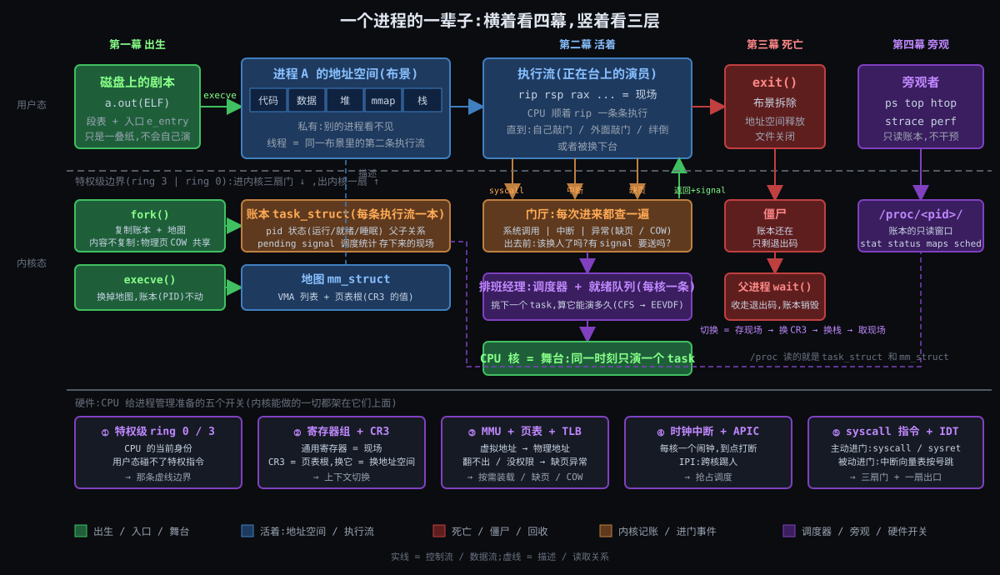
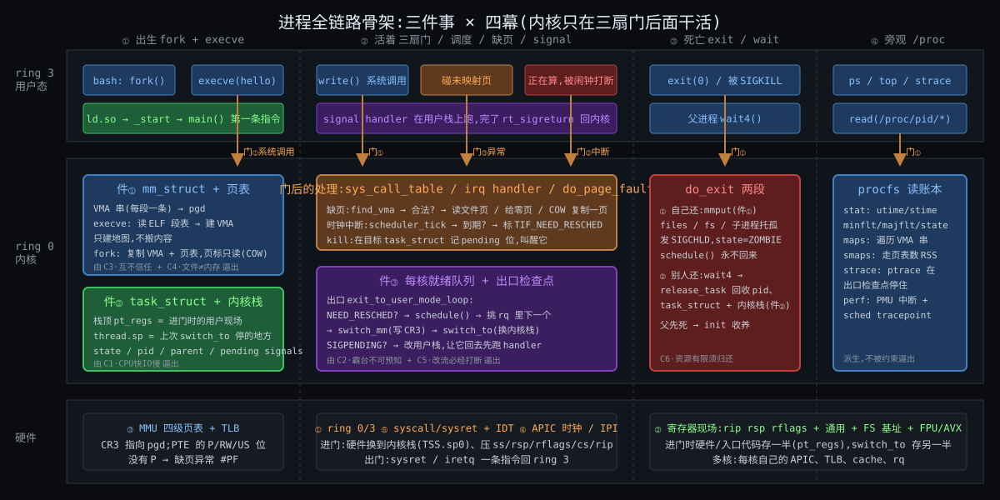
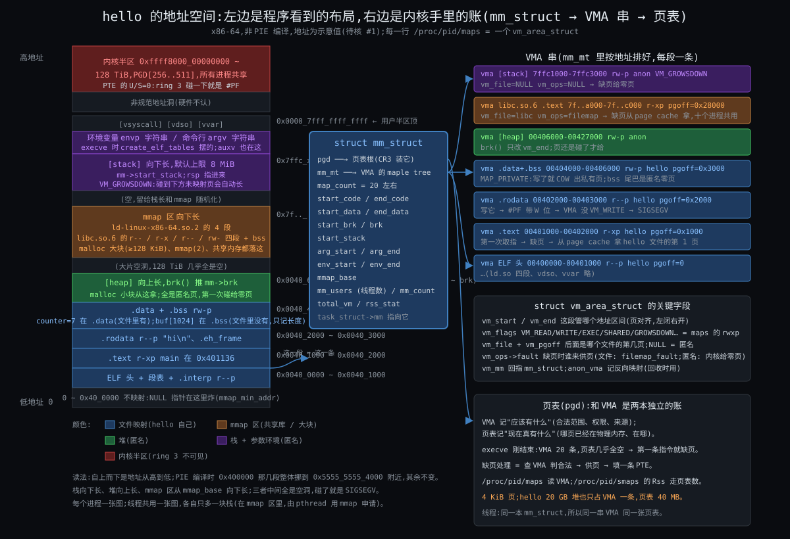
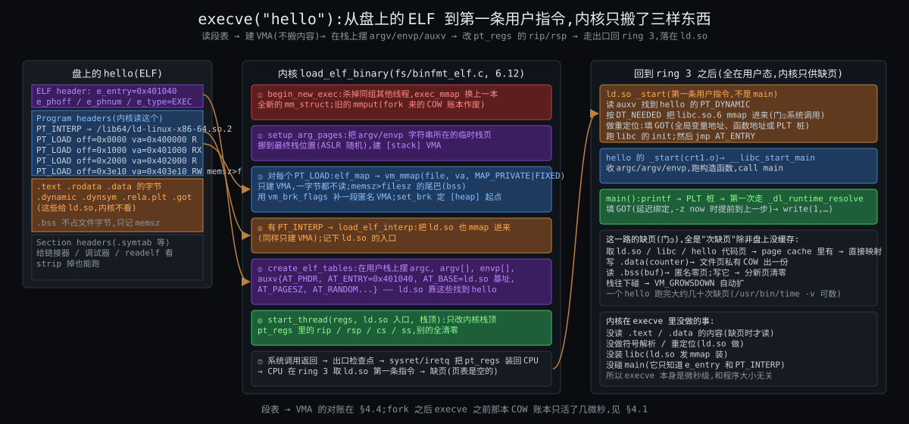
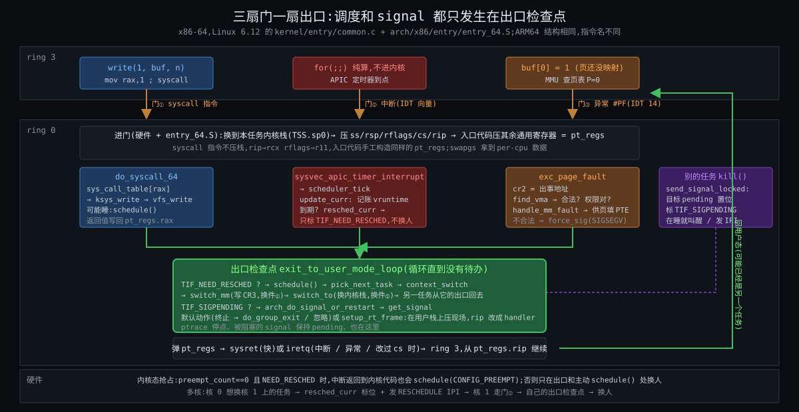
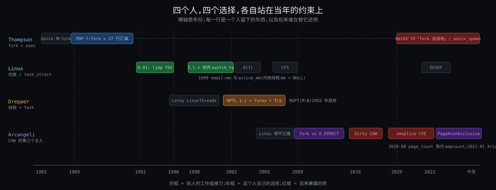
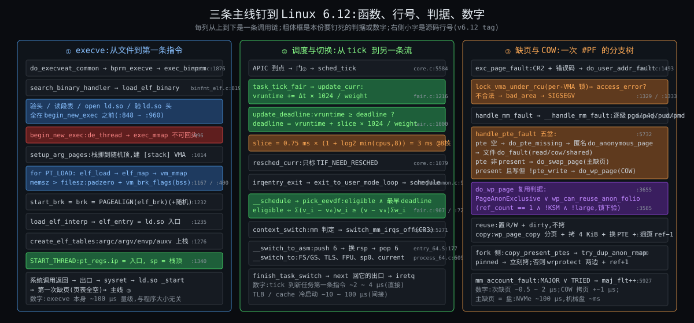
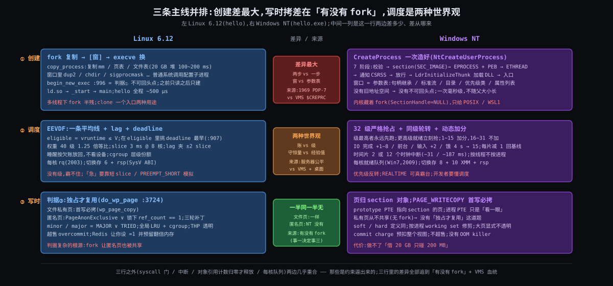
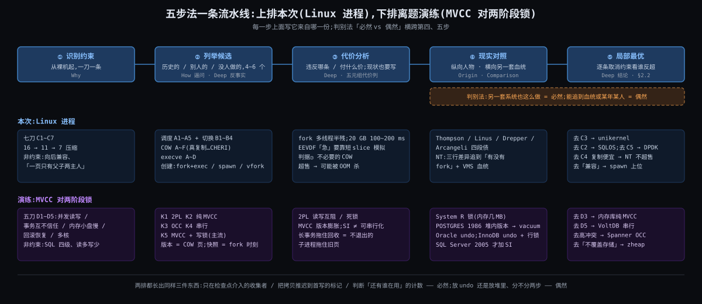

# Linux 进程全链路 | atlas 综合长文

> 一份以 Linux 6.12 为样本、以「一个进程的一辈子」为主轴的内核进程管理设计笔记 —— 四幕一条链 / 七刀七条约束 / 三件事三个判据 / 1969 ~ 2022 四个人 / 三条主线源码追踪(execve、调度与切换、缺页与 COW)/ 对照 Windows NT / 五元组 14 行 + 五步法 + MVCC 对两阶段锁验证

---

## 导读地图

本文是 atlas 苏格拉底式技术教学的**最终融合产物**,围绕**第一性原理**展开,陪你一篇一篇把 Linux 的进程从 execve 到上下文切换到调度器的整条链搞透,最终带走一套能离开内核领域使用的推导方法。

### 灵魂问题(Discovery 收集,贯穿全文)

> **"一个进程从磁盘上的二进制文件到被销毁,完整生命周期里内核每一站做了什么:(1) 进程怎么从磁盘的二进制文件装载到内存;(2) 二进制文件本身在磁盘上的结构,怎么解析、怎么确定入口、怎么链接、怎么映射到内存、怎么分配内存空间、怎么做符号重定位;(3) 怎么调度到 CPU 上执行,CPU 怎么做进程切换,典型调度算法的原理;(4) 怎么做系统调用,怎么响应中断(主 / 次缺页中断),什么是 COW,怎么响应 signal;(5) 怎么销毁一个进程;(6) 常用的进程监视工具及其原理。"**

走完全文你会从七个角度回答它:它是什么(What)、为什么非得长成「地址空间 + 执行流 + 账本」(Why)、每一站具体怎么做(How)、谁在什么约束下这样做的(Origin)、6.12 源码里到底怎么走(Deep)、换一套血统会长成什么样(Comparison)、这套推导怎么带走(Synthesis)。

### 覆盖的 7 篇

| 篇 | 它讲什么 | 篇幅 |
|---|---|---|
| **What** | 它是什么:一辈子四幕、剧场类比、CPU 的五个开关、两个开场钩子(PostgreSQL 每连接一进程 / Redis bgsave) | ~317 行 |
| **Why** | 为什么必须存在:从裸机起七刀,一刀一条,逼出 C1 ~ C7 | ~370 行 |
| **How** | 大致怎么工作:页表 → VMA → execve 七步 → 三扇门一扇出口 → 调度与切换 → 缺页 / COW / signal → exit → 旁观工具,60 行伪代码内核 | ~934 行 |
| **Origin** | 是怎么来的:Thompson 与 fork、Torvalds 与任务切换、Drepper 与 NPTL、Arcangeli 与 COW,严格一手资料 | ~454 行 |
| **Deep** | 深度剖析:三条主线钉到 6.12 行号,三个判据,反事实小试,tick 到换人逐步走,THP 与 Redis | ~1226 行 |
| **Comparison** | 横向对照:Windows NT 的 CreateProcess / 32 级优先级 / section 对象,差异全追到「有没有 fork」 | ~364 行 |
| **Synthesis** | ★ 设计哲学与方法论:五元组 14 行 / 六次取消约束 / 十一条洞察 / 三个同构 / 五步法 + MVCC 对两阶段锁验证 / 十年赌注 | ~449 行 |

### 阅读路径建议

- **第一次接触这条链** → 顺读(What → Why → How → Origin → Deep → Comparison → Synthesis)
- **想快速建立心智** → 看 [What](#stage-what) + [Why](#stage-why)(约 40 分钟)
- **想看清设计为什么这样** → 看 [Why](#stage-why) + [Deep](#stage-deep) + [Synthesis](#stage-synthesis)(约 2 小时)
- **想横向对比** → 直接看 [Comparison](#stage-comparison)(约 40 分钟)
- **想拿走方法论** → 直接看 [Synthesis §2 五元组](#stage-synthesis) 与 §5 五步法 + §5.6 MVCC 演练(约 1 小时)
- **只想看源码怎么走** → [Deep](#stage-deep) 的 §2 / §3 / §4 三条主线,行号全对 `v6.12`

**全长**约 4138 行、中文约 7.2 万字;深读约 6 小时,跳读约 1.5 小时。

### 全文导览

下面七篇按顺序展开,每两篇之间有一段过渡,做心智模式切换 —— 讲解员 → 论证者 → 实操员 → 讲故事的人 → 工程师 → 评论家 → 哲学家。每篇末尾都有「约束回扣」和「呼应你的问题」两节,把该篇内容钉回约束清单与灵魂问题;沿途的《你的视角》小节记的是你在对话里提出的猜想,认一半、拧紧一半。各篇内部的修订记录保留在 `stages/0X-*/0X-*.md` 里,这里不重复;全部待核项在文末统一核实并列表。

---

## 约束清单速查(C1 ~ C7)

> 后文所有 `Cn·短名` 引用都对应下面 7 条;**各篇不再重复列**。它们在第二篇 Why 里从一台裸机一刀一刀推出(七刀七条,一刀一条),后面五篇交叉引用。每条是 markdown 标题,后文用 `[C1](#c1)` 一类链接或 `Ctrl+F` 搜 `C3` 跳回这里。

<a id="c1" name="c1"></a>
#### C1·CPU快IO慢

CPU 比设备快 10⁴ ~ 10⁷ 倍,等待是常态;一核一次只跑一条流,但流的现场在指令边界上是一组有限寄存器,可存可取。
**不可再分**:物理时延与 GHz 时钟的差距消不掉;寄存器可读写是 ISA 承诺。
**口诀**:等就换人 → 现场必须能存

<a id="c2" name="c2"></a>
#### C2·霸台不可预知

程序不会主动让台;内核猜不到它下一步要算还是要等、要快还是要多。
**不可再分**:内核无法静态验证任意二进制;用户意图不在代码里。
**口诀**:到点硬换 → 换谁只能靠猜

<a id="c3" name="c3"></a>
#### C3·互不信任

程序可能有 bug 或恶意;有些操作(关中断 / 改页表根 / 操作设备)波及整机;程序又假定自己独占一套连续地址且可同时跑多份。
**不可再分**:代码来源、硬件结构、编译模型三样都不是内核能改的。
**口诀**:三道闸 → 跨任务的事全经内核之手

<a id="c4" name="c4"></a>
#### C4·文件≠内存

程序在盘上是文件,任务要的是页表;写文件的工具链和读文件的内核是不同方;内存远小于程序总量、单次只触及一小部分且有局部性;复制必须便宜。
**不可再分**:不同作者、年代、节奏;单位容量价格差一到两个数量级;局部性是程序结构的普遍性质。
**口诀**:只建地图不搬内容 → 缺页才搬

<a id="c5" name="c5"></a>
#### C5·改流必经打断

内核没有自己的 CPU;ring 3 的流不会自己停;内核只能在它进内核的瞬间介入。
**不可再分**:要控制一条流必须先拿到它的核。
**口诀**:三扇门一扇出口 → 一切挂出口上

<a id="c6" name="c6"></a>
#### C6·资源有限须归还

pid / 内存 / fd 有限,内核没有 GC;任务不能释放自己正在用的栈和账本。
**不可再分**:自己拆自己脚下的栈在逻辑上不可能;有限资源必须有归还点。
**口诀**:自己还大头 → 别人收尾

<a id="c7" name="c7"></a>
#### C7·核各自为政

核有独立 cache / 执行 / 时钟;跨核协调走互连,代价高一到两个数量级。
**不可再分**:多核的物理结构。
**口诀**:每核一张表 → 跨核靠 IPI

---

---

<a id="stage-what" name="stage-what"></a>

# 📍 第一篇:What — 它是什么

# 阶段 1:Linux 进程全链路是什么

> 这一份是**地图**:一个进程的一辈子分四幕,每一幕内核在做什么、交接什么;底下 CPU 给了哪五个开关。每一幕"为什么必须这样设计",后面按幕逐个拆。

## 一句话定义

**一份被内核记账的地址空间,加上在里面跑的执行流;生于 execve,死于 exit。**

记住两个名词:

- **地址空间**:它**拥有**什么 —— 代码、数据、堆、栈,一张只属于它的虚拟内存地图。
- **执行流**:它**正在做**什么 —— 一组寄存器的值 + 一个栈,CPU 顺着 `rip` 一条条往下执行。

内核给这两样各记一本账:地址空间记在 `mm_struct`,执行流记在 `task_struct`。后面四幕全是围绕这两本账的增、删、改、查。

一个马上会用到的推论:**线程就是"同一份地址空间里的第二条执行流"** —— 共用一本 `mm_struct`,各有一本 `task_struct`。

---

## 跨领域类比:剧场

想象一座剧场:舞台只有一个(或者几个),仓库里堆着几百本剧本,排队等着上台的剧团有几十个。

| 剧场 | 对应内核 | 这一环的本分 |
|---|---|---|
| **剧本**:印好的册子,放在仓库 | 磁盘上的 ELF 文件 | 只是一叠纸,不会自己演 |
| **剧团** | 进程 | 一套布景 + 一群演员 |
| **布景**:搭在台上的整套景片和道具 | 地址空间 | 剧团私有,别的剧团看不见、碰不着 |
| **演员** | 执行流 / 线程 | 同一剧团的演员共用一套布景 |
| **装台**:按剧本把布景搭起来,翻到第一幕第一句 | `execve` 装载 + 找入口 | 把纸变成能演的现场 |
| **舞台** | CPU 核 | 同一时刻一个舞台上只能有一个剧团在演 |
| **排班经理**:决定谁上台、演多久 | 调度器 | 公平,不让谁饿死 |
| **换场**:把台上剧团演到哪、每个演员站在哪记下来,换下一个剧团上 | 上下文切换 | 记现场、换布景、取现场 |
| **舞台监督**:演员不能自己碰灯光音响,要递条子请舞台监督操作 | 系统调用 / 特权级 | 用户态进内核的正门 |
| **场外有事**(火警、快递到了),舞台监督临时叫停 | 中断 | 不是演员请求的,是外面发生的 |
| **布景按需搭**:幕布上画着一扇门,演员真要走过去才临时把门装上 | 缺页异常(按需调页) | 不先搭全,用到再搭 |
| **分团巡演**:把布景原样"复制"一份,但道具谁改谁才真复制 | `fork` + COW | 复制便宜到可以随手用 |
| **经理塞到台上的纸条**,演员在下一句台词的间隙必须看 | signal | 异步通知,在返回用户态那一刻处理 |
| **解散**:布景拆掉,海报留着给总团看一眼才扔 | `exit` → 僵尸 → `wait` 回收 | 退出码得有人收 |
| **经理的排班表和账本**,谁都能翻 | `/proc` 与 ps / top / perf | 观察,不干预 |

这个类比里能直接推出几条后面会反复用到的性质:

1. **剧本 ≠ 剧团**。同一本 ELF 可以同时装成十个进程(十个 bash),剧本只读、布景各一份。所以 ELF 的代码段可以在十个进程间共享同一份物理页,数据段才各自复制。
2. **布景是剧团私有的**。一个剧团的演员摔了道具,别的剧团不受影响 —— 这就是 PostgreSQL 选进程的理由;代价是换场必须换布景(换 CR3),而同一剧团内换演员不用。
3. **舞台只有一个**。"并发"是排班经理靠换场造出来的错觉;换场本身不演戏,是纯开销,所以要尽量少换、换得快。
4. **演员碰不了灯光**。进内核只有三条路(递条子、场外有事、绊倒),每一条都是一次"用户态 → 内核态"的身份切换,这正是 CPU 特权级开关的用处。

---

## 一张全景图



读图的方法:**横着看是四幕,竖着看是三层**。四幕是时间顺序,三层是"谁看得见什么"。

能从图上读出来的 5 件事:

1. **用户态能看见的只有三样**:ELF 文件、自己的地址空间、正在跑的执行流。`task_struct`、调度器、僵尸都在虚线以下,进程自己看不见自己的账本。
2. **进内核只有三扇门(系统调用 / 中断 / 异常),出内核只有一扇(返回用户态)**。调度器"换人"和 signal 投递都挂在那扇出口上 —— 这是第二幕的全部骨架。
3. **`fork` 复制的是账本和地图,不复制内容**:物理页 COW 共享。**`execve` 换的是地图,账本(PID)不动**。
4. **`exit` 先拆布景(释放 `mm_struct`),账本留到父进程 `wait` 才销毁**;中间这段叫僵尸。
5. **旁观工具全是在读账本**:`/proc/<pid>/` 是 `task_struct` + `mm_struct` 的只读窗口,ps / top 读它;perf 另开一扇窗读 CPU 的硬件计数器。

**一个关键观察:内核里没有"进程"这个对象。** 内核只有 task(`task_struct`)。"进程"是用户态的叫法,等于"共享同一个 `mm_struct` 的一组 task",组长的 pid 就是这个进程的 pid(内核里叫 `tgid`)。所以 PostgreSQL 的 100 个 backend 进程和 MySQL 的 100 个连接线程,在调度器的就绪队列里是**同等公民** —— 差别只出现在切换时要不要换地址空间。

---

## 四幕各是谁

### 第一幕 出生:从 ELF 到地址空间(对应你的第 1、2 问)

ELF(Executable and Linkable Format)是剧本的印刷格式。它**一本两用**:

- 给**装载器**看的 program headers(段表):哪几段要映射进内存、映射到哪个地址、权限 r/w/x;入口地址 `e_entry`;需要哪个动态链接器(`PT_INTERP`,通常是 `/lib64/ld-linux-x86-64.so.2`)。
- 给**链接器**看的 section headers(节表):`.text` `.data` `.bss` `.symtab` `.rela.*`,符号表和重定位表住在这里。

Unix 把"造一个进程"拆成了**两步**:`fork()` 复制一个现成的(账本 + 地图,内容 COW),`execve()` 再把它的地址空间整个换成新剧本的 —— PID 不变、打开的文件默认不变,换掉的只是 `mm_struct`。

`execve` 在内核里做的事比想象的少:读 ELF 头 → 建一张新地图(一串 VMA:代码段在这、数据段在那、栈在顶上)→ 把动态链接器也映射进来 → 把 `rip` 指到入口。**它不真的把文件读进内存** —— 页等第一次被碰到时,由缺页异常搬进来(第二幕)。至于符号重定位、找 libc,内核根本不管,由用户态的 `ld.so` 在 `main()` 之前做完。

> "怎么解析、怎么定入口、怎么链接、怎么重定位、怎么分配内存"的具体步骤,留到讲内部机制时逐个拆。

### 第二幕 活着:与 CPU 和内核打交道(对应你的第 3、4 问)

一个 task 有三种状态:**运行**(在台上)、**就绪**(在队列里等舞台)、**睡眠**(等某个事件:磁盘、锁、网络、定时器)。调度器只管"就绪 → 运行"这一步:从就绪队列里挑一个,算它能跑多久(CFS,6.6 起换成 EEVDF)。**上下文切换** = 把当前执行流的寄存器存进它的 `task_struct` / 内核栈 → 换 CR3(如果是不同进程)→ 换内核栈 → 把下一条的寄存器装回来。

进内核的三扇门和一扇出口:

| 门 | 谁敲 | 例子 | 对应你的问题 |
|---|---|---|---|
| **系统调用** | 进程自己,主动 | `read` / `write` / `mmap` / `fork` / `exit` | 怎么做系统调用 |
| **中断** | 外部设备,被动 | 时钟 tick、网卡收包、磁盘 DMA 完成 | 怎么响应中断 |
| **异常** | 进程自己,但不是故意的 | 缺页(**主缺页**:页要从盘上读;**次缺页**:页已在内存,只是没建映射或要 COW)、除零、非法指令 | 主次缺页、COW |
| **出口:返回用户态** | 内核在每次出门前检查 | 该换人了吗?有 signal 要送吗? | 怎么响应 signal |

**COW 一句话**:`fork` 后父子共享物理页,页表项全部标成只读;谁先写谁触发一次次缺页,内核复制那一页、改回可写、放行。所以 COW 不是一个独立机制,是"缺页异常 + 页表权限位"的一种用法。

**signal 一句话**:signal 是内核 → 进程的反向通道。发送方只是在目标 `task_struct` 里记一个 pending 位;真正的"响应"发生在那扇出口 —— 返回用户态前,内核把用户栈改造一下,让进程回去时先跑 handler,跑完再回原处。

### 第三幕 死亡:exit 到回收(对应你的第 5 问)

`exit` 做的事:释放 `mm_struct`(布景拆除)→ 关文件 → 给自己的子进程找新父(init 或 subreaper)→ 给父进程发 `SIGCHLD` → 状态改成 `EXIT_ZOMBIE`,`task_struct` **留着**,只剩退出码和统计。父进程 `wait()` 读走退出码,`task_struct` 才真正释放。父不 `wait`,就一直是僵尸;父先死,孤儿被 init 收养。`kill -9` 也走同一条路,只是起点换成了 signal。

### 第四幕 旁观:账本的窗口(对应你的第 6 问)

| 工具 | 读哪本账 | 原理一句话 |
|---|---|---|
| `ps` / `top` / `htop` | `/proc/<pid>/stat`、`status` | 定时读 `/proc` 文本文件,前后两次做差算 CPU% |
| `vmstat` / `pidstat` | `/proc/stat`、`/proc/<pid>/stat` | `/proc/stat` 的 `ctxt` 行 = 全系统累计切换次数 |
| `cat /proc/<pid>/maps` / `smaps` | `mm_struct` 的 VMA 列表 | 地址空间的地图直接打印出来 |
| `cat /proc/<pid>/sched` | `task_struct` 的调度统计 | 跑了多久、等了多久、主动 / 被动切换各几次 |
| `strace` | `ptrace` | 每次系统调用进出都把目标停下来让父进程看一眼,所以慢一个数量级 |
| `perf` | `perf_event_open` + PMU 硬件计数器 + 内核 tracepoint | 硬件数 cycles / cache-miss,内核埋点数 `sched_switch` |
| `bpftrace` / eBPF | 内核 tracepoint / kprobe | 把小程序挂进内核统计,不停目标进程 |

全都是读账本,区别只是读哪一本、用什么窗口读。

---

## 硬件入门:CPU 给进程管理准备的五个开关

内核能做的一切,都架在 CPU 已经提供的几个硬件机制上。不讲电路,只说每个开关是什么、扳它会发生什么、哪一幕扳它。以 x86-64 为准,括号里是你 Mac 上 Apple Silicon(ARM64)的对应物。

### ① 特权级:ring 0 / ring 3

CPU 任何时刻都有一个"当前身份"。ring 3(用户态)不能执行特权指令(改 CR3、关中断、访问 IO 端口),也不能访问页表里标了"内核"的页;ring 0(内核态)什么都能做。进程在 ring 3 跑,内核在 ring 0。身份切换只能通过正门(⑤)。(ARM64:EL0 / EL1。)

**扳于**:全景图里那条虚线;整条链路上每一次用户态 ↔ 内核态。

### ② 寄存器组 + CR3

通用寄存器(`rip` 下一条指令、`rsp` 栈顶、`rax` 等十几个、`rflags`)= 执行流的全部现场,几十个 8 字节的值。`CR3` = 当前页表的根地址,**换掉它 = 换掉整个地址空间的翻译规则**。(ARM64:`TTBR0_EL1`。)

**扳于**:上下文切换 = 存现场 + 换 CR3 + 取现场。线程间切换**不换 CR3**。

### ③ MMU + 页表 + TLB

MMU 把每个虚拟地址按页表翻译成物理地址。页表项除了物理页号,还有 present / 可写 / 用户可访问 几个权限位;翻不出来或权限不对,CPU 就报**缺页异常**交给内核处理。TLB 是翻译结果的缓存,换 CR3 后大部分作废,要重新填。(ARM64 同构,ASID 让切换时不必全部作废。)

**扳于**:第一幕的按需装载,第二幕的缺页 / COW;也是切换成本里最大的隐性部分。

### ④ 时钟中断 + APIC

每个核的 local APIC 自带一个定时器,到点就打一次中断 —— **这是调度器的闹钟**:没有它,一个死循环的进程永远不会被换下来。APIC 还能发核间中断(IPI),让一个核"踢醒"另一个核去调度。(ARM64:GIC + generic timer。)

**扳于**:第二幕的抢占。

### ⑤ syscall / sysret 指令 + 中断向量表 IDT

从 ring 3 进 ring 0 的两个正门:`syscall` 指令(主动)跳到内核预先登记的入口,`sysret` 回来;IDT 是 256 项的"按铃对应表",中断、异常各占一项,硬件按号跳转。(ARM64:`svc` / `eret`,`VBAR_EL1` 向量表。)

**扳于**:第二幕的三扇门和一扇出口。

| 开关 | 一句话 | 哪一幕扳它 |
|---|---|---|
| ① 特权级 | CPU 的当前身份,决定能不能碰特权指令 | 每一次进出内核 |
| ② 寄存器 + CR3 | 现场 + 地址空间的根 | 切换 |
| ③ MMU / 页表 / TLB | 翻译,翻不出就报缺页 | 装载、缺页、COW、切换成本 |
| ④ 时钟中断 + APIC | 闹钟 + 跨核踢人 | 抢占 |
| ⑤ syscall + IDT | 进内核的正门 | 三扇门 |

---

## 关键词速查表

| 术语 | 一句话说明 | 哪一幕 |
|---|---|---|
| ELF | 可执行文件格式;段表给装载器、节表给链接器 | 一 |
| `fork` / `execve` / `clone` | 复制一个 task / 换掉地址空间 / `fork` 的底层通用版(线程也用它) | 一 |
| `task_struct` | 内核的账本,每条执行流一本 | 全程 |
| `mm_struct` / VMA | 地址空间的地图 / 地图上的一段 | 一、二 |
| 上下文切换 | 存现场 + 换 CR3 + 换内核栈 + 取现场 | 二 |
| 调度器(CFS → EEVDF) | 从就绪队列挑下一个、算配额 | 二 |
| 缺页异常(主 / 次) | 页要读盘 / 页已在内存只需建映射或 COW | 一、二 |
| COW | 共享只读,谁写谁复制 | 一、二 |
| signal | 内核 → 进程的异步通知,返回用户态时投递 | 二 |
| 僵尸 / `wait` | 布景拆了账本留着 / 父进程收尸 | 三 |
| `/proc/<pid>` | 账本的只读窗口 | 四 |

---

## 边界:进程、线程、内核线程、协程

| | 内核看得见? | 自己的地址空间? | 共享什么 | 切换走哪条路 | 例子 |
|---|---|---|---|---|---|
| **进程** | 是(`task_struct`) | 是(独立 `mm_struct`) | 几乎不共享;要共享得显式用共享内存 | 换 CR3 的完整切换 | PostgreSQL backend、bash |
| **线程** | 是(`task_struct`,`tgid` = 组长 pid) | 否(共用组长的 `mm_struct`) | 地址空间、文件表、signal 处理表 | 不换 CR3 的切换 | MySQL 连接线程、Java 线程 |
| **内核线程** | 是(`task_struct`,`mm = NULL`) | 没有用户态地址空间 | 只在内核态跑,借用上一个 task 的页表 | 不换 CR3 | `kworker`、`ksoftirqd`、`kswapd` |
| **协程 / 用户态线程** | **否** | 否(寄居在一个线程里) | 整个宿主线程 | 用户态库自己存 / 取寄存器,不进内核 | goroutine、Java 虚拟线程、Python asyncio |
| **容器** | 不是新物种 | — | — | — | namespace 换 task 看到的"世界",cgroup 给 task 贴资源标签 |

怎么记这张表:

- **前三行都是 task**,差别只在 `clone()` 时传的 flags:`CLONE_VM | CLONE_FILES | CLONE_SIGHAND | CLONE_THREAD` 全传就是线程,一个都不传就是进程,`mm` 干脆为空就是内核线程。Linux 没有单独的"线程"对象,这就是上面那个关键观察的来源。
- **协程在内核的分辨率以下**。内核只看见宿主线程;协程切换是用户态函数调用级别的开销(几十 ns 量级),而 task 切换要进内核(μs 量级)—— 这是 Go / 虚拟线程存在的理由。代价是:任何一个协程做了阻塞系统调用,整条宿主线程连同上面所有协程一起睡(所以 Go runtime 要把阻塞系统调用挪到别的线程、网络 IO 走 netpoller)。
- **容器只是贴标签**。namespace 改的是一个 task 看见的 pid 空间、文件树、网络栈;cgroup 改的是调度器给它多少 CPU、内存上限多少。task 还是那个 task。

### 拆开说:进程切换和线程切换差在哪

**问题来源**:上面说 PG 的 backend 进程和 MySQL 的连接线程在调度器眼里是同等公民,那"切换"这件事两者到底差在哪?

**先说结论**:切换分两半 —— **换执行流**(两者都做)和**换地址空间**(只有进程间切换做)。差别就是后一半,落在硬件开关②(CR3)上,再牵连开关③(TLB)付隐性代价。

**分岔点**:调度器挑出下一个 task 之后,内核看一眼:下一个 task 的 `mm_struct` 和当前的是不是同一本?

| 步骤 | 做什么 | 扳哪个开关 | 线程间(同 mm) | 进程间(不同 mm) |
|---|---|---|---|---|
| 1. 存现场 | 把当前 task 的通用寄存器压进它自己的内核栈,栈顶指针记进 `task_struct` | ② 寄存器 | 做 | 做 |
| 2. 换地址空间 | 把下一个 task 的页表根写进 CR3 | ② CR3 | **跳过** | **做** |
| 3. 换内核栈 | 让 `rsp` 指向下一个 task 的内核栈 | ② 寄存器 | 做 | 做 |
| 4. 取现场 | 从那条栈上弹出下一个 task 的寄存器,跳回它上次停下的地方 | ② 寄存器 | 做 | 做 |

步骤 1、3、4 两者一样,都是几十个寄存器的存取,μs 以下。差别只在步骤 2 那一条写 CR3 的指令 —— 指令本身很便宜,贵的是**它的后果**。

**结果:写 CR3 牵连 TLB(开关③)**

TLB 里缓存的是"虚拟地址 → 物理地址"的翻译结果,而这些结果只对**当前这张页表**成立。CR3 一换,旧条目全部不可信:

- 没有 PCID 的老 CPU:写 CR3 直接把 TLB 清空。新进程跑起来的头一批访存,每一次都得由 MMU 重新走一遍四级页表(最多 4 次内存访问)才能拿到物理地址 —— 这叫 TLB 冷启动,是进程切换成本里最大的隐性部分。
- 有 PCID 的 CPU(Intel Haswell 起;Linux 4.14 起启用,已核 #4):TLB 条目带一个"进程编号"标签,写 CR3 时不清空,只是不再命中别人的条目。切回来时如果条目还在,就不用重填。ARM64 的 ASID 是同一个思路。
- 线程间切换 CR3 不动,TLB 里的翻译全部继续有效,而且两条线程共用的代码、全局数据在 cache 里也还是热的。

数字量级(已核 #5):直接开销(四步本身)两者都在 1~2 μs(Haswell 实测绑核 1.2 ~ 1.5 μs、不绑 2.2 μs);进程间切换的间接开销(TLB 冷启动 + cache 里是别人的数据)视工作集大小,等效损失从几十 μs 到上千 μs(2007 年的经典测量:直接 3.8 μs,间接随工作集从几 μs 到超过 1000 μs)。所以"线程切换比进程切换便宜"这句话,便宜的不是四步本身,而是省掉的那次 TLB 冷启动。

**一个旁注**:换 CR3 的代价不只出现在进程切换。2018 年 Meltdown 补丁(KPTI)让用户态和内核态各用一张页表,每次系统调用进出都要换一次 CR3,这就是那批补丁让系统调用明显变慢的原因 —— 同一个开关,同一种代价。

**回到两个数据库**:MySQL 两个连接线程 A → B,四步里跳过第 2 步,TLB 热着;PG 两个 backend 1 → 2,第 2 步要做,没有 PCID 时 backend 2 的头一批访存全部要重新走页表。调度器排班的时候两者确实是同等公民,但排完班、真正换场的那一下,进程间要多付一次"换布景"的钱。

**内核线程是个例外**:它 `mm = NULL`,切换上来时直接借用上一个 task 的页表(`active_mm`),不写 CR3 —— 反正它只在内核态跑,内核那半边地址空间每张页表里都一样。

**你的凝练**:「TLB 才是贵的。」—— 对。写 CR3 是一条指令,TLB 冷启动才是账单;PCID / ASID 的全部意义就是把这张账单变小。

---

## 开场钩子一:PostgreSQL 每连接一进程 vs MySQL 每连接一线程

**先说结论**:两家都是"一个连接一条执行流",分歧只在**这条执行流要不要自己的地址空间**。

| 维度 | PostgreSQL(进程) | MySQL(线程) |
|---|---|---|
| 建立连接 | postmaster `fork()` 一个 backend:复制账本 + 地图,物理页 COW | mysqld `pthread_create`:新建一个 task,共用 `mm_struct` |
| 连接的代价 | 高:`fork` 要逐条复制页表项,新 backend 还要靠缺页把自己的页一页页 fault 进来(fork 本身零点几 ms,但新 backend 的初始化占大头,整体 ms 级,已核 #3);所以生产环境几乎必配 pgbouncer | 低(几十 μs 量级,已核 #3);高并发下再用线程池摊薄 |
| 共享 buffer pool | 必须**显式**:`shared_buffers` 放在一段共享内存里,每个 backend 都把它映射进自己的地址空间 | **天然**:全局变量就是共享的 |
| 一个连接的代码崩了 | 野指针只能写坏自己的地址空间,别的 backend 的内存不会被悄悄污染(postmaster 出于保险会让全部 backend 重启,但数据没被写坏) | 整个 mysqld 挂:同一地址空间,一个线程的野指针可以写坏任何线程的数据 |
| 切换 | 不同 backend 之间换 CR3,TLB 大部分作废 | 线程间不换 CR3 |
| 调度器眼里 | 100 个 task | 100 个 task,同等公民 |

一句话:**进程 = 用代价换隔离;线程 = 用隔离换代价。** 两家的选择都是各自的约束逼出来的(PG 从 1986 年的 Postgres 起就是进程模型,把可靠性排在前面),到底是哪些约束,下一步逼。

## 开场钩子二:Redis bgsave:fork 出一张快照

Redis 用一条线程跑所有命令。要把 20 GB 的内存落盘成 RDB 文件,又不能停服务 —— 它的办法是 `fork()` 一个子进程:子进程看到的是 fork 那一刻的**冻结副本**,慢慢写盘;父进程继续改内存,改到哪一页,哪一页才被真正复制(COW)。

一个算例,看 fork 到底付了什么:

- 20 GB 堆 ÷ 4 KB 一页 = 524 万页;每页一条 8 字节的页表项 → 页表本身约 **40 MB**。
- fork 不是 memcpy 这 40 MB 就完事:内核要**逐条**处理这 524 万个页表项 —— 复制、标成只读、给每个物理页的引用计数 +1。Redis 官方文档给过实测表:物理机约 **9 ms / GB**、VMware 虚机约 13 ms / GB、老式 Xen 云实例可到 240 ~ 420 ms / GB(已核 #1),20 GB 在物理机上就是两百多毫秒。这段时间 Redis 主线程是停的,这就是 Redis 文档里著名的"fork latency"。
- fork 完,父进程每写一页就触发一次次缺页 + 4 KB 拷贝(约 2 μs,已核 #2);写得越热,被复制的页越多,极端情况 RSS 翻倍。

**一句话**:进程复制之所以用得起,全靠"只复制地图、不复制内容"。COW 是 `fork` 的基础设施,不是 Redis 的技巧;Redis 只是把这个基础设施用到了极致。

**一个你答对的推论**:父子**各有一本** `mm_struct`、各有一套页表,只是两套页表暂时指向同一批物理页。所以父子之间切换要写 CR3(四步表的第 2 步),TLB 照样要冷启动 —— 哪怕两张页表此刻翻译出来的结果一模一样,CPU 也不知道。

## 你的视角

> 「这两个是进程的两个方面,一个是共享进程空间,一个是 COW。」

认。再拧紧一点:**两个钩子问的是同一个东西 —— 地址空间**。钩子一问"要不要共享"(线程共享,进程不共享);钩子二问"不共享的时候,复制一份怎么才便宜"(COW)。所以进程一出场,最硬的那条性质就是"它拥有一个地址空间";线程、COW、切换成本、隔离,全是这一条性质的不同侧面。

> 「没有进程,OS 在使用 CPU 的时候效率会比较低,甚至可能退化到只能服务单个用户的场景,因为 CPU 没法方便地在多个用户、多个任务之间切换、保存状态。更不用说多核时代了。」(你对"没有进程的世界"的第一反应)

认一大半。你说的三件事 —— CPU 利用率低、退化成单用户、多核没法用 —— 正好对应"执行流"那半本账:没有一个能**存下来再取回来**的现场,CPU 就只能从头到尾伺候一个任务。两处拧紧:

1. "效率低"的源头要再往下挖一层:CPU 比磁盘 / 终端快几个数量级,一个任务一等 IO,CPU 就空转。最早逼出"多道程序"的不是多用户,是这个速度差 —— 这会是约束清单里的第一条。
2. 你只说到了"切换、保存状态",那是**执行流**这半;"多个用户"还逼出另外半本账 —— **地址空间**。没有它,多个用户的任务挤在同一片内存里,一个野指针就能写坏别人的数据,多用户在技术上可行、在信任上不可行。所以"进程"一定是两半合起来的:能存取的现场 + 私有的地址空间。

这段是下一步"约束清单"的开场白,到时候从这三个痛点(CPU 等 IO 空转、用户互不信任、多核)一条条长出来。

---

## 最后的预留:调参、隔离与启动加速

有一批东西站在主线之上,改的不是"进程怎么活",而是"**活得多快、分到多少、起得多快**":

- **分配与隔离**:`nice`、cgroup 的 `cpu.weight` / `cpu.max`、cpuset、CPU 亲和、`SCHED_FIFO` / `SCHED_DEADLINE` 实时类、NUMA 感知。
- **启动加速**:`vfork` / `posix_spawn`(跳过复制地图)、大页(减少缺页次数和页表体积)、静态链接 / prelink(省掉重定位)。

全部主线讲完后,再拿四幕当坐标,逐个看它们在哪一幕动手、省掉了什么。

---

## 呼应你的问题

你的六问,现在都有了挂的位置:

| 你的问题 | 挂在哪一幕 | 这份地图回答到哪 | 剩下的交给 |
|---|---|---|---|
| 1. 怎么从磁盘装载到内存 | 一 | `fork` + `execve` 两步;`execve` 只建地图不搬内容 | 内部机制(按需调页的每一步) |
| 2. ELF 结构 / 解析 / 入口 / 链接 / 映射 / 分配 / 重定位 | 一 | 段表给装载器、节表给链接器;重定位在用户态 `ld.so` | 内部机制 + 源码细节 |
| 3. 怎么调度 / 怎么切换 / 调度算法 | 二 | 三状态;切换 = 存现场 + 换 CR3 + 换栈 + 取现场;闹钟是时钟中断 | 内部机制(CFS / EEVDF 的数学)+ 源码 |
| 4. 系统调用 / 中断 / 主次缺页 / COW / signal | 二 | 三扇门一扇出口;COW = 缺页 + 权限位;signal 挂在出口 | 内部机制 |
| 5. 怎么销毁 | 三 | 先拆布景后销账本;僵尸是中间态 | 内部机制 |
| 6. 监视工具及原理 | 四 | 全是读账本;`/proc` 是窗口,perf 读硬件计数器 | 内部机制(每个工具读哪个字段) |

但"**为什么非得这样**"一个都还没回答:为什么造进程要拆成 `fork` + `execve` 两步而不是一步?为什么 `execve` 不直接把文件读进来、非要等缺页?为什么 CPU 要分 ring 0 / 3?为什么死了还要留一具僵尸?为什么调度器需要一个硬件闹钟?这些答案藏在一组更底层的约束里,而这组约束正是下一步要一条条摆出来的。

---

---

> **🔄 心智切换:讲解员 → 论证者(共情模式)**
>
> 上面用一个剧场的类比和一张四幕全景图,立起了「一个进程的一辈子」的骨架:出生、活着、死亡、旁观,每一幕内核交接什么、CPU 给了哪五个开关。但只看地图不知道这个形状为什么非得这样。下一篇回到原点:从一台没有操作系统的裸机出发,让程序直接占着 CPU、直接写物理内存、直接等磁盘,看它在哪一步撞墙 —— 每撞一次墙,就逼出一条不可再分的约束。读完你会拿到七刀七条约束 C1 ~ C7,它们是后面五篇所有设计决策的唯一依据。

---

<a id="stage-why" name="stage-why"></a>

# 📍 第二篇:Why — 为什么必须存在

# 阶段 2:Linux 进程全链路为什么必须存在

> 上一份地图回答了"一个进程的一辈子有哪四幕、每幕交接什么"。这一份回答"是什么硬约束逼着内核非得把一个任务长成'地址空间 + 执行流 + 账本'这个形状"。写法是:从一台没有操作系统的裸机出发,每解决一个痛点就露出下一个,直到四幕全被逼出来。**七刀,七条约束,一刀一条**:C1 ~ C7 是后面所有讨论的脊梁,每一条都直接对应一簇机制。

你在上一轮给过"没有进程的世界"的第一反应:CPU 效率低、退化成单用户、多核没法用。下面七刀,前三刀就是把这三句话切成可以引用的约束。

---

## 没有它的世界

### 开场:裸机 —— 一段程序独占一切

机器上电。固件把盘上第一个扇区搬到内存 `0x7C00`,跳过去执行;或者 UEFI 把一个文件装进内存,跳过去执行。从这一刻起,**你的代码就是机器上唯一在跑的东西**:

- 它独占 CPU:没有人会打断它,它不让出,CPU 就一直是它的。
- 它独占全部物理内存:地址 `0x1000` 就是物理第 4096 字节,想写哪写哪。
- 它独占所有设备:直接往网卡 / 磁盘控制器的寄存器里写命令,直接接中断。
- 它什么账本都没有:没有 pid,没有状态,没有"谁"的概念 —— 因为只有一个"谁"。

这不是假想。单片机上的 Arduino 程序就是这么跑的;GRUB 这种引导程序就是这么跑的;1950 年代的计算机就是这么跑的 —— 操作员把一盘纸带装上,机器从头跑到尾,下一个用户再来装下一盘。

注意一件事:在这个世界里,**"进程"这个词没有意义**。进程是用来区分"这一个"和"那一个"的,只有一个东西时无需区分。所以接下来每一刀,本质上都是在回答同一个问题:**当机器上要同时存在不止一个东西时,内核必须替它们记住什么、隔开什么、裁决什么。**

---

### 第一刀:CPU 等 IO 空转 → 多道程序 + 可存取的现场

**痛点**。裸机上的程序要读一段磁盘。今天的数字:一条指令 ≈ 0.3 ns(3 GHz),NVMe 一次读 ≈ 10 ~ 100 μs,机械盘 ≈ 5 ~ 10 ms。一次等待,CPU 空转掉 **10⁴ ~ 10⁷ 条指令**的时间。1960 年代更惨:读卡机(IBM 711)每分钟 250 张卡,一台 IBM 7090 1960 年售价 290 万美元或月租 6.35 万美元(已核 #1),大部分时间在等纸卡。

场景具体一点:一个报表作业,算 1 秒、读盘 4 秒,循环十万次。单道跑法 CPU 利用率 20%,五台机器的钱只买到一台的算力。

**引入**。因为 C1·CPU快IO慢(速度差 10⁴ ~ 10⁷ 倍,物理事实,消不掉)→ 要解决"一个任务等 IO 时 CPU 别闲着"→ 所以把**几个任务同时装进内存,A 等 IO 时跑 B**(多道程序)。

但"跑 B 再回来跑 A"有一个前提:A 停下时的全部状态能存起来、以后能原样取回。幸运的是 CPU 架构给了这个前提 —— **一条执行流在任意一条指令的边界上,全部状态就是一组有限的寄存器(x86-64 上几十个 8 字节)+ 内存**。把寄存器存进内存、以后再装回去,A 就像从没停过。这组存下来的寄存器,就是账本 `task_struct` 里的第一个字段 —— **执行流这半本账,从这一刀开始存在**。这条"一核一次只跑一条流、现场可存可取"的事实不单独立项,它是 C1·CPU快IO慢 的另一半:速度差逼出轮流,现场可存让轮流成为可能。

还要一件事:A 等的 IO 完成了,谁知道?CPU 正在跑 B。所以设备完成时必须能**打断** B,让内核看一眼 —— 这是中断的第一次出场(开关④的雏形),第五刀会正面讲。

**浮现的约束**:

- **C1·CPU快IO慢** CPU 比设备快 10⁴ ~ 10⁷ 倍,等待是常态;一核一次只跑一条流,但流的现场在指令边界上可存可取,所以可以轮流

**解决完露出的新痛点**:B 是一个死循环,或者一个要算三小时的作业。它永远不做 IO、永远不停,A 永远回不来。谁来把 B 拉下来?拉下来之后,下一个跑谁?

---

### 第二刀:霸台 → 闹钟 + 排班

**痛点**。多道程序依赖"任务主动停下来"。Windows 3.x 和 Mac OS 9 真的是这么做的(协作式多任务):每个程序自己决定什么时候把 CPU 还回去。结果谁都用过 —— 一个程序卡死,整台机器跟着卡死,鼠标都不动。

再加一个事实:人坐在终端前面。人能感觉到的延迟阈值大约 **100 ms**;超过 1 秒就觉得"卡"。1961 年 MIT 的 CTSS 要让几十个人同时用一台机器、每个人都觉得机器是自己的,那就必须每隔几十毫秒就换一个人上台 —— 不能等任务自愿。

**引入**。因为 C2·霸台不可预知(台上的程序不会主动让出 —— bug、死循环、或者故意;内核又猜不到它下一步要算还是要等)+ C1·CPU快IO慢 的后半句(一个核一次只能跑一个,"同时"只能靠轮流造出来)→ 要解决"不管台上的程序愿不愿意,到点必须换人"→ 所以引入**硬件闹钟**(开关④:APIC 定时器到点打中断,中断不受程序控制)+ **排班规则**(调度器:换谁上、给多久)。

排班规则为什么是个难题,而不是"轮着来"就完了?因为内核**不知道任务接下来要干什么**:下一毫秒它是要算、还是要等键盘?它是交互式的(要快响应)还是批处理(要高吞吐)?任务自己也说不准。所以调度器只能靠**过去的行为猜未来**,这就是后面所有调度算法(从多级反馈队列到 CFS 到 EEVDF)的共同出发点。

**浮现的约束**:

- **C2·霸台不可预知** 程序不会主动让台;内核无法预知它下一步要算还是要等、要快还是要多,只能用过去推测

**解决完露出的新痛点**:A 和 B 现在轮流上台了。但它们住在同一片物理内存里。B 的一个野指针写到了 `0x1000`,那是 A 的数据。更糟的是,B 完全可以执行一条 `cli`(关中断)—— 第二刀的闹钟就哑了。

---

### 第三刀:互不信任 → 地址空间 + 特权级(本份加厚的一刀)

**痛点**。三种伤害,都真实发生过:

1. **读别人的**。多用户机器上,学生 A 的程序扫一遍物理内存,就能读到教授 B 正在编辑的成绩。
2. **写坏别人的**。DOS 时代一个程序的野指针可以写坏另一个程序,或者写坏 DOS 本身,然后整机重启。Windows 95/98 的蓝屏有相当一部分是这么来的。
3. **拖死别人的**。一条 `cli` 关掉中断,闹钟就哑了,第二刀白做;一条 `out` 指令直接往磁盘控制器写命令,能把别人的数据覆盖掉;改一下页表根(后面会有)就能把别人的内存映射到自己这里。这些操作的共同点:**一个任务做了,全机受影响**。

**引入**。C3·互不信任 有三个面,三道闸各堵一面:

- 因为程序不可信,而编译链接出来的程序又假定自己独占一套连续地址(`main` 在 `0x401000`,全局变量在 `0x404000`;而且同一个程序要能同时跑十份)→ 要解决"让每个任务以为自己独占内存,实际上互相看不见"→ 所以引入**地址空间**:每个任务一张自己的页表,CPU 的 MMU(开关③)按它翻译;翻译表里没有的地址,碰了就是异常。**这就是账本的另一半 `mm_struct`**。两个任务都用 `0x1000`,翻译到不同的物理页;A 的页表里根本没有 B 的页,想读也读不到。
- 因为有些操作波及整机(关中断、改页表根、直接操作设备 —— 这些资源物理上只有一份,影响的不是发出者自己,而是整台机器)→ 要解决"这些操作只能由一个可信的人做"→ 所以引入**特权级**(开关①):任务跑在 ring 3,特权指令一执行就是异常;只有内核跑在 ring 0。
- 可任务还是得读盘、得申请内存 —— 不能自己动手,就只能**请求**。因为任务不可信而内核可信,又必须有一条路从 ring 3 到 ring 0 → 要解决"让任务能请求但不能乱来"→ 所以引入**系统调用这扇正门**(开关⑤):只能从内核登记好的固定入口进,进来之后跑的是内核代码,参数由内核检查。

三道闸合起来,"任务"第一次变成了后来叫"进程"的那个东西:**私有的地址空间 + 可存取的现场 + 一本内核的账**。

**浮现的约束**:

- **C3·互不信任** 程序可能有 bug、可能恶意;有些操作(关中断 / 改页表根 / 操作设备)波及整机;程序又假定自己独占一套连续地址且可同时跑多份 —— 所以任何跨任务的动作都必须经内核之手

(第二刀的"不让台"也是不信任的一种,所以闹钟其实是第三刀的第四道闸;它先出场只是因为痛点先出现。)

**解决完露出的新痛点**:每个任务有了私有地址空间 —— 那这个地址空间怎么**来**?程序在盘上是一个文件,文件怎么变成一张页表?想起十个 bash,要装十次吗?复制一个 20 GB 的任务,真的复制 20 GB 吗?

### C3·互不信任 展开:三道闸怎么把一台机器隔成 N 台(以及它跟数据库事务隔离是不是一回事)

这一节单独加厚,因为它逼出的东西最多:地址空间、ring 0/3、系统调用、缺页、COW、僵尸都挂在它下面。

#### 问题的精确形状

N 份互不信任的代码共用一台机器,一份代码能对另一份造成的伤害只有三种:**读它的、写它的、拖死它**。每一种对应一个硬件资源 —— 读写对应内存,拖死对应 CPU 和设备。所以隔离的最小配置就是三道闸,不多不少:

| 伤害 | 用的资源 | 闸 | 硬件开关 | 闸关上之后任务还能怎么用这个资源 |
|---|---|---|---|---|
| 读 / 写别人的内存 | 内存 | 地址空间(每任务一张页表) | ③ MMU | 只能用自己页表里有的地址;要共享得显式申请(共享内存、mmap 同一文件) |
| 拖死别人:霸占 CPU | CPU | 闹钟(时钟中断 + 抢占) | ④ APIC | 到点就被换下,无论愿不愿意 |
| 拖死别人:关中断 / 乱操作设备 / 改页表 | 整机 | 特权级(ring 3 不能执行特权指令) | ① ring | 只能通过系统调用**请求**内核代劳 |

注意最后一列:**每道闸都不是"禁止",而是"必须经内核之手"**。任务仍然能共享内存、仍然能用满 CPU、仍然能读盘,只是每一样都要先过内核。隔离的本质不是把任务关起来,而是**把所有跨任务的动作收口到内核**。

#### 闸的代价

每道闸都不是免费的,而且代价的形状决定了后面大量设计:

| 闸 | 一次性代价 | 每次跨闸的代价 | 后面谁来付 |
|---|---|---|---|
| 地址空间 | 每个任务一套页表(20 GB 堆 ≈ 40 MB 页表,见上一份 Redis 算例) | 切换时写 CR3 + TLB 冷启动(你已经抓到:TLB 才是贵的) | fork 的 COW、PCID / ASID、线程(干脆共享,不付) |
| 特权级 | — | 每次系统调用跨一次态,百 ns 量级(5.10 实测:无 PTI 80 ns,有 PTI 200 ns);KPTI 之后还要换页表(已核 #2) | vDSO(把 `gettimeofday` 搬回用户态)、io_uring(批量提交减少跨态) |
| 闹钟 | — | 每个 tick 一次中断;每次抢占打断 cache | tickless 内核(NO_HZ)、调度器尽量少换人 |

#### 跟数据库事务隔离是不是一回事?

你熟的那个系统里也有"N 份互不信任的工作共用一份资源"的问题,解法长得很像:

| 数据库 | 内核 | 像在哪 |
|---|---|---|
| 一个事务 | 一个 task | 都是"一份工作 + 它的私有状态" |
| 事务看到的快照(MVCC 私有视图) | 私有地址空间 | 各看各的,互不干扰;共享要显式(共享缓冲池 ↔ 共享内存段) |
| 隔离级别:serializable → read uncommitted | `clone()` 的 flags:进程(全隔离)→ 线程(全共享) | **clone flags 就是 task 的隔离级别**:`CLONE_VM` 共享内存,`CLONE_FILES` 共享文件表,`CLONE_SIGHAND` 共享信号处理 —— 一个 flag 放开一样共享 |
| 一个事务 abort,别的事务的数据不受污染 | 一个 backend 段错误,只死它自己 | 这就是 PostgreSQL 选进程的理由(上一份钩子一) |
| MVCC 的版本链、undo、GC 的代价 | 页表、TLB、COW 的代价 | 隔离都要花钱;隔离越彻底越贵 |
| DBA 账号 vs 普通账号 | ring 0 vs ring 3 | 影响全局的操作只给可信的一方 |
| 锁等待超时、死锁检测 | 时钟中断 + 抢占 | 都是"不能指望参与者自觉"的兜底 |

两处不一样,而且是本质的:

1. **数据库隔离的是语义,内核隔离的是地址**。serializable 保证的是"结果等价于某个串行执行",这是一个关于数据正确性的承诺;地址空间只保证"你碰不到别人的字节",对数据语义一无所知。所以内核隔离便宜得多,也笨得多 —— 两个进程通过共享内存乱写,内核不管。
2. **事务有 commit,进程没有**。事务的隔离是临时的,commit 之后变化对所有人可见;进程的隔离是永久的,从 `execve` 到 `exit` 一直生效,没有"把我的地址空间发布给大家"这一步。要共享就得一开始就共享(线程),或者显式开口(mmap / shm)。

#### 这道闸不是唯一形状

隔离也可以不靠硬件:语言级隔离(JVM / WebAssembly / eBPF 验证器)靠"只允许执行经过检查的代码"来防读写 —— 没有页表切换,代价是只能跑受限语言。微内核把驱动也赶到 ring 3,隔离更彻底,代价是更多跨态。单内核 + 硬件页表是 Linux 在"隔离强度 / 跨闸代价 / 能跑任意二进制"三者之间的一个选点,不是唯一解。

---

### 第四刀:文件变成地址空间,还要能复制 → ELF 装载、按需调页、fork + COW

**痛点**。程序在盘上是一个文件,任务需要的是一张页表。中间隔着三个问题:

1. **文件里得写清楚**:哪几段放到哪个地址、哪段可写哪段只读、从哪条指令开始跑、还依赖哪些共享库。可写这个文件的是编译器 / 链接器,读它的是内核 —— 两个不同的程序、不同的作者、不同的年代。gcc 2025 年编出来的文件,要能被 2015 年的内核装载。
2. **内存装不下也不该装**:libc.so 约 2 MB,Chrome 的二进制几百 MB,一次运行只碰其中一小部分(启动 Chrome 不会跑到打印模块的代码)。全部读进来是浪费,而且十个 bash 读十次 libc 更是浪费 —— 只读的代码段完全可以十个进程共用一份物理页。
3. **复制要便宜**:Unix 造新进程的办法是先复制一个现成的(`fork`),再换剧本(`execve`)。Redis 的 20 GB 堆、postmaster 带着几百 MB 共享内存,如果 fork 真的复制内容,谁也用不起。

**引入**。C4·文件≠内存 的三个面,各逼出一样东西:

- 因为工具链和内核是不同方,文件是它们之间唯一的渠道 → 要解决"内核不认识编译器,也要能装它产出的东西"→ 所以引入**可执行文件格式**(ELF):段表告诉装载器"哪段放哪、什么权限、入口在哪";节表 + 符号表 + 重定位表留给链接器。
- 因为内存远小于所有程序之和、一次运行只碰一小部分、访问有局部性,再加 C1·CPU快IO慢(读盘贵)→ 要解决"别把用不到的页读进来、能共享的页别复制"→ 所以 `execve` **只建地图不搬内容**:VMA 记下"这段地址对应文件的哪一段",真碰到才由缺页异常搬一页进来;只读的代码页直接指向 page cache 里的同一份物理页,十个 bash 共用。
- 因为复制要便宜,而 C3·互不信任 里"程序假定独占地址"又要求子进程和父进程看到同样的地址 → 要解决"复制一个 20 GB 的地址空间,但几乎不复制内容"→ 所以引入 **COW**:fork 只复制页表(地图),物理页共享并标只读;谁先写,缺页异常复制那一页。

这一刀把"缺页异常"从一个错误变成了**内核最常用的工具**:按需装载是缺页,共享库是缺页,COW 是缺页。第五刀会把它和其他两扇门放在一起看。

**浮现的约束**:

- **C4·文件≠内存** 程序在盘上是文件,任务要的是页表;写文件的工具链和读文件的内核是不同方;内存远小于程序总量、单次只触及一小部分且有局部性;同一程序要跑多份、复制必须便宜

**解决完露出的新痛点**:任务现在被关在自己的地址空间里按需装载。可它仍然要做事:读盘(得请内核)、等盘读完(设备要通知)、碰到还没装的页(MMU 要报告)。反过来,内核和别的任务也要找它:ctrl-C 了,子进程死了,定时器到了 —— 可它正在 ring 3 跑自己的代码,内核怎么插手?

---

### 第五刀:隔离之后还得办事、还得被找到 → 三扇门 + 一扇出口 + signal

**痛点**。一条在 ring 3 跑的执行流,内核**拿它没办法** —— 内核不是一个常驻在跑的东西,它没有自己的 CPU。内核代码只有在某条执行流进入 ring 0 的那一瞬间才跑,跑的还是那条流的 CPU。所以内核想对一个任务做任何事(换它下台、告诉它子进程死了、杀掉它),只有一个机会:**等它进内核的时候**。

进内核的方式只有三种,而且三种的"谁发起"不一样:

| 门 | 谁发起 | 为什么必须有 | 由哪条约束逼出 |
|---|---|---|---|
| 系统调用 | 任务自己,主动 | 任务被关在 ring 3,办事只能请求 | C3·互不信任(第三刀) |
| 中断 | 设备,被动 | 设备完成是异步的,CPU 正在跑别人 | C1·CPU快IO慢(第一刀);闹钟也是中断 |
| 异常 | 任务自己,非故意 | 碰了没映射的页、没权限的指令、除零 —— 硬件只能报告,处理得靠内核 | C4·文件≠内存(第四刀的缺页)、C3·互不信任(越权) |

三扇门进来,**出去只有一条路**:返回 ring 3。内核把所有"要对这个任务做的事"全都挂在这条路上:出门前查一下 —— 该换人了吗(调度);有没有人给它留了纸条(signal)。

**引入**。因为 C5·改流必经打断(ring 3 的执行流不会自己停下来听内核的;要让它改道,唯一手段是在它进内核的某个瞬间动手)→ 要解决"内核和其他任务怎么异步地通知一个任务"→ 所以引入 **signal**:发送方只在目标的 `task_struct` 里记一个 pending 位(如果目标在睡,顺手叫醒它);投递发生在目标下一次经过出口时 —— 内核改造它的用户栈,让它回到 ring 3 时先跑 handler。这就是为什么 signal 是"异步的",但 handler 从来不会在任务的两条指令中间凭空出现:它总是在某次进出内核之后才跑。

同一条约束也解释了抢占为什么要靠时钟:要换下一个不做系统调用的任务,必须有人把它打进内核,闹钟就是那个人。

这条约束是第三刀的直接后果:把任务关进 ring 3、内核不常驻,是隔离的代价。它单独立项不是因为它是新的物理事实,而是因为它逼出的东西(三扇门一扇出口、signal 延迟投递、抢占靠 tick、IPI)自成一簇,后面引用起来要能一句话定位。

**浮现的约束**:

- **C5·改流必经打断** 内核没有自己的 CPU;ring 3 的执行流不会自己停;内核只能在它进内核的瞬间(三扇门)介入,所有内核 → 任务的动作都挂在出口上

**解决完露出的新痛点**:任务会结束。它占的内存、打开的文件、它的账本、它的 pid,得还回去 —— 可它自己正站在自己的内核栈上,不能把脚下的栈释放掉。父进程还想知道它的退出码。

---

### 第六刀:死得干净 → exit、僵尸、wait

**痛点**。内核资源全是有限的,而且没有垃圾回收器:pid 默认上限 32768(可调到 4194304),内存有限,fd 表有限。一个任务结束时,每一样都得有人明确地还回去;漏一样就是泄漏,fork 炸弹几秒钟就能把 pid 用光。

但"自己收拾自己"有两处做不到:

1. 任务在 `exit` 的时候正跑在自己的内核栈上,用着自己的 `task_struct` —— 这两样不能由它自己释放,得由**别人**在它彻底停下之后释放。
2. 退出码要交给父进程。如果 `task_struct` 立刻销毁,退出码就丢了;如果永远不销毁,就是泄漏。所以必须有一个"**死了但账本还在**"的中间态,等父进程来取;父进程取走的那一刻账本才销毁。

**引入**。因为 C6·资源有限须归还(没有 GC,每份内核资源必须有明确的归还者和归还时刻)+ C5·改流必经打断(退出码只能在父进程主动来问时交出去,内核不能"推"给一条在 ring 3 跑的流 —— 它能做的只是发一个 `SIGCHLD` 纸条)→ 要解决"大头资源立刻还,账本等父进程来取"→ 所以 `exit` 分**两段**:自己释放 `mm_struct`、文件、把子进程托付给 init;然后变成**僵尸**(只剩 `task_struct` + 退出码),由父进程 `wait()` 收走最后一截。父进程先死,就由 init 收养 —— 保证每具僵尸总有人来收。

**浮现的约束**:

- **C6·资源有限须归还** pid / 内存 / fd 有限,内核没有 GC;每份资源必须有明确的归还者和归还时刻,任务不能释放自己正在用的栈和账本

**解决完露出的新痛点**:到这里,一个核上的一辈子齐了。但机器有 64 个核。

---

### 第七刀:多核 → 每核一条就绪队列、IPI、迁移

**痛点**。两个核各跑一个任务,看起来只是"第二刀 × 2"。但三件事变了:

1. **排班表变成共享数据**。64 个核同时在一张就绪队列上挑任务,每次挑都要加锁,锁就是瓶颈 —— 2.4 内核的全局 runqueue 正是这么死的。
2. **核各有各的 cache**。任务在核 0 上跑热了 L1 / L2 里的数据,挪到核 1 等于重新冷启动,代价和 TLB 冷启动同量级。所以"哪个核空了就把任务搬过去"并不总是划算,调度器得在"均衡"和"亲和"之间猜 —— C2·霸台不可预知 的后半句又出场。
3. **核之间没有共享的闹钟**。核 0 上的内核决定"核 1 上那个任务该下台了",它改不了核 1 的 CR3,也进不了核 1 的内核 —— 只能给核 1 发一个核间中断(IPI,开关④的另一半),让核 1 自己在门口处理。C5·改流必经打断 在多核上长成了"打断还得发对核"。

**引入**。因为 C7·核各自为政(核有独立 cache 和独立执行,跨核通信要走互连,同插槽约 60 ns、跨插槽约 150 ns,已核 #3)+ C1·CPU快IO慢 的后半句(每核一次一条流)+ C2·霸台不可预知(搬不搬划算只能猜)→ 要解决"64 个核各自排班、偶尔互相帮忙,又不互相拖累"→ 所以**每核一条就绪队列 + 周期性负载均衡 + IPI 踢人**。

**浮现的约束**:

- **C7·核各自为政** 核有独立 cache、独立执行流、独立时钟;跨核协调要走互连,代价比核内高一到两个数量级

四幕到齐:第一、二、五、七刀是"活着",第三、四刀是"出生",第六刀是"死亡"。"旁观"不是约束逼出来的,是账本的副产品 —— 账本本来就在,`/proc` 只是开了扇窗(见下文「这些不算约束」)。

---

## 约束清单(C1 ~ C7,一刀一条)

| # | 短名 | 约束 | 收进来的事实 | 不可再分性 | 逼出的东西 |
|---|---|---|---|---|---|
| C1 | CPU快IO慢 | CPU 比设备快 10⁴ ~ 10⁷ 倍,等待是常态;一核一次只跑一条流,现场在指令边界上可存可取 | 速度差(物理);一核一流现场可存(CPU 架构) | 物理时延与 GHz 时钟的差距消不掉;寄存器可读写是 ISA 承诺 | 多道程序、现场保存 / 上下文切换、中断、`task_struct` 的现场字段 |
| C2 | 霸台不可预知 | 程序不会主动让台;内核猜不到它下一步要算还是要等、要快还是要多 | 程序可能永不让出(来源事实);未来不可知(计算理论 + 负载事实) | 内核无法静态验证任意二进制;停机问题级别的不可判定,用户意图不在代码里 | 时钟闹钟、抢占、调度算法只能用历史推测、负载均衡的启发式 |
| C3 | 互不信任 | 程序可能有 bug 或恶意;有些操作波及整机;程序又假定独占一套连续地址且可同时跑多份 | 程序不可信;特权资源物理上只有一份;指针是裸地址,运行期重定位全部指针不可行 | 三者都不是内核能改的:代码来源、硬件结构、编译模型 | 地址空间 + 每任务页表、ring 0/3、系统调用这扇门、`mm_struct` |
| C4 | 文件≠内存 | 程序在盘上是文件,任务要的是页表;写文件的工具链和读文件的内核是不同方;内存远小于程序总量、单次只触及一小部分且有局部性;复制必须便宜 | 编译与运行分离(工程现实);内存小程序大且局部(经济 + 物理 + 负载);读盘比访存慢 10² ~ 10⁵ 倍 | 不同作者、年代、节奏;单位容量价格差一到两个数量级;局部性是程序结构的普遍性质 | ELF、`ld.so` 在用户态链接、按需调页、共享只读页、fork + COW |
| C5 | 改流必经打断 | 内核没有自己的 CPU;ring 3 的执行流不会自己停;内核只能在它进内核的瞬间介入 | 隔离的直接后果(C3·互不信任) | 要控制一条流必须先拿到它的核 | 三扇门一扇出口、signal 在出口投递、抢占靠 tick、IPI |
| C6 | 资源有限须归还 | pid / 内存 / fd 有限,内核没有 GC;任务不能释放自己正在用的栈和账本 | 物理 + 内核设计 | 自己拆自己脚下的栈在逻辑上不可能;有限资源必须有归还点 | `exit` 两段式、僵尸、`wait`、init 收养 |
| C7 | 核各自为政 | 核有独立 cache / 执行 / 时钟;跨核协调走互连,代价高一到两个数量级 | 硬件 | 多核的物理结构;光速和互连带宽 | 每核就绪队列、负载均衡、IPI、亲和性 |

**引用约定**:编号永远带短名、不单独出现 —— 写作 `C3·互不信任`、`C5·改流必经打断`。编号只是锚点,短名才是给人读的。

七条 ↔ 四幕:

| 幕 | 主责的约束 | 具体逼出 |
|---|---|---|
| 出生 | C4·文件≠内存、C3·互不信任 | ELF、只建地图不搬内容、每任务页表、fork + COW |
| 活着 | C1·CPU快IO慢、C2·霸台不可预知、C3·互不信任、C5·改流必经打断、C7·核各自为政 | 切换、闹钟 + 调度、ring + 系统调用、三扇门一扇出口 + signal、每核队列 |
| 死亡 | C6·资源有限须归还、C5·改流必经打断 | 两段式、僵尸、wait、SIGCHLD 只是通知 |
| 旁观 | —(派生) | 账本本来就在,`/proc` 只是窗口 |

### 压缩记录(16 → 11 → 7)

你要求"少而精,多推断、压缩几次"。三轮:

**第 0 轮:七刀里浮现的原始痛点,16 条**。CPU 等 IO、现场要能存、现场要能取、程序不让出、人等不了 100 ms、任务需求冲突、读别人内存、写别人内存、关中断、直接操作设备、程序地址写死、同一程序多份、文件格式要约定、内存装不下、读盘太贵、复制 20 GB 太贵、内核没自己的 CPU、退出码要交接、资源要归还、核间 cache 独立、核间要通信。(实际 21 条,去掉明显同义的得 16。)

**第 1 轮:合并同一事实的不同面,16 → 11**。标准是"能不能写出不可再分性":

| 合并前 | 合并后(11 条时的叶子) | 理由 |
|---|---|---|
| 现场要能存 + 现场要能取 + 一次只跑一个 | 一核一流现场可存 | 同一条 CPU 架构事实的三个面 |
| 程序不让出 + 乱写内存 + 乱做特权操作 | 程序不可信 | 都是"内核不能依赖程序配合";防法不同但来源是一个 |
| 关中断 + 直接操作设备 + 改页表根 | 特权波及整机 | 都是"物理上只有一份、影响全机"的资源 |
| 地址写死 + 同一程序多份 | 程序独占地址假设 | 后者是前者在多实例下的表现 |
| 内存装不下 + 读盘贵 + 复制贵 + 局部性 | 内存小程序大且局部 | 一条经济 + 物理事实;读盘贵本身属于 CPU快IO慢 |
| 人等不了 100 ms + 任务需求冲突 | 并入 未来不可知 | "需求冲突"之所以是难题,根源是内核猜不到需求;100 ms 是目标不是约束(见下文) |
| 退出码要交接 + 资源要归还 | 资源有限须归还 | 退出码本身就是一份要归还的资源(账本的最后一截) |
| 核间 cache 独立 + 核间要通信 | 核各自为政 | 同一条硬件事实 |

**第 2 轮:按"刀"合并,11 → 7**。11 条叶子记不住,而且好几条总是一起出现、逼出同一簇机制。按"同一刀浮现的就是一条"合并:

| 11 条里的叶子 | 合成 | 为什么能合 |
|---|---|---|
| CPU快IO慢 + 一核一流现场可存 | C1·CPU快IO慢 | 前者逼出轮流,后者让轮流成为可能;单独引用"现场可存"的场合几乎没有 |
| 程序不让出(程序不可信的一面)+ 未来不可知 | C2·霸台不可预知 | 两者合起来才是"调度"这个难题:不让台逼出闹钟,猜不透逼出算法 |
| 程序不可信 + 特权波及整机 + 程序独占地址假设 | C3·互不信任 | 三道闸的三个面,从来都是一起出场 |
| 编译与运行分离 + 内存小程序大且局部 | C4·文件≠内存 | 都是"盘上文件到内存页表之间的鸿沟" |
| 改流必经打断、资源有限须归还、核各自为政 | C5·改流必经打断、C6·资源有限须归还、C7·核各自为政 原样保留 | 各自独立成刀,没有同伴可合 |

第一次压到这里时还试过往下再压一层、压出 4 条"根"(速度断崖 / 一核多流 / 互不信任 / 交接靠契约)。放弃了:根抽象到那个程度之后,离机制太远 —— "交接靠契约"同时管 ELF、signal 和僵尸,后面讲设计时引用它定位不了任何东西。七刀七条正好:每一条对应一簇机制,一句话能定位,且 7 条记得住。

---

## 这些不算约束

用"必要原因 vs 派生好处 / 约束 vs 目标 vs 策略 vs 历史选择"这把尺子筛一遍。下面这些经常被当成约束,但都不是:

| 常被误认为约束的 | 其实是 | 为什么剔除 |
|---|---|---|
| "必须 `fork` + `execve` 两步" | 历史选择 | Windows 的 `CreateProcess` 一步到位,`posix_spawn` 也是一步;两步是 Unix 1970 年代在 PDP-7 上的选择,后来靠 COW 才变得便宜。真正的约束是 C4·文件≠内存(复制必须按需) |
| "响应要在 100 ms 内" | 目标 | 目标不逼出形状;逼出形状的是 C2·霸台不可预知(所以要猜、要闹钟) |
| "调度要公平" | 策略 | 实时调度(SCHED_FIFO)就不公平;cgroup 按权重分也不是人人平等。可换的是策略,不变的是 C1·CPU快IO慢 里"一核一次一条流" |
| "必须是 ELF" | 约定 | a.out、PE、Mach-O 都行;不变的是 C4·文件≠内存(必须有一个格式) |
| "必须用进程而不是线程"(或反之) | 隔离级别的选点 | 见 C3·互不信任 展开:clone flags 是连续谱,PG 和 MySQL 选了两端 |
| "4 KiB 页 / 32768 个 pid" | 具体数字 | 页可以 16 / 64 KiB(ARM),pid 可以调到 4194304;不变的是 C4·文件≠内存(存在固定最小单位)和 C6·资源有限须归还(有限) |
| "必须有僵尸" | 解法 | 僵尸是 C6·资源有限须归还 + C5·改流必经打断 的一种解法;如果父进程事先声明"不关心退出码"(`SIGCHLD` 设 `SIG_IGN`),内核就直接回收,不留僵尸 |
| "必须抢占式" | 解法 | 协作式在"所有程序可信"的世界里成立(单片机 RTOS 很多就是协作式);是 C2·霸台不可预知 让它在通用 OS 上不成立 |
| "要有 ps / top / perf" | 派生好处 | 旁观工具不被任何约束逼出;它们存在是因为账本本来就在,开窗几乎免费 |
| "内核必须单内核 / 用 C 写" | 历史选择 | 微内核把驱动赶到 ring 3 照样可行;不变的是 C3·互不信任(必须有一个特权代理) |

这一节的用处在后面:讲到某个设计时,先问"它是被哪条 Cn 逼出来的,还是某个策略 / 选择?" —— 前者不能改,后者可以换。

---

## 核心 insight

### Insight 1:进程 = 用一本账把一台机器虚拟成 N 台

把 C1·CPU快IO慢 和 C3·互不信任 合起来看:CPU 只有一个,内存只有一份,但靠"存现场 / 取现场"可以让 N 个任务**轮流**用 CPU,靠"每任务一张页表"可以让 N 个任务**同时**以为自己独占内存。两样合起来,每个任务都以为自己拿到了一整台机器 —— 一个专属 CPU(其实是时间片)+ 一片专属内存(其实是翻译表)。

**用一次保存 / 恢复换一个 CPU 的假象,用一张页表换一台机器的假象。** 账本 `task_struct` + `mm_struct` 记的就是"这台虚拟机器现在是什么样"。

这句话能直接推出好几件事:虚拟机(KVM)只是把同一个把戏再套一层;容器根本不需要新机制,因为"假象"已经够用,只需再给账本贴标签;线程是"只要 CPU 假象、不要内存假象"的任务。

### Insight 2:内核是被动的 —— 把"随时介入"换成"只在门口介入"

C5·改流必经打断 说内核没有自己的 CPU。初看是个限制,其实是一个统一的设计原则:**内核对任务做的一切,都发生在任务进出内核的那一瞬间**。

- 要换人?在出口查一下"该换了吗"。
- 要送 signal?在出口改一下用户栈。
- 要杀掉它?在出口不让它回去。
- 要抢占一个不进内核的任务?用闹钟把它打进来,然后走出口。
- 要在另一个核上做这些?先发 IPI,让那个核自己走一遍门。

所以 signal 看起来"异步",投递却永远精确地落在某次进出之后;抢占看起来"随时",其实只能落在 tick 上;一个屏蔽了所有中断的内核线程段落里,什么都不会发生。这一个 insight 把第二幕的四样东西(系统调用、中断、异常、signal)收成了一个机制。

### Insight 3:把复制变成异常 —— 用缺页换拷贝

C4·文件≠内存 + C1·CPU快IO慢 逼出的是:**所有昂贵的"搬内容"都推迟到真正需要的那一刻,而"需要"由 MMU 用异常来报告**。装载是缺页,共享库是缺页,fork 是缺页。`execve` 和 `fork` 之所以快到可以随手用,是因为它们都没干活 —— 活被切成 4 KB 一份,留给以后的缺页异常按需去干。

**用一张只读标记换一次延迟到未来的拷贝。** Redis 的 bgsave、PostgreSQL 的 postmaster、每一次 shell 起命令,都站在这上面。

---

## insight 怎么解决了哪些约束

| insight | 精确解决的约束 | 付出的代价(由哪条约束收走) |
|---|---|---|
| 1. 一本账虚拟 N 台机器 | C1·CPU快IO慢(轮流)、C3·互不信任(独占地址 + 不可信 + 特权,靠页表和 ring 隔开) | 切换成本:写 CR3 + TLB 冷启动(C7·核各自为政 让它在多核上更贵) |
| 2. 内核只在门口介入 | C5·改流必经打断(signal 延迟投递)、C6·资源有限须归还(退出码靠 wait)、C2·霸台不可预知(抢占靠闹钟) | 延迟:signal 不是立刻的,抢占精度 = tick;实时系统为此要 PREEMPT_RT |
| 3. 用缺页换拷贝 | C4·文件≠内存(按需、共享、COW)、C1·CPU快IO慢(少读盘)、C3·互不信任 的"父子同地址" | 不可预测的延迟:第一次碰每一页都慢一下;Redis 主线程写热页时的 COW 抖动 |

三个 insight 之间的关系:1 造出"每个任务一台机器"的假象;2 规定内核只在假象的边界上动手;3 让假象造得便宜。少了任何一个,另外两个都站不住 —— 没有 3,fork 用不起,1 的"N 台"就只能是很小的 N;没有 2,隔离就有漏洞,1 的假象就是假的;没有 1,2 和 3 无从谈起。

---

## 呼应你的问题

你的六问,现在每一问都能说出"它是被哪条约束逼出来的":

| 你的问题 | 逼出它的约束 | 这份清单回答到哪 | 剩下的交给 |
|---|---|---|---|
| 1. 怎么从磁盘装载到内存 | C4·文件≠内存(格式、按需)、C3·互不信任(每任务页表) | 为什么只建地图不搬内容;为什么十个 bash 共用一份 libc | 内部机制:`execve` 的每一步、VMA 怎么建 |
| 2. ELF 结构 / 解析 / 入口 / 链接 / 映射 / 分配 / 重定位 | C4·文件≠内存(一本两用:段表给内核,节表给链接器)、C3·互不信任(独占地址假设 → 重定位为什么必须有) | 为什么链接在用户态 `ld.so` 做而不是内核做 | 内部机制 + 源码:ELF 头字段、GOT / PLT |
| 3. 怎么调度 / 怎么切换 / 调度算法 | C1·CPU快IO慢(切换的内容)、C2·霸台不可预知(闹钟、算法只能猜)、C7·核各自为政(每核队列) | 切换存什么、为什么要闹钟、为什么算法是启发式 | 内部机制:CFS / EEVDF 的数学、负载均衡 |
| 4. 系统调用 / 中断 / 主次缺页 / COW / signal | C3·互不信任(门)、C1·CPU快IO慢(中断)、C4·文件≠内存(缺页、COW)、C5·改流必经打断(signal 在出口) | 为什么只有三扇门一扇出口;为什么 signal 延迟投递 | 内部机制:每扇门的进出路径 |
| 5. 怎么销毁 | C6·资源有限须归还(两段式、僵尸)、C5·改流必经打断(SIGCHLD 只是通知) | 为什么死了账本还在;为什么父进程必须 wait | 内部机制:`do_exit` 的顺序 |
| 6. 监视工具及原理 | 不被约束逼出(派生好处) | 它们全是读账本 | 内部机制:每个工具读哪个字段 |

但"**具体怎么做**"一个都还没回答:`execve` 的几十步里每一步在建什么?切换那几十个寄存器按什么顺序存?调度器用什么数据结构、算什么数?缺页进来之后内核怎么分清"主"和"次"、怎么认出 COW?这些是下一步的事 —— 拿着这 7 条约束,一幕一幕地看内核是怎么把它们化解掉的。

---

---

> **🔄 心智切换:论证者 → 实操员(实践模式)**
>
> 七条约束立住了:CPU 快 IO 慢、霸台不可预知、互不信任、文件不等于内存、改流必经打断、资源有限须归还、核各自为政。但约束只说「必须解决什么」,不说「内核用哪几样东西、按什么顺序解决」。下一篇换成实操员的视角,用同一个 hello 程序贯穿:execve 一步步建了什么、第一条指令落在哪、时钟中断到换人之间发生了什么、缺页进来怎么分主次、exit 按什么顺序拆。先立三件核心组件,再按四幕走,出生幕和「切换 + 调度」写最厚。

---

<a id="stage-how" name="stage-how"></a>

# 📍 第三篇:How — 大致怎么工作

# 阶段 3:Linux 进程全链路大致怎么工作

> 上一份回答了"七条约束逼出四幕"。这一份回答"内核具体用哪几样东西、按什么顺序把这七条化解掉":execve 一步步建了什么、第一条指令落在哪、切换按什么顺序存、调度在哪几个点被触发、缺页进来怎么分主次、exit 按什么顺序拆。写法:先立三件核心组件(§0),一张鸟瞰图(§1),然后按四幕走,出生幕和"切换 + 调度"写最厚(你定的),缺页 / signal / 死亡 / 旁观按正常机制级写。全文用同一个程序 hello 贯穿;源码钉 Linux 6.12,x86-64 为主,ARM64 差异旁注;demo 用伪代码。
>
> 数字精确化(时间片多少毫秒、EEVDF 的公式、页表项每一位)这一份不碰,留给进源码那一轮。

贯穿例子:

```c
/* hello.c —— gcc -no-pie -O0 -o hello hello.c(非 PIE,地址稳定,方便对账)*/
#include <stdio.h>
int   counter = 7;          /* .data   :文件里真有 4 字节 */
static int buf[1024];       /* .bss    :文件里没有,只记"要 4 KiB 清零" */
const char *msg = "hi";     /* "hi" 在 .rodata,msg 本身在 .data */
int main(void) { buf[0] = counter; printf("%s %d\n", msg, buf[0]); return 0; }
```

在 bash 里敲 `./hello`,下面的一切就开始了。

---

## §0 从 Why 走到 How:三件事记住

上一份结尾说:进程 = 用一本账把一台机器虚拟成 N 台。这一节把"一本账"精确成内核里的**三样东西**。后面每一节的细节都挂在这三样上;记住它们,就不会在 execve 的几十步、调度器的几个类、缺页的几种分支里迷路。

### §0.1 件①:`mm_struct` + 页表 —— 从 C3·互不信任 + C4·文件≠内存 推出

因为 C3·互不信任(程序假定独占地址、互相不能读写)+ C4·文件≠内存(程序在盘上是文件,要按需、可共享地变成内存)→ 要解决"每个任务一套自己的地址翻译,而且这套翻译能一段一段地来自文件、来自零页、来自父进程"→ 所以引入 **`mm_struct`**:它挂两本账。

- **VMA 串**(`vm_area_struct`,6.12 存在 maple tree `mm->mm_mt` 里):记"**应该**有什么"—— 哪段地址合法、什么权限、后面是哪个文件的第几页还是匿名。`/proc/pid/maps` 一行就是一条。
- **页表**(`mm->pgd`,CR3 装它):记"**现在真**有什么"—— 哪一页已经在物理内存、在哪、能不能写。硬件 MMU 只看这本。

两本账的差,就是缺页异常要填的东西。execve 刚结束时 VMA 有二十来条,页表几乎全空;hello 跑完一共几十次缺页,每次填一条 PTE。

### §0.2 件②:`task_struct` + 内核栈 —— 从 C1·CPU快IO慢 推出

因为 C1·CPU快IO慢(等 IO 就要换人,换人前提是现场可存可取)→ 要解决"一条流停下时,它的全部状态放哪、谁替它记着它是谁、在等什么"→ 所以引入 **`task_struct`**(内核里的"任务"对象,进程和线程都是它)+ 每任务一块 **内核栈**(x86-64 上 16 KiB,`THREAD_SIZE_ORDER = 2`,KASAN 下 32 KiB;已核 #2)。

现场分两段存,这是后面理解切换的关键:

- **进门时存的一半**:任务一进内核(三扇门之一),硬件 + 入口代码就把用户态的 rip / rsp / rflags / 通用寄存器压在内核栈顶,叫 `pt_regs`。这是"它在用户态走到哪了"。
- **换人时存的另一半**:真正 `switch_to` 时,只再存被调用者保存寄存器(rbp、rbx、r12 ~ r15)和内核栈指针 rsp,记在 `task->thread.sp`。这是"它在内核里走到哪了"。

`task_struct` 另外记:状态(RUNNING / INTERRUPTIBLE / ZOMBIE …)、pid、父子兄弟链、`mm` 指针(指向件①;内核线程为 NULL)、打开文件表、信号 pending 位图、调度实体(vruntime 等)。进程 = 共享同一个 `mm` 的一组 `task_struct`。

### §0.3 件③:每核就绪队列 + 出口检查点 —— 从 C2·霸台不可预知 + C5·改流必经打断 推出

因为 C2·霸台不可预知(到点必须换,换谁只能猜)+ C5·改流必经打断(内核只能在任务进内核的瞬间动手)+ C7·核各自为政(每核一张表)→ 要解决"在哪个时刻、按什么规则、换到哪个任务"→ 所以引入两样配套的东西:

- **每核一条就绪队列 `rq`**:记这个核上所有想跑的任务,按调度类分层(stop > deadline > rt > fair > idle),fair 类里用 EEVDF 按 vruntime / deadline 排(6.6 起取代 CFS 的核心,6.12 已是 EEVDF)。
- **出口检查点 `exit_to_user_mode_loop`**:三扇门进来、办完事、要回 ring 3 之前,必经的一个循环。它查 `TIF_NEED_RESCHED`(该换人了吗 → `schedule()`)和 `TIF_SIGPENDING`(有纸条吗 → 投递 signal)。**调度和 signal 投递只在这里发生**,时钟中断本身不换人,只是在这里留个标记。

### §0 结论:三件事对照

| 件 | 是什么 | 为什么存在 |
|---|---|---|
| ① `mm_struct` + 页表 | 地址空间这半本账:VMA 记"应该有什么",页表记"真有什么" | C3·互不信任 要每任务一套翻译;C4·文件≠内存 要按需、可共享、可 COW |
| ② `task_struct` + 内核栈 | 执行流这半本账:`pt_regs`(用户态现场)+ `thread.sp`(内核态现场)+ 身份 / 状态 / 关系 | C1·CPU快IO慢 要能停下再接着跑;C6·资源有限须归还 要有人记着它欠什么 |
| ③ 每核 `rq` + 出口检查点 | 谁上台、在哪换:就绪队列挑人,出口检查点动手 | C2·霸台不可预知 要闹钟 + 猜;C5·改流必经打断 只能在门口动手;C7·核各自为政 每核一张表 |

三件怎么嵌套:件②指向件①(`task->mm`),多个件②可以指同一个件①(线程);件③的 `rq` 串着件②(`rq` 里排的是 `task_struct`),出口检查点跑在件②的内核栈上,换人时先换件①(写 CR3)再换件②(换内核栈)。

---

## §1 一张极简概览图



从图上能读出来的五件事:

1. **用户态的每个动作都是从一扇门进内核**:execve、write、碰未映射页、被闹钟打断、exit、ps 读 /proc,全都走门①②③之一。ring 3 和内核之间没有第四条路。
2. **三件事全在内核带里**,硬件带只提供开关(页表 / ring / 时钟 / syscall 指令),用户态只看到假象。
3. **出生幕只碰件①**(建 VMA)和件②的 `pt_regs`(改 rip / rsp),没有搬内容;所以 execve 微秒级。
4. **活着幕的四样东西(系统调用 / 中断 / 异常 / signal)在出口汇成一条路**:换人和投递 signal 都是出口检查点的事。
5. **死亡幕是两段**:自己还件①(`mmput`),件②由别人在 `wait4` 之后还 —— 中间那段就是僵尸。

---

## §2 硬件底座怎么被用:页表原理

这节是件①的硬件那一半。上一份只说"MMU 按页表翻译",这里把"怎么翻"讲到能对账的程度;页表项每一位的精确语义留给下一轮。

### §2.1 四级页表怎么翻译一个地址

x86-64 的 48 位虚拟地址被切成 5 段,每段是一级表的下标:

```
 47      39 38      30 29      21 20      12 11         0
 ┌─────────┬─────────┬─────────┬─────────┬─────────────┐
 │ PGD idx │ PUD idx │ PMD idx │ PTE idx │ 页内偏移     │
 │  9 位   │  9 位   │  9 位   │  9 位   │   12 位     │
 └─────────┴─────────┴─────────┴─────────┴─────────────┘
 每级表 512 项 × 8 字节 = 一页 4 KiB;四级各一页就能翻译一个地址
```

拿 hello 的 `main` 对账:`main` 在 `0x401136`。

| 段 | 取法 | 值 |
|---|---|---|
| PGD idx | 位 47..39 | 0 |
| PUD idx | 位 38..30 | 0 |
| PMD idx | 位 29..21 | `0x401136 >> 21` = 2 |
| PTE idx | 位 20..12 | `(0x401136 >> 12) & 0x1ff` = `0x401 & 0x1ff` = 1 |
| 页内偏移 | 位 11..0 | `0x136` |

MMU 的动作:CR3 → PGD 页;PGD[0] → PUD 页;PUD[0] → PMD 页;PMD[2] → PTE 页;PTE[1] → 物理页号;加 `0x136` 就是 `main` 第一条指令所在的物理地址。四次访存。所以才有 TLB:同一页内的 4096 个地址共用一条翻译结果,TLB 命中就一次都不用查。

Linux 6.12 内部用五级抽象(PGD / P4D / PUD / PMD / PTE);四级硬件上 P4D 折叠掉。ARM64 用 TTBR0 / TTBR1 两个根寄存器分别指用户半区和内核半区,翻译结构一样。

### §2.2 页表项里哪几位后面会反复用到

一条 PTE 是 8 字节:高位是物理页号,低位是标志。只需要记五个标志,因为后面每一样机制都靠它们:

| 位 | 意思 | 谁用 |
|---|---|---|
| P(present) | 这一页在物理内存里 | 0 就触发缺页异常 #PF —— 按需装载、swap 全靠它 |
| R/W | 可写 | 0 时写入触发 #PF —— **COW 全靠它**;.rodata 写保护也是它 |
| U/S | 用户态可访问 | 0 = 只有 ring 0 能碰 —— 内核半区靠它对 ring 3 隐身 |
| A / D | 访问过 / 写脏过 | 硬件自动置位,内核回收页、决定要不要写回时读 |
| NX | 不可执行 | 栈和堆不可执行(`rw-p` 没有 x)靠它 |

缺页异常发生时,CPU 把出事地址放进 CR2,错误码里带"是读还是写 / 是用户态还是内核态 / 是 P=0 还是权限不对"。内核的缺页处理(§7)就是读这两样 + 查 VMA 做决定。

### §2.3 CR3、TLB 与切换

CR3 装的是当前任务 PGD 的物理地址。切到另一个进程 = 写 CR3 = 整张翻译表瞬间换掉。代价不在写 CR3 这条指令,在 **TLB**:老的 TLB 条目对新页表无效,必须作废,新任务开头每次访存都要重新走四级表 —— 你在上一份里抓到的"TLB 才是贵的"。PCID(Linux 4.14 起,已核 #4)让 TLB 条目带上 12 位的地址空间标签,切换时不必全冲,回来还能命中。

线程切换 `next->mm == prev->mm`,内核跳过写 CR3,TLB 原样保留 —— 这是线程切换比进程切换便宜的全部原因。

### §2.4 内核态和用户态:同一张表的上下半

一张 PGD 有 512 项。x86-64 Linux 的约定:**项 0 ~ 255 是用户半区**(0 ~ `0x0000_7fff_ffff_ffff`,128 TiB),**项 256 ~ 511 是内核半区**(`0xffff_8000_0000_0000` 起,128 TiB)。中间 16 EiB 的"非规范地址"硬件直接拒绝。

- 内核半区在**所有进程的页表里内容相同**:创建 `mm` 时 `pgd_alloc` 把内核半区那 256 项从主内核页表抄过来。所以系统调用进内核不用换 CR3,内核代码、内核栈、所有物理内存的直接映射都在这半区里,任务一进 ring 0 就能用。
- 内核半区的 PTE 全是 U/S = 0:ring 3 的任务读一下 `0xffff8000…` 就是 #PF → SIGSEGV。这就是 C3·互不信任 里"地址空间这道闸"在硬件上的实现:**不是内核看不见,是 CPU 不让看**。
- KPTI(2018 年起,应对 Meltdown)把这个约定打破了一半:每个进程两张 PGD,用户态那张的内核半区几乎是空的,进出内核时切一次 CR3。代价是系统调用变贵,后面讲代价时还会提。

ARM64 的做法更直接:TTBR0 指用户表,TTBR1 指内核表,切进程只换 TTBR0,内核表天然共享。

---

## §3 出生幕 ①:地址空间布局与 VMA

这节是件①的内核那一半:布局长什么样、每一段在内核里是什么、`mm_struct` 怎么挂它们。先看图,再逐段过,最后逼问"为什么要两本账"。



### §3.1 从低到高走一遍布局

以 hello(非 PIE)为例,地址为示意值(待核 #1,收尾未核,本机无 Linux),PIE 时低地址那几段整体挪到 `0x5555_5555_4000` 附近,其余不变:

| 区域 | 地址(示意) | 权限 | 来源 | 作用 |
|---|---|---|---|---|
| 不映射 | `0` ~ `0x40_0000` | — | — | NULL 指针在这里炸;`mmap_min_addr` 保证低地址不许映射 |
| ELF 头 + 段表 | `0x40_0000` ~ `0x40_1000` | `r--p` | 文件 hello 第 0 页 | 装载器 / ld.so 读;跑起来后没用 |
| .text | `0x40_1000` ~ `0x40_2000` | `r-xp` | 文件 hello 第 1 页 | 代码;`main` 在 `0x401136`;只读 + 可执行,十个 hello 共用同一物理页 |
| .rodata | `0x40_2000` ~ `0x40_3000` | `r--p` | 文件 hello 第 2 页 | `"hi"` 字符串、异常表;写它 → SIGSEGV |
| .data + .bss | `0x40_4000` ~ `0x40_6000` | `rw-p` | 文件第 3 页 + 匿名尾巴 | `counter` 在 .data(文件里有 7 这个值);`buf[1024]` 在 .bss(文件里只记"要 4 KiB 零") |
| [heap] | `0x40_6000` ~ `0x42_7000` | `rw-p` | 匿名 | `brk()` 推 `mm->brk` 向上长;malloc 小块从这拿 |
| 空洞 | 中间 | — | — | 几乎 128 TiB 全是空;碰了 SIGSEGV |
| mmap 区 | `0x7f..` 向下 | 各段不同 | 文件 / 匿名 | 从 `mm->mmap_base` 向下分配:ld.so 的 4 段、libc 的 4 段、malloc 大块(≥ 128 KiB)、`mmap(2)`、共享内存、线程栈 |
| [stack] | `0x7ffc..` 向下 | `rw-p` | 匿名 | 主线程栈,默认上限 8 MiB;`VM_GROWSDOWN` 碰到下方未映射页自动扩 |
| argv / envp 字符串 + auxv | 栈顶之上 | `rw-p` | execve 摆的 | 命令行、环境变量的字节本体,`mm->arg_start` / `env_start` 指着 |
| [vvar] [vdso] | 再往上 | `r--p` / `r-xp` | 内核提供 | `gettimeofday` 不进内核的那块共享页 |
| 内核半区 | `0xffff_8000_0000_0000` 起 | U/S = 0 | 所有进程共享 | ring 3 不可见;§2.4 |

三个方向要记住:**栈向下长、堆向上长、mmap 区从 mmap_base 向下长**。它们的起点都带 ASLR 随机偏移(栈、mmap_base、brk 起点各随机一次),所以每次运行 `0x7f..` 的具体值不同。

线程不改这张图:同一个 `mm`,只在 mmap 区里多一块 8 MiB 的匿名映射当它的栈(pthread 用 `mmap` 申请),TLS 块也在那里。

### §3.2 每一段在内核里是一个 `vm_area_struct`

`/proc/<pid>/maps` 一行 = 一条 VMA。关键字段:

| 字段 | 记什么 | maps 里对应 |
|---|---|---|
| `vm_start` / `vm_end` | 这条管的地址区间,页对齐,左闭右开 | `00401000-00402000` |
| `vm_flags` | `VM_READ / VM_WRITE / VM_EXEC / VM_SHARED / VM_GROWSDOWN …` | `r-xp`(p = private,s = shared) |
| `vm_file` + `vm_pgoff` | 后面是哪个文件的第几页;`NULL` 就是匿名 | `00001000 08:01 1234 /home/u/hello` |
| `vm_ops` | 缺页时谁来供页:文件映射是 `filemap_fault` 之类,匿名为 NULL(内核自己给零页) | — |
| `vm_mm` | 回指 `mm_struct` | — |
| `anon_vma` | 反向映射:这条 VMA 的匿名页被谁映射着;回收和 COW 查 | — |

VMA 的一个重要性质:**它不占物理内存**。hello 的 .bss 是 4 KiB,VMA 只是一条几十字节的记录;Redis 的 20 GB 堆也只是一条 VMA。物理页是缺页时一页一页来的。

6.12 里 VMA 存在 maple tree(`mm->mm_mt`,6.1 起取代红黑树 + 链表),按地址有序,缺页处理里 `find_vma(mm, addr)` 就是在这棵树上查"哪条 VMA 包含 addr"。

### §3.3 `mm_struct` 挂什么

| 字段 | 作用 |
|---|---|
| `pgd` | 页表根;`switch_mm` 时把它的物理地址写进 CR3 |
| `mm_mt` | VMA 的 maple tree;`map_count` 是条数 |
| `start_code / end_code / start_data / end_data` | execve 填,`/proc/pid/stat` 和 core dump 用 |
| `start_brk / brk` | 堆的起点和当前顶;`brk(2)` 只改 `brk` 并调 VMA 的 `vm_end` |
| `start_stack / arg_start / arg_end / env_start / env_end` | 栈顶、命令行、环境变量的位置;`ps` 读 cmdline 就是按这个范围读用户内存 |
| `mmap_base` | mmap 区的起点(随机化后) |
| `mm_users` | 多少个 `task_struct` 在用它 = 线程数;归零才 `exit_mmap` |
| `mm_count` | 多少个"引用"(含内核线程借用的 `active_mm`);归零才释放 `mm_struct` 本体 |
| `rss_stat` / `total_vm` | 常驻页数 / 映射总页数;`top` 的 RES / VIRT |

### §3.4 再逼问:为什么要 VMA 和页表两本账

| 没有它会坏在哪 | 它解决了 |
|---|---|
| 只有页表、没有 VMA:缺页时内核不知道这个地址**该不该**有页、从**哪个文件哪一页**读、给什么**权限**。hello 刚 execve 完页表全空,第一条指令就缺页,内核拿什么判断 `0x401040` 是合法的? | VMA 是"地图的说明书":合法范围 + 权限 + 来源。缺页处理 = 查 VMA 判合法 → 按 `vm_ops` 供页 → 填 PTE |
| 只有 VMA、没有页表:硬件不认 VMA。MMU 只会走 §2.1 那四级表 | 页表是硬件接口;VMA 是内核自己的账 |
| 两本账合一(每个 PTE 都带文件信息):4 KiB 一页,20 GB 堆要 524 万条带文件信息的记录 | VMA 按"段"记,一条管一大片;页表按"页"记,只记真有的 |
| 没有 `mm_users`:线程退出时不知道能不能拆地址空间 | 引用计数;最后一个线程走时才 `exit_mmap` |

---

## §4 出生幕 ②:execve 从 ELF 到第一条指令

这节是你点名的"ELF 如何加载、如何映射、如何跳转到入口"。顺序:fork 先复制一本账(§4.1)→ ELF 文件长什么样(§4.2)→ execve 的七步(§4.3)→ hello 的段表到 VMA 对账(§4.4)→ 第一条指令落在哪、怎么走到 `main`(§4.5)→ 逼问(§4.6)。



### §4.1 fork 先走:复制账本,不复制内容

bash 敲 `./hello`,bash 先 `fork()`。内核 `kernel_clone` → `copy_process`,按 clone flags 决定每样东西是**复制**还是**共享**:

| 步骤 | 做什么 | 件 |
|---|---|---|
| `dup_task_struct` | 分配新的 `task_struct` + 16 KiB 内核栈,把父进程的 `task_struct` 整个拷过来,再改 | 件② |
| `copy_files / copy_fs / copy_sighand / copy_signal` | 无 `CLONE_FILES` 等 flag 时复制一份表;有 flag 时共享,只加引用计数 | 件② |
| `copy_mm` → `dup_mm` → `dup_mmap` | 无 `CLONE_VM`:新 `mm_struct`,逐条复制 VMA,再 `copy_page_range` **复制页表**;私有可写页在**父子两边都清掉 R/W 位**,页本身不复制(COW,§7.2)。有 `CLONE_VM`(线程):`mm_users++`,完 | 件① |
| `copy_thread` | 在子进程内核栈顶伪造一份 `pt_regs`(拷父进程的,但 `rax = 0`,所以子进程的 `fork()` 返回 0),把 `thread.sp` 指向一个 `ret_from_fork` 帧 —— 子进程第一次被 `switch_to` 到时,就从这里"返回"到用户态 | 件② |
| `alloc_pid` | 分配 pid(C6·资源有限须归还 的第一笔) | 件② |
| `wake_up_new_task` | 挂到某个核的 `rq` 上,等调度 | 件③ |

fork 的代价 = 复制 VMA + 复制页表。Redis 20 GB 堆 = 40 MB 页表要逐条拷,这就是上一份算例里那 9 ~ 13 ms / GB 的来源(已核,上一份 #1)。

三个变种,差在 flags:

| 调用 | 关键 flags | 效果 |
|---|---|---|
| `fork()` | 无 | 全复制(COW) |
| `vfork()` | `CLONE_VM \| CLONE_VFORK` | 共享地址空间,父进程**挂起**直到子进程 exec 或 exit;省掉页表复制,但子进程这段时间不能碰内存 |
| `pthread_create` → `clone()` | `CLONE_VM \| CLONE_FS \| CLONE_FILES \| CLONE_SIGHAND \| CLONE_THREAD \| CLONE_SETTLS …` | 什么都共享,只新建件②;`CLONE_THREAD` 让它和父进程同一个 tgid(`getpid()` 相同) |
| `posix_spawn` | glibc 内部用 `CLONE_VM \| CLONE_VFORK` | 一步到位,实际是 vfork + exec |

### §4.2 ELF 文件长什么样:一本两用

`readelf -l hello` 看到的是内核关心的那一半:

```
ELF Header:   e_type = EXEC   e_entry = 0x401040   e_phoff = 64   e_phnum = 11
Program Headers (段,给内核):
  PHDR      offset 0x000040  vaddr 0x400040  filesz 0x268   memsz 0x268   R
  INTERP    offset 0x0002a8  vaddr 0x4002a8  filesz 0x1c    memsz 0x1c    R
      [Requesting program interpreter: /lib64/ld-linux-x86-64.so.2]
  LOAD      offset 0x000000  vaddr 0x400000  filesz 0x4d8   memsz 0x4d8   R     align 0x1000
  LOAD      offset 0x001000  vaddr 0x401000  filesz 0x1b5   memsz 0x1b5   R E   align 0x1000
  LOAD      offset 0x002000  vaddr 0x402000  filesz 0x100   memsz 0x100   R     align 0x1000
  LOAD      offset 0x002e10  vaddr 0x403e10  filesz 0x230   memsz 0x1250  RW    align 0x1000
  DYNAMIC   ...   NOTE ...   GNU_RELRO ...   GNU_STACK  (RW,没有 E → 栈不可执行)
```

四个 LOAD 段就是 §3.1 表里的前四段;最后一个 LOAD 的 `memsz > filesz`,差的 `0x1020` 字节就是 .bss(`buf[1024]` + 几个库变量)。

`readelf -S hello` 看到的是链接器 / ld.so / 调试器关心的另一半:`.text .rodata .data .bss .dynamic .dynsym .dynstr .rela.plt .got .plt .symtab .strtab …`。节(section)和段(segment)是同一堆字节的两种划分:节是编译视角(按用途),段是装载视角(按权限,相同权限的节合并到一个段)。**内核只读段表,从不看节表**;`strip` 掉 `.symtab` 程序照样跑。

因为 C4·文件≠内存(工具链和内核是不同方)→ 要解决"内核不认识编译器,也要能装它产出的东西"→ 所以段表只说三件事:**放哪(vaddr)、放什么(offset / filesz / memsz)、什么权限(R / W / E)**,外加"入口在哪(e_entry)"和"找谁做剩下的事(INTERP)"。内核认这五样就够了。

### §4.3 execve 的七步(`load_elf_binary`,`fs/binfmt_elf.c`)

`execve("./hello", argv, envp)` 是门①系统调用。`do_execveat_common` 打开文件、把 argv / envp 字符串拷到一组临时页上、选格式处理器(ELF、脚本 `#!`、misc),进入 `load_elf_binary`:

| 步 | 函数 | 做什么 | 碰哪件 |
|---|---|---|---|
| ① | `begin_new_exec` | **不可回头点**。`de_thread` 杀掉同线程组的其他线程;`exec_mmap` 把 `task->mm` 换成一本全新的 `mm_struct`,旧的 `mmput`(fork 来的那本 COW 账本只活了几微秒就作废);清掉 signal handler、关 close-on-exec 的 fd、改 `comm` | 件① 换新,件② 改身份 |
| ② | `setup_arg_pages` | 把 argv / envp 所在的临时页挪到最终栈地址(ASLR 随机),建 `[stack]` VMA,设 `mm->start_stack` | 件① |
| ③ | 对每个 `PT_LOAD`:`elf_load` → `elf_map` → `vm_mmap` | 建一条 **文件映射、私有(`MAP_PRIVATE`)、定址(`MAP_FIXED`)** 的 VMA,`vm_pgoff` = 段的文件偏移,`vm_flags` 按 R / W / E。**不读一个字节**。`memsz > filesz` 的尾巴:文件页里超出 `filesz` 的部分清零,再超出一页的部分 `vm_brk_flags` 补一条匿名 VMA(bss) | 件① |
| ④ | `set_brk` | 在最后一个 LOAD 段之后(加随机偏移)定 `mm->start_brk = mm->brk`,堆从这里长 | 件① |
| ⑤ | `load_elf_interp` | 有 `PT_INTERP` → 打开 `/lib64/ld-linux-x86-64.so.2`,同样按它的段表建 VMA(落在 mmap 区),记下它的入口 | 件① |
| ⑥ | `create_elf_tables` | 在用户栈上从高到低摆:envp 字符串、argv 字符串、auxv 向量、`envp[]` 指针数组、`argv[]`、`argc`。auxv 里有 `AT_PHDR`(hello 的段表在哪)、`AT_ENTRY = 0x401040`、`AT_BASE`(ld.so 基址)、`AT_PAGESZ`、`AT_RANDOM`(栈保护用的随机数)—— **ld.so 不读 ELF 头,靠 auxv 找到 hello** | 件① 栈页 |
| ⑦ | `START_THREAD` → `start_thread` | 改内核栈顶 `pt_regs`:`ip` = ld.so 入口(有 INTERP 时)或 `e_entry`,`sp` = 摆好的栈顶,`cs / ss` = 用户段,其余通用寄存器清零 | 件② |

然后 `execve` 作为系统调用"返回":走出口检查点 → `sysret` / `iretq` 把 `pt_regs` 装回 CPU → **CPU 在 ring 3 从 ld.so 第一条指令开始取指** → 页表里没这一页 → #PF → 第一次缺页。

为什么 execve 不能"失败回滚"到旧程序:①之后旧 `mm` 已经 `mmput`,没了。所以内核把能失败的事(打开文件、读 ELF 头、检查格式)全放在①之前,①之后出错只能 `SIGSEGV` 杀掉。

### §4.3.1 你的视角:为什么先换账本后建 VMA,而不是建好再换

你的回答:「先建好再换比较耗内存资源,性能也很差」。认一小半,拧紧三处。

**认的**:方向对 —— 内核确实选了"便宜的那条路",代价是失败不可回滚。

**拧紧 1:内核其实把能提前查的都提前查了**。看 `load_elf_binary` 的顺序:读 ELF 头、验 magic / 架构 / 类型、读完整段表、**找到 `PT_INTERP` 就立刻 `open` ld.so 并读它的 ELF 头验格式** —— 这些全在 `begin_new_exec` **之前**。所以"ld.so 不存在"会在不可回头点之前就以 `ENOENT` 返回,bash 还活着,打出 `No such file or directory`。真正落在不可回头点之后的失败只剩:段表里的地址互相重叠或越界、`vm_mmap` 因 `ENOMEM` 失败、读段内容时文件被截断。这些要么是文件损坏,要么是系统濒死,都极罕见。

**拧紧 2:贵的不是内存,是"在别人的地址空间里建东西"这件事本身**。新账本的 VMA 只是几十条几十字节的记录,不耗内存。耗的是机制:`vm_mmap`、`vm_brk_flags`、清 bss 尾巴用的 `clear_user`、缺页处理 —— 整套 mm 代码都默认操作的是 **`current->mm`**,因为它们要走当前任务的页表、要能在当前任务上触发缺页。要在一本"还没装上"的 mm 里建完整映射,这整套代码都得长出一个"对非当前 mm 操作"的版本。内核实际上只对**一样东西**这么做了:argv / envp 所在的栈页 —— `alloc_bprm` 早早建了一本 `bprm->mm`,用专门的 `copy_strings` 把字符串拷进去。这是唯一在不可回头点之前建好的 VMA,也是为什么 `setup_arg_pages` 要在换账本之后再把它"挪"到最终位置。

**拧紧 3:不可回头点不止换 mm 一件事**。`begin_new_exec` 同时做了 `de_thread`:把同线程组的其他线程全部杀掉。这一步本身就不可逆 —— 线程杀了没法复活。既然必须有一个不可逆的点,把换 mm、重置 signal handler、关 close-on-exec fd 都归到同一个点上,比各自分散要清楚:**之前的失败返回错误码,之后的失败只能 `SIGSEGV`**,规则只有一条。

所以准确的说法:**能在旧账本上验的全在换之前验完;换之后建 VMA 是因为建 VMA 的机制只认当前账本;不可回头点本来就因为 `de_thread` 而必须存在。** C4·文件≠内存 里"内核只认段表五样"在这里又帮了一次忙:要验的东西少,才能几乎全提前验。

### §4.4 算例:hello 的段表 → VMA 对账

拿 §4.2 的四个 LOAD 段,按 ③ 的规则走一遍:

| LOAD | vaddr / filesz / memsz | 页对齐后的 VMA | `vm_pgoff` | flags | 备注 |
|---|---|---|---|---|---|
| 1 | `0x400000` / `0x4d8` / `0x4d8` | `0x400000` ~ `0x401000` | 0 | `r--p` | ELF 头 + 段表 + .interp + .dynsym 等 |
| 2 | `0x401000` / `0x1b5` / `0x1b5` | `0x401000` ~ `0x402000` | 1 | `r-xp` | .text(`main` 在 `0x401136`,`_start` 在 `0x401040`) |
| 3 | `0x402000` / `0x100` / `0x100` | `0x402000` ~ `0x403000` | 2 | `r--p` | .rodata(`"hi"`)+ .eh_frame |
| 4 | `0x403e10` / `0x230` / `0x1250` | `0x403000` ~ `0x404000`(文件页,含 .dynamic / .got,GNU_RELRO 后改只读)+ `0x404000` ~ `0x406000`(`.data` 尾 + .bss) | 3 | `rw-p` | `vm_mmap` 按 `vaddr` 向下取整到 `0x403000`,`pgoff` 对应 `0x2000`;`0x403e10 + 0x230 = 0x404040` 是文件内容结束,到 `0x405060` 是 .bss,余下补零到页边界 |

数一下:execve 完成时 hello 自己 5 条 VMA + `[stack]` 1 条 + ld.so 4 条 + `[vvar] [vdso]` 2 条 ≈ 12 条;libc 还没来(ld.so 之后 `mmap` 它,再加 5 条左右);`[heap]` 要等第一次 `brk()` 才出现。`cat /proc/<pid>/maps | wc -l` 对 hello 大约 20 行,跟图上对得上。

页表这时填了几条?**几乎零**。内核在 ③ 里一个 PTE 都没写(argv / envp 那几页、栈顶一页除外,那是内核自己写过的)。

### §4.5 跳到入口:第一条指令不是 `main`,是 ld.so

`start_thread` 写的 `pt_regs.ip` 是 **ld.so 的入口**,不是 hello 的 `0x401040`,更不是 `main`。接下来全在用户态,内核只在缺页和 `mmap` 系统调用时出场:

1. **ld.so `_start`**(`sysdeps/x86_64/dl-machine.h` 的 `_dl_start`):先给自己做重定位(它是位置无关的,被装到随机基址),然后读栈上的 auxv:`AT_PHDR` 找到 hello 的段表 → 找到 `PT_DYNAMIC` → 读 `DT_NEEDED` 得知要 `libc.so.6`。
2. **装 libc**:`open` + `mmap` 四次(门①),按 libc 的段表建 VMA —— 跟内核装 hello 的动作完全一样,只是在用户态做。所以 `ldd` 能列、`LD_PRELOAD` 能插、`LD_LIBRARY_PATH` 能改:这是用户态代码,改得了。
3. **重定位**:hello 引用了 `printf`(在 libc)和 `msg`(自己的 .data,非 PIE 时地址固定不需要重定位)。对外部符号,ld.so 在 hello 的 **GOT**(global offset table,在 `0x403ff0` 附近的 `rw-p` 页)里填地址。默认是**延迟绑定**:GOT 里先填 PLT 桩的下一条指令,第一次调 `printf` 时桩跳进 `_dl_runtime_resolve` 查符号再填真地址;`-z now`(很多发行版默认,待核 #6)时提前到这一步全填完。这一步是 hello 第一次**写** .data 页 → 文件页的 COW → 私有一页。
4. **跑初始化**:libc 的 `_init` / 构造函数,设 TLS(`arch_prctl(ARCH_SET_FS)`,门①)。
5. **`jmp AT_ENTRY`** = hello 的 `_start`(`crt1.o` 里的,`0x401040`):把 `argc / argv / envp` 从栈上取出,`call __libc_start_main(main, …)`。
6. **`__libc_start_main`** 跑 hello 自己的构造函数、注册 `exit` 时要跑的析构,然后 **`call main`**。
7. **`main`**:`buf[0] = counter` → 读 .data 页(次缺页,从 page cache 来)、写 .bss 页(匿名零页 → 分新页);`printf` → PLT → libc → `write(1, …)`(门①)。`return 0` → `exit(0)` → 第四幕。

一次 hello 从 execve 返回到 `main` 第一行,用户态走了几千条指令,内核出场几十次(缺页 + 十来个系统调用)。`/usr/bin/time -v ./hello` 里 "Minor page faults" 大约几十次。

ARM64 差别:入口由 `start_thread` 写 `pc / sp`,`pstate` 置 EL0;ld.so 路径是 `/lib/ld-linux-aarch64.so.1`;TLS 寄存器是 `TPIDR_EL0` 不是 FS 基址。流程一样。

### §4.6 再逼问:为什么这样分工

| 没有它会坏在哪 | 它解决了 |
|---|---|
| 内核在 execve 里把 .text / .data 读进内存:Chrome 几百 MB 要读几秒才能起;十个 bash 读十份 libc | 只建 VMA(C4·文件≠内存):execve 微秒级,与程序大小无关;只读页在 page cache 里只有一份 |
| 内核做符号解析和重定位:ELF 的 `.dynsym` / `.rela` / 版本脚本 / `LD_PRELOAD` 这一整套语义要搬进内核;内核要能解析每种语言 ABI | 内核只认段表五样(放哪、放什么、权限、入口、INTERP),其余交给用户态的 ld.so(C4·文件≠内存:工具链一方的事留在工具链一方) |
| 没有 PT_INTERP,入口直接是 `e_entry`:静态链接可以这样(`-static` 时确实没有 INTERP,第一条指令就是 hello 的 `_start`),动态链接就没人去装 libc | INTERP 是"先跑谁"的约定;auxv 是内核给 ld.so 留的纸条 |
| 没有 `begin_new_exec` 那个不可回头点:一半换了新 `mm`、一半还是旧的,失败了回不去 | 能失败的全在它之前;之后出错只能杀 |
| fork 真复制内容:bash 每起一个命令复制自己全部内存,只为了几微秒后 execve 扔掉 | COW(§7.2):fork 只复制页表;execve 的 `exec_mmap` 把这本只活几微秒的账本 `mmput` 掉,实际一页都没拷 |

---

## §5 活着幕 ①:三扇门一扇出口

这节讲件③的"出口检查点"那一半,也是你点名的"进程如何通过时钟中断、系统调用返回触发调度"。三扇门各走一遍,看它们怎么汇到同一个出口。



### §5.1 门①:系统调用

hello 的 `printf` 最后落到 libc 的 `write`:`mov eax, 1 ; syscall`。

| 步 | 谁 | 做什么 |
|---|---|---|
| 1 | CPU `syscall` 指令 | `rip` → `rcx`,`rflags` → `r11`,`cs / ss` 换成内核段,`rip` ← MSR `LSTAR` 里登记的入口 `entry_SYSCALL_64`。**不换栈、不压栈**(比中断少做事,所以快) |
| 2 | `entry_SYSCALL_64`(`arch/x86/entry/entry_64.S`) | `swapgs` 拿到 per-cpu 区;从 per-cpu 的 `cpu_current_top_of_stack` 取本任务**内核栈顶**换 `rsp`;把用户 `rsp`、`rcx`(= 用户 rip)、`r11`(= rflags)和全部通用寄存器压栈 → 凑成一份 `pt_regs`。KPTI 开着时这里还要切 CR3 到内核版页表 |
| 3 | `do_syscall_64` | `rax` 是号,查 `sys_call_table[1]` = `__x64_sys_write`,参数从 `pt_regs` 的 `rdi rsi rdx r10 r8 r9` 取 → `ksys_write` → `vfs_write` → … → 返回值写回 `pt_regs.rax` |
| 4 | `syscall_exit_to_user_mode` → **出口检查点** | §5.4 |
| 5 | `sysret` | 从 `pt_regs` 恢复,`rcx → rip`,`r11 → rflags`,回 ring 3 |

中途如果 `write` 的对象是终端、管道满了、磁盘要等 —— `vfs_write` 里会把任务标成 `TASK_INTERRUPTIBLE` 然后 **主动 `schedule()`**:这是换人的第二个触发点(§6.1),发生在内核深处,不在出口。

### §5.2 门②:中断(以时钟中断为例)

hello 在一个纯算的循环里,不进内核。APIC 定时器到点:

| 步 | 谁 | 做什么 |
|---|---|---|
| 1 | CPU | 查 IDT 取向量对应的入口;**换到本任务内核栈**(从 TSS.sp0 取;4.15 起(随 KPTI)先落在 per-cpu 的入口跳板栈,`error_entry` 再 `jmp sync_regs` 切到任务栈;已核 #2);硬件压 `ss / rsp / rflags / cs / rip`,入口代码压其余 → 又是一份 `pt_regs` |
| 2 | `sysvec_apic_timer_interrupt` | 应答 APIC;`local_apic_timer_interrupt` → `tick_handle_periodic` 或 hrtimer → **`scheduler_tick`** |
| 3 | `scheduler_tick` → `task_tick_fair` → `update_curr` | 给当前任务记账:这段时间算进它的 `vruntime`;检查它的 deadline 过没过(EEVDF)/ 时间片用完没 → 过了就 **`resched_curr`:只在它的 `thread_info` 上标 `TIF_NEED_RESCHED`**。不换人 |
| 4 | `irqentry_exit` → 出口检查点 | 回用户态前查到 `TIF_NEED_RESCHED` → `schedule()` → 换人。所以**时钟中断本身不换人,是它的出口换人** |
| 5 | `iretq` | 中断必须用 `iretq`(要恢复 ss / rsp / rflags 全套),比 `sysret` 慢一点 |

其他设备中断(网卡、NVMe 完成)走同一条路:上半部在这里只做应答 + 标记 + 唤醒(`wake_up` 把等 IO 的任务放回 `rq`,顺手检查要不要抢占当前任务 → 可能也标 `TIF_NEED_RESCHED`),重活交给 softirq / 线程化中断。

### §5.3 门③:异常(以缺页为例)

hello 执行 `buf[0] = counter`,`buf` 在 .bss,页表里 P = 0:

| 步 | 谁 | 做什么 |
|---|---|---|
| 1 | CPU | 把出事地址写 CR2,错误码(写 / 用户态 / P=0)压栈,走 IDT 向量 14 → 同样换内核栈、凑 `pt_regs` |
| 2 | `exc_page_fault` → `do_user_addr_fault` | 读 CR2;`lock_vma_under_rcu` / `find_vma`:查件①的 VMA 树,`0x404xxx` 在 `.data+.bss` 那条里,`rw-p`,合法 |
| 3 | `handle_mm_fault` → `__handle_mm_fault` | 逐级看页表:PUD / PMD 没有就分配;到 PTE 发现是空 + VMA 匿名 → `do_anonymous_page`:分一页清零、填 PTE(P=1, R/W=1, U/S=1) |
| 4 | 出口检查点 → `iretq` | 回到 **同一条指令** 重新执行,这次 TLB miss → 走页表 → 命中 |

不合法(地址不在任何 VMA 里,或在 `r--p` 的 .rodata 里写)→ `bad_area` → `force_sig_fault(SIGSEGV)`:在自己的 `task_struct` 上记 pending → 出口检查点投递 → 默认动作终止 + core dump。段错误也是走出口的。

### §5.4 出口检查点:`exit_to_user_mode_loop`

三扇门的返回路径在 `kernel/entry/common.c` 汇合:

```c
/* 伪代码,去掉了 ptrace / audit / rseq 等旁支 */
exit_to_user_mode_loop(regs):
    while (ti_work = READ_ONCE(current_thread_info()->flags) & EXIT_TO_USER_MODE_WORK):
        local_irq_enable()
        if (ti_work & TIF_NEED_RESCHED):         schedule()                    // 件③:换人
        if (ti_work & (TIF_SIGPENDING|NOTIFY_SIGNAL)): arch_do_signal_or_restart(regs)  // signal 投递
        if (ti_work & TIF_NOTIFY_RESUME):         resume_user_mode_work(regs)  // 其他延后的活
        local_irq_disable()
    // 循环:schedule() 回来后可能又有 signal 了,再查一遍,直到干净
```

因为 C5·改流必经打断(内核只在这一瞬间握着这条流)→ 要解决"所有'要对这个任务做的事'都得有个确定的发生点"→ 所以把它们全挂在这一个循环上。`schedule()` 返回时,这个任务已经被换下去又换回来了,中间可能过了几毫秒或几小时,它自己完全不知道。

ARM64 对应 `arch/arm64/kernel/entry-common.c` 的 `exit_to_user_mode`,同一套 `kernel/entry/common.c` 代码,只是进门指令是 `svc` / 异常向量表,出门是 `eret`。

### §5.5 内核态也能被换:抢占计数

出口检查点只覆盖"回用户态"这一刻。任务在内核里跑了很久(大 `read` 拷数据)怎么办?`CONFIG_PREEMPT` 下,中断返回到**内核代码**时也会查 `TIF_NEED_RESCHED`,只要 `preempt_count == 0`(没持自旋锁、不在中断里)就 `schedule()`。`preempt_count` 是每任务一个计数器,拿自旋锁 +1、放锁 -1,进中断 +1;不为零就不许换。发行版常用的 `PREEMPT_DYNAMIC` / `VOLUNTARY` 在这上面做取舍。细节下一轮。

---

## §6 活着幕 ②:调度器与切换

件③的另一半。顺序:换人在哪三个点被触发(§6.1)→ `rq` 和调度类怎么挑人(§6.2)→ `context_switch` 的四步(§6.3)→ 一次时钟中断到换人的时间线(§6.4)→ 线程 vs 进程(§6.5)→ 多核(§6.6)。

### §6.1 换人的三个触发点,真正换人只有一处

| 触发点 | 谁触发 | 做什么 | 真正换人在 |
|---|---|---|---|
| **时钟中断** | 门②,硬件 | `scheduler_tick` 发现当前任务到期 → 标 `TIF_NEED_RESCHED` | 这次中断的出口检查点 → `schedule()` |
| **任务自己睡** | 任务在系统调用里等东西(`read` 等盘、`futex` 等锁、`nanosleep`、`wait4` 等子进程) | 把自己标成 `TASK_INTERRUPTIBLE / UNINTERRUPTIBLE`,挂到等待队列,**直接调 `schedule()`** | 就在那里,不经出口 |
| **唤醒抢占** | 别的任务 / 中断把一个任务叫醒(`wake_up` / `try_to_wake_up`) | 被唤醒者进 `rq`;`check_preempt_curr`(6.12 叫 `wakeup_preempt`)比较:新来的比当前的更该跑 → 标当前任务 `TIF_NEED_RESCHED` | 当前任务下一次经过出口(或内核抢占点) |

因为 C2·霸台不可预知(不让台 + 猜不透)→ 要解决"硬换和软让都要有,且换谁要能调"→ 所以标记和换人分开:**三处标记,一处换人**。`schedule()` 是唯一的换人函数;它要么被出口检查点调,要么被任务自己调。

### §6.1.1 你的视角:schedule() 从哪调、回哪去

你的猜想:「schedule() 如果是自己调用,则只能自己返回;如果是中断上下文调用,就在中断上下文恢复。所以时钟中断是用户态保护的机制原因所在。」认大半,拧紧两处。

**认的**:`schedule()` 永远回到调它的那个任务、那个栈、那一行 —— 不管是谁逼它调的。这是 §6.3 "换栈即换流"的另一面:`switch_to` 从 prev 的栈进去、从 next 的栈出来,所以 prev 的那次 `schedule()` 调用只会在 prev 下次被选中时"返回",而且一定返回到 prev 自己的内核栈上、`schedule()` 的下一行。两种触发方式的差别只在**调用链的上游**:

| 触发 | 调用链(从上往下) | 任务回来之后往哪走 |
|---|---|---|
| 自己睡(§6.1 第二处) | `sys_read` → NFS 等待 → `schedule()` | 从 `schedule()` 返回 → 等待循环 → `sys_read` 继续 → 系统调用出口 → `sysret` |
| 时钟中断(§6.1 第一处) | 门② → `irqentry_exit` → `exit_to_user_mode_loop` → `schedule()` | 从 `schedule()` 返回 → 出口循环再查一遍 → `iretq` 回到被打断的那条用户指令 |

两条链在 `schedule()` 这一层完全一样,所以调度器不需要知道自己是被谁调的。

**拧紧 1:"中断上下文"这个词要换掉**。`schedule()` **从不在中断处理程序里面**被调用 —— 中断处理期间 `preempt_count` 的 hardirq 位非零,内核明令禁止在那里睡觉或换人(`schedule()` 开头的 `schedule_debug` 会直接报 BUG)。时钟中断那条链里,`scheduler_tick` 只标 `TIF_NEED_RESCHED`;`schedule()` 是在**中断已经处理完、正要返回**的那段出口代码里调的。那段代码跑在**被打断任务的内核栈上、它的任务上下文里**,中断本身已经结束。所以准确说法是"在中断返回路径上调、在中断返回路径上恢复",不是"在中断上下文里"。返回到内核态时也类似:`CONFIG_PREEMPT` 下 `irqentry_exit` 发现要回的是内核代码且 `preempt_count == 0`,走 `preempt_schedule_irq`,同样是中断结束之后的事。

**拧紧 2:"用户态保护"换成"防用户态霸台"**。时钟中断保护的不是用户态,是**系统不被某一个用户态任务独占**。一个在 ring 3 纯算、不碰任何系统调用、不触发任何异常的任务,只有门②能把它打进内核 —— 这正是上一份第二刀的"闹钟":C2·霸台不可预知 里"不让台"那一半,只能靠一个不受任务控制的硬件事件来解。门①和门③都要任务自己(主动或失手)走进来,门②是唯一不需要它配合的。

所以你的结论反过来说更准:**时钟中断是唯一一扇任务无法拒绝的门,因此它是抢占能成立的前提;而 `schedule()` 不管从哪扇门后面被调,都只会回到调用者自己。**

### §6.2 `rq`、调度类、EEVDF 骨架

每核一个 `struct rq`(C7·核各自为政)。`schedule()` → `__schedule` → `pick_next_task(rq)`:按调度类从高到低问"你有人要跑吗":

| 类 | 谁在里面 | 挑法 |
|---|---|---|
| stop | 迁移 / 热插拔用的内核任务 | 有就它 |
| deadline(`SCHED_DEADLINE`) | 带 runtime / period 的实时任务 | 最早 deadline |
| rt(`SCHED_FIFO / RR`) | 实时优先级 1 ~ 99 | 最高优先级,FIFO 或轮转 |
| **fair**(`SCHED_NORMAL / BATCH`) | hello、bash、几乎所有东西 | **EEVDF** |
| idle | 每核的 swapper | 没人时跑它(进低功耗) |

fair 类的 EEVDF(Earliest Eligible Virtual Deadline First,6.6 起):每个任务有 `vruntime`(它已经跑了多少"虚拟时间",按权重 nice 换算)和一个 `deadline`(= 它的 `vruntime` + 一个按权重算的时间片);挑人时先过滤出"**eligible**"的(`vruntime` 不比队列平均快,即没有超前)、再在其中挑 `deadline` 最早的。`vruntime` 存在每核一棵红黑树(6.12 用增强红黑树,带 min_deadline)里。效果:每个任务按权重公平分 CPU,且交互式任务(睡得多、`vruntime` 落后)一醒就 eligible 且 deadline 早,很快上台 —— 这是对 C2·霸台不可预知 "猜"的那部分的回答:**用过去跑了多少来决定现在该不该跑**。公式、`base_slice`、lag 的处理留下一轮。

### §6.3 `context_switch` 的四步

`__schedule` 挑出 `next` 后,`context_switch(rq, prev, next)`,对应上一份《拆开说》那张四步表:

| 步 | 代码 | 做什么 | 件 |
|---|---|---|---|
| 1 存现场(用户态那一半) | 早就存好了 | `prev` 进门时压的 `pt_regs` 还在它的内核栈顶 | 件② |
| 2 换地址空间 | `switch_mm_irqs_off(prev->active_mm, next->mm, next)` | `next->mm` 和当前 CR3 不同 → `load_new_mm_cr3`:写 CR3(PCID 开着就带标签,TLB 不全冲)。**`next->mm == NULL`(内核线程)→ 不写 CR3,借 `prev` 的 `active_mm`**;同一进程的线程 → 跳过 | 件① |
| 3 换内核栈 + 内核态现场 | `switch_to(prev, next)` → `__switch_to_asm` | 把 rbp / rbx / r12 ~ r15 压到 `prev` 内核栈,`prev->thread.sp = rsp`;`rsp = next->thread.sp`,从 `next` 的栈弹出它的 rbp / rbx / r12 ~ r15;`jmp __switch_to`(C 函数):换 FS / GS 基址(TLS)、更新 `TSS.sp0` 和 per-cpu 的 `cpu_current_top_of_stack` 指向 `next` 的内核栈顶、FPU 状态延迟切换 | 件② |
| 4 取现场 | `__switch_to` 返回 | 返回地址是 `next` 上次 `switch_to` 之后的那条指令 —— `next` 从它上次停下的地方(某个 `schedule()` 里)继续,走回它自己的出口检查点,弹**它的** `pt_regs`,`sysret / iretq` 回它的用户态。如果 `next` 是刚 fork 的,`thread.sp` 指向 `ret_from_fork` 帧,从那里"返回"到用户态,`rax = 0` | 件② |

关键一句:**`switch_to` 不是一个"返回到调用者"的函数**。它从 `prev` 的栈进去,从 `next` 的栈出来;`prev` 的那次调用要等它下次被选中才"返回"。这就是为什么 CPU 上永远只有一条流:换的是栈,流本身没有断。

第 1 步和第 3 步存的东西不一样,是因为它们在回答不同问题:`pt_regs` 回答"用户态走到哪了",`switch_to` 存的六个寄存器回答"内核态走到哪了"。调用者保存的寄存器(rax、rcx、rdx、rsi、rdi、r8 ~ r11)不用存,因为 `schedule()` 是普通 C 函数调用,编译器已经按 ABI 把它们在调用前存好了。

### §6.3.1 你的视角:没存的那些寄存器为什么不会出问题

你的回答:「因为 task_struct 会存储程序运行相关的寄存器」。认一半,拧紧一半。

**认的那一半**:用户态的全套寄存器确实有地方存 —— 就是件②内核栈顶的 `pt_regs`(`task_struct` 通过 `stack` 指针能找到它)。任务进门那一刻,rax、rcx、rdx、rsi、rdi、r8 ~ r11 连同其他所有寄存器已经压在那里了。所以**用户态的值**一个都不会丢:换回来时走到出口,`sysret / iretq` 从 `pt_regs` 整套装回去。

**拧紧的那一半**:`switch_to` 不存它们,真正的原因不是"别处存了",而是**它们在内核态这一段里根本没有需要保留的值**。`schedule()` 是一个普通 C 函数调用。x86-64 的调用约定规定:rax、rcx、rdx、rsi、rdi、r8 ~ r11 是**调用者保存**的 —— 任何函数调用之后,这些寄存器的值都视为已被破坏,调用者如果还需要,必须在调用前自己存到栈上。编译器在生成"调 `schedule()`"的那段代码时,已经按这个约定把它需要的值压在当前任务的内核栈里了。`switch_to` 从 `schedule()` 内部换出去、几毫秒后从 `schedule()` 内部换回来,对编译器来说就是"`schedule()` 返回了",它本来就不指望这九个寄存器还是原值。

而 rbp、rbx、r12 ~ r15 是**被调用者保存**的:约定说"函数返回时这几个必须和进来时一样"。`switch_to` 既然要伪装成一次普通的函数返回,就必须亲手把它们存下、换回 —— 这就是它只存这六个的原因。

一句话:**`pt_regs` 保的是用户态的现场,`switch_to` 保的是内核态的现场,而内核态现场之所以只有六个寄存器,是因为 C 调用约定替它省掉了其余九个。** ARM64 同理:`cpu_switch_to` 只存 x19 ~ x29 和 sp、lr(被调用者保存),x0 ~ x18 不存。

你随后的凝练:「CPU 会约定有些寄存器是通用的,切换的时候不保证不会变,所以自己负责保存与恢复;还有些是切换时不会变的,那么由对方负责保存与恢复。」

结构全对:寄存器分两类,责任分两边 —— 一类"调用方别指望它还在,要用自己先存",一类"被调用方保证原样,它来存"。只纠两个词:

1. **约定的不是 CPU,是 ABI**。硬件对这 16 个通用寄存器一视同仁,`call` / `ret` 指令不保存任何一个。"哪几个调用者保存、哪几个被调用者保存"是 System V AMD64 调用约定定的,由编译器生成的代码遵守。换成 Windows x64 ABI,分法就不一样(rsi、rdi 变成被调用者保存)。
2. **保存的也不是 CPU,是代码**。调用者那一类由编译器在调用点前后生成的压栈 / 弹栈指令保存;被调用者那一类由函数开头 / 结尾(这里就是 `__switch_to_asm` 那几条 push / pop)保存。CPU 自己只在进门时(中断 / 异常)压 ss、rsp、rflags、cs、rip 那五个,其余一概不管。

所以准确版本是:**ABI 把寄存器分成两类,调用者的代码保一类,被调用者的代码保另一类;`switch_to` 是被调用者,所以只保它那一类。** "切换"在这里就是一次函数调用,不是用户态切换 —— 用户态现场是另一回事,由进门时的 `pt_regs` 管。

### §6.4 算例:一次时钟中断到换人的时间线

hello 和另一个任务 B 在核 0 上。`CONFIG_HZ = 250`(每 4 ms 一个 tick;Ubuntu 22.04 通用内核是 250,24.04 起 amd64 / arm64 改 1000,Fedora / Arch 1000;已核 #5)。hello 在纯算,B 在 `rq` 里等。

| 时刻 | 事件 | 件 |
|---|---|---|
| t = 0 | APIC 定时器到点,CPU 在 hello 的两条指令中间停下,门② | 硬件 |
| + ~100 ns | 换到 hello 的内核栈,`pt_regs` 压好 | 件② |
| + ~1 μs | `scheduler_tick` → `update_curr`:hello 这 4 ms 记进它的 `vruntime`;它的 deadline 过了,且 B eligible 且 deadline 更早 → `resched_curr(hello)`:标 `TIF_NEED_RESCHED` | 件③ |
| + ~1.5 μs | 中断处理完,`irqentry_exit` → 出口检查点看到标志 → `schedule()` | 件③ |
| + ~2 μs | `pick_next_task` → fair 类 → 红黑树里挑 B | 件③ |
| + ~2.2 μs | `switch_mm`:hello 和 B 是不同进程 → 写 CR3(hello 的 TLB 条目失效或被 PCID 打上标签) | 件① |
| + ~2.5 μs | `switch_to`:存 hello 的 6 个寄存器和 rsp,换到 B 的内核栈,恢复 B 的 6 个寄存器,`TSS.sp0` 指 B 的栈 | 件② |
| + ~2.7 μs | 现在在 B 的流上:B 上次是在它自己的 `schedule()` 里停的,从那里返回 → B 的出口检查点 → 弹 B 的 `pt_regs` → `iretq` | 件② |
| + ~3 μs | ring 3,B 的代码从它上次被打断的那条指令继续 | 用户态 |
| 之后 | B 的头几十次访存 TLB miss、cache miss —— 间接代价几十到上千 μs(上一份已核 #5) | 硬件 |

直接代价 1 ~ 3 μs,间接代价几十 μs,和上一份估的一致。

hello 什么时候回来?它还在 `rq` 里(没睡,只是被换下),`vruntime` 现在比 B 大;等 B 跑到 deadline 过了、或 B 睡了,`schedule()` 再挑到它,从**它**的 `switch_to` 返回 → 它的出口 → 它的 `pt_regs` → `iretq` → 回到 t = 0 停下的那条指令。它自己完全不知道。

### §6.5 线程切换和进程切换:只差第 2 步

上一份《拆开说》的结论在代码里就是一行:`switch_mm_irqs_off` 里 `if (prev_mm == next_mm) 跳过写 CR3`。线程切换省的是 CR3 写 + TLB 冷启动;第 1、3、4 步一样要做,因为每个线程有自己的件②(内核栈 + `pt_regs` + `thread.sp`)。内核线程(`mm == NULL`)也跳过,借 `active_mm`,`mm_count++`。

### §6.6 多核:每核一张表,跨核靠 IPI

C7·核各自为政 落在三处:

| 事 | 做法 |
|---|---|
| 每核一个 `rq` | 挑人不用全局锁;`task_struct->on_cpu / cpu` 记它属于哪个核的队列 |
| 负载均衡 | 每个 tick / 空闲时 `sched_balance_*`(6.12 改的名,原 `load_balance`):从最忙的核的 `rq` 里挑几个任务挪到自己这里。挪 = 从那边 `rq` 摘下、挂到这边,代价是 cache 冷(§2.3 同理)。所以有"亲和":`cpus_mask` 限定能去哪些核,调度域(SMT / 核 / NUMA 节点)分层决定"先在近处均衡" |
| 跨核抢占 | 核 0 唤醒一个任务,决定它该在核 1 上跑、且该抢占核 1 当前任务 → `resched_curr` 标核 1 当前任务的 `TIF_NEED_RESCHED` + 发 **`RESCHEDULE_VECTOR` IPI**(门②的另一半)→ 核 1 进中断 → 它的出口检查点 → 换人。C5·改流必经打断 在多核上 = "打断要发对核" |

---

## §7 活着幕 ③:缺页、COW、signal

正常机制级。三样东西各一节,最后用 hello 的 ctrl-C 串一遍。

### §7.1 缺页:主次怎么分、四种供页

门③进来、`find_vma` 判合法之后,`handle_mm_fault` 按 VMA 类型和 PTE 状态分四路:

| 情形 | PTE | VMA | 做法 | 主 / 次 |
|---|---|---|---|---|
| 匿名页第一次读 | 空 | 匿名(堆 / 栈 / bss) | 映射到全局**零页**,只读 | 次 |
| 匿名页第一次写 | 空 | 匿名 | `do_anonymous_page`:分新页清零,填 PTE 可写 | 次 |
| 文件页第一次碰 | 空 | 有 `vm_file` | `vm_ops->fault`(`filemap_fault`):在 page cache 里找;**有** → 直接映射(次);**没有** → 发 IO 读盘,等 → 映射(**主**) | 看 page cache |
| 写一个只读映射的页 | P=1, R/W=0 | 可写(`VM_WRITE`) | **COW**:`do_wp_page`(§7.2) | 次 |
| 写一个只读 VMA | P=1, R/W=0 | 不可写 | 不合法 → SIGSEGV | — |
| 页被换出去了 | P=0 但 PTE 非空(存着 swap 位置) | 任意 | `do_swap_page`:读 swap(主) | 主 |

**主缺页 = 要等 IO;次缺页 = 不用等 IO**。判定在 `filemap_fault` 返回 `VM_FAULT_MAJOR` 时,计入 `task->maj_flt`,否则 `min_flt`。`/proc/<pid>/stat` 第 10、12 字段、`ps -o min_flt,maj_flt`、`/usr/bin/time -v` 读的就是这两个计数。hello 跑一遍:几十次次缺页,主缺页通常 0(hello、ld.so、libc 都在 page cache 里),第一次跑一个刚从网上下载的大程序时主缺页才多。

因为 C4·文件≠内存(只建地图,碰了才搬)→ 要解决"搬的时候从哪搬"→ 所以 VMA 的 `vm_ops` 决定供页者:文件映射问 page cache,匿名直接分。因为 C1·CPU快IO慢 → 要解决"等盘的时候别占着 CPU"→ 所以主缺页里任务睡下(`schedule()`,§6.1 第二个触发点),盘读完中断唤醒。

### §7.2 COW:一个 R/W 位 + 一个引用计数

fork 时 `copy_page_range` 对每条私有可写 VMA 的每个 PTE:父子两边都 `ptep_set_wrprotect`(清 R/W 位),物理页的引用计数 +1。两边谁先写:

```
#PF(错误码:写 + P=1)→ do_user_addr_fault → VMA 有 VM_WRITE,合法 → handle_mm_fault
  → PTE 存在但 R/W=0 → do_wp_page:
       页的引用计数 == 1(另一方已经复制走了,或 exec 掉了)→ wp_page_reuse:直接把 R/W 置 1,不拷
       否则 → wp_page_copy:分新页,拷 4 KiB,新 PTE 指新页 R/W=1,旧页引用计数 -1
  → 回到同一条指令重做
```

所以 Redis bgsave 时父进程写一个热页 = 一次次缺页 + 4 KiB 拷贝,子进程仍看旧页。bash fork 出来的子进程马上 execve → `exec_mmap` 把它的 `mm` 整个 `mmput` → 所有共享页引用计数 -1 → 父进程再写时走 `wp_page_reuse`,一页都不用拷。这就是 fork + exec 在 COW 下便宜的全部机制。

同一套机制也管文件私有映射:hello 的 .data 页是 `MAP_PRIVATE` 文件页,第一次写(ld.so 填 GOT)也走 `do_wp_page` → 从 page cache 的页拷一份私有的。所以十个 hello 共享 .text 的物理页,但各有各的 .data 页。

因为 C4·文件≠内存(复制必须便宜)+ C3·互不信任(父子必须看到同样地址、且互不影响)→ 要解决"复制 20 GB 但几乎不拷"→ 所以用页表的 R/W 位当"借条",写的时候才结账。§2.2 那五位里,这一位的用处最大。

### §7.3 signal:发送是记一笔,投递在出口

| 阶段 | 谁 | 做什么 |
|---|---|---|
| 发送 | `kill()` / 内核自己(SIGSEGV / SIGCHLD / SIGALRM) | `send_signal_locked`:在目标的 `signal->shared_pending`(进程级)或 `task->pending`(线程级)位图置位,排队 `siginfo`;`signal_wake_up`:标目标 `TIF_SIGPENDING`;目标在睡(`INTERRUPTIBLE`)→ 叫醒它;目标正在别的核上跑 → 发 IPI 把它打进内核 |
| 投递 | 目标自己,在出口检查点 | `arch_do_signal_or_restart` → `get_signal`:从 pending 里取一个没被阻塞的(`blocked` 位图 = `sigprocmask`)→ 查 `sighand->action[sig]`: |
| 　默认 | | `SIG_DFL`:终止 → `do_group_exit`(整个线程组);终止 + core;忽略(SIGCHLD 默认忽略);停止 / 继续 |
| 　忽略 | | `SIG_IGN`:丢掉 |
| 　阻塞 | | 在 `blocked` 里:留在 pending,这次不投,解除阻塞时再投 |
| 　捕获 | | `handle_signal` → `setup_rt_frame`:**在用户栈上**压一帧 —— 当前 `pt_regs` 的副本(`ucontext`)、`siginfo`、返回地址指向 libc 的 `__restore_rt`;然后改 `pt_regs.ip = handler`、`sp = 新栈顶`、`di = signo`。出口 `sysret` 时 CPU 就"回到"了 handler |
| 返回 | handler `ret` → `__restore_rt` → `rt_sigreturn` 系统调用(门①) | 内核从用户栈上那份 `ucontext` 把 `pt_regs` 恢复回去 → 出口 → 回到被打断的那条指令 |

因为 C5·改流必经打断 → 要解决"异步通知一条 ring 3 的流"→ 所以内核只改它的 `pt_regs`,让它"自己"跳到 handler;handler 跑在用户态、用户栈,内核不执行用户代码。这就是 handler 里不能随便调 `printf` 的原因:它打断的可能正是 `printf` 持锁的中间。

因为 C3·互不信任 的"闹钟"那一道闸 → `SIGKILL` / `SIGSTOP` 不许捕获也不许阻塞:内核在 `get_signal` 前先检查它们,保证总能杀掉。

### §7.4 hello 的 ctrl-C 全程

把三样串起来:hello 改成在 `main` 里死循环,终端上按 ctrl-C。

1. 键盘中断(门②,核 0)→ 终端驱动(tty 行规程)看到 `^C` → `kill_pgrp(SIGINT)` → 对前台进程组每个进程 `send_signal_locked`:hello 的 `shared_pending` 置 SIGINT 位,标 `TIF_SIGPENDING`。hello 在核 1 上纯算 → 发 IPI 给核 1。
2. 核 1 进中断(门②)→ 没事做 → 出口检查点看到 `TIF_SIGPENDING` → `get_signal`:SIGINT 没被阻塞、没装 handler → 默认动作 = 终止 → `do_group_exit(SIGINT)` → 第四幕 `do_exit`。
3. 如果 hello 装了 handler(`signal(SIGINT, h)`):出口检查点 `setup_rt_frame` 在 hello 的用户栈上压帧,`ip = h` → `iretq` → `h` 跑 → `ret` → `rt_sigreturn` → 恢复 → 回到死循环的那条指令继续。整个过程 hello 的 `main` 对此一无所知。

### §7.5 D 状态为什么 kill -9 杀不掉:从头讲一遍

你的回答是「卡在切换之前'能不能切换'的判断上;严重的 signal 才会死,比如 SIGSEGV」。两点都没对上,这节从头走一遍:问题来源 → 分岔点 → 结果。

**问题来源**。任务 T 调 `read()` 读 NFS 上的文件(门①)。NFS 客户端代码发出请求后要等服务器回包,于是:把 `T->__state` 设成 `TASK_UNINTERRUPTIBLE`,把 T 挂到这个请求的等待队列上,然后 **主动调 `schedule()`**(§6.1 的第二个触发点)。`schedule()` 把 T 从 `rq` 摘掉,`switch_to` 换到别的任务。此刻 T 的全部现场:用户态的在 `pt_regs`,内核态的在 `thread.sp` 指的那几个寄存器 —— T 停在 `schedule()` 内部,**不在任何出口检查点上**。

**kill -9 做了什么**。bash 发 `SIGKILL`:`send_signal_locked` 在 T 的 pending 位图置位,然后 `signal_wake_up(T, resume=true)` → 标 `TIF_SIGPENDING` → `try_to_wake_up(T, TASK_WAKEKILL | TASK_INTERRUPTIBLE)`。**分岔点就在这个 `try_to_wake_up`**:它只唤醒"状态和掩码匹配"的任务。

| T 当时的状态 | 掩码匹配? | 结果 |
|---|---|---|
| `TASK_INTERRUPTIBLE`(S 态,如 `nanosleep`、等管道、等 socket) | 匹配 | T 被放回 `rq`;下次被调度到,从 `schedule()` 返回,等待循环发现有 pending signal,`-ERESTARTSYS` 退出系统调用 → 出口检查点 → `get_signal` 取到 SIGKILL → `do_group_exit`。**立刻死** |
| `TASK_KILLABLE`(= `UNINTERRUPTIBLE \| WAKEKILL`,2.6.25 起;NFS 大部分等待、`mutex_lock_killable` 用它) | 匹配(只对致命 signal) | 同上。**立刻死**。这就是现在 NFS 挂了多数情况仍能 `kill -9` 的原因 |
| `TASK_UNINTERRUPTIBLE`(纯 D 态:老驱动、某些块层等待、`vfork` 父进程、被 `mutex_lock` 卡住) | **不匹配** | `try_to_wake_up` 什么都不做,T 继续躺在等待队列上,**不在 `rq` 里**。pending 位和 `TIF_SIGPENDING` 都标好了,但没有任何 CPU 会去跑 T,T 就永远走不到出口检查点,`get_signal` 永远没有机会读到那一位 |

**结果**。纯 D 态的 T 只有一个死法:**它在等的那件事发生**。NFS 回包了、服务器 ping 通了、驱动超时了 → 那条路径上的 `wake_up` 把 T 放回 `rq` → T 跑起来,从 `schedule()` 返回,顺着 `read` 的调用链返回到系统调用出口 → 出口检查点看到 `TIF_SIGPENDING` → `get_signal` 取到 SIGKILL → `do_group_exit` → `do_exit`。所以 "`kill -9` 之后它过了一分钟才消失"不是 `kill` 延迟,是 IO 一分钟后才完成。

两处纠正:

1. **卡的不是"能不能切换"的判断,是"要不要唤醒"的判断**。切换早就发生了 —— T 是自己调 `schedule()` 切出去的,此刻 CPU 上跑的是别人。问题是没人把它切回来:`try_to_wake_up` 拒绝唤醒 D 态。
2. **signal 没有"严重程度"这个维度**。SIGKILL 已经是最强的:不可捕获、不可阻塞、`get_signal` 第一个检查它。它对 D 态无效,不是因为不够严重,而是 D 态的任务根本到不了 `get_signal`。SIGSEGV 更不行:它是内核在**这个任务自己**触发缺页异常时发给它的(§5.3),一个睡着的任务不会执行任何指令,也就不会触发异常。

这件事背后还是 C5·改流必经打断:内核对一条流能做的一切都挂在它进出内核的瞬间;一条睡在内核深处、谁也不唤醒的流,连"瞬间"都没有。D 态存在的理由是 C3·互不信任 的反面 —— 有些内核路径(持有锁、半截的硬件操作)中途被打断会留下不一致状态,所以它们声明"这段时间我不接受任何打扰"。`TASK_KILLABLE` 是后来的折中:不接受普通打扰,但接受"反正你要死了,状态不一致也无所谓"。

你最后的理解我记在这里:D 态杀不掉,是因为它根本没被唤醒、走不到取 signal 的那一步;等它等的 IO 完成,SIGKILL 才生效。

---

## §8 死亡幕:exit、僵尸、wait

hello 的 `main` 返回 → `__libc_start_main` 调 `exit(0)` → 跑析构、刷 stdio → `_exit(0)` → 门① `sys_exit_group` → `do_group_exit` → 每个线程 `do_exit`。

### §8.1 `do_exit` 的顺序(`kernel/exit.c`)

| 步 | 函数 | 还什么 | 件 |
|---|---|---|---|
| 1 | `exit_signals` | 标 `PF_EXITING`,以后来的 signal 不再投递 | 件② |
| 2 | `exit_mm` → `mmput` | `mm_users--`;归零 → `exit_mmap`:逐条 VMA 解除映射(文件页引用 -1、匿名页释放、COW 页引用 -1)、释放页表、释放 VMA、`mm_count--` → 归零释放 `mm_struct`。**`task->mm = NULL`**,之后它跑在借来的 `active_mm` 上 —— 像内核线程一样 | **件① 还掉** |
| 3 | `exit_sem / exit_shm / exit_files / exit_fs` | 关 fd(引用 -1,最后一个关闭者才真关)、SysV 资源、cwd / root | 件② 的附件 |
| 4 | `exit_task_namespaces / exit_thread` | 命名空间引用、FPU 状态等 | 件② |
| 5 | `exit_notify` | 子进程**托孤**:`forget_original_parent` 把 hello 的所有子进程的 `parent` 改成最近的 subreaper 或 init(pid 1);**通知父进程**:`do_notify_parent` 给 bash 发 `SIGCHLD`;如果 bash 把 SIGCHLD 设成 `SIG_IGN` 或 `SA_NOCLDWAIT` → 内核直接 `release_task`,**不留僵尸**;否则 `exit_state = EXIT_ZOMBIE` | 件② 状态 |
| 6 | `do_task_dead` | `state = TASK_DEAD`,**`__schedule()` 永不返回**。换到别的任务后,`finish_task_switch` 看到 `prev` 是 `TASK_DEAD` → `put_task_stack`(内核栈这时才能释放,因为已经不在上面跑了)+ `put_task_struct` 引用 -1 | 件② 的栈还掉 |

因为 C6·资源有限须归还(自己不能拆脚下的栈)→ 要解决"最后一截谁来拆"→ 所以第 6 步是"在别人的栈上拆我的栈":`finish_task_switch` 跑在 `next` 的内核栈上,此刻才能安全释放 `prev` 的。

### §8.2 僵尸与 `wait4`:账本的最后一截

第 5 步之后、父进程来取之前,hello 是僵尸:`mm = NULL`、fd 全关、内核栈已释放(第 6 步后),**只剩 `task_struct` 本体 + pid + 退出码 + 统计(utime / stime / 缺页数)**,大约几 KB。`ps` 显示 `Z`,`<defunct>`。它不占内存、不占 CPU,`kill -9` 对它无效(它已经不会再经过任何出口检查点了)。

bash 收到 SIGCHLD → `wait4(pid, &status, …)` → `do_wait` → `wait_task_zombie`:把退出码和 utime / stime 等抄给父进程(`times()` / `getrusage(RUSAGE_CHILDREN)` 的累计就是这里加的)→ `release_task`:`__unhash_process` 从 pid 表、进程链表摘下,**释放 pid**;`put_task_struct` 最后一个引用 → RCU 宽限期后释放 `task_struct`。到这里 hello 的一切都还完了。

父进程不 `wait` → 僵尸永远在,pid 一直占着(C6·资源有限须归还 的泄漏形态);父进程先死 → 托孤给 init / subreaper,它们的主循环就是 `wait`,僵尸会被收走。这就是 systemd / 容器里 pid 1 必须会 `wait` 的原因(`tini` 存在的理由)。

### §8.3 被杀、线程组、父先死

| 场景 | 路径 |
|---|---|
| `kill -9` | `SIGKILL` 置位 + 叫醒;目标在出口检查点 `get_signal` → 不可捕获 → `do_group_exit(SIGKILL)` → 每个线程 `do_exit`。`UNINTERRUPTIBLE` 睡着的任务(等盘 / NFS)唤不醒 → 这就是 `D` 状态杀不掉的原因:它根本不会醒来经过出口(§7.5 从头讲) |
| 多线程进程 `exit()` | `sys_exit_group` → `zap_other_threads`:给组里每个线程记 SIGKILL,它们各自在出口 `do_exit`;线程组长最后变僵尸,其他线程直接 `release_task`(线程没有僵尸态,除非它是组长) |
| 单个线程 `pthread_exit` | `sys_exit`(不是 `exit_group`):只它自己 `do_exit`,`mm_users--` 不归零,件①不动 |
| 父先死 | `forget_original_parent` → 子进程 `parent` 指向 subreaper 或 init;`getppid()` 变成 1 |
| 段错误 | §5.3 的 `SIGSEGV` → 出口 → 默认终止 + core dump(`do_coredump` 在 `get_signal` 里,**走的是件①的 VMA 串**,把每条可写 VMA 的内容写进 core 文件)→ `do_group_exit` |

---

## §9 旁观幕:工具全是读账本

派生,不被约束逼出,但每一个都能指到前面某一件:

| 工具 | 读哪里 | 对应件 |
|---|---|---|
| `ps` / `top` 的 PID / STAT / %CPU / TIME | `/proc/<pid>/stat`:`task->__state`、`utime / stime`(时钟中断在 `scheduler_tick` 里累加,§5.2)、`min_flt / maj_flt`(§7.1)、`start_time` | 件② |
| `top` 的 VIRT / RES / SHR | `/proc/<pid>/statm`:`mm->total_vm`(VMA 总页数)、`rss_stat`(真映射的页数,缺页时 +1,解除映射时 -1)| 件① |
| `cat /proc/<pid>/maps` | 遍历 `mm->mm_mt`,每条 VMA 打一行(`fs/proc/task_mmu.c`) | 件① VMA |
| `cat /proc/<pid>/smaps` | 每条 VMA 再**走页表**数 Rss / Pss / Shared / Private —— 所以慢 | 件① 页表 |
| `cat /proc/<pid>/cmdline` / `environ` | 按 `mm->arg_start ~ arg_end` / `env_start ~ env_end` 读目标进程用户内存 | 件① |
| `/proc/<pid>/status` 的 `voluntary_ctxt_switches / nonvoluntary` | `task->nvcsw / nivcsw`:`__schedule` 里按"是自己睡的还是被抢的"分别 +1(§6.1 的触发点分类) | 件③ |
| `strace` | `ptrace(PTRACE_SYSCALL)`:目标在**出口检查点**(以及系统调用入口)停住、变 `TASK_TRACED`,tracer `wait4` 到它,读它内核栈顶的 `pt_regs` 拿到系统调用号和参数;所以 strace 让目标变慢几倍 | 件② `pt_regs` + 件③ 出口 |
| `gdb` | 同样 ptrace,`PTRACE_PEEKUSER / GETREGS` 读 `pt_regs`,`PEEKDATA` 读目标用户内存(走它的件①) | 件②① |
| `perf top` / `perf record` | PMU 溢出中断(门②)采样当前 `pt_regs.ip`;`perf sched` 挂 `sched_switch` tracepoint(在 `context_switch` 里) | 件② + 件③ |
| `vmstat` 的 `cs` / `in` | `/proc/stat`:全局 `nr_context_switches` / 中断计数 | 件③ |
| `/proc/<pid>/wchan` | 任务在内核里睡在哪个函数(`task->thread.sp` 往上找第一个非调度器的帧)—— `D` 状态排查用 | 件② `thread.sp` |

一句话:**没有一个工具有自己的数据源,全是在读三件事里的字段**;它们能读到,是因为账本本来就在(上一份「这些不算约束」)。

---

## §10 端到端流程:hello 的一辈子 + 分支

### §10.1 主线(七步)

| 步 | 用户态看到的 | 内核做的 | 件 |
|---|---|---|---|
| 1 bash `fork()` | 返回两次 | `copy_process`:新件②,复制件①的 VMA + 页表(COW),子进程进 `rq` | ②①③ |
| 2 子进程 `execve("./hello")` | 不返回(成功时) | `load_elf_binary`:换新件①,按段表建 5 条 VMA + 栈 + ld.so,摆 auxv,改 `pt_regs.ip` 到 ld.so;旧 COW 账本 `mmput` | ①② |
| 3 ld.so → `main` | 第一条用户指令在 ld.so | 几十次次缺页供页;`mmap` libc;`arch_prctl` 设 TLS | ① |
| 4 `main` 跑 | 算、`printf` | `write` 门①;`buf[0]=` 匿名页缺页;`counter` 读文件页缺页 | ① |
| 5 中途被换下 / 换回 | 无感 | 时钟中断 → `TIF_NEED_RESCHED` → 出口 `schedule()` → `switch_mm` + `switch_to`;稍后换回 | ③②① |
| 6 `exit(0)` | 不返回 | `do_exit`:`mmput` 还件①;托孤;`SIGCHLD` 给 bash;僵尸;`do_task_dead` 换人,栈由下一任务释放 | ①② |
| 7 bash `wait4` | 拿到 status | `release_task`:释放 pid、`task_struct` | ② |

### §10.2 分支

| 分支 | 和主线的差 |
|---|---|
| `vfork` + exec | 第 1 步不复制件①(共享),父进程挂起到第 2 步完成 |
| `pthread_create` | 第 1 步只新建件②,件①共享;栈在 mmap 区;没有第 2 步 |
| 静态链接 | 第 2 步没有 ld.so,`pt_regs.ip = e_entry`;第 3 步没有 `mmap libc` |
| 主缺页 | 第 3 / 4 步某次缺页 page cache 没有 → 发 IO、`schedule()` 睡、中断唤醒 → 继续 |
| 父进程先写 COW 页 | 第 1 步之后第 2 步之前父进程写了 → `do_wp_page` 拷一页;第 2 步子进程 `mmput` 后引用归 1 → 以后 `wp_page_reuse` |
| signal 捕获 | 第 4 步任意时刻:出口 `setup_rt_frame` → handler → `rt_sigreturn` → 回原指令 |
| signal 默认终止 / `kill -9` | 出口 `get_signal` → `do_group_exit` → 直接进第 6 步 |
| signal 阻塞 | pending 保留,解除阻塞那次出口再投 |
| `D` 状态 | 第 4 步睡在 `UNINTERRUPTIBLE` 里,SIGKILL 置位了但它不醒,到 IO 完成才进第 6 步 |
| 父先死 | 第 6 步托孤到 init;第 7 步由 init 做 |
| 父进程 `SIGCHLD = SIG_IGN` | 第 6 步直接 `release_task`,跳过僵尸和第 7 步 |
| 多核 | 第 5 步换人可能发生在另一核;唤醒时可能 IPI;负载均衡可能把 hello 搬核(cache 冷) |

---

## §11 最小伪代码 demo:一个 60 行的"进程内核"

只为手感,每一行能指着说对应哪一件 / 哪条约束。没有锁、没有多核、没有错误处理。

```python
# ---------- 件①:地址空间 ----------
class VMA:  start; end; flags; file; pgoff              # /proc/pid/maps 一行
class MM:   vmas = []; pgd = {}; brk; users = 1         # pgd: 虚页号 -> (物理页, 可写)

# ---------- 件②:任务 ----------
class Task: pid; state; mm; parent; kstack; pt_regs; thread_sp; pending = set(); need_resched = False
            exit_code; children = []

# ---------- 件③:就绪队列 + 出口 ----------
rq = []                                                  # 一个核
def exit_to_user(t):                                     # C5·改流必经打断:一切挂这里
    while t.need_resched or t.pending:
        if t.need_resched: t.need_resched = False; schedule()
        if t.pending:      deliver_signal(t)
    cpu.load(t.pt_regs)                                  # sysret / iretq

def tick():                                              # 门②:时钟中断  C2·霸台不可预知
    cur.vruntime += TICK
    if cur.vruntime > min(x.vruntime for x in rq): cur.need_resched = True   # 只标记

def schedule():                                          # 唯一换人处
    nxt = min(rq, key=lambda x: x.vruntime); rq.remove(nxt); rq.append(cur)
    if nxt.mm is not cur.mm and nxt.mm: cpu.cr3 = nxt.mm.pgd   # C7·核各自为政 / 线程跳过;TLB 冷
    cur.thread_sp = cpu.rsp; cpu.rsp = nxt.thread_sp     # switch_to:换栈 = 换流
    cur = nxt

# ---------- 出生 ----------
def fork():                                              # C4·文件≠内存:复制地图不复制内容
    c = Task(); c.mm = MM(); c.mm.vmas = [copy(v) for v in cur.mm.vmas]
    for vpn, (page, _) in cur.mm.pgd.items():
        cur.mm.pgd[vpn] = c.mm.pgd[vpn] = (page, False); page.refs += 1   # 清 R/W = COW 借条
    c.pt_regs = copy(cur.pt_regs); c.pt_regs.rax = 0; rq.append(c); return c.pid

def execve(path):
    elf = read_header_and_phdrs(path)                    # 只读头和段表
    cur.mm = MM()                                        # 旧账本作废(mmput)
    for seg in elf.PT_LOAD: cur.mm.vmas.append(VMA(seg.vaddr, seg.vaddr+seg.memsz, seg.flags, path, seg.off))
    cur.mm.vmas.append(VMA(STACK_TOP-8M, STACK_TOP, "rw", None, 0))
    sp = push(STACK_TOP, argv, envp, auxv(AT_ENTRY=elf.entry, AT_PHDR=...))
    cur.pt_regs = Regs(ip=load_ldso() if elf.interp else elf.entry, sp=sp)   # 第一条指令在 ld.so
    # 没读一个字节的 .text / .data —— 全留给 page_fault

# ---------- 活着 ----------
def page_fault(addr, is_write):                          # 门③  C4·文件≠内存
    v = find_vma(cur.mm, addr) or die("SIGSEGV")
    vpn = addr >> 12; ent = cur.mm.pgd.get(vpn)
    if ent is None:                                      # 没页:按 VMA 来源供页
        page = page_cache.get(v.file, v.pgoff + vpn - (v.start>>12)) if v.file else zero_page()
        cur.mm.pgd[vpn] = (page, is_write and v.file is None)   # 文件页先只读(私有映射)
    elif is_write and not ent[1]:                        # 有页但只读:COW
        page, _ = ent
        if page.refs == 1: cur.mm.pgd[vpn] = (page, True)                   # wp_page_reuse
        else: page.refs -= 1; cur.mm.pgd[vpn] = (page.copy(), True)        # wp_page_copy

def send_signal(t, sig): t.pending.add(sig); wake_up(t)  # 发送只记一笔
def deliver_signal(t):                                   # 投递只在出口
    sig = t.pending.pop()
    if handler[sig] is DEFAULT: do_exit(128 + sig)
    else: push_frame(t.pt_regs); t.pt_regs.ip = handler[sig]   # handler 在用户栈跑

# ---------- 死亡 ----------
def do_exit(code):                                       # C6·资源有限须归还
    cur.mm.users -= 1
    if cur.mm.users == 0: free_pages_and_pgd(cur.mm); cur.mm = None   # 自己还件①
    for c in cur.children: c.parent = init
    cur.exit_code = code; cur.state = "ZOMBIE"; send_signal(cur.parent, SIGCHLD)
    schedule()                                           # 永不返回;栈由下一任务释放

def wait4(parent):
    z = next(c for c in parent.children if c.state == "ZOMBIE")
    code = z.exit_code; free_pid(z.pid); free(z.kstack); free(z)   # 别人还件②
    return code
```

对账:`tick` 只标记、`schedule` 唯一换人、`exit_to_user` 是检查点 → C5·改流必经打断;`fork` 清可写位、`page_fault` 的 refs 判断 → C4·文件≠内存 的 COW;`do_exit` 还 `mm` 自己做、`wait4` 还 task 别人做 → C6·资源有限须归还。

---

## §12 朴素方案 vs 真实方案

| 环节 | 朴素做法 | 坏在哪 | 真实做法 | 靠哪条 |
|---|---|---|---|---|
| 装载 | execve 把文件读进内存 | 大程序起不来;十份 libc 十份内存 | 只建 VMA,缺页才读,只读页共享 | C4·文件≠内存 |
| 复制 | fork 拷全部页 | 20 GB 要拷几秒;bash 每起一个命令拷一次 | 拷页表清写位,写时才拷一页 | C4·文件≠内存 |
| 换人时机 | 时钟中断里直接换 | 中断上下文里换栈不安全;持锁时换会死锁 | 中断只标记,出口 / 抢占点换 | C5·改流必经打断 |
| 挑人 | 轮着来 | 交互式任务等一整轮;算得多的和睡得多的一样待遇 | 按 vruntime 公平 + deadline 保证醒来的快上台 | C2·霸台不可预知 |
| 切换存什么 | 存全部寄存器 | 多存一倍没必要 | 进门存一半(pt_regs),switch_to 存另一半(6 个) | C1·CPU快IO慢 |
| 地址空间切换 | 每次换人都写 CR3 | 线程切换白付 TLB 冷启动 | 同 mm 跳过;内核线程借用 | C7·核各自为政 / C3·互不信任 |
| 通知任务 | 内核直接调它的 handler | 内核跑用户代码,ring 0 执行不可信代码 | 改 pt_regs 让它自己跳 | C3·互不信任 + C5·改流必经打断 |
| 退出 | 自己释放一切 | 拆自己脚下的栈;退出码没地方放 | 两段式:自己还 mm,僵尸等 wait | C6·资源有限须归还 |
| 多核 | 一条全局队列 | 64 核抢一把锁 | 每核一队列 + 均衡 + IPI | C7·核各自为政 |

---

## §13 三个常见误解

1. **"execve 把程序加载进内存"** —— 其实 execve 一个字节的代码和数据都没读。它读了 ELF 头和段表(几百字节),建了十来条 VMA,改了 `pt_regs` 的 `ip / sp`。内容是之后几十次缺页一页页搬的,而且 .text 页根本不"搬",只是映射到 page cache 里早就有的那一份。所以 `execve` 微秒级,和程序多大无关;`strace -T` 能看到。
2. **"时钟中断到了就换进程"** —— 时钟中断只在当前任务的 `thread_info` 上标一个位。换人发生在这次中断返回用户态的出口检查点里,而且只有当 EEVDF 认为确实该换时才换。两者分开,是因为换人要换栈,不能在中断处理的中途做;也因为"该不该换"是调度器的判断,不是定时器的。`sysret` 之前的那个循环才是真正的"换场口"。
3. **"僵尸进程占着内存,`kill -9` 清掉它"** —— 僵尸的 `mm` 早在 `exit_mm` 里还掉了,fd 也关了,内核栈也释放了;它只剩一个几 KB 的 `task_struct` 和一个 pid。`kill -9` 对它无效,因为它永远不会再经过出口检查点去取 signal。清掉它的唯一办法是让它的父进程 `wait`,或者杀掉父进程让 init 收养后 `wait`。真正该担心的是那个不 `wait` 的父进程。

---

## §14 约束回扣:组件 → 约束 → 精确化解

| 组件 / 机制 | 化解的约束 | 精确化解方式 |
|---|---|---|
| `mm_struct` + 每进程页表(件①) | C3·互不信任 | 每任务独立翻译;内核半区 U/S=0 对 ring 3 隐身;KPTI 时再分两张 |
| VMA 串 + `vm_ops` | C4·文件≠内存 | 地图按段记来源和权限;缺页时按来源供页 |
| ELF 段表 / INTERP / auxv | C4·文件≠内存 | 内核只认段表五样;链接留给用户态 ld.so;auxv 是内核给 ld.so 的纸条 |
| 只建 VMA 不读内容 + page cache 共享 | C4·文件≠内存 + C1·CPU快IO慢 | execve 微秒级;只读页全系统一份 |
| COW(R/W 位 + 引用计数) | C4·文件≠内存 + C3·互不信任 | fork 拷页表不拷页;写时按 refs 决定 reuse 还是 copy |
| `task_struct` + 内核栈 + 两段现场(件②) | C1·CPU快IO慢 | 进门存 `pt_regs`,switch_to 存 6 个寄存器 + rsp;换栈即换流 |
| 三扇门 + 出口检查点 `exit_to_user_mode_loop`(件③) | C5·改流必经打断 | 换人与 signal 投递只在这一个循环;时钟中断只标记 |
| `scheduler_tick` + `TIF_NEED_RESCHED` + 唤醒抢占 | C2·霸台不可预知(不让台) | 三处标记一处换人;硬件闹钟保证不让台的也会被打进来 |
| EEVDF(`vruntime` + deadline + eligible) | C2·霸台不可预知(猜不透) | 用过去跑了多少决定现在该不该跑;醒来的任务 deadline 早先上台 |
| `switch_mm` 跳过同 mm / 内核线程借 `active_mm` / PCID | C7·核各自为政 的 cache 代价 + C3·互不信任 | 线程切换不写 CR3;TLB 条目打标签少冲 |
| 每核 `rq` + 负载均衡 + 调度域 + `RESCHEDULE` IPI | C7·核各自为政 | 挑人无全局锁;跨核换人靠打断那个核 |
| signal:pending 位图 + 出口投递 + 用户栈帧 + `rt_sigreturn` | C5·改流必经打断 + C3·互不信任 | 发送只记账;目标自己在出口跳 handler;内核不执行用户代码;SIGKILL 不可拦 |
| `do_exit` 两段 + 僵尸 + `wait4` + `release_task` + 托孤 | C6·资源有限须归还 | 自己还 mm / fd,栈由下一任务释放,pid 和 task_struct 由父进程收;父先死 init 接 |
| procfs(`stat / maps / smaps / status`)+ ptrace 停点 | —(派生) | 全部是读三件事的字段;ptrace 复用出口检查点 |

七条全部有组件接住;没有任何组件是无约束逼出的(旁观幕除外,它是派生)。

---

## §15 呼应你的问题

| 你的问题 | 这份回答到哪 | 还没回答的 |
|---|---|---|
| 1. 从磁盘装载到内存 | fork 复制账本 → execve 七步 → 只建 VMA → 缺页供页;布局图;段表到 VMA 的对账(§3、§4) | `elf_map` 对齐的细节、ASLR 各段随机范围、大页 / 预读 |
| 2. ELF 结构 / 解析 / 入口 / 链接 / 映射 / 分配 / 重定位 | 段 vs 节一本两用;内核认五样;入口是 ld.so 不是 main;ld.so 装 libc、填 GOT、延迟绑定;bss 补零(§4.2 ~ §4.5) | ELF 头每个字段、`.rela.plt` 条目格式、`_dl_runtime_resolve` 的查表、符号版本 |
| 3. 调度 / 切换 / 算法 | 三处标记一处换人;`rq` + 五个调度类;EEVDF 骨架;`context_switch` 四步 + 时间线算例;线程 vs 进程;多核 IPI / 均衡(§5、§6) | EEVDF 公式与 `base_slice`、nice 权重表、调度域层次、`PREEMPT_RT`、cgroup CPU 带宽 |
| 4. 系统调用 / 中断 / 主次缺页 / COW / signal | 三扇门各自路径 + 出口循环;主次 = 等不等 IO;COW = R/W 位 + refs;signal 发送 / 投递 / 四种处理 + ctrl-C 全程(§5、§7) | 入口跳板栈与 KPTI 的 CR3 切换细节、softirq、swap 路径、`siginfo` 排队上限、实时 signal |
| 5. 销毁 | `do_exit` 六步、栈在别人栈上释放、僵尸只剩几 KB、`wait4` 收尾、托孤、`kill -9` 对 D 态和僵尸无效的原因(§8) | `release_task` 的 RCU 细节、线程组退出的竞争、core dump 格式 |
| 6. 监视工具 | 每个工具读哪一件的哪个字段;strace / gdb 复用出口检查点(§9) | perf 的 PMU 编程、`/proc` 每个字段的精确含义、eBPF 探针 |

骨架层面六问全部闭环(约 65%);剩下的 35% 是数字、公式、源码行号和边角路径,交给下一轮进源码。

---

## 待核

| # | 事项 | 当前写法 |
|---|---|---|
| 1 | hello 非 PIE 的段表 / maps 示意地址 | 按常见 gcc 13 + glibc 2.39 布局估的,具体 filesz / memsz 需在一台机器上 `readelf -l` 核 —— 收尾未核(本机无 Linux),示意地址保留 |
| 2 | x86-64 内核栈 16 KiB(`THREAD_SIZE_ORDER = 2`);中断先落入口跳板栈再搬到任务栈 | 收尾已核并改写:`page_64_types.h:15` `THREAD_SIZE_ORDER (2 + KASAN_STACK_ORDER)`;跳板栈由 Lutomirski commit `7f2590a1`(2017-12-04)引入,首发 v4.15(随 PTI),不是"6.x";正文已改 |
| 3 | 6.12 VMA 查找走 `lock_vma_under_rcu`(per-VMA lock,6.4 起)再回退 `mmap_lock` | 收尾已核:`fault.c:1329` `lock_vma_under_rcu` → `:1361` `lock_mm_and_find_vma`;6.3 无、6.4 有 |
| 4 | PCID 启用版本 Linux 4.14 | 收尾已核:Lutomirski commit `660da7c9`「x86/mm: Enable CR4.PCIDE on supported systems」(2017-06-29),4.14(2017-11-12)合入 |
| 5 | 发行版 `CONFIG_HZ` 常见 250(Ubuntu 服务器)/ 1000(桌面) | 收尾改写:Ubuntu 22.04 generic amd64 = 250;24.04 起 generic amd64 / arm64 = 1000(LP #2051342,把 lowlatency 设置并入 generic);Fedora 1000(RHEL 否);Arch 现 1000(2022 前长期 300);算例仍按 250 |
| 6 | 发行版默认 `-z now`(BIND_NOW)的范围 | 收尾已核:Fedora 23 起全部包 `-pie -Wl,-z,now`;Ubuntu 16.10 起 gcc 补丁在 PIE 链接时自动加 `-z now`(amd64 / ppc64el / s390x);Debian `dpkg-buildflags` 的 bindnow 默认关(relro 默认开);"很多发行版默认"成立但 Debian 不在内 |
| 7 | `check_preempt_curr` 在 6.12 已改名 `wakeup_preempt`;`load_balance` 改名 `sched_balance_rq`(6.10) | 收尾已核:改名分别在 6.7(Molnar commit `e23edc86`,2023-09-19)和 6.10(commit `4c3e509e`,2024-03-08);6.12 `core.c:2136` / `fair.c:11669` |
| 8 | `exit_mm` 与内核栈释放顺序:栈在 `finish_task_switch` 的 `put_task_stack`;`task_struct` 在 `release_task` 后 RCU 释放 | 收尾已核(细化):`exit.c:926` `exit_mm()` → `:990` `do_task_dead()`;下一个任务的 `finish_task_switch`(`core.c:5230`,`prev_state == TASK_DEAD`)调 `put_task_stack` + `put_task_struct_rcu_user`;`task_struct` 由 `rcu_users`(初值 2)计数,`release_task` 和 `finish_task_switch` 各放一次,最后一次 `call_rcu(delayed_put_task_struct)` |

---

---

> **🔄 心智切换:实操员 → 讲故事的人(沉浸模式)**
>
> 到这里你已经能顺着 hello 的一辈子把每一站的机制说出来。但「它今天这样工作」不等于「它只能这样工作」:fork 为什么和 exec 分成两步、任务切换为什么从硬件改成软件、线程为什么就是一个 task、COW 那一位 R/W 为什么到今天还在打官司。每一样都是某个人在某个年代的约束下做的选择。下一篇换成讲故事的人,四个人四个完整故事 —— Thompson、Torvalds、Drepper、Arcangeli —— 资料严格一手,查不到的地方明说。

---

<a id="stage-origin" name="stage-origin"></a>

# 📍 第四篇:Origin — 是怎么来的

# 阶段 4:Linux 进程全链路是怎么来的

> 上一份讲了内核今天用三件事把七条约束化解掉。这一份回到原点:fork 和 exec 为什么是两步、切换为什么从硬件改成软件、线程为什么就是一个 task、COW 那一位 R/W 为什么到今天还在打官司 —— 每一样都是某个人在某个年代的约束下做的选择。按你定的口径:四个人,每人一个完整故事(烦躁 → 初试 → 死胡同 → 顿悟 → 成型与遗憾),时间线弱化;资料严格一手,每条引用带链接和年份,查不到一手的地方明说。
>
> 调度器那条线(O(1) → CFS → EEVDF)你没选,只在 Linus 那篇末尾用三句带过。

---

## §0 从 How 走到 Origin:三件事记住

四个故事里反复出现同三个形状。先记住它们,后面读每个人的时候就知道该看哪里。

### §0.1 小改动赢过大设计 —— 从 C4·文件≠内存 + C6·资源有限须归还 推出

因为当年机器小、人少、时间紧(C6 在 1969 年和 1991 年都尖锐得多:PDP-7 只有 8K 字,Linus 的 386 只有 4 MB)→ 要解决"用最少的代码让系统多做一件事"→ 所以四个人都选了**对现有东西改动最小**的那条路:fork 是 27 行汇编,因为系统已经会把进程换到盘上;0.01 用硬件 TSS,因为 386 手册上就有;线程就是 `clone()` 多传几个 flag,因为 task 已经在那里。这些选择活下来不是因为最优,是因为最便宜。

### §0.2 底层承诺一变,上层就得重做 —— 从 C3·互不信任 + C7·核各自为政 推出

因为硬件和内核给上层的承诺会变(Wine 改 LDT 让 TSS 切换不再安全;SMP 让单个 manager 线程变成瓶颈;O_DIRECT 和 RDMA 让"页只有父子两个主人"不再成立)→ 要解决"旧设计在新承诺下崩掉"→ 所以每个故事的"死胡同"都长一个样:**不是原设计错了,是它依赖的前提消失了**。Linus 1998 年改软件切换、Drepper 2002 年重写线程库、Arcangeli 2009 年起和 COW 拉锯,都是这一种。

### §0.3 便宜的共享总欠下正确性的债 —— 从 C4·文件≠内存 的 COW + C3·互不信任 推出

因为"先共享、写时再分"便宜得没法拒绝(C4)→ 可一旦有第三方也拿着这页(C3 里"互不干扰"的承诺被打破)→ 所以 COW 这一位 R/W 从 2005 年到 2022 年修了至少五轮,每轮都是"谁才是这页的主人"这一个问题换了个马甲。fork 便宜,是预支了未来的正确性。

### §0 结论:三件事对照

| 件 | 是什么 | 为什么存在 |
|---|---|---|
| ① 小改动赢过大设计 | fork 27 行、TSS 一条 ljmp、线程 = clone flags | C6 当年远比今天尖锐:代码、内存、人手都少 |
| ② 底层承诺一变上层重做 | 软件 switch_to、NPTL、COW 五轮修补 | C3 / C7 后来才完整浮现:LDT、SMP、GUP 都是后来的事 |
| ③ 便宜的共享欠正确性的债 | COW 从 mapcount 到 page_count 到 PageAnonExclusive | C4 的便宜建立在"只有父子两个主人"上,这个假设被打破了 |

---

## §1 一张极简概览图



从图上能读出来的四件事:

1. **四个选择隔了半个世纪**,但后三个都在前一个留下的地基上做:Linus 的 task 继承了 Thompson 的进程,Drepper 的线程就是 Linus 的 task,Arcangeli 修的是 Thompson 那个 fork 在 Linus 的 COW 实现里的后果。
2. **每一行右端都有红框**:fork 被 HotOS 2019 的论文点名"该退场";COW 2016 和 2020 两次出 CVE。没有一个选择是"做完就完"的。
3. **Linus 那行的灰框是调度器接力**,本份只带过。
4. **Arcangeli 那行是唯一跨越十几年的拉锯**,而且到今天还没有"最终版"。

---

## §2 Ken Thompson 与 fork:一刀两断,因为省事

### §2.1 烦躁:两个终端,一个壳,换一次命令要重读一次壳

1969 年夏天,PDP-7 上的 Unix 已经有文件系统、有 shell,但**进程只有两个,一个终端一个**,"没有 fork、wait、exec"。Ritchie 后来写下了那时 shell 的主循环 [R1]:

> 1) The shell closed all its open files, then opened the terminal special file for standard input and output.
> 2) It read a command line from the terminal.
> 3) It linked to the file specifying the command, opened the file, and removed the link. Then it copied a small bootstrap program to the top of memory and jumped to it; this bootstrap program read in the file over the shell code, then jumped to the first location of the command (in effect an exec).
> 4) The command did its work, then terminated by calling exit. The exit call caused the system to read in a fresh copy of the shell over the terminated command, then to jump to its start.

也就是说:**命令把 shell 覆盖掉,命令退出时系统再把 shell 读回来**。`exit` 的意思是"把壳装回来"。没有后台任务、没有脚本、更没有管道。Ritchie 记下了那种烦躁 [R1]:"a newly recreated shell had to close all its open files … Then it had to reopen the special file corresponding to its terminal … the shell could retain no memory across commands, because it was reexecuted afresh after each command." 每个目录还必须放一个叫 `tty` 的特殊文件,不然 shell 找不到自己的终端,"the shell would loop hopelessly; about the only remedy was to reboot."

Thompson 自己 1989 年回忆时把来源说得很直白 [T1]:他在 Berkeley 参与过 Project Genie,那个系统"made a cleaned up version of MIT's operating system",而 Multics 给了他"the concept of a shell"和"per process execution. You know create a process - execute the command"。但 Multics "it was so expensive creating a process that it ended up creating a few processes" —— 他想要那个模型,又付不起 Multics 的代价。

### §2.2 初试与顿悟:27 行汇编

Ritchie 的原话 [R1]:"Process control in its modern form was designed and implemented within a couple of days. It is astonishing how easily it fitted into the existing system; at the same time it is easy to see how some of the slightly unusual features of the design are present precisely because they represented small, easily-coded changes to what existed."

关键的一段,回答你那份 How 里的问题"为什么是两步":

> A good example is the separation of the fork and exec functions. … The separation of the functions is certainly not unique to Unix, and in fact it was present in the Berkeley time-sharing system, which was well-known to Thompson. Still, it seems reasonable to suppose that it exists in Unix mainly because of the ease with which fork could be implemented without changing much else. The system already handled multiple (i.e. two) processes; there was a process table, and the processes were swapped between main memory and the disk. The initial implementation of fork required only
> 1) Expansion of the process table
> 2) Addition of a fork call that copied the current process to the disk swap area, using the already existing swap IO primitives, and made some adjustments to the process table.
> In fact, the PDP-7's fork call required precisely 27 lines of assembly code. … But a combined fork-exec would have been considerably more complicated, if only because exec as such did not exist; its function was already performed, using explicit IO, by the shell.

拆开看这段话里的三个事实:

| 事实 | 对应今天 |
|---|---|
| 系统已经会把整个进程换到盘上(swap) | fork 的"复制"不是新机制,是把 swap-out 再 swap-in 一份 —— 第一版 fork 真的复制全部内容,COW 要等到 1980 年代 BSD 才有 |
| exec 当时不在内核里,是 shell 自己用 IO 做的 | 内核只需要加 fork;exec 后来才搬进内核,`exit` 则从"装回 shell"简化成"清掉进程表项" |
| 一个 fork 调用 + 扩进程表 = 全部改动 | 这就是 §0.1 的"小改动赢过大设计" |

Thompson 在采访里还说了一句设计动机 [T1]:"I wanted to avoid this thing called an 'executive'" —— 他不要一个内建命令层,命令就是文件系统里的程序,"run the tools out of the file system, that's called an 'exec' by the way"。fork 之后 exec 一个文件,正好让 shell 自己也只是个普通程序。

### §2.3 死胡同:chdir 坏了,IO 指针错了

两步模型一上线就撞了两堵墙,Ritchie 都记了下来 [R1]:

1. **chdir 不工作了**。"In the midst of our jubilation, it was discovered that the chdir command had stopped working. … in the old system chdir was an ordinary command; it adjusted the current directory of the (unique) process attached to the terminal. Under the new system, the chdir command correctly changed the current directory of the process created to execute it, but this process promptly terminated and had no effect whatsoever on its parent shell!" 解法是把 `chdir` 做成 shell 内建命令 —— 今天 `cd` 仍然是内建的,`login` 同理。这是 fork 语义第一次暴露出来:**子进程改的是自己的账本**(How 的件②里 `fs` 那一栏)。
2. **输出互相覆盖**。IO 指针当时记在进程里,fork 把它复制了一份,于是 `ls` 写完之后 `who` 的输出从 0 偏移重写一遍,"the output of who overwrites and destroys the output of the preceding ls command"。解法:"creation of a new system table to contain the IO pointers of open files independently of the process in which they were opened" —— 这就是今天的 `struct file`,父子共享同一个文件偏移的来历。

两堵墙都在说同一件事:fork 复制了"全部",但哪些该复制、哪些该共享,当时没人想过。后来的 `clone()` flags(How §4.1 那张表)就是把这个问题一样一样补回来。

### §2.4 成型与遗憾:半个世纪后被点名退场

fork + exec 在 PDP-11 上和 1970 年代的 Unix 一起固化,进了 POSIX。半个世纪后,2019 年 HotOS 上一篇题目就叫《A fork() in the road》的论文给它下了判词 [B1]:fork 是"a clever hack for machines and programs of the 1970s that has long outlived its usefulness and is now a liability";论文数了 Ubuntu 的包,1304 个(7.2%)调 fork,只有 41 个用 posix_spawn。

Ulrich Drepper(下一篇的主角)对这篇论文的回应里有一句和 Thompson 遥相呼应 [D0]:"I think that fork() is too high-level and, just like in the origins of fork() itself, … we need to aggregate around lower-level interfaces, like clone()"。他指出 Linux 上 posix_spawn 很多情况下就是用 vfork 实现的,而 vfork 本身在 POSIX 2008 修订里被删掉了。

遗憾清单,用今天的约束说:

| 1969 年的选择 | 今天的账 | 谁在还 |
|---|---|---|
| fork 复制全部 | Redis 20 GB 堆要 fork(What 的钩子二);Android zygote 靠 fork 省启动 | COW(Arcangeli 那篇) |
| "全部"没定义 | 哪些共享、哪些复制,一样一样补 flag | `clone()` 的十几个 flag(Drepper 那篇) |
| exec 单独一步 | 两步之间那几微秒的 COW 账本白建(How §4.1) | vfork、posix_spawn、`CLONE_VFORK` |
| 子进程改自己的账 | `cd` 必须内建;线程出现后 `chdir` 又要共享 | `CLONE_FS` |

Thompson 1989 年被问到有没有想做得不一样的事,答的不是 fork,是网络 [T1]:"The stuff that we left fuzzy, got done either poorly or multiple ways … it's nothing that I could have predicted, it had to be in retrospect to think of that." 这句话放在 fork 上也成立:1969 年没人能预见 20 GB 的堆。

### §2.5 你的视角:分开比较好,职责清晰

你的回答:「分开比较好。生成进程分为两个步骤,职责分离很清晰:fork 负责创建进程运行的环境,execve 负责加载特定的程序代码,是两个阶段。」

认的部分,而且这正是半个世纪来替 fork 辩护的标准论证:**两步之间那段窗口才是价值所在**。子进程在 fork 之后、exec 之前,用普通的系统调用把自己布置好 —— `dup2` 重定向、`close` 关掉不该继承的 fd、`chdir`、`setuid`、`setrlimit`、改信号掩码 —— 然后 exec。Ritchie 自己就记了这个效果 [R1]:"the new process control scheme instantly rendered some very valuable features trivial to implement; for example detached processes (with '&') and recursive use of the shell as a command." IO 重定向在 shell 里就是 fork 之后换掉 0 和 1 再 exec,内核不需要知道"重定向"这个概念。反过来看一步到位的接口就明白:Windows 的 `CreateProcess` 有十个参数,`posix_spawn` 要一套 `posix_spawn_file_actions` 和 `posix_spawnattr` 来描述"exec 之前该做的事",而且每多一种需求就要多一个属性 —— 它们在用一个 API 枚举 fork 窗口里能做的一切。Drepper 说 fork "too high-level"、该围绕 `clone()` 聚合 [D0],Krieger 说该"make explicit where they want to share"[D0],争的就是这个窗口该不该存在。

拧紧两处:

1. **这是事后发现的好处,不是当年的设计理由**。Ritchie 的原话是"it seems reasonable to suppose that it exists in Unix mainly because of the ease with which fork could be implemented without changing much else" —— 先有 27 行汇编,后有"职责清晰"。你的论证是对的,但它是 fork 活下来的原因,不是它出生的原因。这一点在 §0.1 里:便宜的选择先活下来,好处是后来长出来的。
2. **"创建环境"的准确说法是"复制一份环境再改"**。fork 不是从零建一个环境,是把父进程的全部(地址空间、fd、信号、cwd、rlimit……)复制一份,子进程再在窗口里把不要的一样样去掉。好处是改环境用的是普通系统调用;代价有两笔,正是 HotOS 2019 那篇论文 [B1] 攻击的点:一是复制本身 —— 20 GB 的 Redis 为了起一个 bgsave 要建 40 MB 页表(What 的钩子二),bash 每起一个命令建一本只活几微秒的 COW 账本(How §4.1);二是多线程程序里 fork 只复制调用它的那一个线程,其他线程持着的锁、开到一半的连接原样留在子进程里,窗口里能安全调用的函数只剩 async-signal-safe 那一小撮。`vfork` 和 `posix_spawn` 就是在保留"窗口"或"不要窗口"之间各选一边。

所以更准的说法:**fork 把"配置新进程"这件事从一个 API 变成了一段普通代码,这是它的职责分离;代价是配置的起点是一份完整拷贝,而且在线程出现之后这份拷贝是残缺的。** 1969 年两样代价都不存在,所以 Thompson 没得选也不用选。

---

## §3 Linus Torvalds 与任务切换:从一条 ljmp 到一个 C 函数

### §3.1 烦躁:两个线程,一个打 A 一个打 B

1991 年 1 月 Linus 买了一台 386 DX33,4 MB 内存(他本人回忆录里的说法,见「无一手资料的部分」)。他想做的第一件事不是操作系统,是看清 386 的保护模式和任务切换。第一个程序:两个任务,一个在屏幕上打 A,一个打 B,用定时器中断换。他 1992 年 5 月在 Linux-Activists 邮件列表里回忆这一刻:"switched between two processes that printed AAAA... and BBBB... Gods I was proud over that"(已核 #1,出处见文末)。

这段的重要性在于:**Linux 从第一天起就是从"换任务"长出来的**,不是从文件系统或 shell。Thompson 先有文件系统再加进程;Linus 先有两个任务再加别的。

### §3.2 初试:0.01 —— 一切都在一个结构里,一条 ljmp 换人

1991 年 9 月的 0.01 release notes 里,Linus 自己列的设计要点 [L1]:

> Efficient use of the possibilities offered by the 386 chip.
> We task switch only when we really want to switch tasks - unlike minix which task-switches whatever you do.
> Just one data structure for tasks. … I wanted everything in one place.

他还给这版定了位:"As the version number (0.01) suggests this is not a mature product. … This version is also meant mostly for reading."

看 0.01 的 `include/linux/sched.h` [L2],三样东西今天还认得出来:

| 0.01 里 | 今天 |
|---|---|
| `NR_TASKS 64`,一个静态数组 | 动态分配的 `task_struct`,pid 上限 4194304 |
| `struct task_struct` 里直接嵌着 `struct tss_struct tss` 和 `ldt[3]`;`state` 注释 `-1 unrunnable, 0 runnable, >0 stopped`;`counter / priority`;`pid / father`;`filp[NR_OPEN]` | 字段名换了,骨架没变:状态、调度、父子、文件表全在一个结构里(How 的件②) |
| `switch_to(n)`:`xchgl %%ecx,_current` 然后 **`ljmp` 到那个任务的 TSS 选择子** | `__switch_to_asm` + `__switch_to` 两个函数(How §6.3) |

那条 `ljmp` 就是全部的切换代码:386 看到跳到一个 TSS 描述符,**硬件**把当前所有寄存器存进当前 TSS、从目标 TSS 装回来,包括 CR3 和栈。Linus 不用写任何保存现场的代码。宏里唯一多做的是一行"clears the TS-flag if the task we switched to has used the math co-processor latest",协处理器状态延迟保存。

"Just one data structure for tasks"这句在今天的内核里仍然成立 —— 这是 §0.1 的"小改动":硬件提供了切换,他就用硬件的;硬件要 TSS,他就把 TSS 嵌在 task 里。

### §3.3 死胡同:Wine 改了 LDT,硬件切换修不了 oops

七年后的 1998 年 9 月,2.1.x 开发版里切换突然变成了软件实现,有人在 linux-kernel 上抱怨变慢。Linus 的回答是这个故事的核心一手资料 [L3]:

> What happened is that the very latest 2.1.x kernels are using a software context switch, rather than just a jump through a task-gate and using the hardware context switch code.
> Intel documents hardware context switching as slow, and various people have at times complained to me about using it. They can now see _why_ I used it.
> The reason I had to make the context switch be done in software rather than hardware was that I couldn't fix an oops any other way. What happens is that in order to streamline various other parts, I really cannot guarantee that all user-level segment registers are always up-to-date - when processes like Wine and DOSEMU change the LDT, the process context may no longer be valid in another thread, and with the hardware context switching I could force an oops in the context switch that I had no way to recover from.
> In contrast, with the slightly slower software context switch I can recover gracefully from bad segments.

然后是那句被引用很多次的话:

> The new software context switch routine might be slightly optimizable, so we may be able to make it faster, but on the whole it's always easier to make buggy code faster than correct code. And while I am a performance freak, fixing bugs takes precedence..

拆开看他说的死胡同:

- **前提变了**(§0.2)。硬件切换假定 TSS 里的段寄存器值永远合法。Wine 和 DOSEMU 为了跑 16 位代码要改 LDT;2.1.x 里线程共享 LDT,于是一个线程改完 LDT,另一个线程 TSS 里存的段选择子就指向了无效描述符。硬件在 `ljmp` 中途装段寄存器时发现无效 → 异常 → 发生在切换一半的地方,内核栈都不是完整状态,"no way to recover from"。
- **为什么 2.0 没炸**:"2.0.x had this same problem too, but it's harder to trigger because threads don't share the LDT in 2.0.x. In addition, in 2.0.x the context switch isn't protected by a spinlock, so the oops was less damaging: in 2.1.x the oops would result in a completely dead system due to the scheduler spinlock being held stale." —— 多核(C7)来了,切换加了自旋锁,原来"只是 oops"变成"整机死锁"。
- **软件切换为什么能恢复**:每个寄存器由内核一条一条装,装段寄存器出错时内核知道自己在哪一行,可以把它置成安全值继续。How §6.3 里 `__switch_to` 处理 FS / GS 基址那一步,就是这个"gracefully"。

第二天他又补了一句,解释为什么有人测出来软件切换慢得离谱 [L4]:"the reason the numbers got worse for some people is simply that I screwed up the floating point save code … it saved every time through instead of doing the lazy save it was meant to do" —— 修好后"the software context switch is pretty comparable to the hardware one"。

### §3.4 顿悟:地址空间和任务分开 —— mm 与 active_mm

软件切换把"换寄存器"和"换地址空间"拆成两步之后,一个新问题暴露出来:内核线程没有用户地址空间,换到它时 CR3 该写什么?1999 年 7 月 30 日 Linus 在 linux-kernel 上的一封邮件回答了这个问题,这封邮件至今原样收在内核文档里 [L5]:

> we have "real address spaces" and "anonymous address spaces". … all kernel threads basically fall into this category.
> For an anonymous process, tsk->mm will be NULL, for the logical reason that an anonymous process really doesn't have a real address space at all.

于是 `task_struct` 里出现了两个指针:`mm`(真正拥有的地址空间,内核线程为 NULL)和 `active_mm`(当前借用的那本)。`mm_count` 记的是"the number of 'lazy' users (ie anonymous users) plus one if there are any real users",`init_mm` 只是"a 'lazy context when no other context is available'"。

这就是 How §6.3 第 2 步"内核线程不写 CR3、借 `active_mm`"的全部来历,也是 What 里"内核线程 mm = NULL"那一行的出处。顿悟在于:**任务和地址空间是两本账**(How 的件①和件②),0.01 里它们被 TSS 绑在一起(TSS 里有 CR3),软件切换把它们解开了。

### §3.5 成型与遗憾

- **TSS 没有死**。硬件规定从 ring 3 进 ring 0 时必须从 TSS 取内核栈指针(`sp0`),所以今天每个 CPU 仍有一个 TSS,`__switch_to` 每次切换都要更新它的 `sp0`(How §6.3 第 3 步)。Linus 扔掉的是"用 TSS 切换",不是 TSS。
- **"everything in one place" 的代价**。`task_struct` 今天有几百个字段、几 KB 大,每加一个子系统就多几个字段。0.01 的 64 个任务是静态数组;今天 `fork` 一次要分配它加 16 KiB 内核栈。
- **调度器接力(你没选,三句带过)**:0.01 的 `schedule()` 是遍历 64 个槽挑 `counter` 最大的;2002 年 Ingo Molnar 的 O(1) 调度器让 NPTL 敢用 1:1(下一篇);2007 年 CFS 取代 O(1);2023 年 Peter Zijlstra 用 EEVDF 换掉 CFS 核心,就是 How §6.2 里那个。这条线的一手资料本份没查,见文末。

Linus 1998 年那封邮件里的态度,是这四个故事里最清楚的一次"约束变了就改":不是硬件切换设计错了,是 1991 年没有 Wine、没有共享 LDT 的线程、没有多核自旋锁。

---

## §4 Ulrich Drepper 与 NPTL:线程为什么就是一个 task

### §4.1 烦躁:ps 里一个程序显示十个 pid

1996 年,Xavier Leroy 写了 LinuxThreads,README 第一段就定了模型 [X1]:

> LinuxThreads provides kernel-level threads: each thread is a separate Unix process, sharing its address space with the other threads through the new system call clone(). Scheduling between threads is handled by the kernel scheduler, just like scheduling between Unix processes.

这就是 1:1 模型:**一个线程 = 一个内核任务**,靠 `clone()` 共享地址空间。Leroy 自己在 README 里列了它和 POSIX 的差距 [X1]:

- pid 不同:"One thing that they do not share is their pid's and parent pid's. According to the standard, they should have the same, but that's one thing we cannot achieve in this implementation (until the CLONE_PID flag to clone() becomes usable)." —— `ps` 里一个多线程程序显示成一排进程,`kill` 一个 pid 只杀一个线程。
- 信号发错人:POSIX 要求异步信号"delivered to one of the threads of the program which does not block the signal",LinuxThreads 做不到:"the signal is delivered to the thread it's been sent to, based on the pid of the thread. If that thread is currently blocking the signal, the signal remains pending."
- 线程数:每个线程栈预留 2 MB,"on a 32-bit architecture, no more than about 1000 threads can coexist … but this is reasonable, since each thread uses up one entry in the kernel's process table, which is usually limited to 512 processes."
- 靠一个 **manager 线程**兜底:"The thread manager notices when a thread dies on a signal and kills all other threads with the same signal." 创建线程、回收线程栈、处理致命信号,全经它之手。

这些都不是 Leroy 的失误 —— 1996 年的内核没有线程组的概念,`clone()` 只能造"共享内存的进程"。他在能拿到的承诺上做到了最好,并且把做不到的全写在 README 里。

### §4.2 初试:两条路 —— 内核改一点,还是用户态自己调度

到 2002 年,Linux 要进企业服务器,Java 和数据库动辄几千线程,LinuxThreads 的问题从"不合标准"变成"跑不动"。Drepper 和 Molnar 2003 年的设计文档把病症列成一段 [D1]:

> The existence of the manager thread causes problems. If the manager thread gets killed the remainder of the process is in a state which must be manually cleaned up. Having the manager handle operations like thread creation and cleanup makes it a bottleneck.
> The signal system is severely broken. It does not conform with the behavior POSIX specifies. Sending a signal to the process as a whole could not be implemented.
> The use of signals to implement the synchronization primitives causes enormous problems.

当时有两个方案在竞争。IBM 的 NGPT(Next Generation POSIX Threads)走 **M:N**:用户态自己做一个调度器,把 M 个用户线程铺在 N 个内核任务上,内核不用大改。Drepper 和 Molnar 的 NPTL 走 **1:1**:线程还是一个 task,但要内核加一堆东西。

### §4.3 死胡同:M:N 为什么被判不合 Linux

设计文档里的裁决 [D1]:

> The consensus among the kernel developers was that an M-on-N implementation would not fit into the Linux kernel concept. The necessary coordinated scheduling infrastructure that must be added comes with a cost which is too high. To allow context switching in the user-level scheduler it would be often necessary to copy the contents of the registers from the kernel space. Additionally many of the problems the user-level scheduling helps to prevent are not real problems for the Linux kernel. Huge numbers of threads are not a significant issue since the scheduler and all the other core routines have constant execution time (O(1)) as opposed to linear time with respect to the number of active processes and threads.

三个理由,对应三条约束:

| 理由 | 为什么成立 | 约束 |
|---|---|---|
| 两个调度器互相不知道对方(用户态线程在内核里睡了,用户态调度器不知道,那个内核任务就白占着) | 要协作得加 Scheduler Activations 那套上行调用,"cost which is too high" | C5·改流必经打断:用户态调度器没法在内核睡眠时介入 |
| M:N 的理由之一是"内核线程太多调度慢" | 2002 年 Ingo 的 O(1) 调度器刚进 2.5,这个理由消失了 | C2·霸台不可预知 的解法变了,上层选择跟着变 |
| 信号:M:N 要在用户态重做 POSIX 信号语义 | "it adds complexity, bulk, and unnecessary delay";放内核做"otherwise straightforward … Obviously this helps only if the 1-on-1 model is used" | C3·互不信任 的闹钟和纸条本来就是内核的事 |

还有一个硬件级的死胡同:1:1 要每个线程一个 TLS 基址,IA-32 上只能用段寄存器,段描述符放在 LDT 里,"The previously used method (via the LDT) had limited the number of threads per process to 8192. To achieve maximal scalability without this new system call, an M-on-N implementation would have been necessary." [D1] 也就是说:**如果内核不肯加 TLS 系统调用,1:1 在 x86 上就封顶 8192 个线程,M:N 会是唯一出路**。

### §4.4 顿悟:把 manager 线程的每件事都塞回内核

设计文档的结论是一句话:"The goal for the new implementation therefore should be to avoid a manager thread." [D1] 做法是逐条回答"manager 为什么存在",每条换成一个内核特性:

| manager 干的事 | 换成的内核特性 | 今天在 How 的哪里 |
|---|---|---|
| 致命信号时杀掉全组 | `CLONE_THREAD` 线程组 + `exit_group` 系统调用;"The exec system call now provides the newly created process with the process ID of the original process. All other threads in the process are terminated" | §8.3 `zap_other_threads`;§4.3 `de_thread` |
| 回收死线程的栈(线程不能拆自己脚下的栈) | `CLONE_CHILD_CLEARTID`:"clears this memory location once the thread is terminated … Furthermore the kernel does a futex wakeup on the thread ID. This feature is used by the pthread_join implementation." | §8.1 第 6 步同一个问题,C6·资源有限须归还 |
| 用信号实现 mutex | futex:内核能看到所有等待者 | §6.1 "任务自己睡"的触发点 |
| 每线程一个 pid | `getpid()` 全组相同,`/proc` 改造 | §3.3 `mm_users` = 线程数;ps 里一个进程 |
| TLS 基址 | 新系统调用往 per-CPU GDT 写条目,"The GDT entries per-thread are kept current by the scheduler" | §6.3 第 3 步换 FS / GS 基址 |

2002 年 9 月 19 日的发布邮件给了数字 [D2]:要求"a kernel with the threading capabilities of Linux 2.5.36";在一台双 450 MHz PII Xeon 上,"100,000 threads were created and destroyed in 2.3 seconds"。设计文档里还有退出路径的对比 [D1]:"starting and stopping 100,000 threads formerly took 15 minutes compared to the 2 seconds it now takes." 发布邮件也坦白 1:1 并非公认更好:它"is not generally accepted"为优越,"but our tests convinced us" [D2]。

LWN 当时的报道:NGPT 比 LinuxThreads 快约两倍,NPTL 比 NGPT 再快约四倍 [W1];NGPT 2003 年中放弃(二手,见文末)。

### §4.5 成型与遗憾

- **线程 = task 成了定论**。这就是 What 里"内核里没有进程对象,只有 task"的来历,也是 Why 里"clone flags 就是 task 的隔离级别"那张表的来历。每一个 `CLONE_*` 都是 LinuxThreads 时代"做不到"清单上的一条。
- **8192 的上限换成了 GDT 的 per-CPU 槽**,但 TLS 靠段寄存器这件事一直留到 x86-64 的 FS 基址,`__switch_to` 每次都得换它。
- **manager 没了,但"线程退出时谁收尾"没有消失**,只是搬进了内核:`CLONE_CHILD_CLEARTID` + futex 唤醒。C6·资源有限须归还 不会因为换了实现就不见。
- **遗憾**:Drepper 2019 年回看 fork 时说 clone "is not ideal but it served us well" [D0]。1:1 把"一个线程多少内核资源"的问题留给了今天:每个线程 16 KiB 内核栈 + 一个 `task_struct`,十万线程就是 1.6 GB 内核栈;Go 和 Java 虚拟线程后来又在用户态做回了 M:N —— 用 2002 年被否决的那条路,因为它们在运行时里能做内核做不到的协作。

---

## §5 Andrea Arcangeli 与 COW:一页纸有第三个主人之后

### §5.1 烦躁:fork 一下,别人的读就丢了

COW 的机制在 How §7.2 只有两句话:fork 时父子两边都清 R/W 位,谁先写谁复制;复制不复制看引用计数。这两句话默认**一页只有父子两个主人**。可 Linux 从 2.4 起就有了第三个主人:`get_user_pages()`(GUP)—— O_DIRECT、RDMA、`vmsplice`、驱动,都可以拿到一个用户页的物理地址,然后绕开页表直接读写它。

2009 年 2 月 2 日,Arcangeli 在 linux-kernel 上描述了一个三线程的场景 [A1]:一个线程在反复写某页的最后 512 字节,另一个线程用 O_DIRECT 往这页的前 512 字节读数据,第三个**毫不相干的线程 fork 了一个子进程**。结果:

> We can lose O_DIRECT reads (or any other get_user_pages write=1 I/O not just bio/O_DIRECT) … the very moment we mark any pte wrprotected because a third unrelated thread forks off a child.

为什么:fork 把这页标成只读;写最后 512 字节的线程触发 COW,拷了一份新页、把父进程的页表指过去;可磁盘 DMA 还在往**旧页**写 —— 数据落到了子进程(或已经没人要的)那一页上。父进程的读就这样丢了。

### §5.2 初试与死胡同:十几年里的五次修补

这个问题没有一次性的解法,因为每次修都要在三样东西之间选:安全(子进程不能看到父进程之后写的东西)、正确(GUP 的使用者不能被 COW 甩掉)、便宜(别为了 1% 的场景让每次缺页都变慢)。按一手资料排一下:

| 时间 | 谁 | 做了什么 | 后来 |
|---|---|---|---|
| 2005 | Linus | commit `4ceb5db9757a` "Fix get_user_pages() race for write access" | 因 s390 问题被 `f33ea7f404e5` 撤销 —— Linus 2016 年自己写的回顾 [A3] |
| 2009-02 | Arcangeli(基于 Nick Piggin 的补丁) | fork 时如果页可能正被 GUP 写着,就**不要**只读化父进程的 PTE,而是直接在 fork 里给子进程拷一页;加 `PG_gup` 位避免拖慢普通 fork [A1] | 他自己说 mainline 更难:"porting to mainline is harder because of gup-fast" —— 快路径不拿锁,没法在 fork 里同步。Piggin 同年说 Linus "hated our 'preemptive cow' approaches"(二手转述,见文末) |
| 2016-10 | Linus | Dirty COW(CVE-2016-5195):GUP 的 `FOLL_WRITE` 玩法让只读映射能被写。Linus 的提交说明 [A3]:"This is an ancient bug that was actually attempted to be fixed once (badly) by me eleven years ago … In the meantime … the VM has become more scalable, and what used a purely theoretical race back then has become easier to trigger." 引入内部标志 `FOLL_COW` 记"已经 COW 过",再用 PTE 的脏位验证 | 这是 How §2.2 那五位里 D 位的一次关键用法 |
| 2020-05-27 | Linus(Jann Horn 报告) | 子进程用 `vmsplice` 把一页 pin 进管道再 unmap,父进程写这页时引用计数变成 1 → 直接复用 → 子进程从管道里读到父进程之后写的内容(CVE-2020-29374,Android zygote 模式正中靶心)。Linus 的提交说明 [A4]:"Doing a 'get_user_pages()' on a copy-on-write page for reading can be ambiguous: the page can be COW'ed at any time afterwards, and the direction of a COW event isn't defined." 解法:GUP 只要拿私有映射的页,就先强制 COW | "this commit message being a lot bigger than the patch" |
| 2020-08-21 | Linus / Peter Xu | `do_wp_page()` 彻底简化:复用的判据从 `mapcount`(有几个页表映射它)改成 **`page_count`(有几个人引用它,含 GUP)**。提交说明只有三句 [A5]:"How about we just make sure we're the only possible valid user of the page before we bother to reuse it? Simplify, simplify, simplify. And get rid of the nasty serialization on the page lock at the same time." 删了 42 行,加了 17 行 | Xu 的描述:"Linus's suggestion to simplify cow handling (and also more strict) by checking against page refcounts rather than mapcounts" [A6] |

每一轮都是 §0.2:不是上一轮错了,是又多出一种"第三个主人"。

### §5.3 争论:2021 年 1 月,mapcount 还是 page_count

2021 年 1 月 9 日,Arcangeli 发了一个补丁,标题"mm: restore full accuracy in COW page reuse",要把 2020 年 8 月那次简化撤回 [A7]。他的复现程序标题就是指控:"v5.11 O_DIRECT mm corruption with page_count instead of mapcount in do_wp_page" —— 用 `page_count` 之后,一次 O_DIRECT 读(GUP 拿了引用,计数变 2)叠加一次 `clear_refs` 写保护,父进程再写就会被**错误地**复制一页,DMA 写进旧页,数据又丢了。这正是他 2009 年那个 bug 的镜像:2009 年是该复制时没复制(父进程读丢),2020 年是不该复制时复制了(父进程读丢)。

他的立场 [A7][A8]:"The only thing again where I see page_count provides a tangible benefit, is the vmsplice attack from child to parent" —— 为了堵一个 `vmsplice` 的洞,让每一次 COW 缺页都多付代价,不值;应该"orthogonally secure vmsplice"。"I haven't seen a single benchmark showing the benefit of not taking the PG_lock before a page copy."

Linus 当天的回复 [A9],措辞是他的风格:

> page_mapcount() is pure and utter garbage, and has zero meaning for COW.
> In other words, COW needs to use page_count().

他的逻辑:COW 要回答的是"**这页是不是只有我一个人**",映射次数回答不了这个问题 —— GUP 拿着页却不在任何页表里。`mapcount` 只能回答另一个问题:"这页是否已经被独占过"。对 Arcangeli 的"definitely know"他说"I think you're full of it"。

这场争论没有和解。David Hildenbrand 在同一个线程里的总结 [A10]:简化之后只有 `page_count == 1` 且 `mapcount == 1` 才复用;而 fork 之类的老 GUP 场景本来就是坏的。Jason Gunthorpe 则指出 `page_count` 对长期 pin(RDMA)也不是可靠信号(二手摘要,见文末)。

### §5.4 顿悟:给页记一位"我是独占的"

2022 年 1 月,Hildenbrand 的"mm: COW fixes part 1"把问题重新表述成三种失败 [A11]:

> (1) "missed COW":the kernel reuses a page when it should copy —— 安全问题(2020 CVE)
> (2) "wrong COW":the kernel copies when it shouldn't,GUP references fall out of sync —— 数据损坏(Arcangeli 2009 和 2021 的两个 bug)
> (3) "unnecessary COW":performance loss and temporary swap and memory growth

他把 2020 年的两次修补各打了一个标签:17839856 "fixed this issue and resulted in other problems",09854ba "re-introduced part of the problem unfortunately"。然后提出 **`PageAnonExclusive`**:在页上**显式记一位**"这页现在只属于一个进程",规则是"allow GUP pins only on such exclusive pages",独占位只有在"there are no GUP pins"时才能清掉。也就是说,不再从引用计数里**推断**独占,而是把独占当成一个要维护的状态。

2022 年 5 月 LSFMM 上他自己的评价 [W2]:结果"is not optimal",它"works well in the absence of fork() calls or the use of kernel same-page merging (KSM)",THP、临时 unmap、并发 gup_fast 仍然是"tricky cases","a step in the right direction"。

### §5.5 成型与遗憾

- **How §7.2 里 `wp_page_reuse` 的判据,今天就是这场争论的结果**:`page_count == 1` 加 `PageAnonExclusive`。写那一节时我说"看引用计数",现在你知道这个计数在 2020 年前叫 `mapcount`,以及为什么换。
- **COW 便宜的前提从来就不成立**。Thompson 的 fork 假定"复制全部",BSD 的 COW 假定"只有父子两个主人",Linux 的 GUP 加了第三个,RDMA 加了"长期"第三个。§0.3:便宜的共享预支了正确性,利息一直在付。
- **Arcangeli 的立场没有赢,但他的 bug 是真的**。2021 年之后 O_DIRECT + fork 的组合在应用层的标准建议仍然是"别这么干"或者"用 `MADV_DONTFORK`"。
- **没有"最终版"**。Hildenbrand 自己说还要 part 2、part 3,"This work will certainly take a while"。这是四个故事里唯一一个结尾还开着的。

---

## §6 约束回扣:当年的约束组合 ≠ 今天的

| 人 / 年 | 当年有的约束 | 当年**没有**或很弱的 | 后来谁替它还债 |
|---|---|---|---|
| Thompson 1969 | C1·CPU快IO慢(等读卡机)、C6·资源有限须归还(8K 字、一个人一个月)、C2 的一半(两个终端轮流) | **C4·文件≠内存 的 COW 一半**(fork 真复制,swap 整个进程);**C3·互不信任**(两个同事共用一台机);**C7** | COW(BSD / Linux);clone flags;posix_spawn |
| Linus 1991 | C1、C2(两个任务打 A 打 B)、C6(4 MB 内存) | **C3 的 LDT 那一面**(没有 Wine);**C7·核各自为政**(单核,切换不加锁) | 1998 软件切换;1999 mm / active_mm;2.6 的每核 rq |
| Leroy 1996 → Drepper 2002 | C1、C2(O(1) 调度器让"线程多"不再是问题)、C3(信号语义必须归内核) | Leroy 时代**缺内核承诺**(没有线程组、没有 futex、没有 TLS 调用);**C7**(SMP 把 manager 变成瓶颈) | 2.5.36 的一堆新 flag 和系统调用;今天 Go / JVM 在用户态重做 M:N |
| Arcangeli 2009 → 2022 | C4(COW 必须便宜)、C3(子进程不能看到父进程的写) | **"一页只有父子两个主人"这个隐含假设**从来不是约束,只是 1980 年代的事实 | `PageAnonExclusive`,还在修 |

两个规律:

1. **每个人都在缺失的那条约束上留了债**。Thompson 缺 C4 的 COW,Linus 缺 C7,Drepper 的前辈缺内核承诺,Arcangeli 面对的是一条当年没人写下的隐含假设。
2. **债不是由原作者还的**。Thompson 的 fork 由 BSD 和 Linus 还,Linus 的 TSS 由他自己还(少见),Leroy 的 manager 由 Drepper 还,COW 的债由 Linus、Arcangeli、Hildenbrand 轮流还。这就是 Why 里"这些不算约束"那张表存在的意义:分清哪些是约束、哪些是某年某人的选择,后者才能换。

---

## §7 呼应你的问题

从历史角度回看六问,每问都能指到一个人的一个决定:

| 你的问题 | 历史上的那个决定 | 它解释了什么 |
|---|---|---|
| 1. 怎么从磁盘装载到内存 | Thompson 把 exec 从 shell 搬进内核、和 fork 分开;Ritchie:"a combined fork-exec would have been considerably more complicated" | 为什么今天 execve 要先扔掉一本刚 fork 出来的账本(How §4.1) |
| 2. ELF / 链接 / 重定位 | 本份没有专门的人物(ELF 是 1989 年 Unix System V R4 的委员会产物,一手资料未查) | — |
| 3. 调度 / 切换 | Linus 0.01 用 TSS、1998 改软件、1999 拆开 mm 和 active_mm | 为什么 switch_to 只存六个寄存器而 TSS 还在;为什么内核线程 mm = NULL |
| 4. 系统调用 / 缺页 / COW / signal | Arcangeli 2009 的三线程 bug 到 Hildenbrand 2022 的三种失败;Drepper 把信号语义收回内核 | 为什么 COW 复用要看 page_count 加独占位;为什么信号是进程级的 |
| 5. 销毁 | Leroy 的 manager 线程负责回收栈和杀全组 → NPTL 把它换成 `CLONE_CHILD_CLEARTID` 和 `exit_group` | 为什么线程不能拆自己的栈,以及内核怎么替它拆(How §8.1 第 6 步) |
| 6. 监视工具 | Leroy README:每线程一个 pid,`ps` 显示一排 → NPTL 后 `/proc` 改造 | 为什么 `ps` 里一个进程、`ps -L` 才见线程 |

---

## 一手资料引用列表

**Thompson 与 fork**

- [R1] Dennis M. Ritchie, "The Evolution of the Unix Time-sharing System", AT&T Bell Laboratories Technical Journal 63(6) part 2, Oct 1984, pp. 1577–93(初稿为 1979 年 Language Design and Programming Methodology 会议论文)。节「Process control」「IO redirection」。镜像:https://www.read.seas.harvard.edu/~kohler/class/aosref/ritchie84evolution.pdf(Bell Labs 原址 https://www.bell-labs.com/usr/dmr/www/hist.html 已 410)
- [T1] Michael S. Mahoney, "Interview with Ken Thompson, 9-6-89", The Unix Oral History Project。https://tuhs.pdp-11.org.ru/Documentation/OralHistory/transcripts/thompson.htm
- [B1] Andrew Baumann, Jonathan Appavoo, Orran Krieger, Timothy Roscoe, "A fork() in the road", HotOS 2019。https://www.microsoft.com/en-us/research/publication/a-fork-in-the-road ;PDF https://www.bu.edu/rhcollab/files/2019/04/fork-in-the-road.pdf
- [D0] Ulrich Drepper 与 Orran Krieger 的通信,"A fork() in the road – conversation between Uli Drepper & Orran Krieger", Red Hat Collaboratory at BU, 2019-04-11。https://www.bu.edu/rhcollab/2019/04/11/a-fork-in-the-road

**Linus 与任务切换**

- [L1] Linus Torvalds, "Notes for linux release 0.01", 1991-09。https://www.kernel.org/pub/linux/kernel/Historic/old-versions/RELNOTES-0.01
- [L2] Linux 0.01 源码 `include/linux/sched.h`(`switch_to` 宏、`struct task_struct`、`struct tss_struct`)。镜像 https://github.com/zavg/linux-0.01/blob/master/include/linux/sched.h ;官方归档 https://kernel.googlesource.com/pub/scm/linux/kernel/git/nico/archive/+/v0.01
- [L3] Linus Torvalds, "Re: Interesting scheduling times", linux-kernel, 1998-09-17。https://lkml.iu.edu/hypermail/linux/kernel/9809.2/0240.html
- [L4] Linus Torvalds(经 Richard Gooch 回信引用), "Re: Interesting scheduling times", linux-kernel, 1998-09-18。https://lkml.iu.edu/hypermail/linux/kernel/9809.2/0318.html
- [L5] Linus Torvalds, "Re: active_mm", linux-kernel, 1999-07-30;收录于内核文档 Documentation/mm/active_mm.rst。https://www.kernel.org/doc/html/latest/mm/active_mm.html

**Drepper 与 NPTL**

- [X1] Xavier Leroy, LinuxThreads README(release 0.7,Copyright 1996, 1997)。glibc 2.3.6 树内副本:https://raw.githubusercontent.com/bminor/glibc/glibc-2.3.6/linuxthreads/README
- [D1] Ulrich Drepper, Ingo Molnar, "The Native POSIX Thread Library for Linux", Red Hat, 2003-02。镜像 https://www.cs.utexas.edu/~witchel/372/lectures/POSIX_Linux_Threading.pdf(原址 people.redhat.com/drepper/nptl-design.pdf;2005 年修订版镜像 https://compas.cs.stonybrook.edu/~nhonarmand/courses/sp17/cse506/papers/nptl-design.pdf)
- [D2] Ulrich Drepper, "[ANNOUNCE] Native POSIX Thread Library 0.1", linux-kernel, 2002-09-19。https://lkml.iu.edu/hypermail/linux/kernel/0209.2/1075.html
- [W1] LWN.net, 对 NPTL 0.1 发布的报道, 2002-09。https://lwn.net/Articles/10465/ ;https://lwn.net/Articles/10710/

**Arcangeli 与 COW**

- [A1] Andrea Arcangeli, "Re: open(2) says O_DIRECT works on 512 byte boundries?"(内附 fork-o_direct-race 补丁), linux-kernel, 2009-02-02。https://lkml.iu.edu/hypermail/linux/kernel/0902.0/00474.html
- [A3] Linus Torvalds, commit 19be0eaffa3a "mm: remove gup_flags FOLL_WRITE games from __get_user_pages()", 2016-10-13(Dirty COW 修复)。https://github.com/torvalds/linux/commit/19be0eaffa3ac7d8eb6784ad9bdbc7d67ed8e619
- [A4] Linus Torvalds, commit 17839856fd58 "gup: document and work around 'COW can break either way' issue", 2020-05-27。https://github.com/torvalds/linux/commit/17839856fd588f4ab6b789f482ed3ffd7c403e1f
- [A5] Linus Torvalds(经 Peter Xu 提交), commit 09854ba94c6a "mm: do_wp_page() simplification", 2020-08-21。https://github.com/torvalds/linux/commit/09854ba94c6aad7886996bfbee2530b3d8a7f4f4
- [A6] Peter Xu, "[PATCH 0/4] mm: Simplfy cow handling", linux-kernel, 2020-08-21(回信中引用)。https://lkml.iu.edu/hypermail/linux/kernel/2008.3/05695.html
- [A7] Andrea Arcangeli, "[PATCH 0/1] mm: restore full accuracy in COW page reuse", linux-kernel, 2021-01-09。https://lkml.rescloud.iu.edu/2101.1/01409.html ;补丁正文 https://lkml.rescloud.iu.edu/2101.1/01408.html
- [A8] Andrea Arcangeli, 同线程回复 Linus, 2021-01-09 22:18 EST。https://lkml.rescloud.iu.edu/2101.1/01421.html
- [A9] Linus Torvalds, 同线程, 2021-01-09 22:59 EST。https://lkml.rescloud.iu.edu/2101.1/01427.html
- [A10] David Hildenbrand, 同线程总结, 2021-01。https://lkml.rescloud.iu.edu/2101.1/08696.html
- [A11] David Hildenbrand, "[PATCH RFC v2 0/9] mm: COW fixes part 1: fix the COW security issue for THP and swap", linux-kernel, 2022-01-26。https://lkml.iu.edu/hypermail/linux/kernel/2201.3/06740.html
- [W2] Jonathan Corbet, "get_user_pages() and COW, 2022 edition", LWN.net, 2022-05-20(LSFMM 2022 会议报道,Hildenbrand 的发言)。https://lwn.net/Articles/895439/

---

## 无一手资料的部分

以下细节本份没有查到一手出处,可信度按标注:

| 说法 | 来源性质 | 处理 |
|---|---|---|
| Linus 1991-01-05 买 386 DX33、4 MB;第一个程序两个任务打 A 打 B,用定时器中断换;"Gods I was proud over that" | 收尾已核:引文出自 Linus 1992-05-05 发在 Linux-Activists 的帖子「Re: Writing an OS - questions !!」(cs.cmu.edu/~awb/linux.history.html 存档),不是书;《Just for Fun》原文是"I was very proud of it",并记 1991-01-02 决定买、01-05 父亲帮忙运回家、33 MHz、4 MB、含分期 18,000 芬兰马克;书的节选里没有字面写"DX33" | 正文已改为引 1992 年帖子 |
| O(1)(2002, Ingo Molnar)→ CFS(2007)→ EEVDF(2023, Peter Zijlstra)的接力 | 你没选这条线,未查一手 | 三句带过,标"本份未查" |
| NGPT 2003 年中放弃;glibc 2.3 不支持 NGPT | Wikipedia / Dr. Dobb's 2005 | 二手,标注 |
| Nick Piggin 2009 年说 Linus "hated our 'preemptive cow' approaches" | 搜索结果里的邮件摘要,未读原文 | 二手转述,标注 |
| Jason Gunthorpe 2021 年关于 page_count 对长期 pin 不可靠的观点 | linux-mm 线程摘要 https://www.spinics.net/lists/linux-mm/msg240793.html ,未读全文 | 二手摘要,标注 |
| ELF 格式的来历(1989, SVR4 / TIS 委员会) | 未查 | 六问表里第 2 问留空 |
| Thompson 第一版 fork 真的复制整个进程到 swap 区 | 直接出自 [R1] 的"copied the current process to the disk swap area";"COW 要等到 BSD"是常识性说法,未查 BSD 一手 | 前半一手,后半标注 |

---

---

> **🔄 心智切换:讲故事的人 → 工程师(工程师模式)**
>
> 四个人的选择解释了形状从哪来。但形状落到 Linux 6.12 的源码里,是哪个函数、哪一行、按什么判据、花多少纳秒?下一篇换成工程师,把三条主线钉到源码上:execve 从文件到第一条指令、从 tick 到另一条流、一次缺页的完整分支树。每条主线三层(操作层 / 函数逻辑层 / 底层原理层),贴 6.12 原文逐句注释,然后做反事实小试:如果不这样设计还能怎么做,各违反哪条约束。三个判据会在这一篇里浮出来:不可回头点之前只读不写、eligible 且 deadline 最早、复用当且仅当独占。

---

<a id="stage-deep" name="stage-deep"></a>

# 📍 第五篇:Deep — 深度剖析

# 阶段 5:Linux 进程全链路的深度剖析

> 上一份把骨架立住了:三件事、四幕、七步 execve、三处标记一处换人、五岔缺页。这一份把三条主线钉到 Linux 6.12 的源码上:函数名、行号、判据、数字。每条主线三层(操作层 / 函数逻辑层 / 底层原理层),贴 50 ~ 150 行 6.12 原文逐句注释,然后做一次反事实小试:如果不这样设计,还能怎么做,各违反哪条约束。按你定的口径:不给可编译代码,demo 是伪代码;纳秒级时间线只做调度与切换这一条;预留专题(nice / cgroup / 亲和 / SCHED_DEADLINE / NUMA)作附录只给机制和数字。
>
> 行号全部对 `v6.12` tag(`git show v6.12:<path>`),写作 `文件:行`。所有时间数字都是量级估计,逐条标在文末待核表里。

---

## §0 从 How 走到 Deep:三件事记住

How 的三件事是组件(mm_struct + 页表 / task_struct + 内核栈 / rq + 出口检查点)。这一份的三件事是**三个判据**,每条主线各一个,后面所有行号都在围着它们转:

### §0.1 判据①:不可回头点之前只读不写 —— 从 C4·文件≠内存 + C6·资源有限须归还 推出

因为 C4(内核只认段表五样,要验的东西少)+ C6(旧账本扔了就没了,失败没地方回滚)→ 要解决"execve 失败时 bash 还得活着"→ 所以 `load_elf_binary` 的结构是**先验后换再建**:`binfmt_elf.c:848` 到 `:960` 只读文件、只在内核栈上算,一个 VMA 都不碰;`:996` 的 `begin_new_exec` 是分水岭;之后的 `elf_load`、`create_elf_tables`、`START_THREAD` 全在新账本上写。记住行号 996。

### §0.2 判据②:eligible 且 deadline 最早 —— 从 C2·霸台不可预知 推出

因为 C2(猜不到未来,只能按过去分)→ 要解决"既公平又让刚醒的交互任务快上台"→ 所以 EEVDF 用两个数挑人:**`vruntime`**(已经拿到的服务,按权重折算)决定你有没有资格(eligible = 拿到的不比平均多),**`deadline`**(= `vruntime` + 一个时间片的折算)决定资格相同者谁先。挑人函数 `pick_eevdf`(`fair.c:907`)就是"在 eligible 的里面挑 deadline 最早的"。记住公式 `vd = ve + r/w`。

### §0.3 判据③:复用当且仅当独占 —— 从 C4·文件≠内存 的 COW + C3·互不信任 推出

因为 C4(fork 不能拷)+ C3(子进程不能看到父进程之后的写;GUP 的使用者不能被甩掉)→ 要解决"写一个只读 PTE 时,拷还是不拷"→ 所以 `do_wp_page`(`memory.c:3655`)的判据是 **`PageAnonExclusive` 已置位,或 `wp_can_reuse_anon_folio` 在锁下验出 `ref_count == 1`**。前者是 2022 年加的"显式独占位",后者是 2020 年的"引用计数独占"。记住 `:3724` 那一行。

### §0 结论:三个判据对照

| 判据 | 一句话 | 行号 | 由哪条约束逼出 |
|---|---|---|---|
| ① 先验后换再建 | `begin_new_exec` 之前只读,之后才写新账本 | `binfmt_elf.c:996` | C4 + C6 |
| ② eligible ∧ 最早 deadline | 拿到的服务不超平均才有资格,资格相同看 deadline | `fair.c:907 / :726 / :1000` | C2 |
| ③ 独占才复用 | `PageAnonExclusive` 或锁下 `ref_count == 1` | `memory.c:3724 / :3585` | C4 + C3 |

---

## §1 一张极简概览图



从图上能读出来的四件事:

1. **三列的分水岭各在一个位置**:① 的红框 `begin_new_exec`,② 的 `resched_curr` 只标记不换,③ 的 `access_error` 决定是供页还是 SIGSEGV。前面讲过的"不可回头点 / 三处标记一处换人 / 查 VMA 判合法"在源码里各是一行。
2. **三列各有一个数字框**(橙):execve 的量级、EEVDF 的 slice、缺页的μs。它们是本份要钉的数。
3. **② 和 ③ 在底部交汇**:换人之后新任务头几十次访存 TLB miss,和缺页一样走四级页表;这是"间接代价"的来源。
4. **① 的终点是 ③ 的起点**:`START_THREAD` 之后第一条指令就缺页。

---

## §2 主线①:execve 从文件到第一条指令

### §2.1 操作层:调用方看到什么

```c
/* 用户态 */
execve("./hello", argv, envp);        /* 成功不返回;失败返回 -1 + errno */
execveat(dirfd, "hello", argv, envp, AT_EMPTY_PATH);   /* 可对 fd 执行(fexecve 底层)*/
```

调用方能影响装载的旋钮,和它们落在哪一行:

| 旋钮 | 效果 | 落点 |
|---|---|---|
| `personality(ADDR_NO_RANDOMIZE)` / `/proc/sys/kernel/randomize_va_space` | 关 ASLR:栈顶、mmap_base、brk 起点不随机;`setarch -R` 就是它 | `binfmt_elf.c:1006` 判 `PF_RANDOMIZE`;`:1014` 的 `randomize_stack_top`;`:1316` 的 `arch_randomize_brk` |
| `-static` 编译(无 `PT_INTERP`) | 不装 ld.so,`elf_entry = e_entry`,第一条指令就是程序自己的 `_start` | `:893` 不走 `open_exec(elf_interpreter)`;`:1235` 不走 `load_elf_interp` |
| `-pie`(`ET_DYN`)vs `-no-pie`(`ET_EXEC`) | `ET_DYN` 时第一个 `PT_LOAD` 加随机 `load_bias`(x86-64 基址 `ELF_ET_DYN_BASE` 附近,即 `0x5555…`);`ET_EXEC` 按 `p_vaddr` 原地放 | `:1095 ~ :1150` 算 `load_bias` |
| `GNU_STACK` 段的 `E` 位(`-z execstack`) | 栈 VMA 加 `VM_EXEC` | `:1014` 的 `executable_stack` 参数 |
| `ulimit -s` | 栈 VMA 的上限(`setup_arg_pages` 里 `stack_expand`) | `exec.c:716` |
| `MAP_PAGE_ZERO` personality | 把第 0 页映射成只读(兼容 SVr4) | `:1326` |

注意事项:`execve` 之后文件描述符默认**保留**(除非 `O_CLOEXEC`),信号处理函数**重置为默认**(`SIG_IGN` 保留),线程组其他线程**被杀**。这三条分别对应 `begin_new_exec` 里的 `do_close_on_exec`、`flush_signal_handlers`、`de_thread`(`exec.c:1222 ~ :1340`)。C3·互不信任:新程序不该继承旧程序的 handler,但继承 fd 是 Unix 管道模型的基础。

### §2.2 函数逻辑层:`load_elf_binary` 的四段

调用链(`fs/exec.c` → `fs/binfmt_elf.c`):

```
sys_execve
 └ do_execveat_common          exec.c:1876   alloc_bprm → bprm_mm_init(新 mm,只有一条临时栈 VMA)
    ├ copy_string_kernel/copy_strings       把 filename / envp / argv 拷进临时栈页
    └ bprm_execve               exec.c:1821
       └ exec_binprm            exec.c:1777   处理 #! 解释器链(最多 4 层)
          └ search_binary_handler  exec.c:1730  按 formats 链表试 load_binary
             └ load_elf_binary  binfmt_elf.c:819
```

把 `load_elf_binary`(`:819 ~ :1370`)按"判据①"切成四段:

| 段 | 行号 | 做什么 | 碰不碰新账本 |
|---|---|---|---|
| A 验 | `:838 ~ :870` | `memcmp(ELFMAG)`、`e_type ∈ {EXEC, DYN}`、`elf_check_arch`、`f_op->mmap` 存在;`load_elf_phdrs` 把段表读进内核内存 | 不碰 |
| B 找解释器 | `:875 ~ :975` | 遍历段表找 `PT_INTERP`;`elf_read` 读路径;**`open_exec(elf_interpreter)`**(`:893`);`would_dump`;读 ld.so 的 ELF 头并 `elf_check_arch`(`:950`);读 ld.so 的段表 | 不碰 |
| C 换 | `:996 ~ :1016` | `begin_new_exec`;`SET_PERSONALITY2`;`PF_RANDOMIZE`;`setup_new_exec`;`setup_arg_pages` | **从这里开始写新账本** |
| D 建 | `:1022 ~ :1340` | PT_LOAD 循环(`elf_load`);`start_brk`;`load_elf_interp`;`ARCH_SETUP_ADDITIONAL_PAGES`(vdso);`create_elf_tables`;写 `mm->start_code` 等;随机 brk;`finalize_exec`;`START_THREAD` | 写 |

D 段里 PT_LOAD 循环的关键(`:1022 ~ :1200`,摘要):

```c
/* binfmt_elf.c:1022 起,去掉了 ET_DYN 对齐的分支 */
for (i = 0, elf_ppnt = elf_phdata; i < elf_ex->e_phnum; i++, elf_ppnt++) {
    if (elf_ppnt->p_type != PT_LOAD) continue;
    elf_prot  = make_prot(elf_ppnt->p_flags, &arch_state, !!interpreter, false);  /* R/W/X → PROT_* */
    elf_flags = MAP_PRIVATE;                       /* 永远私有:写了就 COW,文件不变 */
    vaddr = elf_ppnt->p_vaddr;
    if (elf_ex->e_type == ET_EXEC || load_addr_set)
        elf_flags |= MAP_FIXED;                    /* 非 PIE:按段表给的地址放,不商量 */
    else if (elf_ex->e_type == ET_DYN)
        load_bias = ...;                           /* PIE:第一个段随机基址,后面的跟着偏 */
    error = elf_load(bprm->file, load_bias + vaddr, elf_ppnt, elf_prot, elf_flags, total_size);   /* :1167 */
    ...
    k = elf_ppnt->p_vaddr;                         /* 记 start_code / end_code / start_data / end_data */
    if ((elf_ppnt->p_flags & PF_X) && k < start_code) start_code = k;
    ...
    k = elf_ppnt->p_vaddr + elf_ppnt->p_memsz;
    if (k > elf_brk) elf_brk = k;                  /* 最高的段尾 = 堆起点候选 */
}
current->mm->start_brk = current->mm->brk = ELF_PAGEALIGN(elf_brk);    /* :1232 */
```

`elf_load`(`:400 ~ :445`)是 How §4.3 里"bss 怎么来"的精确答案,整段贴出来:

```c
static unsigned long elf_load(struct file *filep, unsigned long addr,
		const struct elf_phdr *eppnt, int prot, int type,
		unsigned long total_size)
{
	unsigned long zero_start, zero_end;
	unsigned long map_addr;

	if (eppnt->p_filesz) {                                   /* 文件里真有字节的段 */
		map_addr = elf_map(filep, addr, eppnt, prot, type, total_size);   /* → vm_mmap:只建 VMA */
		if (BAD_ADDR(map_addr))
			return map_addr;
		if (eppnt->p_memsz > eppnt->p_filesz) {              /* memsz 比 filesz 长:尾巴是 bss */
			zero_start = map_addr + ELF_PAGEOFFSET(eppnt->p_vaddr) +
				eppnt->p_filesz;                         /* 文件内容在内存里的结束点 */
			zero_end = map_addr + ELF_PAGEOFFSET(eppnt->p_vaddr) +
				eppnt->p_memsz;
			/*
			 * Zero the end of the last mapped page but ignore
			 * any errors if the segment isn't writable.
			 */
			if (padzero(zero_start) && (prot & PROT_WRITE))   /* 同一页里文件内容之后的部分清零 */
				return -EFAULT;                          /* —— 注意:这是 clear_user,会触发第一次缺页 */
		}
	} else {                                                 /* filesz == 0:纯 bss 段 */
		map_addr = zero_start = ELF_PAGESTART(addr);
		zero_end = zero_start + ELF_PAGEOFFSET(eppnt->p_vaddr) +
			eppnt->p_memsz;
	}
	if (eppnt->p_memsz > eppnt->p_filesz) {
		/*
		 * Map the last of the segment.
		 * If the header is requesting these pages to be
		 * executable, honour that (ppc32 needs this).
		 */
		int error;

		zero_start = ELF_PAGEALIGN(zero_start);              /* 超出最后一个文件页的部分 */
		zero_end = ELF_PAGEALIGN(zero_end);

		error = vm_brk_flags(zero_start, zero_end - zero_start,
				     prot & PROT_EXEC ? VM_EXEC : 0);    /* 补一条匿名 VMA:这就是 .bss */
		if (error)
			map_addr = error;
	}
	return map_addr;
}
```

拿 hello 对账(How §4.4 的第 4 个 LOAD:`p_vaddr = 0x403e10, filesz = 0x230, memsz = 0x1250`):

| 量 | 值 | 来源 |
|---|---|---|
| `elf_map` 建的 VMA | `0x403000 ~ 0x405000`(`total_size` 为 0 时按 `filesz + 页内偏移` 对齐) | `elf_map` 把 `p_vaddr` 向下取整到页,`p_offset` 同步取整 |
| `zero_start` | `0x403000 + 0xe10 + 0x230 = 0x404040` | 文件内容结束 |
| `zero_end` | `0x403000 + 0xe10 + 0x1250 = 0x405060` | bss 结束 |
| `padzero(0x404040)` | 把 `0x404040 ~ 0x405000` 清零 | 这一页是文件页的私有映射,`clear_user` 写它 → **COW 缺页**,内核在 execve 里就拷了一页 |
| `vm_brk_flags(0x405000, 0x1000)` | 匿名 VMA `0x405000 ~ 0x406000` | 剩下的 bss;碰了才给零页 |
| `elf_brk` | `0x405060` → `start_brk = 0x406000` | 堆从 bss 之后的下一页起(再加随机) |

所以 How §4.4 说"页表几乎全空"要修正一个字:**除了 bss 尾巴那一页** —— `padzero` 在 execve 里就触发了一次 COW 缺页。`/usr/bin/time -v` 数到的 minor faults 里有一次是内核替你触发的。

`create_elf_tables`(`:156 ~ :350`)摆栈的顺序从高到低:`envp` 字符串 → `argv` 字符串 → 16 字节随机数(`AT_RANDOM` 指它,栈保护用)→ 平台字符串 → auxv 向量(每项 16 字节,`AT_PHDR / AT_PHENT / AT_PHNUM / AT_PAGESZ / AT_BASE / AT_ENTRY / AT_UID … / AT_NULL`)→ `envp[]` 指针数组 + NULL → `argv[]` 指针数组 + NULL → `argc`。ld.so 从 `rsp` 开始往上读:先 `argc`,跳过 `argv` 和 `envp`,到 auxv 取 `AT_PHDR` 找 hello 的段表、`AT_ENTRY` 作最后的跳转目标、`AT_BASE` 知道自己被装在哪。

`START_THREAD`(`:1340`)→ `start_thread`(`process_64.c:582`):

```c
start_thread(struct pt_regs *regs, unsigned long new_ip, unsigned long new_sp)
{
	start_thread_common(regs, new_ip, new_sp, __USER_CS, __USER_DS, 0);
}
/* start_thread_common:
	loadsegment(fs, 0); loadsegment(es, _ds); loadsegment(ds, _ds); load_gs_index(0);
	regs->ip = new_ip; regs->sp = new_sp; regs->cs = _cs; regs->ss = _ss; regs->flags = X86_EFLAGS_IF;
	通用寄存器不清(由 PUSH_AND_CLEAR_REGS 进门时已置零)*/
```

改的就是内核栈顶 `pt_regs` 的五个字段。`execve` 作为系统调用"返回"时,`do_syscall_64` 返回 → `syscall_exit_to_user_mode` → 出口检查点 → `entry_64.S:160` 附近 `popq %rsp`、`sysretq`(`:166`)→ CPU 从 `rcx`(= 新 `ip`)取指。

### §2.3 底层原理层:为什么这样切、代价是什么

| 设计 | 原因 | 代价 | 约束 |
|---|---|---|---|
| 验证全在 `:996` 之前,连 ld.so 都先 `open` 了 | 之后没有回滚;能提前验的越多,"死于 SIGSEGV"的窗口越小 | 要先读两个文件的头和段表(各几百字节到几 KB);段表地址互相重叠这种事只能在 `vm_mmap` 失败时才发现 | C4 + C6(判据①) |
| `MAP_PRIVATE` 永远 | 写 `.data` 不能改文件;十个 hello 共享 `.text` 物理页 | 第一次写每个 `.data` 页要 COW 一次 | C4 + C3 |
| `MAP_FIXED` 对 `ET_EXEC` | 非 PIE 的指针是编译期定死的绝对地址 | 不能随机化,`setarch` 也救不了;这就是发行版默认 PIE 的原因 | C3 的"程序独占地址假设" |
| bss 用 `padzero` + `vm_brk_flags` 两段 | 文件页的尾巴必须清零(不然读到的是文件里下一节的字节);整页的 bss 用匿名 VMA 不占文件 | execve 里多一次 COW 缺页 | C4 |
| 临时栈先建在 `bprm->mm`,换账本后再挪 | argv / envp 在旧账本里,拷字符串时新账本还不存在;唯一一样提前建在新账本里的 VMA | `setup_arg_pages` 要 `move_page_tables` 把几页搬到随机位置 | C6(How §4.3.1 拧紧 2) |
| ld.so 在用户态做链接 | 内核只认段表五样 | 第一条指令在 ld.so,到 `main` 要几千条指令 + 十来个系统调用 | C4 |

数字(待核 #1 ~ #3,收尾未核,旁证见文末表):`execve` 本身(从 `syscall` 到 `sysret`)在现代机器上 **100 ~ 300 μs** 量级,大头是 `de_thread`、`exec_mmap` 释放旧 mm、读两个文件的头、`setup_arg_pages` 搬栈;与程序大小无关。从 `sysret` 到 `main` 第一行,动态链接的 hello 再花 **300 ~ 800 μs**,大头是 ld.so 的符号查找和几十次缺页;静态链接的 hello 这段只有几十 μs。`strace -T ./hello` 能看到 `execve` 那一行的耗时;`LD_DEBUG=statistics ./hello` 能看到 ld.so 的重定位计数和耗时。

### §2.4 反事实小试:为什么 execve 不读内容、不做链接、不可回滚

**候选 A:execve 把所有 PT_LOAD 内容读进内存(DOS / 早期 Unix 的做法)**
- 违反 C4·文件≠内存:Chrome 几百 MB 要先读完才能起;十个 bash 十份 libc。
- 代价:启动时间与程序大小成正比;内存占用与装载量成正比,不是与使用量。
- 现实:嵌入式无 MMU 系统(uClinux 的 bFLT 格式)仍然这样,因为没有缺页机制可用。

**候选 B:内核做符号解析和重定位(把 ld.so 搬进 ring 0)**
- 违反 C4 的"工具链与内核不同方":`.dynsym` / 符号版本 / `LD_PRELOAD` / IFUNC 的语义要进内核,每种语言 ABI 一份。
- 违反 C3·互不信任:在 ring 0 解析不可信文件的符号表是攻击面(今天 ld.so 跑在 ring 3,解析错了只死自己)。
- 现实:Windows 的加载器在内核里做一部分(`ntdll` 仍在用户态);Linux 只对内核模块这么做,因为模块本来就是可信的。

**候选 C:execve 先在旁边建好完整新账本,确认无误再原子替换(可回滚)**
- 违反 C6·资源有限须归还 的另一面:要同时养两本完整账本,`vm_mmap` / `padzero` / 缺页处理全部要有"对非当前 mm"的版本(How §4.3.1 拧紧 2)。
- 代价:`de_thread` 仍然不可逆(线程杀了不能复活),所以"可回滚"只是半截。
- 现实:没有主流内核这么做;FreeBSD 的 `kern_execve` 结构和 Linux 一样有一个 point of no return。

**候选 D:一步到位的 `spawn`(Windows `CreateProcess`、`posix_spawn` 原生实现)**
- 不违反约束;它绕开的是 fork 那本只活几微秒的 COW 账本。
- 代价:fork-exec 窗口里能做的事要全部变成参数(Origin §2.5)。
- 现实:Linux 的 `posix_spawn` 由 glibc 用 `clone(CLONE_VM | CLONE_VFORK)` 实现,内核没有原生 spawn;Drepper 2019 年仍主张该有。

**结论**:在 C4(只认段表、按需调页)+ C3(链接在不可信侧做)+ C6(没地方回滚)的组合下,"先验后换再建、只建地图不搬内容、链接留给 ld.so"是局部最优。候选 D 是唯一在约束内还能改进的方向,改的不是 execve 而是它前面的 fork。

---

## §3 主线②:调度与切换

### §3.1 操作层:调用方能碰的旋钮

```c
nice(5);  setpriority(PRIO_PROCESS, 0, 5);          /* 改权重:nice 0 → 5,weight 1024 → 335 */
sched_setattr(0, &(struct sched_attr){ .sched_policy = SCHED_NORMAL, .sched_runtime = 1000000 }, 0);
                                                   /* 6.12 新:自定义 slice(sched_runtime),1 ms */
sched_setaffinity(0, sizeof(set), &set);           /* 限定能跑的核 */
sched_yield();                                     /* 让出:fair 类里只是把自己的 deadline 推后 */
```

| 旋钮 | 落点 | 数字 |
|---|---|---|
| nice −20 ~ +19 | `sched_prio_to_weight[]`(`core.c:10012`):每差一级权重差约 1.25 倍,nice 0 = 1024 | nice −20 = 88761,nice 19 = 15;两个任务 nice 差 5,CPU 分配约 3 : 1 |
| `sysctl kernel.sched_base_slice_ns`(debugfs `/sys/kernel/debug/sched/base_slice_ns`) | `fair.c:76` `sysctl_sched_base_slice = 750000`,启动时乘 `1 + ilog2(min(cpus, 8))`(`fair.c:191 ~ :217`) | 1 核 0.75 ms,2 核 1.5 ms,4 核 2.25 ms,≥ 8 核 **3 ms** |
| `sched_attr.sched_runtime`(6.12 起对 `SCHED_NORMAL` 有效) | `se->custom_slice = 1`,`update_deadline` 不再用默认值(`fair.c:1017`) | 允许 0.1 ~ 100 ms(`:5272` 附近 clamp) |
| `CONFIG_HZ` | `sched_tick` 频率;`TICK_NSEC` 也是 lag 的下限 | 250 → 4 ms 一拍;1000 → 1 ms |
| `/proc/sys/kernel/sched_autogroup_enabled` | 每个终端会话一个 cgroup,权重按会话分 | 桌面默认开 |
| `chrt -f 50` | 切到 rt 类,fair 类的一切不再适用 | 实时优先级 1 ~ 99 |

观察:`/proc/<pid>/sched` 的 `se.vruntime / se.deadline / se.slice / nr_switches / nr_voluntary_switches`;`perf sched record` + `perf sched latency` 看每次换人的延迟;`/sys/kernel/debug/sched/debug` 看每核 rq 的 `avg_vruntime`。

### §3.2 函数逻辑层:从 tick 到另一条流

调用链:

```
APIC 定时器 → 门② → sysvec_apic_timer_interrupt → local_apic_timer_interrupt
 └ hrtimer / tick_handle_periodic → update_process_times
    └ sched_tick                     core.c:5584
       └ curr->sched_class->task_tick → task_tick_fair   fair.c:13049
          └ entity_tick → update_curr  fair.c:1216
             ├ vruntime += calc_delta_fair(Δ)            fair.c:289
             ├ update_deadline                           fair.c:1000  ← 判据②的一半
             └ resched_curr(rq)                          core.c:1079  只标 TIF_NEED_RESCHED
 ← 中断返回:irqentry_exit → exit_to_user_mode_loop      entry/common.c:90
    └ schedule → __schedule(SM_NONE)                     core.c:6548
       ├ pick_next_task → pick_task_fair → pick_eevdf    fair.c:907   ← 判据②的另一半
       └ context_switch                                  core.c:5271
          ├ switch_mm_irqs_off(写 CR3)                   arch/x86/mm/tlb.c
          ├ switch_to → __switch_to_asm → __switch_to   entry_64.S:177 / process_64.c:609
          └ finish_task_switch(跑在 next 的栈上)         core.c:5159
```

**记账:`update_curr`(`fair.c:1216 ~ :1260`)**

```c
static void update_curr(struct cfs_rq *cfs_rq)
{
	struct sched_entity *curr = cfs_rq->curr;
	struct rq *rq = rq_of(cfs_rq);
	s64 delta_exec;
	bool resched;

	if (unlikely(!curr))
		return;

	delta_exec = update_curr_se(rq, curr);        /* 上次记账到现在跑了多少 ns(rq_clock_task)*/
	if (unlikely(delta_exec <= 0))
		return;

	curr->vruntime += calc_delta_fair(delta_exec, curr);   /* 折算成虚拟时间:Δ × 1024 / weight */
	resched = update_deadline(cfs_rq, curr);     /* 判据②:过 deadline 了吗 */
	update_min_vruntime(cfs_rq);                 /* 维护 rq 的 min_vruntime 和 avg_vruntime */

	if (entity_is_task(curr)) {
		struct task_struct *p = task_of(curr);
		update_curr_task(p, delta_exec);         /* utime / stime、cputime 限额 */
		if (p->dl_server != &rq->fair_server)
			dl_server_update(&rq->fair_server, delta_exec);   /* 6.12 新:fair 类作为 deadline server 的额度 */
	}

	account_cfs_rq_runtime(cfs_rq, delta_exec);  /* cgroup CPU 带宽(附录)*/

	if (cfs_rq->nr_running == 1)
		return;                                  /* 就一个人,换谁 */

	if (resched || did_preempt_short(cfs_rq, curr)) {
		resched_curr(rq);                        /* 只标记 */
		clear_buddies(cfs_rq, curr);
	}
}
```

`calc_delta_fair`(`:289`):`weight == 1024` 时 `delta` 原样,否则 `delta × 1024 / weight`(用 `__calc_delta` 的定点乘法,`inv_weight = 2³² / weight` 预先算好在 `sched_prio_to_wmult[]`)。nice 5 的任务跑 3 ms 真实时间,`vruntime` 涨 `3 × 1024 / 335 ≈ 9.2 ms`;nice −5 跑 3 ms 只涨 `3 × 1024 / 3121 ≈ 1 ms`。**权重大的虚拟时间走得慢,所以能多拿真实时间**。

**deadline:`update_deadline`(`fair.c:1000 ~ :1025`)**

```c
static bool update_deadline(struct cfs_rq *cfs_rq, struct sched_entity *se)
{
	if ((s64)(se->vruntime - se->deadline) < 0)
		return false;                            /* 还没跑到 deadline,不用换 */

	/*
	 * For EEVDF the virtual time slope is determined by w_i (iow.
	 * nice) while the request time r_i is determined by
	 * sysctl_sched_base_slice.
	 */
	if (!se->custom_slice)
		se->slice = sysctl_sched_base_slice;     /* 默认 slice:8 核机上 3 ms */

	/*
	 * EEVDF: vd_i = ve_i + r_i / w_i
	 */
	se->deadline = se->vruntime + calc_delta_fair(se->slice, se);   /* 新 deadline = 现在 + 一个 slice 的折算 */

	/*
	 * The task has consumed its request, reschedule.
	 */
	return true;
}
```

所以 "时间片" 在 EEVDF 里不是硬限:它是**请求长度 r**,到期只是"你这次的请求用完了,重新排队",而不是"你必须下台"。下不下台看 `pick_eevdf` 是否还选你。

**eligible:`vruntime_eligible`(`fair.c:726 ~ :740`)**

```c
/*
 * lag_i = S - s_i = w_i*(V - v_i)
 * lag_i >= 0 -> V >= v_i
 *     \Sum (v_i - v)*w_i
 * V = ------------------ + v
 *          \Sum w_i
 * lag_i >= 0 -> \Sum (v_i - v)*w_i >= (v_i - v)*(\Sum w_i)
 */
static int vruntime_eligible(struct cfs_rq *cfs_rq, u64 vruntime)
{
	struct sched_entity *curr = cfs_rq->curr;
	s64 avg = cfs_rq->avg_vruntime;              /* Σ (v_i − min_vruntime) × w_i,树里维护 */
	long load = cfs_rq->avg_load;                /* Σ w_i */

	if (curr && curr->on_rq) {                   /* 当前任务不在树里,手工加上 */
		unsigned long weight = scale_load_down(curr->load.weight);
		avg += entity_key(cfs_rq, curr) * weight;
		load += weight;
	}

	return avg >= (s64)(vruntime - cfs_rq->min_vruntime) * load;   /* 不做除法,避免精度丢失 */
}
```

含义:**V 是加权平均虚拟时间;你的 `vruntime ≤ V` 就 eligible**,即你拿到的服务没有超过"公平份额"。刚睡醒的任务 `vruntime` 落后(睡觉不涨),一定 eligible;刚跑完一个 slice 的任务 `vruntime` 超前,暂时不 eligible,哪怕它的 deadline 很早。这就是对 C2·霸台不可预知 的精确回答:**不猜未来,只看过去欠不欠**。

**挑人:`pick_eevdf`(`fair.c:907 ~ :975`)**

```c
static struct sched_entity *pick_eevdf(struct cfs_rq *cfs_rq)
{
	struct rb_node *node = cfs_rq->tasks_timeline.rb_root.rb_node;
	struct sched_entity *se = __pick_first_entity(cfs_rq);   /* 树最左 = deadline 最早(树按 deadline 排)*/
	struct sched_entity *curr = cfs_rq->curr;
	struct sched_entity *best = NULL;

	if (cfs_rq->nr_running == 1)
		return curr && curr->on_rq ? curr : se;  /* 一个人,免检 */

	if (curr && (!curr->on_rq || !entity_eligible(cfs_rq, curr)))
		curr = NULL;                             /* 当前任务不 eligible 就不考虑它 */

	/*
	 * Once selected, run a task until it either becomes non-eligible or
	 * until it gets a new slice. See the HACK in set_next_entity().
	 */
	if (sched_feat(RUN_TO_PARITY) && curr && curr->vlag == curr->deadline)
		return curr;                             /* RUN_TO_PARITY:只保护还 eligible 的 curr,跑到追平平均或 slice 到期,少换人;§3.5 */

	/* Pick the leftmost entity if it's eligible */
	if (se && entity_eligible(cfs_rq, se)) {
		best = se;                               /* 最早 deadline 的正好 eligible:快路径 */
		goto found;
	}

	/* Heap search for the EEVD entity */
	while (node) {                               /* 否则沿树找:eligible 里 deadline 最早的 */
		struct rb_node *left = node->rb_left;
		/* 左子树里 min_vruntime 够小(有 eligible 的)就往左 —— 左边 deadline 更早 */
		if (left && vruntime_eligible(cfs_rq, __node_2_se(left)->min_vruntime)) {
			node = left;
			continue;
		}
		se = __node_2_se(node);
		if (entity_eligible(cfs_rq, se)) {
			best = se;
			break;
		}
		node = node->rb_right;
	}
found:
	if (!best || (curr && entity_before(curr, best)))
		best = curr;                             /* 当前任务 deadline 更早就继续跑它(少换人)*/

	return best;
}
```

树是红黑树,按 `deadline` 排,每个节点增广一个 `min_vruntime`(子树里最小的 `vruntime`),所以"左子树里有没有 eligible 的"一次比较就知道。O(log n)。

**换人:`context_switch`(`core.c:5271 ~ :5333`)** —— How §6.3 的四步在源码里:

```c
static __always_inline struct rq *
context_switch(struct rq *rq, struct task_struct *prev,
	       struct task_struct *next, struct rq_flags *rf)
{
	prepare_task_switch(rq, prev, next);         /* perf / rseq / 记 next->on_cpu */
	arch_start_context_switch(prev);

	/*
	 * kernel -> kernel   lazy + transfer active
	 *   user -> kernel   lazy + mmgrab_lazy_tlb() active
	 *
	 * kernel ->   user   switch + mmdrop_lazy_tlb() active
	 *   user ->   user   switch
	 */
	if (!next->mm) {                                // to kernel   ← 内核线程:Origin §3.4 那封邮件
		enter_lazy_tlb(prev->active_mm, next);
		next->active_mm = prev->active_mm;          /* 借 prev 的地址空间,不写 CR3 */
		if (prev->mm)                           // from user
			mmgrab_lazy_tlb(prev->active_mm);       /* mm_count++ */
		else
			prev->active_mm = NULL;
	} else {                                        // to user
		membarrier_switch_mm(rq, prev->active_mm, next->mm);
		switch_mm_irqs_off(prev->active_mm, next->mm, next);   /* 第 2 步:prev_mm != next_mm 才写 CR3 */
		lru_gen_use_mm(next->mm);

		if (!prev->mm) {                        // from kernel
			rq->prev_mm = prev->active_mm;          /* 等 finish_task_switch 再 mmdrop */
			prev->active_mm = NULL;
		}
	}

	switch_mm_cid(rq, prev, next);
	prepare_lock_switch(rq, next, rf);

	/* Here we just switch the register state and the stack. */
	switch_to(prev, next, prev);                 /* 第 3 步 */
	barrier();

	return finish_task_switch(prev);             /* 第 4 步:已经在 next 的栈上了 */
}
```

`switch_mm_irqs_off`(`arch/x86/mm/tlb.c`):`prev == next` → 只检查 TLB 是否需要刷;否则 `load_new_mm_cr3(next->pgd, new_asid, …)`:PCID 开着时在 `cpu_tlbstate` 里找这个 mm 上次用的 ASID(每 CPU 最多 6 个,`TLB_NR_DYN_ASIDS`),命中就带 `CR3_NOFLUSH` 位写 CR3,TLB 不冲;没命中就分一个新 ASID 并冲掉它的旧条目。KPTI 开着时用户版页表的 PCID 再加 2048。

**`__switch_to_asm`(`entry_64.S:177 ~ :216`)** —— How §6.3.1 那六个寄存器:

```asm
SYM_FUNC_START(__switch_to_asm)
	/*
	 * Save callee-saved registers
	 * This must match the order in inactive_task_frame
	 */
	pushq	%rbp                 ; 六个被调用者保存寄存器,压在 prev 的内核栈上
	pushq	%rbx
	pushq	%r12
	pushq	%r13
	pushq	%r14
	pushq	%r15

	/* switch stack */
	movq	%rsp, TASK_threadsp(%rdi)    ; prev->thread.sp = rsp   ← 这一行之前是 prev 的流
	movq	TASK_threadsp(%rsi), %rsp    ; rsp = next->thread.sp   ← 这一行之后是 next 的流

#ifdef CONFIG_STACKPROTECTOR
	movq	TASK_stack_canary(%rsi), %rbx
	movq	%rbx, PER_CPU_VAR(fixed_percpu_data + FIXED_stack_canary)
#endif
	FILL_RETURN_BUFFER %r12, RSB_CLEAR_LOOPS, X86_FEATURE_RSB_CTXSW   ; Spectre:清返回预测栈

	/* restore callee-saved registers */
	popq	%r15                 ; 从 next 的内核栈弹它上次压的六个
	popq	%r14
	popq	%r13
	popq	%r12
	popq	%rbx
	popq	%rbp

	jmp	__switch_to          ; 尾调用 C 函数;它 ret 时返回地址来自 next 的栈 → next 上次 switch_to 的下一行
SYM_FUNC_END(__switch_to_asm)
```

两条 `movq` 之间就是"换流"的瞬间。新 fork 的任务 `thread.sp` 指向 `copy_thread` 伪造的 `inactive_task_frame`,六个寄存器是 0,返回地址是 `ret_from_fork_asm`(`entry_64.S:227`),它调 `ret_from_fork` 做 `schedule_tail`(= `finish_task_switch`)后走出口到用户态,`pt_regs.ax = 0`。

**`__switch_to`(`process_64.c:609 ~ :700`)** —— 第 3 步的 C 半截:

```c
__switch_to(struct task_struct *prev_p, struct task_struct *next_p)
{
	...
	if (!test_tsk_thread_flag(prev_p, TIF_NEED_FPU_LOAD))
		switch_fpu_prepare(prev_p, cpu);         /* FPU/AVX 状态:XSAVES 到 prev 的 fpstate(~几百 ns)*/

	save_fsgs(prev_p);                           /* 读 prev 的 FS/GS 基址(FSGSBASE 指令或 MSR)*/
	load_TLS(next, cpu);                         /* 把 next 的 3 个 TLS 描述符写进本 CPU 的 GDT */
	arch_end_context_switch(next_p);

	savesegment(es, prev->es);                   /* DS/ES 一般是 0,只在非零时才重装 */
	if (unlikely(next->es | prev->es))
		loadsegment(es, next->es);
	savesegment(ds, prev->ds);
	if (unlikely(next->ds | prev->ds))
		loadsegment(ds, next->ds);

	x86_fsgsbase_load(prev, next);               /* 写 next 的 FS 基址(TLS)和 GS 基址 */
	x86_pkru_load(prev, next);

	raw_cpu_write(pcpu_hot.current_task, next_p);              /* current = next */
	raw_cpu_write(pcpu_hot.top_of_stack, task_top_of_stack(next_p));  /* 下次 syscall 进门用的栈顶 */

	switch_fpu_finish(next_p);                   /* 只标 TIF_NEED_FPU_LOAD,真正 XRSTOR 延迟到回用户态 */

	/* Reload sp0. */
	update_task_stack(next_p);                   /* TSS.sp0 ← next 的栈顶(中断进门用)*/

	switch_to_extra(prev_p, next_p);             /* IO 位图 / 调试寄存器 / 推测执行缓解 */
	...
	return prev_p;                               /* ret:返回地址在 next 的栈上 */
}
```

**`finish_task_switch`(`core.c:5159 ~ :5260`)**:跑在 next 的栈上,`prev` 已经停了。`:5227` `mmdrop_lazy_tlb_sched(rq->prev_mm)`;`:5230` 如果 `prev_state == TASK_DEAD` → `put_task_stack(prev)` + `put_task_struct_rcu_user(prev)` —— How §8.1 第 6 步"在别人的栈上拆我的栈"的精确位置。

### §3.3 底层原理层 + 纳秒级时间线

机器:8 核 x86-64,3 GHz,`CONFIG_HZ = 250`,PCID 开,KPTI 关(现代 CPU 不需要)。hello(nice 0,纯算)和 B(nice 0,刚被唤醒,`vruntime` 落后)在同一核。`base_slice` = 3 ms。时间从 APIC 定时器到点算,单位 ns,全是量级估计(待核 #4 ~ #8):

| t(ns) | 事件 | 代码 | 件 |
|---|---|---|---|
| 0 | APIC 定时器到期,CPU 完成当前指令,查 IDT | 硬件 | — |
| ~50 | 从 TSS 取 `sp0`,切到 hello 的内核栈;压 ss / rsp / rflags / cs / rip;入口压其余 → `pt_regs` | `entry_64.S` 的 `idtentry` 宏,`PUSH_AND_CLEAR_REGS` | ② |
| ~100 | `sysvec_apic_timer_interrupt`:`ack_APIC_irq`,`local_apic_timer_interrupt` | `arch/x86/kernel/apic/apic.c` | — |
| ~300 | `sched_tick` → `rq_lock` → `update_rq_clock`(读 TSC) | `core.c:5584` | ③ |
| ~500 | `task_tick_fair` → `update_curr`:`delta_exec ≈ 4 000 000`(上一拍到现在);hello `vruntime += 4 ms`;`update_deadline`:`vruntime ≥ deadline`(它已经跑了 3 ms 的 slice)→ `deadline = vruntime + 3 ms`,返回 true;`nr_running == 2` → `resched_curr` → `set_tsk_need_resched(hello)` | `fair.c:1216 / :1000`;`core.c:1079` | ③ |
| ~700 | tick 里剩下的:`calc_global_load_tick`、`perf_event_task_tick`;`rq_unlock` | `core.c:5600 ~ :5620` | — |
| ~900 | 中断处理结束,`irqentry_exit` → 要回用户态 → `exit_to_user_mode_loop`,看到 `TIF_NEED_RESCHED` | `entry/common.c:101` | ③ |
| ~1 000 | `schedule` → `__schedule(SM_NONE)`:`rq_lock`;hello 是 RUNNING(被抢,不是睡)→ `switch_count = &prev->nivcsw` | `core.c:6548 ~ :6620` | ③ |
| ~1 200 | `pick_next_task` → fair 类 → `pick_task_fair` → `pick_eevdf`:hello `vruntime` 超前(刚涨了 4 ms)→ 不 eligible,`curr = NULL`;树最左是 B,B eligible → `best = B`;`put_prev_entity(hello)` 把 hello 放回树,`set_next_entity(B)` | `fair.c:907 / :8848` | ③ |
| ~1 500 | `rq->nr_switches++`,`RCU_INIT_POINTER(rq->curr, B)`,`++prev->nivcsw`,`trace_sched_switch` | `core.c:6650 ~ :6690` | ③ |
| ~1 600 | `context_switch`:B 有 mm,`switch_mm_irqs_off(hello->mm, B->mm)`:不同 mm → 查 B 的 ASID,命中 → 写 CR3(带 NOFLUSH);写 CR3 本身 ~100 ~ 200 周期 | `core.c:5312`;`tlb.c` | ① |
| ~1 800 | `__switch_to_asm`:6 push,`hello->thread.sp = rsp`,`rsp = B->thread.sp`,6 pop | `entry_64.S:177` | ② |
| ~1 850 | `__switch_to`:`switch_fpu_prepare`(XSAVES hello 的 AVX 状态,~100 ~ 300 ns,状态大时更久)、`load_TLS`、`x86_fsgsbase_load`、`update_task_stack`、`current = B` | `process_64.c:609` | ② |
| ~2 200 | `ret` → 回到 B 上次 `__schedule` 里 `context_switch` 的下一行 → `finish_task_switch(hello)`:`hello->on_cpu = 0`,解 rq 锁 | `core.c:5159` | ③ |
| ~2 400 | B 从它自己的 `schedule()` 返回(它上次是在 `futex_wait` 里睡的)→ 沿 `futex_wait` → `do_syscall_64` 返回 → `syscall_exit_to_user_mode` → 出口循环(没有待办)→ `switch_fpu_finish` 延迟的 XRSTOR 在这里做 | `kernel/futex/`;`entry/common.c` | ② |
| ~2 700 | `swapgs_restore_regs_and_return_to_usermode`:弹 B 的 `pt_regs`,`sysretq`(B 是从 syscall 进来的,所以走 sysret 不是 iretq) | `entry_64.S:560 / :166` | ② |
| ~2 800 | **ring 3,B 的 `futex` 调用返回后的第一条指令** | — | 用户态 |
| 2 800 ~ 100 000 | B 的 TLB 条目(ASID 命中,大部分还在)、L1/L2 cache(多半被 hello 冲掉)冷启动;每次 L2 miss ~ 10 ns,每次 TLB miss 走四级表 ~ 20 ~ 40 ns;B 的工作集 1 MB 时重新填满要几十 μs | 硬件 | — |

直接代价约 **2 ~ 3 μs**,与 How §6.4 的估计一致;间接代价取决于工作集,**10 ~ 100 μs**。`perf stat -e context-switches,cpu-migrations` 看次数;`perf sched latency` 看从唤醒到上台的延迟(上表 B 的情况是 tick 驱动,延迟 = 到下一拍的时间,最多 4 ms,这就是交互任务靠唤醒抢占而不是靠 tick 的原因)。

三个底层 trade-off:

| 设计 | 原因 | 代价 | 约束 |
|---|---|---|---|
| tick 只标记,出口换人 | 中断处理里 `preempt_count` 非零,换栈不安全;持锁不能换 | 从"该换"到"真换"最多差一次中断返回的时间(~1 μs);内核态长路径要靠 `CONFIG_PREEMPT` 的抢占点 | C5 |
| eligible 用加权平均 V,不用绝对阈值 | 公平是相对的:所有人都超前时谁都不该被罚 | 维护 `avg_vruntime` 要在树的每次插删时更新(`avg_vruntime_add/sub`),加减乘各一次 | C2 |
| PCID / ASID | 进程切换不冲 TLB | 每 CPU 只能记 6 个 mm;第 7 个开始轮换;ASID 用完要全冲 | C7(cache 代价)+ C3(地址空间隔离必须保持) |
| FPU 延迟恢复(`TIF_NEED_FPU_LOAD`) | 内核态很少用 FPU;切到的任务可能在回用户态前又被换走 | 回用户态前多一次检查;内核里用 FPU 要 `kernel_fpu_begin` | C1(省掉无谓的 XRSTOR,~几百 ns) |

### §3.4 反事实小试:为什么是 EEVDF,为什么只存六个寄存器

**机制 A:挑人规则**

- **候选 A1:时间片轮转(RR),固定 10 ms 一人**
  - 违反 C2 的"猜不透":交互任务醒来要等满一圈;64 个任务一圈 640 ms。
  - 现实:`SCHED_RR` 就是它,但只给实时类;通用负载没人用。
- **候选 A2:CFS(2007 ~ 2023):只按 `vruntime` 最小挑,没有 deadline**
  - 不违反约束,但有两个漏洞:睡醒的任务 `vruntime` 被 `place_entity` 补到 `min_vruntime − slice/2`,等于给了无条件的优先,被滥用(短睡眠刷优先级);没有 deadline 就没法表达"我需要低延迟但不需要多 CPU"(`sched_attr.sched_runtime` 在 CFS 下无意义)。
  - 现实:Linux 用了 16 年,2023 年 6.6 被 EEVDF 换掉;换的理由就是这两条(Zijlstra 2023-03-06 的 cover letter 原话:「EEVDF is a much better defined policy」「delete a whole much of icky heuristics code」,已核 #9)。
- **候选 A3:严格优先级 + 老化(Windows / 早期 Unix / O(1))**
  - 违反 C2:优先级是"猜"的编码,老化参数是魔法数;O(1) 调度器的交互性启发式(`sleep_avg`)正是 2007 年被 CFS 取代的原因(Origin 没选那条线)。
- **候选 A4:用户态调度(M:N、Scheduler Activations)**
  - 违反 C5:用户态调度器在任务陷入内核睡眠时无法介入(Origin §4.3)。
  - 现实:Go runtime 在**自己的**线程上做,不替内核做。
- **候选 A5:EEVDF 但 deadline 用绝对时间(真正的 EDF)**
  - 违反 C2 的公平:EDF 保证的是截止时间不是份额,过载时谁都保不住(domino effect)。
  - 现实:`SCHED_DEADLINE` 就是 EDF + CBS,只给有 admission control 的实时任务(附录 §5.3)。

**结论**:在 C2(只能按过去分、又要低延迟)+ C5(只能在出口换)下,"eligible(过去欠不欠)∧ 最早 deadline(请求多短)"是局部最优;它比 CFS 多出的 deadline 维度让"延迟敏感"和"CPU 份额"分开表达,这是 6.12 允许 `sched_runtime` 自定义 slice 的理由。

**机制 B:切换存什么**

- **候选 B1:硬件 TSS 切换(0.01 ~ 2.0)**
  - 存全部寄存器,一条 `ljmp`。
  - 违反 C3·互不信任:Wine 改 LDT 后硬件切换中途 oops 不可恢复(Origin §3.3,Linus 1998 原话)。
  - 代价:Intel 文档它慢(~几百周期),且无法跳过 FPU、无法 lazy。
- **候选 B2:软件切换但存全部 16 个通用寄存器**
  - 不违反约束,只是多存 9 个(How §6.3.1:C ABI 已经替它存了)。
  - 代价:每次切换多 18 条 mov,~10 ns;没人这么做。
- **候选 B3:连 6 个也不存,把 `schedule()` 做成 `noreturn` + `longjmp`**
  - 等价于自己实现一遍"被调用者保存",没有收益。
- **候选 B4:每任务一个 CPU 核(不切换)**
  - 违反 C1 和 C7 的经济面:核数有限;等 IO 时核空转。
  - 现实:`isolcpus` + `SCHED_FIFO` 绑核在实时系统里确实这么干,但只对少数任务。

**结论**:六个寄存器 + rsp 是 x86-64 System V ABI 下的下限;再少就得改 ABI。

---

### §3.5 《tick 到了换不换:从头走一遍》

你在一个反事实前停住了:同核两个 nice 0 任务,A 正在跑、刚拿到新 slice,B 刚睡醒、落后平均 10 ms,tick 到了换不换,开着 `RUN_TO_PARITY` 变不变。这节按 6.12 代码把它走完,顺手拆掉题目里藏的一个错误前提。

**问题来源**:§3.2 贴的 `pick_eevdf` 里第 928 行写着 `RUN_TO_PARITY`,注释像在说「选中的人跑完这个 slice 再说」。单看这一句,A 还在 slice 里,谁来都不该换。但它前面第 926 行还有一句:`curr` 不 eligible 就把 `curr` 置 `NULL`。两句的先后顺序决定答案。另一个坑:换不换根本不是 tick 决定的。

**场景定死**:A、B 权重都是 1024(`core.c:10012` 表),slice 都是 3 ms(8 核机)。A 刚被 pick,`set_next_entity` 第 5578 行把 `vlag` 盖成 `deadline`,这就是「slice 保护」标记;`A.deadline = A.vruntime + 3 ms`。B 睡前 `vlag = +10 ms`(落后平均 10 ms,正 lag 表示欠它)。一个修正:睡下去那一刻 `update_entity_lag`(:702)→ `entity_lag`(:692)会把 lag 夹在 `±max(2 × slice, TICK_NSEC)` 之内,3 ms slice 下就是 ±6 ms,所以「落后 10 ms」实际记成 +6 ms。下面的推导把 10 换成 6 完全成立,只是数字小了;为了和你的题目对得上,正文仍按 10 写。

#### 分岔一:决定点在 B 醒来的那一刻,不在 tick

B 醒来的路径:`try_to_wake_up` → `ttwu_do_activate`(`core.c:3658`)→ `enqueue_task_fair` → `enqueue_entity` → `place_entity`(`fair.c:5266`)→ 入红黑树;紧接着同一函数第 3681 行调 `wakeup_preempt`(`core.c:2136`)→ `check_preempt_wakeup_fair`(`fair.c:8764`)。这个函数最后一句是:

```c
	if (pick_eevdf(cfs_rq) == pse)      /* :8840 B 一进队列就问一次"现在该谁跑" */
		goto preempt;
	...
preempt:
	resched_curr(rq);                   /* :8845 给 A 打 TIF_NEED_RESCHED */
```

所以 B 入队的同时就做了一次完整的 EEVDF 裁决,不等 tick。tick 走的是另一条路:`sched_tick` → `task_tick_fair` → `entity_tick` → `update_curr`(:1216)→ `update_deadline`(:1007,slice 用完才 true)或 `did_preempt_short`(:1166)。tick 只是兜底。题目里「tick 到了」是干扰项:到 tick 时早已裁完。因为 C2·霸台不可预知 的另一半是「未来不可知」:内核不知道 B 什么时候醒,所以只能在醒的那一刻立刻问。

#### 分岔二:B 落在哪、A 为什么突然不 eligible

直觉是 B 放到 `V − 10 ms`。代码不是。`place_entity` 第 5287 ~ 5351 行:

```c
		lag = se->vlag;                                   /* :5287 睡前记下的 +10 ms */
		load = cfs_rq->avg_load;                          /* 树里所有人的权重和:0 */
		if (curr && curr->on_rq)
			load += scale_load_down(curr->load.weight);   /* 加上正在跑的 A:1024 */
		lag *= load + scale_load_down(se->load.weight);   /* :5345 乘 (1024 + 1024) */
		lag = div_s64(lag, load);                         /* 除 1024 → 放大 2 倍 = 20 ms */
	se->vruntime = vruntime - lag;                        /* :5351 B.vruntime = V − 20 ms */
	se->deadline = se->vruntime + vslice;                 /* :5370 B.deadline = V − 17 ms */
```

为什么放大:B 入队后平均线 V 自己会往下挪。两个等权任务,新平均 `V′ = (A.vr + B.vr) / 2 = V − 10 ms`。放大 2 倍之后,B 相对新平均正好还是落后 10 ms,这叫 lag 守恒(注释原话 preserve lag)。不放大的话 B 一入队就只剩 5 ms 的债,睡一觉亏一半。

副作用是题目的关键:A 什么都没做,`A.vruntime = V = V′ + 10 ms`,平均线从它脚下移走,A 变成「超前 10 ms」,不 eligible 了。eligible 不是任务自己的属性,是任务和当前平均线的相对位置;来一个欠账多的人,线就下移。

#### 分岔三:`check_preempt_wakeup_fair` 里的三步

| 步 | 代码 | 对本场景的判定 |
|---|---|---|
| 1 | `update_curr(cfs_rq)`(:8826)| A 的 vruntime 加一点;`update_deadline` 返回 false(slice 没用完);`did_preempt_short`(:1166)第一句 `vlag == deadline → return false`,保护生效。这一步不换 |
| 2 | `do_preempt_short(cfs_rq, pse, se)`(:1177)| 第一条判定 `pse->slice >= se->slice`:B 的 3 ms 不小于 A 的 3 ms → false。A 的保护不被剥。只有 B 用 `sched_setattr` 要了更短的 slice,才会走到第 8834 行 `vlag = deadline + 1` 把保护撕掉 |
| 3 | `pick_eevdf(cfs_rq)`(:907)| `nr_running == 2`,不走单人捷径;第 926 行 A 不 eligible → `curr = NULL`;第 928 行 `RUN_TO_PARITY` 要求 `curr` 非空,**跳过**;树里最左是 B,eligible → `best = B` |

**结果**:`pick_eevdf == pse` → `resched_curr`。换成 B。`RUN_TO_PARITY` 开不开,答案一样。

一句话原因:`RUN_TO_PARITY` 保护的是「仍然 eligible 的 curr」。它只在「两个人都没超额,只是 deadline 一早一晚」时站在 curr 一边,从不替一个已经超额的任务续命。名字就是意思:run to parity,跑到和平均线齐平(lag 归零)为止,不是跑完 slice 为止。注释原文:run a task until it either becomes non-eligible or until it gets a new slice。否则就违反 C2·霸台不可预知 的硬底线:公平份额不能被一个 feature 开关破坏。

A 真正下台的时刻:`resched_curr` 只打标记。A 下一次经过出口检查点(系统调用返回 / 中断返回,How §5)或内核抢占点才 `schedule()` → 换 B。从 B 醒到 B 跑起来,间隔是「A 下一次过检查点」加 §3.3 的 2 ~ 3 μs,不是等 4 ms 后的 tick。

#### 什么时候 `RUN_TO_PARITY` 才改答案:一个反例

把场景改成三个人。A 在跑,`A.vruntime = V − 4 ms`(自己也欠着);C 在树里,`V + 4 ms`;B 醒来,lag +3 ms。`load = 2048`,放大 1.5 倍,`B.vr = V − 4.5 ms`,`B.deadline = V − 1.5 ms`;新平均 `V′ = (V−4 + V+4 + V−4.5) / 3 = V − 1.5 ms`。`A.vr < V′`,A 仍 eligible;`A.deadline = V − 1 ms`,比 B 晚 0.5 ms。

| `RUN_TO_PARITY` | 第 926 行 | 第 928 行 | 结果 |
|---|---|---|---|
| 关 | A eligible,`curr` 保留 | 不看 | B 也 eligible 且 deadline 更早 → pick B → 换 |
| 开 | A eligible,`curr` 保留 | `vlag == deadline` → 直接返回 A | 不换。A 把剩下的 3 ms slice 跑完(追平 V′ 需要约 3.75 ms,比 slice 长,所以是 slice 先到期),`update_deadline` 给新 deadline、`vlag` 失配,下一次 pick 才轮到 B |

这就是这个开关的全部交换:少一次切换(省 2 ~ 3 μs 直接 + 几十 μs 缓存重热),代价是 B 的唤醒延迟从接近 0 变成最多一个 slice(3 ms)。两条路都不违反 C2:A 没超额,B 的债还在账上。6.12 默认开。

**三个判据的落点**:判据② 的两个词「eligible」「deadline 最早」里,`RUN_TO_PARITY` 只动第二个词,从不碰第一个。所有 feature 开关(`PREEMPT_SHORT` / `RUN_TO_PARITY` / `PLACE_LAG`)都在 eligible 这条线之下做手脚,线本身不动。

---

### §3.6 《超前的 B 醒来会抢吗:接着走一遍》

第二个反事实把 B 的 lag 翻成负的:B 睡前超前平均 10 ms(实际被 :692 夹成 −6 ms,下面按 −6 算)。路径和 §3.5 完全一样,只是三个数字的符号变了,结论反过来。

**分岔一同 §3.5**:决定点仍在 B 醒来那一刻的 `check_preempt_wakeup_fair`。

**分岔二:B 落在平均线上方**。`place_entity` 第 5345 行照样放大 2 倍:`B.vruntime = V − (−12 ms) = V + 12 ms`,`B.deadline = V + 15 ms`。新平均 `V′ = (V + V + 12) / 2 = V + 6 ms`。两个人的位置:A 在 `V = V′ − 6 ms`,线下方,eligible;B 在 `V′ + 6 ms`,线上方,不 eligible。和 §3.5 镜像:这次是 B 把平均线往上顶,A 平白多了 6 ms 的债权。

**分岔三:`pick_eevdf` 两种开关都选 A**。

| `RUN_TO_PARITY` | 第 926 行 | 之后 | 结果 |
|---|---|---|---|
| 开 | A eligible,`curr` 保留 | 第 928 行 `vlag == deadline` → 直接返回 A | 不抢 |
| 关 | A eligible,`curr` 保留 | 最左是 B,`entity_eligible(B)` false;堆搜索整棵树没有 eligible 的 → `best = NULL`;第 966 行 `if (!best || ...) best = curr` → A | 不抢 |

**结果**:B 不抢,A 继续跑。B 什么时候才轮到:B 变 eligible 的条件是 `V′ ≥ B.vruntime`。A 跑的时候 A 的 vruntime 以 1 倍速涨,B 停着,平均线以 1/2 倍速涨;要涨 6 ms,得让 A 再跑 12 ms 墙钟时间。其间 A 每 3 ms slice 到期一次,`update_deadline` 触发 resched,`pick_eevdf` 重选,还是 A(树里唯一的 B 不 eligible)。12 ms 之后 B 的 lag 归零,下一次 pick 才轮到它。

算一下账对不对:12 ms 里公平份额是一人 6 ms,B 拿 0,正好把睡前多拿的 6 ms 还清。lag 守恒说的就是这件事:睡觉不洗账,欠的、多拿的都带着。

**和 §3.5 合起来看判据②**:同一条 `pick_eevdf`,同一个开关,只因 B 的 lag 一正一负,结果一个立刻抢、一个等 12 ms。决定因素从头到尾只有一个:谁在平均线的哪一侧。deadline 和 `RUN_TO_PARITY` 都是线下方那群人之间的事。这也回答了「为什么 EEVDF 不怕短睡眠刷优先级」(§3.4 候选 A2 说的 CFS 漏洞):CFS 把睡醒的人放到 `min_vruntime − slice/2`,无条件给甜头;EEVDF 把睡醒的人放回它自己的 lag,超前的照样排队。因为 C2·霸台不可预知 不区分「霸台」是用长跑还是用频繁短睡换来的。

**夹紧那 6 ms 的来历**(`entity_lag` :692 的 `limit = max(2 × slice, TICK_NSEC)`):因为 C1·CPU快IO慢,一个任务可能睡几秒、几小时,lag 若不封顶,醒来要么一人独占 CPU 几十毫秒(正 lag 太大),要么排队几秒才轮到(负 lag 太大);封在两个 slice 以内,最坏的补偿和惩罚都不超过 6 ms。这个数字就是 EEVDF 对「历史账」记多久的答案:两个 slice。

---

## §4 主线③:缺页与 COW

### §4.1 操作层:调用方能碰的旋钮

```c
madvise(addr, len, MADV_DONTFORK);      /* 这段不复制给子进程:O_DIRECT / RDMA 缓冲区的标准做法(Origin §5.5)*/
madvise(addr, len, MADV_WIPEONFORK);    /* 子进程看到的是零页 */
madvise(addr, len, MADV_POPULATE_WRITE);/* 现在就触发写缺页,把 COW 全做掉(6.12 有)*/
mmap(..., MAP_POPULATE, ...);           /* 建映射时就把页填上,避免以后缺页 */
mlock(addr, len);                       /* 填上且不许换出 */
/* /proc/<pid>/clear_refs 写 4:把所有 PTE 清 soft-dirty 并写保护 —— Arcangeli 2021 复现用的就是它 */
```

| 观察点 | 读什么 | 落点 |
|---|---|---|
| `/proc/<pid>/stat` 第 10 / 12 字段 `minflt / majflt` | `task->min_flt / maj_flt` | `memory.c:5962 ~ :5965` |
| `perf stat -e page-faults,minor-faults,major-faults` | `PERF_COUNT_SW_PAGE_FAULTS*` | `:5975 ~ :5980` |
| `/proc/vmstat` 的 `pgfault / pgmajfault` | 全局计数 | `:5941` `count_vm_event(PGFAULT)` |
| `perf trace -F all` / `perf record -e exceptions:page_fault_user` | 每次缺页的地址和错误码 | `fault.c:1493` 的 tracepoint |
| `/proc/<pid>/smaps` 的 `Private_Dirty / Shared_Clean` | 哪些页已经 COW 出来了(Private)、哪些还和父进程 / page cache 共享(Shared) | `fs/proc/task_mmu.c` 走页表 |

### §4.2 函数逻辑层:一次 #PF 的完整分支树

```
#PF(CR2 = 地址,错误码 = {P, W/R, U/S, I/D, …})
 └ exc_page_fault                 fault.c:1493   address = read_cr2()
    └ handle_page_fault           fault.c:1469   内核地址 → do_kern_addr_fault;否则 ↓
       └ do_user_addr_fault       fault.c:1211
          ├ 快路径:lock_vma_under_rcu   :1329   per-VMA 读锁(6.4 起),不拿 mmap_lock
          │   ├ access_error → bad_area_access_error → SIGSEGV   :1333
          │   └ handle_mm_fault(…, FAULT_FLAG_VMA_LOCK)         :1338
          └ 慢路径:lock_mm_and_find_vma  :1361   拿 mmap_lock 读锁;地址在栈 VMA 下方且 VM_GROWSDOWN → expand_stack
              ├ 找不到 VMA → bad_area_nosemaphore → SIGSEGV      :1363
              └ handle_mm_fault            memory.c:6042
                 ├ __handle_mm_fault       :5816   逐级 pgd_offset / p4d_alloc / pud_alloc / pmd_alloc;THP 分支
                 │   └ handle_pte_fault    :5732   ← 五岔
                 └ mm_account_fault        :5927   maj_flt / min_flt / perf 事件
```

**五岔:`handle_pte_fault`(`memory.c:5732 ~ :5815`)**

```c
static vm_fault_t handle_pte_fault(struct vm_fault *vmf)
{
	pte_t entry;

	if (unlikely(pmd_none(*vmf->pmd))) {          /* PMD 都没有:PTE 页表页还没分配 */
		vmf->pte = NULL;
		vmf->flags &= ~FAULT_FLAG_ORIG_PTE_VALID;
	} else {
		vmf->pte = pte_offset_map_nolock(vmf->vma->vm_mm, vmf->pmd, vmf->address, &vmf->ptl);
		if (unlikely(!vmf->pte))
			return 0;
		vmf->orig_pte = ptep_get_lockless(vmf->pte);   /* 不拿锁先读一眼 */
		vmf->flags |= FAULT_FLAG_ORIG_PTE_VALID;
		if (pte_none(vmf->orig_pte)) {
			pte_unmap(vmf->pte);
			vmf->pte = NULL;
		}
	}

	if (!vmf->pte)
		return do_pte_missing(vmf);               /* 岔 1:PTE 为空 → 匿名 do_anonymous_page / 文件 do_fault */

	if (!pte_present(vmf->orig_pte))
		return do_swap_page(vmf);                 /* 岔 2:PTE 非空但 P=0 → 在 swap 里(主缺页)*/

	if (pte_protnone(vmf->orig_pte) && vma_is_accessible(vmf->vma))
		return do_numa_page(vmf);                 /* 岔 3:NUMA 平衡故意清掉的 present 位(附录)*/

	spin_lock(vmf->ptl);                          /* 岔 4 / 5 要改 PTE,拿页表锁 */
	entry = vmf->orig_pte;
	if (unlikely(!pte_same(ptep_get(vmf->pte), entry))) {
		update_mmu_tlb(vmf->vma, vmf->address, vmf->pte);
		goto unlock;                              /* 别人已经处理了(多线程并发缺页)*/
	}
	if (vmf->flags & (FAULT_FLAG_WRITE|FAULT_FLAG_UNSHARE)) {
		if (!pte_write(entry))
			return do_wp_page(vmf);               /* 岔 4:写一个只读 PTE → COW(判据③)*/
		else if (likely(vmf->flags & FAULT_FLAG_WRITE))
			entry = pte_mkdirty(entry);
	}
	entry = pte_mkyoung(entry);                   /* 岔 5:PTE 其实没问题(TLB 陈旧 / 并发),置 A/D 位了事 */
	if (ptep_set_access_flags(vmf->vma, vmf->address, vmf->pte, entry, vmf->flags & FAULT_FLAG_WRITE)) {
		update_mmu_cache_range(vmf, vmf->vma, vmf->address, vmf->pte, 1);
	} else {
		if (vmf->flags & FAULT_FLAG_TRIED)
			goto unlock;
		if (vmf->flags & FAULT_FLAG_WRITE)
			flush_tlb_fix_spurious_fault(vmf->vma, vmf->address, vmf->pte);
	}
unlock:
	pte_unmap_unlock(vmf->pte, vmf->ptl);
	return 0;
}
```

岔 1 再分:`do_pte_missing` → VMA 无 `vm_ops` → `do_anonymous_page`(`:4735`):读缺页映射全局零页(`my_zero_pfn`),写缺页 `vma_alloc_zeroed_movable_folio` 分一页清零、`SetPageAnonExclusive`、填 PTE;有 `vm_ops` → `do_fault`(`:5401`):读 → `do_read_fault`(`:5277`,调 `vm_ops->fault` = `filemap_fault`,还会 `do_fault_around` 顺手映射周围最多 16 页);私有写 → `do_cow_fault`(`:5309`,先分匿名页再从文件页拷);共享写 → `do_shared_fault`(`:5351`,`page_mkwrite`)。**主缺页在哪判**:`filemap_fault` 在 page cache 没命中、要 `__folio_lock_or_retry` 等 IO 时返回 `VM_FAULT_MAJOR`;`do_swap_page` 在 `:4343` 直接 `ret = VM_FAULT_MAJOR`。

**记账:`mm_account_fault`(`:5927 ~ :5985`)**

```c
	major = (ret & VM_FAULT_MAJOR) || (flags & FAULT_FLAG_TRIED);   /* :5959 重试过的也算主 */
	if (major)
		current->maj_flt++;
	else
		current->min_flt++;
```

`FAULT_FLAG_TRIED` 是 `do_user_addr_fault:1352` 在第一次返回 `VM_FAULT_RETRY | VM_FAULT_MAJOR` 后加的,所以"等过 IO 的"一定记主。

**判据③:`do_wp_page`(`:3655 ~ :3745`)**

```c
static vm_fault_t do_wp_page(struct vm_fault *vmf)
	__releases(vmf->ptl)
{
	const bool unshare = vmf->flags & FAULT_FLAG_UNSHARE;   /* GUP 想拿只读 pin 时走的"去共享"路径(2022 加)*/
	struct vm_area_struct *vma = vmf->vma;
	struct folio *folio = NULL;
	pte_t pte;

	if (likely(!unshare)) {
		if (userfaultfd_pte_wp(vma, ptep_get(vmf->pte))) { ... }   /* uffd 写保护:交给用户态处理 */
		...
	}

	vmf->page = vm_normal_page(vma, vmf->address, vmf->orig_pte);  /* PTE → struct page(PFN 映射返回 NULL)*/
	if (vmf->page)
		folio = page_folio(vmf->page);

	/*
	 * Shared mapping: we are guaranteed to have VM_WRITE and
	 * FAULT_FLAG_WRITE set at this point.
	 */
	if (vma->vm_flags & (VM_SHARED | VM_MAYSHARE)) {
		if (!vmf->page)
			return wp_pfn_shared(vmf);
		return wp_page_shared(vmf, folio);      /* MAP_SHARED:不 COW,只是把页标脏 + 可写(page_mkwrite)*/
	}

	/*
	 * Private mapping: create an exclusive anonymous page copy if reuse
	 * is impossible. We might miss VM_WRITE for FOLL_FORCE handling.
	 *
	 * If we encounter a page that is marked exclusive, we must reuse
	 * the page without further checks.
	 */
	if (folio && folio_test_anon(folio) &&
	    (PageAnonExclusive(vmf->page) || wp_can_reuse_anon_folio(folio, vma))) {   /* :3724 ← 判据③ */
		if (!PageAnonExclusive(vmf->page))
			SetPageAnonExclusive(vmf->page);    /* 验出独占就记下来,下次免验 */
		if (unlikely(unshare)) {
			pte_unmap_unlock(vmf->pte, vmf->ptl);
			return 0;
		}
		wp_page_reuse(vmf, folio);              /* 复用:PTE 置 R/W + dirty + young,flush TLB,不拷 */
		return 0;
	}
	/*
	 * Ok, we need to copy. Oh, well..
	 */
	if (folio)
		folio_get(folio);
	pte_unmap_unlock(vmf->pte, vmf->ptl);
	...
	return wp_page_copy(vmf);                   /* :3331:分新页 → copy_user_highpage 拷 4 KiB → 新 PTE 可写 → 旧页 rmap−1、ref−1 */
}
```

文件私有页(hello 的 `.data`,`folio_test_anon` 为假)永远走 `wp_page_copy`:从 page cache 的页拷出一份匿名页,新页是独占的。所以 `.data` 第一次写一定拷,之后它已经是匿名页,再 fork 再写才进判据③。

**`wp_can_reuse_anon_folio`(`:3585 ~ :3635`)** —— Origin §5 那场争论的落点:

```c
static bool wp_can_reuse_anon_folio(struct folio *folio, struct vm_area_struct *vma)
{
	if (folio_test_large(folio))
		return false;                           /* 大页(mTHP)的子页不复用,整页给回 */
	if (folio_test_ksm(folio) || folio_ref_count(folio) > 3)
		return false;                           /* KSM 页不复用;引用太多直接放弃(快路径)*/
	if (!folio_test_lru(folio))
		lru_add_drain();                        /* per-CPU LRU 缓存可能还拿着一个引用,先排空 */
	if (folio_ref_count(folio) > 1 + folio_test_swapcache(folio))
		return false;                           /* 除了页表和 swapcache 还有别人(GUP pin / 子进程)→ 不复用 */
	if (!folio_trylock(folio))
		return false;
	if (folio_test_swapcache(folio))
		folio_free_swap(folio);                 /* 从 swapcache 摘掉,引用 −1 */
	if (folio_test_ksm(folio) || folio_ref_count(folio) != 1) {
		folio_unlock(folio);
		return false;                           /* 锁下再验一次:必须恰好 1 */
	}
	/*
	 * Ok, we've got the only folio reference from our mapping
	 * and the folio is locked, it's dark out, and we're wearing
	 * sunglasses. Hit it.
	 */
	folio_move_anon_rmap(folio, vma);
	folio_unlock(folio);
	return true;
}
```

判据是 **`ref_count`,不是 `mapcount`**(Linus 2020:"COW needs to use page_count()"),而且是在 `folio_lock` 下验的(Arcangeli 2021 抱怨的"不拿 PG_lock"在 2022 年又拿回来了)。`PageAnonExclusive` 则是 Hildenbrand 的显式位:置位的页免验;fork 时 `folio_try_dup_anon_rmap_pte` 会清掉它(页变成共享),子进程 `mmput` 后它仍是清的,父进程下次写要走一次 `wp_can_reuse_anon_folio` 验 `ref_count == 1` 才重新置位。

**fork 侧:`copy_present_ptes`(`:980 ~ :1056`)**,COW 的另一半:

```c
	folio_get(folio);                           /* 子进程多一个引用 */
	if (folio_test_anon(folio)) {
		/*
		 * If this page may have been pinned by the parent process,
		 * copy the page immediately for the child so that we'll always
		 * guarantee the pinned page won't be randomly replaced in the
		 * future.
		 */
		if (unlikely(folio_try_dup_anon_rmap_pte(folio, page, src_vma))) {   /* 页被 GUP pin 着(O_DIRECT / RDMA)*/
			/* Page may be pinned, we have to copy. */
			folio_put(folio);
			err = copy_present_page(dst_vma, src_vma, dst_pte, src_pte, addr, rss, prealloc, page);
			return err ? err : 1;               /* → 在 fork 里就给子进程拷一页,父进程的页不动、不写保护 */
		}
		rss[MM_ANONPAGES]++;
		VM_WARN_ON_FOLIO(PageAnonExclusive(page), folio);   /* try_dup 成功时已经清了独占位 */
	} else {
		folio_dup_file_rmap_pte(folio, page);
		rss[mm_counter_file(folio)]++;
	}
copy_pte:
	__copy_present_ptes(dst_vma, src_vma, dst_pte, src_pte, pte, addr, 1);
	/* __copy_present_ptes:私有可写 VMA → ptep_set_wrprotect(src) 且子 PTE 去掉 R/W;清 dirty 由 VM_SHARED 决定 */
```

这一段就是 Arcangeli 2009 年"fork 不该写保护正在被 DMA 的页"的补丁在 13 年后的正式形态:`folio_try_dup_anon_rmap_pte` 看 `folio_maybe_dma_pinned` → pin 着就拷,不写保护。

### §4.3 底层原理层:代价与数字

| 情形 | 路径 | 耗时(待核 #10 ~ #13,COW 拷贝行有实测 2.3 μs 旁证) | 为什么 |
|---|---|---|---|
| 次缺页,匿名读 | 零页映射 | ~0.3 ~ 0.5 μs | 不分页,填一条 PTE |
| 次缺页,匿名写 | `do_anonymous_page` 分页 + `clear_page` | ~0.5 ~ 1 μs | `clear_page` 4 KiB ~100 ns;分页从 per-CPU 页列表拿 |
| 次缺页,文件读,page cache 命中 | `filemap_fault` + `do_fault_around`(最多 16 页) | ~1 ~ 2 μs | 查 page cache(xarray)+ 映射一批 |
| COW 复用 | `wp_can_reuse_anon_folio` + `wp_page_reuse` | ~0.5 μs | 一次 trylock + 改 PTE + TLB flush |
| COW 拷贝 | `wp_page_copy` | ~1 ~ 2 μs | 分页 + `copy_user_highpage` 4 KiB(~200 ns)+ rmap 改动 |
| 主缺页,NVMe | `filemap_fault` 发读 + `schedule()` 等 | ~50 ~ 150 μs | 盘的延迟 + 两次换人 |
| 主缺页,机械盘 | 同上 | ~5 ~ 10 ms | 寻道 |
| 主缺页,swap on NVMe | `do_swap_page` | ~50 ~ 150 μs | 同上 + 可能 `swapin_readahead` |

Redis bgsave 算例(What 钩子二的精确版):20 GB 堆 = 524 万页。fork 时 `copy_page_range` 对每页做 `folio_get` + `ptep_set_wrprotect` + 拷 PTE,每页 ~20 ~ 40 ns → **100 ~ 260 ms**(已核 #14:redis.io 实测物理机 9 ms / GB、VMware 13 ms / GB;On-demand-fork 论文 5.6 内核 EPYC 上 50 GB 254 ms ≈ 5 ms / GB)。之后父进程每写一个还没拷过的页 = 一次 COW 拷贝 ~1 ~ 2 μs;如果主线程 1 秒内写 100 MB 热数据 = 25 600 次 = 25 ~ 50 ms 的 CPU 和 100 MB 额外内存。子进程写完 RDB `exit` → `exit_mmap` 把 524 万个引用减回去,又是 ~100 ms。这就是 Redis 6 加 `rdb-save-incremental-fsync`、Redis 7 讨论用线程而非 fork 做快照的背景。

### §4.4 反事实小试:为什么用 R/W 位 + 引用计数 + 独占位

- **候选 A:fork 复制内容(1969 年的 fork)**
  - 违反 C4·文件≠内存:20 GB 拷 20 GB,~5 秒。
  - 现实:无 MMU 系统只能这样(所以它们没有 fork,只有 vfork)。
- **候选 B:fork 时不写保护,靠"记一个子进程列表"在写时查**
  - 需要每页一个"谁在共享我"的列表 → 这就是 `anon_vma` 反向映射,内核已经有了,但它用于回收,不用于判独占,因为遍历它比看一个计数贵得多。
  - 违反 C1 的经济面。
- **候选 C:用 `mapcount`(2020 年前)判独占**
  - 违反 C3·互不信任:GUP 拿着页却不在任何页表里,`mapcount == 1` 时子进程 `vmsplice` 后 unmap,父进程"独占"复用 → 子进程读到父进程之后的写(CVE-2020-29374,Origin §5.2)。
  - 现实:用了 15 年,2020 年 8 月换掉。
- **候选 D:用 `page_count`,不加独占位(2020-08 ~ 2022)**
  - 不违反 C3,但违反"GUP 使用者不能被甩掉":O_DIRECT 读 pin 着页(`ref_count == 2`)时父进程写 → 被迫拷一页 → DMA 写进旧页,父进程读丢(Arcangeli 2021 的复现)。
  - 代价:`page_count` 被 LRU 缓存、swapcache、临时 `get_page` 污染,"不必要的 COW"变多(Hildenbrand 的失败模式 3)。
- **候选 E:`page_count` + `PageAnonExclusive` + fork 时 pin 页立刻拷(6.12 现状)**
  - 三种失败各堵一个口:missed COW 靠 `ref_count`(C3);wrong COW 靠 fork 时 `try_dup_anon_rmap` 看 pin(GUP 使用者);unnecessary COW 靠独占位免验。
  - 代价:多一个 page flag;fork 里多一次 `folio_maybe_dma_pinned` 判断;大页和 KSM 还是"tricky"。
- **候选 F:硬件支持的页级引用计数 / 容量式(capability)内存(CHERI)**
  - 不违反约束,但 x86 / ARM 没有;CHERI 在实验平台上确实能让"谁拥有这页"成为硬件事实。
  - 现实:研究阶段。

**结论**:在 C4(必须 COW)+ C3(父子互不可见)+ 第三个主人 GUP 存在的组合下,候选 E 是局部最优,而且是用了三轮才到的;它的"局部"体现在 Hildenbrand 自己说的"works well in the absence of fork() or KSM"。

---

### §4.5 《你的视角》:「谁先动谁 copy」对一半

你对「子进程退出后父进程第一次写堆页」的回答是:也会拷一份,谁先动谁 copy。

**认的一半**:父子都活着的时候,这条经验是对的,而且是 Redis bgsave 窗口里每天发生的事。fork 之后页 P 的 `ref_count = 2`、`PageAnonExclusive` 被 `folio_try_dup_anon_rmap_pte` 清掉。父进程先写 P:第 3724 行两个条件都不成立(位清了;`wp_can_reuse_anon_folio` 第 3613 行 `ref_count > 1` 返回 false)→ `wp_page_copy` 拷出 P′ 给父进程,P 的 `ref_count` 降回 1。先动的拷了。

**拧紧的一半**:它不是规则,是规则在「两人都在」这一种情形下的投影。规则只有一句,判据③:复用当且仅当独占。用它重新走三种情形:

| 情形 | P 的 `ref_count` | 判据③ 走到哪 | 结果 |
|---|---|---|---|
| 父子都活着,父先写 | 2 | :3613 `> 1` → false → `wp_page_copy` | 父拷 P′,P 留给子 |
| 接上,子随后也写 P | 1(父已搬走)| 位仍是清的 → :3615 `trylock` → :3619 `ref_count == 1` → true;:3726 重新置位 | 子**不拷**,直接复用 P |
| 子已退出,父第一次写 P(你的题)| 1(子的 `exit_mmap` → `zap_pte_range` 减掉了)| 同上 | 父**不拷**,复用 P 并重新置位 |

所以「谁先动谁 copy」要改成两句:先动的拷,后动的不拷;没别人了,动的也不拷。独占是一个瞬时状态,子进程死了父进程就重新独占,中间没有任何人需要「通知」父进程,计数自己说话。这也是为什么 Redis 的 bgsave 结束后父进程写不再付 COW 的代价,内存也回到 fork 前的水平:父进程拷过的那些 P′ 留下,对应的原页 P 在子进程 `exit_mmap` 时随最后一个引用释放。你对这一步的回答是「释放 P,RSS 一样」,对:父进程的页数没变(P′ 顶替了 P),变的只是物理页的身份;系统总量在子进程退出后回到 fork 前,中间多出来的峰值 = 窗口内父进程写过的页数 × 4 KiB,这就是 Redis 文档让你给 bgsave 预留「最坏情况翻倍」内存的来源。

**一个例外,让你的直觉在边界上还是对的**:`wp_can_reuse_anon_folio` 验的是 `ref_count == 1`,不是「只有父进程在用」。LRU 的 per-CPU 批处理缓存(第 3608 行 `lru_add_drain` 就是为它)、swapcache(第 3613 行多算的那个 1)、或者任何一个正在 `get_page` 的旁观者,都会让计数暂时大于 1;`trylock` 拿不到锁也返回 false。这些情形下父进程虽然事实上独占,还是会拷一份。这就是 Hildenbrand 2022 列的第三种失败模式「不必要的 COW」,代价是多一页内存和 1 ~ 2 μs,不是正确性问题。内核在这里选的是「宁可多拷,不可错复用」,因为错复用违反 C3·互不信任(子进程或 DMA 看到父进程之后的写),多拷只多付 C4·文件≠内存 里「复制须便宜」已经付得起的那点钱。

**对照数据库**:这和 MVCC 里旧版本的回收一回事。父进程写 = 生成新版本;子进程 = 还在用旧快照的事务;子进程退出 = 快照释放;`ref_count` = 旧版本的引用计数。「谁先动谁 copy」在 MVCC 里对应「写者永远生成新版本」,成立的前提是「总有读者在」。没读者了,原地改就是最便宜的,Postgres 的 HOT 更新和这里的复用是同一个判断。

---

## §5 附录:预留专题,只给机制和数字

| 专题 | 机制一段 | 关键数字 / 落点 |
|---|---|---|
| **nice** | 改 `se->load.weight`,进 `calc_delta_fair` 的分母;权重表按 1.25 倍等比,保证"差 1 级 ≈ 10% CPU 差"的旧承诺 | `sched_prio_to_weight[40]`(`core.c:10012`):`88761 … 1024 … 15`;`sched_prio_to_wmult[]` 是预算好的 `2³² / weight` |
| **cgroup CPU 份额(`cpu.weight`)** | 每个 cgroup 在父级 `cfs_rq` 里是一个 `sched_entity`(组调度),组内再一棵树;`cpu.weight` 1 ~ 10000 映射成这个实体的权重 | `cpu.weight` 100 = nice 0;`cpu.max` 的 `quota period`(默认 period 100 ms)走 `account_cfs_rq_runtime`(`update_curr` 里那行)→ 用完把整个组 `throttle_cfs_rq` 摘出树 |
| **cpuset / 亲和(`sched_setaffinity`)** | `task->cpus_mask`;`select_task_rq` 和负载均衡只在掩码内挑核;cpuset 是 cgroup 版的掩码 | `taskset -c 2,3`;`/sys/fs/cgroup/<g>/cpuset.cpus`;迁移时 `set_task_cpu` 调 `migrate_task_rq_fair` 保留 `vruntime` 的相对位置 |
| **`SCHED_FIFO` / `SCHED_RR`** | rt 类,优先级 1 ~ 99 严格抢占 fair;FIFO 不限时,RR 默认 100 ms 轮转 | `/proc/sys/kernel/sched_rt_runtime_us` = 950000:rt 最多占 95%,留 5% 给 fair(防 FIFO 死循环把机器锁死,C2) |
| **`SCHED_DEADLINE`** | EDF + CBS:`sched_attr{runtime, deadline, period}`,admission control 保证 Σ runtime/period ≤ 1;超额用完 runtime 就被 throttle 到下一个 period | 最高优先级类(仅次于 stop);6.12 的 `fair_server`(`dl_server`)就是用一个 deadline 实体给 fair 类保底,替代旧的 `rt_runtime` 机制 |
| **NUMA 平衡** | 定期把一些 PTE 清 present 位(`pte_protnone`),下次访问走岔 3 `do_numa_page`(`memory.c:5546`),记下"哪个核访问了哪个节点的页",然后迁页或迁任务 | `/proc/sys/kernel/numa_balancing`;扫描周期 `numa_balancing_scan_period_min_ms` = 1000;跨节点访存延迟 ~100 ns vs 本地 ~70 ns |
| **大页(THP / hugetlb)** | PMD 级映射:一个页表项管 2 MiB,少走一级,TLB 条目覆盖 512 倍;THP 由 `do_huge_pmd_anonymous_page` 在缺页时分配,khugepaged 后台合并 | `/sys/kernel/mm/transparent_hugepage/enabled`;20 GB 堆用 2 MiB 页 = 1 万条 PMD 而不是 524 万条 PTE,fork 的页表复制从 ~100 ms 降到 ~1 ms;COW 在 5.8 之前一次拷 2 MiB,5.8 起拆 PMD 只拷 4 KiB(§5.1)|
| **vfork / posix_spawn** | `CLONE_VM \| CLONE_VFORK`:子进程借父进程的 mm,父进程在 `wait_for_vfork_done` 上睡到子进程 exec 或 exit | 跳过 `copy_page_range`:20 GB 堆的 Redis 用 `posix_spawn` 起外部命令只要几十 μs 而非 100 ms |
| **静态链接** | 无 `PT_INTERP`,`elf_entry = e_entry`;没有 ld.so 的符号查找和 libc 的 `mmap` | hello 从 `sysret` 到 `main` 从几百 μs 降到几十 μs;代价是每个程序自带一份 libc 的代码页,不共享 |

---

### §5.1 《THP 让 fork 快百倍,Redis 为什么叫你关掉:从头走一遍》

你在这题停住了。它的答案分两段:Redis 文档写下那条建议时内核是怎么做的,和 6.12 现在怎么做。两段中间隔着一个 2020 年的提交。

**问题来源**:Redis 官方延迟诊断页原话(latency 文档「Latency induced by transparent huge pages」节):

> 1. Fork is called, two processes with shared huge pages are created.
> 2. In a busy instance, a few event loops runs will cause commands to target a few thousand of pages, causing the copy on write of almost the whole process memory.
> 3. This will result in big latency and big memory usage.

第 2 句是关键:几千次写,就把几乎整个进程内存都 COW 了。按 §4 的账,普通 4 KiB 页几千次写只拷几千页 = 十几 MiB,怎么会是「几乎整个内存」?

**分岔一:写保护的大页,写一下拷多少**。判据③ 在 PMD 级有一个对应函数 `do_huge_pmd_wp_page`(`huge_memory.c:1766`)。2020 年 6 月之前它的做法是:页不独占 → 分配一整张 2 MiB 大页 → 拷 2 MiB → 换 PMD。也就是说 COW 的粒度跟着映射粒度走:一次写 8 字节,拷 2 MiB,耗时 ~100 ~ 200 μs(待核 #18),内存多 2 MiB。Redis 的键随机散在堆上,几千次写落在几千张不同的大页上 = 几千 × 2 MiB ≈ 整个 20 GB 堆。这就是文档第 2 句的来历,也是它建议 `echo never` 的全部理由。违反的是 C4·文件≠内存 里「复制须便宜」:便宜的前提是拷的单位小,大页把单位放大了 512 倍。

**分岔二:2020-06-03,Kirill Shutemov,commit `3917c80280c9`「thp: change CoW semantics for anon-THP」(v5.8)**。提交说明直接点名:这是 THP 对某些负载(such as Redis)不可用的主要原因。改法是把匿名 THP 的 COW 改成和文件 THP 一样:不拷大页,先拆 PMD(`__split_huge_pmd`,一个 PMD 项变 512 个 PTE 项,都指向原来那张大页、都写保护),返回 `VM_FAULT_FALLBACK`,让缺页按 4 KiB 重走一遍,只拷被写的那一页。之前做不到是因为旧的引用计数处理不了「PTE 映射的复合页」,新的 refcounting(Kirill 2016)解除了这个限制;拆散的区域 khugepaged 以后还能合回去。

6.12 的 `do_huge_pmd_wp_page` 就是这个形状:

```c
	if (PageAnonExclusive(page))                                   /* :1792 独占位在,直接复用,判据③ 的 PMD 版 */
		goto reuse;
	...
	if (folio_ref_count(folio) > 1 + folio_test_swapcache(folio) * folio_nr_pages(folio))
		goto unlock_fallback;                                      /* :1814 有别人 → 不拷大页,走 fallback */
	if (folio_ref_count(folio) == 1) {                             /* :1819 锁下验独占 → 置位 + 改 PMD 可写 */
		folio_move_anon_rmap(folio, vma);
		SetPageAnonExclusive(page);
reuse:  ...
	}
unlock_fallback: ...
fallback:
	__split_huge_pmd(vma, vmf->pmd, vmf->address, false, NULL);    /* :1842 拆成 512 个 PTE */
	return VM_FAULT_FALLBACK;                                      /* 回 handle_mm_fault 按 4 KiB 重走 */
```

重走进 `do_wp_page` → `wp_can_reuse_anon_folio` 第 3595 行 `folio_test_large → return false`(大 folio 的子页不走复用),→ `wp_page_copy` 只拷 4 KiB。所以 6.12 上 bgsave 窗口内父进程每次首写的代价是:一次 PMD 拆分(分配一张页表、填 512 项,~1 ~ 2 μs)+ 一次 4 KiB 拷贝,内存只多 4 KiB。Redis 文档描述的「几乎整个内存」在 5.8 之后不再发生。

**分岔三:那 6.12 上还有什么代价,建议还成立吗**。三条残留,都比原来小一个量级以上:

| 残留代价 | 机制 | 量级 |
|---|---|---|
| 拆 PMD 的那一下 | `__split_huge_pmd` 分配页表 + 填 512 项 + TLB flush | 每张被写的大页一次,~μs |
| TLB 覆盖退化 | 拆过的 2 MiB 区域从 1 条 TLB 变 512 条,直到 khugepaged 合回去 | bgsave 后一段时间内 TLB miss 上升 |
| khugepaged 合回去本身 | 后台扫描、分 2 MiB、拷 512 页、拿 mmap 写锁换 PMD | 每次 ~百 μs 级停顿(待核 #18,收尾未核;对照:拷 2 MiB 实测 198 μs),对单线程事件循环就是延迟毛刺 |

另外子进程退出后,父进程手里是「部分子页被换掉」的大 folio,走 deferred split 才能把被顶替的子页真正释放,这是 §4.5 那句「释放 P」在大页上的延后版本。

**结果**:Redis 的 THP 检测与启动警告加于 2.8.18(2014-12,已核 #18),描述的是 5.8 以前的内核;它说的「几乎整个内存被 COW」在 6.12 上不存在。今天仍建议关 THP 的理由只剩 khugepaged 的合并毛刺和 jemalloc 在大页上的碎片放大,是「延迟敏感服务不要后台不可控动作」这一类,和 C2·霸台不可预知 同源,不再是 C4 的「复制不便宜」。一句话:fork 快百倍是真的,COW 慢 512 倍曾经是真的,现在只剩拆页表和 khugepaged 两处毛刺。

**你的复述**:「现在内核用 THP 时发生 COW 就把 THP 裂开,不复制整个 THP,改哪个页就复制哪个页。」对,再拧紧三个字眼:

1. 裂开的是**映射**不是物理页。`__split_huge_pmd` 只把一条 PMD 项换成一张 512 项的页表,那张 2 MiB 的物理大页(folio)还是完整的一块,511 个 PTE 仍指向它内部;只有被写的那个 4 KiB 位置换成新拷的一页。物理大页要等到 deferred split(它被部分解除映射之后的后台工作)才真的拆成 512 张小页。
2. 只在**不独占**时才裂。独占(位在,或锁下验出 `ref_count == 1`,比如子进程已经退出)就整张 2 MiB 原地改可写,不裂不拷,和 §4.5 的结论一致。
3. 说的是**匿名** THP。文件 THP 本来就这么做,2020 年的改动是让匿名页跟上。

**对照判据③**:同一条「复用当且仅当独占」,在 PTE 级(`do_wp_page`)和 PMD 级(`do_huge_pmd_wp_page`)各写了一遍;区别只在不独占时的动作,PTE 级直接拷 4 KiB,PMD 级先降级到 PTE 级再拷。2020 年的改动就是让第二条路归并到第一条,代价单位回到 4 KiB。

---

## §6 端到端场景时间线

调度与切换的纳秒级时间线已在 §3.3。另两条主线各给一张微秒级的步骤表,时间大头都不在指令上:

**hello 从 bash 回车到 `main`(动态链接,page cache 全热)**

| 累计 | 步 | 主线 |
|---|---|---|
| 0 | bash `fork()`:`copy_process` + `dup_mmap`,bash 自己 ~几 MB,页表 ~几十页 → ~50 ~ 100 μs | ③ 的 fork 侧 |
| ~100 μs | 子进程被调度到(可能在另一核,唤醒抢占 IPI)→ `ret_from_fork` → 回 bash 代码 | ② |
| ~120 μs | 子进程 `execve`:A 验 + B 找 ld.so(读两个文件的头和段表,page cache 命中)~20 μs | ① |
| ~150 μs | C 换:`de_thread`(单线程,快)+ `exec_mmap`(`mmput` 旧 mm:`exit_mmap` 解除 bash 的几十条 VMA、释放刚 COW 的页表)~50 μs | ① |
| ~250 μs | D 建:12 条 VMA + `padzero` 的一次 COW 缺页 + `create_elf_tables` ~30 μs;`START_THREAD`;出口;`sysret` | ① |
| ~300 μs | ld.so:自身重定位、读 auxv、`open` + `mmap` × 4 装 libc(每个 `mmap` ~2 μs)、符号查找、填 GOT(非 PIE + lazy binding 时只填几个)、`arch_prctl` 设 TLS;期间 ~40 次次缺页(ld.so / libc / hello 的代码页和数据页)~100 μs | ① + ③ |
| ~500 μs | `jmp _start` → `__libc_start_main` → `main` | ① |
| ~500 μs | `main`:`buf[0] = counter` 两次次缺页;`printf` → PLT → `_dl_runtime_resolve`(第一次)→ `write` | ③ |

`strace -ttt -T ./hello` 加 `perf stat -e page-faults` 可以把这张表对一遍;冷 page cache(第一次跑一个刚下载的程序)时 ld.so 和 libc 的页要从盘读,主缺页 + 几 ms。

---

## §7 约束回扣

三条主线的每个判据都能指到约束上,而且每个判据的代价也能指到约束上:

| 机制 | 化解 | 代价(由谁收走) |
|---|---|---|
| 判据①:`begin_new_exec` 之前只读 | C4(要验的少)+ C6(不可回滚) | 不能验 `vm_mmap` 冲突;`de_thread` 不可逆 —— C6 |
| 只建 VMA + `MAP_PRIVATE` + bss 两段 | C4 | execve 里一次 COW 缺页;`.data` 首写必拷 —— C4 的另一面 |
| 判据②:eligible ∧ 最早 deadline | C2(按过去分 + 低延迟) | 树增广 `min_vruntime`、`avg_vruntime` 维护;tick 粒度的抢占延迟 —— C5 |
| 权重表 1.25 倍等比 + `calc_delta_fair` 定点乘 | C2(可调的"猜") | 定点误差;nice 只在同一 cfs_rq 内有意义(cgroup 之间看 `cpu.weight`) |
| tick 标记 / 出口换人 / `__switch_to_asm` 六寄存器 / PCID / FPU 延迟 | C5 + C1 + C7 | 内核态长路径需抢占点;ASID 只有 6 个;`TIF_NEED_FPU_LOAD` 多一次检查 |
| 五岔 `handle_pte_fault` + per-VMA 锁 | C4(按需)+ C7(多线程并发缺页不抢 mmap_lock) | 并发时 `pte_same` 失败重来;`do_fault_around` 可能多映射 15 页 |
| 判据③:`ref_count == 1` 锁下验 ∨ `PageAnonExclusive`;fork 时 pin 页立刻拷 | C4(COW)+ C3(父子互不可见、GUP 不被甩) | 一个 page flag;`lru_add_drain`;大页 / KSM 仍 tricky;不必要的 COW 仍存在 |
| 主次缺页按"等没等 IO"记 | C1(主缺页 = 盘的时间) | `FAULT_FLAG_TRIED` 把重试过的也算主,计数偏大一点 |

一句话:三个判据各回答一个"在哪一行做决定"的问题 —— 996 行决定能不能回头,907 行决定换谁,3724 行决定拷不拷 —— 每一行背后都是七条里的两三条在互相拉扯。

---

## §8 呼应你的问题

| 你的问题 | 这份钉到哪 | 还留给综合 / 对比的 |
|---|---|---|
| 1. 装载 | `load_elf_binary` 四段 + 行号;`elf_load` 全文;bss 的 `padzero` + `vm_brk_flags`;hello 第 4 段的逐字节对账;execve 100 ~ 300 μs 与程序大小无关 | — |
| 2. ELF / 链接 / 重定位 | 内核侧钉死(段表 → `vm_mmap` 参数、auxv 的每一项);ld.so 侧只到流程(符号查找、GOT、lazy binding)没进 glibc 源码 | glibc `_dl_relocate_object` 的行号,若要可在对比或综合里补 |
| 3. 调度 / 切换 / 算法 | EEVDF 三个函数全文 + 公式 + 权重表 + slice 数字;`context_switch` / `__switch_to_asm` / `__switch_to` 全文;纳秒时间线;附录的 nice / cgroup / rt / deadline / NUMA | 负载均衡(`sched_balance_rq`)的调度域层次没展开 |
| 4. 系统调用 / 中断 / 缺页 / COW / signal | 五岔全文 + 主次判据的行号 + `do_wp_page` / `wp_can_reuse_anon_folio` / `copy_present_ptes` 全文 + 缺页耗时表 + Redis 算例;系统调用入口在 §2.2 末和 §3.3 时间线里;signal 投递没单独钉(How §7.3 的骨架够用) | `setup_rt_frame` 的帧布局、`rt_sigreturn` 的恢复细节 |
| 5. 销毁 | `finish_task_switch:5230` 的 `TASK_DEAD` 分支钉了"谁拆栈";`do_task_dead:6701` | `release_task` / `__exit_signal` 的顺序 |
| 6. 监视 | 每条主线的操作层都给了观察点(`/proc/<pid>/sched`、`perf sched`、`perf stat -e page-faults`、`smaps`) | — |

六问在源码层面约 **85%** 闭环;剩下的是 ld.so 内部、负载均衡、signal 帧、`release_task` 四处,都是"再往下一层"的事,不影响主线。

---

## 待核

| # | 事项 | 当前写法 |
|---|---|---|
| 1 | `execve` 本身 100 ~ 300 μs | 量级估计;`strace -T` 可测 —— 收尾未核(无拆开的公开实测);旁证:musl 2015 静态小程序 `posix_spawn` ≈ 280 μs,Python 2018 `posix_spawn` + wait `/bin/true` 420 ~ 447 μs |
| 2 | 动态链接 hello 从 `sysret` 到 `main` 300 ~ 800 μs;静态几十 μs | 量级估计;`LD_DEBUG=statistics` 可测 —— 收尾未核;旁证:Red Hat 2012 对 PIE hello 测 ld.so 内 714,700 周期 ≈ 255 μs(38% 装载对象,0.9% 重定位) |
| 3 | `padzero` 在 execve 里触发一次 COW 缺页 | 按 `clear_user` 语义推断;`perf trace` 可验 —— 收尾未核(推断保留) |
| 4 ~ 8 | §3.3 时间线各步的纳秒数(入口 ~50、tick ~500、pick ~200、CR3 ~100 ~ 200、XSAVES ~100 ~ 300) | 量级估计,按 3 GHz 推算;`perf sched` / `ftrace function_graph` 可测 —— 收尾未核;总量旁证:整次切换直接成本实测 1.2 ~ 2.2 μs(What #5),与本表 ~2.8 μs 终点同量级 |
| 9 | EEVDF 取代 CFS 的理由(Zijlstra 2023 cover letter) | 收尾已核:2023-03-06「[PATCH 00/10] sched: EEVDF using latency-nice」原话「EEVDF is a much better defined policy than what we currently have」「if we can pull this off we can delete a whole much of icky heuristics code」「schbench results seem to indicate EEVDF schedules a lot more consistent than CFS」;v3 2023-05-31,合入 6.6(2023-10-29) |
| 10 ~ 13 | §4.3 缺页耗时表 | 量级估计;`perf trace -F` 可测 —— 收尾部分核实:COW 拷贝 4 KiB 实测 2.3 μs(EuroSys'21,5.6.19 / EPYC),普通 4 KB 缺页 3.6 μs(Ingens OSDI'16,Xeon E5-2640),与表中 1 ~ 2 μs 同量级;其余行未核 |
| 14 | Redis 20 GB fork 100 ~ 200 ms(每页 20 ~ 40 ns) | 收尾已核(范围放宽到 100 ~ 260 ms):redis.io 实测表物理机 9 ms / GB、VMware 13 ms / GB、老 Xen 240 ~ 420 ms / GB;On-demand-fork 论文 1 GB 6.5 ms、50 GB 254 ms;正文已改 |
| 15 | `TLB_NR_DYN_ASIDS = 6`;KPTI 用户 PCID 偏移 2048 | 收尾已核(细化):`tlbflush.h:65` `TLB_NR_DYN_ASIDS 6`;宏名 `X86_CR3_PTI_PCID_USER_BIT = 11`(`processor-flags.h:55`);`tlb.c:78 ~ :153`:kPCID = ASID + 1(PCID 0 保留),uPCID = kPCID + 2048 |
| 16 | `do_fault_around` 默认 16 页(`fault_around_bytes = 64 KiB`) | 收尾已核(变量改名):`memory.c:5171` `fault_around_pages = 65536 >> PAGE_SHIFT`(4K 页下 16 页);debugfs 旋钮仍叫 `fault_around_bytes`(`:5204`) |
| 17 | `sched_rt_runtime_us = 950000`;`numa_balancing_scan_period_min_ms = 1000` | 收尾已核(位置更正):`sysctl_sched_rt_runtime = 950000` 在 `kernel/sched/rt.c:21`(不在 core.c);`sysctl_numa_balancing_scan_period_min = 1000` 在 `fair.c:1439` |
| 18 | 5.8 前 THP COW 拷 2 MiB 的耗时 ~100 ~ 200 μs;khugepaged 一次合并的停顿量级;Redis THP 建议的首次写入年份(2015 前后) | 收尾已核 + 改写:2 MiB COW 缺页实测 198 μs(On-demand-fork,5.6.19),Ingens 4 KB 3.6 μs vs 2 MB 378 μs(主要是清零);Redis THP 检测与日志警告首见 2.8.18(2014-12-04),3.0.0 RC2(2015-01)回移,6.2.0 起只在 `always` 时警告 —— "2015 前后"改"2014-12";khugepaged 停顿量级仍未核;commit `3917c80280c9` 已查一手 |

行号均对 `v6.12`,本份已逐一 grep 核对:`binfmt_elf.c` 819 / 996 / 1014 / 1167 / 1232 / 1235 / 1276 / 1340 / 400;`fair.c` 76 / 191 / 289 / 653 / 726 / 907 / 1000 / 1216 / 13049;`core.c` 1079 / 5159 / 5271 / 5584 / 6548 / 6701 / 10012;`entry_64.S` 87 / 177 / 227 / 560;`process_64.c` 582 / 609;`memory.c` 980 / 3331 / 3585 / 3655 / 3724 / 4343 / 4735 / 5277 / 5309 / 5351 / 5401 / 5546 / 5732 / 5816 / 5927 / 6042;`fault.c` 1211 / 1329 / 1333 / 1361 / 1469 / 1493;`entry/common.c` 90 / 101;`exec.c` 716 / 958 / 1021 / 1222 / 1730 / 1777 / 1821 / 1876。

---

---

> **🔄 心智切换:工程师 → 评论家(比较模式)**
>
> 三条主线钉到行号和纳秒之后,还剩一个问题没法在 Linux 内部回答:这些选择里哪些是约束逼出来的,哪些只是血统带来的?答案要靠另一套从头设计的内核来对照。下一篇换成评论家,把 Linux 放到 Windows NT 旁边 —— 1988 年 Cutler 从 VMS 和 Mach 出发,在同样七条约束下重新做了一遍。创建、调度与切换、缺页与 COW 三条主线逐条比:两边一样的,是约束的函数;两边不同的,全都追到「有没有 fork」这一件事上。

---

<a id="stage-comparison" name="stage-comparison"></a>

# 📍 第六篇:Comparison — 横向对照

# 阶段 6:Linux 进程全链路 与 Windows NT 进程模型的对照

> 前五份把 Linux 的进程从「是什么」讲到「6.12 源码的行号和纳秒」。这一份把它放到另一套从头设计的内核旁边 —— Windows NT —— 看哪些选择是约束逼出来的(两边一样),哪些是血统带来的(两边不同)。按你定的范围:**只比 Deep 的三条主线**(创建、调度与切换、缺页与 COW),每条写透;六问里其余三问(系统调用与中断、销毁、工具)只在动机简表里各带一句。
>
> **依据**:Windows 内核不开源。NT 侧的说法来自微软文档(learn.microsoft.com 的 Win32 页、WSL 团队 2016 年的博客)、Windows Internals 7th(Yosifovich / Russinovich / Solomon / Ionescu,Part 1 2017)和少量公开的逆向分析,每处给出处,拿不准的标「待核」,不编数字。Linux 侧沿用 6.12 和前几份的行号。
>
> 主角程序沿用 hello(`gcc -no-pie`);NT 侧对应 `hello.exe`(PE 格式,`/SUBSYSTEM:CONSOLE`)。

---

## §0 从 Deep 走到 Comparison:三件事记住

承上:Deep 的三条主线落在三个判据上 —— 判据① 先验后换再建(`binfmt_elf.c:996`)、判据② eligible 且 deadline 最早(`fair.c:907`)、判据③ 独占才复用(`memory.c:3724`)。把 NT 放到旁边,三个判据各对上一个「解同一道题但长得不一样」的东西。三件事就是三对。

### §0.1 事一:复制再改,还是一次造好 —— 从 C3·互不信任 + C4·文件≠内存 推出

因为新程序必须在干净的地址空间里跑(C3),又因为可执行文件是文件、装载是映射(C4)→ 要解决「怎么从无到有造一个进程」→ Linux 的解法是 **fork 复制再 exec 换**:两步、两个系统调用、中间有一扇窗(Origin §2.5 你的视角);NT 的解法是 **CreateProcess 一次造好**:一个系统调用 `NtCreateUserProcess` 同时造地址空间、映射镜像、造第一个线程,没有窗,想配置子进程就在参数表(`STARTUPINFOEX` 的属性列表)里一次说完。NT 内核里其实有一个 fork(`NtCreateProcess` 的 `SectionHandle` 传 NULL),但从 1993 年起就不暴露给 Win32,只给 POSIX 子系统、后来给 WSL1 用。

### §0.2 事二:两边都要解「霸台 + 未来不可知」,一个用优先级补偿,一个用 lag —— 从 C2·霸台不可预知 + C1·CPU快IO慢 推出

因为不能让一个线程霸台(C2)、又要让等 IO 回来的线程尽快跑(C1)→ 要解决「谁下一个上 CPU」→ NT 的解法是 **32 级严格优先级抢占 + 时间片轮转 + 动态加分**:最高优先级的就绪线程永远先跑,同级轮转,IO 完成 / 等待结束 / 前台窗口给临时加分,每跑完一个时间片减一分退回基线;Linux 6.12 的解法是 **一条平均线 + lag + deadline**(Deep §3):没有「级」,只有「你拿到的服务比公平份额少还是多」。两个形状都是 C2 逼出来的,差别在于 NT 把「谁该先跑」交给开发者和启发式(优先级类 + 加分规则),Linux 把它交给一个守恒量(lag)。

### §0.3 事三:写时拷的判据是「谁拥有这一页」,NT 的答案是 section 对象 —— 从 C4·文件≠内存 + C3·互不信任 推出

因为复制必须便宜(C4),又因为父子 / 进程间互不可见(C3)→ 要解决「一页被多方映射时谁写谁拷」→ Linux 的判据③是 **`ref_count == 1` 或独占位**(Deep §4.2),它复杂到打了三轮补丁,根源是 fork 让匿名页也会被共享;NT 的判据是 **页属于哪个 section**:文件和镜像的页归 section 对象,进程只是「看一眼」(prototype PTE),写 `PAGE_WRITECOPY` 的页永远拷一份私有页、记在 commit charge 上;私有页从来不共享(Win32 没有 fork),所以不需要 `ref_count` 这条判据。Linux 的「文件私有页永远走 `wp_page_copy`」那一半两边一样,「匿名页看独占」那一半 NT 根本没有。

### §0 结论:三件事对照

| 事 | Linux 6.12 | Windows NT | 为什么存在 |
|---|---|---|---|
| 一 创建 | fork 复制 + execve 换;两步、有窗;判据① 不可回头点在 `begin_new_exec` | `CreateProcess` 一次造;一个系统调用;参数表代替窗 | C3 + C4 两边一样;分两步是 Unix 1969 的血统(Origin §2) |
| 二 调度 | lag + deadline,一条平均线;权重 1.25 倍等比;slice 3 ms @ 8 核 | 32 级优先级严格抢占;同级轮转;IO / 等待 / 前台加分再逐片衰减;时间片 2 或 12 个时钟中断 | C2 + C1 两边一样;NT 继承 VMS 的优先级模型,Linux 2007 年起走公平份额 |
| 三 写时拷 | `ref_count == 1` ∨ `PageAnonExclusive`;匿名页也共享 | 页归 section;`PAGE_WRITECOPY` 首写必拷;私有页不共享 | C4 + C3 两边一样;判据③ 的复杂度是 fork 带来的 |

三件事的关系:事一决定了事三 —— 没有 fork,就没有「匿名页被两个进程共享」这件事,写时拷只剩文件页一种;事二独立于前两者,是两种血统(VMS / Unix)各自对 C2 的回答。

---

## §1 一张极简概览图



从图上能读出四件事:

1. **创建**一行差异最大:Linux 两个系统调用中间有一扇窗,NT 一个系统调用里七个阶段连着走,窗被参数表替代。
2. **调度**一行两边的输入不同:NT 的输入是「级」(开发者定的 + 系统加的),Linux 的输入是「账」(lag,内核自己记的);输出都是「下一个跑谁」,都要靠时钟中断兜底。
3. **写时拷**一行,文件页那一半两边一样(首写必拷),匿名页那一半只有 Linux 有,因为只有 Linux 的公共 API 有 fork。
4. 三行之外的东西(系统调用门、中断、对象回收)两边几乎重合,所以本份不展开。

---

## §2 设计动机简表:Windows NT 的进程、线程、内存管理器

### §2.1 Windows NT 进程模型(进程对象 + 线程对象 + 内存管理器 + 调度器)

**初衷**:1988 年 10 月,微软请来 DEC 的 Dave Cutler 设计一个可移植(先 MIPS 后 x86)、支持对称多处理、带安全模型、能同时跑 OS/2 / POSIX / Win32 三种子系统的新内核。Cutler 团队带着 VMS 的经验,把「进程是资源容器、线程是调度单位」从第一天写进设计(VMS 本身没有线程,但 NT 吸收了 Mach 的任务 / 线程分离);又因为要跑三种子系统,进程创建做成「内核造壳,子系统填内容」。NT 3.1 于 1993 年 7 月 27 日发布(待核 #1)。

**擅长**:
- 多线程服务:线程从第一天就是一等公民,创建一个线程不涉及「复制进程」这个概念,没有 NPTL 那段 1996 ~ 2003 的弯路(Origin §4)
- 可配置的创建:子进程的句柄继承、作业对象、安全令牌、CPU 亲和、启动目录,全在一个参数表里一次性给定,没有「先 fork 再在子进程里改」的窗口,也就没有 fork 在多线程程序里的半残问题(Origin §2.4,HotOS 2019 那篇论文的第一作者 Andrew Baumann 来自微软研究院)
- 交互响应:优先级加分(前台窗口 / 输入 / IO 完成)让桌面程序在 CPU 饱和时仍然跟手,这是 NT 作为桌面系统的立身之本

**不擅长**:
- 「复制当前进程」这类用法:快照(Redis bgsave 那种)、预分叉服务器、测试框架的 fork 隔离,Win32 没有原语;Cygwin 的 fork 靠 `CreateProcess` + 逐段拷贝数据 / 堆 / 栈模拟,比原生 fork 慢几倍到几十倍(官方 FAQ 只说「非 COW 实现,可能有点慢」,公开实测 4 ~ 90 倍;已核 #2)
- 进程创建本身贵:映射 ntdll、造 PEB / TEB、通知 CSRSS、走 `LdrInitializeThunk` 加载所有导入 DLL,一次 `CreateProcess` 毫秒级,比 fork+exec 慢一个量级以上(空程序基准 > 20 倍,受杀毒软件影响大;已核 #3);所以 Windows 程序偏向少进程多线程,shell 脚本式的「一条命令一个进程」在 Windows 上慢
- 公平性:调度器按线程不按进程,一个开 64 个线程的进程在同级下拿到 64 倍 CPU;没有 cgroup 那样的层级份额(有「作业对象」能限 CPU 百分比,但那是硬上限不是份额)
- 内核不开源,行为只能靠文档、Windows Internals 和逆向

**典型应用场景**:
- SQL Server:一个进程、SQLOS 自己做用户态调度(UMS / SOS Scheduler),把 NT 线程当「物理 CPU」用,避开内核调度器的优先级启发式
- IIS 工作进程 `w3wp.exe` + 线程池:一个进程服务成千上万连接,完成端口回调
- Chrome / Edge 的多进程架构:每个渲染器一个进程,靠 `CreateProcess` + 作业对象做沙箱,启动开销靠进程池摊
- WSL1(2016):在 NT 内核里补齐 fork 语义,给 pico 进程跑未改动的 Linux 二进制

(Linux 侧的四件事前几份已经讲过,不重复。)

**本份不展开的三问,各一句**:系统调用两边都是 `syscall` 指令进 ring 0,NT 多一个 APC(异步过程调用)机制替代 signal 的大部分用途,信号那套「打断用户态流」在 NT 里主要靠异常分发和 APC;销毁两边都是「对象引用计数归零才真正释放」,NT 的进程对象在最后一个句柄关掉前一直在,和 Linux 的僵尸等 `wait4` 同构;工具 Process Explorer / ETW / WPA 对 `/proc` / perf / ftrace,原理都是内核计数器 + 事件跟踪点。

---

## §3 对照一:创建 —— CreateProcess 对 fork + execve

### §3.1 对比维度

一次造好 vs 复制再改;窗口在参数表里 vs 窗口在两个系统调用之间。

### §3.2 NT 的核心做法:一个系统调用,七个阶段

Windows Internals 7th Part 1 第 3 章把 `CreateProcess` 的流程分成七个阶段,在三个地方执行:调用方进程的 kernel32.dll、内核、新进程自己。对应 hello.exe:

| 阶段 | 在哪执行 | 做什么 | Linux 的对应物 |
|---|---|---|---|
| 1 | 调用方,kernel32 `CreateProcessInternalW` | 参数和标志转换、校验;决定优先级类;准备属性列表 | 无(fork 前的用户态准备) |
| 2 | 内核,`NtCreateUserProcess` | 打开镜像文件,造 **section 对象**(`SEC_IMAGE`):解析 PE 头、校验、算好每个节的映射 | `do_open_execat` + `load_elf_binary` 的 A 段「验」(Deep §2.2) |
| 3 | 内核 | 造执行体进程对象(`EPROCESS`):新地址空间、句柄表、令牌、作业归属;把 section 映射进去;映射 ntdll;造 PEB | `copy_process`(fork)+ `begin_new_exec` 的「换」+ `elf_load` 的「建」合在一起;判据① 的不可回头点在这里不存在,因为没有旧地址空间要换 |
| 4 | 内核 | 造第一个线程(`ETHREAD` + 内核栈 + 用户栈 + TEB + 初始上下文),挂起状态 | `start_thread` 填 `pt_regs`(Deep §2.2 D 段) |
| 5 | 调用方,kernel32 | 把新进程和线程的句柄送给 **CSRSS**(Windows 子系统进程),登记 | 无(Linux 没有子系统进程) |
| 6 | 内核 | 除非 `CREATE_SUSPENDED`,恢复第一个线程 | `wake_up_new_task` |
| 7 | 新进程自己 | 第一条指令在 ntdll 的 `LdrInitializeThunk`:加载导入表里的 DLL、重定位、跑各 DLL 的 `DllMain`,最后跳到 PE 的入口 | ld.so → `_start` → `__libc_start_main` → `main`(How §4.3) |

阶段 2 ~ 4、6 在一个系统调用里完成(Vista 起的 `NtCreateUserProcess`;更早是 `NtCreateProcess` + `NtCreateThread` 两次)。阶段 7 的 ntdll 相当于 Linux 的 ld.so 和 vDSO 合体:每个进程都有,由内核映射,用户态加载器住在里面。

**窗口去哪了**:Linux 在 fork 和 exec 之间用普通系统调用配置子进程(`dup2` / `chdir` / `setrlimit` / `sigprocmask`……,Origin §2.5 你认的那一半)。NT 把这些做成 `CreateProcess` 的参数:`bInheritHandles` + 每个句柄的可继承位决定句柄继承;`STARTUPINFO.hStdInput/Output/Error` 决定标准流;`lpCurrentDirectory` 决定目录;`dwCreationFlags` 决定优先级类、挂起、作业;`STARTUPINFOEX.lpAttributeList` 从 Vista 起可以再塞父进程句柄(重定父)、亲和、缓解策略、**精确的句柄继承列表**(`PROC_THREAD_ATTRIBUTE_HANDLE_LIST`,就是为了修「所有可继承句柄都漏给子进程」这个 fork 式问题)。这就是 `posix_spawn` 的 `posix_spawnattr_t` + `posix_spawn_file_actions_t` 想做的事,NT 从 1993 年起就是这么做的。

### §3.3 Linux 的对应物

fork(`copy_process`,`kernel/fork.c`)+ execve(`do_execveat_common` → `load_elf_binary`,Deep §2)。两个系统调用、两个不可回头点(fork 返回 / `begin_new_exec`)、中间一扇窗。hello 从 `fork` 到 `main` 约 500 μs,其中 ld.so 占大头(Deep §6 微秒表)。

### §3.4 在五元组上的差异

| | Linux fork + execve | NT CreateProcess |
|---|---|---|
| 核心抽象 | 进程 = 任务(`task_struct`),线程是共享 mm 的任务;新进程是旧进程的复制品 | 进程 = 容器(`EPROCESS`:地址空间 + 句柄表 + 令牌),线程(`ETHREAD`)是调度单位;新进程是空壳填内容 |
| 系统调用数 | 2(fork、execve),加窗口里的若干 | 1(`NtCreateUserProcess`)+ CSRSS 的 LPC |
| 配置子进程 | 窗口里跑普通系统调用;父进程的一切默认继承 | 参数表一次说完;句柄默认不继承,要显式标可继承 |
| 不可回头点 | `begin_new_exec`(判据①):之前只读,之后旧 mm 已死 | 不存在:没有旧地址空间;失败就销毁半成品对象 |
| 处理 C3·互不信任 | 新 mm 替换旧 mm;`de_thread` 杀光兄弟线程;`setuid` 程序走 `secureexec` | 令牌在阶段 3 就定好;进程边界即安全边界;线程不能跨进程 |
| 处理 C4·文件≠内存 | ELF 一本两用,PT_LOAD → VMA;ld.so 在用户态 | PE 一本两用,section 对象 → 映射;ntdll 的加载器在用户态 |
| 代价 | fork 复制页表(20 GB 堆 100 ~ 200 ms)+ execve 换;小程序整体几百 μs | 一次 `CreateProcess` 毫秒级(基准比 fork+exec 慢 20 倍以上,已核 #3);不随父进程大小增长 |
| 多线程下 | fork 只复制调用线程,其余线程「消失」,锁可能永久持有(HotOS 2019) | 无此问题:不复制 |
| 快照 / 预分叉 | fork 天然支持(Redis bgsave) | 无原语;要自己做(Redis for Windows 曾用 Win32 模拟 COW 的 fork,2016 年放弃维护) |

### §3.5 为什么 NT 这么选

三个来源,都能追到约束或血统:

1. **要跑三种子系统**(OS/2、POSIX、Win32),子进程「长什么样」由子系统决定,内核只能造壳 → 「内核造壳 + 子系统填内容」的七阶段,阶段 5 通知 CSRSS 就是「填内容」的一环。Unix 只有一种进程样子,fork 复制自己就是最省事的「造壳」。
2. **线程是一等公民**:既然线程不是进程的复制品,「复制进程」这个原语就没有第二个用户(Linux 里 `clone` 一个入口服务两种用途,Origin §4 的 LinuxThreads 就是把 fork 当线程用);NT 干脆不暴露它。
3. **VMS 血统**:VMS 的 `$CREPRC` 就是「给一堆参数造一个进程」,没有 fork。Cutler 把这套带到 NT。HotOS 2019 的论文说 fork 「不再是简单的抽象」、「posix_spawn 才是对的」,从 NT 的角度看这是 1993 年就做过的决定。

内核里保留的那个 fork(`NtCreateProcess` 的 `SectionHandle = NULL` 复制调用者地址空间)说明:**不是做不到,是不想给 Win32**。WSL 团队 2016 年的博客原话:「The Windows kernel has supported fork for a long time (going back to earlier POSIX and SFU application support), but it is not exposed in the Win32 programming model」,并且为了 WSL1 「改进了 fork 的实现以满足新需求」—— 因为 Linux 二进制的 fork 用法(多线程、信号、文件描述符)比旧 POSIX 子系统狠得多。

### §3.6 这个对比突出了什么

Linux 的 fork + exec 不是「进程创建的必然形状」,是 1969 年 PDP-7 上 27 行汇编的选择被 C3·互不信任 之外的一个非约束 —— 向后兼容 —— 锁死的结果(Origin §2)。另一套内核在同样的 C3 + C4 下选了「一次造好」,代价是失去「复制自己」这个原语,收益是没有窗口、没有多线程半残、创建代价不随父进程大小增长。你在 Origin §2.5 认的「fork 建环境、exec 装代码,职责清晰」,NT 的回答是:环境可以用一张参数表描述,不需要先复制一份再改。

---

## §4 对照二:调度与切换 —— 优先级抢占对 EEVDF

### §4.1 对比维度

「级」vs「账」:调度输入是开发者 + 启发式给的优先级,还是内核自己记的服务欠账。

### §4.2 NT 的核心做法:32 级严格抢占 + 动态加分

**静态部分**(微软文档「Scheduling Priorities」):优先级 0 ~ 31,0 只给零页线程(把空闲页清零的系统线程),1 ~ 15 动态区,16 ~ 31 实时区。每个线程的**基础优先级** = 进程的优先级类 + 线程的相对级:

| 优先级类 | 基础值(线程 NORMAL) | 线程相对级能到 |
|---|---|---|
| IDLE | 4 | 1 ~ 6,TIME_CRITICAL 15 |
| BELOW_NORMAL | 6 | 1 ~ 8,TIME_CRITICAL 15 |
| NORMAL(默认) | 8 | 1 ~ 10,TIME_CRITICAL 15 |
| ABOVE_NORMAL | 10 | 1 ~ 12,TIME_CRITICAL 15 |
| HIGH | 13 | 1 ~ 15 |
| REALTIME | 24 | 16 ~ 31 |

**选人规则**(同一文档):「系统把所有同优先级的线程视为平等;按轮转把时间片分给最高优先级的所有线程;一个更高优先级的线程变为就绪时,系统立刻停止正在跑的低优先级线程(不让它用完时间片),把一整个时间片给高优先级线程。」这就是判据② 的 NT 版:**先看级,级相同看轮转**;没有「eligible」这个概念,一个线程只要级最高就一直跑,直到更高的来或它自己等。

**动态部分**(「Priority Boosts」文档 + Windows Internals 第 4 章):只对 1 ~ 15 生效,16 ~ 31 不加分。加分时机:等待结束(IO 完成按设备加 1 ~ 8:盘 +1、网 +2、键盘鼠标 +6、声卡 +8,已核 #4);前台进程的优先级类临时抬到不低于任何后台进程;收到窗口输入 +2;被「饿」的线程(就绪队列里等了 300 个时钟 tick ≈ 4 秒没跑到,已核 #5)由平衡集管理器每秒扫一次,抬到 15 跑一个时间片(Win2000 / XP 加倍,Server 2003 起固定 4 个量子单位;每轮每个优先级最多扫 16 个、抬 10 个)。衰减:**每跑完一个时间片减一级,直到回到基础优先级,永不低于基础值**。

**时间片**:单位是时钟中断的三分之一;客户端 Windows 默认 2 个时钟中断(6 单位),服务器版 12 个(36 单位);x86 多核机器时钟间隔 15.625 ms → 约 31 ms / 187 ms(已核 #6);客户端默认「短、可变」:前台进程的时间片再乘 3(已核 #6)。Vista 起时间片按 CPU 周期而非时钟中断计,中断处理的周期不算在当前线程头上。对照 Linux:slice 3 ms @ 8 核(Deep §3.1),NT 的片长一个量级。

**多核**:每个处理器自己一组 32 级就绪队列从 Windows Server 2003 就有(和 Linux 2.6 的 O(1) 每核 rq 同年),线程有「理想处理器」和「上次跑的处理器」;但一把全局 dispatcher lock 一直留到 Windows 7 / Server 2008 R2 才拆成 11 类细粒度锁 —— 微软自己说它是内核里争用最重的自旋锁,超过 16 核就是伸缩瓶颈(已核 #7;「空闲核去别的核偷」只有论坛说法,未核)。形状和 Linux 一样,队列同年、拆锁晚六年,C7·核各自为政 逼出同一个答案。

**切换**:`KiSwapContext` / `SwapContext`(ntoskrnl 内部,汇编):存旧线程的非易失寄存器到它的内核栈、换 rsp、必要时换 CR3(跨进程)、恢复新线程。Windows x64 ABI 的被调用者保存寄存器是 **RBX、RBP、RDI、RSI、R12 ~ R15 八个 + XMM6 ~ XMM15 十个**;System V 是六个(How §6.3.1)。同一个道理「存多少由 ABI 定」,两套 ABI 给出两个数。

### §4.3 Linux 的对应物

EEVDF(Deep §3):每个任务一个 `vruntime` 和 `deadline`,一条加权平均线 V;eligible = `vruntime ≤ V`(拿到的服务没超过公平份额);在 eligible 的里面挑 deadline 最早的;权重表 40 级 1.25 倍等比;睡醒的任务按 lag 放回,lag 夹在 ±2 slice;`RUN_TO_PARITY` 只保护仍 eligible 的 curr(Deep §3.5 / §3.6)。

### §4.4 在五元组上的差异

| | Linux EEVDF | NT 调度器 |
|---|---|---|
| 核心抽象 | 服务欠账(lag):你该拿多少、实际拿了多少 | 优先级(级):你是谁、现在心情多急 |
| 调度输入 | 权重(nice / cgroup)+ 内核自己记的 vruntime / deadline | 优先级类 + 线程相对级 + 内核启发式加分 |
| 「该谁跑」 | eligible ∧ deadline 最早(`pick_eevdf` :907) | 级最高 ∧ 同级队头(每核 32 条队列,位图找最高非空) |
| 对 C2·霸台不可预知 | 公平份额:谁超额谁下台;没有级,霸不住 | 严格抢占:高级永远压低级;同级靠时间片;1 ~ 15 靠加分 + 反饥饿兜底;16 ~ 31 不保护(实时类可以真霸台,文档警告「几乎永远不要用 REALTIME」) |
| 对 C1·CPU快IO慢 | 睡醒按 lag 放回,欠账多的立刻 eligible;不加分,不看设备 | IO 完成按设备类型加分,键盘 +6 盘 +1;靠「谁等过 IO 谁急」的启发式 |
| 公平的单位 | 任务;cgroup 把整组当一个实体,层级份额 | 线程;进程多开线程就多拿;作业对象只能设硬上限 |
| 时间片 | 3 ms @ 8 核,按权重折算到虚拟时间 | 31 ms 客户端 / 187 ms 服务器(已核 #6),按周期计 |
| 延迟与份额能否分开表达 | 能:`sched_attr.sched_runtime` 定 slice,短 slice 抢先但份额不变 | 不能直接:要低延迟只能抬级,抬级同时多拿 CPU |
| 多核 | 每核 rq(2.6,2003)+ 负载均衡 | 每核就绪队列(Server 2003)+ 理想处理器;全局 dispatcher lock 到 Win 7(2009)才拆 |
| 切换存的寄存器 | 6 + rsp(SysV ABI) | 8 + 10 XMM + rsp(Windows x64 ABI) |

### §4.5 为什么 NT 这么选

1. **桌面优先**:1993 年的 NT 要在 16 MB 内存的机器上让前台窗口跟手。优先级 + 前台加分 + 输入加分是最直接的工具:用户在点谁,谁就先跑。公平份额对桌面没有意义 —— 用户不想要后台编译和前台编辑器各 50%。Linux 2007 年 CFS 之前的 O(1) 调度器也是优先级 + 交互性启发式这个形状(Origin §3.4 那三句话),是服务器负载把 Linux 推向了公平份额。
2. **VMS 血统**:VMS 的调度器就是 32 级优先级 + 加分(VMS 叫 priority boost),Cutler 原样带过来。
3. **把决定权交给开发者**:NT 的文档整页都在教你「输入线程用 ABOVE_NORMAL,后台线程用 BELOW_NORMAL」。这是一种世界观:应用知道自己哪条线程重要。EEVDF 的世界观相反:应用只给权重,急不急由 lag 说话。
4. **代价**:优先级反转(低级线程持锁,高级线程等锁,中级线程霸台)在严格优先级下是必然的,NT 靠反饥饿扫描(每秒扫、等满 4 秒抬到 15,已核 #5)和 2019 年后的 AutoBoost(Windows 8.1 起,锁持有者临时继承等待者的优先级)打补丁;EEVDF 没有优先级反转这个概念,但有它自己的问题 —— 吞吐型任务的 slice 被频繁抢先,`RUN_TO_PARITY` 就是为此加的。

### §4.6 这个对比突出了什么

判据②「eligible 且 deadline 最早」不是调度的必然形状,是 Linux 从 2007 年起选择的「公平优先」世界观在 2023 年的最新表达。同一条 C2·霸台不可预知,NT 用「级」回答,代价是优先级反转和需要开发者懂调度;Linux 用「账」回答,代价是桌面响应要靠 lag 的边界(±2 slice)和 `PREEMPT_SHORT` 这类补丁去模拟「急」。你在 Deep §3.5 / §3.6 停住的 lag,在 NT 里没有对应物;对应的是「等待结束加 1 ~ 8 分、每片减 1 分」这套规则 —— 一个是守恒量,一个是经验值。


### §4.7 《你的视角》:SQLOS 绕开的是什么

问你 SQL Server 为什么在 NT 之上自己做一层用户态调度器(SQLOS,前身是 SQL Server 7 的 UMS),你选了「绕开优先级加分的启发式」。

**认的一半**:加分确实是问题的一部分。IO 完成 +1、等待结束 +1,意味着一个刚拿到锁的工作线程可能因为别人的 IO 完成被抢下去;前台加分对数据库服务器毫无意义却照样生效。SQL Server 的文档和 Ken Henderson 的《The Guru's Guide to SQL Server Architecture and Internals》(2003)都提到内核调度器「不知道线程在干什么」。

**拧紧的一半**:加分只是症状,病根是**抢占本身**。NT 调度器(和 EEVDF 一样)是抢占式的:它可以在任何一条指令后把线程换下去,包括这个线程正握着一把 latch 或 spinlock 的时候。换下去的后果是:等这把锁的其他线程醒来、发现锁还在、再睡回去,一圈空转(convoy)。SQLOS 的做法是**协作式**:每个 CPU 一个 scheduler,同一时刻只让一个 worker 跑,worker 只在自己选定的点(等锁、等 IO、跑够一个配额)主动 yield;内核看到的是「每核一个线程在跑、其余线程都在等事件」,于是没有什么可抢的。加分、时间片、按线程公平,三条都被这一招架空了 —— 不是绕开其中一条,是把内核调度器从决策者降成了执行者。

**为什么它能这么做,内核不能**:C2·霸台不可预知 的前提是内核不信任任何流会让台。SQL Server 在自己的进程里**信任自己的 worker**(都是自己写的代码,知道每一个 yield 点),C2 在进程内部不成立,协作式就可行。这和上一份文件 IO 对照里数据库用 `O_DIRECT` 自己管缓冲池是同一个动作:**应用比内核知道得多,就把那一层拿回来自己做**。代价也一样:一个 worker 忘了 yield(比如一个 CLR 调用或一个没走 SQLOS 的系统调用),整个 scheduler 的其他 worker 全饿着 —— 这正是内核调度器用抢占来防的事。SQL Server 为此给「可能不合作」的调用单独开 preemptive 模式(worker 先声明「我要出去走一段不受控的路」,scheduler 放另一个 worker 上来)。

**在 Linux 上的对应物**:没有「用户态调度器接管一个核」的通用机制,近似的是 `SCHED_FIFO` + `isolcpus` 绑核(Deep §3.4 候选 B4),或者像 Go / Erlang 运行时那样 M:N 自己调度 goroutine。Linux 的 EEVDF 对这类负载的让步是 `sched_attr.sched_runtime` 定更长的 slice 减少抢占,但不能关掉抢占。

**三选项各自的分量**:

| 你的选项 | 分量 | 说明 |
|---|---|---|
| 1 优先级加分的启发式 | 症状 | 会在错误时刻触发抢占,但去掉加分抢占仍在 |
| 2 时间片太长 | 不是问题 | 31 ms 对数据库反而嫌短;SQLOS 自己的配额是最多 4 ms(已核 #10) |
| 3 按线程不按进程的公平 | 不是问题 | 单进程服务器无所谓进程间公平 |
| (没列的)抢占不知道线程在干什么 | 病根 | 协作式把抢占点收回自己手里 |

---

## §5 对照三:缺页与 COW —— section 对象对判据③

### §5.1 对比维度

谁拥有一页:页归「section 对象」还是归「映射它的进程们」;写时拷的判据是「首写必拷」还是「独占才复用」。

### §5.2 NT 的核心做法:section、prototype PTE、working set、commit charge

四个概念,各对一个 Linux 的东西:

**section 对象**:文件的一段(或一块匿名内存)作为内核对象存在,进程通过 `MapViewOfFile` 把它的一个视图映射进自己的地址空间。可执行文件 / DLL 的映射(`SEC_IMAGE`)、文件映射、缓存管理器的缓存视图、共享内存,全是 section。Linux 的对应物是 `struct address_space`(page cache 的索引)+ `mmap`,但 Linux 没有把它做成一个有句柄、有安全描述符的对象。

**prototype PTE**:section 的每一页在内核里有一条「原型页表项」,记录这页现在在哪(内存 / 页文件 / 文件的哪个偏移);每个进程的真实 PTE 在页不在工作集时**指向原型 PTE** 而不是指向物理页。缺页时顺着原型 PTE 找。Linux 的对应物是 page cache 里的 `folio` + `vm_ops->fault` 走 `filemap_fault`;功能相同,NT 多了一层间接,好处是「这页搬家了」只改原型 PTE 一处。

**working set**(微软文档「Working Set」原话):进程当前驻留在物理内存里的页集合,有最小和最大值;内存紧张时**工作集管理器按进程修剪**,被修剪的页进「transition」状态(standby / modified 列表)留在内存里,再被访问是软缺页。缺页分两类:**硬缺页**要读后备存储(页文件或映射文件),**软缺页**不用 —— 包括页在别的进程工作集里、页在 transition、第一次访问的 demand-zero 页。Linux 的对应物是 major / minor(Deep §4.2 `mm_account_fault` :5927),定义几乎一字不差;差别是 Linux 没有按进程的工作集,回收是全局 LRU(加 cgroup 限额),NT 先按进程修剪再全局回收。

**commit charge**:每一页可能变成私有的虚拟内存,在分配时就要在「commit 上限 = 物理内存 + 页文件」里占一个名额;`MapViewOfFile` 用 `FILE_MAP_COPY` 时「commit charge taken is for the entire view」(微软文档原话),因为每一页都可能被写而私有化。Linux 的对应物是 `vm.overcommit_memory`:默认启发式,允许超售;Redis 官方管理文档让你设成 1(永远允许)—— 因为 fork 一个 20 GB 的进程在严格记账下要再占 20 GB 名额,而 COW 实际只会碰一小部分。**NT 不超售,所以 NT 上做不了「fork 20 GB 再只碰 200 MB」这种事,反过来 NT 永远不会 OOM-kill 一个已经拿到内存的进程。**

**COW**(微软文档「MapViewOfFile」原话):对 `PAGE_WRITECOPY` / `FILE_MAP_COPY` 的页,「写入会使系统把原页拷到一个进程私有的新页,新页由页文件支持,改为 `PAGE_READWRITE`,内容永远不会写回原文件」。用在:镜像的数据节和需要重定位的页(DLL 加载到非首选地址时,重定位改的是进程私有副本,代码段若需重定位也一样,这是 Windows 让 DLL 尽量按首选基址加载、后来加 ASLR 后用「共享重定位」减少私有页的原因)、`FILE_MAP_COPY` 的文件映射。**没有 fork,私有页从不被两个进程共享,所以「两个进程共享一张匿名页、谁写谁拷、最后一个不用拷」这整套判据③ 在 Win32 里不存在。**

### §5.3 Linux 的对应物

判据③(Deep §4.2):`do_wp_page` :3655,文件私有页永远 `wp_page_copy`;匿名页看 `PageAnonExclusive` 或 `wp_can_reuse_anon_folio` 锁下验 `ref_count == 1`;fork 侧 `copy_present_ptes` :980 清独占位、写保护、pin 着的页立刻拷。三轮补丁(mapcount → page_count → page_count + 独占位,Origin §5)。§4.5 你的视角:先动的拷,后动的不拷,没别人了动的也不拷。

### §5.4 在五元组上的差异

| | Linux 6.12 | Windows NT |
|---|---|---|
| 页的主人 | 文件页归 page cache(`address_space`);匿名页归映射它的进程们,靠 `anon_vma` + `ref_count` 记 | 文件页和镜像页归 section 对象(prototype PTE);私有页归一个进程,从不共享 |
| 缺页分类 | minor / major,`MAJOR ∨ TRIED`(:5927) | soft / hard,定义同;soft 多一种「在别的进程工作集里」 |
| 文件页首写 | `wp_page_copy`,永远拷(两边一样) | 拷到页文件支持的私有页,改 `PAGE_READWRITE`(两边一样) |
| 匿名页共享后首写 | 判据③:独占才复用 | 不存在(Win32 无 fork);内核 fork 路径有自己的实现,未公开 |
| 记账 | 超售(`overcommit_memory` 0 / 1 / 2);fork 不预扣 | commit charge 预扣整个视图;不超售 |
| 回收 | 全局 LRU + cgroup 限额;`kswapd` | 按进程工作集修剪 + standby / modified 全局列表;modified page writer |
| 对 C4·文件≠内存 | ELF → VMA → 缺页按需读;THP 透明合并 | PE → section → 缺页按需读;大页只能显式申请(`MEM_LARGE_PAGES` + 锁页特权),不可分页,无 THP |
| 对 C3·互不信任 | 父子互不可见靠 `ref_count` 判据;GUP 第三者靠 pin 立刻拷 | 进程边界即 section 视图边界;私有页不共享,没有第三者问题 |
| 代价 | 判据复杂(三轮补丁),fork 后首写要走锁下验 | 每个视图预扣 commit;DLL 重定位产生私有页;没有「复制再碰一点」的省法 |

### §5.5 为什么 NT 这么选

1. **先有 section**:NT 内存管理器从设计起就围绕「文件映射对象」建:可执行文件加载、文件缓存、共享内存都是同一个机制(上一份文件 IO 对照里的缓存管理器视图也是 section)。有了「页归 section」,写时拷的判据自然是「这页是 section 的,你要写就拷走」,不需要问「还有谁在共享」。
2. **没有 fork**(§3):判据③ 的复杂度全部来自匿名页被多个进程共享。Linus 2020 年那句「COW needs to use page_count()」、Hildenbrand 2022 的三种失败模式,根源都是 fork。NT 砍掉 fork,顺手砍掉了这场争论。当 WSL1 在 2016 年把 fork 加回内核时,这些问题又回来了,只是在闭源里解。
3. **不超售**:commit charge 预扣是 C6·资源有限须归还 的另一种读法 —— 先保证能还,再给。代价是 fork 式的「借 20 GB 名额只用 200 MB」做不了;收益是没有 OOM killer。Redis 文档让你设 `vm.overcommit_memory = 1` 并「预留最坏翻倍的内存」(Deep §4.5),就是 Linux 为了保留 fork 而把这个判断推给运维。

### §5.6 这个对比突出了什么

判据③「独占才复用」不是写时拷的必然形状,是「fork 存在」这个前提的衍生物。两边在 C4 + C3 下都选了写时拷,文件页那一半长得一模一样(首写必拷,私有页由页文件 / swap 支持);差别只在「匿名页会不会被两个进程共享」,而这由事一(有没有 fork)决定。你在 Deep §4.5 答对的「释放 P,RSS 一样」,在 NT 里没有这道题 —— 没有第二个人持有 P。

---

## §6 约束回扣

| 约束 | Linux 的化解 | NT 的化解 | 同 / 异 | 异的来源 |
|---|---|---|---|---|
| C3·互不信任 | 新 mm 换旧 mm;`de_thread`;父子靠 `ref_count` 互不可见 | 进程 = 容器,令牌在造壳时定;私有页从不共享 | 功能同,边界画法异 | 有没有 fork |
| C4·文件≠内存 | ELF 一本两用 → VMA;page cache;COW;THP | PE → section 对象(一个抽象管加载 / 缓存 / 共享);COW 只对 section 页;显式大页 | 同形 | NT 先有 section,Linux 先有 page cache |
| C2·霸台不可预知 | lag + deadline,公平份额 | 32 级严格抢占 + 加分 + 反饥饿 | 异 | VMS 血统 + 桌面优先 vs 服务器推动的公平 |
| C1·CPU快IO慢 | 睡醒按 lag 放回,不看设备 | IO 完成按设备加 1 ~ 8 分 | 异(守恒量 vs 经验值) | 同上 |
| C7·核各自为政 | 每核 rq(2003) | 每核就绪队列(2003),拆全局锁(2009) | 同(队列同年,拆锁晚六年) | — |
| C5·改流必经打断 | syscall / 中断 / 异常三扇门 + 出口检查点 | 同三扇门 + APC | 同 | — |
| C6·资源有限须归还 | 引用计数;僵尸等 `wait4`;超售 + OOM killer | 对象管理器引用计数;进程对象等最后一个句柄;commit charge 不超售 | 同形,记账异 | fork 需要超售 |

读法:**同**的行(C4 形状、C5、C6 的引用计数、C7)是约束逼出来的,两套内核独立长成一样;**异**的行(创建、调度、COW 判据、记账)全部能追到一个二元选择 —— **有没有 fork** —— 加一条血统(VMS 的优先级调度)。七条约束里没有一条写着「必须有 fork」,这就是 Origin §2 那场 HotOS 争论的另一个证据。

---

## §7 呼应你的问题

你的六问是「内核每一站做了什么」。对照给「做了什么」加了一个参照系:**另一套从头设计的内核在同一站做了什么不一样的事**。

- 问 1 / 2(装载、ELF、链接、重定位):两边都是「文件一本两用、映射不读、用户态加载器收尾」,必然;分不分两步、有没有窗,不必然。
- 问 3(调度、切换、算法):切换的形状(存被调用者保存寄存器 + 换栈 + 换 CR3)必然,存几个由 ABI 定;算法不必然,级和账是两种世界观,各有代价。
- 问 4(缺页、COW):缺页的分类(软 / 硬)和文件页首写必拷必然;匿名页的独占判据不必然,它是 fork 的衍生物。
- 问 5 / 6:引用计数归零才释放、工具靠内核计数器,两边一样,本份只带一句。

对照之后六问的闭合度不变(Deep 的 85%),变的是你知道哪 85% 是「必须」、哪些是「碰巧」。

---

## §8 资料来源与待核

**一手 / 准一手**:
- [Scheduling Priorities(learn.microsoft.com)](https://learn.microsoft.com/en-us/windows/win32/procthread/scheduling-priorities):优先级表、选人规则原话
- [Priority Boosts(learn.microsoft.com)](https://learn.microsoft.com/en-us/windows/win32/procthread/priority-boosts):加分时机、每片减一、16 ~ 31 不加分
- [Context Switches(learn.microsoft.com)](https://learn.microsoft.com/en-us/windows/win32/procthread/context-switches):切换四步、三种触发
- [Working Set(learn.microsoft.com)](https://learn.microsoft.com/en-us/windows/win32/memory/working-set):硬 / 软缺页定义、transition、修剪
- [MapViewOfFile / MapViewOfFileFromApp(learn.microsoft.com)](https://learn.microsoft.com/en-us/windows/win32/api/memoryapi/nf-memoryapi-mapviewoffilefromapp):`FILE_MAP_COPY` 语义、首写拷贝、commit 预扣整个视图
- [Pico Process Overview(WSL 团队博客,2016)](https://learn.microsoft.com/archive/blogs/wsl/pico-process-overview):内核早有 fork、不暴露给 Win32、为 WSL 改进
- [Windows Subsystem for Linux Overview(2016)](https://learn.microsoft.com/ja-jp/archive/blogs/wsl/windows-subsystem-for-linux-overview)、[WSL System Calls(2016)](https://learn.microsoft.com/en-us/archive/blogs/wsl/wsl-system-calls):lxcore 调内核 API 实现 fork
- [Know Thy Tick(微软 Embedded 博客)](https://learn.microsoft.com/en-us/archive/blogs/embedded/know-thy-tick):x86 多核时钟间隔 15.625 ms,时间片是时钟间隔的倍数
- [Flow of CreateProcess(Windows Internals 6th,O'Reilly 节选)](https://oreilly.com/library/view/windows-internals-sixth/9780735671294/ch05s03.html):七阶段结构
- [NtCreateProcess(NtDoc)](https://ntdoc.m417z.com/ntcreateprocess):`SectionHandle` 参数
- Origin §2 已引:Baumann 等,"A fork() in the road",HotOS 2019

**待核**(并入收尾清单):

1. NT 3.1 发布日期 1993-07-27;Cutler 1988-10 加入微软 —— 收尾已核(Zachary《Showstopper》:1988-10 到微软;NT 3.1 1993-07-26 发 OEM、07-27 公开)
2. Cygwin fork 相对原生 fork 慢的量级(一到两个量级)—— 收尾改写:官方 FAQ 只说「non-copy-on-write … can be a little slow」;公开实测 4 ~ 7 倍(polyml 2010)、≥ 10 倍(Nessus 2004)、~90 倍(CMake 2013);正文改「几倍到几十倍」
3. `CreateProcess` 毫秒级 vs fork+exec 几百 μs —— 收尾改写:无直接对照实测;HotOS'19 论文 `posix_spawn` ≈ 0.5 ms(i7-6850K)且不随父进程大小变;bitsnbites 基准空程序 fork+exec 比 `CreateProcess` 快 20 倍以上;正文改「慢一个量级以上」
4. IO 完成加分值(盘 +1 / 网 +2 / 键鼠 +6 / 声卡 +8)—— 收尾已核:WDK `wdm.h` IO_DISK_INCREMENT 1 / IO_NETWORK_INCREMENT 2 / IO_KEYBOARD_INCREMENT 6 / IO_MOUSE_INCREMENT 6 / IO_SOUND_INCREMENT 8
5. 反饥饿:就绪等待约 4 秒、抬到 15、平衡集管理器每秒扫 —— 收尾已核(细化):300 个 tick ≈ 4 s、抬到 15、每秒一次;「时间片翻倍」只是 Win2000 / XP,Server 2003 起固定 4 个量子单位;正文已改
6. 时间片:客户端 2 个时钟中断(6 单位)/ 服务器 12 个(36 单位)/ 前台 ×3;31 ms / 187 ms 由 15.625 ms 推算 —— 收尾已核:Russinovich「Inside the Windows Vista Kernel」(客户端 2 tick、前台 6;Vista 起按周期计且中断不计入)+「Know Thy Tick」(15.625 ms,量子 ÷ 3 = tick 数);服务器 12 tick 来自 Windows Internals 课件
7. Windows 7 起每核就绪队列 —— 收尾改写:每核就绪队列 Server 2003 已有;Windows 7 的变化是去掉全局 dispatcher lock(微软博客「Fewer Hardware Locks and Greater Parallelism」);「空闲核偷活」未核;正文与 §4.4 / §6 已改
8. Windows x64 ABI 被调用者保存:RBX / RBP / RDI / RSI / R12 ~ R15 + XMM6 ~ 15 —— 收尾已核:微软 x64 calling convention 页,非易失还含 RSP(不计入 8 个 GPR)
9. Redis for Windows(MSOpenTech)用 Win32 模拟 fork 的实现方式与 2016 停止维护 —— 收尾已核:2.8 用内存映射文件装堆 + 全部页 COW 保护 + 子进程持句柄;3.0 改用系统分页文件;最后版本 win-3.2.100 发布 2016-07-01,仓库归档
10. SQLOS worker 的配额量级(4 ms)与 preemptive 模式的触发条件 —— 收尾已核:微软「Thread and Task Architecture Guide」原话「OS quantum, with a maximum of 4 ms」;执行 SQL Server 之外的代码(扩展存储过程、分布式查询、调 OS 函数)时切 preemptive;CLR 托管代码抢占式运行

---

---

> **🔄 心智切换:评论家 → 哲学家(反思模式)**
>
> 对照完你手里有了判别法:一个设计是必然还是偶然,看另一套从头设计的系统在同一约束下是否也这么做。最后一篇换成哲学家,把前六篇的证据收成结论和方法:一张五元组表把 14 个设计决策各过一遍「约束 → 代价 → 反事实 → 现实对照」的筛,六次取消一条约束看谁反超,十一条洞察各一节,三个别的领域里的同构,然后把五步法离题套到数据库的 MVCC 对两阶段锁上,看这套问法能不能搬走。

---

<a id="stage-synthesis" name="stage-synthesis"></a>

# 📍 第七篇:Synthesis — 设计哲学与方法论

# 阶段 7:Linux 进程全链路 的设计哲学与方法论沉淀

> 这是七份里的最后一份,给**读过内核书的人**看:你已经知道 `task_struct`、`fork`、CFS、COW 是什么,所以这里不再解释机制,只回答两个问题 —— **这些机制为什么长成这样**(而不是别的样子),以及**怎么把「为什么」这套问法搬到别的系统上**。前六份(What / Why / How / Origin / Deep / Comparison)是证据,这一份是结论和方法。需要机制细节时按括号里的出处回去查。
>
> 结构:§2 一张五元组表,把全链路 14 个设计决策各过一遍「约束 → 代价 → 反事实 → 现实对照」的筛;§3 十一条你选出来的必保洞察,各一节,带出处和反例;§4 三个别的领域里的同构;§5 五步法,每步配本次实例,然后**离题**套到数据库的 MVCC 对两阶段锁上,看方法能不能搬走;§6 时代局限;§7 / §8 回扣与收口。

---

## §0 从 Comparison 走到 Synthesis:三件事记住

承上:Comparison 的结论是「三行差异全部追到有没有 fork,加一条 VMS 血统」。这句话的意思是:七条约束决定了形状的大部分,剩下的小部分由历史决定。收束要做的就是把这两部分**分开记账**。三件事:

### §0.1 事一:五元组 —— 把每个决策过一遍筛

因为每个机制都是「在某几条约束下、付某个代价、从若干候选里选出来的」(Deep 三条主线各 4 ~ 6 个反事实候选,Comparison 给了另一套内核的真实选择)→ 要解决「怎么把六份的证据压成一张可查的表」→ 所以用**五元组**:决策 / 解决的约束 / 付出的代价 / 反事实候选 / 现实对照。一行一个决策,14 行(§2)。表的读法:代价列永远不空 —— 写不出代价说明没分析到位。

### §0.2 事二:必然 vs 偶然的判别法 —— 从 Comparison 的「同 / 异」推出

因为两套血统不同的内核在同一条约束下**独立长成了一样的形状**(系统调用门、缺页分类、文件页首写必拷、每核队列、引用计数归零才释放),而长得不一样的地方都能追到血统或一个早年的选择 → 所以得到一个判别法:**一个设计是「必然」还是「偶然」,看另一套从头设计的系统在同一约束下是否也这么做**。必然的部分是约束的函数,偶然的部分是历史的函数;后者才是能换的(Origin §6 的「债不是由原作者还的」说的就是偶然部分)。

### §0.3 事三:五步法 —— 从前六份的生成过程本身推出

因为前六份就是按「识别约束(Why)→ 列候选与代价(How 的逼问、Deep 的反事实)→ 看现实(Origin 的人物、Comparison 的 NT)→ 证局部最优(Deep 每条反事实的结论)」这个顺序做出来的 → 所以把它抽成**五步法**(§5),每一步配本次的实例,再离题套到 MVCC 上验证它不依赖本主题。

### §0 结论:三件事对照

| 事 | 是什么 | 为什么存在 |
|---|---|---|
| 一 五元组 | 14 行 × 5 列的表,每行一个决策 | 六份证据要压成一张能查的表;代价列强制分析到位 |
| 二 判别法 | 必然 = 另一套系统也这么做;偶然 = 能追到血统或某年某人的选择 | Comparison 的同 / 异两列直接给出 |
| 三 五步法 | 识别约束 → 列候选 → 代价分析 → 现实对照 → 局部最优 | 前六份的做法本身;要证明它能搬走,所以 §5.6 离题 |

---

## §1 一张极简概览图



从图上能读出三件事:

1. 五步法是一条流水线,前六份各占一两步:Why 做第一步,How 和 Deep 做第二、三步,Origin 和 Comparison 做第四步,Deep 的每条反事实结论和 §2.2 做第五步。
2. 同一条流水线下面并排放了 MVCC 对两阶段锁的实例:每一步都有对应物,说明方法不依赖「内核」这个主题。
3. 判别法(事二)横跨第四、五步:现实对照给「别人怎么选」,局部最优给「为什么这里只能这么选」,两者的差就是「偶然」的部分。

---

## §2 五元组表:14 次过筛

### §2.1 表

| # | 设计决策 | 解决的约束 | 付出的代价 | 反事实候选(Deep / How 逼问) | 现实对照(Comparison / Origin) |
|---|---|---|---|---|---|
| 1 | 进程 = `task_struct` + `mm_struct` 一本账,线程 = 共享 mm 的任务,`clone` 一个入口 | C1 轮流用 CPU,C3 每人一张页表 | 切换成本(CR3 + TLB 冷启);线程和进程的边界要靠 flags 自己画 | 进程线程两套对象(NT);只有进程没有线程(V7 Unix);只有线程没有进程(单地址空间 OS) | NT:进程是容器、线程是调度单位,从 1993 年起两套对象;Linux 1996 ~ 2003 的 LinuxThreads 就是把 fork 当线程用的代价(Origin §4) |
| 2 | 内核只在门口介入:三扇门 + 出口检查点 | C5,C2 的抢占,C6 的退出码 | 一切都是延迟的:signal 不立刻,抢占精度 = tick,实时要 PREEMPT_RT | 内核常驻一个核轮询(浪费一个核,违反 C1 经济面);硬件级抢占(TSS,见 #8) | NT 同形:三扇门 + APC;两边 syscall 指令、中断返回路径几乎一样(Comparison §6) |
| 3 | execve 先验后换再建,不可回头点 `begin_new_exec` :996;读段表不读内容 | C4 映射不读,C3 新地址空间,C6 失败要能回 | 「先验」只能验头和解释器,运行期错误(缺库、缺符号)回不了;换的那一刻旧 mm 已死 | 可回滚的 exec(两份 mm 并存,内存翻倍);exec 读内容(execve 耗时随程序大小长);fork 内置 exec(见 #4) | NT `CreateProcess` 没有不可回头点,因为没有旧地址空间要换;失败就销毁半成品对象(Comparison §3) |
| 4 | fork 复制 + exec 换,两步、有窗 | C3 新进程要干净,C4 复制要便宜(靠 #11) | 多线程下 fork 半残;窗口里所有可继承的东西都漏;复制页表 20 GB 堆 100 ~ 200 ms | spawn 一次造好(NT / posix_spawn);vfork 借 mm | NT 一个系统调用七阶段,窗口做成参数表;内核藏着 fork 只给 POSIX / WSL1;HotOS 2019「fork 不再是简单的抽象」(Origin §2,Comparison §3) |
| 5 | 时钟中断只打标记,换人在出口 | C2 抢占要有闹钟,C5 换人要换栈不能在中断中途 | 换人延迟 = 到下一个出口;屏蔽中断的内核段里什么都不发生 | 中断里直接换(栈嵌套不可控);无 tick 纯事件驱动(NO_HZ 已部分做到) | NT 同形:时钟中断发现片用完,排一个 DPC、置 PRCB 标志,换人在 DPC 里(Comparison §4 待核) |
| 6 | 判据② eligible ∧ deadline 最早(EEVDF),一条平均线 + lag | C2 不让霸台,C1 睡醒要快 | 「急」没有直接表达,靠短 slice 模拟;吞吐型任务被频繁抢先要 `RUN_TO_PARITY` 兜;lag 夹 ±2 slice 丢了长历史 | RR 固定片;CFS 只看 vruntime;严格优先级 + 老化;M:N 用户态;真 EDF 绝对时间(Deep §3.4 A1 ~ A5) | NT 32 级优先级 + 加分 + 每片减一;SQLOS 在上面再做协作式(Comparison §4、§4.7) |
| 7 | 权重 40 级 1.25 倍等比;slice = 0.75 ms × (1 + log2 核数) | C2 公平要可调,C7 核多了片可以长 | nice 差 5 约 3:1 是硬编码的旧承诺;8 核 3 ms 对桌面偏长 | 线性权重;固定 slice;按进程不按任务算份额 | NT 时间片 2 / 12 个时钟中断(31 / 187 ms),按线程不按进程(Comparison §4.4) |
| 8 | 软件切换只存被调用者保存的 6 个寄存器 + rsp;用户态现场在 `pt_regs` | C1 切换要便宜,C3 用户态现场不可信要内核保管 | 存几个由 ABI 定,换 ABI 要改汇编;FPU 靠 lazy 另算 | 硬件 TSS 全存(0.01 ~ 2.0,Wine 改 LDT 后 oops);存全部 16 个;不存靠 longjmp;一任务一核不切(Deep §3.4 B1 ~ B4) | NT x64 ABI 存 8 个 + 10 个 XMM,同一道理两个数;Linus 1998「让错的代码变快比变对容易」(Origin §3) |
| 9 | 每核一条 rq + 负载均衡 + IPI | C7 | 迁移丢缓存;均衡本身要锁和扫描 | 全局一条队列一把锁(2.4 及以前) | NT 每核就绪队列 Server 2003 就有(与 2.6 同年),但全局 dispatcher lock 到 Windows 7(2009)才拆,同形(Comparison §4.2) |
| 10 | 缺页分 minor / major,`MAJOR ∨ TRIED` 记账 | C1 等过盘的要单独算,C4 按需调页 | 分类是事后的,等过锁没等过盘的也算 minor | 不分类;按耗时分类 | NT soft / hard 定义几乎一字不差,多一种「在别的进程工作集里」(Comparison §5.2) |
| 11 | COW:fork 只写保护不拷,首写时拷;判据③ 独占才复用(`ref_count == 1` ∨ 独占位) | C4 复制须便宜,C3 父子互不可见,GUP 第三者 | 首写延迟抖动;判据三轮补丁才稳;LRU 批缓存等瞬时引用造成不必要的拷 | fork 真复制(1969);子进程列表查;`mapcount`;`page_count` 无独占位;硬件引用计数(Deep §4.4 A ~ F) | NT 文件页首写必拷同形;匿名页共享不存在(无 fork),判据③ 整个没有(Comparison §5) |
| 12 | THP:PMD 级映射;COW 时拆 PMD 只拷 4 KiB(5.8 起) | C4 内存大页表贵,C1 TLB 覆盖 | 拆 PMD 一下 + TLB 退化 + khugepaged 合并毛刺 | 5.8 前整张 2 MiB 拷(Redis 文档描述的就是它);不透明只显式(NT) | NT 大页只能显式申请、不可分页、无 THP,所以没有 khugepaged 这种后台动作(Comparison §5.4) |
| 13 | 超售 + OOM killer | C4 fork 要借大量名额只用一点 | 已经拿到内存的进程可能被杀;Redis 要你设 `overcommit_memory = 1` 并预留翻倍 | 严格记账不超售 | NT commit charge 预扣整个视图,不超售,做不了「借 20 GB 只碰 200 MB」(Comparison §5.2) |
| 14 | exit 六步 + 僵尸 + wait;signal 没有严重程度只有唤醒掩码 | C6 退出码要有人收,C5 死也只能在门口 | 父进程不 wait 就留僵尸;D 状态 kill -9 杀不掉 | 退出码写进文件系统(Plan 9 的 `/proc` 风格);信号分级可中断 D | NT 进程对象等最后一个句柄关掉,同构(Comparison §2.1 末段) |

### §2.2 局部最优论证

给定约束 {C1 … C7},上表的 14 个决策是**同时过得了七条筛的组合**,不是各自最优。证明的方式是逐条取消一条约束,看哪个候选会反超:

- 取消 C3·互不信任(单一可信程序):#1 的页表、#8 的 `pt_regs`、#11 的判据③ 全部多余 → 现实里 **unikernel / 嵌入式 RTOS** 就是这么做的,一个地址空间、函数调用代替系统调用。
- 取消 C4·文件≠内存 的「复制须便宜」一半(内存无限便宜):#11 退化为 1969 年的真复制,#13 不需要超售 → 现实里 **NT 不超售、Cygwin 真复制**,代价是 fork 慢几倍到几十倍,所以 NT 干脆不给 fork。
- 取消 C2·霸台不可预知(所有流都自觉让台):#5 #6 #7 全部多余,协作式即可 → 现实里 **SQLOS、Go 1.14 前的 goroutine 调度、Node 的事件循环**都在进程内这么做,前提是只跑自己信任的代码。
- 取消 C5·改流必经打断(内核有自己的核):#2 的出口检查点变成常驻轮询 → 现实里 **DPDK / SPDK 的轮询线程、Linux 的 `isolcpus` + 忙轮询**这么做,代价是烧一个核。
- 取消 C7·核各自为政(单核):#9 多余,切换不用锁 → 现实里 **Linux 0.01 ~ 2.0** 就是,SMP 2.0 起加大内核锁,2.6 才每核 rq。
- 取消「向后兼容」这个**非约束**(Why 的「这些不算约束」表):#4 的 fork + exec 退出,spawn 上位 → 现实里 **NT 1993 年、HotOS 2019 的论文、posix_spawn 的普及**都是这个方向,但 Linux 不能取消它。

所以:Linux 的进程不是 2024 年最聪明的设计,是 **1969 年的形状在七条约束下逐步修成的、当前唯一同时过得了全部筛的组合**;能修的只有「偶然」的那部分(#4 的两步、#6 的世界观、#13 的记账),而且每次修都要付兼容的债。

---

## §3 十一条必保洞察:各一节,带出处与反例

你从 16 条里挑了 11 条。每条三段:一句话、出处、反例或数字(反例是「如果不这样会怎样」或「别人不这样」)。

### §3.1 进程 = 用一本账把一台机器虚拟成 N 台;clone flags 就是 task 的隔离级别

一次保存 / 恢复换一个 CPU 的假象,一张页表换一台机器的假象;`task_struct` + `mm_struct` 记的是「这台虚拟机器现在什么样」。`clone` 的每个 `CLONE_*` 标志决定新任务和旧任务共享账本的哪一页:共享 mm 是线程,不共享是进程,共享 fs 不共享 files 是介于两者之间的东西。这和数据库事务隔离级别同构:隔离级别决定事务之间看得见对方的哪些写,clone flags 决定任务之间看得见对方的哪些资源(Why §C3 展开)。

出处:02-why.md Insight 1、C3·互不信任 展开节;03-how.md §0 件① ②。

反例:NT 的进程和线程是两套内核对象,没有「中间态」;Linux 的 `CLONE_NEWNS` / `CLONE_NEWPID` 等命名空间标志直接从这本账上长出容器,NT 的容器(Windows Server Containers,2016)要另起一套 silo 对象。一本账的代价是边界要自己画:LinuxThreads 时代 `getpid()` 在线程里返回不同值(Origin §4,Leroy 1996 README)。

### §3.2 把复制变成异常:用缺页换拷贝

所有昂贵的「搬内容」都推迟到真正需要的那一刻,「需要」由 MMU 用异常报告。装载是缺页,共享库是缺页,fork 是缺页。`execve` 和 `fork` 快到可以随手用,是因为它们都没干活,活切成 4 KiB 一份留给以后的缺页。

出处:02-why.md Insight 3;03-how.md §7;05-deep.md §4(耗时表:匿名写缺页 ~0.5 ~ 1 μs,COW 拷 ~1 ~ 2 μs,NVMe 主缺页 50 ~ 150 μs)。

反例:无 MMU 系统没有 fork 只有 vfork(Deep §4.4 候选 A);Cygwin 在 NT 上模拟 fork 只能真拷,慢几倍到几十倍(Comparison §2.1,已核)。数字:Redis 20 GB 堆 fork 100 ~ 260 ms,是页表复制不是内容复制;内容复制要 ~5 秒。

### §3.3 约束一刀一条,七刀对应七个痛点;抽象的根离机制太远就定位不了设计

Why 第一版是 11 条叶子 + 4 条根,你把它压成七刀七条。根(「资源有限」「不可信」之类)每条都对,但对到任何机制都能挂上,就失去了定位能力;一刀一条的约束是「裸机上加了这一样东西才解决这一个痛点」,能精确对到几个组件。

出处:02-why.md 压缩记录(16 → 11 → 7)、「这些不算约束」表;house-style 第 3 条。

反例:上一主题(文件 IO)用了「五根十二叶」两层,根是 R1 ~ R5;那一次根有用,因为块层的五层各自对应一条根。本主题的根抽到「资源有限」就和机制脱钩了。判断标准:**一条约束如果对不到至多三四个组件,它不是约束,是口号**。

### §3.4 execve 先验后换再建,不可回头点在第 996 行;读的是段表不是内容

`load_elf_binary` 第 848 ~ 960 行只读:ELF 头、段表、`PT_INTERP`、把 ld.so 也 open 并验了头;第 996 行 `begin_new_exec` 之后旧 mm 已死,只能往前;之后 `elf_load` 逐段建 VMA,一个字节的代码和数据都不读。所以 execve 微秒级,和程序大小无关。

出处:05-deep.md §0.1 判据①、§2.2 四段 A / B / C / D、`elf_load` :400 全文、hello 第 4 个 LOAD 段对账;03-how.md §4.3.1《你的视角》(为什么先换 mm 后建 VMA:选便宜的路,代价是 mm 代码假设 `current->mm`)。

反例:「先验」验不了运行期错误,缺库缺符号在 ld.so 里才报,此时旧程序已经没了,shell 看到的是 127 / 「No such file」而不是 execve 失败;NT 没有不可回头点,因为没有旧地址空间。数字:hello 到 `main` 约 500 μs,ld.so 占大头;静态链接降到几十 μs(Deep §5 附录)。顺带修正一个误解:bss 尾页在 execve 里就被 `padzero` 触发了一次 COW 缺页,页表不是「几乎全空」(Deep §2.2)。

### §3.5 时钟中断不直接换人,只打标记;真正换人在出口检查点

`sched_tick` → `update_curr` → `update_deadline` 或 `did_preempt_short` 只调 `resched_curr` 置 `TIF_NEED_RESCHED`;换人在这次中断返回用户态的 `exit_to_user_mode_loop` 里,或内核抢占点。两者分开,因为换人要换栈不能在中断中途做,也因为「该不该换」是调度器的判断不是定时器的。

出处:03-how.md §5 出口伪代码、§6.4 时钟中断到换人时间线、§13 误解 2;05-deep.md §3.3 纳秒时间线 16 步(从 APIC 到点到 B 的第一条用户指令 2 ~ 3 μs 直接代价)。

反例:唤醒也是一个决策点,而且比 tick 早 —— B 醒来时 `check_preempt_wakeup_fair` 当场裁决(Deep §3.5 分岔一),所以「tick 到了换不换」这个问法本身有错误前提。NT 同形:时钟中断发现片用完只排 DPC。

### §3.6 switch_to 只存六个寄存器:约定者是 ABI,保存者是代码不是 CPU

`__switch_to_asm` 只压 rbx / rbp / r12 ~ r15 和 rsp,因为 `schedule()` 是一个 C 函数调用,System V ABI 规定调用者保存的九个寄存器在调用 `schedule()` 之前编译器已经处理;用户态的完整现场在进内核时就压在 `pt_regs` 里了。

出处:03-how.md §6.3.1《你的视角》(纠正「约定者是 ABI 不是 CPU」);05-deep.md §3.2 `__switch_to_asm` entry_64.S:177 全文、`__switch_to` process_64.c:609。

反例:Windows x64 ABI 的被调用者保存是 8 个通用 + 10 个 XMM,所以 NT 的 `SwapContext` 存 18 个,同一道理两个数(Comparison §4.2);Linux 0.01 用硬件 TSS 一条 `ljmp` 全存,1998 年 Wine 改 LDT 后硬件切换中途 oops 才改软件切换(Origin §3)。

### §3.7 判据③ 独占才复用:先动的拷,后动的不拷,没别人了动的也不拷;复杂度全部来自 fork

`do_wp_page` :3724:`PageAnonExclusive` 置位,或 `wp_can_reuse_anon_folio` 在 folio 锁下验 `ref_count == 1`,才复用;否则拷。「谁先动谁拷」只是规则在「两人都在」时的投影;子进程退出后 `ref_count` 回 1,父进程首写不拷。例外是 LRU 批缓存 / swapcache / trylock 失败造成的「不必要的 COW」,内核选宁多拷不错复用,因为错复用违反 C3。

出处:05-deep.md §0.3 判据③、§4.2 `do_wp_page` / `wp_can_reuse_anon_folio` 全文、§4.5《你的视角》三情形表、「释放 P,RSS 一样」。

反例:NT 没有这道题,因为 Win32 没有 fork,私有页从不被两个进程共享,写时拷只剩「文件页首写必拷」一种(Comparison §5)。数字:bgsave 窗口的峰值内存 = 窗口内父进程写过的页数 × 4 KiB,这就是 Redis 文档「最坏翻倍」的来源。

### §3.8 fork 是 27 行汇编的历史偶然,后来被兼容性锁死;HotOS 2019 和 NT 1993 都说 spawn 才对

Ritchie 1984:PDP-7 上 fork 是 27 行汇编,exec 不在内核里;fork 活下来是因为「窗口里能用普通系统调用配置子进程」(你在 Origin §2.5 认的那一半)。但这是事后好处不是设计理由,代价是复制 + 多线程半残。HotOS 2019 的论文第一作者来自微软研究院,结论和 NT 1993 年的 `CreateProcess` 一致:环境可以用一张参数表描述,不需要先复制一份再改。

出处:04-origin.md §2(Ritchie 1984、Thompson 1989 访谈、HotOS 2019、Drepper 回复)、§2.5《你的视角》;06-comparison.md §3(七阶段、窗口去哪了、内核藏着的 fork)。

反例:WSL 团队 2016 年博客原话「内核早就支持 fork,只是不暴露给 Win32」—— 不是做不到,是不想给。Linux 不能取消 fork,因为「向后兼容」虽然不是约束(Why 的「这些不算约束」表),但 1304 个 Debian 包调它(HotOS 2019 的统计)。

### §3.9 COW 判据三轮补丁的争论:mapcount 到 page_count 到独占位,根源是 GUP 第三者

2020 年前用 `mapcount` 判独占:GUP 拿着页却不在任何页表里,`vmsplice` + unmap 让父进程「独占」复用,子进程读到父进程之后的写(CVE-2020-29374)。Linus 2020-08 换 `page_count`(「Simplify, simplify, simplify」);Arcangeli 2021-01 指出 O_DIRECT pin 着的页会被迫拷、DMA 写进旧页;Hildenbrand 2022 加 `PageAnonExclusive` + fork 时 pin 页立刻拷,三种失败各堵一个口。「一页只有父子两个主人」从来不是约束,只是 1980 年代的事实。

出处:04-origin.md §5(2009 / 2016 Dirty COW / 2020-05 / 2020-08 / 2021-01 / 2022-01 六个一手引用);05-deep.md §4.2 `copy_present_ptes` :980(pin 着就拷)、§4.4 候选 C / D / E。

反例:Hildenbrand 自己的话「works well in the absence of fork() or KSM」—— 现状是局部最优不是终点;候选 F 硬件引用计数(CHERI)在研究阶段。NT 砍掉 fork 顺手砍掉了这场争论,WSL1 把 fork 加回内核时问题又回来了,只是在闭源里解。

### §3.10 THP 的 COW 2020 年起拆 PMD 只拷 4 KiB;Redis 的建议描述的是旧内核

5.8 之前 `do_huge_pmd_wp_page` 对不独占的大页分配整张 2 MiB 来拷,几千次随机写就 COW 掉几乎整个堆,这是 Redis 文档「关掉 THP」的全部理由。Kirill Shutemov 2020-06-03 的提交 `3917c80280c9`(说明点名 Redis)改成拆 PMD 成 512 个 PTE、返回 `VM_FAULT_FALLBACK`、按 4 KiB 重走只拷一页。裂开的是映射不是物理页;只在不独占时才裂;限匿名 THP。

出处:05-deep.md §5.1 全程(Redis 文档原话、提交、6.12 `huge_memory.c:1766 / :1792 / :1814 / :1819 / :1842` 走读、残留三代价表)。

反例:6.12 上仍建议延迟敏感服务关 THP 的理由只剩 khugepaged 合并毛刺和 jemalloc 碎片放大,属于 C2 一类「后台不可控动作」,不再是 C4 的「复制不便宜」;NT 大页只能显式申请,所以根本没有这类后台动作(Comparison §5.4)。

### §3.11 级 vs 账:NT 用优先级回答 C2,Linux 用 lag 回答,各自代价

同一条 C2·霸台不可预知:NT 的输入是「级」(优先级类 + 线程相对级 + IO 完成 / 前台 / 输入加分,每片减一回基线),规则是级最高者永远先跑;Linux 的输入是「账」(lag = 该拿的减实际拿的),规则是没超额的里面挑 deadline 最早。级的代价是优先级反转和开发者要懂调度;账的代价是「急」没有直接表达,要靠短 slice 和 `PREEMPT_SHORT` 模拟,且 lag 夹在 ±2 slice 丢了长历史。

出处:06-comparison.md §4(优先级表、选人规则原话、加分与衰减、十行五元组);05-deep.md §3.5 / §3.6(lag 守恒、睡觉不洗账、`RUN_TO_PARITY` 只护 eligible 的 curr)。

反例:SQLOS 在 NT 之上做协作式调度,把内核调度器从决策者降成执行者,前提是进程内信任自己的 worker,C2 在进程内不成立(Comparison §4.7);Linux 自己 2007 年前的 O(1) 也是「级 + 交互性启发式」,是服务器负载把它推向了账(Origin §3.4)。

---

## §4 同构系统:这套形状在哪里又出现过

三个别的领域,各对上本篇的两三条洞察。同构的标准是**同一条约束逼出同一个形状**,不是名字像。

### §4.1 JVM:安全点是出口检查点,写屏障是写保护位

| Linux 进程 | JVM | 共同的约束 |
|---|---|---|
| 内核只在门口介入:换人 / 投 signal 在出口检查点 | GC 只在**安全点**(safepoint)介入:线程在方法返回、循环回边、调用点轮询一个标志,GC 要停世界时置标志,线程跑到下一个安全点自己停 | C5·改流必经打断 的 JVM 版:GC 没有自己的 CPU,不能在任意指令间移动对象 |
| 写保护位 + 缺页 = 延迟到首写的拷贝 | **写屏障**(card marking)= 每次写引用时标一下 card,GC 只扫标过的 card;G1 / ZGC 的读屏障 / 着色指针把「搬对象」推迟到下一次访问 | C4 的「复制须便宜」:并发 GC 不能停下来拷整个堆 |
| 线程 = 共享 mm 的任务 | Java 线程 = 共享堆的执行流;虚拟线程(JDK 21)= M:N 用户态调度,就是 Deep §3.4 候选 A4 | C1 + C2 |

反过来的差别也说明问题:JVM 的安全点轮询是编译器插的(自己的代码,可信),所以可以是协作式的;内核面对不可信代码只能靠时钟中断把人打进门。同 §3.11 的 SQLOS 一个道理。

### §4.2 KVM 与容器:同一本账再套一层,或者只贴标签

Insight 1 说进程是「用一本账把一台机器虚拟成 N 台」。往上套一层就是 KVM:guest 的页表之上再加一张 EPT(两级翻译,缺页变成 EPT violation 退出到 host),guest 的 ring 0 之上再加一个 VMX root 模式(三扇门变成 VM exit)。往下退一步就是容器:**根本不需要新机制**,`CLONE_NEWPID` / `CLONE_NEWNS` / cgroup 只是给同一本账贴标签,因为「假象」已经够用。

| | 进程 | 容器 | 虚拟机 |
|---|---|---|---|
| 隔离靠什么 | 页表 + ring | 页表 + ring + 命名空间标签 + cgroup 限额 | EPT + VMX root,两层页表两层特权 |
| 切换代价 | CR3 + TLB,2 ~ 3 μs | 同进程 | VM exit / entry,~1 μs 量级一次 + 两层 TLB |
| 「fork」 | 复制账本 | 复制账本 + 贴新标签 | 快照整个 guest 内存(虚拟机的 fork,= 真复制或 COW 磁盘) |
| 对应约束 | C1 + C3 | 同左,C3 多一层「同一内核多租户」 | C3 推到「连内核都不信」 |

NT 这边的对照:Windows 容器要另起 silo 对象、Hyper-V 隔离直接退到虚拟机,因为 NT 的账本(EPROCESS + 对象管理器)没有命名空间这一维,说明「容器不需要新机制」是 Linux 一本账设计的派生收益,不是必然。

### §4.3 Git:分支是 fork,对象不可变是 COW,gc 的可达性是 ref_count

| Linux 进程 | Git | 共同的约束 |
|---|---|---|
| fork 只复制页表(指针),不复制内容 | `git branch` 只写一个 41 字节的 ref 文件,指向同一个 commit;O(1) | C4 复制须便宜 |
| 首写时拷一页,旧页留给另一方 | 对象不可变:改一个文件生成新 blob、新 tree、新 commit,旧对象原样留给旧分支 | C3 两边互不可见(分支之间) |
| 判据③ `ref_count == 1` 才能原地改;子进程退出后旧页随最后一个引用释放 | `git gc` 按**可达性**回收:没有任何 ref 能走到的对象才删;一个没删的分支(= 一个没退出的子进程)让旧对象一直活着 | C6 资源有限须归还 |
| THP:大页整张拷 vs 拆小只拷一页 | packfile 的 delta:大文件改一行只存 delta 不存整份 | C4 |

差别:Git 的「引用计数」是离线算的可达性(gc 时扫一遍),内核是在线的 `ref_count`(每次 fork / exit 增减),因为内核的「gc」必须在微秒级完成。这正是 Deep §4.4 候选 B(子进程列表查)被否的原因:遍历比计数贵。

### §4.4 三个同构的共同点

三个系统都在 C4·文件≠内存 的「复制须便宜」和 C5 / C2 的「介入只能在边界」下长出了同样的三件东西:**一个只在检查点介入的收集者**(调度器 / GC / git gc)、**一个把拷贝推迟到首写的标记**(写保护位 / 写屏障 / 不可变对象)、**一个判断「还有谁在用」的计数**(`ref_count` / 可达性 / reachability)。知道这三件东西在哪,就能在一个陌生系统里迅速定位它的调度、它的复制策略和它的回收。

---

## §5 方法论沉淀:五步法,每步配本次实例

### §5.1 第一步:识别约束 —— 不可再分的物理 / 数学 / 工程 / ABI 边界

做法:从「没有它的世界」起步(裸机),每加一样东西问「不加会疼在哪」,疼一次记一刀;再做两张表 —— 「这些不算约束」(向后兼容、性能偏好、当年的硬件事实)和「压缩记录」(叶子太多就合,根太抽象就删)。

本次实例:裸机 → 七刀(Why);16 → 11 → 7 的压缩;「向后兼容」「一页只有父子两个主人」被明确记为非约束。检验标准:每条约束能对到至多三四个组件(§3.3)。

### §5.2 第二步:列举候选 —— 抽象层面的所有可能解

做法:对每个机制问「如果不这样,还能怎样」,候选要覆盖**历史上出现过的、别的系统选过的、理论上可行但没人做的**三类;每个机制 4 ~ 6 个,少了没覆盖面,多了没主次。

本次实例:调度 A1 ~ A5(RR / CFS / 优先级 / M:N / 真 EDF)+ 切换 B1 ~ B4;COW A ~ F(真复制 / 子进程列表 / mapcount / page_count / 现状 / 硬件计数);execve A ~ D。How 的「逼问推导法」(先陈述朴素方案,再逼问它哪里不行)是生成候选的具体手法。

### §5.3 第三步:代价分析 —— 每个候选违反哪条约束、付什么价

做法:每个候选写两行,「违反 Cx 因为 …」或「不违反约束但代价是 …」;**现状也要写代价**,写不出说明没分析到位。代价要落到数字或具体失败场景。

本次实例:五元组表的代价列(§2.1)—— 判据③ 的「不必要的 COW」、EEVDF 的「急没有直接表达」、fork 的「多线程半残」、超售的「可能被 OOM 杀」。Hildenbrand 2022 的三种失败模式(missed / wrong / unnecessary COW)是代价分析的范本:每种失败对应一条被违反的约束或一个被甩掉的使用者。

### §5.4 第四步:现实对照 —— 历史与别的系统是天然的对照实验

做法:两条线。**纵向**看人物:谁在什么年份、缺哪条约束、留了什么债、谁来还(Origin);**横向**看另一套血统不同的系统:同一约束下它怎么选,同的部分是必然,异的部分追血统(Comparison)。一手资料优先,给链接,拿不准标待核。

本次实例:四个人(Thompson / Linus / Drepper / Arcangeli)四段债;NT 的三条主线对照,结论「差异全部追到有没有 fork + VMS 血统」;Redis 文档那条 THP 建议描述的是 5.8 前的内核(§3.10)—— 现实对照还能揪出**过期的常识**。

### §5.5 第五步:局部最优证明 —— 为什么是它而不是别的

做法:逐条取消一条约束,看哪个候选反超,再去现实里找谁真的在那条约束缺席时选了那个候选;能找到,说明「局部」划对了。最后一句话写清「局部」在哪 —— 现状在什么前提下成立、前提变了会换成谁。

本次实例:§2.2 的六次取消(C3 → unikernel;C4 复制便宜 → NT 不超售;C2 → SQLOS;C5 → DPDK;C7 → Linux 0.01;向后兼容 → spawn)。「局部」的边界:Hildenbrand 的「works well in the absence of fork() or KSM」,EEVDF 的 `RUN_TO_PARITY` 补丁,THP 的 khugepaged 毛刺。

### §5.6 离题验证:把五步法套到 MVCC 对两阶段锁上

选它有两个理由:你熟,读者(内核人)不一定熟,正好反过来检验方法;它和本篇有暗线 —— 版本就是 COW 页,快照就是 fork 时刻,vacuum 就是 `ref_count` 归零。下面每步都标出和本篇的对应物。

#### 第一步:识别约束

从「没有它的世界」起:一个单用户、内存无限、永不崩溃的数据库,不需要任何并发控制。每加一样东西记一刀:

| 刀 | 约束 | 对应本篇 |
|---|---|---|
| D1·多人同时读写一张表 | 读者和写者会碰到同一行;结果必须像某个串行顺序 | C2·霸台不可预知(谁先谁后内核 / 数据库都不知道) |
| D2·事务互不信任 | 一个事务不能看到另一个未提交的写;提交了的也要按隔离级别决定能不能看 | C3·互不信任(clone flags = 隔离级别,§3.1) |
| D3·内存小数据大、盘慢 | 不能把每个版本都留在内存;写盘是百微秒级 | C1 + C4 |
| D4·必须能回滚、崩溃后要恢复 | 写了一半的事务要能撤;撤的依据必须在盘上 | C6·资源有限须归还(退出要干净) |
| D5·多核 | 并发控制本身的数据结构(锁表、版本链)不能成为瓶颈 | C7·核各自为政 |

不算约束的:「SQL 标准定义的四个隔离级别」(那是 1992 年对锁实现的描述,Berenson 等 1995 年已经证明它描述不了快照隔离);「读多写少」(是负载事实,不是约束,变了解就变)。

#### 第二步:列举候选

| 候选 | 核心做法 | 对应本篇 |
|---|---|---|
| K1 两阶段锁(2PL) | 读加共享锁,写加排他锁,事务结束才放;读写互阻 | 没有 COW 的世界:谁要用就等谁放手 |
| K2 多版本(MVCC) | 写生成新版本,旧版本留给还在用它的读者;读不阻塞写、写不阻塞读 | COW:写者拷一份,旧页留给另一方 |
| K3 乐观并发(OCC) | 不加锁,提交时验证读集没被改,冲突就重做 | 没有写保护位、事后对账 |
| K4 串行执行 | 一个分区一个线程,事务排队跑,没有并发控制 | 单核、协作式:C2 在分区内不成立 |
| K5 MVCC + 写锁(主流实现) | 读走版本,写写之间仍用锁或时间戳排序 | COW + fork 时的写保护:复制便宜,但「两个人同时写一页」仍要串行 |

#### 第三步:代价分析

| 候选 | 违反哪条 / 代价 |
|---|---|
| K1 2PL | 不违反约束;代价是读写互阻(报表拖住更新)、死锁要检测或超时、锁表在 D5 下是热点。1970 年代 D3 很重(内存几 MB),留不起版本,所以 System R 选了它 |
| K2 纯 MVCC | 写写冲突仍要仲裁,否则违反 D1;版本膨胀违反 D3(旧版本要有人回收);快照隔离不是可串行化(write skew,Berenson 1995),违反 D2 的最严格一档 |
| K3 OCC | 高冲突下重试风暴,违反 D1 的「必须前进」;读集验证本身要记每个读 |
| K4 串行 | 违反 D5(多核用不上),跨分区事务要两阶段提交;只在「事务极短 + 可分区」时成立 |
| K5 MVCC + 写锁 | 代价 = K2 的版本回收 + 一个小号的 K1(只对写);**长事务拖住回收**:一个开了两小时的只读事务让它之后的所有旧版本都删不掉 |

最后一条就是本篇的 Redis:**一个没退出的子进程让父进程写过的所有旧页都释放不掉**(§3.7「没别人了动的也不拷」的反面)。PostgreSQL 的 `xmin` 水位 = 最老的活跃快照,和 `ref_count` 是同一个东西的离线版。

#### 第四步:现实对照

纵向:System R(1974 ~ 1979,Gray 的粒度锁)选 K1,因为 D3 太重;Reed 1978 提出多版本(MIT 博士论文,公认最早,已核 #1);POSTGRES(Stonebraker 1986)为了「时间旅行」做不覆盖存储,旧版本留在堆里,后来成了 PostgreSQL 的 MVCC,代价是 vacuum 这个永久的债;Oracle 的多版本读一致性 v4(1984)就有,v6(1988)把 before-image 文件换成库内回滚段(已核 #2);InnoDB(1990 年代)用 undo log 存旧版本 + 行锁 + 间隙锁;SQL Server 直到 2005 年才加快照隔离(版本存在 tempdb),默认仍是锁(待核 #3);PostgreSQL 9.1(2011)加可串行化快照隔离(SSI),用读写依赖检测补 write skew。横向:同一条 D1 ~ D5,Oracle / InnoDB 把旧版本放 undo(写路径贵、读旧版本要回溯),PostgreSQL 放堆里(写路径便宜、读新版本要跳过死元组、要 vacuum),**同一约束两种解,差在「先有什么」**:POSTGRES 先有不覆盖存储,Oracle 先有回滚段。和 Linux 先有 page cache、NT 先有 section 一模一样。

还能揪出一条过期常识:「MVCC 读不阻塞写」在 K5 下只对读写成立,写写照样等;「快照隔离 = 可串行化」在 1995 年就被证伪,但 SQL 标准到今天没改。

#### 第五步:局部最优证明

给定 {D1 … D5},K5(MVCC + 写锁)是当前主流的局部最优。逐条取消:

- 取消 D3(内存无限):纯 MVCC 不需要回收,版本链可以无限长 → 现实里**内存数据库**(Hekaton、HyPer)确实走这条路,用时间戳代替锁,回收靠 epoch 而非 vacuum。
- 取消 D5(单核或可完美分区):K4 串行最优 → 现实里 **VoltDB / H-Store** 这么做,Redis 的单线程也是。
- 取消 D2 的最严一档(不要求可串行化):K2 快照隔离就够 → 现实里绝大多数业务跑在 READ COMMITTED / SI 上,SSI 是选项不是默认。
- 取消 D1 的「高冲突」一面(冲突极少):K3 OCC 最优 → 现实里 **Spanner / CockroachDB** 对跨节点事务用乐观 + 时间戳,因为分布式下锁更贵。
- 取消「不覆盖存储」这个**非约束**(POSTGRES 1986 年的选择):PostgreSQL 会像 Oracle 一样用 undo → 现实里 **zheap** 项目(2018 ~)就想这么改,因为 vacuum 的债太重;没合并,因为兼容的债更重。

「局部」在哪:K5 在「读多写少 + 内存够放活跃版本 + 事务短」时成立;长事务、写密集、超大内存各自把它推向 K1、K3、纯 K2。

#### 演练的结论

五步没有一步依赖「内核」这个主题。判别法(§0.2)也照用:两套血统(Oracle 的 undo / PostgreSQL 的堆内版本)在同一约束下都长出了「版本 + 回收 + 写仲裁」三件东西 —— 必然;放 undo 还是放堆里 —— 偶然,追到 1986 年的一个选择。和本篇「两套内核都长出三扇门 + 缺页分类 + 首写必拷,分不分两步追到 1969 年」是同一个结论形状。

---

## §6 时代局限:约束没变,代价变了的三个地方

| 变的东西 | 当年 | 今天 | 谁为此改了什么 |
|---|---|---|---|
| **硬件** | 单核、几 MB 内存、机械盘(Thompson 1969、Linus 1991) | 几十核、几百 GB、NVMe 50 μs | C7 从无到有 → 每核 rq(2.6)、NT 每核队列(Win7);内存大了 fork 的页表复制从忽略不计变成 100 ~ 200 ms → THP、vfork / posix_spawn;盘快了主缺页从毫秒到几十微秒 → 主次缺页的记账意义变了 |
| **负载** | 桌面 / 两个终端(C2 只需要「别霸台」) | 服务器多租户、容器(C2 变成「按份额公平」) | O(1) → CFS(2007)→ EEVDF(2023);cgroup;NT 没走这条路,仍是级 + 加分,靠 SQLOS 这类应用自己做 |
| **接口** | fork / exec / signal / wait 是 1970 年代的合同 | 合同没变,下面的实现换了三轮(COW 判据)、调度器换了三代 | 向后兼容不是约束却锁死了形状;能改的只有合同下面(判据③、EEVDF、THP 的 COW)和合同旁边(posix_spawn、`clone3`、io_uring) |

一句话:**约束一条没少,但每条约束的「重量」变了**。C7 从零变重逼出了每核结构;C4 的「复制须便宜」因为内存变大反而变重,逼出了 THP 和「不要 fork」的呼声;C2 因为负载从桌面变服务器,把 Linux 推向了「账」而 NT 留在了「级」。

---

## §7 约束回扣:每条约束在五元组表的哪几行、在哪条洞察、在方法论的哪一步最显形

| 约束 | 五元组表行 | 必保洞察 | 方法论里最显形的一步 | 在 MVCC 演练里的对应 |
|---|---|---|---|---|
| C1·CPU快IO慢 | #1 #2 #6 #8 #10 | §3.1 §3.2 §3.5 | 第一步(裸机的第一刀) | D3 的「盘慢」一半 |
| C2·霸台不可预知 | #5 #6 #7 #9 | §3.5 §3.11 | 第五步(取消它 → SQLOS) | D1 |
| C3·互不信任 | #1 #3 #4 #8 #11 | §3.1 §3.7 §3.9 | 第五步(取消它 → unikernel) | D2 |
| C4·文件≠内存 | #3 #4 #11 #12 #13 | §3.2 §3.4 §3.7 §3.10 | 第三步(代价列最密的一条) | D3 的「数据大」一半 |
| C5·改流必经打断 | #2 #5 #14 | §3.5 §3.6 | 第五步(取消它 → DPDK) | 无直接对应(数据库在用户态,没有特权级这一维) |
| C6·资源有限须归还 | #3 #14 | §3.7(释放 P) | 第四步(Origin 每个人留的债) | D4 |
| C7·核各自为政 | #7 #9 | §3.11(NT 队列同年、拆锁晚六年) | 第四步(横向对照同形) | D5 |

读法:C3 和 C4 两条占了表的大半,它们是本主题的主轴;C5 是 Linux 内核独有的维度,到数据库那边就消失了 —— 这正是「约束是主题的函数」的证据,也是为什么每个主题的约束数要重新数,不能套上一主题的。

---

## §8 呼应你的问题

你的六问,每问一句最终答案 + 它的「必然 / 偶然」判定:

1. **进程怎么从磁盘装载到内存**:不装载,映射。execve 读段表建 VMA,内容留给缺页(§3.4)。必然(NT 同形);「先 fork 再 exec」是偶然(§3.8)。
2. **二进制的结构、解析、入口、链接、重定位、映射、分配**:ELF 一本两用,段表给内核、节表给链接器;内核只认 PT_LOAD / PT_INTERP,把入口交给 ld.so,ld.so 在用户态做重定位和符号查找(How §4,Deep §2)。必然(PE / ntdll 同形);ld.so 占 execve 到 main 的大头是代价不是偶然。
3. **调度、切换、算法**:三处标记一处换人;切换存 6 个寄存器 + 换栈 + 换 CR3;EEVDF 是「账」的世界观(§3.5 §3.6 §3.11)。切换的形状必然,存几个由 ABI 定;算法偶然,级和账各有代价。
4. **系统调用、中断、主次缺页、COW、signal**:三扇门一扇出口,内核只在门口介入;缺页分 minor / major 按等没等过盘;COW 的判据是独占才复用;signal 没有严重程度只有唤醒掩码(§3.2 §3.7 §3.9)。门和缺页分类必然;判据③ 的复杂度是 fork 的衍生物,偶然。
5. **销毁**:exit 六步还资源,留一个 task_struct 和 pid 等 wait;kill -9 杀不掉 D 和僵尸(How §8,§7.5)。必然(NT 的对象等最后一个句柄,同构)。
6. **监视工具的原理**:`/proc` 是内核账本的只读视图,perf 是计数器 + tracepoint,strace 是 ptrace 在出口检查点截住(How §9)。必然(ETW / Process Explorer 同形)。

**你的视角(收束时选的)**:六问里你最早最想弄清的是第 1 问(装载)和第 4 问(COW)。回头看这两问正好是开场的两个钩子 —— PostgreSQL 每连接一进程问的是地址空间怎么来(第 1 问,答案「不装载,映射」,必然),Redis bgsave 问的是复制怎么便宜(第 4 问,判据③ 是 fork 的衍生物,偶然)。你在最开始猜「两个钩子是进程的两个方面,一个是共享地址空间,一个是 COW」,现在可以再拧一圈:两个方面一个是约束的函数,一个是历史的函数;而 Redis bgsave 恰恰是 §9 说的 fork 退守后「真正必然的那个角落」—— 它要的是快照,只有复制语义给得了。所以你最关心的两问,一问告诉你 Linux 不能换,一问告诉你 Linux 会把它收进哪里。

闭合度:Deep 时说 85%,对照和收束之后没有新的「不知道」,但多了一个维度 —— 你现在能说出每一问的答案里哪部分是约束逼出来的、哪部分是 1969 年或 1993 年某个人选的。这就是这一路的产出:**不是知道 Linux 怎么做,是知道换一套约束它会怎么做**。

---

## §9 十年赌注:五元组表里哪一行最先换候选

### §9.1 问题来源

§2.1 的 14 行里,每行的「反事实候选」列都列了至少一个没被选的解。收束时自然要问:这些没被选的解,有没有哪个会在可见的将来反超?问这个不是为了预测,是为了检验 §0.2 的判别法有没有预测力 —— **只有「偶然」的行才可能换候选,「必然」的行换了就违反约束**。候选有四行:#4 fork + exec 两步、#13 超售 + OOM killer、#6 EEVDF 的「账」世界观、#11 判据③。

### §9.2 分岔:四行各自为什么能换、为什么不能

| 行 | 判定 | 能换的理由 | 不能换的理由 | 十年内换掉的可能 |
|---|---|---|---|---|
| #4 fork + exec | 偶然(§3.8:1969 年 27 行汇编,NT 1993 和 HotOS 2019 都判了 spawn) | 从头设计的系统没有一个选它;代价(多线程半残、窗口泄漏、大堆页表复制 100 ~ 200 ms)随内存增长而增长;spawn 类接口的替换在内核 ABI 之下、运行时之上,不触碰兼容 | 内核的 `fork` 系统调用永远不会删 —— 向后兼容是非约束但不可取消(§2.2 最后一条);真需要「复制」语义的场合(Redis bgsave、Chrome zygote 预热)只有 fork 能给 | **最高**,而且在运行时这一层已经发生了大半(见 §9.3) |
| #13 超售 + OOM | 偶然(NT 证明严格记账在同样约束下可行) | cgroup v2 的 `memory.max` 已经在容器边界上做了严格记账,OOM 从全局降到组内 | 全局超售的存在理由是 #4:只要还有人 fork 一个 20 GB 堆再 exec,就得允许借名额;**#13 是 #4 的下游**,#4 不走它走不了 | 第二,但只能跟在 #4 后面 |
| #6 EEVDF 的「账」 | 算法偶然,世界观必然(§3.11:级和账各付代价,但 C2·霸台不可预知 逼着主线用账) | 「急」已经从侧门进来:6.12 起 `sched_setattr` 的 `sched_runtime` 可以申请更短的 slice,等于用 deadline 表达急;同版本的 sched_ext 允许 BPF 整个替换调度类 | 主线回到「级」就是回到 O(1) 时代的饥饿问题,NT 用 32 级加分补丁堆出来的代价 Comparison §4 已经算过;CFS 2007 → EEVDF 2023 的节奏是 16 年一换,下一次换的是算法不是世界观 | 低:会再换一次算法,「急」以 slice 请求和可插拔调度类的形式并存,不会换回级 |
| #11 判据③ | 必然(C3·互不信任 + GUP 第三者,软件必须知道还有谁在用) | 硬件引用计数在理论上可以把 `ref_count` 搬进页表项 | TLB 和页表是按地址翻译设计的,引用是跨进程的全局事实,硬件没有视角;三轮补丁的争论(§3.9)是在软件里找正确的判据,不是在等硬件 | 最低:#4 若退场,判据③ 的复杂度自然消失(没人共享匿名页了),是被**绕过**而不是被接管 |

四行里只有 #4 同时满足三个条件:判定为偶然、代价随时代变大(§6 硬件行)、替换路径不碰兼容。其余三行要么是必然,要么是 #4 的下游。

### §9.3 结果:第 4 行,而且替换在运行时层已经走了一多半

你让我选,我选 **1,第 4 行**。但要拧紧一句:换掉的不是内核的那一行,是**各语言运行时的默认建进程路径**。内核 2036 年仍然有 `fork`;变的是没人直接调它。证据按时间排:

| 时间 | 事件 | 意义 |
|---|---|---|
| 1993 | NT `CreateProcess` 一次造好,内核藏 fork 只给 POSIX 子系统 | 从头设计的系统第一次投票 |
| 2016 | glibc 2.24 把 `posix_spawn` 改写为 `clone(CLONE_VM \| CLONE_VFORK)`,不再退化成 fork + exec | 用户态标准库给出了不复制页表的默认路径 |
| 2019 | JDK 13 起 Linux 上的 `ProcessBuilder` 默认走 `posix_spawn`(jspawnhelper) | 第一个主流运行时把默认从 fork 切走 |
| 2019 | HotOS「A fork() in the road」(Baumann 等,微软研究院) | 学术界正式判决 |
| 2023 | Python 3.12 对「多线程进程里 fork」发 DeprecationWarning | 多线程半残(#4 的代价列第一项)被语言层承认 |
| 2025 | Python 3.14 把 Linux 上 `multiprocessing` 的默认启动方式从 fork 改为 forkserver | 最大的 fork 使用者之一改默认 |
| 一直 | Go 的 `os/exec` 从来走 `clone(CLONE_VM \| CLONE_VFORK)`,Rust 的 `Command` 在 glibc ≥ 2.24 上优先 `posix_spawn` | 2010 年后出生的运行时没有一个默认 fork |

反例要留着:Redis bgsave、PostgreSQL 的每连接一进程、Chrome 的 zygote,**三者要的恰恰是复制语义**(要一份快照、要继承整套状态、要预热后的进程模板),spawn 给不了。所以赌注的准确表述是:**十年内,「建一个新程序」的默认路径换成 spawn 类;「复制自己」的场合仍然 fork,而且只剩这些场合**。fork 从「建进程的方式」退回它 1969 年真正的含义 —— 复制。

这正好回到 §0.2:判别法说偶然的能换,但没说怎么换。本节补上:**偶然的设计不是被删掉,是被挤到它真正必然的那个角落里**。NT 的 fork 藏在 POSIX 子系统,Linux 的 fork 将藏在「需要快照」的那几个程序里,殊途同归。

新增待核两条(编号接 §待核汇总):4. glibc 2.24(2016)`posix_spawn` 改用 `CLONE_VFORK` 的版本号;5. JDK 13 Linux 默认 `posix_spawn` 的具体 JDK 版本与 Python 3.14 forkserver 默认的发布时间。

---

## 待核汇总

各份的待核在导出前统一核实并把结果写回各自文件。本份新增五条(前三条 MVCC 演练,后两条 §9 十年赌注):

1. Reed 1978 的多版本提案(MIT 博士论文)年份与是否为最早出处 —— 收尾已核:MIT-LCS-TR-205,1978-09;Bernstein & Goodman 1981 CSUR §4.3 直接引 [REED78];「最早」写作「公认最早」
2. Oracle 回滚段读一致性首次出现于 v6(1988)—— 收尾改写:多版本读一致性 v4(1984)已有;v6(1988-07 有限发布)把 before-image 文件换成库内回滚段并引入行级锁;正文已改
3. SQL Server 快照隔离(版本存 tempdb)首次出现于 2005 版;默认隔离级别仍为锁实现的 READ COMMITTED —— 收尾已核:微软事务锁与行版本指南
4. glibc 2.24(2016)起 `posix_spawn` 改用 `clone(CLONE_VM | CLONE_VFORK)` 的版本号 —— 收尾已核:Zanella commit `9ff72da4`「posix: New Linux posix_spawn{p} implementation」(2016-01-19),glibc-2.24 的 `spawni.c:366` `CLONE_VM | CLONE_VFORK`,2.23 无此文件
5. JDK 13 Linux 默认 `posix_spawn` 的具体版本;Python 3.12 的 fork DeprecationWarning 与 3.14 forkserver 默认的发布时间 —— 收尾已核(票号更正):加选项是 JDK-8212828(JDK 12),改默认是 JDK-8213192(JDK 13,2019-09);Python 3.12(2023-10-02)多线程里 `os.fork()` 发 DeprecationWarning;3.14(2025-10-07)非 macOS 的 Unix 默认 forkserver

前六份的待核条数:What 5、Why 3、How 8、Origin 1、Deep 18、Comparison 10;收尾(2026-10-31)已合并成一张 50 行的表逐条标「已核 / 改写 / 部分核实 / 未核」,见综合长文末尾《收尾核实》;各份原来的待核小节保留并逐条标了结果。

---

---

## ✅ 收尾核实:50 条待核逐条结果

收尾(2026-10-31)统一核了七份累计的 50 条待核(What 5 / Why 3 / How 8 / Origin 1 / Deep 18 / Comparison 10 / Synthesis 5;下表按篇合并为 43 行,区间编号的合为一行):**已核 24 行**(其中若干细化了名称、行号或出处)、**改写 12 行**(正文已同步改)、**部分核实 1 行**、**未核 6 行**(本机无 Linux、或公开资料没有按本文口径拆开的实测;每行给了旁证和测法)。核实方式:内核项对 `v6.12` 原文逐行 grep、版本归属对相邻 tag 的 raw 文件做有无对比、提交信息取 GitHub `.patch` 镜像(哈希一致);NT 项取 learn.microsoft.com、WDK 头文件、Russinovich 的 TechNet 文与微软博客,Windows Internals 正文不可达处注明取自课件;量级数字取已发表论文与可复现的基准帖。各篇原来的待核小节保留并逐条标了结果。

| 条目 | 待核项 | 位置 | 结论 | 核实后事实 | 出处 |
|---|---|---|---|---|---|
| What #1 | Redis 文档 fork 耗时「10 多 ms / GB」 | 01-what 钩子二 | 改写 | redis.io 延迟页没有「10 ms/GB」的原话,数字在 `latest_fork_usec` 实测表里:物理机(Xeon 2.27 GHz)9 ms/GB、VMware 虚机 12.8 ms/GB、新款 EC2(HVM)10 ms/GB、老 Xen 实例 239 ms/GB、Linode Xen 424 ms/GB;页表账:24 GB / 4 KB × 8 B = 48 MB | https://raw.githubusercontent.com/redis/docs/main/content/operate/oss_and_stack/management/optimization/latency.md |
| What #2 | COW 一次缺页 + 4 KiB 拷贝 μs 量级 | 01-what 钩子二 | 已核 | EuroSys'21 On-demand-fork 表 1:普通 4 KB 页 COW 缺页最坏 0.0023 ms(2.3 μs),AMD EPYC 7302P,Linux 5.6.19 | https://www.cs.purdue.edu/homes/pfonseca/papers/eurosys21-odf.pdf |
| What #3 | PG 每连接 fork 几百 μs ~ ms,线程几十 μs | 01-what 钩子一 | 改写 | fork 本身:LKML 2004 实测 0.24 ~ 0.33 ms,线程 0.026 ~ 0.085 ms;但 PG 新 backend 的毫秒级成本大头不是 fork,是 backend 初始化(Andres Freund 2013:「fork 不会超过启动成本的 5 ~ 10%」);PG 自身无公开绝对数,可用 `pgbench -C` 对比连接池测 | https://lkml.iu.edu/hypermail/linux/kernel/0405.2/1306.html ; https://postgresql.org/message-id/20130620154526.GE16659%40awork2.anarazel.de |
| What #4 | PCID 于 Linux 4.14 启用 | 01-what 边界节 | 见 How #4 | 同 How #4 | — |
| What #5 | 切换直接开销 1 ~ 2 μs,间接几十 μs | 01-what 边界节 | 改写 | 直接成本:Bendersky 2018 Haswell i7-4771 绑核 1.2 ~ 1.5 μs、不绑 2.2 μs;Li / Ding / Shen ExpCS'07 双 Xeon 2.0 GHz、2.6.17:直接 3.8 μs,间接(cache / TLB)「从几 μs 到超过 1000 μs」随工作集变;「几十 μs」改成「几十到上千 μs」 | https://eli.thegreenplace.net/2018/measuring-context-switching-and-memory-overheads-for-linux-threads/ ; https://www.cs.rochester.edu/~kshen/papers/expcs2007.pdf |
| Why #1 | IBM 7090 几百万美元;读卡机 300 张 / 分 | 02-why 第一刀 | 改写 | 1960 年典型系统售价 290 万美元或月租 6.35 万美元,首台 1959-12 装机;7090 配的 IBM 711 读卡机 250 张 / 分(1402 为 800 张 / 分);「300」改「250」 | https://en.wikipedia.org/wiki/IBM_7090 ; https://en.wikipedia.org/wiki/IBM_711 |
| Why #2 | 系统调用百 ns 量级;KPTI 后还要换页表 | 02-why 代价表 | 已核 | LKML 2020-11 `perf bench syscall basic` 5.10-rc4:无 PTI 0.079 μs / 次,有 PTI 0.203 μs / 次(+0.12 μs);LWN KAISER 文:典型 5%、最坏回环网络 30%,CR3 操作「给每次系统调用或中断加几百个周期」;Gregg:4.14 有 PCID 后降到 0.5% | https://lkml.iu.edu/hypermail/linux/kernel/2011.2/04453.html ; https://lwn.net/Articles/738975/ ; https://www.brendangregg.com/blog/2018-02-09/kpti-kaiser-meltdown-performance.html |
| Why #3 | 跨核通信几十到几百 ns | 02-why 第七刀 | 已核 | Intel 双路 Xeon Max 9480:同插槽 61.5 ns、跨插槽 150 ns(单程);Chips and Cheese SPR 平均 59 / 138 ns;AnandTech 7950X 同 CCX 15 ~ 19 ns、跨 CCD 76 ~ 80 ns | https://www.intel.com/content/www/us/en/developer/articles/technical/fast-core-to-core-communications.html ; https://chipsandcheese.com/p/core-to-core-latency-data-on-large-systems |
| How #1 | hello 非 PIE 的段表 / maps 示意地址 | 03-how §3.1 / §4.4 | 未核 | 本机无 Linux,无法 `readelf -l`;示意地址按 gcc 13 + glibc 2.39 常见布局保留,正文已标「示意值」 | — |
| How #2 | x86-64 内核栈 16 KiB;中断先落入口跳板栈再搬到任务栈(写成「6.x」) | 03-how §0.2 / §5.2 | 改写 | `page_64_types.h:15` `THREAD_SIZE_ORDER (2 + KASAN_STACK_ORDER)`(KASAN 下 32 KiB);跳板栈由 Lutomirski commit `7f2590a1`「x86/entry/64: Use a per-CPU trampoline stack for IDT entries」(2017-12-04)引入,首发 v4.15(随 PTI / Meltdown),并回灌 4.14.y;`entry_64.S:291` / `:1025` `jmp sync_regs`;「6.x」改「4.15 起」 | https://github.com/torvalds/linux/commit/7f2590a110b837af5679d08fc25c6227c5a8c497 |
| How #3 | 6.12 VMA 查找走 `lock_vma_under_rcu`(6.4 起 per-VMA lock)再回退 `mmap_lock` | 03-how §5.3 | 已核 | `arch/x86/mm/fault.c:1329` `lock_vma_under_rcu` → `:1361` `lock_mm_and_find_vma`;raw fault.c 6.3 无、6.4 有;6.4 发布 2023-06-25 | https://kernelnewbies.org/Linux_6.4 |
| How #4 / What #4 | PCID 启用于 Linux 4.14 | 03-how §2.3;01-what 边界节 | 已核 | Lutomirski commit `660da7c9`「x86/mm: Enable CR4.PCIDE on supported systems」(2017-06-29);4.13 `init.c` 无 `setup_pcid`,4.14 有;4.14 发布 2017-11-12 | https://github.com/torvalds/linux/commit/660da7c9228f685b2ebe664f9fd69aaddcc420b5 ; https://kernelnewbies.org/Linux_4.14 |
| How #5 | 发行版 `CONFIG_HZ` 常见 250(Ubuntu)/ 1000(桌面) | 03-how §6.4 算例 | 改写 | Ubuntu 22.04 generic amd64 / arm64 = 250;24.04 起 generic amd64 / arm64 = 1000(LP #2051342「Enable lowlatency settings in the generic kernel」,armhf / ppc64el / riscv64 仍 250);Fedora 1000(RHEL 否);Arch 现 1000(2022 前长期 300);算例仍按 250 | https://bugs.launchpad.net/bugs/2051342 ; https://gitlab.com/cki-project/kernel-ark |
| How #6 | 发行版默认 `-z now`(BIND_NOW)的范围 | 03-how §4.5 | 已核 | Fedora 23 起所有包默认 hardened(`-pie -Wl,-z,now`);Ubuntu 16.10 起 gcc 补丁对 PIE 链接自动加 `-z now`(amd64 / ppc64el / s390x);Debian `dpkg-buildflags` bindnow 默认关、relro 默认开 | https://fedoraproject.org/wiki/Changes/Harden_All_Packages ; https://wiki.ubuntu.com/ToolChain/CompilerFlags |
| How #7 | `check_preempt_curr` → `wakeup_preempt`;`load_balance` → `sched_balance_rq`(6.10) | 03-how §6.1 | 已核 | Molnar commit `e23edc86`(2023-09-19)入 6.7;commit `4c3e509e`(2024-03-08)入 6.10;6.12 `core.c:2136` `wakeup_preempt`、`fair.c:11669` `sched_balance_rq` | https://github.com/torvalds/linux/commit/e23edc86b09df655bf8963bbcb16647adc787395 ; https://github.com/torvalds/linux/commit/4c3e509ea9f249458e8692f8298cceac73105948 |
| How #8 | `exit_mm` 与内核栈释放顺序;`task_struct` 在 `release_task` 后 RCU 释放 | 03-how §8.1 / §8.2 | 已核(细化) | `exit.c:926` `exit_mm()` → `:990` `do_task_dead()`;下一个任务的 `finish_task_switch`(`core.c:5230 ~ :5237`,`prev_state == TASK_DEAD`)调 `put_task_stack` + `put_task_struct_rcu_user`;`fork.c:1156` `rcu_users` 初值 2,`release_task`(`exit.c:283`)与 `finish_task_switch` 各放一次,归零 `call_rcu(delayed_put_task_struct)` → `__put_task_struct` → `free_task`;VMAP_STACK 下栈可能先进 per-CPU cache 或 RCU 延迟释放 | v6.12 `kernel/exit.c` `kernel/sched/core.c` `kernel/fork.c` |
| Origin #1 | Linus 1991-01-05 买 386、4 MB;「Gods I was proud over that」出处 | 04-origin §3 | 已核(出处改写) | 引文出自 Linus 1992-05-05 发在 Linux-Activists 的帖子「Re: Writing an OS - questions !!」:「switched between two processes that printed AAAA... and BBBB... Gods I was proud over that」;《Just for Fun》原文是「I was very proud of it」,并记 1991-01-02 决定买、1-05 父亲帮忙运回家、33 MHz、4 MB(而非 2 MB)、含分期 18,000 芬兰马克 ≈ 3,500 美元;书的节选里没有字面写「DX33」 | https://www.cs.cmu.edu/~awb/linux.history.html ; https://linux.omnipotent.net/article/12428.html |
| Deep #1 | execve 本身 100 ~ 300 μs | 05-deep §2.3 | 未核(有旁证) | 无按「execve 本身 / ld.so / 静态」拆开的公开实测;旁证:musl 2015 静态小程序 posix_spawn ≈ 280 μs、fork+exec ≈ 450 μs;Python bpo 2018(4.19 / glibc 2.28)posix_spawn+wait `/bin/true` 420 ~ 447 μs;测法 `lat_proc exec`(lmbench)或 `perf stat -r` | https://bugs.python.org/msg333744 ; https://openwall.com/lists/musl/2015/06/04/1 |
| Deep #2 | 动态 hello 从 sysret 到 main 300 ~ 800 μs,静态几十 μs | 05-deep §2.3 | 未核(有旁证) | Red Hat 2012 `LD_DEBUG=statistics` 对 PIE hello:ld.so 内 714,700 周期 ≈ 255 μs(38% 装载对象、0.9% 重定位);静态数值无公开实测;测法 `LD_DEBUG=statistics` | https://www.redhat.com/en/blog/position-independent-executable-pie-performance |
| Deep #3 | `padzero` 在 execve 里触发一次 COW 缺页 | 05-deep §2.2 | 未核 | 按 `clear_user` 写私有文件映射的语义推断,保留;`perf trace -F` 可验 | — |
| Deep #4 ~ #8 | §3.3 时间线各步纳秒数(入口 ~50、tick ~500、pick ~200、CR3 ~100 ~ 200、XSAVES ~100 ~ 300) | 05-deep §3.3 | 未核(有旁证) | 按 3 GHz 推算的量级;总量旁证:整次切换直接成本实测 1.2 ~ 2.2 μs(What #5),与本表 ~2.8 μs 终点同量级;`ftrace function_graph` 可逐段测 | https://eli.thegreenplace.net/2018/measuring-context-switching-and-memory-overheads-for-linux-threads/ |
| Deep #9 | EEVDF 取代 CFS 的理由(Zijlstra 2023 cover letter) | 05-deep §3.4 | 已核 | 2023-03-06「[PATCH 00/10] sched: EEVDF using latency-nice」:「Ever since looking at the latency-nice patches, I've wondered if EEVDF would not make more sense」「EEVDF is a much better defined policy than what we currently have」「if we can pull this off we can delete a whole much of icky heuristics code」「schbench results seem to indicate EEVDF schedules a lot more consistent than CFS」;v3 2023-05-31,合入 6.6 | https://lore.kernel.org/lkml/20230306132521.968182689@infradead.org/ ; https://lkml.iu.edu/hypermail/linux/kernel/2303.0/05235.html |
| Deep #10 ~ #13 | §4.3 缺页耗时表 | 05-deep §4.3 | 部分核实 | COW 拷贝 4 KiB 实测 2.3 μs(EuroSys'21 On-demand-fork,5.6.19 / EPYC 7302P),普通 4 KB 缺页 3.6 μs(Ingens OSDI'16,Xeon E5-2640),与表中 1 ~ 2 μs 同量级;零页、page cache 命中、NVMe 主缺页三行未核;`perf trace -F` 可测 | https://www.cs.purdue.edu/homes/pfonseca/papers/eurosys21-odf.pdf |
| Deep #14 | Redis 20 GB fork 100 ~ 200 ms(每页 20 ~ 40 ns) | 05-deep §4.3 | 已核(范围放宽) | 按 redis.io 物理机 9 ~ 13 ms/GB:20 GB ≈ 180 ~ 260 ms;On-demand-fork 论文 5.6.19 / EPYC:1 GB 6.5 ms、50 GB 254 ms(≈ 5 ms/GB,每页 20 ns);写成「100 ~ 260 ms,按机器 5 ~ 13 ms/GB」 | 同 What #1;https://www.cs.purdue.edu/homes/pfonseca/papers/eurosys21-odf.pdf |
| Deep #15 | `TLB_NR_DYN_ASIDS = 6`;KPTI 用户 PCID 偏移 2048 | 05-deep §3.2 | 已核(细化) | `tlbflush.h:65` `TLB_NR_DYN_ASIDS 6`;宏名 `X86_CR3_PTI_PCID_USER_BIT 11`(`processor-flags.h:55`);`tlb.c:78 ~ :153`:kPCID = ASID + 1(PCID 0 保留),uPCID = kPCID + 2048 | v6.12 `arch/x86/include/asm/tlbflush.h` `arch/x86/mm/tlb.c` |
| Deep #16 | `do_fault_around` 默认 16 页(`fault_around_bytes = 64 KiB`) | 05-deep §4.2 | 已核(变量改名) | `memory.c:5171` `fault_around_pages = 65536 >> PAGE_SHIFT`(4K 页下 16 页);debugfs 旋钮仍叫 `fault_around_bytes`(`:5204`) | v6.12 `mm/memory.c` |
| Deep #17 | `sched_rt_runtime_us = 950000`;`numa_balancing_scan_period_min_ms = 1000` | 05-deep §5 附录 | 已核(位置更正) | `kernel/sched/rt.c:21` `sysctl_sched_rt_runtime = 950000`(不在 core.c);`fair.c:1439` `sysctl_numa_balancing_scan_period_min = 1000` | v6.12 `kernel/sched/rt.c` `kernel/sched/fair.c` |
| Deep #18 | 5.8 前 THP COW 拷 2 MiB ≈ 100 ~ 200 μs;Redis THP 建议首次年份 | 05-deep §5.1 | 已核 + 改写 | 2 MiB:On-demand-fork 表 1 大页 COW 缺页 0.1984 ms(198 μs,5.6.19);Ingens OSDI'16 Xeon E5-2640:4 KB 缺页 3.6 μs vs 2 MB 378 μs(主要是清零);Redis 的 THP 检测与日志警告首见 2.8.18(2014-12-04),3.0.0 RC2(2015-01-13)回移,6.2.0 起只在 `always` 时警告;「2015 前后」改「2014-12,Redis 2.8.18」 | https://raw.githubusercontent.com/redis/redis/2.8/00-RELEASENOTES ; https://www.cs.utexas.edu/users/witchel/pubs/kwon16osdi-ingens-slides.pdf |
| Comparison #1 | NT 3.1 发布 1993-07-27;Cutler 1988-10 加入微软 | 06-comparison §2.1 | 已核 | Zachary《Showstopper》:Cutler 1988 年 10 月到微软,11 月开工;NT 3.1 发给 OEM 1993-07-26、公开 07-27,两种写法都有 | https://en.wikipedia.org/wiki/Windows_NT_3.1 ; https://en.wikipedia.org/wiki/Dave_Cutler |
| Comparison #2 | Cygwin fork 慢一到两个量级 | 06-comparison §2.1 | 改写 | 官方 FAQ 只说「non-copy-on-write ... can be a little slow」;公开实测差距从 4 ~ 7 倍(polyml 2010)、≥ 10 倍(Nessus 2004)到 ~90 倍(CMake 2013 启动 gcc);改成「慢几倍到几十倍(非 COW 实现)」 | https://cygwin.com/faq/faq.html ; https://sourceware.org/legacy-ml/cygwin/2004-04/msg01243.html ; https://cmake.org/pipermail/cmake/2013-May/054821.html |
| Comparison #3 | `CreateProcess` 毫秒级 vs fork+exec 几百 μs | 06-comparison §2.1 / §3.4 | 改写 | 无直接 μs / ms 对照实测;可引:HotOS'19 论文 i7-6850K / Ubuntu 16.04 `posix_spawn` ≈ 0.5 ms 且不随父进程大小变,fork+exec 随父进程线性增长;bitsnbites 基准:空程序 fork+exec 比 Windows `CreateProcess` 快 20 倍以上(受 Defender 影响大);改成「CreateProcess 比 fork+exec 慢一个量级以上(基准 > 20 倍),绝对值随杀毒等因素变」 | https://www.cs.bu.edu/~jappavoo/Resources/Papers/fork-hotos19.pdf ; https://www.bitsnbites.eu/benchmarking-os-primitives/ |
| Comparison #4 | IO 完成加分:盘 +1 / 网 +2 / 键鼠 +6 / 声卡 +8 | 06-comparison §4.2 | 已核 | WDK `wdm.h`:IO_DISK_INCREMENT 1、IO_NETWORK_INCREMENT 2、IO_KEYBOARD_INCREMENT 6、IO_MOUSE_INCREMENT 6、IO_SOUND_INCREMENT 8(另 CD_ROM / PARALLEL / VIDEO 1,SERIAL / NAMED_PIPE / MAILSLOT 2) | https://raw.githubusercontent.com/tpn/winsdk-10/master/Include/10.0.10240.0/km/wdm.h ; https://learn.microsoft.com/en-us/windows-hardware/drivers/ddi/wdm/nf-wdm-iocompleterequest |
| Comparison #5 | 反饥饿:就绪约 4 秒、抬到 15、每秒扫一次 | 06-comparison §4.2 | 改写(细化) | 平衡集管理器每秒一次、Ready 满 300 个时钟 tick(10 ms 时钟 ≈ 4 s)抬到 15 已核;「时间片翻倍」只是 Win2000 / XP 行为,Server 2003 起固定为 4 个量子单位;每轮每个优先级最多扫 16 个、最多抬 10 个线程 | https://osm.hpi.de/bs/2007/Slides/Unit04/4.5_AdvancedScheduling.pdf(Windows Internals 课件) |
| Comparison #6 | 时间片:客户端 2 个时钟中断(6 单位)/ 服务器 12 个(36 单位)/ 前台 ×3;31 / 187 ms;Vista 起按周期计 | 06-comparison §4.2 / §4.4 | 已核 | Russinovich「Inside the Windows Vista Kernel」:客户端 2 个 tick(前台 6);Vista 用周期计数器且中断不计入线程;「Know Thy Tick」:x86 多核时钟间隔 15.625 ms,量子除以 3 得 tick 数;服务器 12 tick 来自 Windows Internals 课件;2 × 15.625 = 31.25、12 × 15.625 = 187.5 | https://learn.microsoft.com/en-us/previous-versions/technet-magazine/cc162494(v=msdn.10) ; https://learn.microsoft.com/en-us/archive/blogs/embedded/know-thy-tick |
| Comparison #7 | Windows 7 起每核就绪队列 | 06-comparison §4.2 / §4.4 | 改写 | 每核就绪队列 Windows Server 2003 已有;Windows 7 / Server 2008 R2 的变化是去掉全局 dispatcher lock,换成 11 类细粒度锁(微软博客:dispatcher lock 是内核争用最重的自旋锁,> 16 核时是伸缩瓶颈);「理想处理器 / 上次处理器」已核;「空闲核去偷」只有论坛说法,未核 | https://learn.microsoft.com/en-us/archive/blogs/philpenn/fewer-hardware-locks-and-greater-parallelism ; https://www.osnews.com/story/22501/ |
| Comparison #8 | Windows x64 ABI 被调用者保存 8 GPR + XMM6 ~ 15 | 06-comparison §4.4 | 已核 | 微软 x64 calling convention:非易失 RBX、RBP、RDI、RSI、RSP、R12 ~ R15、XMM6 ~ XMM15(不计 RSP 为 8 个 GPR);易失 RAX、RCX、RDX、R8 ~ R11、XMM0 ~ 5 | https://learn.microsoft.com/en-us/cpp/build/x64-calling-convention |
| Comparison #9 | Redis for Windows(MSOpenTech)模拟 fork;2016 停止维护 | 06-comparison §2.1 | 已核(细化) | 2.8 版用内存映射文件装堆 + 全部页标 COW 保护 + 子进程持句柄做 RDB / AOF;3.0 起改用系统分页文件;最后版本 win-3.2.100 发布 2016-07-01,仓库已归档 | https://raw.githubusercontent.com/microsoftarchive/redis/3.0/README.md |
| Comparison #10 | SQLOS worker 配额 4 ms;preemptive 模式触发条件 | 06-comparison §4.7 | 已核 | 微软线程与任务架构指南:「OS quantum, with a maximum of 4 ms」,到期主动让出,协作式即非抢占;执行 SQL Server 之外的代码(扩展存储过程、分布式查询、调 OS 函数)时 worker 切到 preemptive 模式;CLR 托管代码在 SQL Server 里抢占式运行;Slava Oks 博客只确认非抢占,无 4 ms 数字 | https://learn.microsoft.com/en-us/sql/relational-databases/thread-and-task-architecture-guide ; https://learn.microsoft.com/en-us/archive/blogs/slavao/sqlos-unleashed |
| Synthesis #1 | Reed 1978 MIT 博士论文;是否最早的多版本提案 | 07-synthesis §5.6 | 已核 | MIT-LCS-TR-205,1978 年 9 月;Bernstein & Goodman 1981 CSUR §4.3「Multiversion T/O」直接引 [REED78];「最早」只能写「公认最早 / 通常归功于」 | https://dspace.mit.edu/handle/1721.1/149493 ; https://dsf.berkeley.edu/cs286/papers/bernstein-csur1981.pdf |
| Synthesis #2 | Oracle 回滚段读一致性首次出现于 v6(1988) | 07-synthesis §5.6 | 改写 | 多版本读一致性 v4(1984)已有;v6(1988 年 7 月有限发布)把 before-image 文件换成库内回滚段(undo 进库)并引入行级锁;改成「读一致性 v4 1984,undo 进库 v6 1988」 | https://techmonitor.ai/technology/oracle_corp_explains_why_it_believes_its_release_6_will_best_all_comers ; https://en.wikipedia.org/wiki/Oracle_Database |
| Synthesis #3 | SQL Server 2005 引入快照隔离(版本在 tempdb);默认仍是锁式 READ COMMITTED | 07-synthesis §5.6 | 已核 | 微软事务锁与行版本指南:SQL Server 2005 起提供行版本化的 READ COMMITTED 快照与 SNAPSHOT 级别,版本库在 tempdb(2019 起 ADR 可放用户库);默认隔离级别 READ COMMITTED | https://learn.microsoft.com/en-us/sql/relational-databases/sql-server-transaction-locking-and-row-versioning-guide |
| Synthesis #4 | glibc 2.24(2016)起 `posix_spawn` 改用 `clone(CLONE_VM \| CLONE_VFORK)` | 07-synthesis §9.3 | 已核 | Zanella commit `9ff72da4`「posix: New Linux posix_spawn{p} implementation」(2016-01-19):「uses the clone syscall directly with CLONE_VM and CLONE_VFORK flags」;glibc-2.24 `sysdeps/unix/sysv/linux/spawni.c:366`,2.23 无此文件;2.24 NEWS 列 BZ 10354 / 14750 / 18433 | https://sourceware.org/git/?p=glibc.git;a=commit;h=9ff72da471a509a8c19791efe469f47fa6977410 |
| Synthesis #5 | JDK 13 Linux 默认 `posix_spawn`;Python 3.12 警告 / 3.14 forkserver 默认 | 07-synthesis §9.3 | 改写(JDK 票号) | JDK-8212828(JDK 12)只是加了 `posix_spawn` 选项,改默认是 JDK-8213192,随 JDK 13 发布(2019-09);Python 3.12(2023-10-02)多线程进程里 `os.fork()` 发 DeprecationWarning;3.14(2025-10-07)非 macOS 的 Unix 上 `multiprocessing` 默认改 forkserver | https://www.oracle.com/java/technologies/javase/13-relnote-issues.html ; https://docs.python.org/3/whatsnew/3.12.html ; https://docs.python.org/3/whatsnew/3.14.html |

---

## 🚀 延伸阅读

本次留白的几块,各自都够开一个新话题(Claude Code 用 `/atlas <主题>`,Codex 用 `$atlas <主题>`):

- `/atlas Linux内存管理:页回收与swap`:本次 COW 和缺页只走到「供页」为止;页回收(LRU / MGLRU)、swap、khugepaged 的合并策略、cgroup 的内存记账,是 C4·文件≠内存 的下半场。
- `/atlas Linux调度器专题:cgroup、SCHED_DEADLINE 与 sched_ext`:Deep §5 的附录只给了机制和数字;组调度的层级权重、EDF 的准入控制、6.12 起 BPF 可插拔调度类,是「账」世界观之外的三条岔路。
- `/atlas 动态链接器ld.so`:execve 到 main 的大头在用户态的 ld.so;符号查找、重定位、`-z now` 与 lazy binding、prelink 的兴衰,本次只在 How §4.5 带过。
- `/atlas PostgreSQL的MVCC与vacuum`:Synthesis §5.6 只在方法论层面套了一遍;xmin / xmax、HOT、可见性映射、长事务拖住 vacuum 的实际账,值得单独走一遍五步法 —— 它和 fork 后不退出的子进程是同一个东西。
- `/atlas 按CPU视角重切进程管理`:一颗 CPU 从上电起在用户态 / 内核态 / 中断上下文之间跳,进程只是它的记账单位 —— 同一主题换一个主轴再切一次。

## ❓ Q&A 钩子(开放问题)

读完之后,可以继续追问的几个口子:

1. 如果 Linux 在 1991 年就按 NT 的方式只给 spawn 不给 fork,Redis bgsave、PostgreSQL 每连接一进程、Chrome zygote 这三类「要复制语义」的程序会长成什么样?它们各自付的代价是不是比今天 fork 的代价更高?
2. EEVDF 把「急」压成了短 slice;sched_ext 又允许 BPF 整个替换调度类。十年后桌面和服务器会不会跑的根本不是同一个主线调度器?如果会,C2·霸台不可预知 在两边的权重各是多少?
3. 判据③「独占才复用」靠 `ref_count == 1` 或独占位;如果硬件在页表项里给一位「还有别人映射这一页」,内核能省掉三轮补丁里的哪一轮,省不掉哪一轮?
4. KPTI 之后每次系统调用要换页表、PCID 又把 TLB 救回来一部分;这两样叠在一起,C3·互不信任 和 C1·CPU快IO慢 的交换比在 6.12 上到底是多少纳秒?
5. 僵尸进程存在是因为退出码要有人收(C6·资源有限须归还);如果退出码写进文件系统(Plan 9 的做法),wait 这个系统调用还需要存在吗?signal 的「没有严重程度只有唤醒掩码」会不会跟着变?
