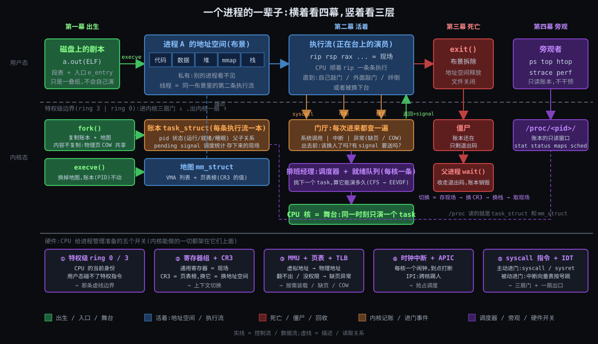

# 阶段 1:Linux 进程全链路是什么

> 这一份是**地图**:一个进程的一辈子分四幕,每一幕内核在做什么、交接什么;底下 CPU 给了哪五个开关。每一幕"为什么必须这样设计",后面按幕逐个拆。

## 一句话定义

**一份被内核记账的地址空间,加上在里面跑的执行流;生于 execve,死于 exit。**

记住两个名词:

- **地址空间**:它**拥有**什么 —— 代码、数据、堆、栈,一张只属于它的虚拟内存地图。
- **执行流**:它**正在做**什么 —— 一组寄存器的值 + 一个栈,CPU 顺着 `rip` 一条条往下执行。

内核给这两样各记一本账:地址空间记在 `mm_struct`,执行流记在 `task_struct`。后面四幕全是围绕这两本账的增、删、改、查。

一个马上会用到的推论:**线程就是"同一份地址空间里的第二条执行流"** —— 共用一本 `mm_struct`,各有一本 `task_struct`。

---

## 跨领域类比:剧场

想象一座剧场:舞台只有一个(或者几个),仓库里堆着几百本剧本,排队等着上台的剧团有几十个。

| 剧场 | 对应内核 | 这一环的本分 |
|---|---|---|
| **剧本**:印好的册子,放在仓库 | 磁盘上的 ELF 文件 | 只是一叠纸,不会自己演 |
| **剧团** | 进程 | 一套布景 + 一群演员 |
| **布景**:搭在台上的整套景片和道具 | 地址空间 | 剧团私有,别的剧团看不见、碰不着 |
| **演员** | 执行流 / 线程 | 同一剧团的演员共用一套布景 |
| **装台**:按剧本把布景搭起来,翻到第一幕第一句 | `execve` 装载 + 找入口 | 把纸变成能演的现场 |
| **舞台** | CPU 核 | 同一时刻一个舞台上只能有一个剧团在演 |
| **排班经理**:决定谁上台、演多久 | 调度器 | 公平,不让谁饿死 |
| **换场**:把台上剧团演到哪、每个演员站在哪记下来,换下一个剧团上 | 上下文切换 | 记现场、换布景、取现场 |
| **舞台监督**:演员不能自己碰灯光音响,要递条子请舞台监督操作 | 系统调用 / 特权级 | 用户态进内核的正门 |
| **场外有事**(火警、快递到了),舞台监督临时叫停 | 中断 | 不是演员请求的,是外面发生的 |
| **布景按需搭**:幕布上画着一扇门,演员真要走过去才临时把门装上 | 缺页异常(按需调页) | 不先搭全,用到再搭 |
| **分团巡演**:把布景原样"复制"一份,但道具谁改谁才真复制 | `fork` + COW | 复制便宜到可以随手用 |
| **经理塞到台上的纸条**,演员在下一句台词的间隙必须看 | signal | 异步通知,在返回用户态那一刻处理 |
| **解散**:布景拆掉,海报留着给总团看一眼才扔 | `exit` → 僵尸 → `wait` 回收 | 退出码得有人收 |
| **经理的排班表和账本**,谁都能翻 | `/proc` 与 ps / top / perf | 观察,不干预 |

这个类比里能直接推出几条后面会反复用到的性质:

1. **剧本 ≠ 剧团**。同一本 ELF 可以同时装成十个进程(十个 bash),剧本只读、布景各一份。所以 ELF 的代码段可以在十个进程间共享同一份物理页,数据段才各自复制。
2. **布景是剧团私有的**。一个剧团的演员摔了道具,别的剧团不受影响 —— 这就是 PostgreSQL 选进程的理由;代价是换场必须换布景(换 CR3),而同一剧团内换演员不用。
3. **舞台只有一个**。"并发"是排班经理靠换场造出来的错觉;换场本身不演戏,是纯开销,所以要尽量少换、换得快。
4. **演员碰不了灯光**。进内核只有三条路(递条子、场外有事、绊倒),每一条都是一次"用户态 → 内核态"的身份切换,这正是 CPU 特权级开关的用处。

---

## 一张全景图

读图的方法:**横着看是四幕,竖着看是三层**。四幕是时间顺序,三层是"谁看得见什么"。

能从图上读出来的 5 件事:

1. **用户态能看见的只有三样**:ELF 文件、自己的地址空间、正在跑的执行流。`task_struct`、调度器、僵尸都在虚线以下,进程自己看不见自己的账本。
2. **进内核只有三扇门(系统调用 / 中断 / 异常),出内核只有一扇(返回用户态)**。调度器"换人"和 signal 投递都挂在那扇出口上 —— 这是第二幕的全部骨架。
3. **`fork` 复制的是账本和地图,不复制内容**:物理页 COW 共享。**`execve` 换的是地图,账本(PID)不动**。
4. **`exit` 先拆布景(释放 `mm_struct`),账本留到父进程 `wait` 才销毁**;中间这段叫僵尸。
5. **旁观工具全是在读账本**:`/proc/<pid>/` 是 `task_struct` + `mm_struct` 的只读窗口,ps / top 读它;perf 另开一扇窗读 CPU 的硬件计数器。

**一个关键观察:内核里没有"进程"这个对象。** 内核只有 task(`task_struct`)。"进程"是用户态的叫法,等于"共享同一个 `mm_struct` 的一组 task",组长的 pid 就是这个进程的 pid(内核里叫 `tgid`)。所以 PostgreSQL 的 100 个 backend 进程和 MySQL 的 100 个连接线程,在调度器的就绪队列里是**同等公民** —— 差别只出现在切换时要不要换地址空间。

---

## 四幕各是谁

### 第一幕 出生:从 ELF 到地址空间(对应你的第 1、2 问)

ELF(Executable and Linkable Format)是剧本的印刷格式。它**一本两用**:

- 给**装载器**看的 program headers(段表):哪几段要映射进内存、映射到哪个地址、权限 r/w/x;入口地址 `e_entry`;需要哪个动态链接器(`PT_INTERP`,通常是 `/lib64/ld-linux-x86-64.so.2`)。
- 给**链接器**看的 section headers(节表):`.text` `.data` `.bss` `.symtab` `.rela.*`,符号表和重定位表住在这里。

Unix 把"造一个进程"拆成了**两步**:`fork()` 复制一个现成的(账本 + 地图,内容 COW),`execve()` 再把它的地址空间整个换成新剧本的 —— PID 不变、打开的文件默认不变,换掉的只是 `mm_struct`。

`execve` 在内核里做的事比想象的少:读 ELF 头 → 建一张新地图(一串 VMA:代码段在这、数据段在那、栈在顶上)→ 把动态链接器也映射进来 → 把 `rip` 指到入口。**它不真的把文件读进内存** —— 页等第一次被碰到时,由缺页异常搬进来(第二幕)。至于符号重定位、找 libc,内核根本不管,由用户态的 `ld.so` 在 `main()` 之前做完。

> "怎么解析、怎么定入口、怎么链接、怎么重定位、怎么分配内存"的具体步骤,留到讲内部机制时逐个拆。

### 第二幕 活着:与 CPU 和内核打交道(对应你的第 3、4 问)

一个 task 有三种状态:**运行**(在台上)、**就绪**(在队列里等舞台)、**睡眠**(等某个事件:磁盘、锁、网络、定时器)。调度器只管"就绪 → 运行"这一步:从就绪队列里挑一个,算它能跑多久(CFS,6.6 起换成 EEVDF)。**上下文切换** = 把当前执行流的寄存器存进它的 `task_struct` / 内核栈 → 换 CR3(如果是不同进程)→ 换内核栈 → 把下一条的寄存器装回来。

进内核的三扇门和一扇出口:

| 门 | 谁敲 | 例子 | 对应你的问题 |
|---|---|---|---|
| **系统调用** | 进程自己,主动 | `read` / `write` / `mmap` / `fork` / `exit` | 怎么做系统调用 |
| **中断** | 外部设备,被动 | 时钟 tick、网卡收包、磁盘 DMA 完成 | 怎么响应中断 |
| **异常** | 进程自己,但不是故意的 | 缺页(**主缺页**:页要从盘上读;**次缺页**:页已在内存,只是没建映射或要 COW)、除零、非法指令 | 主次缺页、COW |
| **出口:返回用户态** | 内核在每次出门前检查 | 该换人了吗?有 signal 要送吗? | 怎么响应 signal |

**COW 一句话**:`fork` 后父子共享物理页,页表项全部标成只读;谁先写谁触发一次次缺页,内核复制那一页、改回可写、放行。所以 COW 不是一个独立机制,是"缺页异常 + 页表权限位"的一种用法。

**signal 一句话**:signal 是内核 → 进程的反向通道。发送方只是在目标 `task_struct` 里记一个 pending 位;真正的"响应"发生在那扇出口 —— 返回用户态前,内核把用户栈改造一下,让进程回去时先跑 handler,跑完再回原处。

### 第三幕 死亡:exit 到回收(对应你的第 5 问)

`exit` 做的事:释放 `mm_struct`(布景拆除)→ 关文件 → 给自己的子进程找新父(init 或 subreaper)→ 给父进程发 `SIGCHLD` → 状态改成 `EXIT_ZOMBIE`,`task_struct` **留着**,只剩退出码和统计。父进程 `wait()` 读走退出码,`task_struct` 才真正释放。父不 `wait`,就一直是僵尸;父先死,孤儿被 init 收养。`kill -9` 也走同一条路,只是起点换成了 signal。

### 第四幕 旁观:账本的窗口(对应你的第 6 问)

| 工具 | 读哪本账 | 原理一句话 |
|---|---|---|
| `ps` / `top` / `htop` | `/proc/<pid>/stat`、`status` | 定时读 `/proc` 文本文件,前后两次做差算 CPU% |
| `vmstat` / `pidstat` | `/proc/stat`、`/proc/<pid>/stat` | `/proc/stat` 的 `ctxt` 行 = 全系统累计切换次数 |
| `cat /proc/<pid>/maps` / `smaps` | `mm_struct` 的 VMA 列表 | 地址空间的地图直接打印出来 |
| `cat /proc/<pid>/sched` | `task_struct` 的调度统计 | 跑了多久、等了多久、主动 / 被动切换各几次 |
| `strace` | `ptrace` | 每次系统调用进出都把目标停下来让父进程看一眼,所以慢一个数量级 |
| `perf` | `perf_event_open` + PMU 硬件计数器 + 内核 tracepoint | 硬件数 cycles / cache-miss,内核埋点数 `sched_switch` |
| `bpftrace` / eBPF | 内核 tracepoint / kprobe | 把小程序挂进内核统计,不停目标进程 |

全都是读账本,区别只是读哪一本、用什么窗口读。

---

## 硬件入门:CPU 给进程管理准备的五个开关

内核能做的一切,都架在 CPU 已经提供的几个硬件机制上。不讲电路,只说每个开关是什么、扳它会发生什么、哪一幕扳它。以 x86-64 为准,括号里是你 Mac 上 Apple Silicon(ARM64)的对应物。

### ① 特权级:ring 0 / ring 3

CPU 任何时刻都有一个"当前身份"。ring 3(用户态)不能执行特权指令(改 CR3、关中断、访问 IO 端口),也不能访问页表里标了"内核"的页;ring 0(内核态)什么都能做。进程在 ring 3 跑,内核在 ring 0。身份切换只能通过正门(⑤)。(ARM64:EL0 / EL1。)

**扳于**:全景图里那条虚线;整条链路上每一次用户态 ↔ 内核态。

### ② 寄存器组 + CR3

通用寄存器(`rip` 下一条指令、`rsp` 栈顶、`rax` 等十几个、`rflags`)= 执行流的全部现场,几十个 8 字节的值。`CR3` = 当前页表的根地址,**换掉它 = 换掉整个地址空间的翻译规则**。(ARM64:`TTBR0_EL1`。)

**扳于**:上下文切换 = 存现场 + 换 CR3 + 取现场。线程间切换**不换 CR3**。

### ③ MMU + 页表 + TLB

MMU 把每个虚拟地址按页表翻译成物理地址。页表项除了物理页号,还有 present / 可写 / 用户可访问 几个权限位;翻不出来或权限不对,CPU 就报**缺页异常**交给内核处理。TLB 是翻译结果的缓存,换 CR3 后大部分作废,要重新填。(ARM64 同构,ASID 让切换时不必全部作废。)

**扳于**:第一幕的按需装载,第二幕的缺页 / COW;也是切换成本里最大的隐性部分。

### ④ 时钟中断 + APIC

每个核的 local APIC 自带一个定时器,到点就打一次中断 —— **这是调度器的闹钟**:没有它,一个死循环的进程永远不会被换下来。APIC 还能发核间中断(IPI),让一个核"踢醒"另一个核去调度。(ARM64:GIC + generic timer。)

**扳于**:第二幕的抢占。

### ⑤ syscall / sysret 指令 + 中断向量表 IDT

从 ring 3 进 ring 0 的两个正门:`syscall` 指令(主动)跳到内核预先登记的入口,`sysret` 回来;IDT 是 256 项的"按铃对应表",中断、异常各占一项,硬件按号跳转。(ARM64:`svc` / `eret`,`VBAR_EL1` 向量表。)

**扳于**:第二幕的三扇门和一扇出口。

| 开关 | 一句话 | 哪一幕扳它 |
|---|---|---|
| ① 特权级 | CPU 的当前身份,决定能不能碰特权指令 | 每一次进出内核 |
| ② 寄存器 + CR3 | 现场 + 地址空间的根 | 切换 |
| ③ MMU / 页表 / TLB | 翻译,翻不出就报缺页 | 装载、缺页、COW、切换成本 |
| ④ 时钟中断 + APIC | 闹钟 + 跨核踢人 | 抢占 |
| ⑤ syscall + IDT | 进内核的正门 | 三扇门 |

---

## 关键词速查表

| 术语 | 一句话说明 | 哪一幕 |
|---|---|---|
| ELF | 可执行文件格式;段表给装载器、节表给链接器 | 一 |
| `fork` / `execve` / `clone` | 复制一个 task / 换掉地址空间 / `fork` 的底层通用版(线程也用它) | 一 |
| `task_struct` | 内核的账本,每条执行流一本 | 全程 |
| `mm_struct` / VMA | 地址空间的地图 / 地图上的一段 | 一、二 |
| 上下文切换 | 存现场 + 换 CR3 + 换内核栈 + 取现场 | 二 |
| 调度器(CFS → EEVDF) | 从就绪队列挑下一个、算配额 | 二 |
| 缺页异常(主 / 次) | 页要读盘 / 页已在内存只需建映射或 COW | 一、二 |
| COW | 共享只读,谁写谁复制 | 一、二 |
| signal | 内核 → 进程的异步通知,返回用户态时投递 | 二 |
| 僵尸 / `wait` | 布景拆了账本留着 / 父进程收尸 | 三 |
| `/proc/<pid>` | 账本的只读窗口 | 四 |

---

## 边界:进程、线程、内核线程、协程

| | 内核看得见? | 自己的地址空间? | 共享什么 | 切换走哪条路 | 例子 |
|---|---|---|---|---|---|
| **进程** | 是(`task_struct`) | 是(独立 `mm_struct`) | 几乎不共享;要共享得显式用共享内存 | 换 CR3 的完整切换 | PostgreSQL backend、bash |
| **线程** | 是(`task_struct`,`tgid` = 组长 pid) | 否(共用组长的 `mm_struct`) | 地址空间、文件表、signal 处理表 | 不换 CR3 的切换 | MySQL 连接线程、Java 线程 |
| **内核线程** | 是(`task_struct`,`mm = NULL`) | 没有用户态地址空间 | 只在内核态跑,借用上一个 task 的页表 | 不换 CR3 | `kworker`、`ksoftirqd`、`kswapd` |
| **协程 / 用户态线程** | **否** | 否(寄居在一个线程里) | 整个宿主线程 | 用户态库自己存 / 取寄存器,不进内核 | goroutine、Java 虚拟线程、Python asyncio |
| **容器** | 不是新物种 | — | — | — | namespace 换 task 看到的"世界",cgroup 给 task 贴资源标签 |

怎么记这张表:

- **前三行都是 task**,差别只在 `clone()` 时传的 flags:`CLONE_VM | CLONE_FILES | CLONE_SIGHAND | CLONE_THREAD` 全传就是线程,一个都不传就是进程,`mm` 干脆为空就是内核线程。Linux 没有单独的"线程"对象,这就是上面那个关键观察的来源。
- **协程在内核的分辨率以下**。内核只看见宿主线程;协程切换是用户态函数调用级别的开销(几十 ns 量级),而 task 切换要进内核(μs 量级)—— 这是 Go / 虚拟线程存在的理由。代价是:任何一个协程做了阻塞系统调用,整条宿主线程连同上面所有协程一起睡(所以 Go runtime 要把阻塞系统调用挪到别的线程、网络 IO 走 netpoller)。
- **容器只是贴标签**。namespace 改的是一个 task 看见的 pid 空间、文件树、网络栈;cgroup 改的是调度器给它多少 CPU、内存上限多少。task 还是那个 task。

### 拆开说:进程切换和线程切换差在哪

**问题来源**:上面说 PG 的 backend 进程和 MySQL 的连接线程在调度器眼里是同等公民,那"切换"这件事两者到底差在哪?

**先说结论**:切换分两半 —— **换执行流**(两者都做)和**换地址空间**(只有进程间切换做)。差别就是后一半,落在硬件开关②(CR3)上,再牵连开关③(TLB)付隐性代价。

**分岔点**:调度器挑出下一个 task 之后,内核看一眼:下一个 task 的 `mm_struct` 和当前的是不是同一本?

| 步骤 | 做什么 | 扳哪个开关 | 线程间(同 mm) | 进程间(不同 mm) |
|---|---|---|---|---|
| 1. 存现场 | 把当前 task 的通用寄存器压进它自己的内核栈,栈顶指针记进 `task_struct` | ② 寄存器 | 做 | 做 |
| 2. 换地址空间 | 把下一个 task 的页表根写进 CR3 | ② CR3 | **跳过** | **做** |
| 3. 换内核栈 | 让 `rsp` 指向下一个 task 的内核栈 | ② 寄存器 | 做 | 做 |
| 4. 取现场 | 从那条栈上弹出下一个 task 的寄存器,跳回它上次停下的地方 | ② 寄存器 | 做 | 做 |

步骤 1、3、4 两者一样,都是几十个寄存器的存取,μs 以下。差别只在步骤 2 那一条写 CR3 的指令 —— 指令本身很便宜,贵的是**它的后果**。

**结果:写 CR3 牵连 TLB(开关③)**

TLB 里缓存的是"虚拟地址 → 物理地址"的翻译结果,而这些结果只对**当前这张页表**成立。CR3 一换,旧条目全部不可信:

- 没有 PCID 的老 CPU:写 CR3 直接把 TLB 清空。新进程跑起来的头一批访存,每一次都得由 MMU 重新走一遍四级页表(最多 4 次内存访问)才能拿到物理地址 —— 这叫 TLB 冷启动,是进程切换成本里最大的隐性部分。
- 有 PCID 的 CPU(Intel Haswell 起;Linux 4.14 起启用,已核 #4):TLB 条目带一个"进程编号"标签,写 CR3 时不清空,只是不再命中别人的条目。切回来时如果条目还在,就不用重填。ARM64 的 ASID 是同一个思路。
- 线程间切换 CR3 不动,TLB 里的翻译全部继续有效,而且两条线程共用的代码、全局数据在 cache 里也还是热的。

数字量级(已核 #5):直接开销(四步本身)两者都在 1~2 μs(Haswell 实测绑核 1.2 ~ 1.5 μs、不绑 2.2 μs);进程间切换的间接开销(TLB 冷启动 + cache 里是别人的数据)视工作集大小,等效损失从几十 μs 到上千 μs(2007 年的经典测量:直接 3.8 μs,间接随工作集从几 μs 到超过 1000 μs)。所以"线程切换比进程切换便宜"这句话,便宜的不是四步本身,而是省掉的那次 TLB 冷启动。

**一个旁注**:换 CR3 的代价不只出现在进程切换。2018 年 Meltdown 补丁(KPTI)让用户态和内核态各用一张页表,每次系统调用进出都要换一次 CR3,这就是那批补丁让系统调用明显变慢的原因 —— 同一个开关,同一种代价。

**回到两个数据库**:MySQL 两个连接线程 A → B,四步里跳过第 2 步,TLB 热着;PG 两个 backend 1 → 2,第 2 步要做,没有 PCID 时 backend 2 的头一批访存全部要重新走页表。调度器排班的时候两者确实是同等公民,但排完班、真正换场的那一下,进程间要多付一次"换布景"的钱。

**内核线程是个例外**:它 `mm = NULL`,切换上来时直接借用上一个 task 的页表(`active_mm`),不写 CR3 —— 反正它只在内核态跑,内核那半边地址空间每张页表里都一样。

**你的凝练**:「TLB 才是贵的。」—— 对。写 CR3 是一条指令,TLB 冷启动才是账单;PCID / ASID 的全部意义就是把这张账单变小。

---

## 开场钩子一:PostgreSQL 每连接一进程 vs MySQL 每连接一线程

**先说结论**:两家都是"一个连接一条执行流",分歧只在**这条执行流要不要自己的地址空间**。

| 维度 | PostgreSQL(进程) | MySQL(线程) |
|---|---|---|
| 建立连接 | postmaster `fork()` 一个 backend:复制账本 + 地图,物理页 COW | mysqld `pthread_create`:新建一个 task,共用 `mm_struct` |
| 连接的代价 | 高:`fork` 要逐条复制页表项,新 backend 还要靠缺页把自己的页一页页 fault 进来(fork 本身零点几 ms,但新 backend 的初始化占大头,整体 ms 级,已核 #3);所以生产环境几乎必配 pgbouncer | 低(几十 μs 量级,已核 #3);高并发下再用线程池摊薄 |
| 共享 buffer pool | 必须**显式**:`shared_buffers` 放在一段共享内存里,每个 backend 都把它映射进自己的地址空间 | **天然**:全局变量就是共享的 |
| 一个连接的代码崩了 | 野指针只能写坏自己的地址空间,别的 backend 的内存不会被悄悄污染(postmaster 出于保险会让全部 backend 重启,但数据没被写坏) | 整个 mysqld 挂:同一地址空间,一个线程的野指针可以写坏任何线程的数据 |
| 切换 | 不同 backend 之间换 CR3,TLB 大部分作废 | 线程间不换 CR3 |
| 调度器眼里 | 100 个 task | 100 个 task,同等公民 |

一句话:**进程 = 用代价换隔离;线程 = 用隔离换代价。** 两家的选择都是各自的约束逼出来的(PG 从 1986 年的 Postgres 起就是进程模型,把可靠性排在前面),到底是哪些约束,下一步逼。

## 开场钩子二:Redis bgsave:fork 出一张快照

Redis 用一条线程跑所有命令。要把 20 GB 的内存落盘成 RDB 文件,又不能停服务 —— 它的办法是 `fork()` 一个子进程:子进程看到的是 fork 那一刻的**冻结副本**,慢慢写盘;父进程继续改内存,改到哪一页,哪一页才被真正复制(COW)。

一个算例,看 fork 到底付了什么:

- 20 GB 堆 ÷ 4 KB 一页 = 524 万页;每页一条 8 字节的页表项 → 页表本身约 **40 MB**。
- fork 不是 memcpy 这 40 MB 就完事:内核要**逐条**处理这 524 万个页表项 —— 复制、标成只读、给每个物理页的引用计数 +1。Redis 官方文档给过实测表:物理机约 **9 ms / GB**、VMware 虚机约 13 ms / GB、老式 Xen 云实例可到 240 ~ 420 ms / GB(已核 #1),20 GB 在物理机上就是两百多毫秒。这段时间 Redis 主线程是停的,这就是 Redis 文档里著名的"fork latency"。
- fork 完,父进程每写一页就触发一次次缺页 + 4 KB 拷贝(约 2 μs,已核 #2);写得越热,被复制的页越多,极端情况 RSS 翻倍。

**一句话**:进程复制之所以用得起,全靠"只复制地图、不复制内容"。COW 是 `fork` 的基础设施,不是 Redis 的技巧;Redis 只是把这个基础设施用到了极致。

**一个你答对的推论**:父子**各有一本** `mm_struct`、各有一套页表,只是两套页表暂时指向同一批物理页。所以父子之间切换要写 CR3(四步表的第 2 步),TLB 照样要冷启动 —— 哪怕两张页表此刻翻译出来的结果一模一样,CPU 也不知道。

## 你的视角

> 「这两个是进程的两个方面,一个是共享进程空间,一个是 COW。」

认。再拧紧一点:**两个钩子问的是同一个东西 —— 地址空间**。钩子一问"要不要共享"(线程共享,进程不共享);钩子二问"不共享的时候,复制一份怎么才便宜"(COW)。所以进程一出场,最硬的那条性质就是"它拥有一个地址空间";线程、COW、切换成本、隔离,全是这一条性质的不同侧面。

> 「没有进程,OS 在使用 CPU 的时候效率会比较低,甚至可能退化到只能服务单个用户的场景,因为 CPU 没法方便地在多个用户、多个任务之间切换、保存状态。更不用说多核时代了。」(你对"没有进程的世界"的第一反应)

认一大半。你说的三件事 —— CPU 利用率低、退化成单用户、多核没法用 —— 正好对应"执行流"那半本账:没有一个能**存下来再取回来**的现场,CPU 就只能从头到尾伺候一个任务。两处拧紧:

1. "效率低"的源头要再往下挖一层:CPU 比磁盘 / 终端快几个数量级,一个任务一等 IO,CPU 就空转。最早逼出"多道程序"的不是多用户,是这个速度差 —— 这会是约束清单里的第一条。
2. 你只说到了"切换、保存状态",那是**执行流**这半;"多个用户"还逼出另外半本账 —— **地址空间**。没有它,多个用户的任务挤在同一片内存里,一个野指针就能写坏别人的数据,多用户在技术上可行、在信任上不可行。所以"进程"一定是两半合起来的:能存取的现场 + 私有的地址空间。

这段是下一步"约束清单"的开场白,到时候从这三个痛点(CPU 等 IO 空转、用户互不信任、多核)一条条长出来。

---

## 最后的预留:调参、隔离与启动加速

有一批东西站在主线之上,改的不是"进程怎么活",而是"**活得多快、分到多少、起得多快**":

- **分配与隔离**:`nice`、cgroup 的 `cpu.weight` / `cpu.max`、cpuset、CPU 亲和、`SCHED_FIFO` / `SCHED_DEADLINE` 实时类、NUMA 感知。
- **启动加速**:`vfork` / `posix_spawn`(跳过复制地图)、大页(减少缺页次数和页表体积)、静态链接 / prelink(省掉重定位)。

全部主线讲完后,再拿四幕当坐标,逐个看它们在哪一幕动手、省掉了什么。

---

## 呼应你的问题

你的六问,现在都有了挂的位置:

| 你的问题 | 挂在哪一幕 | 这份地图回答到哪 | 剩下的交给 |
|---|---|---|---|
| 1. 怎么从磁盘装载到内存 | 一 | `fork` + `execve` 两步;`execve` 只建地图不搬内容 | 内部机制(按需调页的每一步) |
| 2. ELF 结构 / 解析 / 入口 / 链接 / 映射 / 分配 / 重定位 | 一 | 段表给装载器、节表给链接器;重定位在用户态 `ld.so` | 内部机制 + 源码细节 |
| 3. 怎么调度 / 怎么切换 / 调度算法 | 二 | 三状态;切换 = 存现场 + 换 CR3 + 换栈 + 取现场;闹钟是时钟中断 | 内部机制(CFS / EEVDF 的数学)+ 源码 |
| 4. 系统调用 / 中断 / 主次缺页 / COW / signal | 二 | 三扇门一扇出口;COW = 缺页 + 权限位;signal 挂在出口 | 内部机制 |
| 5. 怎么销毁 | 三 | 先拆布景后销账本;僵尸是中间态 | 内部机制 |
| 6. 监视工具及原理 | 四 | 全是读账本;`/proc` 是窗口,perf 读硬件计数器 | 内部机制(每个工具读哪个字段) |

但"**为什么非得这样**"一个都还没回答:为什么造进程要拆成 `fork` + `execve` 两步而不是一步?为什么 `execve` 不直接把文件读进来、非要等缺页?为什么 CPU 要分 ring 0 / 3?为什么死了还要留一具僵尸?为什么调度器需要一个硬件闹钟?这些答案藏在一组更底层的约束里,而这组约束正是下一步要一条条摆出来的。

---

## 修订记录

| 时间 | 修订摘要 | 触发原因 |
|---|---|---|
| 2026-10-27 | 初稿:四幕总纲 + 剧场类比 + 全景 SVG + 四幕速写 + 五个硬件开关 + 速查表 + 四者边界 + 两个钩子(PG/MySQL、Redis bgsave 算例)+ 《你的视角》+ 预留 + 六问映射 | 开场对齐收敛 |
| 2026-10-27 | 边界节后新增《拆开说:进程切换和线程切换差在哪》:四步表 + CR3 → TLB 牵连 + PCID/ASID + KPTI 旁注 + 内核线程例外;新增待核 #4 #5 | 用户反馈不了解进程 / 线程切换的差别 |
| 2026-10-29 | 切换节末尾加用户凝练「TLB 才是贵的」;Redis 节末尾加"父子各有一本 mm_struct → 切换写 CR3"推论;《你的视角》加"没有进程的世界"第一反应 + 认一大半 / 拧紧两处(CPU 等 IO 是源头;多用户还逼出地址空间) | 用户凝练 / 答对反问 / 新视角 |
| 2026-10-31 | 收尾核实:待核 #1 改写为 redis.io 实测表数字(9 / 13 / 240 ~ 420 ms/GB);#2 已核(2.3 μs);#3 改写(fork 本身零点几 ms,backend 初始化占大头);#4 已核(4.14);#5 改写(间接开销上限到上千 μs) | 导出前统一核实 |
