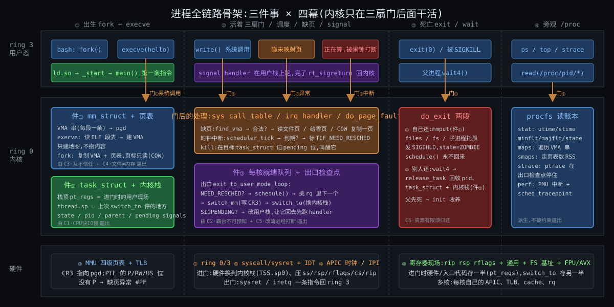
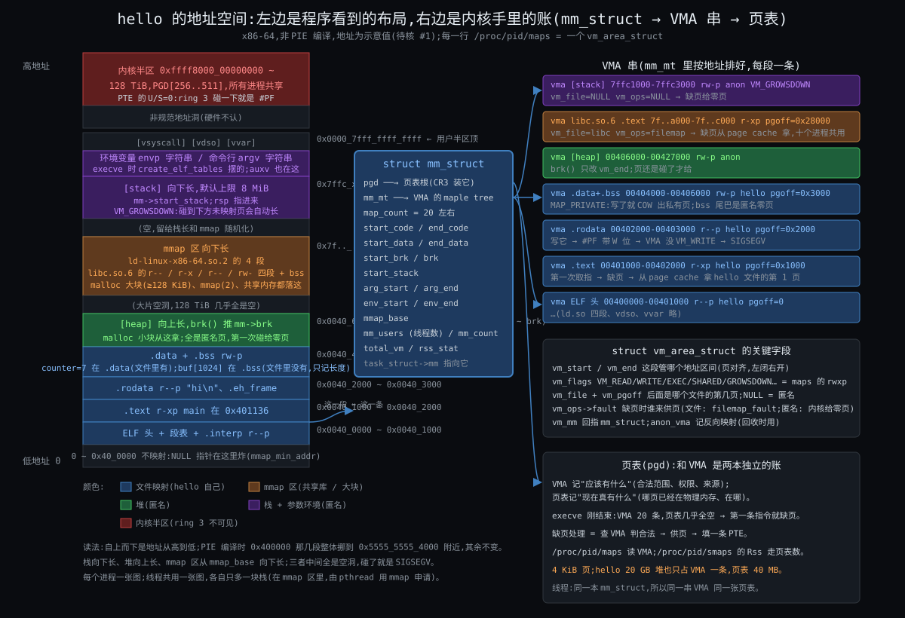
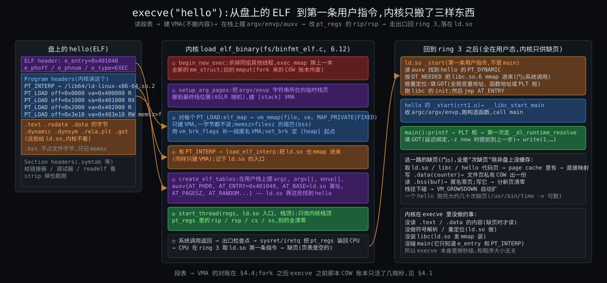
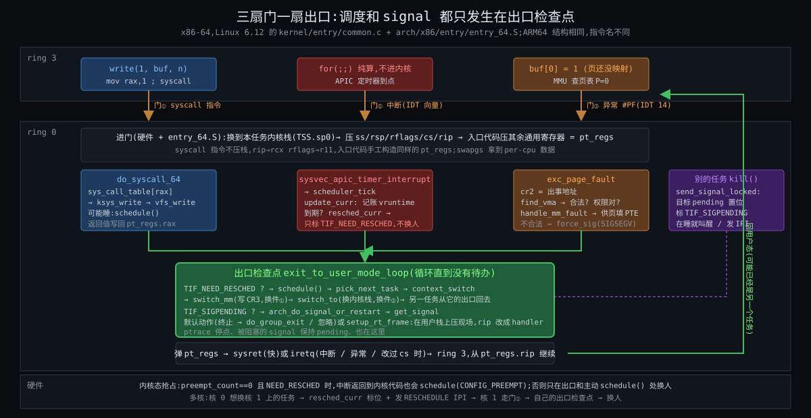

# 阶段 3:Linux 进程全链路大致怎么工作

> 上一份回答了"七条约束逼出四幕"。这一份回答"内核具体用哪几样东西、按什么顺序把这七条化解掉":execve 一步步建了什么、第一条指令落在哪、切换按什么顺序存、调度在哪几个点被触发、缺页进来怎么分主次、exit 按什么顺序拆。写法:先立三件核心组件(§0),一张鸟瞰图(§1),然后按四幕走,出生幕和"切换 + 调度"写最厚(你定的),缺页 / signal / 死亡 / 旁观按正常机制级写。全文用同一个程序 hello 贯穿;源码钉 Linux 6.12,x86-64 为主,ARM64 差异旁注;demo 用伪代码。
>
> 数字精确化(时间片多少毫秒、EEVDF 的公式、页表项每一位)这一份不碰,留给进源码那一轮。

贯穿例子:

```c
/* hello.c —— gcc -no-pie -O0 -o hello hello.c(非 PIE,地址稳定,方便对账)*/
#include <stdio.h>
int   counter = 7;          /* .data   :文件里真有 4 字节 */
static int buf[1024];       /* .bss    :文件里没有,只记"要 4 KiB 清零" */
const char *msg = "hi";     /* "hi" 在 .rodata,msg 本身在 .data */
int main(void) { buf[0] = counter; printf("%s %d\n", msg, buf[0]); return 0; }
```

在 bash 里敲 `./hello`,下面的一切就开始了。

---

## 约束清单速查(C1 ~ C7)

> 后文所有 `Cn·短名` 都对应下面 7 条,每条在上一份里从裸机一刀一刀推出过,这里只放"约束 + 不可再分性 + 口诀"。推导见 `stages/02-why/02-why.md`。每条是 markdown 标题,viewer 里可以 `Ctrl+F` 搜 `C3` 直接滚到。

#### C1 — CPU快IO慢

CPU 比设备快 10⁴ ~ 10⁷ 倍,等待是常态;一核一次只跑一条流,但流的现场在指令边界上是一组有限寄存器,可存可取。
**不可再分**:物理时延与 GHz 时钟的差距消不掉;寄存器可读写是 ISA 承诺。
**口诀**:等就换人 → 现场必须能存

#### C2 — 霸台不可预知

程序不会主动让台;内核猜不到它下一步要算还是要等、要快还是要多。
**不可再分**:内核无法静态验证任意二进制;用户意图不在代码里。
**口诀**:到点硬换 → 换谁只能靠猜

#### C3 — 互不信任

程序可能有 bug 或恶意;有些操作(关中断 / 改页表根 / 操作设备)波及整机;程序又假定自己独占一套连续地址且可同时跑多份。
**不可再分**:代码来源、硬件结构、编译模型三样都不是内核能改的。
**口诀**:三道闸 → 跨任务的事全经内核之手

#### C4 — 文件≠内存

程序在盘上是文件,任务要的是页表;写文件的工具链和读文件的内核是不同方;内存远小于程序总量、单次只触及一小部分且有局部性;复制必须便宜。
**不可再分**:不同作者、年代、节奏;单位容量价格差一到两个数量级;局部性是程序结构的普遍性质。
**口诀**:只建地图不搬内容 → 缺页才搬

#### C5 — 改流必经打断

内核没有自己的 CPU;ring 3 的流不会自己停;内核只能在它进内核的瞬间介入。
**不可再分**:要控制一条流必须先拿到它的核。
**口诀**:三扇门一扇出口 → 一切挂出口上

#### C6 — 资源有限须归还

pid / 内存 / fd 有限,内核没有 GC;任务不能释放自己正在用的栈和账本。
**不可再分**:自己拆自己脚下的栈在逻辑上不可能;有限资源必须有归还点。
**口诀**:自己还大头 → 别人收尾

#### C7 — 核各自为政

核有独立 cache / 执行 / 时钟;跨核协调走互连,代价高一到两个数量级。
**不可再分**:多核的物理结构。
**口诀**:每核一张表 → 跨核靠 IPI

---

## §0 从 Why 走到 How:三件事记住

上一份结尾说:进程 = 用一本账把一台机器虚拟成 N 台。这一节把"一本账"精确成内核里的**三样东西**。后面每一节的细节都挂在这三样上;记住它们,就不会在 execve 的几十步、调度器的几个类、缺页的几种分支里迷路。

### §0.1 件①:`mm_struct` + 页表 —— 从 C3·互不信任 + C4·文件≠内存 推出

因为 C3·互不信任(程序假定独占地址、互相不能读写)+ C4·文件≠内存(程序在盘上是文件,要按需、可共享地变成内存)→ 要解决"每个任务一套自己的地址翻译,而且这套翻译能一段一段地来自文件、来自零页、来自父进程"→ 所以引入 **`mm_struct`**:它挂两本账。

- **VMA 串**(`vm_area_struct`,6.12 存在 maple tree `mm->mm_mt` 里):记"**应该**有什么"—— 哪段地址合法、什么权限、后面是哪个文件的第几页还是匿名。`/proc/pid/maps` 一行就是一条。
- **页表**(`mm->pgd`,CR3 装它):记"**现在真**有什么"—— 哪一页已经在物理内存、在哪、能不能写。硬件 MMU 只看这本。

两本账的差,就是缺页异常要填的东西。execve 刚结束时 VMA 有二十来条,页表几乎全空;hello 跑完一共几十次缺页,每次填一条 PTE。

### §0.2 件②:`task_struct` + 内核栈 —— 从 C1·CPU快IO慢 推出

因为 C1·CPU快IO慢(等 IO 就要换人,换人前提是现场可存可取)→ 要解决"一条流停下时,它的全部状态放哪、谁替它记着它是谁、在等什么"→ 所以引入 **`task_struct`**(内核里的"任务"对象,进程和线程都是它)+ 每任务一块 **内核栈**(x86-64 上 16 KiB,`THREAD_SIZE_ORDER = 2`,KASAN 下 32 KiB;已核 #2)。

现场分两段存,这是后面理解切换的关键:

- **进门时存的一半**:任务一进内核(三扇门之一),硬件 + 入口代码就把用户态的 rip / rsp / rflags / 通用寄存器压在内核栈顶,叫 `pt_regs`。这是"它在用户态走到哪了"。
- **换人时存的另一半**:真正 `switch_to` 时,只再存被调用者保存寄存器(rbp、rbx、r12 ~ r15)和内核栈指针 rsp,记在 `task->thread.sp`。这是"它在内核里走到哪了"。

`task_struct` 另外记:状态(RUNNING / INTERRUPTIBLE / ZOMBIE …)、pid、父子兄弟链、`mm` 指针(指向件①;内核线程为 NULL)、打开文件表、信号 pending 位图、调度实体(vruntime 等)。进程 = 共享同一个 `mm` 的一组 `task_struct`。

### §0.3 件③:每核就绪队列 + 出口检查点 —— 从 C2·霸台不可预知 + C5·改流必经打断 推出

因为 C2·霸台不可预知(到点必须换,换谁只能猜)+ C5·改流必经打断(内核只能在任务进内核的瞬间动手)+ C7·核各自为政(每核一张表)→ 要解决"在哪个时刻、按什么规则、换到哪个任务"→ 所以引入两样配套的东西:

- **每核一条就绪队列 `rq`**:记这个核上所有想跑的任务,按调度类分层(stop > deadline > rt > fair > idle),fair 类里用 EEVDF 按 vruntime / deadline 排(6.6 起取代 CFS 的核心,6.12 已是 EEVDF)。
- **出口检查点 `exit_to_user_mode_loop`**:三扇门进来、办完事、要回 ring 3 之前,必经的一个循环。它查 `TIF_NEED_RESCHED`(该换人了吗 → `schedule()`)和 `TIF_SIGPENDING`(有纸条吗 → 投递 signal)。**调度和 signal 投递只在这里发生**,时钟中断本身不换人,只是在这里留个标记。

### §0 结论:三件事对照

| 件 | 是什么 | 为什么存在 |
|---|---|---|
| ① `mm_struct` + 页表 | 地址空间这半本账:VMA 记"应该有什么",页表记"真有什么" | C3·互不信任 要每任务一套翻译;C4·文件≠内存 要按需、可共享、可 COW |
| ② `task_struct` + 内核栈 | 执行流这半本账:`pt_regs`(用户态现场)+ `thread.sp`(内核态现场)+ 身份 / 状态 / 关系 | C1·CPU快IO慢 要能停下再接着跑;C6·资源有限须归还 要有人记着它欠什么 |
| ③ 每核 `rq` + 出口检查点 | 谁上台、在哪换:就绪队列挑人,出口检查点动手 | C2·霸台不可预知 要闹钟 + 猜;C5·改流必经打断 只能在门口动手;C7·核各自为政 每核一张表 |

三件怎么嵌套:件②指向件①(`task->mm`),多个件②可以指同一个件①(线程);件③的 `rq` 串着件②(`rq` 里排的是 `task_struct`),出口检查点跑在件②的内核栈上,换人时先换件①(写 CR3)再换件②(换内核栈)。

---

## §1 一张极简概览图



从图上能读出来的五件事:

1. **用户态的每个动作都是从一扇门进内核**:execve、write、碰未映射页、被闹钟打断、exit、ps 读 /proc,全都走门①②③之一。ring 3 和内核之间没有第四条路。
2. **三件事全在内核带里**,硬件带只提供开关(页表 / ring / 时钟 / syscall 指令),用户态只看到假象。
3. **出生幕只碰件①**(建 VMA)和件②的 `pt_regs`(改 rip / rsp),没有搬内容;所以 execve 微秒级。
4. **活着幕的四样东西(系统调用 / 中断 / 异常 / signal)在出口汇成一条路**:换人和投递 signal 都是出口检查点的事。
5. **死亡幕是两段**:自己还件①(`mmput`),件②由别人在 `wait4` 之后还 —— 中间那段就是僵尸。

---

## §2 硬件底座怎么被用:页表原理

这节是件①的硬件那一半。上一份只说"MMU 按页表翻译",这里把"怎么翻"讲到能对账的程度;页表项每一位的精确语义留给下一轮。

### §2.1 四级页表怎么翻译一个地址

x86-64 的 48 位虚拟地址被切成 5 段,每段是一级表的下标:

```
 47      39 38      30 29      21 20      12 11         0
 ┌─────────┬─────────┬─────────┬─────────┬─────────────┐
 │ PGD idx │ PUD idx │ PMD idx │ PTE idx │ 页内偏移     │
 │  9 位   │  9 位   │  9 位   │  9 位   │   12 位     │
 └─────────┴─────────┴─────────┴─────────┴─────────────┘
 每级表 512 项 × 8 字节 = 一页 4 KiB;四级各一页就能翻译一个地址
```

拿 hello 的 `main` 对账:`main` 在 `0x401136`。

| 段 | 取法 | 值 |
|---|---|---|
| PGD idx | 位 47..39 | 0 |
| PUD idx | 位 38..30 | 0 |
| PMD idx | 位 29..21 | `0x401136 >> 21` = 2 |
| PTE idx | 位 20..12 | `(0x401136 >> 12) & 0x1ff` = `0x401 & 0x1ff` = 1 |
| 页内偏移 | 位 11..0 | `0x136` |

MMU 的动作:CR3 → PGD 页;PGD[0] → PUD 页;PUD[0] → PMD 页;PMD[2] → PTE 页;PTE[1] → 物理页号;加 `0x136` 就是 `main` 第一条指令所在的物理地址。四次访存。所以才有 TLB:同一页内的 4096 个地址共用一条翻译结果,TLB 命中就一次都不用查。

Linux 6.12 内部用五级抽象(PGD / P4D / PUD / PMD / PTE);四级硬件上 P4D 折叠掉。ARM64 用 TTBR0 / TTBR1 两个根寄存器分别指用户半区和内核半区,翻译结构一样。

### §2.2 页表项里哪几位后面会反复用到

一条 PTE 是 8 字节:高位是物理页号,低位是标志。只需要记五个标志,因为后面每一样机制都靠它们:

| 位 | 意思 | 谁用 |
|---|---|---|
| P(present) | 这一页在物理内存里 | 0 就触发缺页异常 #PF —— 按需装载、swap 全靠它 |
| R/W | 可写 | 0 时写入触发 #PF —— **COW 全靠它**;.rodata 写保护也是它 |
| U/S | 用户态可访问 | 0 = 只有 ring 0 能碰 —— 内核半区靠它对 ring 3 隐身 |
| A / D | 访问过 / 写脏过 | 硬件自动置位,内核回收页、决定要不要写回时读 |
| NX | 不可执行 | 栈和堆不可执行(`rw-p` 没有 x)靠它 |

缺页异常发生时,CPU 把出事地址放进 CR2,错误码里带"是读还是写 / 是用户态还是内核态 / 是 P=0 还是权限不对"。内核的缺页处理(§7)就是读这两样 + 查 VMA 做决定。

### §2.3 CR3、TLB 与切换

CR3 装的是当前任务 PGD 的物理地址。切到另一个进程 = 写 CR3 = 整张翻译表瞬间换掉。代价不在写 CR3 这条指令,在 **TLB**:老的 TLB 条目对新页表无效,必须作废,新任务开头每次访存都要重新走四级表 —— 你在上一份里抓到的"TLB 才是贵的"。PCID(Linux 4.14 起,已核 #4)让 TLB 条目带上 12 位的地址空间标签,切换时不必全冲,回来还能命中。

线程切换 `next->mm == prev->mm`,内核跳过写 CR3,TLB 原样保留 —— 这是线程切换比进程切换便宜的全部原因。

### §2.4 内核态和用户态:同一张表的上下半

一张 PGD 有 512 项。x86-64 Linux 的约定:**项 0 ~ 255 是用户半区**(0 ~ `0x0000_7fff_ffff_ffff`,128 TiB),**项 256 ~ 511 是内核半区**(`0xffff_8000_0000_0000` 起,128 TiB)。中间 16 EiB 的"非规范地址"硬件直接拒绝。

- 内核半区在**所有进程的页表里内容相同**:创建 `mm` 时 `pgd_alloc` 把内核半区那 256 项从主内核页表抄过来。所以系统调用进内核不用换 CR3,内核代码、内核栈、所有物理内存的直接映射都在这半区里,任务一进 ring 0 就能用。
- 内核半区的 PTE 全是 U/S = 0:ring 3 的任务读一下 `0xffff8000…` 就是 #PF → SIGSEGV。这就是 C3·互不信任 里"地址空间这道闸"在硬件上的实现:**不是内核看不见,是 CPU 不让看**。
- KPTI(2018 年起,应对 Meltdown)把这个约定打破了一半:每个进程两张 PGD,用户态那张的内核半区几乎是空的,进出内核时切一次 CR3。代价是系统调用变贵,后面讲代价时还会提。

ARM64 的做法更直接:TTBR0 指用户表,TTBR1 指内核表,切进程只换 TTBR0,内核表天然共享。

---

## §3 出生幕 ①:地址空间布局与 VMA

这节是件①的内核那一半:布局长什么样、每一段在内核里是什么、`mm_struct` 怎么挂它们。先看图,再逐段过,最后逼问"为什么要两本账"。



### §3.1 从低到高走一遍布局

以 hello(非 PIE)为例,地址为示意值(待核 #1,收尾未核,本机无 Linux),PIE 时低地址那几段整体挪到 `0x5555_5555_4000` 附近,其余不变:

| 区域 | 地址(示意) | 权限 | 来源 | 作用 |
|---|---|---|---|---|
| 不映射 | `0` ~ `0x40_0000` | — | — | NULL 指针在这里炸;`mmap_min_addr` 保证低地址不许映射 |
| ELF 头 + 段表 | `0x40_0000` ~ `0x40_1000` | `r--p` | 文件 hello 第 0 页 | 装载器 / ld.so 读;跑起来后没用 |
| .text | `0x40_1000` ~ `0x40_2000` | `r-xp` | 文件 hello 第 1 页 | 代码;`main` 在 `0x401136`;只读 + 可执行,十个 hello 共用同一物理页 |
| .rodata | `0x40_2000` ~ `0x40_3000` | `r--p` | 文件 hello 第 2 页 | `"hi"` 字符串、异常表;写它 → SIGSEGV |
| .data + .bss | `0x40_4000` ~ `0x40_6000` | `rw-p` | 文件第 3 页 + 匿名尾巴 | `counter` 在 .data(文件里有 7 这个值);`buf[1024]` 在 .bss(文件里只记"要 4 KiB 零") |
| [heap] | `0x40_6000` ~ `0x42_7000` | `rw-p` | 匿名 | `brk()` 推 `mm->brk` 向上长;malloc 小块从这拿 |
| 空洞 | 中间 | — | — | 几乎 128 TiB 全是空;碰了 SIGSEGV |
| mmap 区 | `0x7f..` 向下 | 各段不同 | 文件 / 匿名 | 从 `mm->mmap_base` 向下分配:ld.so 的 4 段、libc 的 4 段、malloc 大块(≥ 128 KiB)、`mmap(2)`、共享内存、线程栈 |
| [stack] | `0x7ffc..` 向下 | `rw-p` | 匿名 | 主线程栈,默认上限 8 MiB;`VM_GROWSDOWN` 碰到下方未映射页自动扩 |
| argv / envp 字符串 + auxv | 栈顶之上 | `rw-p` | execve 摆的 | 命令行、环境变量的字节本体,`mm->arg_start` / `env_start` 指着 |
| [vvar] [vdso] | 再往上 | `r--p` / `r-xp` | 内核提供 | `gettimeofday` 不进内核的那块共享页 |
| 内核半区 | `0xffff_8000_0000_0000` 起 | U/S = 0 | 所有进程共享 | ring 3 不可见;§2.4 |

三个方向要记住:**栈向下长、堆向上长、mmap 区从 mmap_base 向下长**。它们的起点都带 ASLR 随机偏移(栈、mmap_base、brk 起点各随机一次),所以每次运行 `0x7f..` 的具体值不同。

线程不改这张图:同一个 `mm`,只在 mmap 区里多一块 8 MiB 的匿名映射当它的栈(pthread 用 `mmap` 申请),TLS 块也在那里。

### §3.2 每一段在内核里是一个 `vm_area_struct`

`/proc/<pid>/maps` 一行 = 一条 VMA。关键字段:

| 字段 | 记什么 | maps 里对应 |
|---|---|---|
| `vm_start` / `vm_end` | 这条管的地址区间,页对齐,左闭右开 | `00401000-00402000` |
| `vm_flags` | `VM_READ / VM_WRITE / VM_EXEC / VM_SHARED / VM_GROWSDOWN …` | `r-xp`(p = private,s = shared) |
| `vm_file` + `vm_pgoff` | 后面是哪个文件的第几页;`NULL` 就是匿名 | `00001000 08:01 1234 /home/u/hello` |
| `vm_ops` | 缺页时谁来供页:文件映射是 `filemap_fault` 之类,匿名为 NULL(内核自己给零页) | — |
| `vm_mm` | 回指 `mm_struct` | — |
| `anon_vma` | 反向映射:这条 VMA 的匿名页被谁映射着;回收和 COW 查 | — |

VMA 的一个重要性质:**它不占物理内存**。hello 的 .bss 是 4 KiB,VMA 只是一条几十字节的记录;Redis 的 20 GB 堆也只是一条 VMA。物理页是缺页时一页一页来的。

6.12 里 VMA 存在 maple tree(`mm->mm_mt`,6.1 起取代红黑树 + 链表),按地址有序,缺页处理里 `find_vma(mm, addr)` 就是在这棵树上查"哪条 VMA 包含 addr"。

### §3.3 `mm_struct` 挂什么

| 字段 | 作用 |
|---|---|
| `pgd` | 页表根;`switch_mm` 时把它的物理地址写进 CR3 |
| `mm_mt` | VMA 的 maple tree;`map_count` 是条数 |
| `start_code / end_code / start_data / end_data` | execve 填,`/proc/pid/stat` 和 core dump 用 |
| `start_brk / brk` | 堆的起点和当前顶;`brk(2)` 只改 `brk` 并调 VMA 的 `vm_end` |
| `start_stack / arg_start / arg_end / env_start / env_end` | 栈顶、命令行、环境变量的位置;`ps` 读 cmdline 就是按这个范围读用户内存 |
| `mmap_base` | mmap 区的起点(随机化后) |
| `mm_users` | 多少个 `task_struct` 在用它 = 线程数;归零才 `exit_mmap` |
| `mm_count` | 多少个"引用"(含内核线程借用的 `active_mm`);归零才释放 `mm_struct` 本体 |
| `rss_stat` / `total_vm` | 常驻页数 / 映射总页数;`top` 的 RES / VIRT |

### §3.4 再逼问:为什么要 VMA 和页表两本账

| 没有它会坏在哪 | 它解决了 |
|---|---|
| 只有页表、没有 VMA:缺页时内核不知道这个地址**该不该**有页、从**哪个文件哪一页**读、给什么**权限**。hello 刚 execve 完页表全空,第一条指令就缺页,内核拿什么判断 `0x401040` 是合法的? | VMA 是"地图的说明书":合法范围 + 权限 + 来源。缺页处理 = 查 VMA 判合法 → 按 `vm_ops` 供页 → 填 PTE |
| 只有 VMA、没有页表:硬件不认 VMA。MMU 只会走 §2.1 那四级表 | 页表是硬件接口;VMA 是内核自己的账 |
| 两本账合一(每个 PTE 都带文件信息):4 KiB 一页,20 GB 堆要 524 万条带文件信息的记录 | VMA 按"段"记,一条管一大片;页表按"页"记,只记真有的 |
| 没有 `mm_users`:线程退出时不知道能不能拆地址空间 | 引用计数;最后一个线程走时才 `exit_mmap` |

---

## §4 出生幕 ②:execve 从 ELF 到第一条指令

这节是你点名的"ELF 如何加载、如何映射、如何跳转到入口"。顺序:fork 先复制一本账(§4.1)→ ELF 文件长什么样(§4.2)→ execve 的七步(§4.3)→ hello 的段表到 VMA 对账(§4.4)→ 第一条指令落在哪、怎么走到 `main`(§4.5)→ 逼问(§4.6)。



### §4.1 fork 先走:复制账本,不复制内容

bash 敲 `./hello`,bash 先 `fork()`。内核 `kernel_clone` → `copy_process`,按 clone flags 决定每样东西是**复制**还是**共享**:

| 步骤 | 做什么 | 件 |
|---|---|---|
| `dup_task_struct` | 分配新的 `task_struct` + 16 KiB 内核栈,把父进程的 `task_struct` 整个拷过来,再改 | 件② |
| `copy_files / copy_fs / copy_sighand / copy_signal` | 无 `CLONE_FILES` 等 flag 时复制一份表;有 flag 时共享,只加引用计数 | 件② |
| `copy_mm` → `dup_mm` → `dup_mmap` | 无 `CLONE_VM`:新 `mm_struct`,逐条复制 VMA,再 `copy_page_range` **复制页表**;私有可写页在**父子两边都清掉 R/W 位**,页本身不复制(COW,§7.2)。有 `CLONE_VM`(线程):`mm_users++`,完 | 件① |
| `copy_thread` | 在子进程内核栈顶伪造一份 `pt_regs`(拷父进程的,但 `rax = 0`,所以子进程的 `fork()` 返回 0),把 `thread.sp` 指向一个 `ret_from_fork` 帧 —— 子进程第一次被 `switch_to` 到时,就从这里"返回"到用户态 | 件② |
| `alloc_pid` | 分配 pid(C6·资源有限须归还 的第一笔) | 件② |
| `wake_up_new_task` | 挂到某个核的 `rq` 上,等调度 | 件③ |

fork 的代价 = 复制 VMA + 复制页表。Redis 20 GB 堆 = 40 MB 页表要逐条拷,这就是上一份算例里那 9 ~ 13 ms / GB 的来源(已核,上一份 #1)。

三个变种,差在 flags:

| 调用 | 关键 flags | 效果 |
|---|---|---|
| `fork()` | 无 | 全复制(COW) |
| `vfork()` | `CLONE_VM \| CLONE_VFORK` | 共享地址空间,父进程**挂起**直到子进程 exec 或 exit;省掉页表复制,但子进程这段时间不能碰内存 |
| `pthread_create` → `clone()` | `CLONE_VM \| CLONE_FS \| CLONE_FILES \| CLONE_SIGHAND \| CLONE_THREAD \| CLONE_SETTLS …` | 什么都共享,只新建件②;`CLONE_THREAD` 让它和父进程同一个 tgid(`getpid()` 相同) |
| `posix_spawn` | glibc 内部用 `CLONE_VM \| CLONE_VFORK` | 一步到位,实际是 vfork + exec |

### §4.2 ELF 文件长什么样:一本两用

`readelf -l hello` 看到的是内核关心的那一半:

```
ELF Header:   e_type = EXEC   e_entry = 0x401040   e_phoff = 64   e_phnum = 11
Program Headers (段,给内核):
  PHDR      offset 0x000040  vaddr 0x400040  filesz 0x268   memsz 0x268   R
  INTERP    offset 0x0002a8  vaddr 0x4002a8  filesz 0x1c    memsz 0x1c    R
      [Requesting program interpreter: /lib64/ld-linux-x86-64.so.2]
  LOAD      offset 0x000000  vaddr 0x400000  filesz 0x4d8   memsz 0x4d8   R     align 0x1000
  LOAD      offset 0x001000  vaddr 0x401000  filesz 0x1b5   memsz 0x1b5   R E   align 0x1000
  LOAD      offset 0x002000  vaddr 0x402000  filesz 0x100   memsz 0x100   R     align 0x1000
  LOAD      offset 0x002e10  vaddr 0x403e10  filesz 0x230   memsz 0x1250  RW    align 0x1000
  DYNAMIC   ...   NOTE ...   GNU_RELRO ...   GNU_STACK  (RW,没有 E → 栈不可执行)
```

四个 LOAD 段就是 §3.1 表里的前四段;最后一个 LOAD 的 `memsz > filesz`,差的 `0x1020` 字节就是 .bss(`buf[1024]` + 几个库变量)。

`readelf -S hello` 看到的是链接器 / ld.so / 调试器关心的另一半:`.text .rodata .data .bss .dynamic .dynsym .dynstr .rela.plt .got .plt .symtab .strtab …`。节(section)和段(segment)是同一堆字节的两种划分:节是编译视角(按用途),段是装载视角(按权限,相同权限的节合并到一个段)。**内核只读段表,从不看节表**;`strip` 掉 `.symtab` 程序照样跑。

因为 C4·文件≠内存(工具链和内核是不同方)→ 要解决"内核不认识编译器,也要能装它产出的东西"→ 所以段表只说三件事:**放哪(vaddr)、放什么(offset / filesz / memsz)、什么权限(R / W / E)**,外加"入口在哪(e_entry)"和"找谁做剩下的事(INTERP)"。内核认这五样就够了。

### §4.3 execve 的七步(`load_elf_binary`,`fs/binfmt_elf.c`)

`execve("./hello", argv, envp)` 是门①系统调用。`do_execveat_common` 打开文件、把 argv / envp 字符串拷到一组临时页上、选格式处理器(ELF、脚本 `#!`、misc),进入 `load_elf_binary`:

| 步 | 函数 | 做什么 | 碰哪件 |
|---|---|---|---|
| ① | `begin_new_exec` | **不可回头点**。`de_thread` 杀掉同线程组的其他线程;`exec_mmap` 把 `task->mm` 换成一本全新的 `mm_struct`,旧的 `mmput`(fork 来的那本 COW 账本只活了几微秒就作废);清掉 signal handler、关 close-on-exec 的 fd、改 `comm` | 件① 换新,件② 改身份 |
| ② | `setup_arg_pages` | 把 argv / envp 所在的临时页挪到最终栈地址(ASLR 随机),建 `[stack]` VMA,设 `mm->start_stack` | 件① |
| ③ | 对每个 `PT_LOAD`:`elf_load` → `elf_map` → `vm_mmap` | 建一条 **文件映射、私有(`MAP_PRIVATE`)、定址(`MAP_FIXED`)** 的 VMA,`vm_pgoff` = 段的文件偏移,`vm_flags` 按 R / W / E。**不读一个字节**。`memsz > filesz` 的尾巴:文件页里超出 `filesz` 的部分清零,再超出一页的部分 `vm_brk_flags` 补一条匿名 VMA(bss) | 件① |
| ④ | `set_brk` | 在最后一个 LOAD 段之后(加随机偏移)定 `mm->start_brk = mm->brk`,堆从这里长 | 件① |
| ⑤ | `load_elf_interp` | 有 `PT_INTERP` → 打开 `/lib64/ld-linux-x86-64.so.2`,同样按它的段表建 VMA(落在 mmap 区),记下它的入口 | 件① |
| ⑥ | `create_elf_tables` | 在用户栈上从高到低摆:envp 字符串、argv 字符串、auxv 向量、`envp[]` 指针数组、`argv[]`、`argc`。auxv 里有 `AT_PHDR`(hello 的段表在哪)、`AT_ENTRY = 0x401040`、`AT_BASE`(ld.so 基址)、`AT_PAGESZ`、`AT_RANDOM`(栈保护用的随机数)—— **ld.so 不读 ELF 头,靠 auxv 找到 hello** | 件① 栈页 |
| ⑦ | `START_THREAD` → `start_thread` | 改内核栈顶 `pt_regs`:`ip` = ld.so 入口(有 INTERP 时)或 `e_entry`,`sp` = 摆好的栈顶,`cs / ss` = 用户段,其余通用寄存器清零 | 件② |

然后 `execve` 作为系统调用"返回":走出口检查点 → `sysret` / `iretq` 把 `pt_regs` 装回 CPU → **CPU 在 ring 3 从 ld.so 第一条指令开始取指** → 页表里没这一页 → #PF → 第一次缺页。

为什么 execve 不能"失败回滚"到旧程序:①之后旧 `mm` 已经 `mmput`,没了。所以内核把能失败的事(打开文件、读 ELF 头、检查格式)全放在①之前,①之后出错只能 `SIGSEGV` 杀掉。

### §4.3.1 你的视角:为什么先换账本后建 VMA,而不是建好再换

你的回答:「先建好再换比较耗内存资源,性能也很差」。认一小半,拧紧三处。

**认的**:方向对 —— 内核确实选了"便宜的那条路",代价是失败不可回滚。

**拧紧 1:内核其实把能提前查的都提前查了**。看 `load_elf_binary` 的顺序:读 ELF 头、验 magic / 架构 / 类型、读完整段表、**找到 `PT_INTERP` 就立刻 `open` ld.so 并读它的 ELF 头验格式** —— 这些全在 `begin_new_exec` **之前**。所以"ld.so 不存在"会在不可回头点之前就以 `ENOENT` 返回,bash 还活着,打出 `No such file or directory`。真正落在不可回头点之后的失败只剩:段表里的地址互相重叠或越界、`vm_mmap` 因 `ENOMEM` 失败、读段内容时文件被截断。这些要么是文件损坏,要么是系统濒死,都极罕见。

**拧紧 2:贵的不是内存,是"在别人的地址空间里建东西"这件事本身**。新账本的 VMA 只是几十条几十字节的记录,不耗内存。耗的是机制:`vm_mmap`、`vm_brk_flags`、清 bss 尾巴用的 `clear_user`、缺页处理 —— 整套 mm 代码都默认操作的是 **`current->mm`**,因为它们要走当前任务的页表、要能在当前任务上触发缺页。要在一本"还没装上"的 mm 里建完整映射,这整套代码都得长出一个"对非当前 mm 操作"的版本。内核实际上只对**一样东西**这么做了:argv / envp 所在的栈页 —— `alloc_bprm` 早早建了一本 `bprm->mm`,用专门的 `copy_strings` 把字符串拷进去。这是唯一在不可回头点之前建好的 VMA,也是为什么 `setup_arg_pages` 要在换账本之后再把它"挪"到最终位置。

**拧紧 3:不可回头点不止换 mm 一件事**。`begin_new_exec` 同时做了 `de_thread`:把同线程组的其他线程全部杀掉。这一步本身就不可逆 —— 线程杀了没法复活。既然必须有一个不可逆的点,把换 mm、重置 signal handler、关 close-on-exec fd 都归到同一个点上,比各自分散要清楚:**之前的失败返回错误码,之后的失败只能 `SIGSEGV`**,规则只有一条。

所以准确的说法:**能在旧账本上验的全在换之前验完;换之后建 VMA 是因为建 VMA 的机制只认当前账本;不可回头点本来就因为 `de_thread` 而必须存在。** C4·文件≠内存 里"内核只认段表五样"在这里又帮了一次忙:要验的东西少,才能几乎全提前验。

### §4.4 算例:hello 的段表 → VMA 对账

拿 §4.2 的四个 LOAD 段,按 ③ 的规则走一遍:

| LOAD | vaddr / filesz / memsz | 页对齐后的 VMA | `vm_pgoff` | flags | 备注 |
|---|---|---|---|---|---|
| 1 | `0x400000` / `0x4d8` / `0x4d8` | `0x400000` ~ `0x401000` | 0 | `r--p` | ELF 头 + 段表 + .interp + .dynsym 等 |
| 2 | `0x401000` / `0x1b5` / `0x1b5` | `0x401000` ~ `0x402000` | 1 | `r-xp` | .text(`main` 在 `0x401136`,`_start` 在 `0x401040`) |
| 3 | `0x402000` / `0x100` / `0x100` | `0x402000` ~ `0x403000` | 2 | `r--p` | .rodata(`"hi"`)+ .eh_frame |
| 4 | `0x403e10` / `0x230` / `0x1250` | `0x403000` ~ `0x404000`(文件页,含 .dynamic / .got,GNU_RELRO 后改只读)+ `0x404000` ~ `0x406000`(`.data` 尾 + .bss) | 3 | `rw-p` | `vm_mmap` 按 `vaddr` 向下取整到 `0x403000`,`pgoff` 对应 `0x2000`;`0x403e10 + 0x230 = 0x404040` 是文件内容结束,到 `0x405060` 是 .bss,余下补零到页边界 |

数一下:execve 完成时 hello 自己 5 条 VMA + `[stack]` 1 条 + ld.so 4 条 + `[vvar] [vdso]` 2 条 ≈ 12 条;libc 还没来(ld.so 之后 `mmap` 它,再加 5 条左右);`[heap]` 要等第一次 `brk()` 才出现。`cat /proc/<pid>/maps | wc -l` 对 hello 大约 20 行,跟图上对得上。

页表这时填了几条?**几乎零**。内核在 ③ 里一个 PTE 都没写(argv / envp 那几页、栈顶一页除外,那是内核自己写过的)。

### §4.5 跳到入口:第一条指令不是 `main`,是 ld.so

`start_thread` 写的 `pt_regs.ip` 是 **ld.so 的入口**,不是 hello 的 `0x401040`,更不是 `main`。接下来全在用户态,内核只在缺页和 `mmap` 系统调用时出场:

1. **ld.so `_start`**(`sysdeps/x86_64/dl-machine.h` 的 `_dl_start`):先给自己做重定位(它是位置无关的,被装到随机基址),然后读栈上的 auxv:`AT_PHDR` 找到 hello 的段表 → 找到 `PT_DYNAMIC` → 读 `DT_NEEDED` 得知要 `libc.so.6`。
2. **装 libc**:`open` + `mmap` 四次(门①),按 libc 的段表建 VMA —— 跟内核装 hello 的动作完全一样,只是在用户态做。所以 `ldd` 能列、`LD_PRELOAD` 能插、`LD_LIBRARY_PATH` 能改:这是用户态代码,改得了。
3. **重定位**:hello 引用了 `printf`(在 libc)和 `msg`(自己的 .data,非 PIE 时地址固定不需要重定位)。对外部符号,ld.so 在 hello 的 **GOT**(global offset table,在 `0x403ff0` 附近的 `rw-p` 页)里填地址。默认是**延迟绑定**:GOT 里先填 PLT 桩的下一条指令,第一次调 `printf` 时桩跳进 `_dl_runtime_resolve` 查符号再填真地址;`-z now`(很多发行版默认,待核 #6)时提前到这一步全填完。这一步是 hello 第一次**写** .data 页 → 文件页的 COW → 私有一页。
4. **跑初始化**:libc 的 `_init` / 构造函数,设 TLS(`arch_prctl(ARCH_SET_FS)`,门①)。
5. **`jmp AT_ENTRY`** = hello 的 `_start`(`crt1.o` 里的,`0x401040`):把 `argc / argv / envp` 从栈上取出,`call __libc_start_main(main, …)`。
6. **`__libc_start_main`** 跑 hello 自己的构造函数、注册 `exit` 时要跑的析构,然后 **`call main`**。
7. **`main`**:`buf[0] = counter` → 读 .data 页(次缺页,从 page cache 来)、写 .bss 页(匿名零页 → 分新页);`printf` → PLT → libc → `write(1, …)`(门①)。`return 0` → `exit(0)` → 第四幕。

一次 hello 从 execve 返回到 `main` 第一行,用户态走了几千条指令,内核出场几十次(缺页 + 十来个系统调用)。`/usr/bin/time -v ./hello` 里 "Minor page faults" 大约几十次。

ARM64 差别:入口由 `start_thread` 写 `pc / sp`,`pstate` 置 EL0;ld.so 路径是 `/lib/ld-linux-aarch64.so.1`;TLS 寄存器是 `TPIDR_EL0` 不是 FS 基址。流程一样。

### §4.6 再逼问:为什么这样分工

| 没有它会坏在哪 | 它解决了 |
|---|---|
| 内核在 execve 里把 .text / .data 读进内存:Chrome 几百 MB 要读几秒才能起;十个 bash 读十份 libc | 只建 VMA(C4·文件≠内存):execve 微秒级,与程序大小无关;只读页在 page cache 里只有一份 |
| 内核做符号解析和重定位:ELF 的 `.dynsym` / `.rela` / 版本脚本 / `LD_PRELOAD` 这一整套语义要搬进内核;内核要能解析每种语言 ABI | 内核只认段表五样(放哪、放什么、权限、入口、INTERP),其余交给用户态的 ld.so(C4·文件≠内存:工具链一方的事留在工具链一方) |
| 没有 PT_INTERP,入口直接是 `e_entry`:静态链接可以这样(`-static` 时确实没有 INTERP,第一条指令就是 hello 的 `_start`),动态链接就没人去装 libc | INTERP 是"先跑谁"的约定;auxv 是内核给 ld.so 留的纸条 |
| 没有 `begin_new_exec` 那个不可回头点:一半换了新 `mm`、一半还是旧的,失败了回不去 | 能失败的全在它之前;之后出错只能杀 |
| fork 真复制内容:bash 每起一个命令复制自己全部内存,只为了几微秒后 execve 扔掉 | COW(§7.2):fork 只复制页表;execve 的 `exec_mmap` 把这本只活几微秒的账本 `mmput` 掉,实际一页都没拷 |

---

## §5 活着幕 ①:三扇门一扇出口

这节讲件③的"出口检查点"那一半,也是你点名的"进程如何通过时钟中断、系统调用返回触发调度"。三扇门各走一遍,看它们怎么汇到同一个出口。



### §5.1 门①:系统调用

hello 的 `printf` 最后落到 libc 的 `write`:`mov eax, 1 ; syscall`。

| 步 | 谁 | 做什么 |
|---|---|---|
| 1 | CPU `syscall` 指令 | `rip` → `rcx`,`rflags` → `r11`,`cs / ss` 换成内核段,`rip` ← MSR `LSTAR` 里登记的入口 `entry_SYSCALL_64`。**不换栈、不压栈**(比中断少做事,所以快) |
| 2 | `entry_SYSCALL_64`(`arch/x86/entry/entry_64.S`) | `swapgs` 拿到 per-cpu 区;从 per-cpu 的 `cpu_current_top_of_stack` 取本任务**内核栈顶**换 `rsp`;把用户 `rsp`、`rcx`(= 用户 rip)、`r11`(= rflags)和全部通用寄存器压栈 → 凑成一份 `pt_regs`。KPTI 开着时这里还要切 CR3 到内核版页表 |
| 3 | `do_syscall_64` | `rax` 是号,查 `sys_call_table[1]` = `__x64_sys_write`,参数从 `pt_regs` 的 `rdi rsi rdx r10 r8 r9` 取 → `ksys_write` → `vfs_write` → … → 返回值写回 `pt_regs.rax` |
| 4 | `syscall_exit_to_user_mode` → **出口检查点** | §5.4 |
| 5 | `sysret` | 从 `pt_regs` 恢复,`rcx → rip`,`r11 → rflags`,回 ring 3 |

中途如果 `write` 的对象是终端、管道满了、磁盘要等 —— `vfs_write` 里会把任务标成 `TASK_INTERRUPTIBLE` 然后 **主动 `schedule()`**:这是换人的第二个触发点(§6.1),发生在内核深处,不在出口。

### §5.2 门②:中断(以时钟中断为例)

hello 在一个纯算的循环里,不进内核。APIC 定时器到点:

| 步 | 谁 | 做什么 |
|---|---|---|
| 1 | CPU | 查 IDT 取向量对应的入口;**换到本任务内核栈**(从 TSS.sp0 取;4.15 起(随 KPTI)先落在 per-cpu 的入口跳板栈,`error_entry` 再 `jmp sync_regs` 切到任务栈;已核 #2);硬件压 `ss / rsp / rflags / cs / rip`,入口代码压其余 → 又是一份 `pt_regs` |
| 2 | `sysvec_apic_timer_interrupt` | 应答 APIC;`local_apic_timer_interrupt` → `tick_handle_periodic` 或 hrtimer → **`scheduler_tick`** |
| 3 | `scheduler_tick` → `task_tick_fair` → `update_curr` | 给当前任务记账:这段时间算进它的 `vruntime`;检查它的 deadline 过没过(EEVDF)/ 时间片用完没 → 过了就 **`resched_curr`:只在它的 `thread_info` 上标 `TIF_NEED_RESCHED`**。不换人 |
| 4 | `irqentry_exit` → 出口检查点 | 回用户态前查到 `TIF_NEED_RESCHED` → `schedule()` → 换人。所以**时钟中断本身不换人,是它的出口换人** |
| 5 | `iretq` | 中断必须用 `iretq`(要恢复 ss / rsp / rflags 全套),比 `sysret` 慢一点 |

其他设备中断(网卡、NVMe 完成)走同一条路:上半部在这里只做应答 + 标记 + 唤醒(`wake_up` 把等 IO 的任务放回 `rq`,顺手检查要不要抢占当前任务 → 可能也标 `TIF_NEED_RESCHED`),重活交给 softirq / 线程化中断。

### §5.3 门③:异常(以缺页为例)

hello 执行 `buf[0] = counter`,`buf` 在 .bss,页表里 P = 0:

| 步 | 谁 | 做什么 |
|---|---|---|
| 1 | CPU | 把出事地址写 CR2,错误码(写 / 用户态 / P=0)压栈,走 IDT 向量 14 → 同样换内核栈、凑 `pt_regs` |
| 2 | `exc_page_fault` → `do_user_addr_fault` | 读 CR2;`lock_vma_under_rcu` / `find_vma`:查件①的 VMA 树,`0x404xxx` 在 `.data+.bss` 那条里,`rw-p`,合法 |
| 3 | `handle_mm_fault` → `__handle_mm_fault` | 逐级看页表:PUD / PMD 没有就分配;到 PTE 发现是空 + VMA 匿名 → `do_anonymous_page`:分一页清零、填 PTE(P=1, R/W=1, U/S=1) |
| 4 | 出口检查点 → `iretq` | 回到 **同一条指令** 重新执行,这次 TLB miss → 走页表 → 命中 |

不合法(地址不在任何 VMA 里,或在 `r--p` 的 .rodata 里写)→ `bad_area` → `force_sig_fault(SIGSEGV)`:在自己的 `task_struct` 上记 pending → 出口检查点投递 → 默认动作终止 + core dump。段错误也是走出口的。

### §5.4 出口检查点:`exit_to_user_mode_loop`

三扇门的返回路径在 `kernel/entry/common.c` 汇合:

```c
/* 伪代码,去掉了 ptrace / audit / rseq 等旁支 */
exit_to_user_mode_loop(regs):
    while (ti_work = READ_ONCE(current_thread_info()->flags) & EXIT_TO_USER_MODE_WORK):
        local_irq_enable()
        if (ti_work & TIF_NEED_RESCHED):         schedule()                    // 件③:换人
        if (ti_work & (TIF_SIGPENDING|NOTIFY_SIGNAL)): arch_do_signal_or_restart(regs)  // signal 投递
        if (ti_work & TIF_NOTIFY_RESUME):         resume_user_mode_work(regs)  // 其他延后的活
        local_irq_disable()
    // 循环:schedule() 回来后可能又有 signal 了,再查一遍,直到干净
```

因为 C5·改流必经打断(内核只在这一瞬间握着这条流)→ 要解决"所有'要对这个任务做的事'都得有个确定的发生点"→ 所以把它们全挂在这一个循环上。`schedule()` 返回时,这个任务已经被换下去又换回来了,中间可能过了几毫秒或几小时,它自己完全不知道。

ARM64 对应 `arch/arm64/kernel/entry-common.c` 的 `exit_to_user_mode`,同一套 `kernel/entry/common.c` 代码,只是进门指令是 `svc` / 异常向量表,出门是 `eret`。

### §5.5 内核态也能被换:抢占计数

出口检查点只覆盖"回用户态"这一刻。任务在内核里跑了很久(大 `read` 拷数据)怎么办?`CONFIG_PREEMPT` 下,中断返回到**内核代码**时也会查 `TIF_NEED_RESCHED`,只要 `preempt_count == 0`(没持自旋锁、不在中断里)就 `schedule()`。`preempt_count` 是每任务一个计数器,拿自旋锁 +1、放锁 -1,进中断 +1;不为零就不许换。发行版常用的 `PREEMPT_DYNAMIC` / `VOLUNTARY` 在这上面做取舍。细节下一轮。

---

## §6 活着幕 ②:调度器与切换

件③的另一半。顺序:换人在哪三个点被触发(§6.1)→ `rq` 和调度类怎么挑人(§6.2)→ `context_switch` 的四步(§6.3)→ 一次时钟中断到换人的时间线(§6.4)→ 线程 vs 进程(§6.5)→ 多核(§6.6)。

### §6.1 换人的三个触发点,真正换人只有一处

| 触发点 | 谁触发 | 做什么 | 真正换人在 |
|---|---|---|---|
| **时钟中断** | 门②,硬件 | `scheduler_tick` 发现当前任务到期 → 标 `TIF_NEED_RESCHED` | 这次中断的出口检查点 → `schedule()` |
| **任务自己睡** | 任务在系统调用里等东西(`read` 等盘、`futex` 等锁、`nanosleep`、`wait4` 等子进程) | 把自己标成 `TASK_INTERRUPTIBLE / UNINTERRUPTIBLE`,挂到等待队列,**直接调 `schedule()`** | 就在那里,不经出口 |
| **唤醒抢占** | 别的任务 / 中断把一个任务叫醒(`wake_up` / `try_to_wake_up`) | 被唤醒者进 `rq`;`check_preempt_curr`(6.12 叫 `wakeup_preempt`)比较:新来的比当前的更该跑 → 标当前任务 `TIF_NEED_RESCHED` | 当前任务下一次经过出口(或内核抢占点) |

因为 C2·霸台不可预知(不让台 + 猜不透)→ 要解决"硬换和软让都要有,且换谁要能调"→ 所以标记和换人分开:**三处标记,一处换人**。`schedule()` 是唯一的换人函数;它要么被出口检查点调,要么被任务自己调。

### §6.1.1 你的视角:schedule() 从哪调、回哪去

你的猜想:「schedule() 如果是自己调用,则只能自己返回;如果是中断上下文调用,就在中断上下文恢复。所以时钟中断是用户态保护的机制原因所在。」认大半,拧紧两处。

**认的**:`schedule()` 永远回到调它的那个任务、那个栈、那一行 —— 不管是谁逼它调的。这是 §6.3 "换栈即换流"的另一面:`switch_to` 从 prev 的栈进去、从 next 的栈出来,所以 prev 的那次 `schedule()` 调用只会在 prev 下次被选中时"返回",而且一定返回到 prev 自己的内核栈上、`schedule()` 的下一行。两种触发方式的差别只在**调用链的上游**:

| 触发 | 调用链(从上往下) | 任务回来之后往哪走 |
|---|---|---|
| 自己睡(§6.1 第二处) | `sys_read` → NFS 等待 → `schedule()` | 从 `schedule()` 返回 → 等待循环 → `sys_read` 继续 → 系统调用出口 → `sysret` |
| 时钟中断(§6.1 第一处) | 门② → `irqentry_exit` → `exit_to_user_mode_loop` → `schedule()` | 从 `schedule()` 返回 → 出口循环再查一遍 → `iretq` 回到被打断的那条用户指令 |

两条链在 `schedule()` 这一层完全一样,所以调度器不需要知道自己是被谁调的。

**拧紧 1:"中断上下文"这个词要换掉**。`schedule()` **从不在中断处理程序里面**被调用 —— 中断处理期间 `preempt_count` 的 hardirq 位非零,内核明令禁止在那里睡觉或换人(`schedule()` 开头的 `schedule_debug` 会直接报 BUG)。时钟中断那条链里,`scheduler_tick` 只标 `TIF_NEED_RESCHED`;`schedule()` 是在**中断已经处理完、正要返回**的那段出口代码里调的。那段代码跑在**被打断任务的内核栈上、它的任务上下文里**,中断本身已经结束。所以准确说法是"在中断返回路径上调、在中断返回路径上恢复",不是"在中断上下文里"。返回到内核态时也类似:`CONFIG_PREEMPT` 下 `irqentry_exit` 发现要回的是内核代码且 `preempt_count == 0`,走 `preempt_schedule_irq`,同样是中断结束之后的事。

**拧紧 2:"用户态保护"换成"防用户态霸台"**。时钟中断保护的不是用户态,是**系统不被某一个用户态任务独占**。一个在 ring 3 纯算、不碰任何系统调用、不触发任何异常的任务,只有门②能把它打进内核 —— 这正是上一份第二刀的"闹钟":C2·霸台不可预知 里"不让台"那一半,只能靠一个不受任务控制的硬件事件来解。门①和门③都要任务自己(主动或失手)走进来,门②是唯一不需要它配合的。

所以你的结论反过来说更准:**时钟中断是唯一一扇任务无法拒绝的门,因此它是抢占能成立的前提;而 `schedule()` 不管从哪扇门后面被调,都只会回到调用者自己。**

### §6.2 `rq`、调度类、EEVDF 骨架

每核一个 `struct rq`(C7·核各自为政)。`schedule()` → `__schedule` → `pick_next_task(rq)`:按调度类从高到低问"你有人要跑吗":

| 类 | 谁在里面 | 挑法 |
|---|---|---|
| stop | 迁移 / 热插拔用的内核任务 | 有就它 |
| deadline(`SCHED_DEADLINE`) | 带 runtime / period 的实时任务 | 最早 deadline |
| rt(`SCHED_FIFO / RR`) | 实时优先级 1 ~ 99 | 最高优先级,FIFO 或轮转 |
| **fair**(`SCHED_NORMAL / BATCH`) | hello、bash、几乎所有东西 | **EEVDF** |
| idle | 每核的 swapper | 没人时跑它(进低功耗) |

fair 类的 EEVDF(Earliest Eligible Virtual Deadline First,6.6 起):每个任务有 `vruntime`(它已经跑了多少"虚拟时间",按权重 nice 换算)和一个 `deadline`(= 它的 `vruntime` + 一个按权重算的时间片);挑人时先过滤出"**eligible**"的(`vruntime` 不比队列平均快,即没有超前)、再在其中挑 `deadline` 最早的。`vruntime` 存在每核一棵红黑树(6.12 用增强红黑树,带 min_deadline)里。效果:每个任务按权重公平分 CPU,且交互式任务(睡得多、`vruntime` 落后)一醒就 eligible 且 deadline 早,很快上台 —— 这是对 C2·霸台不可预知 "猜"的那部分的回答:**用过去跑了多少来决定现在该不该跑**。公式、`base_slice`、lag 的处理留下一轮。

### §6.3 `context_switch` 的四步

`__schedule` 挑出 `next` 后,`context_switch(rq, prev, next)`,对应上一份《拆开说》那张四步表:

| 步 | 代码 | 做什么 | 件 |
|---|---|---|---|
| 1 存现场(用户态那一半) | 早就存好了 | `prev` 进门时压的 `pt_regs` 还在它的内核栈顶 | 件② |
| 2 换地址空间 | `switch_mm_irqs_off(prev->active_mm, next->mm, next)` | `next->mm` 和当前 CR3 不同 → `load_new_mm_cr3`:写 CR3(PCID 开着就带标签,TLB 不全冲)。**`next->mm == NULL`(内核线程)→ 不写 CR3,借 `prev` 的 `active_mm`**;同一进程的线程 → 跳过 | 件① |
| 3 换内核栈 + 内核态现场 | `switch_to(prev, next)` → `__switch_to_asm` | 把 rbp / rbx / r12 ~ r15 压到 `prev` 内核栈,`prev->thread.sp = rsp`;`rsp = next->thread.sp`,从 `next` 的栈弹出它的 rbp / rbx / r12 ~ r15;`jmp __switch_to`(C 函数):换 FS / GS 基址(TLS)、更新 `TSS.sp0` 和 per-cpu 的 `cpu_current_top_of_stack` 指向 `next` 的内核栈顶、FPU 状态延迟切换 | 件② |
| 4 取现场 | `__switch_to` 返回 | 返回地址是 `next` 上次 `switch_to` 之后的那条指令 —— `next` 从它上次停下的地方(某个 `schedule()` 里)继续,走回它自己的出口检查点,弹**它的** `pt_regs`,`sysret / iretq` 回它的用户态。如果 `next` 是刚 fork 的,`thread.sp` 指向 `ret_from_fork` 帧,从那里"返回"到用户态,`rax = 0` | 件② |

关键一句:**`switch_to` 不是一个"返回到调用者"的函数**。它从 `prev` 的栈进去,从 `next` 的栈出来;`prev` 的那次调用要等它下次被选中才"返回"。这就是为什么 CPU 上永远只有一条流:换的是栈,流本身没有断。

第 1 步和第 3 步存的东西不一样,是因为它们在回答不同问题:`pt_regs` 回答"用户态走到哪了",`switch_to` 存的六个寄存器回答"内核态走到哪了"。调用者保存的寄存器(rax、rcx、rdx、rsi、rdi、r8 ~ r11)不用存,因为 `schedule()` 是普通 C 函数调用,编译器已经按 ABI 把它们在调用前存好了。

### §6.3.1 你的视角:没存的那些寄存器为什么不会出问题

你的回答:「因为 task_struct 会存储程序运行相关的寄存器」。认一半,拧紧一半。

**认的那一半**:用户态的全套寄存器确实有地方存 —— 就是件②内核栈顶的 `pt_regs`(`task_struct` 通过 `stack` 指针能找到它)。任务进门那一刻,rax、rcx、rdx、rsi、rdi、r8 ~ r11 连同其他所有寄存器已经压在那里了。所以**用户态的值**一个都不会丢:换回来时走到出口,`sysret / iretq` 从 `pt_regs` 整套装回去。

**拧紧的那一半**:`switch_to` 不存它们,真正的原因不是"别处存了",而是**它们在内核态这一段里根本没有需要保留的值**。`schedule()` 是一个普通 C 函数调用。x86-64 的调用约定规定:rax、rcx、rdx、rsi、rdi、r8 ~ r11 是**调用者保存**的 —— 任何函数调用之后,这些寄存器的值都视为已被破坏,调用者如果还需要,必须在调用前自己存到栈上。编译器在生成"调 `schedule()`"的那段代码时,已经按这个约定把它需要的值压在当前任务的内核栈里了。`switch_to` 从 `schedule()` 内部换出去、几毫秒后从 `schedule()` 内部换回来,对编译器来说就是"`schedule()` 返回了",它本来就不指望这九个寄存器还是原值。

而 rbp、rbx、r12 ~ r15 是**被调用者保存**的:约定说"函数返回时这几个必须和进来时一样"。`switch_to` 既然要伪装成一次普通的函数返回,就必须亲手把它们存下、换回 —— 这就是它只存这六个的原因。

一句话:**`pt_regs` 保的是用户态的现场,`switch_to` 保的是内核态的现场,而内核态现场之所以只有六个寄存器,是因为 C 调用约定替它省掉了其余九个。** ARM64 同理:`cpu_switch_to` 只存 x19 ~ x29 和 sp、lr(被调用者保存),x0 ~ x18 不存。

你随后的凝练:「CPU 会约定有些寄存器是通用的,切换的时候不保证不会变,所以自己负责保存与恢复;还有些是切换时不会变的,那么由对方负责保存与恢复。」

结构全对:寄存器分两类,责任分两边 —— 一类"调用方别指望它还在,要用自己先存",一类"被调用方保证原样,它来存"。只纠两个词:

1. **约定的不是 CPU,是 ABI**。硬件对这 16 个通用寄存器一视同仁,`call` / `ret` 指令不保存任何一个。"哪几个调用者保存、哪几个被调用者保存"是 System V AMD64 调用约定定的,由编译器生成的代码遵守。换成 Windows x64 ABI,分法就不一样(rsi、rdi 变成被调用者保存)。
2. **保存的也不是 CPU,是代码**。调用者那一类由编译器在调用点前后生成的压栈 / 弹栈指令保存;被调用者那一类由函数开头 / 结尾(这里就是 `__switch_to_asm` 那几条 push / pop)保存。CPU 自己只在进门时(中断 / 异常)压 ss、rsp、rflags、cs、rip 那五个,其余一概不管。

所以准确版本是:**ABI 把寄存器分成两类,调用者的代码保一类,被调用者的代码保另一类;`switch_to` 是被调用者,所以只保它那一类。** "切换"在这里就是一次函数调用,不是用户态切换 —— 用户态现场是另一回事,由进门时的 `pt_regs` 管。

### §6.4 算例:一次时钟中断到换人的时间线

hello 和另一个任务 B 在核 0 上。`CONFIG_HZ = 250`(每 4 ms 一个 tick;Ubuntu 22.04 通用内核是 250,24.04 起 amd64 / arm64 改 1000,Fedora / Arch 1000;已核 #5)。hello 在纯算,B 在 `rq` 里等。

| 时刻 | 事件 | 件 |
|---|---|---|
| t = 0 | APIC 定时器到点,CPU 在 hello 的两条指令中间停下,门② | 硬件 |
| + ~100 ns | 换到 hello 的内核栈,`pt_regs` 压好 | 件② |
| + ~1 μs | `scheduler_tick` → `update_curr`:hello 这 4 ms 记进它的 `vruntime`;它的 deadline 过了,且 B eligible 且 deadline 更早 → `resched_curr(hello)`:标 `TIF_NEED_RESCHED` | 件③ |
| + ~1.5 μs | 中断处理完,`irqentry_exit` → 出口检查点看到标志 → `schedule()` | 件③ |
| + ~2 μs | `pick_next_task` → fair 类 → 红黑树里挑 B | 件③ |
| + ~2.2 μs | `switch_mm`:hello 和 B 是不同进程 → 写 CR3(hello 的 TLB 条目失效或被 PCID 打上标签) | 件① |
| + ~2.5 μs | `switch_to`:存 hello 的 6 个寄存器和 rsp,换到 B 的内核栈,恢复 B 的 6 个寄存器,`TSS.sp0` 指 B 的栈 | 件② |
| + ~2.7 μs | 现在在 B 的流上:B 上次是在它自己的 `schedule()` 里停的,从那里返回 → B 的出口检查点 → 弹 B 的 `pt_regs` → `iretq` | 件② |
| + ~3 μs | ring 3,B 的代码从它上次被打断的那条指令继续 | 用户态 |
| 之后 | B 的头几十次访存 TLB miss、cache miss —— 间接代价几十到上千 μs(上一份已核 #5) | 硬件 |

直接代价 1 ~ 3 μs,间接代价几十 μs,和上一份估的一致。

hello 什么时候回来?它还在 `rq` 里(没睡,只是被换下),`vruntime` 现在比 B 大;等 B 跑到 deadline 过了、或 B 睡了,`schedule()` 再挑到它,从**它**的 `switch_to` 返回 → 它的出口 → 它的 `pt_regs` → `iretq` → 回到 t = 0 停下的那条指令。它自己完全不知道。

### §6.5 线程切换和进程切换:只差第 2 步

上一份《拆开说》的结论在代码里就是一行:`switch_mm_irqs_off` 里 `if (prev_mm == next_mm) 跳过写 CR3`。线程切换省的是 CR3 写 + TLB 冷启动;第 1、3、4 步一样要做,因为每个线程有自己的件②(内核栈 + `pt_regs` + `thread.sp`)。内核线程(`mm == NULL`)也跳过,借 `active_mm`,`mm_count++`。

### §6.6 多核:每核一张表,跨核靠 IPI

C7·核各自为政 落在三处:

| 事 | 做法 |
|---|---|
| 每核一个 `rq` | 挑人不用全局锁;`task_struct->on_cpu / cpu` 记它属于哪个核的队列 |
| 负载均衡 | 每个 tick / 空闲时 `sched_balance_*`(6.12 改的名,原 `load_balance`):从最忙的核的 `rq` 里挑几个任务挪到自己这里。挪 = 从那边 `rq` 摘下、挂到这边,代价是 cache 冷(§2.3 同理)。所以有"亲和":`cpus_mask` 限定能去哪些核,调度域(SMT / 核 / NUMA 节点)分层决定"先在近处均衡" |
| 跨核抢占 | 核 0 唤醒一个任务,决定它该在核 1 上跑、且该抢占核 1 当前任务 → `resched_curr` 标核 1 当前任务的 `TIF_NEED_RESCHED` + 发 **`RESCHEDULE_VECTOR` IPI**(门②的另一半)→ 核 1 进中断 → 它的出口检查点 → 换人。C5·改流必经打断 在多核上 = "打断要发对核" |

---

## §7 活着幕 ③:缺页、COW、signal

正常机制级。三样东西各一节,最后用 hello 的 ctrl-C 串一遍。

### §7.1 缺页:主次怎么分、四种供页

门③进来、`find_vma` 判合法之后,`handle_mm_fault` 按 VMA 类型和 PTE 状态分四路:

| 情形 | PTE | VMA | 做法 | 主 / 次 |
|---|---|---|---|---|
| 匿名页第一次读 | 空 | 匿名(堆 / 栈 / bss) | 映射到全局**零页**,只读 | 次 |
| 匿名页第一次写 | 空 | 匿名 | `do_anonymous_page`:分新页清零,填 PTE 可写 | 次 |
| 文件页第一次碰 | 空 | 有 `vm_file` | `vm_ops->fault`(`filemap_fault`):在 page cache 里找;**有** → 直接映射(次);**没有** → 发 IO 读盘,等 → 映射(**主**) | 看 page cache |
| 写一个只读映射的页 | P=1, R/W=0 | 可写(`VM_WRITE`) | **COW**:`do_wp_page`(§7.2) | 次 |
| 写一个只读 VMA | P=1, R/W=0 | 不可写 | 不合法 → SIGSEGV | — |
| 页被换出去了 | P=0 但 PTE 非空(存着 swap 位置) | 任意 | `do_swap_page`:读 swap(主) | 主 |

**主缺页 = 要等 IO;次缺页 = 不用等 IO**。判定在 `filemap_fault` 返回 `VM_FAULT_MAJOR` 时,计入 `task->maj_flt`,否则 `min_flt`。`/proc/<pid>/stat` 第 10、12 字段、`ps -o min_flt,maj_flt`、`/usr/bin/time -v` 读的就是这两个计数。hello 跑一遍:几十次次缺页,主缺页通常 0(hello、ld.so、libc 都在 page cache 里),第一次跑一个刚从网上下载的大程序时主缺页才多。

因为 C4·文件≠内存(只建地图,碰了才搬)→ 要解决"搬的时候从哪搬"→ 所以 VMA 的 `vm_ops` 决定供页者:文件映射问 page cache,匿名直接分。因为 C1·CPU快IO慢 → 要解决"等盘的时候别占着 CPU"→ 所以主缺页里任务睡下(`schedule()`,§6.1 第二个触发点),盘读完中断唤醒。

### §7.2 COW:一个 R/W 位 + 一个引用计数

fork 时 `copy_page_range` 对每条私有可写 VMA 的每个 PTE:父子两边都 `ptep_set_wrprotect`(清 R/W 位),物理页的引用计数 +1。两边谁先写:

```
#PF(错误码:写 + P=1)→ do_user_addr_fault → VMA 有 VM_WRITE,合法 → handle_mm_fault
  → PTE 存在但 R/W=0 → do_wp_page:
       页的引用计数 == 1(另一方已经复制走了,或 exec 掉了)→ wp_page_reuse:直接把 R/W 置 1,不拷
       否则 → wp_page_copy:分新页,拷 4 KiB,新 PTE 指新页 R/W=1,旧页引用计数 -1
  → 回到同一条指令重做
```

所以 Redis bgsave 时父进程写一个热页 = 一次次缺页 + 4 KiB 拷贝,子进程仍看旧页。bash fork 出来的子进程马上 execve → `exec_mmap` 把它的 `mm` 整个 `mmput` → 所有共享页引用计数 -1 → 父进程再写时走 `wp_page_reuse`,一页都不用拷。这就是 fork + exec 在 COW 下便宜的全部机制。

同一套机制也管文件私有映射:hello 的 .data 页是 `MAP_PRIVATE` 文件页,第一次写(ld.so 填 GOT)也走 `do_wp_page` → 从 page cache 的页拷一份私有的。所以十个 hello 共享 .text 的物理页,但各有各的 .data 页。

因为 C4·文件≠内存(复制必须便宜)+ C3·互不信任(父子必须看到同样地址、且互不影响)→ 要解决"复制 20 GB 但几乎不拷"→ 所以用页表的 R/W 位当"借条",写的时候才结账。§2.2 那五位里,这一位的用处最大。

### §7.3 signal:发送是记一笔,投递在出口

| 阶段 | 谁 | 做什么 |
|---|---|---|
| 发送 | `kill()` / 内核自己(SIGSEGV / SIGCHLD / SIGALRM) | `send_signal_locked`:在目标的 `signal->shared_pending`(进程级)或 `task->pending`(线程级)位图置位,排队 `siginfo`;`signal_wake_up`:标目标 `TIF_SIGPENDING`;目标在睡(`INTERRUPTIBLE`)→ 叫醒它;目标正在别的核上跑 → 发 IPI 把它打进内核 |
| 投递 | 目标自己,在出口检查点 | `arch_do_signal_or_restart` → `get_signal`:从 pending 里取一个没被阻塞的(`blocked` 位图 = `sigprocmask`)→ 查 `sighand->action[sig]`: |
| 　默认 | | `SIG_DFL`:终止 → `do_group_exit`(整个线程组);终止 + core;忽略(SIGCHLD 默认忽略);停止 / 继续 |
| 　忽略 | | `SIG_IGN`:丢掉 |
| 　阻塞 | | 在 `blocked` 里:留在 pending,这次不投,解除阻塞时再投 |
| 　捕获 | | `handle_signal` → `setup_rt_frame`:**在用户栈上**压一帧 —— 当前 `pt_regs` 的副本(`ucontext`)、`siginfo`、返回地址指向 libc 的 `__restore_rt`;然后改 `pt_regs.ip = handler`、`sp = 新栈顶`、`di = signo`。出口 `sysret` 时 CPU 就"回到"了 handler |
| 返回 | handler `ret` → `__restore_rt` → `rt_sigreturn` 系统调用(门①) | 内核从用户栈上那份 `ucontext` 把 `pt_regs` 恢复回去 → 出口 → 回到被打断的那条指令 |

因为 C5·改流必经打断 → 要解决"异步通知一条 ring 3 的流"→ 所以内核只改它的 `pt_regs`,让它"自己"跳到 handler;handler 跑在用户态、用户栈,内核不执行用户代码。这就是 handler 里不能随便调 `printf` 的原因:它打断的可能正是 `printf` 持锁的中间。

因为 C3·互不信任 的"闹钟"那一道闸 → `SIGKILL` / `SIGSTOP` 不许捕获也不许阻塞:内核在 `get_signal` 前先检查它们,保证总能杀掉。

### §7.4 hello 的 ctrl-C 全程

把三样串起来:hello 改成在 `main` 里死循环,终端上按 ctrl-C。

1. 键盘中断(门②,核 0)→ 终端驱动(tty 行规程)看到 `^C` → `kill_pgrp(SIGINT)` → 对前台进程组每个进程 `send_signal_locked`:hello 的 `shared_pending` 置 SIGINT 位,标 `TIF_SIGPENDING`。hello 在核 1 上纯算 → 发 IPI 给核 1。
2. 核 1 进中断(门②)→ 没事做 → 出口检查点看到 `TIF_SIGPENDING` → `get_signal`:SIGINT 没被阻塞、没装 handler → 默认动作 = 终止 → `do_group_exit(SIGINT)` → 第四幕 `do_exit`。
3. 如果 hello 装了 handler(`signal(SIGINT, h)`):出口检查点 `setup_rt_frame` 在 hello 的用户栈上压帧,`ip = h` → `iretq` → `h` 跑 → `ret` → `rt_sigreturn` → 恢复 → 回到死循环的那条指令继续。整个过程 hello 的 `main` 对此一无所知。

### §7.5 D 状态为什么 kill -9 杀不掉:从头讲一遍

你的回答是「卡在切换之前'能不能切换'的判断上;严重的 signal 才会死,比如 SIGSEGV」。两点都没对上,这节从头走一遍:问题来源 → 分岔点 → 结果。

**问题来源**。任务 T 调 `read()` 读 NFS 上的文件(门①)。NFS 客户端代码发出请求后要等服务器回包,于是:把 `T->__state` 设成 `TASK_UNINTERRUPTIBLE`,把 T 挂到这个请求的等待队列上,然后 **主动调 `schedule()`**(§6.1 的第二个触发点)。`schedule()` 把 T 从 `rq` 摘掉,`switch_to` 换到别的任务。此刻 T 的全部现场:用户态的在 `pt_regs`,内核态的在 `thread.sp` 指的那几个寄存器 —— T 停在 `schedule()` 内部,**不在任何出口检查点上**。

**kill -9 做了什么**。bash 发 `SIGKILL`:`send_signal_locked` 在 T 的 pending 位图置位,然后 `signal_wake_up(T, resume=true)` → 标 `TIF_SIGPENDING` → `try_to_wake_up(T, TASK_WAKEKILL | TASK_INTERRUPTIBLE)`。**分岔点就在这个 `try_to_wake_up`**:它只唤醒"状态和掩码匹配"的任务。

| T 当时的状态 | 掩码匹配? | 结果 |
|---|---|---|
| `TASK_INTERRUPTIBLE`(S 态,如 `nanosleep`、等管道、等 socket) | 匹配 | T 被放回 `rq`;下次被调度到,从 `schedule()` 返回,等待循环发现有 pending signal,`-ERESTARTSYS` 退出系统调用 → 出口检查点 → `get_signal` 取到 SIGKILL → `do_group_exit`。**立刻死** |
| `TASK_KILLABLE`(= `UNINTERRUPTIBLE \| WAKEKILL`,2.6.25 起;NFS 大部分等待、`mutex_lock_killable` 用它) | 匹配(只对致命 signal) | 同上。**立刻死**。这就是现在 NFS 挂了多数情况仍能 `kill -9` 的原因 |
| `TASK_UNINTERRUPTIBLE`(纯 D 态:老驱动、某些块层等待、`vfork` 父进程、被 `mutex_lock` 卡住) | **不匹配** | `try_to_wake_up` 什么都不做,T 继续躺在等待队列上,**不在 `rq` 里**。pending 位和 `TIF_SIGPENDING` 都标好了,但没有任何 CPU 会去跑 T,T 就永远走不到出口检查点,`get_signal` 永远没有机会读到那一位 |

**结果**。纯 D 态的 T 只有一个死法:**它在等的那件事发生**。NFS 回包了、服务器 ping 通了、驱动超时了 → 那条路径上的 `wake_up` 把 T 放回 `rq` → T 跑起来,从 `schedule()` 返回,顺着 `read` 的调用链返回到系统调用出口 → 出口检查点看到 `TIF_SIGPENDING` → `get_signal` 取到 SIGKILL → `do_group_exit` → `do_exit`。所以 "`kill -9` 之后它过了一分钟才消失"不是 `kill` 延迟,是 IO 一分钟后才完成。

两处纠正:

1. **卡的不是"能不能切换"的判断,是"要不要唤醒"的判断**。切换早就发生了 —— T 是自己调 `schedule()` 切出去的,此刻 CPU 上跑的是别人。问题是没人把它切回来:`try_to_wake_up` 拒绝唤醒 D 态。
2. **signal 没有"严重程度"这个维度**。SIGKILL 已经是最强的:不可捕获、不可阻塞、`get_signal` 第一个检查它。它对 D 态无效,不是因为不够严重,而是 D 态的任务根本到不了 `get_signal`。SIGSEGV 更不行:它是内核在**这个任务自己**触发缺页异常时发给它的(§5.3),一个睡着的任务不会执行任何指令,也就不会触发异常。

这件事背后还是 C5·改流必经打断:内核对一条流能做的一切都挂在它进出内核的瞬间;一条睡在内核深处、谁也不唤醒的流,连"瞬间"都没有。D 态存在的理由是 C3·互不信任 的反面 —— 有些内核路径(持有锁、半截的硬件操作)中途被打断会留下不一致状态,所以它们声明"这段时间我不接受任何打扰"。`TASK_KILLABLE` 是后来的折中:不接受普通打扰,但接受"反正你要死了,状态不一致也无所谓"。

你最后的理解我记在这里:D 态杀不掉,是因为它根本没被唤醒、走不到取 signal 的那一步;等它等的 IO 完成,SIGKILL 才生效。

---

## §8 死亡幕:exit、僵尸、wait

hello 的 `main` 返回 → `__libc_start_main` 调 `exit(0)` → 跑析构、刷 stdio → `_exit(0)` → 门① `sys_exit_group` → `do_group_exit` → 每个线程 `do_exit`。

### §8.1 `do_exit` 的顺序(`kernel/exit.c`)

| 步 | 函数 | 还什么 | 件 |
|---|---|---|---|
| 1 | `exit_signals` | 标 `PF_EXITING`,以后来的 signal 不再投递 | 件② |
| 2 | `exit_mm` → `mmput` | `mm_users--`;归零 → `exit_mmap`:逐条 VMA 解除映射(文件页引用 -1、匿名页释放、COW 页引用 -1)、释放页表、释放 VMA、`mm_count--` → 归零释放 `mm_struct`。**`task->mm = NULL`**,之后它跑在借来的 `active_mm` 上 —— 像内核线程一样 | **件① 还掉** |
| 3 | `exit_sem / exit_shm / exit_files / exit_fs` | 关 fd(引用 -1,最后一个关闭者才真关)、SysV 资源、cwd / root | 件② 的附件 |
| 4 | `exit_task_namespaces / exit_thread` | 命名空间引用、FPU 状态等 | 件② |
| 5 | `exit_notify` | 子进程**托孤**:`forget_original_parent` 把 hello 的所有子进程的 `parent` 改成最近的 subreaper 或 init(pid 1);**通知父进程**:`do_notify_parent` 给 bash 发 `SIGCHLD`;如果 bash 把 SIGCHLD 设成 `SIG_IGN` 或 `SA_NOCLDWAIT` → 内核直接 `release_task`,**不留僵尸**;否则 `exit_state = EXIT_ZOMBIE` | 件② 状态 |
| 6 | `do_task_dead` | `state = TASK_DEAD`,**`__schedule()` 永不返回**。换到别的任务后,`finish_task_switch` 看到 `prev` 是 `TASK_DEAD` → `put_task_stack`(内核栈这时才能释放,因为已经不在上面跑了)+ `put_task_struct` 引用 -1 | 件② 的栈还掉 |

因为 C6·资源有限须归还(自己不能拆脚下的栈)→ 要解决"最后一截谁来拆"→ 所以第 6 步是"在别人的栈上拆我的栈":`finish_task_switch` 跑在 `next` 的内核栈上,此刻才能安全释放 `prev` 的。

### §8.2 僵尸与 `wait4`:账本的最后一截

第 5 步之后、父进程来取之前,hello 是僵尸:`mm = NULL`、fd 全关、内核栈已释放(第 6 步后),**只剩 `task_struct` 本体 + pid + 退出码 + 统计(utime / stime / 缺页数)**,大约几 KB。`ps` 显示 `Z`,`<defunct>`。它不占内存、不占 CPU,`kill -9` 对它无效(它已经不会再经过任何出口检查点了)。

bash 收到 SIGCHLD → `wait4(pid, &status, …)` → `do_wait` → `wait_task_zombie`:把退出码和 utime / stime 等抄给父进程(`times()` / `getrusage(RUSAGE_CHILDREN)` 的累计就是这里加的)→ `release_task`:`__unhash_process` 从 pid 表、进程链表摘下,**释放 pid**;`put_task_struct` 最后一个引用 → RCU 宽限期后释放 `task_struct`。到这里 hello 的一切都还完了。

父进程不 `wait` → 僵尸永远在,pid 一直占着(C6·资源有限须归还 的泄漏形态);父进程先死 → 托孤给 init / subreaper,它们的主循环就是 `wait`,僵尸会被收走。这就是 systemd / 容器里 pid 1 必须会 `wait` 的原因(`tini` 存在的理由)。

### §8.3 被杀、线程组、父先死

| 场景 | 路径 |
|---|---|
| `kill -9` | `SIGKILL` 置位 + 叫醒;目标在出口检查点 `get_signal` → 不可捕获 → `do_group_exit(SIGKILL)` → 每个线程 `do_exit`。`UNINTERRUPTIBLE` 睡着的任务(等盘 / NFS)唤不醒 → 这就是 `D` 状态杀不掉的原因:它根本不会醒来经过出口(§7.5 从头讲) |
| 多线程进程 `exit()` | `sys_exit_group` → `zap_other_threads`:给组里每个线程记 SIGKILL,它们各自在出口 `do_exit`;线程组长最后变僵尸,其他线程直接 `release_task`(线程没有僵尸态,除非它是组长) |
| 单个线程 `pthread_exit` | `sys_exit`(不是 `exit_group`):只它自己 `do_exit`,`mm_users--` 不归零,件①不动 |
| 父先死 | `forget_original_parent` → 子进程 `parent` 指向 subreaper 或 init;`getppid()` 变成 1 |
| 段错误 | §5.3 的 `SIGSEGV` → 出口 → 默认终止 + core dump(`do_coredump` 在 `get_signal` 里,**走的是件①的 VMA 串**,把每条可写 VMA 的内容写进 core 文件)→ `do_group_exit` |

---

## §9 旁观幕:工具全是读账本

派生,不被约束逼出,但每一个都能指到前面某一件:

| 工具 | 读哪里 | 对应件 |
|---|---|---|
| `ps` / `top` 的 PID / STAT / %CPU / TIME | `/proc/<pid>/stat`:`task->__state`、`utime / stime`(时钟中断在 `scheduler_tick` 里累加,§5.2)、`min_flt / maj_flt`(§7.1)、`start_time` | 件② |
| `top` 的 VIRT / RES / SHR | `/proc/<pid>/statm`:`mm->total_vm`(VMA 总页数)、`rss_stat`(真映射的页数,缺页时 +1,解除映射时 -1)| 件① |
| `cat /proc/<pid>/maps` | 遍历 `mm->mm_mt`,每条 VMA 打一行(`fs/proc/task_mmu.c`) | 件① VMA |
| `cat /proc/<pid>/smaps` | 每条 VMA 再**走页表**数 Rss / Pss / Shared / Private —— 所以慢 | 件① 页表 |
| `cat /proc/<pid>/cmdline` / `environ` | 按 `mm->arg_start ~ arg_end` / `env_start ~ env_end` 读目标进程用户内存 | 件① |
| `/proc/<pid>/status` 的 `voluntary_ctxt_switches / nonvoluntary` | `task->nvcsw / nivcsw`:`__schedule` 里按"是自己睡的还是被抢的"分别 +1(§6.1 的触发点分类) | 件③ |
| `strace` | `ptrace(PTRACE_SYSCALL)`:目标在**出口检查点**(以及系统调用入口)停住、变 `TASK_TRACED`,tracer `wait4` 到它,读它内核栈顶的 `pt_regs` 拿到系统调用号和参数;所以 strace 让目标变慢几倍 | 件② `pt_regs` + 件③ 出口 |
| `gdb` | 同样 ptrace,`PTRACE_PEEKUSER / GETREGS` 读 `pt_regs`,`PEEKDATA` 读目标用户内存(走它的件①) | 件②① |
| `perf top` / `perf record` | PMU 溢出中断(门②)采样当前 `pt_regs.ip`;`perf sched` 挂 `sched_switch` tracepoint(在 `context_switch` 里) | 件② + 件③ |
| `vmstat` 的 `cs` / `in` | `/proc/stat`:全局 `nr_context_switches` / 中断计数 | 件③ |
| `/proc/<pid>/wchan` | 任务在内核里睡在哪个函数(`task->thread.sp` 往上找第一个非调度器的帧)—— `D` 状态排查用 | 件② `thread.sp` |

一句话:**没有一个工具有自己的数据源,全是在读三件事里的字段**;它们能读到,是因为账本本来就在(上一份「这些不算约束」)。

---

## §10 端到端流程:hello 的一辈子 + 分支

### §10.1 主线(七步)

| 步 | 用户态看到的 | 内核做的 | 件 |
|---|---|---|---|
| 1 bash `fork()` | 返回两次 | `copy_process`:新件②,复制件①的 VMA + 页表(COW),子进程进 `rq` | ②①③ |
| 2 子进程 `execve("./hello")` | 不返回(成功时) | `load_elf_binary`:换新件①,按段表建 5 条 VMA + 栈 + ld.so,摆 auxv,改 `pt_regs.ip` 到 ld.so;旧 COW 账本 `mmput` | ①② |
| 3 ld.so → `main` | 第一条用户指令在 ld.so | 几十次次缺页供页;`mmap` libc;`arch_prctl` 设 TLS | ① |
| 4 `main` 跑 | 算、`printf` | `write` 门①;`buf[0]=` 匿名页缺页;`counter` 读文件页缺页 | ① |
| 5 中途被换下 / 换回 | 无感 | 时钟中断 → `TIF_NEED_RESCHED` → 出口 `schedule()` → `switch_mm` + `switch_to`;稍后换回 | ③②① |
| 6 `exit(0)` | 不返回 | `do_exit`:`mmput` 还件①;托孤;`SIGCHLD` 给 bash;僵尸;`do_task_dead` 换人,栈由下一任务释放 | ①② |
| 7 bash `wait4` | 拿到 status | `release_task`:释放 pid、`task_struct` | ② |

### §10.2 分支

| 分支 | 和主线的差 |
|---|---|
| `vfork` + exec | 第 1 步不复制件①(共享),父进程挂起到第 2 步完成 |
| `pthread_create` | 第 1 步只新建件②,件①共享;栈在 mmap 区;没有第 2 步 |
| 静态链接 | 第 2 步没有 ld.so,`pt_regs.ip = e_entry`;第 3 步没有 `mmap libc` |
| 主缺页 | 第 3 / 4 步某次缺页 page cache 没有 → 发 IO、`schedule()` 睡、中断唤醒 → 继续 |
| 父进程先写 COW 页 | 第 1 步之后第 2 步之前父进程写了 → `do_wp_page` 拷一页;第 2 步子进程 `mmput` 后引用归 1 → 以后 `wp_page_reuse` |
| signal 捕获 | 第 4 步任意时刻:出口 `setup_rt_frame` → handler → `rt_sigreturn` → 回原指令 |
| signal 默认终止 / `kill -9` | 出口 `get_signal` → `do_group_exit` → 直接进第 6 步 |
| signal 阻塞 | pending 保留,解除阻塞那次出口再投 |
| `D` 状态 | 第 4 步睡在 `UNINTERRUPTIBLE` 里,SIGKILL 置位了但它不醒,到 IO 完成才进第 6 步 |
| 父先死 | 第 6 步托孤到 init;第 7 步由 init 做 |
| 父进程 `SIGCHLD = SIG_IGN` | 第 6 步直接 `release_task`,跳过僵尸和第 7 步 |
| 多核 | 第 5 步换人可能发生在另一核;唤醒时可能 IPI;负载均衡可能把 hello 搬核(cache 冷) |

---

## §11 最小伪代码 demo:一个 60 行的"进程内核"

只为手感,每一行能指着说对应哪一件 / 哪条约束。没有锁、没有多核、没有错误处理。

```python
# ---------- 件①:地址空间 ----------
class VMA:  start; end; flags; file; pgoff              # /proc/pid/maps 一行
class MM:   vmas = []; pgd = {}; brk; users = 1         # pgd: 虚页号 -> (物理页, 可写)

# ---------- 件②:任务 ----------
class Task: pid; state; mm; parent; kstack; pt_regs; thread_sp; pending = set(); need_resched = False
            exit_code; children = []

# ---------- 件③:就绪队列 + 出口 ----------
rq = []                                                  # 一个核
def exit_to_user(t):                                     # C5·改流必经打断:一切挂这里
    while t.need_resched or t.pending:
        if t.need_resched: t.need_resched = False; schedule()
        if t.pending:      deliver_signal(t)
    cpu.load(t.pt_regs)                                  # sysret / iretq

def tick():                                              # 门②:时钟中断  C2·霸台不可预知
    cur.vruntime += TICK
    if cur.vruntime > min(x.vruntime for x in rq): cur.need_resched = True   # 只标记

def schedule():                                          # 唯一换人处
    nxt = min(rq, key=lambda x: x.vruntime); rq.remove(nxt); rq.append(cur)
    if nxt.mm is not cur.mm and nxt.mm: cpu.cr3 = nxt.mm.pgd   # C7·核各自为政 / 线程跳过;TLB 冷
    cur.thread_sp = cpu.rsp; cpu.rsp = nxt.thread_sp     # switch_to:换栈 = 换流
    cur = nxt

# ---------- 出生 ----------
def fork():                                              # C4·文件≠内存:复制地图不复制内容
    c = Task(); c.mm = MM(); c.mm.vmas = [copy(v) for v in cur.mm.vmas]
    for vpn, (page, _) in cur.mm.pgd.items():
        cur.mm.pgd[vpn] = c.mm.pgd[vpn] = (page, False); page.refs += 1   # 清 R/W = COW 借条
    c.pt_regs = copy(cur.pt_regs); c.pt_regs.rax = 0; rq.append(c); return c.pid

def execve(path):
    elf = read_header_and_phdrs(path)                    # 只读头和段表
    cur.mm = MM()                                        # 旧账本作废(mmput)
    for seg in elf.PT_LOAD: cur.mm.vmas.append(VMA(seg.vaddr, seg.vaddr+seg.memsz, seg.flags, path, seg.off))
    cur.mm.vmas.append(VMA(STACK_TOP-8M, STACK_TOP, "rw", None, 0))
    sp = push(STACK_TOP, argv, envp, auxv(AT_ENTRY=elf.entry, AT_PHDR=...))
    cur.pt_regs = Regs(ip=load_ldso() if elf.interp else elf.entry, sp=sp)   # 第一条指令在 ld.so
    # 没读一个字节的 .text / .data —— 全留给 page_fault

# ---------- 活着 ----------
def page_fault(addr, is_write):                          # 门③  C4·文件≠内存
    v = find_vma(cur.mm, addr) or die("SIGSEGV")
    vpn = addr >> 12; ent = cur.mm.pgd.get(vpn)
    if ent is None:                                      # 没页:按 VMA 来源供页
        page = page_cache.get(v.file, v.pgoff + vpn - (v.start>>12)) if v.file else zero_page()
        cur.mm.pgd[vpn] = (page, is_write and v.file is None)   # 文件页先只读(私有映射)
    elif is_write and not ent[1]:                        # 有页但只读:COW
        page, _ = ent
        if page.refs == 1: cur.mm.pgd[vpn] = (page, True)                   # wp_page_reuse
        else: page.refs -= 1; cur.mm.pgd[vpn] = (page.copy(), True)        # wp_page_copy

def send_signal(t, sig): t.pending.add(sig); wake_up(t)  # 发送只记一笔
def deliver_signal(t):                                   # 投递只在出口
    sig = t.pending.pop()
    if handler[sig] is DEFAULT: do_exit(128 + sig)
    else: push_frame(t.pt_regs); t.pt_regs.ip = handler[sig]   # handler 在用户栈跑

# ---------- 死亡 ----------
def do_exit(code):                                       # C6·资源有限须归还
    cur.mm.users -= 1
    if cur.mm.users == 0: free_pages_and_pgd(cur.mm); cur.mm = None   # 自己还件①
    for c in cur.children: c.parent = init
    cur.exit_code = code; cur.state = "ZOMBIE"; send_signal(cur.parent, SIGCHLD)
    schedule()                                           # 永不返回;栈由下一任务释放

def wait4(parent):
    z = next(c for c in parent.children if c.state == "ZOMBIE")
    code = z.exit_code; free_pid(z.pid); free(z.kstack); free(z)   # 别人还件②
    return code
```

对账:`tick` 只标记、`schedule` 唯一换人、`exit_to_user` 是检查点 → C5·改流必经打断;`fork` 清可写位、`page_fault` 的 refs 判断 → C4·文件≠内存 的 COW;`do_exit` 还 `mm` 自己做、`wait4` 还 task 别人做 → C6·资源有限须归还。

---

## §12 朴素方案 vs 真实方案

| 环节 | 朴素做法 | 坏在哪 | 真实做法 | 靠哪条 |
|---|---|---|---|---|
| 装载 | execve 把文件读进内存 | 大程序起不来;十份 libc 十份内存 | 只建 VMA,缺页才读,只读页共享 | C4·文件≠内存 |
| 复制 | fork 拷全部页 | 20 GB 要拷几秒;bash 每起一个命令拷一次 | 拷页表清写位,写时才拷一页 | C4·文件≠内存 |
| 换人时机 | 时钟中断里直接换 | 中断上下文里换栈不安全;持锁时换会死锁 | 中断只标记,出口 / 抢占点换 | C5·改流必经打断 |
| 挑人 | 轮着来 | 交互式任务等一整轮;算得多的和睡得多的一样待遇 | 按 vruntime 公平 + deadline 保证醒来的快上台 | C2·霸台不可预知 |
| 切换存什么 | 存全部寄存器 | 多存一倍没必要 | 进门存一半(pt_regs),switch_to 存另一半(6 个) | C1·CPU快IO慢 |
| 地址空间切换 | 每次换人都写 CR3 | 线程切换白付 TLB 冷启动 | 同 mm 跳过;内核线程借用 | C7·核各自为政 / C3·互不信任 |
| 通知任务 | 内核直接调它的 handler | 内核跑用户代码,ring 0 执行不可信代码 | 改 pt_regs 让它自己跳 | C3·互不信任 + C5·改流必经打断 |
| 退出 | 自己释放一切 | 拆自己脚下的栈;退出码没地方放 | 两段式:自己还 mm,僵尸等 wait | C6·资源有限须归还 |
| 多核 | 一条全局队列 | 64 核抢一把锁 | 每核一队列 + 均衡 + IPI | C7·核各自为政 |

---

## §13 三个常见误解

1. **"execve 把程序加载进内存"** —— 其实 execve 一个字节的代码和数据都没读。它读了 ELF 头和段表(几百字节),建了十来条 VMA,改了 `pt_regs` 的 `ip / sp`。内容是之后几十次缺页一页页搬的,而且 .text 页根本不"搬",只是映射到 page cache 里早就有的那一份。所以 `execve` 微秒级,和程序多大无关;`strace -T` 能看到。
2. **"时钟中断到了就换进程"** —— 时钟中断只在当前任务的 `thread_info` 上标一个位。换人发生在这次中断返回用户态的出口检查点里,而且只有当 EEVDF 认为确实该换时才换。两者分开,是因为换人要换栈,不能在中断处理的中途做;也因为"该不该换"是调度器的判断,不是定时器的。`sysret` 之前的那个循环才是真正的"换场口"。
3. **"僵尸进程占着内存,`kill -9` 清掉它"** —— 僵尸的 `mm` 早在 `exit_mm` 里还掉了,fd 也关了,内核栈也释放了;它只剩一个几 KB 的 `task_struct` 和一个 pid。`kill -9` 对它无效,因为它永远不会再经过出口检查点去取 signal。清掉它的唯一办法是让它的父进程 `wait`,或者杀掉父进程让 init 收养后 `wait`。真正该担心的是那个不 `wait` 的父进程。

---

## §14 约束回扣:组件 → 约束 → 精确化解

| 组件 / 机制 | 化解的约束 | 精确化解方式 |
|---|---|---|
| `mm_struct` + 每进程页表(件①) | C3·互不信任 | 每任务独立翻译;内核半区 U/S=0 对 ring 3 隐身;KPTI 时再分两张 |
| VMA 串 + `vm_ops` | C4·文件≠内存 | 地图按段记来源和权限;缺页时按来源供页 |
| ELF 段表 / INTERP / auxv | C4·文件≠内存 | 内核只认段表五样;链接留给用户态 ld.so;auxv 是内核给 ld.so 的纸条 |
| 只建 VMA 不读内容 + page cache 共享 | C4·文件≠内存 + C1·CPU快IO慢 | execve 微秒级;只读页全系统一份 |
| COW(R/W 位 + 引用计数) | C4·文件≠内存 + C3·互不信任 | fork 拷页表不拷页;写时按 refs 决定 reuse 还是 copy |
| `task_struct` + 内核栈 + 两段现场(件②) | C1·CPU快IO慢 | 进门存 `pt_regs`,switch_to 存 6 个寄存器 + rsp;换栈即换流 |
| 三扇门 + 出口检查点 `exit_to_user_mode_loop`(件③) | C5·改流必经打断 | 换人与 signal 投递只在这一个循环;时钟中断只标记 |
| `scheduler_tick` + `TIF_NEED_RESCHED` + 唤醒抢占 | C2·霸台不可预知(不让台) | 三处标记一处换人;硬件闹钟保证不让台的也会被打进来 |
| EEVDF(`vruntime` + deadline + eligible) | C2·霸台不可预知(猜不透) | 用过去跑了多少决定现在该不该跑;醒来的任务 deadline 早先上台 |
| `switch_mm` 跳过同 mm / 内核线程借 `active_mm` / PCID | C7·核各自为政 的 cache 代价 + C3·互不信任 | 线程切换不写 CR3;TLB 条目打标签少冲 |
| 每核 `rq` + 负载均衡 + 调度域 + `RESCHEDULE` IPI | C7·核各自为政 | 挑人无全局锁;跨核换人靠打断那个核 |
| signal:pending 位图 + 出口投递 + 用户栈帧 + `rt_sigreturn` | C5·改流必经打断 + C3·互不信任 | 发送只记账;目标自己在出口跳 handler;内核不执行用户代码;SIGKILL 不可拦 |
| `do_exit` 两段 + 僵尸 + `wait4` + `release_task` + 托孤 | C6·资源有限须归还 | 自己还 mm / fd,栈由下一任务释放,pid 和 task_struct 由父进程收;父先死 init 接 |
| procfs(`stat / maps / smaps / status`)+ ptrace 停点 | —(派生) | 全部是读三件事的字段;ptrace 复用出口检查点 |

七条全部有组件接住;没有任何组件是无约束逼出的(旁观幕除外,它是派生)。

---

## §15 呼应你的问题

| 你的问题 | 这份回答到哪 | 还没回答的 |
|---|---|---|
| 1. 从磁盘装载到内存 | fork 复制账本 → execve 七步 → 只建 VMA → 缺页供页;布局图;段表到 VMA 的对账(§3、§4) | `elf_map` 对齐的细节、ASLR 各段随机范围、大页 / 预读 |
| 2. ELF 结构 / 解析 / 入口 / 链接 / 映射 / 分配 / 重定位 | 段 vs 节一本两用;内核认五样;入口是 ld.so 不是 main;ld.so 装 libc、填 GOT、延迟绑定;bss 补零(§4.2 ~ §4.5) | ELF 头每个字段、`.rela.plt` 条目格式、`_dl_runtime_resolve` 的查表、符号版本 |
| 3. 调度 / 切换 / 算法 | 三处标记一处换人;`rq` + 五个调度类;EEVDF 骨架;`context_switch` 四步 + 时间线算例;线程 vs 进程;多核 IPI / 均衡(§5、§6) | EEVDF 公式与 `base_slice`、nice 权重表、调度域层次、`PREEMPT_RT`、cgroup CPU 带宽 |
| 4. 系统调用 / 中断 / 主次缺页 / COW / signal | 三扇门各自路径 + 出口循环;主次 = 等不等 IO;COW = R/W 位 + refs;signal 发送 / 投递 / 四种处理 + ctrl-C 全程(§5、§7) | 入口跳板栈与 KPTI 的 CR3 切换细节、softirq、swap 路径、`siginfo` 排队上限、实时 signal |
| 5. 销毁 | `do_exit` 六步、栈在别人栈上释放、僵尸只剩几 KB、`wait4` 收尾、托孤、`kill -9` 对 D 态和僵尸无效的原因(§8) | `release_task` 的 RCU 细节、线程组退出的竞争、core dump 格式 |
| 6. 监视工具 | 每个工具读哪一件的哪个字段;strace / gdb 复用出口检查点(§9) | perf 的 PMU 编程、`/proc` 每个字段的精确含义、eBPF 探针 |

骨架层面六问全部闭环(约 65%);剩下的 35% 是数字、公式、源码行号和边角路径,交给下一轮进源码。

---

## 待核

| # | 事项 | 当前写法 |
|---|---|---|
| 1 | hello 非 PIE 的段表 / maps 示意地址 | 按常见 gcc 13 + glibc 2.39 布局估的,具体 filesz / memsz 需在一台机器上 `readelf -l` 核 —— 收尾未核(本机无 Linux),示意地址保留 |
| 2 | x86-64 内核栈 16 KiB(`THREAD_SIZE_ORDER = 2`);中断先落入口跳板栈再搬到任务栈 | 收尾已核并改写:`page_64_types.h:15` `THREAD_SIZE_ORDER (2 + KASAN_STACK_ORDER)`;跳板栈由 Lutomirski commit `7f2590a1`(2017-12-04)引入,首发 v4.15(随 PTI),不是"6.x";正文已改 |
| 3 | 6.12 VMA 查找走 `lock_vma_under_rcu`(per-VMA lock,6.4 起)再回退 `mmap_lock` | 收尾已核:`fault.c:1329` `lock_vma_under_rcu` → `:1361` `lock_mm_and_find_vma`;6.3 无、6.4 有 |
| 4 | PCID 启用版本 Linux 4.14 | 收尾已核:Lutomirski commit `660da7c9`「x86/mm: Enable CR4.PCIDE on supported systems」(2017-06-29),4.14(2017-11-12)合入 |
| 5 | 发行版 `CONFIG_HZ` 常见 250(Ubuntu 服务器)/ 1000(桌面) | 收尾改写:Ubuntu 22.04 generic amd64 = 250;24.04 起 generic amd64 / arm64 = 1000(LP #2051342,把 lowlatency 设置并入 generic);Fedora 1000(RHEL 否);Arch 现 1000(2022 前长期 300);算例仍按 250 |
| 6 | 发行版默认 `-z now`(BIND_NOW)的范围 | 收尾已核:Fedora 23 起全部包 `-pie -Wl,-z,now`;Ubuntu 16.10 起 gcc 补丁在 PIE 链接时自动加 `-z now`(amd64 / ppc64el / s390x);Debian `dpkg-buildflags` 的 bindnow 默认关(relro 默认开);"很多发行版默认"成立但 Debian 不在内 |
| 7 | `check_preempt_curr` 在 6.12 已改名 `wakeup_preempt`;`load_balance` 改名 `sched_balance_rq`(6.10) | 收尾已核:改名分别在 6.7(Molnar commit `e23edc86`,2023-09-19)和 6.10(commit `4c3e509e`,2024-03-08);6.12 `core.c:2136` / `fair.c:11669` |
| 8 | `exit_mm` 与内核栈释放顺序:栈在 `finish_task_switch` 的 `put_task_stack`;`task_struct` 在 `release_task` 后 RCU 释放 | 收尾已核(细化):`exit.c:926` `exit_mm()` → `:990` `do_task_dead()`;下一个任务的 `finish_task_switch`(`core.c:5230`,`prev_state == TASK_DEAD`)调 `put_task_stack` + `put_task_struct_rcu_user`;`task_struct` 由 `rcu_users`(初值 2)计数,`release_task` 和 `finish_task_switch` 各放一次,最后一次 `call_rcu(delayed_put_task_struct)` |

---

## 修订记录

| 时间 | 修订摘要 | 触发原因 |
|---|---|---|
| 2026-10-31 | 新增 §6.1.1《你的视角》:schedule() 从哪调回哪去 —— 认「永远回到调用者自己」,拧紧「不在中断上下文里而在中断返回路径上」「保护的是系统不被霸台,不是用户态」 | 用户新视角 |
| 2026-10-31 | 新增 §7.5《D 状态为什么 kill -9 杀不掉:从头讲一遍》(问题来源 → try_to_wake_up 的分岔 → 结果;三种睡眠状态对照表;纠「卡在切换判断」为「卡在唤醒判断」、「signal 严重程度」不存在) | 第 3 次反问,用户没答对,按约定改写完整一节 |
| 2026-10-31 | 新增 §4.3.1《你的视角》:execve 为什么先换账本后建 VMA —— 认「选便宜的路」,拧紧三处(能验的都在不可回头点前验了,含 open ld.so;贵的是 mm 机制只认 current->mm,不是内存;de_thread 本来就不可逆) | 第 2 次反问,用户答对一小半 |
| 2026-10-30 | §6.3.1 追加你的凝练(寄存器分两类、责任分两边)+ 纠两个词(约定者是 ABI 不是 CPU;保存者是代码不是 CPU) | 用户复述理解 |
| 2026-10-30 | 新增 §6.3.1《你的视角》:switch_to 为什么只存六个寄存器 —— 认「用户态寄存器在 pt_regs」,拧紧「内核态那九个由 C 调用约定省掉」 | 第 1 次反问,用户答对一半 |
| 2026-10-30 | 初稿:约束速查 C1 ~ C7 + §0 三件事(mm_struct + 页表 / task_struct + 内核栈 / 每核 rq + 出口检查点)+ §1 概览图 + §2 页表原理(四级翻译对账、五个标志位、CR3 / TLB、上下半区)+ §3 布局与 VMA(图 + 逐段表 + vm_area_struct / mm_struct 字段 + 逼问)+ §4 execve(fork 三变种、ELF 一本两用、七步、段表到 VMA 对账、ld.so 到 main、逼问)+ §5 三扇门一扇出口(图 + 三条路径 + 出口循环伪代码 + 内核抢占)+ §6 调度与切换(三处标记一处换人、调度类 + EEVDF 骨架、context_switch 四步、时钟中断到换人时间线、线程 vs 进程、多核)+ §7 缺页 / COW / signal + ctrl-C 全程 + §8 do_exit 六步 / 僵尸 / wait / 被杀 + §9 旁观工具读哪一件 + §10 主线七步 + 分支 + §11 60 行伪代码 + §12 朴素 vs 真实 + §13 三个误解 + §14 回扣 + §15 六问;待核 #1 ~ #8;四张图 | 开场对齐收敛(机制级全链路 / 出生 + 切换调度加厚 / 三件事 / 布局图 + VMA) |
| 2026-10-31 | 收尾核实:待核 #1 未核(本机无 Linux),#2 ~ #8 已核,其中 #2(跳板栈 4.15 非 6.x)、#5(Ubuntu 24.04 起 HZ=1000)改写并同步正文 | 导出前统一核实 |
