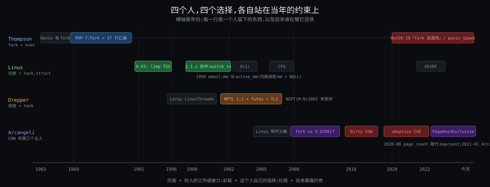

# 阶段 4:Linux 进程全链路是怎么来的

> 上一份讲了内核今天用三件事把七条约束化解掉。这一份回到原点:fork 和 exec 为什么是两步、切换为什么从硬件改成软件、线程为什么就是一个 task、COW 那一位 R/W 为什么到今天还在打官司 —— 每一样都是某个人在某个年代的约束下做的选择。按你定的口径:四个人,每人一个完整故事(烦躁 → 初试 → 死胡同 → 顿悟 → 成型与遗憾),时间线弱化;资料严格一手,每条引用带链接和年份,查不到一手的地方明说。
>
> 调度器那条线(O(1) → CFS → EEVDF)你没选,只在 Linus 那篇末尾用三句带过。

---

## 约束清单速查(C1 ~ C7)

> 和上一份相同的七条,这里只放一句话 + 口诀,方便末尾「约束回扣」对照"当年有哪几条、缺哪几条"。推导见 `stages/02-why/02-why.md`。

#### C1 — CPU快IO慢

CPU 比设备快 10⁴ ~ 10⁷ 倍;一核一次一条流,现场可存可取。**口诀**:等就换人 → 现场必须能存

#### C2 — 霸台不可预知

程序不会主动让台;内核猜不到它下一步。**口诀**:到点硬换 → 换谁只能靠猜

#### C3 — 互不信任

程序可能有 bug 或恶意;有些操作波及整机;程序假定独占地址。**口诀**:三道闸 → 跨任务的事全经内核之手

#### C4 — 文件≠内存

程序在盘上是文件;工具链与内核不同方;内存小程序大且局部;复制必须便宜。**口诀**:只建地图不搬内容 → 缺页才搬

#### C5 — 改流必经打断

内核没有自己的 CPU,只能在任务进内核的瞬间介入。**口诀**:三扇门一扇出口 → 一切挂出口上

#### C6 — 资源有限须归还

pid / 内存 / fd 有限无 GC;任务不能拆自己脚下的栈。**口诀**:自己还大头 → 别人收尾

#### C7 — 核各自为政

核有独立 cache / 执行 / 时钟;跨核协调贵。**口诀**:每核一张表 → 跨核靠 IPI

---

## §0 从 How 走到 Origin:三件事记住

四个故事里反复出现同三个形状。先记住它们,后面读每个人的时候就知道该看哪里。

### §0.1 小改动赢过大设计 —— 从 C4·文件≠内存 + C6·资源有限须归还 推出

因为当年机器小、人少、时间紧(C6 在 1969 年和 1991 年都尖锐得多:PDP-7 只有 8K 字,Linus 的 386 只有 4 MB)→ 要解决"用最少的代码让系统多做一件事"→ 所以四个人都选了**对现有东西改动最小**的那条路:fork 是 27 行汇编,因为系统已经会把进程换到盘上;0.01 用硬件 TSS,因为 386 手册上就有;线程就是 `clone()` 多传几个 flag,因为 task 已经在那里。这些选择活下来不是因为最优,是因为最便宜。

### §0.2 底层承诺一变,上层就得重做 —— 从 C3·互不信任 + C7·核各自为政 推出

因为硬件和内核给上层的承诺会变(Wine 改 LDT 让 TSS 切换不再安全;SMP 让单个 manager 线程变成瓶颈;O_DIRECT 和 RDMA 让"页只有父子两个主人"不再成立)→ 要解决"旧设计在新承诺下崩掉"→ 所以每个故事的"死胡同"都长一个样:**不是原设计错了,是它依赖的前提消失了**。Linus 1998 年改软件切换、Drepper 2002 年重写线程库、Arcangeli 2009 年起和 COW 拉锯,都是这一种。

### §0.3 便宜的共享总欠下正确性的债 —— 从 C4·文件≠内存 的 COW + C3·互不信任 推出

因为"先共享、写时再分"便宜得没法拒绝(C4)→ 可一旦有第三方也拿着这页(C3 里"互不干扰"的承诺被打破)→ 所以 COW 这一位 R/W 从 2005 年到 2022 年修了至少五轮,每轮都是"谁才是这页的主人"这一个问题换了个马甲。fork 便宜,是预支了未来的正确性。

### §0 结论:三件事对照

| 件 | 是什么 | 为什么存在 |
|---|---|---|
| ① 小改动赢过大设计 | fork 27 行、TSS 一条 ljmp、线程 = clone flags | C6 当年远比今天尖锐:代码、内存、人手都少 |
| ② 底层承诺一变上层重做 | 软件 switch_to、NPTL、COW 五轮修补 | C3 / C7 后来才完整浮现:LDT、SMP、GUP 都是后来的事 |
| ③ 便宜的共享欠正确性的债 | COW 从 mapcount 到 page_count 到 PageAnonExclusive | C4 的便宜建立在"只有父子两个主人"上,这个假设被打破了 |

---

## §1 一张极简概览图

从图上能读出来的四件事:

1. **四个选择隔了半个世纪**,但后三个都在前一个留下的地基上做:Linus 的 task 继承了 Thompson 的进程,Drepper 的线程就是 Linus 的 task,Arcangeli 修的是 Thompson 那个 fork 在 Linus 的 COW 实现里的后果。
2. **每一行右端都有红框**:fork 被 HotOS 2019 的论文点名"该退场";COW 2016 和 2020 两次出 CVE。没有一个选择是"做完就完"的。
3. **Linus 那行的灰框是调度器接力**,本份只带过。
4. **Arcangeli 那行是唯一跨越十几年的拉锯**,而且到今天还没有"最终版"。

---

## §2 Ken Thompson 与 fork:一刀两断,因为省事

### §2.1 烦躁:两个终端,一个壳,换一次命令要重读一次壳

1969 年夏天,PDP-7 上的 Unix 已经有文件系统、有 shell,但**进程只有两个,一个终端一个**,"没有 fork、wait、exec"。Ritchie 后来写下了那时 shell 的主循环 [R1]:

> 1) The shell closed all its open files, then opened the terminal special file for standard input and output.
> 2) It read a command line from the terminal.
> 3) It linked to the file specifying the command, opened the file, and removed the link. Then it copied a small bootstrap program to the top of memory and jumped to it; this bootstrap program read in the file over the shell code, then jumped to the first location of the command (in effect an exec).
> 4) The command did its work, then terminated by calling exit. The exit call caused the system to read in a fresh copy of the shell over the terminated command, then to jump to its start.

也就是说:**命令把 shell 覆盖掉,命令退出时系统再把 shell 读回来**。`exit` 的意思是"把壳装回来"。没有后台任务、没有脚本、更没有管道。Ritchie 记下了那种烦躁 [R1]:"a newly recreated shell had to close all its open files … Then it had to reopen the special file corresponding to its terminal … the shell could retain no memory across commands, because it was reexecuted afresh after each command." 每个目录还必须放一个叫 `tty` 的特殊文件,不然 shell 找不到自己的终端,"the shell would loop hopelessly; about the only remedy was to reboot."

Thompson 自己 1989 年回忆时把来源说得很直白 [T1]:他在 Berkeley 参与过 Project Genie,那个系统"made a cleaned up version of MIT's operating system",而 Multics 给了他"the concept of a shell"和"per process execution. You know create a process - execute the command"。但 Multics "it was so expensive creating a process that it ended up creating a few processes" —— 他想要那个模型,又付不起 Multics 的代价。

### §2.2 初试与顿悟:27 行汇编

Ritchie 的原话 [R1]:"Process control in its modern form was designed and implemented within a couple of days. It is astonishing how easily it fitted into the existing system; at the same time it is easy to see how some of the slightly unusual features of the design are present precisely because they represented small, easily-coded changes to what existed."

关键的一段,回答你那份 How 里的问题"为什么是两步":

> A good example is the separation of the fork and exec functions. … The separation of the functions is certainly not unique to Unix, and in fact it was present in the Berkeley time-sharing system, which was well-known to Thompson. Still, it seems reasonable to suppose that it exists in Unix mainly because of the ease with which fork could be implemented without changing much else. The system already handled multiple (i.e. two) processes; there was a process table, and the processes were swapped between main memory and the disk. The initial implementation of fork required only
> 1) Expansion of the process table
> 2) Addition of a fork call that copied the current process to the disk swap area, using the already existing swap IO primitives, and made some adjustments to the process table.
> In fact, the PDP-7's fork call required precisely 27 lines of assembly code. … But a combined fork-exec would have been considerably more complicated, if only because exec as such did not exist; its function was already performed, using explicit IO, by the shell.

拆开看这段话里的三个事实:

| 事实 | 对应今天 |
|---|---|
| 系统已经会把整个进程换到盘上(swap) | fork 的"复制"不是新机制,是把 swap-out 再 swap-in 一份 —— 第一版 fork 真的复制全部内容,COW 要等到 1980 年代 BSD 才有 |
| exec 当时不在内核里,是 shell 自己用 IO 做的 | 内核只需要加 fork;exec 后来才搬进内核,`exit` 则从"装回 shell"简化成"清掉进程表项" |
| 一个 fork 调用 + 扩进程表 = 全部改动 | 这就是 §0.1 的"小改动赢过大设计" |

Thompson 在采访里还说了一句设计动机 [T1]:"I wanted to avoid this thing called an 'executive'" —— 他不要一个内建命令层,命令就是文件系统里的程序,"run the tools out of the file system, that's called an 'exec' by the way"。fork 之后 exec 一个文件,正好让 shell 自己也只是个普通程序。

### §2.3 死胡同:chdir 坏了,IO 指针错了

两步模型一上线就撞了两堵墙,Ritchie 都记了下来 [R1]:

1. **chdir 不工作了**。"In the midst of our jubilation, it was discovered that the chdir command had stopped working. … in the old system chdir was an ordinary command; it adjusted the current directory of the (unique) process attached to the terminal. Under the new system, the chdir command correctly changed the current directory of the process created to execute it, but this process promptly terminated and had no effect whatsoever on its parent shell!" 解法是把 `chdir` 做成 shell 内建命令 —— 今天 `cd` 仍然是内建的,`login` 同理。这是 fork 语义第一次暴露出来:**子进程改的是自己的账本**(How 的件②里 `fs` 那一栏)。
2. **输出互相覆盖**。IO 指针当时记在进程里,fork 把它复制了一份,于是 `ls` 写完之后 `who` 的输出从 0 偏移重写一遍,"the output of who overwrites and destroys the output of the preceding ls command"。解法:"creation of a new system table to contain the IO pointers of open files independently of the process in which they were opened" —— 这就是今天的 `struct file`,父子共享同一个文件偏移的来历。

两堵墙都在说同一件事:fork 复制了"全部",但哪些该复制、哪些该共享,当时没人想过。后来的 `clone()` flags(How §4.1 那张表)就是把这个问题一样一样补回来。

### §2.4 成型与遗憾:半个世纪后被点名退场

fork + exec 在 PDP-11 上和 1970 年代的 Unix 一起固化,进了 POSIX。半个世纪后,2019 年 HotOS 上一篇题目就叫《A fork() in the road》的论文给它下了判词 [B1]:fork 是"a clever hack for machines and programs of the 1970s that has long outlived its usefulness and is now a liability";论文数了 Ubuntu 的包,1304 个(7.2%)调 fork,只有 41 个用 posix_spawn。

Ulrich Drepper(下一篇的主角)对这篇论文的回应里有一句和 Thompson 遥相呼应 [D0]:"I think that fork() is too high-level and, just like in the origins of fork() itself, … we need to aggregate around lower-level interfaces, like clone()"。他指出 Linux 上 posix_spawn 很多情况下就是用 vfork 实现的,而 vfork 本身在 POSIX 2008 修订里被删掉了。

遗憾清单,用今天的约束说:

| 1969 年的选择 | 今天的账 | 谁在还 |
|---|---|---|
| fork 复制全部 | Redis 20 GB 堆要 fork(What 的钩子二);Android zygote 靠 fork 省启动 | COW(Arcangeli 那篇) |
| "全部"没定义 | 哪些共享、哪些复制,一样一样补 flag | `clone()` 的十几个 flag(Drepper 那篇) |
| exec 单独一步 | 两步之间那几微秒的 COW 账本白建(How §4.1) | vfork、posix_spawn、`CLONE_VFORK` |
| 子进程改自己的账 | `cd` 必须内建;线程出现后 `chdir` 又要共享 | `CLONE_FS` |

Thompson 1989 年被问到有没有想做得不一样的事,答的不是 fork,是网络 [T1]:"The stuff that we left fuzzy, got done either poorly or multiple ways … it's nothing that I could have predicted, it had to be in retrospect to think of that." 这句话放在 fork 上也成立:1969 年没人能预见 20 GB 的堆。

### §2.5 你的视角:分开比较好,职责清晰

你的回答:「分开比较好。生成进程分为两个步骤,职责分离很清晰:fork 负责创建进程运行的环境,execve 负责加载特定的程序代码,是两个阶段。」

认的部分,而且这正是半个世纪来替 fork 辩护的标准论证:**两步之间那段窗口才是价值所在**。子进程在 fork 之后、exec 之前,用普通的系统调用把自己布置好 —— `dup2` 重定向、`close` 关掉不该继承的 fd、`chdir`、`setuid`、`setrlimit`、改信号掩码 —— 然后 exec。Ritchie 自己就记了这个效果 [R1]:"the new process control scheme instantly rendered some very valuable features trivial to implement; for example detached processes (with '&') and recursive use of the shell as a command." IO 重定向在 shell 里就是 fork 之后换掉 0 和 1 再 exec,内核不需要知道"重定向"这个概念。反过来看一步到位的接口就明白:Windows 的 `CreateProcess` 有十个参数,`posix_spawn` 要一套 `posix_spawn_file_actions` 和 `posix_spawnattr` 来描述"exec 之前该做的事",而且每多一种需求就要多一个属性 —— 它们在用一个 API 枚举 fork 窗口里能做的一切。Drepper 说 fork "too high-level"、该围绕 `clone()` 聚合 [D0],Krieger 说该"make explicit where they want to share"[D0],争的就是这个窗口该不该存在。

拧紧两处:

1. **这是事后发现的好处,不是当年的设计理由**。Ritchie 的原话是"it seems reasonable to suppose that it exists in Unix mainly because of the ease with which fork could be implemented without changing much else" —— 先有 27 行汇编,后有"职责清晰"。你的论证是对的,但它是 fork 活下来的原因,不是它出生的原因。这一点在 §0.1 里:便宜的选择先活下来,好处是后来长出来的。
2. **"创建环境"的准确说法是"复制一份环境再改"**。fork 不是从零建一个环境,是把父进程的全部(地址空间、fd、信号、cwd、rlimit……)复制一份,子进程再在窗口里把不要的一样样去掉。好处是改环境用的是普通系统调用;代价有两笔,正是 HotOS 2019 那篇论文 [B1] 攻击的点:一是复制本身 —— 20 GB 的 Redis 为了起一个 bgsave 要建 40 MB 页表(What 的钩子二),bash 每起一个命令建一本只活几微秒的 COW 账本(How §4.1);二是多线程程序里 fork 只复制调用它的那一个线程,其他线程持着的锁、开到一半的连接原样留在子进程里,窗口里能安全调用的函数只剩 async-signal-safe 那一小撮。`vfork` 和 `posix_spawn` 就是在保留"窗口"或"不要窗口"之间各选一边。

所以更准的说法:**fork 把"配置新进程"这件事从一个 API 变成了一段普通代码,这是它的职责分离;代价是配置的起点是一份完整拷贝,而且在线程出现之后这份拷贝是残缺的。** 1969 年两样代价都不存在,所以 Thompson 没得选也不用选。

---

## §3 Linus Torvalds 与任务切换:从一条 ljmp 到一个 C 函数

### §3.1 烦躁:两个线程,一个打 A 一个打 B

1991 年 1 月 Linus 买了一台 386 DX33,4 MB 内存(他本人回忆录里的说法,见「无一手资料的部分」)。他想做的第一件事不是操作系统,是看清 386 的保护模式和任务切换。第一个程序:两个任务,一个在屏幕上打 A,一个打 B,用定时器中断换。他 1992 年 5 月在 Linux-Activists 邮件列表里回忆这一刻:"switched between two processes that printed AAAA... and BBBB... Gods I was proud over that"(已核 #1,出处见文末)。

这段的重要性在于:**Linux 从第一天起就是从"换任务"长出来的**,不是从文件系统或 shell。Thompson 先有文件系统再加进程;Linus 先有两个任务再加别的。

### §3.2 初试:0.01 —— 一切都在一个结构里,一条 ljmp 换人

1991 年 9 月的 0.01 release notes 里,Linus 自己列的设计要点 [L1]:

> Efficient use of the possibilities offered by the 386 chip.
> We task switch only when we really want to switch tasks - unlike minix which task-switches whatever you do.
> Just one data structure for tasks. … I wanted everything in one place.

他还给这版定了位:"As the version number (0.01) suggests this is not a mature product. … This version is also meant mostly for reading."

看 0.01 的 `include/linux/sched.h` [L2],三样东西今天还认得出来:

| 0.01 里 | 今天 |
|---|---|
| `NR_TASKS 64`,一个静态数组 | 动态分配的 `task_struct`,pid 上限 4194304 |
| `struct task_struct` 里直接嵌着 `struct tss_struct tss` 和 `ldt[3]`;`state` 注释 `-1 unrunnable, 0 runnable, >0 stopped`;`counter / priority`;`pid / father`;`filp[NR_OPEN]` | 字段名换了,骨架没变:状态、调度、父子、文件表全在一个结构里(How 的件②) |
| `switch_to(n)`:`xchgl %%ecx,_current` 然后 **`ljmp` 到那个任务的 TSS 选择子** | `__switch_to_asm` + `__switch_to` 两个函数(How §6.3) |

那条 `ljmp` 就是全部的切换代码:386 看到跳到一个 TSS 描述符,**硬件**把当前所有寄存器存进当前 TSS、从目标 TSS 装回来,包括 CR3 和栈。Linus 不用写任何保存现场的代码。宏里唯一多做的是一行"clears the TS-flag if the task we switched to has used the math co-processor latest",协处理器状态延迟保存。

"Just one data structure for tasks"这句在今天的内核里仍然成立 —— 这是 §0.1 的"小改动":硬件提供了切换,他就用硬件的;硬件要 TSS,他就把 TSS 嵌在 task 里。

### §3.3 死胡同:Wine 改了 LDT,硬件切换修不了 oops

七年后的 1998 年 9 月,2.1.x 开发版里切换突然变成了软件实现,有人在 linux-kernel 上抱怨变慢。Linus 的回答是这个故事的核心一手资料 [L3]:

> What happened is that the very latest 2.1.x kernels are using a software context switch, rather than just a jump through a task-gate and using the hardware context switch code.
> Intel documents hardware context switching as slow, and various people have at times complained to me about using it. They can now see _why_ I used it.
> The reason I had to make the context switch be done in software rather than hardware was that I couldn't fix an oops any other way. What happens is that in order to streamline various other parts, I really cannot guarantee that all user-level segment registers are always up-to-date - when processes like Wine and DOSEMU change the LDT, the process context may no longer be valid in another thread, and with the hardware context switching I could force an oops in the context switch that I had no way to recover from.
> In contrast, with the slightly slower software context switch I can recover gracefully from bad segments.

然后是那句被引用很多次的话:

> The new software context switch routine might be slightly optimizable, so we may be able to make it faster, but on the whole it's always easier to make buggy code faster than correct code. And while I am a performance freak, fixing bugs takes precedence..

拆开看他说的死胡同:

- **前提变了**(§0.2)。硬件切换假定 TSS 里的段寄存器值永远合法。Wine 和 DOSEMU 为了跑 16 位代码要改 LDT;2.1.x 里线程共享 LDT,于是一个线程改完 LDT,另一个线程 TSS 里存的段选择子就指向了无效描述符。硬件在 `ljmp` 中途装段寄存器时发现无效 → 异常 → 发生在切换一半的地方,内核栈都不是完整状态,"no way to recover from"。
- **为什么 2.0 没炸**:"2.0.x had this same problem too, but it's harder to trigger because threads don't share the LDT in 2.0.x. In addition, in 2.0.x the context switch isn't protected by a spinlock, so the oops was less damaging: in 2.1.x the oops would result in a completely dead system due to the scheduler spinlock being held stale." —— 多核(C7)来了,切换加了自旋锁,原来"只是 oops"变成"整机死锁"。
- **软件切换为什么能恢复**:每个寄存器由内核一条一条装,装段寄存器出错时内核知道自己在哪一行,可以把它置成安全值继续。How §6.3 里 `__switch_to` 处理 FS / GS 基址那一步,就是这个"gracefully"。

第二天他又补了一句,解释为什么有人测出来软件切换慢得离谱 [L4]:"the reason the numbers got worse for some people is simply that I screwed up the floating point save code … it saved every time through instead of doing the lazy save it was meant to do" —— 修好后"the software context switch is pretty comparable to the hardware one"。

### §3.4 顿悟:地址空间和任务分开 —— mm 与 active_mm

软件切换把"换寄存器"和"换地址空间"拆成两步之后,一个新问题暴露出来:内核线程没有用户地址空间,换到它时 CR3 该写什么?1999 年 7 月 30 日 Linus 在 linux-kernel 上的一封邮件回答了这个问题,这封邮件至今原样收在内核文档里 [L5]:

> we have "real address spaces" and "anonymous address spaces". … all kernel threads basically fall into this category.
> For an anonymous process, tsk->mm will be NULL, for the logical reason that an anonymous process really doesn't have a real address space at all.

于是 `task_struct` 里出现了两个指针:`mm`(真正拥有的地址空间,内核线程为 NULL)和 `active_mm`(当前借用的那本)。`mm_count` 记的是"the number of 'lazy' users (ie anonymous users) plus one if there are any real users",`init_mm` 只是"a 'lazy context when no other context is available'"。

这就是 How §6.3 第 2 步"内核线程不写 CR3、借 `active_mm`"的全部来历,也是 What 里"内核线程 mm = NULL"那一行的出处。顿悟在于:**任务和地址空间是两本账**(How 的件①和件②),0.01 里它们被 TSS 绑在一起(TSS 里有 CR3),软件切换把它们解开了。

### §3.5 成型与遗憾

- **TSS 没有死**。硬件规定从 ring 3 进 ring 0 时必须从 TSS 取内核栈指针(`sp0`),所以今天每个 CPU 仍有一个 TSS,`__switch_to` 每次切换都要更新它的 `sp0`(How §6.3 第 3 步)。Linus 扔掉的是"用 TSS 切换",不是 TSS。
- **"everything in one place" 的代价**。`task_struct` 今天有几百个字段、几 KB 大,每加一个子系统就多几个字段。0.01 的 64 个任务是静态数组;今天 `fork` 一次要分配它加 16 KiB 内核栈。
- **调度器接力(你没选,三句带过)**:0.01 的 `schedule()` 是遍历 64 个槽挑 `counter` 最大的;2002 年 Ingo Molnar 的 O(1) 调度器让 NPTL 敢用 1:1(下一篇);2007 年 CFS 取代 O(1);2023 年 Peter Zijlstra 用 EEVDF 换掉 CFS 核心,就是 How §6.2 里那个。这条线的一手资料本份没查,见文末。

Linus 1998 年那封邮件里的态度,是这四个故事里最清楚的一次"约束变了就改":不是硬件切换设计错了,是 1991 年没有 Wine、没有共享 LDT 的线程、没有多核自旋锁。

---

## §4 Ulrich Drepper 与 NPTL:线程为什么就是一个 task

### §4.1 烦躁:ps 里一个程序显示十个 pid

1996 年,Xavier Leroy 写了 LinuxThreads,README 第一段就定了模型 [X1]:

> LinuxThreads provides kernel-level threads: each thread is a separate Unix process, sharing its address space with the other threads through the new system call clone(). Scheduling between threads is handled by the kernel scheduler, just like scheduling between Unix processes.

这就是 1:1 模型:**一个线程 = 一个内核任务**,靠 `clone()` 共享地址空间。Leroy 自己在 README 里列了它和 POSIX 的差距 [X1]:

- pid 不同:"One thing that they do not share is their pid's and parent pid's. According to the standard, they should have the same, but that's one thing we cannot achieve in this implementation (until the CLONE_PID flag to clone() becomes usable)." —— `ps` 里一个多线程程序显示成一排进程,`kill` 一个 pid 只杀一个线程。
- 信号发错人:POSIX 要求异步信号"delivered to one of the threads of the program which does not block the signal",LinuxThreads 做不到:"the signal is delivered to the thread it's been sent to, based on the pid of the thread. If that thread is currently blocking the signal, the signal remains pending."
- 线程数:每个线程栈预留 2 MB,"on a 32-bit architecture, no more than about 1000 threads can coexist … but this is reasonable, since each thread uses up one entry in the kernel's process table, which is usually limited to 512 processes."
- 靠一个 **manager 线程**兜底:"The thread manager notices when a thread dies on a signal and kills all other threads with the same signal." 创建线程、回收线程栈、处理致命信号,全经它之手。

这些都不是 Leroy 的失误 —— 1996 年的内核没有线程组的概念,`clone()` 只能造"共享内存的进程"。他在能拿到的承诺上做到了最好,并且把做不到的全写在 README 里。

### §4.2 初试:两条路 —— 内核改一点,还是用户态自己调度

到 2002 年,Linux 要进企业服务器,Java 和数据库动辄几千线程,LinuxThreads 的问题从"不合标准"变成"跑不动"。Drepper 和 Molnar 2003 年的设计文档把病症列成一段 [D1]:

> The existence of the manager thread causes problems. If the manager thread gets killed the remainder of the process is in a state which must be manually cleaned up. Having the manager handle operations like thread creation and cleanup makes it a bottleneck.
> The signal system is severely broken. It does not conform with the behavior POSIX specifies. Sending a signal to the process as a whole could not be implemented.
> The use of signals to implement the synchronization primitives causes enormous problems.

当时有两个方案在竞争。IBM 的 NGPT(Next Generation POSIX Threads)走 **M:N**:用户态自己做一个调度器,把 M 个用户线程铺在 N 个内核任务上,内核不用大改。Drepper 和 Molnar 的 NPTL 走 **1:1**:线程还是一个 task,但要内核加一堆东西。

### §4.3 死胡同:M:N 为什么被判不合 Linux

设计文档里的裁决 [D1]:

> The consensus among the kernel developers was that an M-on-N implementation would not fit into the Linux kernel concept. The necessary coordinated scheduling infrastructure that must be added comes with a cost which is too high. To allow context switching in the user-level scheduler it would be often necessary to copy the contents of the registers from the kernel space. Additionally many of the problems the user-level scheduling helps to prevent are not real problems for the Linux kernel. Huge numbers of threads are not a significant issue since the scheduler and all the other core routines have constant execution time (O(1)) as opposed to linear time with respect to the number of active processes and threads.

三个理由,对应三条约束:

| 理由 | 为什么成立 | 约束 |
|---|---|---|
| 两个调度器互相不知道对方(用户态线程在内核里睡了,用户态调度器不知道,那个内核任务就白占着) | 要协作得加 Scheduler Activations 那套上行调用,"cost which is too high" | C5·改流必经打断:用户态调度器没法在内核睡眠时介入 |
| M:N 的理由之一是"内核线程太多调度慢" | 2002 年 Ingo 的 O(1) 调度器刚进 2.5,这个理由消失了 | C2·霸台不可预知 的解法变了,上层选择跟着变 |
| 信号:M:N 要在用户态重做 POSIX 信号语义 | "it adds complexity, bulk, and unnecessary delay";放内核做"otherwise straightforward … Obviously this helps only if the 1-on-1 model is used" | C3·互不信任 的闹钟和纸条本来就是内核的事 |

还有一个硬件级的死胡同:1:1 要每个线程一个 TLS 基址,IA-32 上只能用段寄存器,段描述符放在 LDT 里,"The previously used method (via the LDT) had limited the number of threads per process to 8192. To achieve maximal scalability without this new system call, an M-on-N implementation would have been necessary." [D1] 也就是说:**如果内核不肯加 TLS 系统调用,1:1 在 x86 上就封顶 8192 个线程,M:N 会是唯一出路**。

### §4.4 顿悟:把 manager 线程的每件事都塞回内核

设计文档的结论是一句话:"The goal for the new implementation therefore should be to avoid a manager thread." [D1] 做法是逐条回答"manager 为什么存在",每条换成一个内核特性:

| manager 干的事 | 换成的内核特性 | 今天在 How 的哪里 |
|---|---|---|
| 致命信号时杀掉全组 | `CLONE_THREAD` 线程组 + `exit_group` 系统调用;"The exec system call now provides the newly created process with the process ID of the original process. All other threads in the process are terminated" | §8.3 `zap_other_threads`;§4.3 `de_thread` |
| 回收死线程的栈(线程不能拆自己脚下的栈) | `CLONE_CHILD_CLEARTID`:"clears this memory location once the thread is terminated … Furthermore the kernel does a futex wakeup on the thread ID. This feature is used by the pthread_join implementation." | §8.1 第 6 步同一个问题,C6·资源有限须归还 |
| 用信号实现 mutex | futex:内核能看到所有等待者 | §6.1 "任务自己睡"的触发点 |
| 每线程一个 pid | `getpid()` 全组相同,`/proc` 改造 | §3.3 `mm_users` = 线程数;ps 里一个进程 |
| TLS 基址 | 新系统调用往 per-CPU GDT 写条目,"The GDT entries per-thread are kept current by the scheduler" | §6.3 第 3 步换 FS / GS 基址 |

2002 年 9 月 19 日的发布邮件给了数字 [D2]:要求"a kernel with the threading capabilities of Linux 2.5.36";在一台双 450 MHz PII Xeon 上,"100,000 threads were created and destroyed in 2.3 seconds"。设计文档里还有退出路径的对比 [D1]:"starting and stopping 100,000 threads formerly took 15 minutes compared to the 2 seconds it now takes." 发布邮件也坦白 1:1 并非公认更好:它"is not generally accepted"为优越,"but our tests convinced us" [D2]。

LWN 当时的报道:NGPT 比 LinuxThreads 快约两倍,NPTL 比 NGPT 再快约四倍 [W1];NGPT 2003 年中放弃(二手,见文末)。

### §4.5 成型与遗憾

- **线程 = task 成了定论**。这就是 What 里"内核里没有进程对象,只有 task"的来历,也是 Why 里"clone flags 就是 task 的隔离级别"那张表的来历。每一个 `CLONE_*` 都是 LinuxThreads 时代"做不到"清单上的一条。
- **8192 的上限换成了 GDT 的 per-CPU 槽**,但 TLS 靠段寄存器这件事一直留到 x86-64 的 FS 基址,`__switch_to` 每次都得换它。
- **manager 没了,但"线程退出时谁收尾"没有消失**,只是搬进了内核:`CLONE_CHILD_CLEARTID` + futex 唤醒。C6·资源有限须归还 不会因为换了实现就不见。
- **遗憾**:Drepper 2019 年回看 fork 时说 clone "is not ideal but it served us well" [D0]。1:1 把"一个线程多少内核资源"的问题留给了今天:每个线程 16 KiB 内核栈 + 一个 `task_struct`,十万线程就是 1.6 GB 内核栈;Go 和 Java 虚拟线程后来又在用户态做回了 M:N —— 用 2002 年被否决的那条路,因为它们在运行时里能做内核做不到的协作。

---

## §5 Andrea Arcangeli 与 COW:一页纸有第三个主人之后

### §5.1 烦躁:fork 一下,别人的读就丢了

COW 的机制在 How §7.2 只有两句话:fork 时父子两边都清 R/W 位,谁先写谁复制;复制不复制看引用计数。这两句话默认**一页只有父子两个主人**。可 Linux 从 2.4 起就有了第三个主人:`get_user_pages()`(GUP)—— O_DIRECT、RDMA、`vmsplice`、驱动,都可以拿到一个用户页的物理地址,然后绕开页表直接读写它。

2009 年 2 月 2 日,Arcangeli 在 linux-kernel 上描述了一个三线程的场景 [A1]:一个线程在反复写某页的最后 512 字节,另一个线程用 O_DIRECT 往这页的前 512 字节读数据,第三个**毫不相干的线程 fork 了一个子进程**。结果:

> We can lose O_DIRECT reads (or any other get_user_pages write=1 I/O not just bio/O_DIRECT) … the very moment we mark any pte wrprotected because a third unrelated thread forks off a child.

为什么:fork 把这页标成只读;写最后 512 字节的线程触发 COW,拷了一份新页、把父进程的页表指过去;可磁盘 DMA 还在往**旧页**写 —— 数据落到了子进程(或已经没人要的)那一页上。父进程的读就这样丢了。

### §5.2 初试与死胡同:十几年里的五次修补

这个问题没有一次性的解法,因为每次修都要在三样东西之间选:安全(子进程不能看到父进程之后写的东西)、正确(GUP 的使用者不能被 COW 甩掉)、便宜(别为了 1% 的场景让每次缺页都变慢)。按一手资料排一下:

| 时间 | 谁 | 做了什么 | 后来 |
|---|---|---|---|
| 2005 | Linus | commit `4ceb5db9757a` "Fix get_user_pages() race for write access" | 因 s390 问题被 `f33ea7f404e5` 撤销 —— Linus 2016 年自己写的回顾 [A3] |
| 2009-02 | Arcangeli(基于 Nick Piggin 的补丁) | fork 时如果页可能正被 GUP 写着,就**不要**只读化父进程的 PTE,而是直接在 fork 里给子进程拷一页;加 `PG_gup` 位避免拖慢普通 fork [A1] | 他自己说 mainline 更难:"porting to mainline is harder because of gup-fast" —— 快路径不拿锁,没法在 fork 里同步。Piggin 同年说 Linus "hated our 'preemptive cow' approaches"(二手转述,见文末) |
| 2016-10 | Linus | Dirty COW(CVE-2016-5195):GUP 的 `FOLL_WRITE` 玩法让只读映射能被写。Linus 的提交说明 [A3]:"This is an ancient bug that was actually attempted to be fixed once (badly) by me eleven years ago … In the meantime … the VM has become more scalable, and what used a purely theoretical race back then has become easier to trigger." 引入内部标志 `FOLL_COW` 记"已经 COW 过",再用 PTE 的脏位验证 | 这是 How §2.2 那五位里 D 位的一次关键用法 |
| 2020-05-27 | Linus(Jann Horn 报告) | 子进程用 `vmsplice` 把一页 pin 进管道再 unmap,父进程写这页时引用计数变成 1 → 直接复用 → 子进程从管道里读到父进程之后写的内容(CVE-2020-29374,Android zygote 模式正中靶心)。Linus 的提交说明 [A4]:"Doing a 'get_user_pages()' on a copy-on-write page for reading can be ambiguous: the page can be COW'ed at any time afterwards, and the direction of a COW event isn't defined." 解法:GUP 只要拿私有映射的页,就先强制 COW | "this commit message being a lot bigger than the patch" |
| 2020-08-21 | Linus / Peter Xu | `do_wp_page()` 彻底简化:复用的判据从 `mapcount`(有几个页表映射它)改成 **`page_count`(有几个人引用它,含 GUP)**。提交说明只有三句 [A5]:"How about we just make sure we're the only possible valid user of the page before we bother to reuse it? Simplify, simplify, simplify. And get rid of the nasty serialization on the page lock at the same time." 删了 42 行,加了 17 行 | Xu 的描述:"Linus's suggestion to simplify cow handling (and also more strict) by checking against page refcounts rather than mapcounts" [A6] |

每一轮都是 §0.2:不是上一轮错了,是又多出一种"第三个主人"。

### §5.3 争论:2021 年 1 月,mapcount 还是 page_count

2021 年 1 月 9 日,Arcangeli 发了一个补丁,标题"mm: restore full accuracy in COW page reuse",要把 2020 年 8 月那次简化撤回 [A7]。他的复现程序标题就是指控:"v5.11 O_DIRECT mm corruption with page_count instead of mapcount in do_wp_page" —— 用 `page_count` 之后,一次 O_DIRECT 读(GUP 拿了引用,计数变 2)叠加一次 `clear_refs` 写保护,父进程再写就会被**错误地**复制一页,DMA 写进旧页,数据又丢了。这正是他 2009 年那个 bug 的镜像:2009 年是该复制时没复制(父进程读丢),2020 年是不该复制时复制了(父进程读丢)。

他的立场 [A7][A8]:"The only thing again where I see page_count provides a tangible benefit, is the vmsplice attack from child to parent" —— 为了堵一个 `vmsplice` 的洞,让每一次 COW 缺页都多付代价,不值;应该"orthogonally secure vmsplice"。"I haven't seen a single benchmark showing the benefit of not taking the PG_lock before a page copy."

Linus 当天的回复 [A9],措辞是他的风格:

> page_mapcount() is pure and utter garbage, and has zero meaning for COW.
> In other words, COW needs to use page_count().

他的逻辑:COW 要回答的是"**这页是不是只有我一个人**",映射次数回答不了这个问题 —— GUP 拿着页却不在任何页表里。`mapcount` 只能回答另一个问题:"这页是否已经被独占过"。对 Arcangeli 的"definitely know"他说"I think you're full of it"。

这场争论没有和解。David Hildenbrand 在同一个线程里的总结 [A10]:简化之后只有 `page_count == 1` 且 `mapcount == 1` 才复用;而 fork 之类的老 GUP 场景本来就是坏的。Jason Gunthorpe 则指出 `page_count` 对长期 pin(RDMA)也不是可靠信号(二手摘要,见文末)。

### §5.4 顿悟:给页记一位"我是独占的"

2022 年 1 月,Hildenbrand 的"mm: COW fixes part 1"把问题重新表述成三种失败 [A11]:

> (1) "missed COW":the kernel reuses a page when it should copy —— 安全问题(2020 CVE)
> (2) "wrong COW":the kernel copies when it shouldn't,GUP references fall out of sync —— 数据损坏(Arcangeli 2009 和 2021 的两个 bug)
> (3) "unnecessary COW":performance loss and temporary swap and memory growth

他把 2020 年的两次修补各打了一个标签:17839856 "fixed this issue and resulted in other problems",09854ba "re-introduced part of the problem unfortunately"。然后提出 **`PageAnonExclusive`**:在页上**显式记一位**"这页现在只属于一个进程",规则是"allow GUP pins only on such exclusive pages",独占位只有在"there are no GUP pins"时才能清掉。也就是说,不再从引用计数里**推断**独占,而是把独占当成一个要维护的状态。

2022 年 5 月 LSFMM 上他自己的评价 [W2]:结果"is not optimal",它"works well in the absence of fork() calls or the use of kernel same-page merging (KSM)",THP、临时 unmap、并发 gup_fast 仍然是"tricky cases","a step in the right direction"。

### §5.5 成型与遗憾

- **How §7.2 里 `wp_page_reuse` 的判据,今天就是这场争论的结果**:`page_count == 1` 加 `PageAnonExclusive`。写那一节时我说"看引用计数",现在你知道这个计数在 2020 年前叫 `mapcount`,以及为什么换。
- **COW 便宜的前提从来就不成立**。Thompson 的 fork 假定"复制全部",BSD 的 COW 假定"只有父子两个主人",Linux 的 GUP 加了第三个,RDMA 加了"长期"第三个。§0.3:便宜的共享预支了正确性,利息一直在付。
- **Arcangeli 的立场没有赢,但他的 bug 是真的**。2021 年之后 O_DIRECT + fork 的组合在应用层的标准建议仍然是"别这么干"或者"用 `MADV_DONTFORK`"。
- **没有"最终版"**。Hildenbrand 自己说还要 part 2、part 3,"This work will certainly take a while"。这是四个故事里唯一一个结尾还开着的。

---

## §6 约束回扣:当年的约束组合 ≠ 今天的

| 人 / 年 | 当年有的约束 | 当年**没有**或很弱的 | 后来谁替它还债 |
|---|---|---|---|
| Thompson 1969 | C1·CPU快IO慢(等读卡机)、C6·资源有限须归还(8K 字、一个人一个月)、C2 的一半(两个终端轮流) | **C4·文件≠内存 的 COW 一半**(fork 真复制,swap 整个进程);**C3·互不信任**(两个同事共用一台机);**C7** | COW(BSD / Linux);clone flags;posix_spawn |
| Linus 1991 | C1、C2(两个任务打 A 打 B)、C6(4 MB 内存) | **C3 的 LDT 那一面**(没有 Wine);**C7·核各自为政**(单核,切换不加锁) | 1998 软件切换;1999 mm / active_mm;2.6 的每核 rq |
| Leroy 1996 → Drepper 2002 | C1、C2(O(1) 调度器让"线程多"不再是问题)、C3(信号语义必须归内核) | Leroy 时代**缺内核承诺**(没有线程组、没有 futex、没有 TLS 调用);**C7**(SMP 把 manager 变成瓶颈) | 2.5.36 的一堆新 flag 和系统调用;今天 Go / JVM 在用户态重做 M:N |
| Arcangeli 2009 → 2022 | C4(COW 必须便宜)、C3(子进程不能看到父进程的写) | **"一页只有父子两个主人"这个隐含假设**从来不是约束,只是 1980 年代的事实 | `PageAnonExclusive`,还在修 |

两个规律:

1. **每个人都在缺失的那条约束上留了债**。Thompson 缺 C4 的 COW,Linus 缺 C7,Drepper 的前辈缺内核承诺,Arcangeli 面对的是一条当年没人写下的隐含假设。
2. **债不是由原作者还的**。Thompson 的 fork 由 BSD 和 Linus 还,Linus 的 TSS 由他自己还(少见),Leroy 的 manager 由 Drepper 还,COW 的债由 Linus、Arcangeli、Hildenbrand 轮流还。这就是 Why 里"这些不算约束"那张表存在的意义:分清哪些是约束、哪些是某年某人的选择,后者才能换。

---

## §7 呼应你的问题

从历史角度回看六问,每问都能指到一个人的一个决定:

| 你的问题 | 历史上的那个决定 | 它解释了什么 |
|---|---|---|
| 1. 怎么从磁盘装载到内存 | Thompson 把 exec 从 shell 搬进内核、和 fork 分开;Ritchie:"a combined fork-exec would have been considerably more complicated" | 为什么今天 execve 要先扔掉一本刚 fork 出来的账本(How §4.1) |
| 2. ELF / 链接 / 重定位 | 本份没有专门的人物(ELF 是 1989 年 Unix System V R4 的委员会产物,一手资料未查) | — |
| 3. 调度 / 切换 | Linus 0.01 用 TSS、1998 改软件、1999 拆开 mm 和 active_mm | 为什么 switch_to 只存六个寄存器而 TSS 还在;为什么内核线程 mm = NULL |
| 4. 系统调用 / 缺页 / COW / signal | Arcangeli 2009 的三线程 bug 到 Hildenbrand 2022 的三种失败;Drepper 把信号语义收回内核 | 为什么 COW 复用要看 page_count 加独占位;为什么信号是进程级的 |
| 5. 销毁 | Leroy 的 manager 线程负责回收栈和杀全组 → NPTL 把它换成 `CLONE_CHILD_CLEARTID` 和 `exit_group` | 为什么线程不能拆自己的栈,以及内核怎么替它拆(How §8.1 第 6 步) |
| 6. 监视工具 | Leroy README:每线程一个 pid,`ps` 显示一排 → NPTL 后 `/proc` 改造 | 为什么 `ps` 里一个进程、`ps -L` 才见线程 |

---

## 一手资料引用列表

**Thompson 与 fork**

- [R1] Dennis M. Ritchie, "The Evolution of the Unix Time-sharing System", AT&T Bell Laboratories Technical Journal 63(6) part 2, Oct 1984, pp. 1577–93(初稿为 1979 年 Language Design and Programming Methodology 会议论文)。节「Process control」「IO redirection」。镜像:https://www.read.seas.harvard.edu/~kohler/class/aosref/ritchie84evolution.pdf(Bell Labs 原址 https://www.bell-labs.com/usr/dmr/www/hist.html 已 410)
- [T1] Michael S. Mahoney, "Interview with Ken Thompson, 9-6-89", The Unix Oral History Project。https://tuhs.pdp-11.org.ru/Documentation/OralHistory/transcripts/thompson.htm
- [B1] Andrew Baumann, Jonathan Appavoo, Orran Krieger, Timothy Roscoe, "A fork() in the road", HotOS 2019。https://www.microsoft.com/en-us/research/publication/a-fork-in-the-road ;PDF https://www.bu.edu/rhcollab/files/2019/04/fork-in-the-road.pdf
- [D0] Ulrich Drepper 与 Orran Krieger 的通信,"A fork() in the road – conversation between Uli Drepper & Orran Krieger", Red Hat Collaboratory at BU, 2019-04-11。https://www.bu.edu/rhcollab/2019/04/11/a-fork-in-the-road

**Linus 与任务切换**

- [L1] Linus Torvalds, "Notes for linux release 0.01", 1991-09。https://www.kernel.org/pub/linux/kernel/Historic/old-versions/RELNOTES-0.01
- [L2] Linux 0.01 源码 `include/linux/sched.h`(`switch_to` 宏、`struct task_struct`、`struct tss_struct`)。镜像 https://github.com/zavg/linux-0.01/blob/master/include/linux/sched.h ;官方归档 https://kernel.googlesource.com/pub/scm/linux/kernel/git/nico/archive/+/v0.01
- [L3] Linus Torvalds, "Re: Interesting scheduling times", linux-kernel, 1998-09-17。https://lkml.iu.edu/hypermail/linux/kernel/9809.2/0240.html
- [L4] Linus Torvalds(经 Richard Gooch 回信引用), "Re: Interesting scheduling times", linux-kernel, 1998-09-18。https://lkml.iu.edu/hypermail/linux/kernel/9809.2/0318.html
- [L5] Linus Torvalds, "Re: active_mm", linux-kernel, 1999-07-30;收录于内核文档 Documentation/mm/active_mm.rst。https://www.kernel.org/doc/html/latest/mm/active_mm.html

**Drepper 与 NPTL**

- [X1] Xavier Leroy, LinuxThreads README(release 0.7,Copyright 1996, 1997)。glibc 2.3.6 树内副本:https://raw.githubusercontent.com/bminor/glibc/glibc-2.3.6/linuxthreads/README
- [D1] Ulrich Drepper, Ingo Molnar, "The Native POSIX Thread Library for Linux", Red Hat, 2003-02。镜像 https://www.cs.utexas.edu/~witchel/372/lectures/POSIX_Linux_Threading.pdf(原址 people.redhat.com/drepper/nptl-design.pdf;2005 年修订版镜像 https://compas.cs.stonybrook.edu/~nhonarmand/courses/sp17/cse506/papers/nptl-design.pdf)
- [D2] Ulrich Drepper, "[ANNOUNCE] Native POSIX Thread Library 0.1", linux-kernel, 2002-09-19。https://lkml.iu.edu/hypermail/linux/kernel/0209.2/1075.html
- [W1] LWN.net, 对 NPTL 0.1 发布的报道, 2002-09。https://lwn.net/Articles/10465/ ;https://lwn.net/Articles/10710/

**Arcangeli 与 COW**

- [A1] Andrea Arcangeli, "Re: open(2) says O_DIRECT works on 512 byte boundries?"(内附 fork-o_direct-race 补丁), linux-kernel, 2009-02-02。https://lkml.iu.edu/hypermail/linux/kernel/0902.0/00474.html
- [A3] Linus Torvalds, commit 19be0eaffa3a "mm: remove gup_flags FOLL_WRITE games from __get_user_pages()", 2016-10-13(Dirty COW 修复)。https://github.com/torvalds/linux/commit/19be0eaffa3ac7d8eb6784ad9bdbc7d67ed8e619
- [A4] Linus Torvalds, commit 17839856fd58 "gup: document and work around 'COW can break either way' issue", 2020-05-27。https://github.com/torvalds/linux/commit/17839856fd588f4ab6b789f482ed3ffd7c403e1f
- [A5] Linus Torvalds(经 Peter Xu 提交), commit 09854ba94c6a "mm: do_wp_page() simplification", 2020-08-21。https://github.com/torvalds/linux/commit/09854ba94c6aad7886996bfbee2530b3d8a7f4f4
- [A6] Peter Xu, "[PATCH 0/4] mm: Simplfy cow handling", linux-kernel, 2020-08-21(回信中引用)。https://lkml.iu.edu/hypermail/linux/kernel/2008.3/05695.html
- [A7] Andrea Arcangeli, "[PATCH 0/1] mm: restore full accuracy in COW page reuse", linux-kernel, 2021-01-09。https://lkml.rescloud.iu.edu/2101.1/01409.html ;补丁正文 https://lkml.rescloud.iu.edu/2101.1/01408.html
- [A8] Andrea Arcangeli, 同线程回复 Linus, 2021-01-09 22:18 EST。https://lkml.rescloud.iu.edu/2101.1/01421.html
- [A9] Linus Torvalds, 同线程, 2021-01-09 22:59 EST。https://lkml.rescloud.iu.edu/2101.1/01427.html
- [A10] David Hildenbrand, 同线程总结, 2021-01。https://lkml.rescloud.iu.edu/2101.1/08696.html
- [A11] David Hildenbrand, "[PATCH RFC v2 0/9] mm: COW fixes part 1: fix the COW security issue for THP and swap", linux-kernel, 2022-01-26。https://lkml.iu.edu/hypermail/linux/kernel/2201.3/06740.html
- [W2] Jonathan Corbet, "get_user_pages() and COW, 2022 edition", LWN.net, 2022-05-20(LSFMM 2022 会议报道,Hildenbrand 的发言)。https://lwn.net/Articles/895439/

---

## 无一手资料的部分

以下细节本份没有查到一手出处,可信度按标注:

| 说法 | 来源性质 | 处理 |
|---|---|---|
| Linus 1991-01-05 买 386 DX33、4 MB;第一个程序两个任务打 A 打 B,用定时器中断换;"Gods I was proud over that" | 收尾已核:引文出自 Linus 1992-05-05 发在 Linux-Activists 的帖子「Re: Writing an OS - questions !!」(cs.cmu.edu/~awb/linux.history.html 存档),不是书;《Just for Fun》原文是"I was very proud of it",并记 1991-01-02 决定买、01-05 父亲帮忙运回家、33 MHz、4 MB、含分期 18,000 芬兰马克;书的节选里没有字面写"DX33" | 正文已改为引 1992 年帖子 |
| O(1)(2002, Ingo Molnar)→ CFS(2007)→ EEVDF(2023, Peter Zijlstra)的接力 | 你没选这条线,未查一手 | 三句带过,标"本份未查" |
| NGPT 2003 年中放弃;glibc 2.3 不支持 NGPT | Wikipedia / Dr. Dobb's 2005 | 二手,标注 |
| Nick Piggin 2009 年说 Linus "hated our 'preemptive cow' approaches" | 搜索结果里的邮件摘要,未读原文 | 二手转述,标注 |
| Jason Gunthorpe 2021 年关于 page_count 对长期 pin 不可靠的观点 | linux-mm 线程摘要 https://www.spinics.net/lists/linux-mm/msg240793.html ,未读全文 | 二手摘要,标注 |
| ELF 格式的来历(1989, SVR4 / TIS 委员会) | 未查 | 六问表里第 2 问留空 |
| Thompson 第一版 fork 真的复制整个进程到 swap 区 | 直接出自 [R1] 的"copied the current process to the disk swap area";"COW 要等到 BSD"是常识性说法,未查 BSD 一手 | 前半一手,后半标注 |

---

## 修订记录

| 时间 | 修订摘要 | 触发原因 |
|---|---|---|
| 2026-10-31 | 新增 §2.5《你的视角》:fork / exec 分开职责清晰 —— 认「窗口里用普通系统调用配置」是 fork 活下来的理由,拧紧「这是事后好处不是设计理由」「创建环境 = 复制再改,代价是拷贝和多线程残缺」 | 第 1 次反问,用户给出自己的论证 |
| 2026-10-31 | 初稿:约束速查 + §0 三件事(小改动赢过大设计 / 底层承诺一变上层重做 / 便宜的共享欠正确性的债)+ §1 时间线图 + §2 Thompson 与 fork(Ritchie 1984 + Thompson 1989 访谈 + HotOS 2019 + Drepper 回应)+ §3 Linus 与任务切换(0.01 release notes + 0.01 sched.h + 1998 两封 LKML + 1999 active_mm 邮件)+ §4 Drepper 与 NPTL(Leroy README + 2003 设计文档 + 2002 发布邮件)+ §5 Arcangeli 与 COW(2009 LKML、2016 / 2020 / 2020 三个 Linus commit、2021 争论线程、2022 Hildenbrand)+ §6 约束回扣 + §7 六问 + 引用列表 23 条 + 无一手资料 7 条 | 开场对齐收敛(人物剧情 / 四人 1 2 5 6 / 严格一手) |
| 2026-10-31 | 收尾核实:待核 #1 已核,"Gods I was proud over that"出处改为 1992-05-05 Linux-Activists 帖,正文与"无一手资料"表同步 | 导出前统一核实 |
