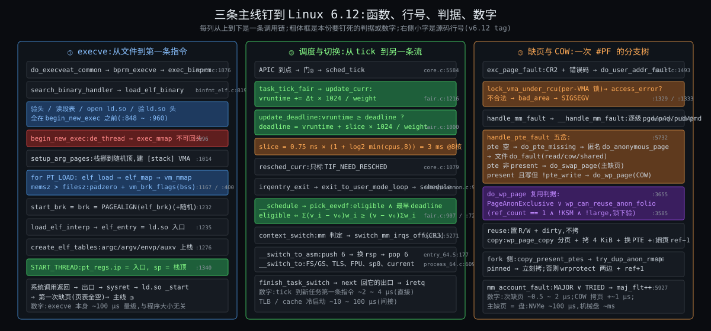

# 阶段 5:Linux 进程全链路的深度剖析

> 上一份把骨架立住了:三件事、四幕、七步 execve、三处标记一处换人、五岔缺页。这一份把三条主线钉到 Linux 6.12 的源码上:函数名、行号、判据、数字。每条主线三层(操作层 / 函数逻辑层 / 底层原理层),贴 50 ~ 150 行 6.12 原文逐句注释,然后做一次反事实小试:如果不这样设计,还能怎么做,各违反哪条约束。按你定的口径:不给可编译代码,demo 是伪代码;纳秒级时间线只做调度与切换这一条;预留专题(nice / cgroup / 亲和 / SCHED_DEADLINE / NUMA)作附录只给机制和数字。
>
> 行号全部对 `v6.12` tag(`git show v6.12:<path>`),写作 `文件:行`。所有时间数字都是量级估计,逐条标在文末待核表里。

---

## 约束清单速查(C1 ~ C7)

> 同前两份,只放一句话 + 口诀。每条主线末尾的反事实都要回到这七条上判"违反了哪条"。

#### C1 — CPU快IO慢

CPU 比设备快 10⁴ ~ 10⁷ 倍;一核一次一条流,现场可存可取。**口诀**:等就换人 → 现场必须能存

#### C2 — 霸台不可预知

程序不会主动让台;内核猜不到它下一步。**口诀**:到点硬换 → 换谁只能靠猜

#### C3 — 互不信任

程序可能有 bug 或恶意;有些操作波及整机;程序假定独占地址。**口诀**:三道闸 → 跨任务的事全经内核之手

#### C4 — 文件≠内存

程序在盘上是文件;工具链与内核不同方;内存小程序大且局部;复制必须便宜。**口诀**:只建地图不搬内容 → 缺页才搬

#### C5 — 改流必经打断

内核没有自己的 CPU,只能在任务进内核的瞬间介入。**口诀**:三扇门一扇出口 → 一切挂出口上

#### C6 — 资源有限须归还

pid / 内存 / fd 有限无 GC;任务不能拆自己脚下的栈。**口诀**:自己还大头 → 别人收尾

#### C7 — 核各自为政

核有独立 cache / 执行 / 时钟;跨核协调贵。**口诀**:每核一张表 → 跨核靠 IPI

---

## §0 从 How 走到 Deep:三件事记住

How 的三件事是组件(mm_struct + 页表 / task_struct + 内核栈 / rq + 出口检查点)。这一份的三件事是**三个判据**,每条主线各一个,后面所有行号都在围着它们转:

### §0.1 判据①:不可回头点之前只读不写 —— 从 C4·文件≠内存 + C6·资源有限须归还 推出

因为 C4(内核只认段表五样,要验的东西少)+ C6(旧账本扔了就没了,失败没地方回滚)→ 要解决"execve 失败时 bash 还得活着"→ 所以 `load_elf_binary` 的结构是**先验后换再建**:`binfmt_elf.c:848` 到 `:960` 只读文件、只在内核栈上算,一个 VMA 都不碰;`:996` 的 `begin_new_exec` 是分水岭;之后的 `elf_load`、`create_elf_tables`、`START_THREAD` 全在新账本上写。记住行号 996。

### §0.2 判据②:eligible 且 deadline 最早 —— 从 C2·霸台不可预知 推出

因为 C2(猜不到未来,只能按过去分)→ 要解决"既公平又让刚醒的交互任务快上台"→ 所以 EEVDF 用两个数挑人:**`vruntime`**(已经拿到的服务,按权重折算)决定你有没有资格(eligible = 拿到的不比平均多),**`deadline`**(= `vruntime` + 一个时间片的折算)决定资格相同者谁先。挑人函数 `pick_eevdf`(`fair.c:907`)就是"在 eligible 的里面挑 deadline 最早的"。记住公式 `vd = ve + r/w`。

### §0.3 判据③:复用当且仅当独占 —— 从 C4·文件≠内存 的 COW + C3·互不信任 推出

因为 C4(fork 不能拷)+ C3(子进程不能看到父进程之后的写;GUP 的使用者不能被甩掉)→ 要解决"写一个只读 PTE 时,拷还是不拷"→ 所以 `do_wp_page`(`memory.c:3655`)的判据是 **`PageAnonExclusive` 已置位,或 `wp_can_reuse_anon_folio` 在锁下验出 `ref_count == 1`**。前者是 2022 年加的"显式独占位",后者是 2020 年的"引用计数独占"。记住 `:3724` 那一行。

### §0 结论:三个判据对照

| 判据 | 一句话 | 行号 | 由哪条约束逼出 |
|---|---|---|---|
| ① 先验后换再建 | `begin_new_exec` 之前只读,之后才写新账本 | `binfmt_elf.c:996` | C4 + C6 |
| ② eligible ∧ 最早 deadline | 拿到的服务不超平均才有资格,资格相同看 deadline | `fair.c:907 / :726 / :1000` | C2 |
| ③ 独占才复用 | `PageAnonExclusive` 或锁下 `ref_count == 1` | `memory.c:3724 / :3585` | C4 + C3 |

---

## §1 一张极简概览图



从图上能读出来的四件事:

1. **三列的分水岭各在一个位置**:① 的红框 `begin_new_exec`,② 的 `resched_curr` 只标记不换,③ 的 `access_error` 决定是供页还是 SIGSEGV。前面讲过的"不可回头点 / 三处标记一处换人 / 查 VMA 判合法"在源码里各是一行。
2. **三列各有一个数字框**(橙):execve 的量级、EEVDF 的 slice、缺页的μs。它们是本份要钉的数。
3. **② 和 ③ 在底部交汇**:换人之后新任务头几十次访存 TLB miss,和缺页一样走四级页表;这是"间接代价"的来源。
4. **① 的终点是 ③ 的起点**:`START_THREAD` 之后第一条指令就缺页。

---

## §2 主线①:execve 从文件到第一条指令

### §2.1 操作层:调用方看到什么

```c
/* 用户态 */
execve("./hello", argv, envp);        /* 成功不返回;失败返回 -1 + errno */
execveat(dirfd, "hello", argv, envp, AT_EMPTY_PATH);   /* 可对 fd 执行(fexecve 底层)*/
```

调用方能影响装载的旋钮,和它们落在哪一行:

| 旋钮 | 效果 | 落点 |
|---|---|---|
| `personality(ADDR_NO_RANDOMIZE)` / `/proc/sys/kernel/randomize_va_space` | 关 ASLR:栈顶、mmap_base、brk 起点不随机;`setarch -R` 就是它 | `binfmt_elf.c:1006` 判 `PF_RANDOMIZE`;`:1014` 的 `randomize_stack_top`;`:1316` 的 `arch_randomize_brk` |
| `-static` 编译(无 `PT_INTERP`) | 不装 ld.so,`elf_entry = e_entry`,第一条指令就是程序自己的 `_start` | `:893` 不走 `open_exec(elf_interpreter)`;`:1235` 不走 `load_elf_interp` |
| `-pie`(`ET_DYN`)vs `-no-pie`(`ET_EXEC`) | `ET_DYN` 时第一个 `PT_LOAD` 加随机 `load_bias`(x86-64 基址 `ELF_ET_DYN_BASE` 附近,即 `0x5555…`);`ET_EXEC` 按 `p_vaddr` 原地放 | `:1095 ~ :1150` 算 `load_bias` |
| `GNU_STACK` 段的 `E` 位(`-z execstack`) | 栈 VMA 加 `VM_EXEC` | `:1014` 的 `executable_stack` 参数 |
| `ulimit -s` | 栈 VMA 的上限(`setup_arg_pages` 里 `stack_expand`) | `exec.c:716` |
| `MAP_PAGE_ZERO` personality | 把第 0 页映射成只读(兼容 SVr4) | `:1326` |

注意事项:`execve` 之后文件描述符默认**保留**(除非 `O_CLOEXEC`),信号处理函数**重置为默认**(`SIG_IGN` 保留),线程组其他线程**被杀**。这三条分别对应 `begin_new_exec` 里的 `do_close_on_exec`、`flush_signal_handlers`、`de_thread`(`exec.c:1222 ~ :1340`)。C3·互不信任:新程序不该继承旧程序的 handler,但继承 fd 是 Unix 管道模型的基础。

### §2.2 函数逻辑层:`load_elf_binary` 的四段

调用链(`fs/exec.c` → `fs/binfmt_elf.c`):

```
sys_execve
 └ do_execveat_common          exec.c:1876   alloc_bprm → bprm_mm_init(新 mm,只有一条临时栈 VMA)
    ├ copy_string_kernel/copy_strings       把 filename / envp / argv 拷进临时栈页
    └ bprm_execve               exec.c:1821
       └ exec_binprm            exec.c:1777   处理 #! 解释器链(最多 4 层)
          └ search_binary_handler  exec.c:1730  按 formats 链表试 load_binary
             └ load_elf_binary  binfmt_elf.c:819
```

把 `load_elf_binary`(`:819 ~ :1370`)按"判据①"切成四段:

| 段 | 行号 | 做什么 | 碰不碰新账本 |
|---|---|---|---|
| A 验 | `:838 ~ :870` | `memcmp(ELFMAG)`、`e_type ∈ {EXEC, DYN}`、`elf_check_arch`、`f_op->mmap` 存在;`load_elf_phdrs` 把段表读进内核内存 | 不碰 |
| B 找解释器 | `:875 ~ :975` | 遍历段表找 `PT_INTERP`;`elf_read` 读路径;**`open_exec(elf_interpreter)`**(`:893`);`would_dump`;读 ld.so 的 ELF 头并 `elf_check_arch`(`:950`);读 ld.so 的段表 | 不碰 |
| C 换 | `:996 ~ :1016` | `begin_new_exec`;`SET_PERSONALITY2`;`PF_RANDOMIZE`;`setup_new_exec`;`setup_arg_pages` | **从这里开始写新账本** |
| D 建 | `:1022 ~ :1340` | PT_LOAD 循环(`elf_load`);`start_brk`;`load_elf_interp`;`ARCH_SETUP_ADDITIONAL_PAGES`(vdso);`create_elf_tables`;写 `mm->start_code` 等;随机 brk;`finalize_exec`;`START_THREAD` | 写 |

D 段里 PT_LOAD 循环的关键(`:1022 ~ :1200`,摘要):

```c
/* binfmt_elf.c:1022 起,去掉了 ET_DYN 对齐的分支 */
for (i = 0, elf_ppnt = elf_phdata; i < elf_ex->e_phnum; i++, elf_ppnt++) {
    if (elf_ppnt->p_type != PT_LOAD) continue;
    elf_prot  = make_prot(elf_ppnt->p_flags, &arch_state, !!interpreter, false);  /* R/W/X → PROT_* */
    elf_flags = MAP_PRIVATE;                       /* 永远私有:写了就 COW,文件不变 */
    vaddr = elf_ppnt->p_vaddr;
    if (elf_ex->e_type == ET_EXEC || load_addr_set)
        elf_flags |= MAP_FIXED;                    /* 非 PIE:按段表给的地址放,不商量 */
    else if (elf_ex->e_type == ET_DYN)
        load_bias = ...;                           /* PIE:第一个段随机基址,后面的跟着偏 */
    error = elf_load(bprm->file, load_bias + vaddr, elf_ppnt, elf_prot, elf_flags, total_size);   /* :1167 */
    ...
    k = elf_ppnt->p_vaddr;                         /* 记 start_code / end_code / start_data / end_data */
    if ((elf_ppnt->p_flags & PF_X) && k < start_code) start_code = k;
    ...
    k = elf_ppnt->p_vaddr + elf_ppnt->p_memsz;
    if (k > elf_brk) elf_brk = k;                  /* 最高的段尾 = 堆起点候选 */
}
current->mm->start_brk = current->mm->brk = ELF_PAGEALIGN(elf_brk);    /* :1232 */
```

`elf_load`(`:400 ~ :445`)是 How §4.3 里"bss 怎么来"的精确答案,整段贴出来:

```c
static unsigned long elf_load(struct file *filep, unsigned long addr,
		const struct elf_phdr *eppnt, int prot, int type,
		unsigned long total_size)
{
	unsigned long zero_start, zero_end;
	unsigned long map_addr;

	if (eppnt->p_filesz) {                                   /* 文件里真有字节的段 */
		map_addr = elf_map(filep, addr, eppnt, prot, type, total_size);   /* → vm_mmap:只建 VMA */
		if (BAD_ADDR(map_addr))
			return map_addr;
		if (eppnt->p_memsz > eppnt->p_filesz) {              /* memsz 比 filesz 长:尾巴是 bss */
			zero_start = map_addr + ELF_PAGEOFFSET(eppnt->p_vaddr) +
				eppnt->p_filesz;                         /* 文件内容在内存里的结束点 */
			zero_end = map_addr + ELF_PAGEOFFSET(eppnt->p_vaddr) +
				eppnt->p_memsz;
			/*
			 * Zero the end of the last mapped page but ignore
			 * any errors if the segment isn't writable.
			 */
			if (padzero(zero_start) && (prot & PROT_WRITE))   /* 同一页里文件内容之后的部分清零 */
				return -EFAULT;                          /* —— 注意:这是 clear_user,会触发第一次缺页 */
		}
	} else {                                                 /* filesz == 0:纯 bss 段 */
		map_addr = zero_start = ELF_PAGESTART(addr);
		zero_end = zero_start + ELF_PAGEOFFSET(eppnt->p_vaddr) +
			eppnt->p_memsz;
	}
	if (eppnt->p_memsz > eppnt->p_filesz) {
		/*
		 * Map the last of the segment.
		 * If the header is requesting these pages to be
		 * executable, honour that (ppc32 needs this).
		 */
		int error;

		zero_start = ELF_PAGEALIGN(zero_start);              /* 超出最后一个文件页的部分 */
		zero_end = ELF_PAGEALIGN(zero_end);

		error = vm_brk_flags(zero_start, zero_end - zero_start,
				     prot & PROT_EXEC ? VM_EXEC : 0);    /* 补一条匿名 VMA:这就是 .bss */
		if (error)
			map_addr = error;
	}
	return map_addr;
}
```

拿 hello 对账(How §4.4 的第 4 个 LOAD:`p_vaddr = 0x403e10, filesz = 0x230, memsz = 0x1250`):

| 量 | 值 | 来源 |
|---|---|---|
| `elf_map` 建的 VMA | `0x403000 ~ 0x405000`(`total_size` 为 0 时按 `filesz + 页内偏移` 对齐) | `elf_map` 把 `p_vaddr` 向下取整到页,`p_offset` 同步取整 |
| `zero_start` | `0x403000 + 0xe10 + 0x230 = 0x404040` | 文件内容结束 |
| `zero_end` | `0x403000 + 0xe10 + 0x1250 = 0x405060` | bss 结束 |
| `padzero(0x404040)` | 把 `0x404040 ~ 0x405000` 清零 | 这一页是文件页的私有映射,`clear_user` 写它 → **COW 缺页**,内核在 execve 里就拷了一页 |
| `vm_brk_flags(0x405000, 0x1000)` | 匿名 VMA `0x405000 ~ 0x406000` | 剩下的 bss;碰了才给零页 |
| `elf_brk` | `0x405060` → `start_brk = 0x406000` | 堆从 bss 之后的下一页起(再加随机) |

所以 How §4.4 说"页表几乎全空"要修正一个字:**除了 bss 尾巴那一页** —— `padzero` 在 execve 里就触发了一次 COW 缺页。`/usr/bin/time -v` 数到的 minor faults 里有一次是内核替你触发的。

`create_elf_tables`(`:156 ~ :350`)摆栈的顺序从高到低:`envp` 字符串 → `argv` 字符串 → 16 字节随机数(`AT_RANDOM` 指它,栈保护用)→ 平台字符串 → auxv 向量(每项 16 字节,`AT_PHDR / AT_PHENT / AT_PHNUM / AT_PAGESZ / AT_BASE / AT_ENTRY / AT_UID … / AT_NULL`)→ `envp[]` 指针数组 + NULL → `argv[]` 指针数组 + NULL → `argc`。ld.so 从 `rsp` 开始往上读:先 `argc`,跳过 `argv` 和 `envp`,到 auxv 取 `AT_PHDR` 找 hello 的段表、`AT_ENTRY` 作最后的跳转目标、`AT_BASE` 知道自己被装在哪。

`START_THREAD`(`:1340`)→ `start_thread`(`process_64.c:582`):

```c
start_thread(struct pt_regs *regs, unsigned long new_ip, unsigned long new_sp)
{
	start_thread_common(regs, new_ip, new_sp, __USER_CS, __USER_DS, 0);
}
/* start_thread_common:
	loadsegment(fs, 0); loadsegment(es, _ds); loadsegment(ds, _ds); load_gs_index(0);
	regs->ip = new_ip; regs->sp = new_sp; regs->cs = _cs; regs->ss = _ss; regs->flags = X86_EFLAGS_IF;
	通用寄存器不清(由 PUSH_AND_CLEAR_REGS 进门时已置零)*/
```

改的就是内核栈顶 `pt_regs` 的五个字段。`execve` 作为系统调用"返回"时,`do_syscall_64` 返回 → `syscall_exit_to_user_mode` → 出口检查点 → `entry_64.S:160` 附近 `popq %rsp`、`sysretq`(`:166`)→ CPU 从 `rcx`(= 新 `ip`)取指。

### §2.3 底层原理层:为什么这样切、代价是什么

| 设计 | 原因 | 代价 | 约束 |
|---|---|---|---|
| 验证全在 `:996` 之前,连 ld.so 都先 `open` 了 | 之后没有回滚;能提前验的越多,"死于 SIGSEGV"的窗口越小 | 要先读两个文件的头和段表(各几百字节到几 KB);段表地址互相重叠这种事只能在 `vm_mmap` 失败时才发现 | C4 + C6(判据①) |
| `MAP_PRIVATE` 永远 | 写 `.data` 不能改文件;十个 hello 共享 `.text` 物理页 | 第一次写每个 `.data` 页要 COW 一次 | C4 + C3 |
| `MAP_FIXED` 对 `ET_EXEC` | 非 PIE 的指针是编译期定死的绝对地址 | 不能随机化,`setarch` 也救不了;这就是发行版默认 PIE 的原因 | C3 的"程序独占地址假设" |
| bss 用 `padzero` + `vm_brk_flags` 两段 | 文件页的尾巴必须清零(不然读到的是文件里下一节的字节);整页的 bss 用匿名 VMA 不占文件 | execve 里多一次 COW 缺页 | C4 |
| 临时栈先建在 `bprm->mm`,换账本后再挪 | argv / envp 在旧账本里,拷字符串时新账本还不存在;唯一一样提前建在新账本里的 VMA | `setup_arg_pages` 要 `move_page_tables` 把几页搬到随机位置 | C6(How §4.3.1 拧紧 2) |
| ld.so 在用户态做链接 | 内核只认段表五样 | 第一条指令在 ld.so,到 `main` 要几千条指令 + 十来个系统调用 | C4 |

数字(待核 #1 ~ #3,收尾未核,旁证见文末表):`execve` 本身(从 `syscall` 到 `sysret`)在现代机器上 **100 ~ 300 μs** 量级,大头是 `de_thread`、`exec_mmap` 释放旧 mm、读两个文件的头、`setup_arg_pages` 搬栈;与程序大小无关。从 `sysret` 到 `main` 第一行,动态链接的 hello 再花 **300 ~ 800 μs**,大头是 ld.so 的符号查找和几十次缺页;静态链接的 hello 这段只有几十 μs。`strace -T ./hello` 能看到 `execve` 那一行的耗时;`LD_DEBUG=statistics ./hello` 能看到 ld.so 的重定位计数和耗时。

### §2.4 反事实小试:为什么 execve 不读内容、不做链接、不可回滚

**候选 A:execve 把所有 PT_LOAD 内容读进内存(DOS / 早期 Unix 的做法)**
- 违反 C4·文件≠内存:Chrome 几百 MB 要先读完才能起;十个 bash 十份 libc。
- 代价:启动时间与程序大小成正比;内存占用与装载量成正比,不是与使用量。
- 现实:嵌入式无 MMU 系统(uClinux 的 bFLT 格式)仍然这样,因为没有缺页机制可用。

**候选 B:内核做符号解析和重定位(把 ld.so 搬进 ring 0)**
- 违反 C4 的"工具链与内核不同方":`.dynsym` / 符号版本 / `LD_PRELOAD` / IFUNC 的语义要进内核,每种语言 ABI 一份。
- 违反 C3·互不信任:在 ring 0 解析不可信文件的符号表是攻击面(今天 ld.so 跑在 ring 3,解析错了只死自己)。
- 现实:Windows 的加载器在内核里做一部分(`ntdll` 仍在用户态);Linux 只对内核模块这么做,因为模块本来就是可信的。

**候选 C:execve 先在旁边建好完整新账本,确认无误再原子替换(可回滚)**
- 违反 C6·资源有限须归还 的另一面:要同时养两本完整账本,`vm_mmap` / `padzero` / 缺页处理全部要有"对非当前 mm"的版本(How §4.3.1 拧紧 2)。
- 代价:`de_thread` 仍然不可逆(线程杀了不能复活),所以"可回滚"只是半截。
- 现实:没有主流内核这么做;FreeBSD 的 `kern_execve` 结构和 Linux 一样有一个 point of no return。

**候选 D:一步到位的 `spawn`(Windows `CreateProcess`、`posix_spawn` 原生实现)**
- 不违反约束;它绕开的是 fork 那本只活几微秒的 COW 账本。
- 代价:fork-exec 窗口里能做的事要全部变成参数(Origin §2.5)。
- 现实:Linux 的 `posix_spawn` 由 glibc 用 `clone(CLONE_VM | CLONE_VFORK)` 实现,内核没有原生 spawn;Drepper 2019 年仍主张该有。

**结论**:在 C4(只认段表、按需调页)+ C3(链接在不可信侧做)+ C6(没地方回滚)的组合下,"先验后换再建、只建地图不搬内容、链接留给 ld.so"是局部最优。候选 D 是唯一在约束内还能改进的方向,改的不是 execve 而是它前面的 fork。

---

## §3 主线②:调度与切换

### §3.1 操作层:调用方能碰的旋钮

```c
nice(5);  setpriority(PRIO_PROCESS, 0, 5);          /* 改权重:nice 0 → 5,weight 1024 → 335 */
sched_setattr(0, &(struct sched_attr){ .sched_policy = SCHED_NORMAL, .sched_runtime = 1000000 }, 0);
                                                   /* 6.12 新:自定义 slice(sched_runtime),1 ms */
sched_setaffinity(0, sizeof(set), &set);           /* 限定能跑的核 */
sched_yield();                                     /* 让出:fair 类里只是把自己的 deadline 推后 */
```

| 旋钮 | 落点 | 数字 |
|---|---|---|
| nice −20 ~ +19 | `sched_prio_to_weight[]`(`core.c:10012`):每差一级权重差约 1.25 倍,nice 0 = 1024 | nice −20 = 88761,nice 19 = 15;两个任务 nice 差 5,CPU 分配约 3 : 1 |
| `sysctl kernel.sched_base_slice_ns`(debugfs `/sys/kernel/debug/sched/base_slice_ns`) | `fair.c:76` `sysctl_sched_base_slice = 750000`,启动时乘 `1 + ilog2(min(cpus, 8))`(`fair.c:191 ~ :217`) | 1 核 0.75 ms,2 核 1.5 ms,4 核 2.25 ms,≥ 8 核 **3 ms** |
| `sched_attr.sched_runtime`(6.12 起对 `SCHED_NORMAL` 有效) | `se->custom_slice = 1`,`update_deadline` 不再用默认值(`fair.c:1017`) | 允许 0.1 ~ 100 ms(`:5272` 附近 clamp) |
| `CONFIG_HZ` | `sched_tick` 频率;`TICK_NSEC` 也是 lag 的下限 | 250 → 4 ms 一拍;1000 → 1 ms |
| `/proc/sys/kernel/sched_autogroup_enabled` | 每个终端会话一个 cgroup,权重按会话分 | 桌面默认开 |
| `chrt -f 50` | 切到 rt 类,fair 类的一切不再适用 | 实时优先级 1 ~ 99 |

观察:`/proc/<pid>/sched` 的 `se.vruntime / se.deadline / se.slice / nr_switches / nr_voluntary_switches`;`perf sched record` + `perf sched latency` 看每次换人的延迟;`/sys/kernel/debug/sched/debug` 看每核 rq 的 `avg_vruntime`。

### §3.2 函数逻辑层:从 tick 到另一条流

调用链:

```
APIC 定时器 → 门② → sysvec_apic_timer_interrupt → local_apic_timer_interrupt
 └ hrtimer / tick_handle_periodic → update_process_times
    └ sched_tick                     core.c:5584
       └ curr->sched_class->task_tick → task_tick_fair   fair.c:13049
          └ entity_tick → update_curr  fair.c:1216
             ├ vruntime += calc_delta_fair(Δ)            fair.c:289
             ├ update_deadline                           fair.c:1000  ← 判据②的一半
             └ resched_curr(rq)                          core.c:1079  只标 TIF_NEED_RESCHED
 ← 中断返回:irqentry_exit → exit_to_user_mode_loop      entry/common.c:90
    └ schedule → __schedule(SM_NONE)                     core.c:6548
       ├ pick_next_task → pick_task_fair → pick_eevdf    fair.c:907   ← 判据②的另一半
       └ context_switch                                  core.c:5271
          ├ switch_mm_irqs_off(写 CR3)                   arch/x86/mm/tlb.c
          ├ switch_to → __switch_to_asm → __switch_to   entry_64.S:177 / process_64.c:609
          └ finish_task_switch(跑在 next 的栈上)         core.c:5159
```

**记账:`update_curr`(`fair.c:1216 ~ :1260`)**

```c
static void update_curr(struct cfs_rq *cfs_rq)
{
	struct sched_entity *curr = cfs_rq->curr;
	struct rq *rq = rq_of(cfs_rq);
	s64 delta_exec;
	bool resched;

	if (unlikely(!curr))
		return;

	delta_exec = update_curr_se(rq, curr);        /* 上次记账到现在跑了多少 ns(rq_clock_task)*/
	if (unlikely(delta_exec <= 0))
		return;

	curr->vruntime += calc_delta_fair(delta_exec, curr);   /* 折算成虚拟时间:Δ × 1024 / weight */
	resched = update_deadline(cfs_rq, curr);     /* 判据②:过 deadline 了吗 */
	update_min_vruntime(cfs_rq);                 /* 维护 rq 的 min_vruntime 和 avg_vruntime */

	if (entity_is_task(curr)) {
		struct task_struct *p = task_of(curr);
		update_curr_task(p, delta_exec);         /* utime / stime、cputime 限额 */
		if (p->dl_server != &rq->fair_server)
			dl_server_update(&rq->fair_server, delta_exec);   /* 6.12 新:fair 类作为 deadline server 的额度 */
	}

	account_cfs_rq_runtime(cfs_rq, delta_exec);  /* cgroup CPU 带宽(附录)*/

	if (cfs_rq->nr_running == 1)
		return;                                  /* 就一个人,换谁 */

	if (resched || did_preempt_short(cfs_rq, curr)) {
		resched_curr(rq);                        /* 只标记 */
		clear_buddies(cfs_rq, curr);
	}
}
```

`calc_delta_fair`(`:289`):`weight == 1024` 时 `delta` 原样,否则 `delta × 1024 / weight`(用 `__calc_delta` 的定点乘法,`inv_weight = 2³² / weight` 预先算好在 `sched_prio_to_wmult[]`)。nice 5 的任务跑 3 ms 真实时间,`vruntime` 涨 `3 × 1024 / 335 ≈ 9.2 ms`;nice −5 跑 3 ms 只涨 `3 × 1024 / 3121 ≈ 1 ms`。**权重大的虚拟时间走得慢,所以能多拿真实时间**。

**deadline:`update_deadline`(`fair.c:1000 ~ :1025`)**

```c
static bool update_deadline(struct cfs_rq *cfs_rq, struct sched_entity *se)
{
	if ((s64)(se->vruntime - se->deadline) < 0)
		return false;                            /* 还没跑到 deadline,不用换 */

	/*
	 * For EEVDF the virtual time slope is determined by w_i (iow.
	 * nice) while the request time r_i is determined by
	 * sysctl_sched_base_slice.
	 */
	if (!se->custom_slice)
		se->slice = sysctl_sched_base_slice;     /* 默认 slice:8 核机上 3 ms */

	/*
	 * EEVDF: vd_i = ve_i + r_i / w_i
	 */
	se->deadline = se->vruntime + calc_delta_fair(se->slice, se);   /* 新 deadline = 现在 + 一个 slice 的折算 */

	/*
	 * The task has consumed its request, reschedule.
	 */
	return true;
}
```

所以 "时间片" 在 EEVDF 里不是硬限:它是**请求长度 r**,到期只是"你这次的请求用完了,重新排队",而不是"你必须下台"。下不下台看 `pick_eevdf` 是否还选你。

**eligible:`vruntime_eligible`(`fair.c:726 ~ :740`)**

```c
/*
 * lag_i = S - s_i = w_i*(V - v_i)
 * lag_i >= 0 -> V >= v_i
 *     \Sum (v_i - v)*w_i
 * V = ------------------ + v
 *          \Sum w_i
 * lag_i >= 0 -> \Sum (v_i - v)*w_i >= (v_i - v)*(\Sum w_i)
 */
static int vruntime_eligible(struct cfs_rq *cfs_rq, u64 vruntime)
{
	struct sched_entity *curr = cfs_rq->curr;
	s64 avg = cfs_rq->avg_vruntime;              /* Σ (v_i − min_vruntime) × w_i,树里维护 */
	long load = cfs_rq->avg_load;                /* Σ w_i */

	if (curr && curr->on_rq) {                   /* 当前任务不在树里,手工加上 */
		unsigned long weight = scale_load_down(curr->load.weight);
		avg += entity_key(cfs_rq, curr) * weight;
		load += weight;
	}

	return avg >= (s64)(vruntime - cfs_rq->min_vruntime) * load;   /* 不做除法,避免精度丢失 */
}
```

含义:**V 是加权平均虚拟时间;你的 `vruntime ≤ V` 就 eligible**,即你拿到的服务没有超过"公平份额"。刚睡醒的任务 `vruntime` 落后(睡觉不涨),一定 eligible;刚跑完一个 slice 的任务 `vruntime` 超前,暂时不 eligible,哪怕它的 deadline 很早。这就是对 C2·霸台不可预知 的精确回答:**不猜未来,只看过去欠不欠**。

**挑人:`pick_eevdf`(`fair.c:907 ~ :975`)**

```c
static struct sched_entity *pick_eevdf(struct cfs_rq *cfs_rq)
{
	struct rb_node *node = cfs_rq->tasks_timeline.rb_root.rb_node;
	struct sched_entity *se = __pick_first_entity(cfs_rq);   /* 树最左 = deadline 最早(树按 deadline 排)*/
	struct sched_entity *curr = cfs_rq->curr;
	struct sched_entity *best = NULL;

	if (cfs_rq->nr_running == 1)
		return curr && curr->on_rq ? curr : se;  /* 一个人,免检 */

	if (curr && (!curr->on_rq || !entity_eligible(cfs_rq, curr)))
		curr = NULL;                             /* 当前任务不 eligible 就不考虑它 */

	/*
	 * Once selected, run a task until it either becomes non-eligible or
	 * until it gets a new slice. See the HACK in set_next_entity().
	 */
	if (sched_feat(RUN_TO_PARITY) && curr && curr->vlag == curr->deadline)
		return curr;                             /* RUN_TO_PARITY:只保护还 eligible 的 curr,跑到追平平均或 slice 到期,少换人;§3.5 */

	/* Pick the leftmost entity if it's eligible */
	if (se && entity_eligible(cfs_rq, se)) {
		best = se;                               /* 最早 deadline 的正好 eligible:快路径 */
		goto found;
	}

	/* Heap search for the EEVD entity */
	while (node) {                               /* 否则沿树找:eligible 里 deadline 最早的 */
		struct rb_node *left = node->rb_left;
		/* 左子树里 min_vruntime 够小(有 eligible 的)就往左 —— 左边 deadline 更早 */
		if (left && vruntime_eligible(cfs_rq, __node_2_se(left)->min_vruntime)) {
			node = left;
			continue;
		}
		se = __node_2_se(node);
		if (entity_eligible(cfs_rq, se)) {
			best = se;
			break;
		}
		node = node->rb_right;
	}
found:
	if (!best || (curr && entity_before(curr, best)))
		best = curr;                             /* 当前任务 deadline 更早就继续跑它(少换人)*/

	return best;
}
```

树是红黑树,按 `deadline` 排,每个节点增广一个 `min_vruntime`(子树里最小的 `vruntime`),所以"左子树里有没有 eligible 的"一次比较就知道。O(log n)。

**换人:`context_switch`(`core.c:5271 ~ :5333`)** —— How §6.3 的四步在源码里:

```c
static __always_inline struct rq *
context_switch(struct rq *rq, struct task_struct *prev,
	       struct task_struct *next, struct rq_flags *rf)
{
	prepare_task_switch(rq, prev, next);         /* perf / rseq / 记 next->on_cpu */
	arch_start_context_switch(prev);

	/*
	 * kernel -> kernel   lazy + transfer active
	 *   user -> kernel   lazy + mmgrab_lazy_tlb() active
	 *
	 * kernel ->   user   switch + mmdrop_lazy_tlb() active
	 *   user ->   user   switch
	 */
	if (!next->mm) {                                // to kernel   ← 内核线程:Origin §3.4 那封邮件
		enter_lazy_tlb(prev->active_mm, next);
		next->active_mm = prev->active_mm;          /* 借 prev 的地址空间,不写 CR3 */
		if (prev->mm)                           // from user
			mmgrab_lazy_tlb(prev->active_mm);       /* mm_count++ */
		else
			prev->active_mm = NULL;
	} else {                                        // to user
		membarrier_switch_mm(rq, prev->active_mm, next->mm);
		switch_mm_irqs_off(prev->active_mm, next->mm, next);   /* 第 2 步:prev_mm != next_mm 才写 CR3 */
		lru_gen_use_mm(next->mm);

		if (!prev->mm) {                        // from kernel
			rq->prev_mm = prev->active_mm;          /* 等 finish_task_switch 再 mmdrop */
			prev->active_mm = NULL;
		}
	}

	switch_mm_cid(rq, prev, next);
	prepare_lock_switch(rq, next, rf);

	/* Here we just switch the register state and the stack. */
	switch_to(prev, next, prev);                 /* 第 3 步 */
	barrier();

	return finish_task_switch(prev);             /* 第 4 步:已经在 next 的栈上了 */
}
```

`switch_mm_irqs_off`(`arch/x86/mm/tlb.c`):`prev == next` → 只检查 TLB 是否需要刷;否则 `load_new_mm_cr3(next->pgd, new_asid, …)`:PCID 开着时在 `cpu_tlbstate` 里找这个 mm 上次用的 ASID(每 CPU 最多 6 个,`TLB_NR_DYN_ASIDS`),命中就带 `CR3_NOFLUSH` 位写 CR3,TLB 不冲;没命中就分一个新 ASID 并冲掉它的旧条目。KPTI 开着时用户版页表的 PCID 再加 2048。

**`__switch_to_asm`(`entry_64.S:177 ~ :216`)** —— How §6.3.1 那六个寄存器:

```asm
SYM_FUNC_START(__switch_to_asm)
	/*
	 * Save callee-saved registers
	 * This must match the order in inactive_task_frame
	 */
	pushq	%rbp                 ; 六个被调用者保存寄存器,压在 prev 的内核栈上
	pushq	%rbx
	pushq	%r12
	pushq	%r13
	pushq	%r14
	pushq	%r15

	/* switch stack */
	movq	%rsp, TASK_threadsp(%rdi)    ; prev->thread.sp = rsp   ← 这一行之前是 prev 的流
	movq	TASK_threadsp(%rsi), %rsp    ; rsp = next->thread.sp   ← 这一行之后是 next 的流

#ifdef CONFIG_STACKPROTECTOR
	movq	TASK_stack_canary(%rsi), %rbx
	movq	%rbx, PER_CPU_VAR(fixed_percpu_data + FIXED_stack_canary)
#endif
	FILL_RETURN_BUFFER %r12, RSB_CLEAR_LOOPS, X86_FEATURE_RSB_CTXSW   ; Spectre:清返回预测栈

	/* restore callee-saved registers */
	popq	%r15                 ; 从 next 的内核栈弹它上次压的六个
	popq	%r14
	popq	%r13
	popq	%r12
	popq	%rbx
	popq	%rbp

	jmp	__switch_to          ; 尾调用 C 函数;它 ret 时返回地址来自 next 的栈 → next 上次 switch_to 的下一行
SYM_FUNC_END(__switch_to_asm)
```

两条 `movq` 之间就是"换流"的瞬间。新 fork 的任务 `thread.sp` 指向 `copy_thread` 伪造的 `inactive_task_frame`,六个寄存器是 0,返回地址是 `ret_from_fork_asm`(`entry_64.S:227`),它调 `ret_from_fork` 做 `schedule_tail`(= `finish_task_switch`)后走出口到用户态,`pt_regs.ax = 0`。

**`__switch_to`(`process_64.c:609 ~ :700`)** —— 第 3 步的 C 半截:

```c
__switch_to(struct task_struct *prev_p, struct task_struct *next_p)
{
	...
	if (!test_tsk_thread_flag(prev_p, TIF_NEED_FPU_LOAD))
		switch_fpu_prepare(prev_p, cpu);         /* FPU/AVX 状态:XSAVES 到 prev 的 fpstate(~几百 ns)*/

	save_fsgs(prev_p);                           /* 读 prev 的 FS/GS 基址(FSGSBASE 指令或 MSR)*/
	load_TLS(next, cpu);                         /* 把 next 的 3 个 TLS 描述符写进本 CPU 的 GDT */
	arch_end_context_switch(next_p);

	savesegment(es, prev->es);                   /* DS/ES 一般是 0,只在非零时才重装 */
	if (unlikely(next->es | prev->es))
		loadsegment(es, next->es);
	savesegment(ds, prev->ds);
	if (unlikely(next->ds | prev->ds))
		loadsegment(ds, next->ds);

	x86_fsgsbase_load(prev, next);               /* 写 next 的 FS 基址(TLS)和 GS 基址 */
	x86_pkru_load(prev, next);

	raw_cpu_write(pcpu_hot.current_task, next_p);              /* current = next */
	raw_cpu_write(pcpu_hot.top_of_stack, task_top_of_stack(next_p));  /* 下次 syscall 进门用的栈顶 */

	switch_fpu_finish(next_p);                   /* 只标 TIF_NEED_FPU_LOAD,真正 XRSTOR 延迟到回用户态 */

	/* Reload sp0. */
	update_task_stack(next_p);                   /* TSS.sp0 ← next 的栈顶(中断进门用)*/

	switch_to_extra(prev_p, next_p);             /* IO 位图 / 调试寄存器 / 推测执行缓解 */
	...
	return prev_p;                               /* ret:返回地址在 next 的栈上 */
}
```

**`finish_task_switch`(`core.c:5159 ~ :5260`)**:跑在 next 的栈上,`prev` 已经停了。`:5227` `mmdrop_lazy_tlb_sched(rq->prev_mm)`;`:5230` 如果 `prev_state == TASK_DEAD` → `put_task_stack(prev)` + `put_task_struct_rcu_user(prev)` —— How §8.1 第 6 步"在别人的栈上拆我的栈"的精确位置。

### §3.3 底层原理层 + 纳秒级时间线

机器:8 核 x86-64,3 GHz,`CONFIG_HZ = 250`,PCID 开,KPTI 关(现代 CPU 不需要)。hello(nice 0,纯算)和 B(nice 0,刚被唤醒,`vruntime` 落后)在同一核。`base_slice` = 3 ms。时间从 APIC 定时器到点算,单位 ns,全是量级估计(待核 #4 ~ #8):

| t(ns) | 事件 | 代码 | 件 |
|---|---|---|---|
| 0 | APIC 定时器到期,CPU 完成当前指令,查 IDT | 硬件 | — |
| ~50 | 从 TSS 取 `sp0`,切到 hello 的内核栈;压 ss / rsp / rflags / cs / rip;入口压其余 → `pt_regs` | `entry_64.S` 的 `idtentry` 宏,`PUSH_AND_CLEAR_REGS` | ② |
| ~100 | `sysvec_apic_timer_interrupt`:`ack_APIC_irq`,`local_apic_timer_interrupt` | `arch/x86/kernel/apic/apic.c` | — |
| ~300 | `sched_tick` → `rq_lock` → `update_rq_clock`(读 TSC) | `core.c:5584` | ③ |
| ~500 | `task_tick_fair` → `update_curr`:`delta_exec ≈ 4 000 000`(上一拍到现在);hello `vruntime += 4 ms`;`update_deadline`:`vruntime ≥ deadline`(它已经跑了 3 ms 的 slice)→ `deadline = vruntime + 3 ms`,返回 true;`nr_running == 2` → `resched_curr` → `set_tsk_need_resched(hello)` | `fair.c:1216 / :1000`;`core.c:1079` | ③ |
| ~700 | tick 里剩下的:`calc_global_load_tick`、`perf_event_task_tick`;`rq_unlock` | `core.c:5600 ~ :5620` | — |
| ~900 | 中断处理结束,`irqentry_exit` → 要回用户态 → `exit_to_user_mode_loop`,看到 `TIF_NEED_RESCHED` | `entry/common.c:101` | ③ |
| ~1 000 | `schedule` → `__schedule(SM_NONE)`:`rq_lock`;hello 是 RUNNING(被抢,不是睡)→ `switch_count = &prev->nivcsw` | `core.c:6548 ~ :6620` | ③ |
| ~1 200 | `pick_next_task` → fair 类 → `pick_task_fair` → `pick_eevdf`:hello `vruntime` 超前(刚涨了 4 ms)→ 不 eligible,`curr = NULL`;树最左是 B,B eligible → `best = B`;`put_prev_entity(hello)` 把 hello 放回树,`set_next_entity(B)` | `fair.c:907 / :8848` | ③ |
| ~1 500 | `rq->nr_switches++`,`RCU_INIT_POINTER(rq->curr, B)`,`++prev->nivcsw`,`trace_sched_switch` | `core.c:6650 ~ :6690` | ③ |
| ~1 600 | `context_switch`:B 有 mm,`switch_mm_irqs_off(hello->mm, B->mm)`:不同 mm → 查 B 的 ASID,命中 → 写 CR3(带 NOFLUSH);写 CR3 本身 ~100 ~ 200 周期 | `core.c:5312`;`tlb.c` | ① |
| ~1 800 | `__switch_to_asm`:6 push,`hello->thread.sp = rsp`,`rsp = B->thread.sp`,6 pop | `entry_64.S:177` | ② |
| ~1 850 | `__switch_to`:`switch_fpu_prepare`(XSAVES hello 的 AVX 状态,~100 ~ 300 ns,状态大时更久)、`load_TLS`、`x86_fsgsbase_load`、`update_task_stack`、`current = B` | `process_64.c:609` | ② |
| ~2 200 | `ret` → 回到 B 上次 `__schedule` 里 `context_switch` 的下一行 → `finish_task_switch(hello)`:`hello->on_cpu = 0`,解 rq 锁 | `core.c:5159` | ③ |
| ~2 400 | B 从它自己的 `schedule()` 返回(它上次是在 `futex_wait` 里睡的)→ 沿 `futex_wait` → `do_syscall_64` 返回 → `syscall_exit_to_user_mode` → 出口循环(没有待办)→ `switch_fpu_finish` 延迟的 XRSTOR 在这里做 | `kernel/futex/`;`entry/common.c` | ② |
| ~2 700 | `swapgs_restore_regs_and_return_to_usermode`:弹 B 的 `pt_regs`,`sysretq`(B 是从 syscall 进来的,所以走 sysret 不是 iretq) | `entry_64.S:560 / :166` | ② |
| ~2 800 | **ring 3,B 的 `futex` 调用返回后的第一条指令** | — | 用户态 |
| 2 800 ~ 100 000 | B 的 TLB 条目(ASID 命中,大部分还在)、L1/L2 cache(多半被 hello 冲掉)冷启动;每次 L2 miss ~ 10 ns,每次 TLB miss 走四级表 ~ 20 ~ 40 ns;B 的工作集 1 MB 时重新填满要几十 μs | 硬件 | — |

直接代价约 **2 ~ 3 μs**,与 How §6.4 的估计一致;间接代价取决于工作集,**10 ~ 100 μs**。`perf stat -e context-switches,cpu-migrations` 看次数;`perf sched latency` 看从唤醒到上台的延迟(上表 B 的情况是 tick 驱动,延迟 = 到下一拍的时间,最多 4 ms,这就是交互任务靠唤醒抢占而不是靠 tick 的原因)。

三个底层 trade-off:

| 设计 | 原因 | 代价 | 约束 |
|---|---|---|---|
| tick 只标记,出口换人 | 中断处理里 `preempt_count` 非零,换栈不安全;持锁不能换 | 从"该换"到"真换"最多差一次中断返回的时间(~1 μs);内核态长路径要靠 `CONFIG_PREEMPT` 的抢占点 | C5 |
| eligible 用加权平均 V,不用绝对阈值 | 公平是相对的:所有人都超前时谁都不该被罚 | 维护 `avg_vruntime` 要在树的每次插删时更新(`avg_vruntime_add/sub`),加减乘各一次 | C2 |
| PCID / ASID | 进程切换不冲 TLB | 每 CPU 只能记 6 个 mm;第 7 个开始轮换;ASID 用完要全冲 | C7(cache 代价)+ C3(地址空间隔离必须保持) |
| FPU 延迟恢复(`TIF_NEED_FPU_LOAD`) | 内核态很少用 FPU;切到的任务可能在回用户态前又被换走 | 回用户态前多一次检查;内核里用 FPU 要 `kernel_fpu_begin` | C1(省掉无谓的 XRSTOR,~几百 ns) |

### §3.4 反事实小试:为什么是 EEVDF,为什么只存六个寄存器

**机制 A:挑人规则**

- **候选 A1:时间片轮转(RR),固定 10 ms 一人**
  - 违反 C2 的"猜不透":交互任务醒来要等满一圈;64 个任务一圈 640 ms。
  - 现实:`SCHED_RR` 就是它,但只给实时类;通用负载没人用。
- **候选 A2:CFS(2007 ~ 2023):只按 `vruntime` 最小挑,没有 deadline**
  - 不违反约束,但有两个漏洞:睡醒的任务 `vruntime` 被 `place_entity` 补到 `min_vruntime − slice/2`,等于给了无条件的优先,被滥用(短睡眠刷优先级);没有 deadline 就没法表达"我需要低延迟但不需要多 CPU"(`sched_attr.sched_runtime` 在 CFS 下无意义)。
  - 现实:Linux 用了 16 年,2023 年 6.6 被 EEVDF 换掉;换的理由就是这两条(Zijlstra 2023-03-06 的 cover letter 原话:「EEVDF is a much better defined policy」「delete a whole much of icky heuristics code」,已核 #9)。
- **候选 A3:严格优先级 + 老化(Windows / 早期 Unix / O(1))**
  - 违反 C2:优先级是"猜"的编码,老化参数是魔法数;O(1) 调度器的交互性启发式(`sleep_avg`)正是 2007 年被 CFS 取代的原因(Origin 没选那条线)。
- **候选 A4:用户态调度(M:N、Scheduler Activations)**
  - 违反 C5:用户态调度器在任务陷入内核睡眠时无法介入(Origin §4.3)。
  - 现实:Go runtime 在**自己的**线程上做,不替内核做。
- **候选 A5:EEVDF 但 deadline 用绝对时间(真正的 EDF)**
  - 违反 C2 的公平:EDF 保证的是截止时间不是份额,过载时谁都保不住(domino effect)。
  - 现实:`SCHED_DEADLINE` 就是 EDF + CBS,只给有 admission control 的实时任务(附录 §5.3)。

**结论**:在 C2(只能按过去分、又要低延迟)+ C5(只能在出口换)下,"eligible(过去欠不欠)∧ 最早 deadline(请求多短)"是局部最优;它比 CFS 多出的 deadline 维度让"延迟敏感"和"CPU 份额"分开表达,这是 6.12 允许 `sched_runtime` 自定义 slice 的理由。

**机制 B:切换存什么**

- **候选 B1:硬件 TSS 切换(0.01 ~ 2.0)**
  - 存全部寄存器,一条 `ljmp`。
  - 违反 C3·互不信任:Wine 改 LDT 后硬件切换中途 oops 不可恢复(Origin §3.3,Linus 1998 原话)。
  - 代价:Intel 文档它慢(~几百周期),且无法跳过 FPU、无法 lazy。
- **候选 B2:软件切换但存全部 16 个通用寄存器**
  - 不违反约束,只是多存 9 个(How §6.3.1:C ABI 已经替它存了)。
  - 代价:每次切换多 18 条 mov,~10 ns;没人这么做。
- **候选 B3:连 6 个也不存,把 `schedule()` 做成 `noreturn` + `longjmp`**
  - 等价于自己实现一遍"被调用者保存",没有收益。
- **候选 B4:每任务一个 CPU 核(不切换)**
  - 违反 C1 和 C7 的经济面:核数有限;等 IO 时核空转。
  - 现实:`isolcpus` + `SCHED_FIFO` 绑核在实时系统里确实这么干,但只对少数任务。

**结论**:六个寄存器 + rsp 是 x86-64 System V ABI 下的下限;再少就得改 ABI。

---

### §3.5 《tick 到了换不换:从头走一遍》

你在一个反事实前停住了:同核两个 nice 0 任务,A 正在跑、刚拿到新 slice,B 刚睡醒、落后平均 10 ms,tick 到了换不换,开着 `RUN_TO_PARITY` 变不变。这节按 6.12 代码把它走完,顺手拆掉题目里藏的一个错误前提。

**问题来源**:§3.2 贴的 `pick_eevdf` 里第 928 行写着 `RUN_TO_PARITY`,注释像在说「选中的人跑完这个 slice 再说」。单看这一句,A 还在 slice 里,谁来都不该换。但它前面第 926 行还有一句:`curr` 不 eligible 就把 `curr` 置 `NULL`。两句的先后顺序决定答案。另一个坑:换不换根本不是 tick 决定的。

**场景定死**:A、B 权重都是 1024(`core.c:10012` 表),slice 都是 3 ms(8 核机)。A 刚被 pick,`set_next_entity` 第 5578 行把 `vlag` 盖成 `deadline`,这就是「slice 保护」标记;`A.deadline = A.vruntime + 3 ms`。B 睡前 `vlag = +10 ms`(落后平均 10 ms,正 lag 表示欠它)。一个修正:睡下去那一刻 `update_entity_lag`(:702)→ `entity_lag`(:692)会把 lag 夹在 `±max(2 × slice, TICK_NSEC)` 之内,3 ms slice 下就是 ±6 ms,所以「落后 10 ms」实际记成 +6 ms。下面的推导把 10 换成 6 完全成立,只是数字小了;为了和你的题目对得上,正文仍按 10 写。

#### 分岔一:决定点在 B 醒来的那一刻,不在 tick

B 醒来的路径:`try_to_wake_up` → `ttwu_do_activate`(`core.c:3658`)→ `enqueue_task_fair` → `enqueue_entity` → `place_entity`(`fair.c:5266`)→ 入红黑树;紧接着同一函数第 3681 行调 `wakeup_preempt`(`core.c:2136`)→ `check_preempt_wakeup_fair`(`fair.c:8764`)。这个函数最后一句是:

```c
	if (pick_eevdf(cfs_rq) == pse)      /* :8840 B 一进队列就问一次"现在该谁跑" */
		goto preempt;
	...
preempt:
	resched_curr(rq);                   /* :8845 给 A 打 TIF_NEED_RESCHED */
```

所以 B 入队的同时就做了一次完整的 EEVDF 裁决,不等 tick。tick 走的是另一条路:`sched_tick` → `task_tick_fair` → `entity_tick` → `update_curr`(:1216)→ `update_deadline`(:1007,slice 用完才 true)或 `did_preempt_short`(:1166)。tick 只是兜底。题目里「tick 到了」是干扰项:到 tick 时早已裁完。因为 C2·霸台不可预知 的另一半是「未来不可知」:内核不知道 B 什么时候醒,所以只能在醒的那一刻立刻问。

#### 分岔二:B 落在哪、A 为什么突然不 eligible

直觉是 B 放到 `V − 10 ms`。代码不是。`place_entity` 第 5287 ~ 5351 行:

```c
		lag = se->vlag;                                   /* :5287 睡前记下的 +10 ms */
		load = cfs_rq->avg_load;                          /* 树里所有人的权重和:0 */
		if (curr && curr->on_rq)
			load += scale_load_down(curr->load.weight);   /* 加上正在跑的 A:1024 */
		lag *= load + scale_load_down(se->load.weight);   /* :5345 乘 (1024 + 1024) */
		lag = div_s64(lag, load);                         /* 除 1024 → 放大 2 倍 = 20 ms */
	se->vruntime = vruntime - lag;                        /* :5351 B.vruntime = V − 20 ms */
	se->deadline = se->vruntime + vslice;                 /* :5370 B.deadline = V − 17 ms */
```

为什么放大:B 入队后平均线 V 自己会往下挪。两个等权任务,新平均 `V′ = (A.vr + B.vr) / 2 = V − 10 ms`。放大 2 倍之后,B 相对新平均正好还是落后 10 ms,这叫 lag 守恒(注释原话 preserve lag)。不放大的话 B 一入队就只剩 5 ms 的债,睡一觉亏一半。

副作用是题目的关键:A 什么都没做,`A.vruntime = V = V′ + 10 ms`,平均线从它脚下移走,A 变成「超前 10 ms」,不 eligible 了。eligible 不是任务自己的属性,是任务和当前平均线的相对位置;来一个欠账多的人,线就下移。

#### 分岔三:`check_preempt_wakeup_fair` 里的三步

| 步 | 代码 | 对本场景的判定 |
|---|---|---|
| 1 | `update_curr(cfs_rq)`(:8826)| A 的 vruntime 加一点;`update_deadline` 返回 false(slice 没用完);`did_preempt_short`(:1166)第一句 `vlag == deadline → return false`,保护生效。这一步不换 |
| 2 | `do_preempt_short(cfs_rq, pse, se)`(:1177)| 第一条判定 `pse->slice >= se->slice`:B 的 3 ms 不小于 A 的 3 ms → false。A 的保护不被剥。只有 B 用 `sched_setattr` 要了更短的 slice,才会走到第 8834 行 `vlag = deadline + 1` 把保护撕掉 |
| 3 | `pick_eevdf(cfs_rq)`(:907)| `nr_running == 2`,不走单人捷径;第 926 行 A 不 eligible → `curr = NULL`;第 928 行 `RUN_TO_PARITY` 要求 `curr` 非空,**跳过**;树里最左是 B,eligible → `best = B` |

**结果**:`pick_eevdf == pse` → `resched_curr`。换成 B。`RUN_TO_PARITY` 开不开,答案一样。

一句话原因:`RUN_TO_PARITY` 保护的是「仍然 eligible 的 curr」。它只在「两个人都没超额,只是 deadline 一早一晚」时站在 curr 一边,从不替一个已经超额的任务续命。名字就是意思:run to parity,跑到和平均线齐平(lag 归零)为止,不是跑完 slice 为止。注释原文:run a task until it either becomes non-eligible or until it gets a new slice。否则就违反 C2·霸台不可预知 的硬底线:公平份额不能被一个 feature 开关破坏。

A 真正下台的时刻:`resched_curr` 只打标记。A 下一次经过出口检查点(系统调用返回 / 中断返回,How §5)或内核抢占点才 `schedule()` → 换 B。从 B 醒到 B 跑起来,间隔是「A 下一次过检查点」加 §3.3 的 2 ~ 3 μs,不是等 4 ms 后的 tick。

#### 什么时候 `RUN_TO_PARITY` 才改答案:一个反例

把场景改成三个人。A 在跑,`A.vruntime = V − 4 ms`(自己也欠着);C 在树里,`V + 4 ms`;B 醒来,lag +3 ms。`load = 2048`,放大 1.5 倍,`B.vr = V − 4.5 ms`,`B.deadline = V − 1.5 ms`;新平均 `V′ = (V−4 + V+4 + V−4.5) / 3 = V − 1.5 ms`。`A.vr < V′`,A 仍 eligible;`A.deadline = V − 1 ms`,比 B 晚 0.5 ms。

| `RUN_TO_PARITY` | 第 926 行 | 第 928 行 | 结果 |
|---|---|---|---|
| 关 | A eligible,`curr` 保留 | 不看 | B 也 eligible 且 deadline 更早 → pick B → 换 |
| 开 | A eligible,`curr` 保留 | `vlag == deadline` → 直接返回 A | 不换。A 把剩下的 3 ms slice 跑完(追平 V′ 需要约 3.75 ms,比 slice 长,所以是 slice 先到期),`update_deadline` 给新 deadline、`vlag` 失配,下一次 pick 才轮到 B |

这就是这个开关的全部交换:少一次切换(省 2 ~ 3 μs 直接 + 几十 μs 缓存重热),代价是 B 的唤醒延迟从接近 0 变成最多一个 slice(3 ms)。两条路都不违反 C2:A 没超额,B 的债还在账上。6.12 默认开。

**三个判据的落点**:判据② 的两个词「eligible」「deadline 最早」里,`RUN_TO_PARITY` 只动第二个词,从不碰第一个。所有 feature 开关(`PREEMPT_SHORT` / `RUN_TO_PARITY` / `PLACE_LAG`)都在 eligible 这条线之下做手脚,线本身不动。

---

### §3.6 《超前的 B 醒来会抢吗:接着走一遍》

第二个反事实把 B 的 lag 翻成负的:B 睡前超前平均 10 ms(实际被 :692 夹成 −6 ms,下面按 −6 算)。路径和 §3.5 完全一样,只是三个数字的符号变了,结论反过来。

**分岔一同 §3.5**:决定点仍在 B 醒来那一刻的 `check_preempt_wakeup_fair`。

**分岔二:B 落在平均线上方**。`place_entity` 第 5345 行照样放大 2 倍:`B.vruntime = V − (−12 ms) = V + 12 ms`,`B.deadline = V + 15 ms`。新平均 `V′ = (V + V + 12) / 2 = V + 6 ms`。两个人的位置:A 在 `V = V′ − 6 ms`,线下方,eligible;B 在 `V′ + 6 ms`,线上方,不 eligible。和 §3.5 镜像:这次是 B 把平均线往上顶,A 平白多了 6 ms 的债权。

**分岔三:`pick_eevdf` 两种开关都选 A**。

| `RUN_TO_PARITY` | 第 926 行 | 之后 | 结果 |
|---|---|---|---|
| 开 | A eligible,`curr` 保留 | 第 928 行 `vlag == deadline` → 直接返回 A | 不抢 |
| 关 | A eligible,`curr` 保留 | 最左是 B,`entity_eligible(B)` false;堆搜索整棵树没有 eligible 的 → `best = NULL`;第 966 行 `if (!best || ...) best = curr` → A | 不抢 |

**结果**:B 不抢,A 继续跑。B 什么时候才轮到:B 变 eligible 的条件是 `V′ ≥ B.vruntime`。A 跑的时候 A 的 vruntime 以 1 倍速涨,B 停着,平均线以 1/2 倍速涨;要涨 6 ms,得让 A 再跑 12 ms 墙钟时间。其间 A 每 3 ms slice 到期一次,`update_deadline` 触发 resched,`pick_eevdf` 重选,还是 A(树里唯一的 B 不 eligible)。12 ms 之后 B 的 lag 归零,下一次 pick 才轮到它。

算一下账对不对:12 ms 里公平份额是一人 6 ms,B 拿 0,正好把睡前多拿的 6 ms 还清。lag 守恒说的就是这件事:睡觉不洗账,欠的、多拿的都带着。

**和 §3.5 合起来看判据②**:同一条 `pick_eevdf`,同一个开关,只因 B 的 lag 一正一负,结果一个立刻抢、一个等 12 ms。决定因素从头到尾只有一个:谁在平均线的哪一侧。deadline 和 `RUN_TO_PARITY` 都是线下方那群人之间的事。这也回答了「为什么 EEVDF 不怕短睡眠刷优先级」(§3.4 候选 A2 说的 CFS 漏洞):CFS 把睡醒的人放到 `min_vruntime − slice/2`,无条件给甜头;EEVDF 把睡醒的人放回它自己的 lag,超前的照样排队。因为 C2·霸台不可预知 不区分「霸台」是用长跑还是用频繁短睡换来的。

**夹紧那 6 ms 的来历**(`entity_lag` :692 的 `limit = max(2 × slice, TICK_NSEC)`):因为 C1·CPU快IO慢,一个任务可能睡几秒、几小时,lag 若不封顶,醒来要么一人独占 CPU 几十毫秒(正 lag 太大),要么排队几秒才轮到(负 lag 太大);封在两个 slice 以内,最坏的补偿和惩罚都不超过 6 ms。这个数字就是 EEVDF 对「历史账」记多久的答案:两个 slice。

---

## §4 主线③:缺页与 COW

### §4.1 操作层:调用方能碰的旋钮

```c
madvise(addr, len, MADV_DONTFORK);      /* 这段不复制给子进程:O_DIRECT / RDMA 缓冲区的标准做法(Origin §5.5)*/
madvise(addr, len, MADV_WIPEONFORK);    /* 子进程看到的是零页 */
madvise(addr, len, MADV_POPULATE_WRITE);/* 现在就触发写缺页,把 COW 全做掉(6.12 有)*/
mmap(..., MAP_POPULATE, ...);           /* 建映射时就把页填上,避免以后缺页 */
mlock(addr, len);                       /* 填上且不许换出 */
/* /proc/<pid>/clear_refs 写 4:把所有 PTE 清 soft-dirty 并写保护 —— Arcangeli 2021 复现用的就是它 */
```

| 观察点 | 读什么 | 落点 |
|---|---|---|
| `/proc/<pid>/stat` 第 10 / 12 字段 `minflt / majflt` | `task->min_flt / maj_flt` | `memory.c:5962 ~ :5965` |
| `perf stat -e page-faults,minor-faults,major-faults` | `PERF_COUNT_SW_PAGE_FAULTS*` | `:5975 ~ :5980` |
| `/proc/vmstat` 的 `pgfault / pgmajfault` | 全局计数 | `:5941` `count_vm_event(PGFAULT)` |
| `perf trace -F all` / `perf record -e exceptions:page_fault_user` | 每次缺页的地址和错误码 | `fault.c:1493` 的 tracepoint |
| `/proc/<pid>/smaps` 的 `Private_Dirty / Shared_Clean` | 哪些页已经 COW 出来了(Private)、哪些还和父进程 / page cache 共享(Shared) | `fs/proc/task_mmu.c` 走页表 |

### §4.2 函数逻辑层:一次 #PF 的完整分支树

```
#PF(CR2 = 地址,错误码 = {P, W/R, U/S, I/D, …})
 └ exc_page_fault                 fault.c:1493   address = read_cr2()
    └ handle_page_fault           fault.c:1469   内核地址 → do_kern_addr_fault;否则 ↓
       └ do_user_addr_fault       fault.c:1211
          ├ 快路径:lock_vma_under_rcu   :1329   per-VMA 读锁(6.4 起),不拿 mmap_lock
          │   ├ access_error → bad_area_access_error → SIGSEGV   :1333
          │   └ handle_mm_fault(…, FAULT_FLAG_VMA_LOCK)         :1338
          └ 慢路径:lock_mm_and_find_vma  :1361   拿 mmap_lock 读锁;地址在栈 VMA 下方且 VM_GROWSDOWN → expand_stack
              ├ 找不到 VMA → bad_area_nosemaphore → SIGSEGV      :1363
              └ handle_mm_fault            memory.c:6042
                 ├ __handle_mm_fault       :5816   逐级 pgd_offset / p4d_alloc / pud_alloc / pmd_alloc;THP 分支
                 │   └ handle_pte_fault    :5732   ← 五岔
                 └ mm_account_fault        :5927   maj_flt / min_flt / perf 事件
```

**五岔:`handle_pte_fault`(`memory.c:5732 ~ :5815`)**

```c
static vm_fault_t handle_pte_fault(struct vm_fault *vmf)
{
	pte_t entry;

	if (unlikely(pmd_none(*vmf->pmd))) {          /* PMD 都没有:PTE 页表页还没分配 */
		vmf->pte = NULL;
		vmf->flags &= ~FAULT_FLAG_ORIG_PTE_VALID;
	} else {
		vmf->pte = pte_offset_map_nolock(vmf->vma->vm_mm, vmf->pmd, vmf->address, &vmf->ptl);
		if (unlikely(!vmf->pte))
			return 0;
		vmf->orig_pte = ptep_get_lockless(vmf->pte);   /* 不拿锁先读一眼 */
		vmf->flags |= FAULT_FLAG_ORIG_PTE_VALID;
		if (pte_none(vmf->orig_pte)) {
			pte_unmap(vmf->pte);
			vmf->pte = NULL;
		}
	}

	if (!vmf->pte)
		return do_pte_missing(vmf);               /* 岔 1:PTE 为空 → 匿名 do_anonymous_page / 文件 do_fault */

	if (!pte_present(vmf->orig_pte))
		return do_swap_page(vmf);                 /* 岔 2:PTE 非空但 P=0 → 在 swap 里(主缺页)*/

	if (pte_protnone(vmf->orig_pte) && vma_is_accessible(vmf->vma))
		return do_numa_page(vmf);                 /* 岔 3:NUMA 平衡故意清掉的 present 位(附录)*/

	spin_lock(vmf->ptl);                          /* 岔 4 / 5 要改 PTE,拿页表锁 */
	entry = vmf->orig_pte;
	if (unlikely(!pte_same(ptep_get(vmf->pte), entry))) {
		update_mmu_tlb(vmf->vma, vmf->address, vmf->pte);
		goto unlock;                              /* 别人已经处理了(多线程并发缺页)*/
	}
	if (vmf->flags & (FAULT_FLAG_WRITE|FAULT_FLAG_UNSHARE)) {
		if (!pte_write(entry))
			return do_wp_page(vmf);               /* 岔 4:写一个只读 PTE → COW(判据③)*/
		else if (likely(vmf->flags & FAULT_FLAG_WRITE))
			entry = pte_mkdirty(entry);
	}
	entry = pte_mkyoung(entry);                   /* 岔 5:PTE 其实没问题(TLB 陈旧 / 并发),置 A/D 位了事 */
	if (ptep_set_access_flags(vmf->vma, vmf->address, vmf->pte, entry, vmf->flags & FAULT_FLAG_WRITE)) {
		update_mmu_cache_range(vmf, vmf->vma, vmf->address, vmf->pte, 1);
	} else {
		if (vmf->flags & FAULT_FLAG_TRIED)
			goto unlock;
		if (vmf->flags & FAULT_FLAG_WRITE)
			flush_tlb_fix_spurious_fault(vmf->vma, vmf->address, vmf->pte);
	}
unlock:
	pte_unmap_unlock(vmf->pte, vmf->ptl);
	return 0;
}
```

岔 1 再分:`do_pte_missing` → VMA 无 `vm_ops` → `do_anonymous_page`(`:4735`):读缺页映射全局零页(`my_zero_pfn`),写缺页 `vma_alloc_zeroed_movable_folio` 分一页清零、`SetPageAnonExclusive`、填 PTE;有 `vm_ops` → `do_fault`(`:5401`):读 → `do_read_fault`(`:5277`,调 `vm_ops->fault` = `filemap_fault`,还会 `do_fault_around` 顺手映射周围最多 16 页);私有写 → `do_cow_fault`(`:5309`,先分匿名页再从文件页拷);共享写 → `do_shared_fault`(`:5351`,`page_mkwrite`)。**主缺页在哪判**:`filemap_fault` 在 page cache 没命中、要 `__folio_lock_or_retry` 等 IO 时返回 `VM_FAULT_MAJOR`;`do_swap_page` 在 `:4343` 直接 `ret = VM_FAULT_MAJOR`。

**记账:`mm_account_fault`(`:5927 ~ :5985`)**

```c
	major = (ret & VM_FAULT_MAJOR) || (flags & FAULT_FLAG_TRIED);   /* :5959 重试过的也算主 */
	if (major)
		current->maj_flt++;
	else
		current->min_flt++;
```

`FAULT_FLAG_TRIED` 是 `do_user_addr_fault:1352` 在第一次返回 `VM_FAULT_RETRY | VM_FAULT_MAJOR` 后加的,所以"等过 IO 的"一定记主。

**判据③:`do_wp_page`(`:3655 ~ :3745`)**

```c
static vm_fault_t do_wp_page(struct vm_fault *vmf)
	__releases(vmf->ptl)
{
	const bool unshare = vmf->flags & FAULT_FLAG_UNSHARE;   /* GUP 想拿只读 pin 时走的"去共享"路径(2022 加)*/
	struct vm_area_struct *vma = vmf->vma;
	struct folio *folio = NULL;
	pte_t pte;

	if (likely(!unshare)) {
		if (userfaultfd_pte_wp(vma, ptep_get(vmf->pte))) { ... }   /* uffd 写保护:交给用户态处理 */
		...
	}

	vmf->page = vm_normal_page(vma, vmf->address, vmf->orig_pte);  /* PTE → struct page(PFN 映射返回 NULL)*/
	if (vmf->page)
		folio = page_folio(vmf->page);

	/*
	 * Shared mapping: we are guaranteed to have VM_WRITE and
	 * FAULT_FLAG_WRITE set at this point.
	 */
	if (vma->vm_flags & (VM_SHARED | VM_MAYSHARE)) {
		if (!vmf->page)
			return wp_pfn_shared(vmf);
		return wp_page_shared(vmf, folio);      /* MAP_SHARED:不 COW,只是把页标脏 + 可写(page_mkwrite)*/
	}

	/*
	 * Private mapping: create an exclusive anonymous page copy if reuse
	 * is impossible. We might miss VM_WRITE for FOLL_FORCE handling.
	 *
	 * If we encounter a page that is marked exclusive, we must reuse
	 * the page without further checks.
	 */
	if (folio && folio_test_anon(folio) &&
	    (PageAnonExclusive(vmf->page) || wp_can_reuse_anon_folio(folio, vma))) {   /* :3724 ← 判据③ */
		if (!PageAnonExclusive(vmf->page))
			SetPageAnonExclusive(vmf->page);    /* 验出独占就记下来,下次免验 */
		if (unlikely(unshare)) {
			pte_unmap_unlock(vmf->pte, vmf->ptl);
			return 0;
		}
		wp_page_reuse(vmf, folio);              /* 复用:PTE 置 R/W + dirty + young,flush TLB,不拷 */
		return 0;
	}
	/*
	 * Ok, we need to copy. Oh, well..
	 */
	if (folio)
		folio_get(folio);
	pte_unmap_unlock(vmf->pte, vmf->ptl);
	...
	return wp_page_copy(vmf);                   /* :3331:分新页 → copy_user_highpage 拷 4 KiB → 新 PTE 可写 → 旧页 rmap−1、ref−1 */
}
```

文件私有页(hello 的 `.data`,`folio_test_anon` 为假)永远走 `wp_page_copy`:从 page cache 的页拷出一份匿名页,新页是独占的。所以 `.data` 第一次写一定拷,之后它已经是匿名页,再 fork 再写才进判据③。

**`wp_can_reuse_anon_folio`(`:3585 ~ :3635`)** —— Origin §5 那场争论的落点:

```c
static bool wp_can_reuse_anon_folio(struct folio *folio, struct vm_area_struct *vma)
{
	if (folio_test_large(folio))
		return false;                           /* 大页(mTHP)的子页不复用,整页给回 */
	if (folio_test_ksm(folio) || folio_ref_count(folio) > 3)
		return false;                           /* KSM 页不复用;引用太多直接放弃(快路径)*/
	if (!folio_test_lru(folio))
		lru_add_drain();                        /* per-CPU LRU 缓存可能还拿着一个引用,先排空 */
	if (folio_ref_count(folio) > 1 + folio_test_swapcache(folio))
		return false;                           /* 除了页表和 swapcache 还有别人(GUP pin / 子进程)→ 不复用 */
	if (!folio_trylock(folio))
		return false;
	if (folio_test_swapcache(folio))
		folio_free_swap(folio);                 /* 从 swapcache 摘掉,引用 −1 */
	if (folio_test_ksm(folio) || folio_ref_count(folio) != 1) {
		folio_unlock(folio);
		return false;                           /* 锁下再验一次:必须恰好 1 */
	}
	/*
	 * Ok, we've got the only folio reference from our mapping
	 * and the folio is locked, it's dark out, and we're wearing
	 * sunglasses. Hit it.
	 */
	folio_move_anon_rmap(folio, vma);
	folio_unlock(folio);
	return true;
}
```

判据是 **`ref_count`,不是 `mapcount`**(Linus 2020:"COW needs to use page_count()"),而且是在 `folio_lock` 下验的(Arcangeli 2021 抱怨的"不拿 PG_lock"在 2022 年又拿回来了)。`PageAnonExclusive` 则是 Hildenbrand 的显式位:置位的页免验;fork 时 `folio_try_dup_anon_rmap_pte` 会清掉它(页变成共享),子进程 `mmput` 后它仍是清的,父进程下次写要走一次 `wp_can_reuse_anon_folio` 验 `ref_count == 1` 才重新置位。

**fork 侧:`copy_present_ptes`(`:980 ~ :1056`)**,COW 的另一半:

```c
	folio_get(folio);                           /* 子进程多一个引用 */
	if (folio_test_anon(folio)) {
		/*
		 * If this page may have been pinned by the parent process,
		 * copy the page immediately for the child so that we'll always
		 * guarantee the pinned page won't be randomly replaced in the
		 * future.
		 */
		if (unlikely(folio_try_dup_anon_rmap_pte(folio, page, src_vma))) {   /* 页被 GUP pin 着(O_DIRECT / RDMA)*/
			/* Page may be pinned, we have to copy. */
			folio_put(folio);
			err = copy_present_page(dst_vma, src_vma, dst_pte, src_pte, addr, rss, prealloc, page);
			return err ? err : 1;               /* → 在 fork 里就给子进程拷一页,父进程的页不动、不写保护 */
		}
		rss[MM_ANONPAGES]++;
		VM_WARN_ON_FOLIO(PageAnonExclusive(page), folio);   /* try_dup 成功时已经清了独占位 */
	} else {
		folio_dup_file_rmap_pte(folio, page);
		rss[mm_counter_file(folio)]++;
	}
copy_pte:
	__copy_present_ptes(dst_vma, src_vma, dst_pte, src_pte, pte, addr, 1);
	/* __copy_present_ptes:私有可写 VMA → ptep_set_wrprotect(src) 且子 PTE 去掉 R/W;清 dirty 由 VM_SHARED 决定 */
```

这一段就是 Arcangeli 2009 年"fork 不该写保护正在被 DMA 的页"的补丁在 13 年后的正式形态:`folio_try_dup_anon_rmap_pte` 看 `folio_maybe_dma_pinned` → pin 着就拷,不写保护。

### §4.3 底层原理层:代价与数字

| 情形 | 路径 | 耗时(待核 #10 ~ #13,COW 拷贝行有实测 2.3 μs 旁证) | 为什么 |
|---|---|---|---|
| 次缺页,匿名读 | 零页映射 | ~0.3 ~ 0.5 μs | 不分页,填一条 PTE |
| 次缺页,匿名写 | `do_anonymous_page` 分页 + `clear_page` | ~0.5 ~ 1 μs | `clear_page` 4 KiB ~100 ns;分页从 per-CPU 页列表拿 |
| 次缺页,文件读,page cache 命中 | `filemap_fault` + `do_fault_around`(最多 16 页) | ~1 ~ 2 μs | 查 page cache(xarray)+ 映射一批 |
| COW 复用 | `wp_can_reuse_anon_folio` + `wp_page_reuse` | ~0.5 μs | 一次 trylock + 改 PTE + TLB flush |
| COW 拷贝 | `wp_page_copy` | ~1 ~ 2 μs | 分页 + `copy_user_highpage` 4 KiB(~200 ns)+ rmap 改动 |
| 主缺页,NVMe | `filemap_fault` 发读 + `schedule()` 等 | ~50 ~ 150 μs | 盘的延迟 + 两次换人 |
| 主缺页,机械盘 | 同上 | ~5 ~ 10 ms | 寻道 |
| 主缺页,swap on NVMe | `do_swap_page` | ~50 ~ 150 μs | 同上 + 可能 `swapin_readahead` |

Redis bgsave 算例(What 钩子二的精确版):20 GB 堆 = 524 万页。fork 时 `copy_page_range` 对每页做 `folio_get` + `ptep_set_wrprotect` + 拷 PTE,每页 ~20 ~ 40 ns → **100 ~ 260 ms**(已核 #14:redis.io 实测物理机 9 ms / GB、VMware 13 ms / GB;On-demand-fork 论文 5.6 内核 EPYC 上 50 GB 254 ms ≈ 5 ms / GB)。之后父进程每写一个还没拷过的页 = 一次 COW 拷贝 ~1 ~ 2 μs;如果主线程 1 秒内写 100 MB 热数据 = 25 600 次 = 25 ~ 50 ms 的 CPU 和 100 MB 额外内存。子进程写完 RDB `exit` → `exit_mmap` 把 524 万个引用减回去,又是 ~100 ms。这就是 Redis 6 加 `rdb-save-incremental-fsync`、Redis 7 讨论用线程而非 fork 做快照的背景。

### §4.4 反事实小试:为什么用 R/W 位 + 引用计数 + 独占位

- **候选 A:fork 复制内容(1969 年的 fork)**
  - 违反 C4·文件≠内存:20 GB 拷 20 GB,~5 秒。
  - 现实:无 MMU 系统只能这样(所以它们没有 fork,只有 vfork)。
- **候选 B:fork 时不写保护,靠"记一个子进程列表"在写时查**
  - 需要每页一个"谁在共享我"的列表 → 这就是 `anon_vma` 反向映射,内核已经有了,但它用于回收,不用于判独占,因为遍历它比看一个计数贵得多。
  - 违反 C1 的经济面。
- **候选 C:用 `mapcount`(2020 年前)判独占**
  - 违反 C3·互不信任:GUP 拿着页却不在任何页表里,`mapcount == 1` 时子进程 `vmsplice` 后 unmap,父进程"独占"复用 → 子进程读到父进程之后的写(CVE-2020-29374,Origin §5.2)。
  - 现实:用了 15 年,2020 年 8 月换掉。
- **候选 D:用 `page_count`,不加独占位(2020-08 ~ 2022)**
  - 不违反 C3,但违反"GUP 使用者不能被甩掉":O_DIRECT 读 pin 着页(`ref_count == 2`)时父进程写 → 被迫拷一页 → DMA 写进旧页,父进程读丢(Arcangeli 2021 的复现)。
  - 代价:`page_count` 被 LRU 缓存、swapcache、临时 `get_page` 污染,"不必要的 COW"变多(Hildenbrand 的失败模式 3)。
- **候选 E:`page_count` + `PageAnonExclusive` + fork 时 pin 页立刻拷(6.12 现状)**
  - 三种失败各堵一个口:missed COW 靠 `ref_count`(C3);wrong COW 靠 fork 时 `try_dup_anon_rmap` 看 pin(GUP 使用者);unnecessary COW 靠独占位免验。
  - 代价:多一个 page flag;fork 里多一次 `folio_maybe_dma_pinned` 判断;大页和 KSM 还是"tricky"。
- **候选 F:硬件支持的页级引用计数 / 容量式(capability)内存(CHERI)**
  - 不违反约束,但 x86 / ARM 没有;CHERI 在实验平台上确实能让"谁拥有这页"成为硬件事实。
  - 现实:研究阶段。

**结论**:在 C4(必须 COW)+ C3(父子互不可见)+ 第三个主人 GUP 存在的组合下,候选 E 是局部最优,而且是用了三轮才到的;它的"局部"体现在 Hildenbrand 自己说的"works well in the absence of fork() or KSM"。

---

### §4.5 《你的视角》:「谁先动谁 copy」对一半

你对「子进程退出后父进程第一次写堆页」的回答是:也会拷一份,谁先动谁 copy。

**认的一半**:父子都活着的时候,这条经验是对的,而且是 Redis bgsave 窗口里每天发生的事。fork 之后页 P 的 `ref_count = 2`、`PageAnonExclusive` 被 `folio_try_dup_anon_rmap_pte` 清掉。父进程先写 P:第 3724 行两个条件都不成立(位清了;`wp_can_reuse_anon_folio` 第 3613 行 `ref_count > 1` 返回 false)→ `wp_page_copy` 拷出 P′ 给父进程,P 的 `ref_count` 降回 1。先动的拷了。

**拧紧的一半**:它不是规则,是规则在「两人都在」这一种情形下的投影。规则只有一句,判据③:复用当且仅当独占。用它重新走三种情形:

| 情形 | P 的 `ref_count` | 判据③ 走到哪 | 结果 |
|---|---|---|---|
| 父子都活着,父先写 | 2 | :3613 `> 1` → false → `wp_page_copy` | 父拷 P′,P 留给子 |
| 接上,子随后也写 P | 1(父已搬走)| 位仍是清的 → :3615 `trylock` → :3619 `ref_count == 1` → true;:3726 重新置位 | 子**不拷**,直接复用 P |
| 子已退出,父第一次写 P(你的题)| 1(子的 `exit_mmap` → `zap_pte_range` 减掉了)| 同上 | 父**不拷**,复用 P 并重新置位 |

所以「谁先动谁 copy」要改成两句:先动的拷,后动的不拷;没别人了,动的也不拷。独占是一个瞬时状态,子进程死了父进程就重新独占,中间没有任何人需要「通知」父进程,计数自己说话。这也是为什么 Redis 的 bgsave 结束后父进程写不再付 COW 的代价,内存也回到 fork 前的水平:父进程拷过的那些 P′ 留下,对应的原页 P 在子进程 `exit_mmap` 时随最后一个引用释放。你对这一步的回答是「释放 P,RSS 一样」,对:父进程的页数没变(P′ 顶替了 P),变的只是物理页的身份;系统总量在子进程退出后回到 fork 前,中间多出来的峰值 = 窗口内父进程写过的页数 × 4 KiB,这就是 Redis 文档让你给 bgsave 预留「最坏情况翻倍」内存的来源。

**一个例外,让你的直觉在边界上还是对的**:`wp_can_reuse_anon_folio` 验的是 `ref_count == 1`,不是「只有父进程在用」。LRU 的 per-CPU 批处理缓存(第 3608 行 `lru_add_drain` 就是为它)、swapcache(第 3613 行多算的那个 1)、或者任何一个正在 `get_page` 的旁观者,都会让计数暂时大于 1;`trylock` 拿不到锁也返回 false。这些情形下父进程虽然事实上独占,还是会拷一份。这就是 Hildenbrand 2022 列的第三种失败模式「不必要的 COW」,代价是多一页内存和 1 ~ 2 μs,不是正确性问题。内核在这里选的是「宁可多拷,不可错复用」,因为错复用违反 C3·互不信任(子进程或 DMA 看到父进程之后的写),多拷只多付 C4·文件≠内存 里「复制须便宜」已经付得起的那点钱。

**对照数据库**:这和 MVCC 里旧版本的回收一回事。父进程写 = 生成新版本;子进程 = 还在用旧快照的事务;子进程退出 = 快照释放;`ref_count` = 旧版本的引用计数。「谁先动谁 copy」在 MVCC 里对应「写者永远生成新版本」,成立的前提是「总有读者在」。没读者了,原地改就是最便宜的,Postgres 的 HOT 更新和这里的复用是同一个判断。

---

## §5 附录:预留专题,只给机制和数字

| 专题 | 机制一段 | 关键数字 / 落点 |
|---|---|---|
| **nice** | 改 `se->load.weight`,进 `calc_delta_fair` 的分母;权重表按 1.25 倍等比,保证"差 1 级 ≈ 10% CPU 差"的旧承诺 | `sched_prio_to_weight[40]`(`core.c:10012`):`88761 … 1024 … 15`;`sched_prio_to_wmult[]` 是预算好的 `2³² / weight` |
| **cgroup CPU 份额(`cpu.weight`)** | 每个 cgroup 在父级 `cfs_rq` 里是一个 `sched_entity`(组调度),组内再一棵树;`cpu.weight` 1 ~ 10000 映射成这个实体的权重 | `cpu.weight` 100 = nice 0;`cpu.max` 的 `quota period`(默认 period 100 ms)走 `account_cfs_rq_runtime`(`update_curr` 里那行)→ 用完把整个组 `throttle_cfs_rq` 摘出树 |
| **cpuset / 亲和(`sched_setaffinity`)** | `task->cpus_mask`;`select_task_rq` 和负载均衡只在掩码内挑核;cpuset 是 cgroup 版的掩码 | `taskset -c 2,3`;`/sys/fs/cgroup/<g>/cpuset.cpus`;迁移时 `set_task_cpu` 调 `migrate_task_rq_fair` 保留 `vruntime` 的相对位置 |
| **`SCHED_FIFO` / `SCHED_RR`** | rt 类,优先级 1 ~ 99 严格抢占 fair;FIFO 不限时,RR 默认 100 ms 轮转 | `/proc/sys/kernel/sched_rt_runtime_us` = 950000:rt 最多占 95%,留 5% 给 fair(防 FIFO 死循环把机器锁死,C2) |
| **`SCHED_DEADLINE`** | EDF + CBS:`sched_attr{runtime, deadline, period}`,admission control 保证 Σ runtime/period ≤ 1;超额用完 runtime 就被 throttle 到下一个 period | 最高优先级类(仅次于 stop);6.12 的 `fair_server`(`dl_server`)就是用一个 deadline 实体给 fair 类保底,替代旧的 `rt_runtime` 机制 |
| **NUMA 平衡** | 定期把一些 PTE 清 present 位(`pte_protnone`),下次访问走岔 3 `do_numa_page`(`memory.c:5546`),记下"哪个核访问了哪个节点的页",然后迁页或迁任务 | `/proc/sys/kernel/numa_balancing`;扫描周期 `numa_balancing_scan_period_min_ms` = 1000;跨节点访存延迟 ~100 ns vs 本地 ~70 ns |
| **大页(THP / hugetlb)** | PMD 级映射:一个页表项管 2 MiB,少走一级,TLB 条目覆盖 512 倍;THP 由 `do_huge_pmd_anonymous_page` 在缺页时分配,khugepaged 后台合并 | `/sys/kernel/mm/transparent_hugepage/enabled`;20 GB 堆用 2 MiB 页 = 1 万条 PMD 而不是 524 万条 PTE,fork 的页表复制从 ~100 ms 降到 ~1 ms;COW 在 5.8 之前一次拷 2 MiB,5.8 起拆 PMD 只拷 4 KiB(§5.1)|
| **vfork / posix_spawn** | `CLONE_VM \| CLONE_VFORK`:子进程借父进程的 mm,父进程在 `wait_for_vfork_done` 上睡到子进程 exec 或 exit | 跳过 `copy_page_range`:20 GB 堆的 Redis 用 `posix_spawn` 起外部命令只要几十 μs 而非 100 ms |
| **静态链接** | 无 `PT_INTERP`,`elf_entry = e_entry`;没有 ld.so 的符号查找和 libc 的 `mmap` | hello 从 `sysret` 到 `main` 从几百 μs 降到几十 μs;代价是每个程序自带一份 libc 的代码页,不共享 |

---

### §5.1 《THP 让 fork 快百倍,Redis 为什么叫你关掉:从头走一遍》

你在这题停住了。它的答案分两段:Redis 文档写下那条建议时内核是怎么做的,和 6.12 现在怎么做。两段中间隔着一个 2020 年的提交。

**问题来源**:Redis 官方延迟诊断页原话(latency 文档「Latency induced by transparent huge pages」节):

> 1. Fork is called, two processes with shared huge pages are created.
> 2. In a busy instance, a few event loops runs will cause commands to target a few thousand of pages, causing the copy on write of almost the whole process memory.
> 3. This will result in big latency and big memory usage.

第 2 句是关键:几千次写,就把几乎整个进程内存都 COW 了。按 §4 的账,普通 4 KiB 页几千次写只拷几千页 = 十几 MiB,怎么会是「几乎整个内存」?

**分岔一:写保护的大页,写一下拷多少**。判据③ 在 PMD 级有一个对应函数 `do_huge_pmd_wp_page`(`huge_memory.c:1766`)。2020 年 6 月之前它的做法是:页不独占 → 分配一整张 2 MiB 大页 → 拷 2 MiB → 换 PMD。也就是说 COW 的粒度跟着映射粒度走:一次写 8 字节,拷 2 MiB,耗时 ~100 ~ 200 μs(待核 #18),内存多 2 MiB。Redis 的键随机散在堆上,几千次写落在几千张不同的大页上 = 几千 × 2 MiB ≈ 整个 20 GB 堆。这就是文档第 2 句的来历,也是它建议 `echo never` 的全部理由。违反的是 C4·文件≠内存 里「复制须便宜」:便宜的前提是拷的单位小,大页把单位放大了 512 倍。

**分岔二:2020-06-03,Kirill Shutemov,commit `3917c80280c9`「thp: change CoW semantics for anon-THP」(v5.8)**。提交说明直接点名:这是 THP 对某些负载(such as Redis)不可用的主要原因。改法是把匿名 THP 的 COW 改成和文件 THP 一样:不拷大页,先拆 PMD(`__split_huge_pmd`,一个 PMD 项变 512 个 PTE 项,都指向原来那张大页、都写保护),返回 `VM_FAULT_FALLBACK`,让缺页按 4 KiB 重走一遍,只拷被写的那一页。之前做不到是因为旧的引用计数处理不了「PTE 映射的复合页」,新的 refcounting(Kirill 2016)解除了这个限制;拆散的区域 khugepaged 以后还能合回去。

6.12 的 `do_huge_pmd_wp_page` 就是这个形状:

```c
	if (PageAnonExclusive(page))                                   /* :1792 独占位在,直接复用,判据③ 的 PMD 版 */
		goto reuse;
	...
	if (folio_ref_count(folio) > 1 + folio_test_swapcache(folio) * folio_nr_pages(folio))
		goto unlock_fallback;                                      /* :1814 有别人 → 不拷大页,走 fallback */
	if (folio_ref_count(folio) == 1) {                             /* :1819 锁下验独占 → 置位 + 改 PMD 可写 */
		folio_move_anon_rmap(folio, vma);
		SetPageAnonExclusive(page);
reuse:  ...
	}
unlock_fallback: ...
fallback:
	__split_huge_pmd(vma, vmf->pmd, vmf->address, false, NULL);    /* :1842 拆成 512 个 PTE */
	return VM_FAULT_FALLBACK;                                      /* 回 handle_mm_fault 按 4 KiB 重走 */
```

重走进 `do_wp_page` → `wp_can_reuse_anon_folio` 第 3595 行 `folio_test_large → return false`(大 folio 的子页不走复用),→ `wp_page_copy` 只拷 4 KiB。所以 6.12 上 bgsave 窗口内父进程每次首写的代价是:一次 PMD 拆分(分配一张页表、填 512 项,~1 ~ 2 μs)+ 一次 4 KiB 拷贝,内存只多 4 KiB。Redis 文档描述的「几乎整个内存」在 5.8 之后不再发生。

**分岔三:那 6.12 上还有什么代价,建议还成立吗**。三条残留,都比原来小一个量级以上:

| 残留代价 | 机制 | 量级 |
|---|---|---|
| 拆 PMD 的那一下 | `__split_huge_pmd` 分配页表 + 填 512 项 + TLB flush | 每张被写的大页一次,~μs |
| TLB 覆盖退化 | 拆过的 2 MiB 区域从 1 条 TLB 变 512 条,直到 khugepaged 合回去 | bgsave 后一段时间内 TLB miss 上升 |
| khugepaged 合回去本身 | 后台扫描、分 2 MiB、拷 512 页、拿 mmap 写锁换 PMD | 每次 ~百 μs 级停顿(待核 #18,收尾未核;对照:拷 2 MiB 实测 198 μs),对单线程事件循环就是延迟毛刺 |

另外子进程退出后,父进程手里是「部分子页被换掉」的大 folio,走 deferred split 才能把被顶替的子页真正释放,这是 §4.5 那句「释放 P」在大页上的延后版本。

**结果**:Redis 的 THP 检测与启动警告加于 2.8.18(2014-12,已核 #18),描述的是 5.8 以前的内核;它说的「几乎整个内存被 COW」在 6.12 上不存在。今天仍建议关 THP 的理由只剩 khugepaged 的合并毛刺和 jemalloc 在大页上的碎片放大,是「延迟敏感服务不要后台不可控动作」这一类,和 C2·霸台不可预知 同源,不再是 C4 的「复制不便宜」。一句话:fork 快百倍是真的,COW 慢 512 倍曾经是真的,现在只剩拆页表和 khugepaged 两处毛刺。

**你的复述**:「现在内核用 THP 时发生 COW 就把 THP 裂开,不复制整个 THP,改哪个页就复制哪个页。」对,再拧紧三个字眼:

1. 裂开的是**映射**不是物理页。`__split_huge_pmd` 只把一条 PMD 项换成一张 512 项的页表,那张 2 MiB 的物理大页(folio)还是完整的一块,511 个 PTE 仍指向它内部;只有被写的那个 4 KiB 位置换成新拷的一页。物理大页要等到 deferred split(它被部分解除映射之后的后台工作)才真的拆成 512 张小页。
2. 只在**不独占**时才裂。独占(位在,或锁下验出 `ref_count == 1`,比如子进程已经退出)就整张 2 MiB 原地改可写,不裂不拷,和 §4.5 的结论一致。
3. 说的是**匿名** THP。文件 THP 本来就这么做,2020 年的改动是让匿名页跟上。

**对照判据③**:同一条「复用当且仅当独占」,在 PTE 级(`do_wp_page`)和 PMD 级(`do_huge_pmd_wp_page`)各写了一遍;区别只在不独占时的动作,PTE 级直接拷 4 KiB,PMD 级先降级到 PTE 级再拷。2020 年的改动就是让第二条路归并到第一条,代价单位回到 4 KiB。

---

## §6 端到端场景时间线

调度与切换的纳秒级时间线已在 §3.3。另两条主线各给一张微秒级的步骤表,时间大头都不在指令上:

**hello 从 bash 回车到 `main`(动态链接,page cache 全热)**

| 累计 | 步 | 主线 |
|---|---|---|
| 0 | bash `fork()`:`copy_process` + `dup_mmap`,bash 自己 ~几 MB,页表 ~几十页 → ~50 ~ 100 μs | ③ 的 fork 侧 |
| ~100 μs | 子进程被调度到(可能在另一核,唤醒抢占 IPI)→ `ret_from_fork` → 回 bash 代码 | ② |
| ~120 μs | 子进程 `execve`:A 验 + B 找 ld.so(读两个文件的头和段表,page cache 命中)~20 μs | ① |
| ~150 μs | C 换:`de_thread`(单线程,快)+ `exec_mmap`(`mmput` 旧 mm:`exit_mmap` 解除 bash 的几十条 VMA、释放刚 COW 的页表)~50 μs | ① |
| ~250 μs | D 建:12 条 VMA + `padzero` 的一次 COW 缺页 + `create_elf_tables` ~30 μs;`START_THREAD`;出口;`sysret` | ① |
| ~300 μs | ld.so:自身重定位、读 auxv、`open` + `mmap` × 4 装 libc(每个 `mmap` ~2 μs)、符号查找、填 GOT(非 PIE + lazy binding 时只填几个)、`arch_prctl` 设 TLS;期间 ~40 次次缺页(ld.so / libc / hello 的代码页和数据页)~100 μs | ① + ③ |
| ~500 μs | `jmp _start` → `__libc_start_main` → `main` | ① |
| ~500 μs | `main`:`buf[0] = counter` 两次次缺页;`printf` → PLT → `_dl_runtime_resolve`(第一次)→ `write` | ③ |

`strace -ttt -T ./hello` 加 `perf stat -e page-faults` 可以把这张表对一遍;冷 page cache(第一次跑一个刚下载的程序)时 ld.so 和 libc 的页要从盘读,主缺页 + 几 ms。

---

## §7 约束回扣

三条主线的每个判据都能指到约束上,而且每个判据的代价也能指到约束上:

| 机制 | 化解 | 代价(由谁收走) |
|---|---|---|
| 判据①:`begin_new_exec` 之前只读 | C4(要验的少)+ C6(不可回滚) | 不能验 `vm_mmap` 冲突;`de_thread` 不可逆 —— C6 |
| 只建 VMA + `MAP_PRIVATE` + bss 两段 | C4 | execve 里一次 COW 缺页;`.data` 首写必拷 —— C4 的另一面 |
| 判据②:eligible ∧ 最早 deadline | C2(按过去分 + 低延迟) | 树增广 `min_vruntime`、`avg_vruntime` 维护;tick 粒度的抢占延迟 —— C5 |
| 权重表 1.25 倍等比 + `calc_delta_fair` 定点乘 | C2(可调的"猜") | 定点误差;nice 只在同一 cfs_rq 内有意义(cgroup 之间看 `cpu.weight`) |
| tick 标记 / 出口换人 / `__switch_to_asm` 六寄存器 / PCID / FPU 延迟 | C5 + C1 + C7 | 内核态长路径需抢占点;ASID 只有 6 个;`TIF_NEED_FPU_LOAD` 多一次检查 |
| 五岔 `handle_pte_fault` + per-VMA 锁 | C4(按需)+ C7(多线程并发缺页不抢 mmap_lock) | 并发时 `pte_same` 失败重来;`do_fault_around` 可能多映射 15 页 |
| 判据③:`ref_count == 1` 锁下验 ∨ `PageAnonExclusive`;fork 时 pin 页立刻拷 | C4(COW)+ C3(父子互不可见、GUP 不被甩) | 一个 page flag;`lru_add_drain`;大页 / KSM 仍 tricky;不必要的 COW 仍存在 |
| 主次缺页按"等没等 IO"记 | C1(主缺页 = 盘的时间) | `FAULT_FLAG_TRIED` 把重试过的也算主,计数偏大一点 |

一句话:三个判据各回答一个"在哪一行做决定"的问题 —— 996 行决定能不能回头,907 行决定换谁,3724 行决定拷不拷 —— 每一行背后都是七条里的两三条在互相拉扯。

---

## §8 呼应你的问题

| 你的问题 | 这份钉到哪 | 还留给综合 / 对比的 |
|---|---|---|
| 1. 装载 | `load_elf_binary` 四段 + 行号;`elf_load` 全文;bss 的 `padzero` + `vm_brk_flags`;hello 第 4 段的逐字节对账;execve 100 ~ 300 μs 与程序大小无关 | — |
| 2. ELF / 链接 / 重定位 | 内核侧钉死(段表 → `vm_mmap` 参数、auxv 的每一项);ld.so 侧只到流程(符号查找、GOT、lazy binding)没进 glibc 源码 | glibc `_dl_relocate_object` 的行号,若要可在对比或综合里补 |
| 3. 调度 / 切换 / 算法 | EEVDF 三个函数全文 + 公式 + 权重表 + slice 数字;`context_switch` / `__switch_to_asm` / `__switch_to` 全文;纳秒时间线;附录的 nice / cgroup / rt / deadline / NUMA | 负载均衡(`sched_balance_rq`)的调度域层次没展开 |
| 4. 系统调用 / 中断 / 缺页 / COW / signal | 五岔全文 + 主次判据的行号 + `do_wp_page` / `wp_can_reuse_anon_folio` / `copy_present_ptes` 全文 + 缺页耗时表 + Redis 算例;系统调用入口在 §2.2 末和 §3.3 时间线里;signal 投递没单独钉(How §7.3 的骨架够用) | `setup_rt_frame` 的帧布局、`rt_sigreturn` 的恢复细节 |
| 5. 销毁 | `finish_task_switch:5230` 的 `TASK_DEAD` 分支钉了"谁拆栈";`do_task_dead:6701` | `release_task` / `__exit_signal` 的顺序 |
| 6. 监视 | 每条主线的操作层都给了观察点(`/proc/<pid>/sched`、`perf sched`、`perf stat -e page-faults`、`smaps`) | — |

六问在源码层面约 **85%** 闭环;剩下的是 ld.so 内部、负载均衡、signal 帧、`release_task` 四处,都是"再往下一层"的事,不影响主线。

---

## 待核

| # | 事项 | 当前写法 |
|---|---|---|
| 1 | `execve` 本身 100 ~ 300 μs | 量级估计;`strace -T` 可测 —— 收尾未核(无拆开的公开实测);旁证:musl 2015 静态小程序 `posix_spawn` ≈ 280 μs,Python 2018 `posix_spawn` + wait `/bin/true` 420 ~ 447 μs |
| 2 | 动态链接 hello 从 `sysret` 到 `main` 300 ~ 800 μs;静态几十 μs | 量级估计;`LD_DEBUG=statistics` 可测 —— 收尾未核;旁证:Red Hat 2012 对 PIE hello 测 ld.so 内 714,700 周期 ≈ 255 μs(38% 装载对象,0.9% 重定位) |
| 3 | `padzero` 在 execve 里触发一次 COW 缺页 | 按 `clear_user` 语义推断;`perf trace` 可验 —— 收尾未核(推断保留) |
| 4 ~ 8 | §3.3 时间线各步的纳秒数(入口 ~50、tick ~500、pick ~200、CR3 ~100 ~ 200、XSAVES ~100 ~ 300) | 量级估计,按 3 GHz 推算;`perf sched` / `ftrace function_graph` 可测 —— 收尾未核;总量旁证:整次切换直接成本实测 1.2 ~ 2.2 μs(What #5),与本表 ~2.8 μs 终点同量级 |
| 9 | EEVDF 取代 CFS 的理由(Zijlstra 2023 cover letter) | 收尾已核:2023-03-06「[PATCH 00/10] sched: EEVDF using latency-nice」原话「EEVDF is a much better defined policy than what we currently have」「if we can pull this off we can delete a whole much of icky heuristics code」「schbench results seem to indicate EEVDF schedules a lot more consistent than CFS」;v3 2023-05-31,合入 6.6(2023-10-29) |
| 10 ~ 13 | §4.3 缺页耗时表 | 量级估计;`perf trace -F` 可测 —— 收尾部分核实:COW 拷贝 4 KiB 实测 2.3 μs(EuroSys'21,5.6.19 / EPYC),普通 4 KB 缺页 3.6 μs(Ingens OSDI'16,Xeon E5-2640),与表中 1 ~ 2 μs 同量级;其余行未核 |
| 14 | Redis 20 GB fork 100 ~ 200 ms(每页 20 ~ 40 ns) | 收尾已核(范围放宽到 100 ~ 260 ms):redis.io 实测表物理机 9 ms / GB、VMware 13 ms / GB、老 Xen 240 ~ 420 ms / GB;On-demand-fork 论文 1 GB 6.5 ms、50 GB 254 ms;正文已改 |
| 15 | `TLB_NR_DYN_ASIDS = 6`;KPTI 用户 PCID 偏移 2048 | 收尾已核(细化):`tlbflush.h:65` `TLB_NR_DYN_ASIDS 6`;宏名 `X86_CR3_PTI_PCID_USER_BIT = 11`(`processor-flags.h:55`);`tlb.c:78 ~ :153`:kPCID = ASID + 1(PCID 0 保留),uPCID = kPCID + 2048 |
| 16 | `do_fault_around` 默认 16 页(`fault_around_bytes = 64 KiB`) | 收尾已核(变量改名):`memory.c:5171` `fault_around_pages = 65536 >> PAGE_SHIFT`(4K 页下 16 页);debugfs 旋钮仍叫 `fault_around_bytes`(`:5204`) |
| 17 | `sched_rt_runtime_us = 950000`;`numa_balancing_scan_period_min_ms = 1000` | 收尾已核(位置更正):`sysctl_sched_rt_runtime = 950000` 在 `kernel/sched/rt.c:21`(不在 core.c);`sysctl_numa_balancing_scan_period_min = 1000` 在 `fair.c:1439` |
| 18 | 5.8 前 THP COW 拷 2 MiB 的耗时 ~100 ~ 200 μs;khugepaged 一次合并的停顿量级;Redis THP 建议的首次写入年份(2015 前后) | 收尾已核 + 改写:2 MiB COW 缺页实测 198 μs(On-demand-fork,5.6.19),Ingens 4 KB 3.6 μs vs 2 MB 378 μs(主要是清零);Redis THP 检测与日志警告首见 2.8.18(2014-12-04),3.0.0 RC2(2015-01)回移,6.2.0 起只在 `always` 时警告 —— "2015 前后"改"2014-12";khugepaged 停顿量级仍未核;commit `3917c80280c9` 已查一手 |

行号均对 `v6.12`,本份已逐一 grep 核对:`binfmt_elf.c` 819 / 996 / 1014 / 1167 / 1232 / 1235 / 1276 / 1340 / 400;`fair.c` 76 / 191 / 289 / 653 / 726 / 907 / 1000 / 1216 / 13049;`core.c` 1079 / 5159 / 5271 / 5584 / 6548 / 6701 / 10012;`entry_64.S` 87 / 177 / 227 / 560;`process_64.c` 582 / 609;`memory.c` 980 / 3331 / 3585 / 3655 / 3724 / 4343 / 4735 / 5277 / 5309 / 5351 / 5401 / 5546 / 5732 / 5816 / 5927 / 6042;`fault.c` 1211 / 1329 / 1333 / 1361 / 1469 / 1493;`entry/common.c` 90 / 101;`exec.c` 716 / 958 / 1021 / 1222 / 1730 / 1777 / 1821 / 1876。

---

## 修订记录

| 时间 | 修订摘要 | 触发原因 |
|---|---|---|
| 2026-10-31 | 初稿:约束速查 + §0 三个判据(996 行 / 907 行 / 3724 行)+ §1 概览图 + §2 execve(操作层旋钮表、四段切分、PT_LOAD 循环摘要、`elf_load` 全文 + hello 对账、`create_elf_tables` 栈布局、`start_thread`、trade-off 表、反事实 4 候选)+ §3 调度与切换(旋钮 + 数字、`update_curr` / `update_deadline` / `vruntime_eligible` / `pick_eevdf` / `context_switch` / `__switch_to_asm` / `__switch_to` 全文注释、纳秒时间线 16 步、trade-off、反事实 5 + 4 候选)+ §4 缺页与 COW(旋钮 + 观察点、分支树、`handle_pte_fault` / `do_wp_page` / `wp_can_reuse_anon_folio` / `copy_present_ptes` 全文注释、耗时表、Redis 算例、反事实 6 候选)+ §5 附录 9 个专题 + §6 execve 微秒表 + §7 回扣 + §8 六问 85%;待核 17 条;行号对 v6.12 逐一 grep | 开场对齐收敛(聚焦三主线 / 伪代码 + 源码追踪 / ns 时间线只做切换) |
| 2026-10-31 | 新增 §3.5《tick 到了换不换:从头走一遍》:决定点在唤醒不在 tick(`check_preempt_wakeup_fair` :8764 → `pick_eevdf`);`place_entity` lag 放大 (load+w)/load 与 lag 守恒(:5345 / :5351);A 因平均线下移变不 eligible;`RUN_TO_PARITY` 只保护 eligible 的 curr(:926 先于 :928),本场景换 B 且开关无关;三任务反例说明开关何时生效(B 延迟 0 → 最多一个 slice);修正 :928 行注释 | 用户对反问答「不知道」 |
| 2026-10-31 | 新增 §3.6《超前的 B 醒来会抢吗》:负 lag 放大后 B 落在平均线上方,A 反而 eligible;`pick_eevdf` 开关两种都返回 A(关时走 :966 的 `best = curr` 兜底);B 需等 A 再跑 12 ms 还清多拿的 6 ms;与 §3.5 合并说明判据② 只看平均线哪一侧;补 `entity_lag` :692 的 ±2×slice 夹紧及其 C1 来历;§3.5 加夹紧修正脚注 | 用户对第 2 个反问答「不知道」 |
| 2026-10-31 | 新增 §4.5《你的视角》:「谁先动谁 copy」认一半(父子都在时先写者拷)、拧紧一半(规则是独占才复用,子退出后 ref_count 回 1 → :3619 验过复用不拷,:3726 重新置位;三情形表;例外:LRU 批缓存 / swapcache / trylock 失败导致不必要 COW,宁多拷不错复用 C3 > C4;对照 MVCC 旧版本回收 / HOT) | 用户对反问答「也会拷贝一份,谁先动谁 copy」 |
| 2026-10-31 | 新增 §5.1《THP 让 fork 快百倍,Redis 为什么叫你关掉》:Redis 文档原话;5.8 前 `do_huge_pmd_wp_page` 拷整张 2 MiB → 几千次写 COW 掉几乎整个堆;2020-06-03 Kirill commit `3917c80280c9`(提交说明点名 Redis)改为拆 PMD 只拷 4 KiB;6.12 `huge_memory.c:1766 / :1792 / :1814 / :1819 / :1842` 走读;残留代价三条(拆 PMD / TLB 退化 / khugepaged 毛刺);结论建议源自旧内核;修正 §5 大页行;待核 #18 | 用户对反问答「不清楚」 |
| 2026-10-31 | 收尾核实:#9 #14 #15 #16 #17 #18 已核(#14 范围放宽、#15 #16 #17 细化名称与位置、#18 Redis 年份改 2014-12),#10 ~ 13 部分核实,#1 #2 #3 #4 ~ 8 未核但补了旁证;正文 §4.3 与 §5.1 同步 | 导出前统一核实 |
