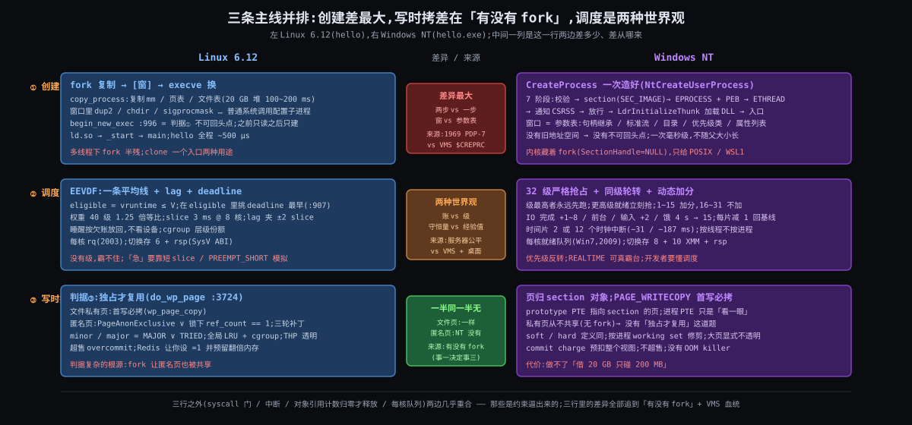

# 阶段 6:Linux 进程全链路 与 Windows NT 进程模型的对照

> 前五份把 Linux 的进程从「是什么」讲到「6.12 源码的行号和纳秒」。这一份把它放到另一套从头设计的内核旁边 —— Windows NT —— 看哪些选择是约束逼出来的(两边一样),哪些是血统带来的(两边不同)。按你定的范围:**只比 Deep 的三条主线**(创建、调度与切换、缺页与 COW),每条写透;六问里其余三问(系统调用与中断、销毁、工具)只在动机简表里各带一句。
>
> **依据**:Windows 内核不开源。NT 侧的说法来自微软文档(learn.microsoft.com 的 Win32 页、WSL 团队 2016 年的博客)、Windows Internals 7th(Yosifovich / Russinovich / Solomon / Ionescu,Part 1 2017)和少量公开的逆向分析,每处给出处,拿不准的标「待核」,不编数字。Linux 侧沿用 6.12 和前几份的行号。
>
> 主角程序沿用 hello(`gcc -no-pie`);NT 侧对应 `hello.exe`(PE 格式,`/SUBSYSTEM:CONSOLE`)。

---

## 约束清单速查(C1 ~ C7)

沿用 02-why.md 的七刀。对照篇里每条都要回答一个新问题:**这条约束在 NT 那边一样重吗?如果一样重,NT 的解法和 Linux 一样吗?**

#### C1 — CPU快IO慢
CPU 一纳秒级,盘和网百微秒到毫秒级;一核一流,现场可存。两边一样重。

#### C2 — 霸台不可预知
一个流不让台就没人能上;未来不可知,内核不知道谁下一秒要跑。两边一样重,**解法形状不同**(§4)。

#### C3 — 互不信任
程序不可信、特权波及整机、每个程序假设自己独占地址空间。两边一样重;NT 的「进程 = 容器」把它推得更彻底(§3)。

#### C4 — 文件≠内存
编译运行分离;内存小程序大且局部;复制须便宜。两边一样重;NT 用 section 对象一个抽象解三件事(§5)。

#### C5 — 改流必经打断
改 CPU 的执行流只能靠异常 / 中断 / 系统调用这三扇门。两边一样;NT 多一扇 APC(本份只带一句)。

#### C6 — 资源有限须归还
进程死了要把一切还回去。两边一样;NT 用对象管理器的引用计数 + 句柄表统一管(本份只带一句)。

#### C7 — 核各自为政
多核各有缓存、各有运行队列。两边一样;NT 到 Windows 7 才改成每核一组就绪队列(§4)。

---

## §0 从 Deep 走到 Comparison:三件事记住

承上:Deep 的三条主线落在三个判据上 —— 判据① 先验后换再建(`binfmt_elf.c:996`)、判据② eligible 且 deadline 最早(`fair.c:907`)、判据③ 独占才复用(`memory.c:3724`)。把 NT 放到旁边,三个判据各对上一个「解同一道题但长得不一样」的东西。三件事就是三对。

### §0.1 事一:复制再改,还是一次造好 —— 从 C3·互不信任 + C4·文件≠内存 推出

因为新程序必须在干净的地址空间里跑(C3),又因为可执行文件是文件、装载是映射(C4)→ 要解决「怎么从无到有造一个进程」→ Linux 的解法是 **fork 复制再 exec 换**:两步、两个系统调用、中间有一扇窗(Origin §2.5 你的视角);NT 的解法是 **CreateProcess 一次造好**:一个系统调用 `NtCreateUserProcess` 同时造地址空间、映射镜像、造第一个线程,没有窗,想配置子进程就在参数表(`STARTUPINFOEX` 的属性列表)里一次说完。NT 内核里其实有一个 fork(`NtCreateProcess` 的 `SectionHandle` 传 NULL),但从 1993 年起就不暴露给 Win32,只给 POSIX 子系统、后来给 WSL1 用。

### §0.2 事二:两边都要解「霸台 + 未来不可知」,一个用优先级补偿,一个用 lag —— 从 C2·霸台不可预知 + C1·CPU快IO慢 推出

因为不能让一个线程霸台(C2)、又要让等 IO 回来的线程尽快跑(C1)→ 要解决「谁下一个上 CPU」→ NT 的解法是 **32 级严格优先级抢占 + 时间片轮转 + 动态加分**:最高优先级的就绪线程永远先跑,同级轮转,IO 完成 / 等待结束 / 前台窗口给临时加分,每跑完一个时间片减一分退回基线;Linux 6.12 的解法是 **一条平均线 + lag + deadline**(Deep §3):没有「级」,只有「你拿到的服务比公平份额少还是多」。两个形状都是 C2 逼出来的,差别在于 NT 把「谁该先跑」交给开发者和启发式(优先级类 + 加分规则),Linux 把它交给一个守恒量(lag)。

### §0.3 事三:写时拷的判据是「谁拥有这一页」,NT 的答案是 section 对象 —— 从 C4·文件≠内存 + C3·互不信任 推出

因为复制必须便宜(C4),又因为父子 / 进程间互不可见(C3)→ 要解决「一页被多方映射时谁写谁拷」→ Linux 的判据③是 **`ref_count == 1` 或独占位**(Deep §4.2),它复杂到打了三轮补丁,根源是 fork 让匿名页也会被共享;NT 的判据是 **页属于哪个 section**:文件和镜像的页归 section 对象,进程只是「看一眼」(prototype PTE),写 `PAGE_WRITECOPY` 的页永远拷一份私有页、记在 commit charge 上;私有页从来不共享(Win32 没有 fork),所以不需要 `ref_count` 这条判据。Linux 的「文件私有页永远走 `wp_page_copy`」那一半两边一样,「匿名页看独占」那一半 NT 根本没有。

### §0 结论:三件事对照

| 事 | Linux 6.12 | Windows NT | 为什么存在 |
|---|---|---|---|
| 一 创建 | fork 复制 + execve 换;两步、有窗;判据① 不可回头点在 `begin_new_exec` | `CreateProcess` 一次造;一个系统调用;参数表代替窗 | C3 + C4 两边一样;分两步是 Unix 1969 的血统(Origin §2) |
| 二 调度 | lag + deadline,一条平均线;权重 1.25 倍等比;slice 3 ms @ 8 核 | 32 级优先级严格抢占;同级轮转;IO / 等待 / 前台加分再逐片衰减;时间片 2 或 12 个时钟中断 | C2 + C1 两边一样;NT 继承 VMS 的优先级模型,Linux 2007 年起走公平份额 |
| 三 写时拷 | `ref_count == 1` ∨ `PageAnonExclusive`;匿名页也共享 | 页归 section;`PAGE_WRITECOPY` 首写必拷;私有页不共享 | C4 + C3 两边一样;判据③ 的复杂度是 fork 带来的 |

三件事的关系:事一决定了事三 —— 没有 fork,就没有「匿名页被两个进程共享」这件事,写时拷只剩文件页一种;事二独立于前两者,是两种血统(VMS / Unix)各自对 C2 的回答。

---

## §1 一张极简概览图

从图上能读出四件事:

1. **创建**一行差异最大:Linux 两个系统调用中间有一扇窗,NT 一个系统调用里七个阶段连着走,窗被参数表替代。
2. **调度**一行两边的输入不同:NT 的输入是「级」(开发者定的 + 系统加的),Linux 的输入是「账」(lag,内核自己记的);输出都是「下一个跑谁」,都要靠时钟中断兜底。
3. **写时拷**一行,文件页那一半两边一样(首写必拷),匿名页那一半只有 Linux 有,因为只有 Linux 的公共 API 有 fork。
4. 三行之外的东西(系统调用门、中断、对象回收)两边几乎重合,所以本份不展开。

---

## §2 设计动机简表:Windows NT 的进程、线程、内存管理器

### §2.1 Windows NT 进程模型(进程对象 + 线程对象 + 内存管理器 + 调度器)

**初衷**:1988 年 10 月,微软请来 DEC 的 Dave Cutler 设计一个可移植(先 MIPS 后 x86)、支持对称多处理、带安全模型、能同时跑 OS/2 / POSIX / Win32 三种子系统的新内核。Cutler 团队带着 VMS 的经验,把「进程是资源容器、线程是调度单位」从第一天写进设计(VMS 本身没有线程,但 NT 吸收了 Mach 的任务 / 线程分离);又因为要跑三种子系统,进程创建做成「内核造壳,子系统填内容」。NT 3.1 于 1993 年 7 月 27 日发布(待核 #1)。

**擅长**:
- 多线程服务:线程从第一天就是一等公民,创建一个线程不涉及「复制进程」这个概念,没有 NPTL 那段 1996 ~ 2003 的弯路(Origin §4)
- 可配置的创建:子进程的句柄继承、作业对象、安全令牌、CPU 亲和、启动目录,全在一个参数表里一次性给定,没有「先 fork 再在子进程里改」的窗口,也就没有 fork 在多线程程序里的半残问题(Origin §2.4,HotOS 2019 那篇论文的第一作者 Andrew Baumann 来自微软研究院)
- 交互响应:优先级加分(前台窗口 / 输入 / IO 完成)让桌面程序在 CPU 饱和时仍然跟手,这是 NT 作为桌面系统的立身之本

**不擅长**:
- 「复制当前进程」这类用法:快照(Redis bgsave 那种)、预分叉服务器、测试框架的 fork 隔离,Win32 没有原语;Cygwin 的 fork 靠 `CreateProcess` + 逐段拷贝数据 / 堆 / 栈模拟,比原生 fork 慢几倍到几十倍(官方 FAQ 只说「非 COW 实现,可能有点慢」,公开实测 4 ~ 90 倍;已核 #2)
- 进程创建本身贵:映射 ntdll、造 PEB / TEB、通知 CSRSS、走 `LdrInitializeThunk` 加载所有导入 DLL,一次 `CreateProcess` 毫秒级,比 fork+exec 慢一个量级以上(空程序基准 > 20 倍,受杀毒软件影响大;已核 #3);所以 Windows 程序偏向少进程多线程,shell 脚本式的「一条命令一个进程」在 Windows 上慢
- 公平性:调度器按线程不按进程,一个开 64 个线程的进程在同级下拿到 64 倍 CPU;没有 cgroup 那样的层级份额(有「作业对象」能限 CPU 百分比,但那是硬上限不是份额)
- 内核不开源,行为只能靠文档、Windows Internals 和逆向

**典型应用场景**:
- SQL Server:一个进程、SQLOS 自己做用户态调度(UMS / SOS Scheduler),把 NT 线程当「物理 CPU」用,避开内核调度器的优先级启发式
- IIS 工作进程 `w3wp.exe` + 线程池:一个进程服务成千上万连接,完成端口回调
- Chrome / Edge 的多进程架构:每个渲染器一个进程,靠 `CreateProcess` + 作业对象做沙箱,启动开销靠进程池摊
- WSL1(2016):在 NT 内核里补齐 fork 语义,给 pico 进程跑未改动的 Linux 二进制

(Linux 侧的四件事前几份已经讲过,不重复。)

**本份不展开的三问,各一句**:系统调用两边都是 `syscall` 指令进 ring 0,NT 多一个 APC(异步过程调用)机制替代 signal 的大部分用途,信号那套「打断用户态流」在 NT 里主要靠异常分发和 APC;销毁两边都是「对象引用计数归零才真正释放」,NT 的进程对象在最后一个句柄关掉前一直在,和 Linux 的僵尸等 `wait4` 同构;工具 Process Explorer / ETW / WPA 对 `/proc` / perf / ftrace,原理都是内核计数器 + 事件跟踪点。

---

## §3 对照一:创建 —— CreateProcess 对 fork + execve

### §3.1 对比维度

一次造好 vs 复制再改;窗口在参数表里 vs 窗口在两个系统调用之间。

### §3.2 NT 的核心做法:一个系统调用,七个阶段

Windows Internals 7th Part 1 第 3 章把 `CreateProcess` 的流程分成七个阶段,在三个地方执行:调用方进程的 kernel32.dll、内核、新进程自己。对应 hello.exe:

| 阶段 | 在哪执行 | 做什么 | Linux 的对应物 |
|---|---|---|---|
| 1 | 调用方,kernel32 `CreateProcessInternalW` | 参数和标志转换、校验;决定优先级类;准备属性列表 | 无(fork 前的用户态准备) |
| 2 | 内核,`NtCreateUserProcess` | 打开镜像文件,造 **section 对象**(`SEC_IMAGE`):解析 PE 头、校验、算好每个节的映射 | `do_open_execat` + `load_elf_binary` 的 A 段「验」(Deep §2.2) |
| 3 | 内核 | 造执行体进程对象(`EPROCESS`):新地址空间、句柄表、令牌、作业归属;把 section 映射进去;映射 ntdll;造 PEB | `copy_process`(fork)+ `begin_new_exec` 的「换」+ `elf_load` 的「建」合在一起;判据① 的不可回头点在这里不存在,因为没有旧地址空间要换 |
| 4 | 内核 | 造第一个线程(`ETHREAD` + 内核栈 + 用户栈 + TEB + 初始上下文),挂起状态 | `start_thread` 填 `pt_regs`(Deep §2.2 D 段) |
| 5 | 调用方,kernel32 | 把新进程和线程的句柄送给 **CSRSS**(Windows 子系统进程),登记 | 无(Linux 没有子系统进程) |
| 6 | 内核 | 除非 `CREATE_SUSPENDED`,恢复第一个线程 | `wake_up_new_task` |
| 7 | 新进程自己 | 第一条指令在 ntdll 的 `LdrInitializeThunk`:加载导入表里的 DLL、重定位、跑各 DLL 的 `DllMain`,最后跳到 PE 的入口 | ld.so → `_start` → `__libc_start_main` → `main`(How §4.3) |

阶段 2 ~ 4、6 在一个系统调用里完成(Vista 起的 `NtCreateUserProcess`;更早是 `NtCreateProcess` + `NtCreateThread` 两次)。阶段 7 的 ntdll 相当于 Linux 的 ld.so 和 vDSO 合体:每个进程都有,由内核映射,用户态加载器住在里面。

**窗口去哪了**:Linux 在 fork 和 exec 之间用普通系统调用配置子进程(`dup2` / `chdir` / `setrlimit` / `sigprocmask`……,Origin §2.5 你认的那一半)。NT 把这些做成 `CreateProcess` 的参数:`bInheritHandles` + 每个句柄的可继承位决定句柄继承;`STARTUPINFO.hStdInput/Output/Error` 决定标准流;`lpCurrentDirectory` 决定目录;`dwCreationFlags` 决定优先级类、挂起、作业;`STARTUPINFOEX.lpAttributeList` 从 Vista 起可以再塞父进程句柄(重定父)、亲和、缓解策略、**精确的句柄继承列表**(`PROC_THREAD_ATTRIBUTE_HANDLE_LIST`,就是为了修「所有可继承句柄都漏给子进程」这个 fork 式问题)。这就是 `posix_spawn` 的 `posix_spawnattr_t` + `posix_spawn_file_actions_t` 想做的事,NT 从 1993 年起就是这么做的。

### §3.3 Linux 的对应物

fork(`copy_process`,`kernel/fork.c`)+ execve(`do_execveat_common` → `load_elf_binary`,Deep §2)。两个系统调用、两个不可回头点(fork 返回 / `begin_new_exec`)、中间一扇窗。hello 从 `fork` 到 `main` 约 500 μs,其中 ld.so 占大头(Deep §6 微秒表)。

### §3.4 在五元组上的差异

| | Linux fork + execve | NT CreateProcess |
|---|---|---|
| 核心抽象 | 进程 = 任务(`task_struct`),线程是共享 mm 的任务;新进程是旧进程的复制品 | 进程 = 容器(`EPROCESS`:地址空间 + 句柄表 + 令牌),线程(`ETHREAD`)是调度单位;新进程是空壳填内容 |
| 系统调用数 | 2(fork、execve),加窗口里的若干 | 1(`NtCreateUserProcess`)+ CSRSS 的 LPC |
| 配置子进程 | 窗口里跑普通系统调用;父进程的一切默认继承 | 参数表一次说完;句柄默认不继承,要显式标可继承 |
| 不可回头点 | `begin_new_exec`(判据①):之前只读,之后旧 mm 已死 | 不存在:没有旧地址空间;失败就销毁半成品对象 |
| 处理 C3·互不信任 | 新 mm 替换旧 mm;`de_thread` 杀光兄弟线程;`setuid` 程序走 `secureexec` | 令牌在阶段 3 就定好;进程边界即安全边界;线程不能跨进程 |
| 处理 C4·文件≠内存 | ELF 一本两用,PT_LOAD → VMA;ld.so 在用户态 | PE 一本两用,section 对象 → 映射;ntdll 的加载器在用户态 |
| 代价 | fork 复制页表(20 GB 堆 100 ~ 200 ms)+ execve 换;小程序整体几百 μs | 一次 `CreateProcess` 毫秒级(基准比 fork+exec 慢 20 倍以上,已核 #3);不随父进程大小增长 |
| 多线程下 | fork 只复制调用线程,其余线程「消失」,锁可能永久持有(HotOS 2019) | 无此问题:不复制 |
| 快照 / 预分叉 | fork 天然支持(Redis bgsave) | 无原语;要自己做(Redis for Windows 曾用 Win32 模拟 COW 的 fork,2016 年放弃维护) |

### §3.5 为什么 NT 这么选

三个来源,都能追到约束或血统:

1. **要跑三种子系统**(OS/2、POSIX、Win32),子进程「长什么样」由子系统决定,内核只能造壳 → 「内核造壳 + 子系统填内容」的七阶段,阶段 5 通知 CSRSS 就是「填内容」的一环。Unix 只有一种进程样子,fork 复制自己就是最省事的「造壳」。
2. **线程是一等公民**:既然线程不是进程的复制品,「复制进程」这个原语就没有第二个用户(Linux 里 `clone` 一个入口服务两种用途,Origin §4 的 LinuxThreads 就是把 fork 当线程用);NT 干脆不暴露它。
3. **VMS 血统**:VMS 的 `$CREPRC` 就是「给一堆参数造一个进程」,没有 fork。Cutler 把这套带到 NT。HotOS 2019 的论文说 fork 「不再是简单的抽象」、「posix_spawn 才是对的」,从 NT 的角度看这是 1993 年就做过的决定。

内核里保留的那个 fork(`NtCreateProcess` 的 `SectionHandle = NULL` 复制调用者地址空间)说明:**不是做不到,是不想给 Win32**。WSL 团队 2016 年的博客原话:「The Windows kernel has supported fork for a long time (going back to earlier POSIX and SFU application support), but it is not exposed in the Win32 programming model」,并且为了 WSL1 「改进了 fork 的实现以满足新需求」—— 因为 Linux 二进制的 fork 用法(多线程、信号、文件描述符)比旧 POSIX 子系统狠得多。

### §3.6 这个对比突出了什么

Linux 的 fork + exec 不是「进程创建的必然形状」,是 1969 年 PDP-7 上 27 行汇编的选择被 C3·互不信任 之外的一个非约束 —— 向后兼容 —— 锁死的结果(Origin §2)。另一套内核在同样的 C3 + C4 下选了「一次造好」,代价是失去「复制自己」这个原语,收益是没有窗口、没有多线程半残、创建代价不随父进程大小增长。你在 Origin §2.5 认的「fork 建环境、exec 装代码,职责清晰」,NT 的回答是:环境可以用一张参数表描述,不需要先复制一份再改。

---

## §4 对照二:调度与切换 —— 优先级抢占对 EEVDF

### §4.1 对比维度

「级」vs「账」:调度输入是开发者 + 启发式给的优先级,还是内核自己记的服务欠账。

### §4.2 NT 的核心做法:32 级严格抢占 + 动态加分

**静态部分**(微软文档「Scheduling Priorities」):优先级 0 ~ 31,0 只给零页线程(把空闲页清零的系统线程),1 ~ 15 动态区,16 ~ 31 实时区。每个线程的**基础优先级** = 进程的优先级类 + 线程的相对级:

| 优先级类 | 基础值(线程 NORMAL) | 线程相对级能到 |
|---|---|---|
| IDLE | 4 | 1 ~ 6,TIME_CRITICAL 15 |
| BELOW_NORMAL | 6 | 1 ~ 8,TIME_CRITICAL 15 |
| NORMAL(默认) | 8 | 1 ~ 10,TIME_CRITICAL 15 |
| ABOVE_NORMAL | 10 | 1 ~ 12,TIME_CRITICAL 15 |
| HIGH | 13 | 1 ~ 15 |
| REALTIME | 24 | 16 ~ 31 |

**选人规则**(同一文档):「系统把所有同优先级的线程视为平等;按轮转把时间片分给最高优先级的所有线程;一个更高优先级的线程变为就绪时,系统立刻停止正在跑的低优先级线程(不让它用完时间片),把一整个时间片给高优先级线程。」这就是判据② 的 NT 版:**先看级,级相同看轮转**;没有「eligible」这个概念,一个线程只要级最高就一直跑,直到更高的来或它自己等。

**动态部分**(「Priority Boosts」文档 + Windows Internals 第 4 章):只对 1 ~ 15 生效,16 ~ 31 不加分。加分时机:等待结束(IO 完成按设备加 1 ~ 8:盘 +1、网 +2、键盘鼠标 +6、声卡 +8,已核 #4);前台进程的优先级类临时抬到不低于任何后台进程;收到窗口输入 +2;被「饿」的线程(就绪队列里等了 300 个时钟 tick ≈ 4 秒没跑到,已核 #5)由平衡集管理器每秒扫一次,抬到 15 跑一个时间片(Win2000 / XP 加倍,Server 2003 起固定 4 个量子单位;每轮每个优先级最多扫 16 个、抬 10 个)。衰减:**每跑完一个时间片减一级,直到回到基础优先级,永不低于基础值**。

**时间片**:单位是时钟中断的三分之一;客户端 Windows 默认 2 个时钟中断(6 单位),服务器版 12 个(36 单位);x86 多核机器时钟间隔 15.625 ms → 约 31 ms / 187 ms(已核 #6);客户端默认「短、可变」:前台进程的时间片再乘 3(已核 #6)。Vista 起时间片按 CPU 周期而非时钟中断计,中断处理的周期不算在当前线程头上。对照 Linux:slice 3 ms @ 8 核(Deep §3.1),NT 的片长一个量级。

**多核**:每个处理器自己一组 32 级就绪队列从 Windows Server 2003 就有(和 Linux 2.6 的 O(1) 每核 rq 同年),线程有「理想处理器」和「上次跑的处理器」;但一把全局 dispatcher lock 一直留到 Windows 7 / Server 2008 R2 才拆成 11 类细粒度锁 —— 微软自己说它是内核里争用最重的自旋锁,超过 16 核就是伸缩瓶颈(已核 #7;「空闲核去别的核偷」只有论坛说法,未核)。形状和 Linux 一样,队列同年、拆锁晚六年,C7·核各自为政 逼出同一个答案。

**切换**:`KiSwapContext` / `SwapContext`(ntoskrnl 内部,汇编):存旧线程的非易失寄存器到它的内核栈、换 rsp、必要时换 CR3(跨进程)、恢复新线程。Windows x64 ABI 的被调用者保存寄存器是 **RBX、RBP、RDI、RSI、R12 ~ R15 八个 + XMM6 ~ XMM15 十个**;System V 是六个(How §6.3.1)。同一个道理「存多少由 ABI 定」,两套 ABI 给出两个数。

### §4.3 Linux 的对应物

EEVDF(Deep §3):每个任务一个 `vruntime` 和 `deadline`,一条加权平均线 V;eligible = `vruntime ≤ V`(拿到的服务没超过公平份额);在 eligible 的里面挑 deadline 最早的;权重表 40 级 1.25 倍等比;睡醒的任务按 lag 放回,lag 夹在 ±2 slice;`RUN_TO_PARITY` 只保护仍 eligible 的 curr(Deep §3.5 / §3.6)。

### §4.4 在五元组上的差异

| | Linux EEVDF | NT 调度器 |
|---|---|---|
| 核心抽象 | 服务欠账(lag):你该拿多少、实际拿了多少 | 优先级(级):你是谁、现在心情多急 |
| 调度输入 | 权重(nice / cgroup)+ 内核自己记的 vruntime / deadline | 优先级类 + 线程相对级 + 内核启发式加分 |
| 「该谁跑」 | eligible ∧ deadline 最早(`pick_eevdf` :907) | 级最高 ∧ 同级队头(每核 32 条队列,位图找最高非空) |
| 对 C2·霸台不可预知 | 公平份额:谁超额谁下台;没有级,霸不住 | 严格抢占:高级永远压低级;同级靠时间片;1 ~ 15 靠加分 + 反饥饿兜底;16 ~ 31 不保护(实时类可以真霸台,文档警告「几乎永远不要用 REALTIME」) |
| 对 C1·CPU快IO慢 | 睡醒按 lag 放回,欠账多的立刻 eligible;不加分,不看设备 | IO 完成按设备类型加分,键盘 +6 盘 +1;靠「谁等过 IO 谁急」的启发式 |
| 公平的单位 | 任务;cgroup 把整组当一个实体,层级份额 | 线程;进程多开线程就多拿;作业对象只能设硬上限 |
| 时间片 | 3 ms @ 8 核,按权重折算到虚拟时间 | 31 ms 客户端 / 187 ms 服务器(已核 #6),按周期计 |
| 延迟与份额能否分开表达 | 能:`sched_attr.sched_runtime` 定 slice,短 slice 抢先但份额不变 | 不能直接:要低延迟只能抬级,抬级同时多拿 CPU |
| 多核 | 每核 rq(2.6,2003)+ 负载均衡 | 每核就绪队列(Server 2003)+ 理想处理器;全局 dispatcher lock 到 Win 7(2009)才拆 |
| 切换存的寄存器 | 6 + rsp(SysV ABI) | 8 + 10 XMM + rsp(Windows x64 ABI) |

### §4.5 为什么 NT 这么选

1. **桌面优先**:1993 年的 NT 要在 16 MB 内存的机器上让前台窗口跟手。优先级 + 前台加分 + 输入加分是最直接的工具:用户在点谁,谁就先跑。公平份额对桌面没有意义 —— 用户不想要后台编译和前台编辑器各 50%。Linux 2007 年 CFS 之前的 O(1) 调度器也是优先级 + 交互性启发式这个形状(Origin §3.4 那三句话),是服务器负载把 Linux 推向了公平份额。
2. **VMS 血统**:VMS 的调度器就是 32 级优先级 + 加分(VMS 叫 priority boost),Cutler 原样带过来。
3. **把决定权交给开发者**:NT 的文档整页都在教你「输入线程用 ABOVE_NORMAL,后台线程用 BELOW_NORMAL」。这是一种世界观:应用知道自己哪条线程重要。EEVDF 的世界观相反:应用只给权重,急不急由 lag 说话。
4. **代价**:优先级反转(低级线程持锁,高级线程等锁,中级线程霸台)在严格优先级下是必然的,NT 靠反饥饿扫描(每秒扫、等满 4 秒抬到 15,已核 #5)和 2019 年后的 AutoBoost(Windows 8.1 起,锁持有者临时继承等待者的优先级)打补丁;EEVDF 没有优先级反转这个概念,但有它自己的问题 —— 吞吐型任务的 slice 被频繁抢先,`RUN_TO_PARITY` 就是为此加的。

### §4.6 这个对比突出了什么

判据②「eligible 且 deadline 最早」不是调度的必然形状,是 Linux 从 2007 年起选择的「公平优先」世界观在 2023 年的最新表达。同一条 C2·霸台不可预知,NT 用「级」回答,代价是优先级反转和需要开发者懂调度;Linux 用「账」回答,代价是桌面响应要靠 lag 的边界(±2 slice)和 `PREEMPT_SHORT` 这类补丁去模拟「急」。你在 Deep §3.5 / §3.6 停住的 lag,在 NT 里没有对应物;对应的是「等待结束加 1 ~ 8 分、每片减 1 分」这套规则 —— 一个是守恒量,一个是经验值。

### §4.7 《你的视角》:SQLOS 绕开的是什么

问你 SQL Server 为什么在 NT 之上自己做一层用户态调度器(SQLOS,前身是 SQL Server 7 的 UMS),你选了「绕开优先级加分的启发式」。

**认的一半**:加分确实是问题的一部分。IO 完成 +1、等待结束 +1,意味着一个刚拿到锁的工作线程可能因为别人的 IO 完成被抢下去;前台加分对数据库服务器毫无意义却照样生效。SQL Server 的文档和 Ken Henderson 的《The Guru's Guide to SQL Server Architecture and Internals》(2003)都提到内核调度器「不知道线程在干什么」。

**拧紧的一半**:加分只是症状,病根是**抢占本身**。NT 调度器(和 EEVDF 一样)是抢占式的:它可以在任何一条指令后把线程换下去,包括这个线程正握着一把 latch 或 spinlock 的时候。换下去的后果是:等这把锁的其他线程醒来、发现锁还在、再睡回去,一圈空转(convoy)。SQLOS 的做法是**协作式**:每个 CPU 一个 scheduler,同一时刻只让一个 worker 跑,worker 只在自己选定的点(等锁、等 IO、跑够一个配额)主动 yield;内核看到的是「每核一个线程在跑、其余线程都在等事件」,于是没有什么可抢的。加分、时间片、按线程公平,三条都被这一招架空了 —— 不是绕开其中一条,是把内核调度器从决策者降成了执行者。

**为什么它能这么做,内核不能**:C2·霸台不可预知 的前提是内核不信任任何流会让台。SQL Server 在自己的进程里**信任自己的 worker**(都是自己写的代码,知道每一个 yield 点),C2 在进程内部不成立,协作式就可行。这和上一份文件 IO 对照里数据库用 `O_DIRECT` 自己管缓冲池是同一个动作:**应用比内核知道得多,就把那一层拿回来自己做**。代价也一样:一个 worker 忘了 yield(比如一个 CLR 调用或一个没走 SQLOS 的系统调用),整个 scheduler 的其他 worker 全饿着 —— 这正是内核调度器用抢占来防的事。SQL Server 为此给「可能不合作」的调用单独开 preemptive 模式(worker 先声明「我要出去走一段不受控的路」,scheduler 放另一个 worker 上来)。

**在 Linux 上的对应物**:没有「用户态调度器接管一个核」的通用机制,近似的是 `SCHED_FIFO` + `isolcpus` 绑核(Deep §3.4 候选 B4),或者像 Go / Erlang 运行时那样 M:N 自己调度 goroutine。Linux 的 EEVDF 对这类负载的让步是 `sched_attr.sched_runtime` 定更长的 slice 减少抢占,但不能关掉抢占。

**三选项各自的分量**:

| 你的选项 | 分量 | 说明 |
|---|---|---|
| 1 优先级加分的启发式 | 症状 | 会在错误时刻触发抢占,但去掉加分抢占仍在 |
| 2 时间片太长 | 不是问题 | 31 ms 对数据库反而嫌短;SQLOS 自己的配额是最多 4 ms(已核 #10) |
| 3 按线程不按进程的公平 | 不是问题 | 单进程服务器无所谓进程间公平 |
| (没列的)抢占不知道线程在干什么 | 病根 | 协作式把抢占点收回自己手里 |

---

## §5 对照三:缺页与 COW —— section 对象对判据③

### §5.1 对比维度

谁拥有一页:页归「section 对象」还是归「映射它的进程们」;写时拷的判据是「首写必拷」还是「独占才复用」。

### §5.2 NT 的核心做法:section、prototype PTE、working set、commit charge

四个概念,各对一个 Linux 的东西:

**section 对象**:文件的一段(或一块匿名内存)作为内核对象存在,进程通过 `MapViewOfFile` 把它的一个视图映射进自己的地址空间。可执行文件 / DLL 的映射(`SEC_IMAGE`)、文件映射、缓存管理器的缓存视图、共享内存,全是 section。Linux 的对应物是 `struct address_space`(page cache 的索引)+ `mmap`,但 Linux 没有把它做成一个有句柄、有安全描述符的对象。

**prototype PTE**:section 的每一页在内核里有一条「原型页表项」,记录这页现在在哪(内存 / 页文件 / 文件的哪个偏移);每个进程的真实 PTE 在页不在工作集时**指向原型 PTE** 而不是指向物理页。缺页时顺着原型 PTE 找。Linux 的对应物是 page cache 里的 `folio` + `vm_ops->fault` 走 `filemap_fault`;功能相同,NT 多了一层间接,好处是「这页搬家了」只改原型 PTE 一处。

**working set**(微软文档「Working Set」原话):进程当前驻留在物理内存里的页集合,有最小和最大值;内存紧张时**工作集管理器按进程修剪**,被修剪的页进「transition」状态(standby / modified 列表)留在内存里,再被访问是软缺页。缺页分两类:**硬缺页**要读后备存储(页文件或映射文件),**软缺页**不用 —— 包括页在别的进程工作集里、页在 transition、第一次访问的 demand-zero 页。Linux 的对应物是 major / minor(Deep §4.2 `mm_account_fault` :5927),定义几乎一字不差;差别是 Linux 没有按进程的工作集,回收是全局 LRU(加 cgroup 限额),NT 先按进程修剪再全局回收。

**commit charge**:每一页可能变成私有的虚拟内存,在分配时就要在「commit 上限 = 物理内存 + 页文件」里占一个名额;`MapViewOfFile` 用 `FILE_MAP_COPY` 时「commit charge taken is for the entire view」(微软文档原话),因为每一页都可能被写而私有化。Linux 的对应物是 `vm.overcommit_memory`:默认启发式,允许超售;Redis 官方管理文档让你设成 1(永远允许)—— 因为 fork 一个 20 GB 的进程在严格记账下要再占 20 GB 名额,而 COW 实际只会碰一小部分。**NT 不超售,所以 NT 上做不了「fork 20 GB 再只碰 200 MB」这种事,反过来 NT 永远不会 OOM-kill 一个已经拿到内存的进程。**

**COW**(微软文档「MapViewOfFile」原话):对 `PAGE_WRITECOPY` / `FILE_MAP_COPY` 的页,「写入会使系统把原页拷到一个进程私有的新页,新页由页文件支持,改为 `PAGE_READWRITE`,内容永远不会写回原文件」。用在:镜像的数据节和需要重定位的页(DLL 加载到非首选地址时,重定位改的是进程私有副本,代码段若需重定位也一样,这是 Windows 让 DLL 尽量按首选基址加载、后来加 ASLR 后用「共享重定位」减少私有页的原因)、`FILE_MAP_COPY` 的文件映射。**没有 fork,私有页从不被两个进程共享,所以「两个进程共享一张匿名页、谁写谁拷、最后一个不用拷」这整套判据③ 在 Win32 里不存在。**

### §5.3 Linux 的对应物

判据③(Deep §4.2):`do_wp_page` :3655,文件私有页永远 `wp_page_copy`;匿名页看 `PageAnonExclusive` 或 `wp_can_reuse_anon_folio` 锁下验 `ref_count == 1`;fork 侧 `copy_present_ptes` :980 清独占位、写保护、pin 着的页立刻拷。三轮补丁(mapcount → page_count → page_count + 独占位,Origin §5)。§4.5 你的视角:先动的拷,后动的不拷,没别人了动的也不拷。

### §5.4 在五元组上的差异

| | Linux 6.12 | Windows NT |
|---|---|---|
| 页的主人 | 文件页归 page cache(`address_space`);匿名页归映射它的进程们,靠 `anon_vma` + `ref_count` 记 | 文件页和镜像页归 section 对象(prototype PTE);私有页归一个进程,从不共享 |
| 缺页分类 | minor / major,`MAJOR ∨ TRIED`(:5927) | soft / hard,定义同;soft 多一种「在别的进程工作集里」 |
| 文件页首写 | `wp_page_copy`,永远拷(两边一样) | 拷到页文件支持的私有页,改 `PAGE_READWRITE`(两边一样) |
| 匿名页共享后首写 | 判据③:独占才复用 | 不存在(Win32 无 fork);内核 fork 路径有自己的实现,未公开 |
| 记账 | 超售(`overcommit_memory` 0 / 1 / 2);fork 不预扣 | commit charge 预扣整个视图;不超售 |
| 回收 | 全局 LRU + cgroup 限额;`kswapd` | 按进程工作集修剪 + standby / modified 全局列表;modified page writer |
| 对 C4·文件≠内存 | ELF → VMA → 缺页按需读;THP 透明合并 | PE → section → 缺页按需读;大页只能显式申请(`MEM_LARGE_PAGES` + 锁页特权),不可分页,无 THP |
| 对 C3·互不信任 | 父子互不可见靠 `ref_count` 判据;GUP 第三者靠 pin 立刻拷 | 进程边界即 section 视图边界;私有页不共享,没有第三者问题 |
| 代价 | 判据复杂(三轮补丁),fork 后首写要走锁下验 | 每个视图预扣 commit;DLL 重定位产生私有页;没有「复制再碰一点」的省法 |

### §5.5 为什么 NT 这么选

1. **先有 section**:NT 内存管理器从设计起就围绕「文件映射对象」建:可执行文件加载、文件缓存、共享内存都是同一个机制(上一份文件 IO 对照里的缓存管理器视图也是 section)。有了「页归 section」,写时拷的判据自然是「这页是 section 的,你要写就拷走」,不需要问「还有谁在共享」。
2. **没有 fork**(§3):判据③ 的复杂度全部来自匿名页被多个进程共享。Linus 2020 年那句「COW needs to use page_count()」、Hildenbrand 2022 的三种失败模式,根源都是 fork。NT 砍掉 fork,顺手砍掉了这场争论。当 WSL1 在 2016 年把 fork 加回内核时,这些问题又回来了,只是在闭源里解。
3. **不超售**:commit charge 预扣是 C6·资源有限须归还 的另一种读法 —— 先保证能还,再给。代价是 fork 式的「借 20 GB 名额只用 200 MB」做不了;收益是没有 OOM killer。Redis 文档让你设 `vm.overcommit_memory = 1` 并「预留最坏翻倍的内存」(Deep §4.5),就是 Linux 为了保留 fork 而把这个判断推给运维。

### §5.6 这个对比突出了什么

判据③「独占才复用」不是写时拷的必然形状,是「fork 存在」这个前提的衍生物。两边在 C4 + C3 下都选了写时拷,文件页那一半长得一模一样(首写必拷,私有页由页文件 / swap 支持);差别只在「匿名页会不会被两个进程共享」,而这由事一(有没有 fork)决定。你在 Deep §4.5 答对的「释放 P,RSS 一样」,在 NT 里没有这道题 —— 没有第二个人持有 P。

---

## §6 约束回扣

| 约束 | Linux 的化解 | NT 的化解 | 同 / 异 | 异的来源 |
|---|---|---|---|---|
| C3·互不信任 | 新 mm 换旧 mm;`de_thread`;父子靠 `ref_count` 互不可见 | 进程 = 容器,令牌在造壳时定;私有页从不共享 | 功能同,边界画法异 | 有没有 fork |
| C4·文件≠内存 | ELF 一本两用 → VMA;page cache;COW;THP | PE → section 对象(一个抽象管加载 / 缓存 / 共享);COW 只对 section 页;显式大页 | 同形 | NT 先有 section,Linux 先有 page cache |
| C2·霸台不可预知 | lag + deadline,公平份额 | 32 级严格抢占 + 加分 + 反饥饿 | 异 | VMS 血统 + 桌面优先 vs 服务器推动的公平 |
| C1·CPU快IO慢 | 睡醒按 lag 放回,不看设备 | IO 完成按设备加 1 ~ 8 分 | 异(守恒量 vs 经验值) | 同上 |
| C7·核各自为政 | 每核 rq(2003) | 每核就绪队列(2003),拆全局锁(2009) | 同(队列同年,拆锁晚六年) | — |
| C5·改流必经打断 | syscall / 中断 / 异常三扇门 + 出口检查点 | 同三扇门 + APC | 同 | — |
| C6·资源有限须归还 | 引用计数;僵尸等 `wait4`;超售 + OOM killer | 对象管理器引用计数;进程对象等最后一个句柄;commit charge 不超售 | 同形,记账异 | fork 需要超售 |

读法:**同**的行(C4 形状、C5、C6 的引用计数、C7)是约束逼出来的,两套内核独立长成一样;**异**的行(创建、调度、COW 判据、记账)全部能追到一个二元选择 —— **有没有 fork** —— 加一条血统(VMS 的优先级调度)。七条约束里没有一条写着「必须有 fork」,这就是 Origin §2 那场 HotOS 争论的另一个证据。

---

## §7 呼应你的问题

你的六问是「内核每一站做了什么」。对照给「做了什么」加了一个参照系:**另一套从头设计的内核在同一站做了什么不一样的事**。

- 问 1 / 2(装载、ELF、链接、重定位):两边都是「文件一本两用、映射不读、用户态加载器收尾」,必然;分不分两步、有没有窗,不必然。
- 问 3(调度、切换、算法):切换的形状(存被调用者保存寄存器 + 换栈 + 换 CR3)必然,存几个由 ABI 定;算法不必然,级和账是两种世界观,各有代价。
- 问 4(缺页、COW):缺页的分类(软 / 硬)和文件页首写必拷必然;匿名页的独占判据不必然,它是 fork 的衍生物。
- 问 5 / 6:引用计数归零才释放、工具靠内核计数器,两边一样,本份只带一句。

对照之后六问的闭合度不变(Deep 的 85%),变的是你知道哪 85% 是「必须」、哪些是「碰巧」。

---

## §8 资料来源与待核

**一手 / 准一手**:
- [Scheduling Priorities(learn.microsoft.com)](https://learn.microsoft.com/en-us/windows/win32/procthread/scheduling-priorities):优先级表、选人规则原话
- [Priority Boosts(learn.microsoft.com)](https://learn.microsoft.com/en-us/windows/win32/procthread/priority-boosts):加分时机、每片减一、16 ~ 31 不加分
- [Context Switches(learn.microsoft.com)](https://learn.microsoft.com/en-us/windows/win32/procthread/context-switches):切换四步、三种触发
- [Working Set(learn.microsoft.com)](https://learn.microsoft.com/en-us/windows/win32/memory/working-set):硬 / 软缺页定义、transition、修剪
- [MapViewOfFile / MapViewOfFileFromApp(learn.microsoft.com)](https://learn.microsoft.com/en-us/windows/win32/api/memoryapi/nf-memoryapi-mapviewoffilefromapp):`FILE_MAP_COPY` 语义、首写拷贝、commit 预扣整个视图
- [Pico Process Overview(WSL 团队博客,2016)](https://learn.microsoft.com/archive/blogs/wsl/pico-process-overview):内核早有 fork、不暴露给 Win32、为 WSL 改进
- [Windows Subsystem for Linux Overview(2016)](https://learn.microsoft.com/ja-jp/archive/blogs/wsl/windows-subsystem-for-linux-overview)、[WSL System Calls(2016)](https://learn.microsoft.com/en-us/archive/blogs/wsl/wsl-system-calls):lxcore 调内核 API 实现 fork
- [Know Thy Tick(微软 Embedded 博客)](https://learn.microsoft.com/en-us/archive/blogs/embedded/know-thy-tick):x86 多核时钟间隔 15.625 ms,时间片是时钟间隔的倍数
- [Flow of CreateProcess(Windows Internals 6th,O'Reilly 节选)](https://oreilly.com/library/view/windows-internals-sixth/9780735671294/ch05s03.html):七阶段结构
- [NtCreateProcess(NtDoc)](https://ntdoc.m417z.com/ntcreateprocess):`SectionHandle` 参数
- Origin §2 已引:Baumann 等,"A fork() in the road",HotOS 2019

**待核**(并入收尾清单):

1. NT 3.1 发布日期 1993-07-27;Cutler 1988-10 加入微软 —— 收尾已核(Zachary《Showstopper》:1988-10 到微软;NT 3.1 1993-07-26 发 OEM、07-27 公开)
2. Cygwin fork 相对原生 fork 慢的量级(一到两个量级)—— 收尾改写:官方 FAQ 只说「non-copy-on-write … can be a little slow」;公开实测 4 ~ 7 倍(polyml 2010)、≥ 10 倍(Nessus 2004)、~90 倍(CMake 2013);正文改「几倍到几十倍」
3. `CreateProcess` 毫秒级 vs fork+exec 几百 μs —— 收尾改写:无直接对照实测;HotOS'19 论文 `posix_spawn` ≈ 0.5 ms(i7-6850K)且不随父进程大小变;bitsnbites 基准空程序 fork+exec 比 `CreateProcess` 快 20 倍以上;正文改「慢一个量级以上」
4. IO 完成加分值(盘 +1 / 网 +2 / 键鼠 +6 / 声卡 +8)—— 收尾已核:WDK `wdm.h` IO_DISK_INCREMENT 1 / IO_NETWORK_INCREMENT 2 / IO_KEYBOARD_INCREMENT 6 / IO_MOUSE_INCREMENT 6 / IO_SOUND_INCREMENT 8
5. 反饥饿:就绪等待约 4 秒、抬到 15、平衡集管理器每秒扫 —— 收尾已核(细化):300 个 tick ≈ 4 s、抬到 15、每秒一次;「时间片翻倍」只是 Win2000 / XP,Server 2003 起固定 4 个量子单位;正文已改
6. 时间片:客户端 2 个时钟中断(6 单位)/ 服务器 12 个(36 单位)/ 前台 ×3;31 ms / 187 ms 由 15.625 ms 推算 —— 收尾已核:Russinovich「Inside the Windows Vista Kernel」(客户端 2 tick、前台 6;Vista 起按周期计且中断不计入)+「Know Thy Tick」(15.625 ms,量子 ÷ 3 = tick 数);服务器 12 tick 来自 Windows Internals 课件
7. Windows 7 起每核就绪队列 —— 收尾改写:每核就绪队列 Server 2003 已有;Windows 7 的变化是去掉全局 dispatcher lock(微软博客「Fewer Hardware Locks and Greater Parallelism」);「空闲核偷活」未核;正文与 §4.4 / §6 已改
8. Windows x64 ABI 被调用者保存:RBX / RBP / RDI / RSI / R12 ~ R15 + XMM6 ~ 15 —— 收尾已核:微软 x64 calling convention 页,非易失还含 RSP(不计入 8 个 GPR)
9. Redis for Windows(MSOpenTech)用 Win32 模拟 fork 的实现方式与 2016 停止维护 —— 收尾已核:2.8 用内存映射文件装堆 + 全部页 COW 保护 + 子进程持句柄;3.0 改用系统分页文件;最后版本 win-3.2.100 发布 2016-07-01,仓库归档
10. SQLOS worker 的配额量级(4 ms)与 preemptive 模式的触发条件 —— 收尾已核:微软「Thread and Task Architecture Guide」原话「OS quantum, with a maximum of 4 ms」;执行 SQL Server 之外的代码(扩展存储过程、分布式查询、调 OS 函数)时切 preemptive;CLR 托管代码抢占式运行

---

## 修订记录

| 时间 | 修订摘要 | 触发原因 |
|---|---|---|
| 2026-10-31 | 初稿:速查(每条加「NT 那边一样重吗」)+ §0 三件事(复制再改 vs 一次造好 / 级 vs 账 / 页的主人是 section)+ §1 概览 SVG + §2 NT 进程模型动机简表(初衷 / 擅长 / 不擅长 / 典型应用 + 不展开的三问各一句)+ §3 创建(七阶段表、窗口去哪了、九行五元组、内核里藏着的 fork)+ §4 调度(优先级表、选人规则原话、加分与衰减、时间片、多核、切换寄存器数 8+10 vs 6、十行五元组)+ §5 缺页与 COW(section / prototype PTE / working set / commit charge 四概念、九行五元组、判据③ 是 fork 的衍生物)+ §6 回扣(七条同 / 异 + 异的来源归到「有没有 fork」)+ §7 呼应 + §8 出处与 9 条待核 | 对齐收敛:对象 Windows NT → 只比三条主线 → 按约束差异讲 + 数字 → 无追加 |
| 2026-10-31 | 新增 §4.7《你的视角》:SQLOS 绕开的是什么 —— 认「加分是症状」,拧紧「病根是抢占不知道线程在干什么」;协作式可行的条件是进程内 C2 不成立(信任自己的 worker);代价与 preemptive 模式;Linux 对应物;三选项分量表;待核 #10 | 用户对确认式反问选 1 |
| 2026-10-31 | 收尾核实:#1 #4 #6 #8 #9 #10 已核,#5 细化(翻倍只在 Win2000 / XP),#2 #3 #7 改写并同步正文(Cygwin 几倍到几十倍;CreateProcess 慢一个量级以上;每核就绪队列 2003 已有、Win 7 拆的是全局锁) | 导出前统一核实 |
