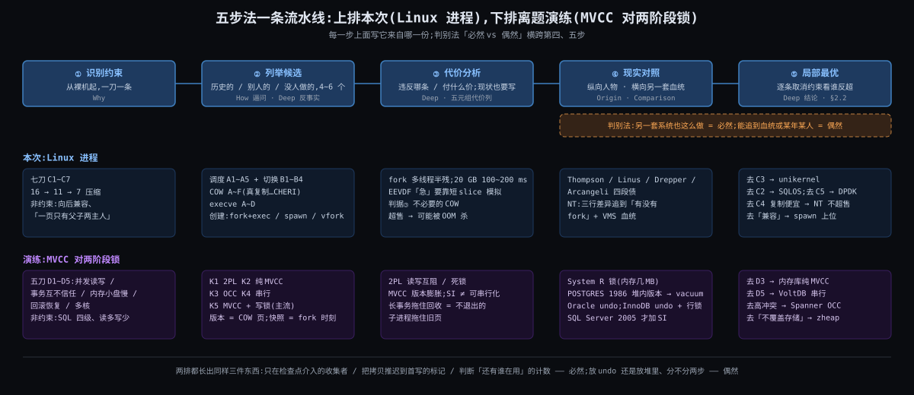

# 阶段 7:Linux 进程全链路 的设计哲学与方法论沉淀

> 这是七份里的最后一份,给**读过内核书的人**看:你已经知道 `task_struct`、`fork`、CFS、COW 是什么,所以这里不再解释机制,只回答两个问题 —— **这些机制为什么长成这样**(而不是别的样子),以及**怎么把「为什么」这套问法搬到别的系统上**。前六份(What / Why / How / Origin / Deep / Comparison)是证据,这一份是结论和方法。需要机制细节时按括号里的出处回去查。
>
> 结构:§2 一张五元组表,把全链路 14 个设计决策各过一遍「约束 → 代价 → 反事实 → 现实对照」的筛;§3 十一条你选出来的必保洞察,各一节,带出处和反例;§4 三个别的领域里的同构;§5 五步法,每步配本次实例,然后**离题**套到数据库的 MVCC 对两阶段锁上,看方法能不能搬走;§6 时代局限;§7 / §8 回扣与收口。

---

## 约束清单速查(C1 ~ C7)

七刀七条,02-why.md 建立,后五份逐条引用。这一份把每条约束对应到五元组表的行号和方法论的步骤(§7)。

#### C1 — CPU快IO慢
CPU 纳秒级,盘和网百微秒到毫秒级;一核一流,现场可存。逼出多道程序、存取现场、按需调页。

#### C2 — 霸台不可预知
一个流不让台就没人能上;内核不知道谁下一秒要跑。逼出时钟中断、调度器、抢占。

#### C3 — 互不信任
程序不可信、特权波及整机、每个程序假设自己独占地址空间。逼出页表、特权级、父子互不可见的 COW 判据。

#### C4 — 文件≠内存
编译运行分离;内存小程序大且局部;复制须便宜。逼出 ELF 映射不读、缺页、COW。

#### C5 — 改流必经打断
改 CPU 的执行流只能靠异常 / 中断 / 系统调用三扇门。逼出出口检查点、signal 的延迟投递。

#### C6 — 资源有限须归还
进程死了要把一切还回去,且退出码要有人收。逼出 exit 六步、僵尸、wait。

#### C7 — 核各自为政
多核各有缓存、各有运行队列。逼出每核 rq、IPI、迁移、每核页表缓存。

---

## §0 从 Comparison 走到 Synthesis:三件事记住

承上:Comparison 的结论是「三行差异全部追到有没有 fork,加一条 VMS 血统」。这句话的意思是:七条约束决定了形状的大部分,剩下的小部分由历史决定。收束要做的就是把这两部分**分开记账**。三件事:

### §0.1 事一:五元组 —— 把每个决策过一遍筛

因为每个机制都是「在某几条约束下、付某个代价、从若干候选里选出来的」(Deep 三条主线各 4 ~ 6 个反事实候选,Comparison 给了另一套内核的真实选择)→ 要解决「怎么把六份的证据压成一张可查的表」→ 所以用**五元组**:决策 / 解决的约束 / 付出的代价 / 反事实候选 / 现实对照。一行一个决策,14 行(§2)。表的读法:代价列永远不空 —— 写不出代价说明没分析到位。

### §0.2 事二:必然 vs 偶然的判别法 —— 从 Comparison 的「同 / 异」推出

因为两套血统不同的内核在同一条约束下**独立长成了一样的形状**(系统调用门、缺页分类、文件页首写必拷、每核队列、引用计数归零才释放),而长得不一样的地方都能追到血统或一个早年的选择 → 所以得到一个判别法:**一个设计是「必然」还是「偶然」,看另一套从头设计的系统在同一约束下是否也这么做**。必然的部分是约束的函数,偶然的部分是历史的函数;后者才是能换的(Origin §6 的「债不是由原作者还的」说的就是偶然部分)。

### §0.3 事三:五步法 —— 从前六份的生成过程本身推出

因为前六份就是按「识别约束(Why)→ 列候选与代价(How 的逼问、Deep 的反事实)→ 看现实(Origin 的人物、Comparison 的 NT)→ 证局部最优(Deep 每条反事实的结论)」这个顺序做出来的 → 所以把它抽成**五步法**(§5),每一步配本次的实例,再离题套到 MVCC 上验证它不依赖本主题。

### §0 结论:三件事对照

| 事 | 是什么 | 为什么存在 |
|---|---|---|
| 一 五元组 | 14 行 × 5 列的表,每行一个决策 | 六份证据要压成一张能查的表;代价列强制分析到位 |
| 二 判别法 | 必然 = 另一套系统也这么做;偶然 = 能追到血统或某年某人的选择 | Comparison 的同 / 异两列直接给出 |
| 三 五步法 | 识别约束 → 列候选 → 代价分析 → 现实对照 → 局部最优 | 前六份的做法本身;要证明它能搬走,所以 §5.6 离题 |

---

## §1 一张极简概览图

从图上能读出三件事:

1. 五步法是一条流水线,前六份各占一两步:Why 做第一步,How 和 Deep 做第二、三步,Origin 和 Comparison 做第四步,Deep 的每条反事实结论和 §2.2 做第五步。
2. 同一条流水线下面并排放了 MVCC 对两阶段锁的实例:每一步都有对应物,说明方法不依赖「内核」这个主题。
3. 判别法(事二)横跨第四、五步:现实对照给「别人怎么选」,局部最优给「为什么这里只能这么选」,两者的差就是「偶然」的部分。

---

## §2 五元组表:14 次过筛

### §2.1 表

| # | 设计决策 | 解决的约束 | 付出的代价 | 反事实候选(Deep / How 逼问) | 现实对照(Comparison / Origin) |
|---|---|---|---|---|---|
| 1 | 进程 = `task_struct` + `mm_struct` 一本账,线程 = 共享 mm 的任务,`clone` 一个入口 | C1 轮流用 CPU,C3 每人一张页表 | 切换成本(CR3 + TLB 冷启);线程和进程的边界要靠 flags 自己画 | 进程线程两套对象(NT);只有进程没有线程(V7 Unix);只有线程没有进程(单地址空间 OS) | NT:进程是容器、线程是调度单位,从 1993 年起两套对象;Linux 1996 ~ 2003 的 LinuxThreads 就是把 fork 当线程用的代价(Origin §4) |
| 2 | 内核只在门口介入:三扇门 + 出口检查点 | C5,C2 的抢占,C6 的退出码 | 一切都是延迟的:signal 不立刻,抢占精度 = tick,实时要 PREEMPT_RT | 内核常驻一个核轮询(浪费一个核,违反 C1 经济面);硬件级抢占(TSS,见 #8) | NT 同形:三扇门 + APC;两边 syscall 指令、中断返回路径几乎一样(Comparison §6) |
| 3 | execve 先验后换再建,不可回头点 `begin_new_exec` :996;读段表不读内容 | C4 映射不读,C3 新地址空间,C6 失败要能回 | 「先验」只能验头和解释器,运行期错误(缺库、缺符号)回不了;换的那一刻旧 mm 已死 | 可回滚的 exec(两份 mm 并存,内存翻倍);exec 读内容(execve 耗时随程序大小长);fork 内置 exec(见 #4) | NT `CreateProcess` 没有不可回头点,因为没有旧地址空间要换;失败就销毁半成品对象(Comparison §3) |
| 4 | fork 复制 + exec 换,两步、有窗 | C3 新进程要干净,C4 复制要便宜(靠 #11) | 多线程下 fork 半残;窗口里所有可继承的东西都漏;复制页表 20 GB 堆 100 ~ 200 ms | spawn 一次造好(NT / posix_spawn);vfork 借 mm | NT 一个系统调用七阶段,窗口做成参数表;内核藏着 fork 只给 POSIX / WSL1;HotOS 2019「fork 不再是简单的抽象」(Origin §2,Comparison §3) |
| 5 | 时钟中断只打标记,换人在出口 | C2 抢占要有闹钟,C5 换人要换栈不能在中断中途 | 换人延迟 = 到下一个出口;屏蔽中断的内核段里什么都不发生 | 中断里直接换(栈嵌套不可控);无 tick 纯事件驱动(NO_HZ 已部分做到) | NT 同形:时钟中断发现片用完,排一个 DPC、置 PRCB 标志,换人在 DPC 里(Comparison §4 待核) |
| 6 | 判据② eligible ∧ deadline 最早(EEVDF),一条平均线 + lag | C2 不让霸台,C1 睡醒要快 | 「急」没有直接表达,靠短 slice 模拟;吞吐型任务被频繁抢先要 `RUN_TO_PARITY` 兜;lag 夹 ±2 slice 丢了长历史 | RR 固定片;CFS 只看 vruntime;严格优先级 + 老化;M:N 用户态;真 EDF 绝对时间(Deep §3.4 A1 ~ A5) | NT 32 级优先级 + 加分 + 每片减一;SQLOS 在上面再做协作式(Comparison §4、§4.7) |
| 7 | 权重 40 级 1.25 倍等比;slice = 0.75 ms × (1 + log2 核数) | C2 公平要可调,C7 核多了片可以长 | nice 差 5 约 3:1 是硬编码的旧承诺;8 核 3 ms 对桌面偏长 | 线性权重;固定 slice;按进程不按任务算份额 | NT 时间片 2 / 12 个时钟中断(31 / 187 ms),按线程不按进程(Comparison §4.4) |
| 8 | 软件切换只存被调用者保存的 6 个寄存器 + rsp;用户态现场在 `pt_regs` | C1 切换要便宜,C3 用户态现场不可信要内核保管 | 存几个由 ABI 定,换 ABI 要改汇编;FPU 靠 lazy 另算 | 硬件 TSS 全存(0.01 ~ 2.0,Wine 改 LDT 后 oops);存全部 16 个;不存靠 longjmp;一任务一核不切(Deep §3.4 B1 ~ B4) | NT x64 ABI 存 8 个 + 10 个 XMM,同一道理两个数;Linus 1998「让错的代码变快比变对容易」(Origin §3) |
| 9 | 每核一条 rq + 负载均衡 + IPI | C7 | 迁移丢缓存;均衡本身要锁和扫描 | 全局一条队列一把锁(2.4 及以前) | NT 每核就绪队列 Server 2003 就有(与 2.6 同年),但全局 dispatcher lock 到 Windows 7(2009)才拆,同形(Comparison §4.2) |
| 10 | 缺页分 minor / major,`MAJOR ∨ TRIED` 记账 | C1 等过盘的要单独算,C4 按需调页 | 分类是事后的,等过锁没等过盘的也算 minor | 不分类;按耗时分类 | NT soft / hard 定义几乎一字不差,多一种「在别的进程工作集里」(Comparison §5.2) |
| 11 | COW:fork 只写保护不拷,首写时拷;判据③ 独占才复用(`ref_count == 1` ∨ 独占位) | C4 复制须便宜,C3 父子互不可见,GUP 第三者 | 首写延迟抖动;判据三轮补丁才稳;LRU 批缓存等瞬时引用造成不必要的拷 | fork 真复制(1969);子进程列表查;`mapcount`;`page_count` 无独占位;硬件引用计数(Deep §4.4 A ~ F) | NT 文件页首写必拷同形;匿名页共享不存在(无 fork),判据③ 整个没有(Comparison §5) |
| 12 | THP:PMD 级映射;COW 时拆 PMD 只拷 4 KiB(5.8 起) | C4 内存大页表贵,C1 TLB 覆盖 | 拆 PMD 一下 + TLB 退化 + khugepaged 合并毛刺 | 5.8 前整张 2 MiB 拷(Redis 文档描述的就是它);不透明只显式(NT) | NT 大页只能显式申请、不可分页、无 THP,所以没有 khugepaged 这种后台动作(Comparison §5.4) |
| 13 | 超售 + OOM killer | C4 fork 要借大量名额只用一点 | 已经拿到内存的进程可能被杀;Redis 要你设 `overcommit_memory = 1` 并预留翻倍 | 严格记账不超售 | NT commit charge 预扣整个视图,不超售,做不了「借 20 GB 只碰 200 MB」(Comparison §5.2) |
| 14 | exit 六步 + 僵尸 + wait;signal 没有严重程度只有唤醒掩码 | C6 退出码要有人收,C5 死也只能在门口 | 父进程不 wait 就留僵尸;D 状态 kill -9 杀不掉 | 退出码写进文件系统(Plan 9 的 `/proc` 风格);信号分级可中断 D | NT 进程对象等最后一个句柄关掉,同构(Comparison §2.1 末段) |

### §2.2 局部最优论证

给定约束 {C1 … C7},上表的 14 个决策是**同时过得了七条筛的组合**,不是各自最优。证明的方式是逐条取消一条约束,看哪个候选会反超:

- 取消 C3·互不信任(单一可信程序):#1 的页表、#8 的 `pt_regs`、#11 的判据③ 全部多余 → 现实里 **unikernel / 嵌入式 RTOS** 就是这么做的,一个地址空间、函数调用代替系统调用。
- 取消 C4·文件≠内存 的「复制须便宜」一半(内存无限便宜):#11 退化为 1969 年的真复制,#13 不需要超售 → 现实里 **NT 不超售、Cygwin 真复制**,代价是 fork 慢几倍到几十倍,所以 NT 干脆不给 fork。
- 取消 C2·霸台不可预知(所有流都自觉让台):#5 #6 #7 全部多余,协作式即可 → 现实里 **SQLOS、Go 1.14 前的 goroutine 调度、Node 的事件循环**都在进程内这么做,前提是只跑自己信任的代码。
- 取消 C5·改流必经打断(内核有自己的核):#2 的出口检查点变成常驻轮询 → 现实里 **DPDK / SPDK 的轮询线程、Linux 的 `isolcpus` + 忙轮询**这么做,代价是烧一个核。
- 取消 C7·核各自为政(单核):#9 多余,切换不用锁 → 现实里 **Linux 0.01 ~ 2.0** 就是,SMP 2.0 起加大内核锁,2.6 才每核 rq。
- 取消「向后兼容」这个**非约束**(Why 的「这些不算约束」表):#4 的 fork + exec 退出,spawn 上位 → 现实里 **NT 1993 年、HotOS 2019 的论文、posix_spawn 的普及**都是这个方向,但 Linux 不能取消它。

所以:Linux 的进程不是 2024 年最聪明的设计,是 **1969 年的形状在七条约束下逐步修成的、当前唯一同时过得了全部筛的组合**;能修的只有「偶然」的那部分(#4 的两步、#6 的世界观、#13 的记账),而且每次修都要付兼容的债。

---

## §3 十一条必保洞察:各一节,带出处与反例

你从 16 条里挑了 11 条。每条三段:一句话、出处、反例或数字(反例是「如果不这样会怎样」或「别人不这样」)。

### §3.1 进程 = 用一本账把一台机器虚拟成 N 台;clone flags 就是 task 的隔离级别

一次保存 / 恢复换一个 CPU 的假象,一张页表换一台机器的假象;`task_struct` + `mm_struct` 记的是「这台虚拟机器现在什么样」。`clone` 的每个 `CLONE_*` 标志决定新任务和旧任务共享账本的哪一页:共享 mm 是线程,不共享是进程,共享 fs 不共享 files 是介于两者之间的东西。这和数据库事务隔离级别同构:隔离级别决定事务之间看得见对方的哪些写,clone flags 决定任务之间看得见对方的哪些资源(Why §C3 展开)。

出处:02-why.md Insight 1、C3·互不信任 展开节;03-how.md §0 件① ②。

反例:NT 的进程和线程是两套内核对象,没有「中间态」;Linux 的 `CLONE_NEWNS` / `CLONE_NEWPID` 等命名空间标志直接从这本账上长出容器,NT 的容器(Windows Server Containers,2016)要另起一套 silo 对象。一本账的代价是边界要自己画:LinuxThreads 时代 `getpid()` 在线程里返回不同值(Origin §4,Leroy 1996 README)。

### §3.2 把复制变成异常:用缺页换拷贝

所有昂贵的「搬内容」都推迟到真正需要的那一刻,「需要」由 MMU 用异常报告。装载是缺页,共享库是缺页,fork 是缺页。`execve` 和 `fork` 快到可以随手用,是因为它们都没干活,活切成 4 KiB 一份留给以后的缺页。

出处:02-why.md Insight 3;03-how.md §7;05-deep.md §4(耗时表:匿名写缺页 ~0.5 ~ 1 μs,COW 拷 ~1 ~ 2 μs,NVMe 主缺页 50 ~ 150 μs)。

反例:无 MMU 系统没有 fork 只有 vfork(Deep §4.4 候选 A);Cygwin 在 NT 上模拟 fork 只能真拷,慢几倍到几十倍(Comparison §2.1,已核)。数字:Redis 20 GB 堆 fork 100 ~ 260 ms,是页表复制不是内容复制;内容复制要 ~5 秒。

### §3.3 约束一刀一条,七刀对应七个痛点;抽象的根离机制太远就定位不了设计

Why 第一版是 11 条叶子 + 4 条根,你把它压成七刀七条。根(「资源有限」「不可信」之类)每条都对,但对到任何机制都能挂上,就失去了定位能力;一刀一条的约束是「裸机上加了这一样东西才解决这一个痛点」,能精确对到几个组件。

出处:02-why.md 压缩记录(16 → 11 → 7)、「这些不算约束」表;house-style 第 3 条。

反例:上一主题(文件 IO)用了「五根十二叶」两层,根是 R1 ~ R5;那一次根有用,因为块层的五层各自对应一条根。本主题的根抽到「资源有限」就和机制脱钩了。判断标准:**一条约束如果对不到至多三四个组件,它不是约束,是口号**。

### §3.4 execve 先验后换再建,不可回头点在第 996 行;读的是段表不是内容

`load_elf_binary` 第 848 ~ 960 行只读:ELF 头、段表、`PT_INTERP`、把 ld.so 也 open 并验了头;第 996 行 `begin_new_exec` 之后旧 mm 已死,只能往前;之后 `elf_load` 逐段建 VMA,一个字节的代码和数据都不读。所以 execve 微秒级,和程序大小无关。

出处:05-deep.md §0.1 判据①、§2.2 四段 A / B / C / D、`elf_load` :400 全文、hello 第 4 个 LOAD 段对账;03-how.md §4.3.1《你的视角》(为什么先换 mm 后建 VMA:选便宜的路,代价是 mm 代码假设 `current->mm`)。

反例:「先验」验不了运行期错误,缺库缺符号在 ld.so 里才报,此时旧程序已经没了,shell 看到的是 127 / 「No such file」而不是 execve 失败;NT 没有不可回头点,因为没有旧地址空间。数字:hello 到 `main` 约 500 μs,ld.so 占大头;静态链接降到几十 μs(Deep §5 附录)。顺带修正一个误解:bss 尾页在 execve 里就被 `padzero` 触发了一次 COW 缺页,页表不是「几乎全空」(Deep §2.2)。

### §3.5 时钟中断不直接换人,只打标记;真正换人在出口检查点

`sched_tick` → `update_curr` → `update_deadline` 或 `did_preempt_short` 只调 `resched_curr` 置 `TIF_NEED_RESCHED`;换人在这次中断返回用户态的 `exit_to_user_mode_loop` 里,或内核抢占点。两者分开,因为换人要换栈不能在中断中途做,也因为「该不该换」是调度器的判断不是定时器的。

出处:03-how.md §5 出口伪代码、§6.4 时钟中断到换人时间线、§13 误解 2;05-deep.md §3.3 纳秒时间线 16 步(从 APIC 到点到 B 的第一条用户指令 2 ~ 3 μs 直接代价)。

反例:唤醒也是一个决策点,而且比 tick 早 —— B 醒来时 `check_preempt_wakeup_fair` 当场裁决(Deep §3.5 分岔一),所以「tick 到了换不换」这个问法本身有错误前提。NT 同形:时钟中断发现片用完只排 DPC。

### §3.6 switch_to 只存六个寄存器:约定者是 ABI,保存者是代码不是 CPU

`__switch_to_asm` 只压 rbx / rbp / r12 ~ r15 和 rsp,因为 `schedule()` 是一个 C 函数调用,System V ABI 规定调用者保存的九个寄存器在调用 `schedule()` 之前编译器已经处理;用户态的完整现场在进内核时就压在 `pt_regs` 里了。

出处:03-how.md §6.3.1《你的视角》(纠正「约定者是 ABI 不是 CPU」);05-deep.md §3.2 `__switch_to_asm` entry_64.S:177 全文、`__switch_to` process_64.c:609。

反例:Windows x64 ABI 的被调用者保存是 8 个通用 + 10 个 XMM,所以 NT 的 `SwapContext` 存 18 个,同一道理两个数(Comparison §4.2);Linux 0.01 用硬件 TSS 一条 `ljmp` 全存,1998 年 Wine 改 LDT 后硬件切换中途 oops 才改软件切换(Origin §3)。

### §3.7 判据③ 独占才复用:先动的拷,后动的不拷,没别人了动的也不拷;复杂度全部来自 fork

`do_wp_page` :3724:`PageAnonExclusive` 置位,或 `wp_can_reuse_anon_folio` 在 folio 锁下验 `ref_count == 1`,才复用;否则拷。「谁先动谁拷」只是规则在「两人都在」时的投影;子进程退出后 `ref_count` 回 1,父进程首写不拷。例外是 LRU 批缓存 / swapcache / trylock 失败造成的「不必要的 COW」,内核选宁多拷不错复用,因为错复用违反 C3。

出处:05-deep.md §0.3 判据③、§4.2 `do_wp_page` / `wp_can_reuse_anon_folio` 全文、§4.5《你的视角》三情形表、「释放 P,RSS 一样」。

反例:NT 没有这道题,因为 Win32 没有 fork,私有页从不被两个进程共享,写时拷只剩「文件页首写必拷」一种(Comparison §5)。数字:bgsave 窗口的峰值内存 = 窗口内父进程写过的页数 × 4 KiB,这就是 Redis 文档「最坏翻倍」的来源。

### §3.8 fork 是 27 行汇编的历史偶然,后来被兼容性锁死;HotOS 2019 和 NT 1993 都说 spawn 才对

Ritchie 1984:PDP-7 上 fork 是 27 行汇编,exec 不在内核里;fork 活下来是因为「窗口里能用普通系统调用配置子进程」(你在 Origin §2.5 认的那一半)。但这是事后好处不是设计理由,代价是复制 + 多线程半残。HotOS 2019 的论文第一作者来自微软研究院,结论和 NT 1993 年的 `CreateProcess` 一致:环境可以用一张参数表描述,不需要先复制一份再改。

出处:04-origin.md §2(Ritchie 1984、Thompson 1989 访谈、HotOS 2019、Drepper 回复)、§2.5《你的视角》;06-comparison.md §3(七阶段、窗口去哪了、内核藏着的 fork)。

反例:WSL 团队 2016 年博客原话「内核早就支持 fork,只是不暴露给 Win32」—— 不是做不到,是不想给。Linux 不能取消 fork,因为「向后兼容」虽然不是约束(Why 的「这些不算约束」表),但 1304 个 Debian 包调它(HotOS 2019 的统计)。

### §3.9 COW 判据三轮补丁的争论:mapcount 到 page_count 到独占位,根源是 GUP 第三者

2020 年前用 `mapcount` 判独占:GUP 拿着页却不在任何页表里,`vmsplice` + unmap 让父进程「独占」复用,子进程读到父进程之后的写(CVE-2020-29374)。Linus 2020-08 换 `page_count`(「Simplify, simplify, simplify」);Arcangeli 2021-01 指出 O_DIRECT pin 着的页会被迫拷、DMA 写进旧页;Hildenbrand 2022 加 `PageAnonExclusive` + fork 时 pin 页立刻拷,三种失败各堵一个口。「一页只有父子两个主人」从来不是约束,只是 1980 年代的事实。

出处:04-origin.md §5(2009 / 2016 Dirty COW / 2020-05 / 2020-08 / 2021-01 / 2022-01 六个一手引用);05-deep.md §4.2 `copy_present_ptes` :980(pin 着就拷)、§4.4 候选 C / D / E。

反例:Hildenbrand 自己的话「works well in the absence of fork() or KSM」—— 现状是局部最优不是终点;候选 F 硬件引用计数(CHERI)在研究阶段。NT 砍掉 fork 顺手砍掉了这场争论,WSL1 把 fork 加回内核时问题又回来了,只是在闭源里解。

### §3.10 THP 的 COW 2020 年起拆 PMD 只拷 4 KiB;Redis 的建议描述的是旧内核

5.8 之前 `do_huge_pmd_wp_page` 对不独占的大页分配整张 2 MiB 来拷,几千次随机写就 COW 掉几乎整个堆,这是 Redis 文档「关掉 THP」的全部理由。Kirill Shutemov 2020-06-03 的提交 `3917c80280c9`(说明点名 Redis)改成拆 PMD 成 512 个 PTE、返回 `VM_FAULT_FALLBACK`、按 4 KiB 重走只拷一页。裂开的是映射不是物理页;只在不独占时才裂;限匿名 THP。

出处:05-deep.md §5.1 全程(Redis 文档原话、提交、6.12 `huge_memory.c:1766 / :1792 / :1814 / :1819 / :1842` 走读、残留三代价表)。

反例:6.12 上仍建议延迟敏感服务关 THP 的理由只剩 khugepaged 合并毛刺和 jemalloc 碎片放大,属于 C2 一类「后台不可控动作」,不再是 C4 的「复制不便宜」;NT 大页只能显式申请,所以根本没有这类后台动作(Comparison §5.4)。

### §3.11 级 vs 账:NT 用优先级回答 C2,Linux 用 lag 回答,各自代价

同一条 C2·霸台不可预知:NT 的输入是「级」(优先级类 + 线程相对级 + IO 完成 / 前台 / 输入加分,每片减一回基线),规则是级最高者永远先跑;Linux 的输入是「账」(lag = 该拿的减实际拿的),规则是没超额的里面挑 deadline 最早。级的代价是优先级反转和开发者要懂调度;账的代价是「急」没有直接表达,要靠短 slice 和 `PREEMPT_SHORT` 模拟,且 lag 夹在 ±2 slice 丢了长历史。

出处:06-comparison.md §4(优先级表、选人规则原话、加分与衰减、十行五元组);05-deep.md §3.5 / §3.6(lag 守恒、睡觉不洗账、`RUN_TO_PARITY` 只护 eligible 的 curr)。

反例:SQLOS 在 NT 之上做协作式调度,把内核调度器从决策者降成执行者,前提是进程内信任自己的 worker,C2 在进程内不成立(Comparison §4.7);Linux 自己 2007 年前的 O(1) 也是「级 + 交互性启发式」,是服务器负载把它推向了账(Origin §3.4)。

---

## §4 同构系统:这套形状在哪里又出现过

三个别的领域,各对上本篇的两三条洞察。同构的标准是**同一条约束逼出同一个形状**,不是名字像。

### §4.1 JVM:安全点是出口检查点,写屏障是写保护位

| Linux 进程 | JVM | 共同的约束 |
|---|---|---|
| 内核只在门口介入:换人 / 投 signal 在出口检查点 | GC 只在**安全点**(safepoint)介入:线程在方法返回、循环回边、调用点轮询一个标志,GC 要停世界时置标志,线程跑到下一个安全点自己停 | C5·改流必经打断 的 JVM 版:GC 没有自己的 CPU,不能在任意指令间移动对象 |
| 写保护位 + 缺页 = 延迟到首写的拷贝 | **写屏障**(card marking)= 每次写引用时标一下 card,GC 只扫标过的 card;G1 / ZGC 的读屏障 / 着色指针把「搬对象」推迟到下一次访问 | C4 的「复制须便宜」:并发 GC 不能停下来拷整个堆 |
| 线程 = 共享 mm 的任务 | Java 线程 = 共享堆的执行流;虚拟线程(JDK 21)= M:N 用户态调度,就是 Deep §3.4 候选 A4 | C1 + C2 |

反过来的差别也说明问题:JVM 的安全点轮询是编译器插的(自己的代码,可信),所以可以是协作式的;内核面对不可信代码只能靠时钟中断把人打进门。同 §3.11 的 SQLOS 一个道理。

### §4.2 KVM 与容器:同一本账再套一层,或者只贴标签

Insight 1 说进程是「用一本账把一台机器虚拟成 N 台」。往上套一层就是 KVM:guest 的页表之上再加一张 EPT(两级翻译,缺页变成 EPT violation 退出到 host),guest 的 ring 0 之上再加一个 VMX root 模式(三扇门变成 VM exit)。往下退一步就是容器:**根本不需要新机制**,`CLONE_NEWPID` / `CLONE_NEWNS` / cgroup 只是给同一本账贴标签,因为「假象」已经够用。

| | 进程 | 容器 | 虚拟机 |
|---|---|---|---|
| 隔离靠什么 | 页表 + ring | 页表 + ring + 命名空间标签 + cgroup 限额 | EPT + VMX root,两层页表两层特权 |
| 切换代价 | CR3 + TLB,2 ~ 3 μs | 同进程 | VM exit / entry,~1 μs 量级一次 + 两层 TLB |
| 「fork」 | 复制账本 | 复制账本 + 贴新标签 | 快照整个 guest 内存(虚拟机的 fork,= 真复制或 COW 磁盘) |
| 对应约束 | C1 + C3 | 同左,C3 多一层「同一内核多租户」 | C3 推到「连内核都不信」 |

NT 这边的对照:Windows 容器要另起 silo 对象、Hyper-V 隔离直接退到虚拟机,因为 NT 的账本(EPROCESS + 对象管理器)没有命名空间这一维,说明「容器不需要新机制」是 Linux 一本账设计的派生收益,不是必然。

### §4.3 Git:分支是 fork,对象不可变是 COW,gc 的可达性是 ref_count

| Linux 进程 | Git | 共同的约束 |
|---|---|---|
| fork 只复制页表(指针),不复制内容 | `git branch` 只写一个 41 字节的 ref 文件,指向同一个 commit;O(1) | C4 复制须便宜 |
| 首写时拷一页,旧页留给另一方 | 对象不可变:改一个文件生成新 blob、新 tree、新 commit,旧对象原样留给旧分支 | C3 两边互不可见(分支之间) |
| 判据③ `ref_count == 1` 才能原地改;子进程退出后旧页随最后一个引用释放 | `git gc` 按**可达性**回收:没有任何 ref 能走到的对象才删;一个没删的分支(= 一个没退出的子进程)让旧对象一直活着 | C6 资源有限须归还 |
| THP:大页整张拷 vs 拆小只拷一页 | packfile 的 delta:大文件改一行只存 delta 不存整份 | C4 |

差别:Git 的「引用计数」是离线算的可达性(gc 时扫一遍),内核是在线的 `ref_count`(每次 fork / exit 增减),因为内核的「gc」必须在微秒级完成。这正是 Deep §4.4 候选 B(子进程列表查)被否的原因:遍历比计数贵。

### §4.4 三个同构的共同点

三个系统都在 C4·文件≠内存 的「复制须便宜」和 C5 / C2 的「介入只能在边界」下长出了同样的三件东西:**一个只在检查点介入的收集者**(调度器 / GC / git gc)、**一个把拷贝推迟到首写的标记**(写保护位 / 写屏障 / 不可变对象)、**一个判断「还有谁在用」的计数**(`ref_count` / 可达性 / reachability)。知道这三件东西在哪,就能在一个陌生系统里迅速定位它的调度、它的复制策略和它的回收。

---

## §5 方法论沉淀:五步法,每步配本次实例

### §5.1 第一步:识别约束 —— 不可再分的物理 / 数学 / 工程 / ABI 边界

做法:从「没有它的世界」起步(裸机),每加一样东西问「不加会疼在哪」,疼一次记一刀;再做两张表 —— 「这些不算约束」(向后兼容、性能偏好、当年的硬件事实)和「压缩记录」(叶子太多就合,根太抽象就删)。

本次实例:裸机 → 七刀(Why);16 → 11 → 7 的压缩;「向后兼容」「一页只有父子两个主人」被明确记为非约束。检验标准:每条约束能对到至多三四个组件(§3.3)。

### §5.2 第二步:列举候选 —— 抽象层面的所有可能解

做法:对每个机制问「如果不这样,还能怎样」,候选要覆盖**历史上出现过的、别的系统选过的、理论上可行但没人做的**三类;每个机制 4 ~ 6 个,少了没覆盖面,多了没主次。

本次实例:调度 A1 ~ A5(RR / CFS / 优先级 / M:N / 真 EDF)+ 切换 B1 ~ B4;COW A ~ F(真复制 / 子进程列表 / mapcount / page_count / 现状 / 硬件计数);execve A ~ D。How 的「逼问推导法」(先陈述朴素方案,再逼问它哪里不行)是生成候选的具体手法。

### §5.3 第三步:代价分析 —— 每个候选违反哪条约束、付什么价

做法:每个候选写两行,「违反 Cx 因为 …」或「不违反约束但代价是 …」;**现状也要写代价**,写不出说明没分析到位。代价要落到数字或具体失败场景。

本次实例:五元组表的代价列(§2.1)—— 判据③ 的「不必要的 COW」、EEVDF 的「急没有直接表达」、fork 的「多线程半残」、超售的「可能被 OOM 杀」。Hildenbrand 2022 的三种失败模式(missed / wrong / unnecessary COW)是代价分析的范本:每种失败对应一条被违反的约束或一个被甩掉的使用者。

### §5.4 第四步:现实对照 —— 历史与别的系统是天然的对照实验

做法:两条线。**纵向**看人物:谁在什么年份、缺哪条约束、留了什么债、谁来还(Origin);**横向**看另一套血统不同的系统:同一约束下它怎么选,同的部分是必然,异的部分追血统(Comparison)。一手资料优先,给链接,拿不准标待核。

本次实例:四个人(Thompson / Linus / Drepper / Arcangeli)四段债;NT 的三条主线对照,结论「差异全部追到有没有 fork + VMS 血统」;Redis 文档那条 THP 建议描述的是 5.8 前的内核(§3.10)—— 现实对照还能揪出**过期的常识**。

### §5.5 第五步:局部最优证明 —— 为什么是它而不是别的

做法:逐条取消一条约束,看哪个候选反超,再去现实里找谁真的在那条约束缺席时选了那个候选;能找到,说明「局部」划对了。最后一句话写清「局部」在哪 —— 现状在什么前提下成立、前提变了会换成谁。

本次实例:§2.2 的六次取消(C3 → unikernel;C4 复制便宜 → NT 不超售;C2 → SQLOS;C5 → DPDK;C7 → Linux 0.01;向后兼容 → spawn)。「局部」的边界:Hildenbrand 的「works well in the absence of fork() or KSM」,EEVDF 的 `RUN_TO_PARITY` 补丁,THP 的 khugepaged 毛刺。

### §5.6 离题验证:把五步法套到 MVCC 对两阶段锁上

选它有两个理由:你熟,读者(内核人)不一定熟,正好反过来检验方法;它和本篇有暗线 —— 版本就是 COW 页,快照就是 fork 时刻,vacuum 就是 `ref_count` 归零。下面每步都标出和本篇的对应物。

#### 第一步:识别约束

从「没有它的世界」起:一个单用户、内存无限、永不崩溃的数据库,不需要任何并发控制。每加一样东西记一刀:

| 刀 | 约束 | 对应本篇 |
|---|---|---|
| D1·多人同时读写一张表 | 读者和写者会碰到同一行;结果必须像某个串行顺序 | C2·霸台不可预知(谁先谁后内核 / 数据库都不知道) |
| D2·事务互不信任 | 一个事务不能看到另一个未提交的写;提交了的也要按隔离级别决定能不能看 | C3·互不信任(clone flags = 隔离级别,§3.1) |
| D3·内存小数据大、盘慢 | 不能把每个版本都留在内存;写盘是百微秒级 | C1 + C4 |
| D4·必须能回滚、崩溃后要恢复 | 写了一半的事务要能撤;撤的依据必须在盘上 | C6·资源有限须归还(退出要干净) |
| D5·多核 | 并发控制本身的数据结构(锁表、版本链)不能成为瓶颈 | C7·核各自为政 |

不算约束的:「SQL 标准定义的四个隔离级别」(那是 1992 年对锁实现的描述,Berenson 等 1995 年已经证明它描述不了快照隔离);「读多写少」(是负载事实,不是约束,变了解就变)。

#### 第二步:列举候选

| 候选 | 核心做法 | 对应本篇 |
|---|---|---|
| K1 两阶段锁(2PL) | 读加共享锁,写加排他锁,事务结束才放;读写互阻 | 没有 COW 的世界:谁要用就等谁放手 |
| K2 多版本(MVCC) | 写生成新版本,旧版本留给还在用它的读者;读不阻塞写、写不阻塞读 | COW:写者拷一份,旧页留给另一方 |
| K3 乐观并发(OCC) | 不加锁,提交时验证读集没被改,冲突就重做 | 没有写保护位、事后对账 |
| K4 串行执行 | 一个分区一个线程,事务排队跑,没有并发控制 | 单核、协作式:C2 在分区内不成立 |
| K5 MVCC + 写锁(主流实现) | 读走版本,写写之间仍用锁或时间戳排序 | COW + fork 时的写保护:复制便宜,但「两个人同时写一页」仍要串行 |

#### 第三步:代价分析

| 候选 | 违反哪条 / 代价 |
|---|---|
| K1 2PL | 不违反约束;代价是读写互阻(报表拖住更新)、死锁要检测或超时、锁表在 D5 下是热点。1970 年代 D3 很重(内存几 MB),留不起版本,所以 System R 选了它 |
| K2 纯 MVCC | 写写冲突仍要仲裁,否则违反 D1;版本膨胀违反 D3(旧版本要有人回收);快照隔离不是可串行化(write skew,Berenson 1995),违反 D2 的最严格一档 |
| K3 OCC | 高冲突下重试风暴,违反 D1 的「必须前进」;读集验证本身要记每个读 |
| K4 串行 | 违反 D5(多核用不上),跨分区事务要两阶段提交;只在「事务极短 + 可分区」时成立 |
| K5 MVCC + 写锁 | 代价 = K2 的版本回收 + 一个小号的 K1(只对写);**长事务拖住回收**:一个开了两小时的只读事务让它之后的所有旧版本都删不掉 |

最后一条就是本篇的 Redis:**一个没退出的子进程让父进程写过的所有旧页都释放不掉**(§3.7「没别人了动的也不拷」的反面)。PostgreSQL 的 `xmin` 水位 = 最老的活跃快照,和 `ref_count` 是同一个东西的离线版。

#### 第四步:现实对照

纵向:System R(1974 ~ 1979,Gray 的粒度锁)选 K1,因为 D3 太重;Reed 1978 提出多版本(MIT 博士论文,公认最早,已核 #1);POSTGRES(Stonebraker 1986)为了「时间旅行」做不覆盖存储,旧版本留在堆里,后来成了 PostgreSQL 的 MVCC,代价是 vacuum 这个永久的债;Oracle 的多版本读一致性 v4(1984)就有,v6(1988)把 before-image 文件换成库内回滚段(已核 #2);InnoDB(1990 年代)用 undo log 存旧版本 + 行锁 + 间隙锁;SQL Server 直到 2005 年才加快照隔离(版本存在 tempdb),默认仍是锁(待核 #3);PostgreSQL 9.1(2011)加可串行化快照隔离(SSI),用读写依赖检测补 write skew。横向:同一条 D1 ~ D5,Oracle / InnoDB 把旧版本放 undo(写路径贵、读旧版本要回溯),PostgreSQL 放堆里(写路径便宜、读新版本要跳过死元组、要 vacuum),**同一约束两种解,差在「先有什么」**:POSTGRES 先有不覆盖存储,Oracle 先有回滚段。和 Linux 先有 page cache、NT 先有 section 一模一样。

还能揪出一条过期常识:「MVCC 读不阻塞写」在 K5 下只对读写成立,写写照样等;「快照隔离 = 可串行化」在 1995 年就被证伪,但 SQL 标准到今天没改。

#### 第五步:局部最优证明

给定 {D1 … D5},K5(MVCC + 写锁)是当前主流的局部最优。逐条取消:

- 取消 D3(内存无限):纯 MVCC 不需要回收,版本链可以无限长 → 现实里**内存数据库**(Hekaton、HyPer)确实走这条路,用时间戳代替锁,回收靠 epoch 而非 vacuum。
- 取消 D5(单核或可完美分区):K4 串行最优 → 现实里 **VoltDB / H-Store** 这么做,Redis 的单线程也是。
- 取消 D2 的最严一档(不要求可串行化):K2 快照隔离就够 → 现实里绝大多数业务跑在 READ COMMITTED / SI 上,SSI 是选项不是默认。
- 取消 D1 的「高冲突」一面(冲突极少):K3 OCC 最优 → 现实里 **Spanner / CockroachDB** 对跨节点事务用乐观 + 时间戳,因为分布式下锁更贵。
- 取消「不覆盖存储」这个**非约束**(POSTGRES 1986 年的选择):PostgreSQL 会像 Oracle 一样用 undo → 现实里 **zheap** 项目(2018 ~)就想这么改,因为 vacuum 的债太重;没合并,因为兼容的债更重。

「局部」在哪:K5 在「读多写少 + 内存够放活跃版本 + 事务短」时成立;长事务、写密集、超大内存各自把它推向 K1、K3、纯 K2。

#### 演练的结论

五步没有一步依赖「内核」这个主题。判别法(§0.2)也照用:两套血统(Oracle 的 undo / PostgreSQL 的堆内版本)在同一约束下都长出了「版本 + 回收 + 写仲裁」三件东西 —— 必然;放 undo 还是放堆里 —— 偶然,追到 1986 年的一个选择。和本篇「两套内核都长出三扇门 + 缺页分类 + 首写必拷,分不分两步追到 1969 年」是同一个结论形状。

---

## §6 时代局限:约束没变,代价变了的三个地方

| 变的东西 | 当年 | 今天 | 谁为此改了什么 |
|---|---|---|---|
| **硬件** | 单核、几 MB 内存、机械盘(Thompson 1969、Linus 1991) | 几十核、几百 GB、NVMe 50 μs | C7 从无到有 → 每核 rq(2.6)、NT 每核队列(Win7);内存大了 fork 的页表复制从忽略不计变成 100 ~ 200 ms → THP、vfork / posix_spawn;盘快了主缺页从毫秒到几十微秒 → 主次缺页的记账意义变了 |
| **负载** | 桌面 / 两个终端(C2 只需要「别霸台」) | 服务器多租户、容器(C2 变成「按份额公平」) | O(1) → CFS(2007)→ EEVDF(2023);cgroup;NT 没走这条路,仍是级 + 加分,靠 SQLOS 这类应用自己做 |
| **接口** | fork / exec / signal / wait 是 1970 年代的合同 | 合同没变,下面的实现换了三轮(COW 判据)、调度器换了三代 | 向后兼容不是约束却锁死了形状;能改的只有合同下面(判据③、EEVDF、THP 的 COW)和合同旁边(posix_spawn、`clone3`、io_uring) |

一句话:**约束一条没少,但每条约束的「重量」变了**。C7 从零变重逼出了每核结构;C4 的「复制须便宜」因为内存变大反而变重,逼出了 THP 和「不要 fork」的呼声;C2 因为负载从桌面变服务器,把 Linux 推向了「账」而 NT 留在了「级」。

---

## §7 约束回扣:每条约束在五元组表的哪几行、在哪条洞察、在方法论的哪一步最显形

| 约束 | 五元组表行 | 必保洞察 | 方法论里最显形的一步 | 在 MVCC 演练里的对应 |
|---|---|---|---|---|
| C1·CPU快IO慢 | #1 #2 #6 #8 #10 | §3.1 §3.2 §3.5 | 第一步(裸机的第一刀) | D3 的「盘慢」一半 |
| C2·霸台不可预知 | #5 #6 #7 #9 | §3.5 §3.11 | 第五步(取消它 → SQLOS) | D1 |
| C3·互不信任 | #1 #3 #4 #8 #11 | §3.1 §3.7 §3.9 | 第五步(取消它 → unikernel) | D2 |
| C4·文件≠内存 | #3 #4 #11 #12 #13 | §3.2 §3.4 §3.7 §3.10 | 第三步(代价列最密的一条) | D3 的「数据大」一半 |
| C5·改流必经打断 | #2 #5 #14 | §3.5 §3.6 | 第五步(取消它 → DPDK) | 无直接对应(数据库在用户态,没有特权级这一维) |
| C6·资源有限须归还 | #3 #14 | §3.7(释放 P) | 第四步(Origin 每个人留的债) | D4 |
| C7·核各自为政 | #7 #9 | §3.11(NT 队列同年、拆锁晚六年) | 第四步(横向对照同形) | D5 |

读法:C3 和 C4 两条占了表的大半,它们是本主题的主轴;C5 是 Linux 内核独有的维度,到数据库那边就消失了 —— 这正是「约束是主题的函数」的证据,也是为什么每个主题的约束数要重新数,不能套上一主题的。

---

## §8 呼应你的问题

你的六问,每问一句最终答案 + 它的「必然 / 偶然」判定:

1. **进程怎么从磁盘装载到内存**:不装载,映射。execve 读段表建 VMA,内容留给缺页(§3.4)。必然(NT 同形);「先 fork 再 exec」是偶然(§3.8)。
2. **二进制的结构、解析、入口、链接、重定位、映射、分配**:ELF 一本两用,段表给内核、节表给链接器;内核只认 PT_LOAD / PT_INTERP,把入口交给 ld.so,ld.so 在用户态做重定位和符号查找(How §4,Deep §2)。必然(PE / ntdll 同形);ld.so 占 execve 到 main 的大头是代价不是偶然。
3. **调度、切换、算法**:三处标记一处换人;切换存 6 个寄存器 + 换栈 + 换 CR3;EEVDF 是「账」的世界观(§3.5 §3.6 §3.11)。切换的形状必然,存几个由 ABI 定;算法偶然,级和账各有代价。
4. **系统调用、中断、主次缺页、COW、signal**:三扇门一扇出口,内核只在门口介入;缺页分 minor / major 按等没等过盘;COW 的判据是独占才复用;signal 没有严重程度只有唤醒掩码(§3.2 §3.7 §3.9)。门和缺页分类必然;判据③ 的复杂度是 fork 的衍生物,偶然。
5. **销毁**:exit 六步还资源,留一个 task_struct 和 pid 等 wait;kill -9 杀不掉 D 和僵尸(How §8,§7.5)。必然(NT 的对象等最后一个句柄,同构)。
6. **监视工具的原理**:`/proc` 是内核账本的只读视图,perf 是计数器 + tracepoint,strace 是 ptrace 在出口检查点截住(How §9)。必然(ETW / Process Explorer 同形)。

**你的视角(收束时选的)**:六问里你最早最想弄清的是第 1 问(装载)和第 4 问(COW)。回头看这两问正好是开场的两个钩子 —— PostgreSQL 每连接一进程问的是地址空间怎么来(第 1 问,答案「不装载,映射」,必然),Redis bgsave 问的是复制怎么便宜(第 4 问,判据③ 是 fork 的衍生物,偶然)。你在最开始猜「两个钩子是进程的两个方面,一个是共享地址空间,一个是 COW」,现在可以再拧一圈:两个方面一个是约束的函数,一个是历史的函数;而 Redis bgsave 恰恰是 §9 说的 fork 退守后「真正必然的那个角落」—— 它要的是快照,只有复制语义给得了。所以你最关心的两问,一问告诉你 Linux 不能换,一问告诉你 Linux 会把它收进哪里。

闭合度:Deep 时说 85%,对照和收束之后没有新的「不知道」,但多了一个维度 —— 你现在能说出每一问的答案里哪部分是约束逼出来的、哪部分是 1969 年或 1993 年某个人选的。这就是这一路的产出:**不是知道 Linux 怎么做,是知道换一套约束它会怎么做**。

---

## §9 十年赌注:五元组表里哪一行最先换候选

### §9.1 问题来源

§2.1 的 14 行里,每行的「反事实候选」列都列了至少一个没被选的解。收束时自然要问:这些没被选的解,有没有哪个会在可见的将来反超?问这个不是为了预测,是为了检验 §0.2 的判别法有没有预测力 —— **只有「偶然」的行才可能换候选,「必然」的行换了就违反约束**。候选有四行:#4 fork + exec 两步、#13 超售 + OOM killer、#6 EEVDF 的「账」世界观、#11 判据③。

### §9.2 分岔:四行各自为什么能换、为什么不能

| 行 | 判定 | 能换的理由 | 不能换的理由 | 十年内换掉的可能 |
|---|---|---|---|---|
| #4 fork + exec | 偶然(§3.8:1969 年 27 行汇编,NT 1993 和 HotOS 2019 都判了 spawn) | 从头设计的系统没有一个选它;代价(多线程半残、窗口泄漏、大堆页表复制 100 ~ 200 ms)随内存增长而增长;spawn 类接口的替换在内核 ABI 之下、运行时之上,不触碰兼容 | 内核的 `fork` 系统调用永远不会删 —— 向后兼容是非约束但不可取消(§2.2 最后一条);真需要「复制」语义的场合(Redis bgsave、Chrome zygote 预热)只有 fork 能给 | **最高**,而且在运行时这一层已经发生了大半(见 §9.3) |
| #13 超售 + OOM | 偶然(NT 证明严格记账在同样约束下可行) | cgroup v2 的 `memory.max` 已经在容器边界上做了严格记账,OOM 从全局降到组内 | 全局超售的存在理由是 #4:只要还有人 fork 一个 20 GB 堆再 exec,就得允许借名额;**#13 是 #4 的下游**,#4 不走它走不了 | 第二,但只能跟在 #4 后面 |
| #6 EEVDF 的「账」 | 算法偶然,世界观必然(§3.11:级和账各付代价,但 C2·霸台不可预知 逼着主线用账) | 「急」已经从侧门进来:6.12 起 `sched_setattr` 的 `sched_runtime` 可以申请更短的 slice,等于用 deadline 表达急;同版本的 sched_ext 允许 BPF 整个替换调度类 | 主线回到「级」就是回到 O(1) 时代的饥饿问题,NT 用 32 级加分补丁堆出来的代价 Comparison §4 已经算过;CFS 2007 → EEVDF 2023 的节奏是 16 年一换,下一次换的是算法不是世界观 | 低:会再换一次算法,「急」以 slice 请求和可插拔调度类的形式并存,不会换回级 |
| #11 判据③ | 必然(C3·互不信任 + GUP 第三者,软件必须知道还有谁在用) | 硬件引用计数在理论上可以把 `ref_count` 搬进页表项 | TLB 和页表是按地址翻译设计的,引用是跨进程的全局事实,硬件没有视角;三轮补丁的争论(§3.9)是在软件里找正确的判据,不是在等硬件 | 最低:#4 若退场,判据③ 的复杂度自然消失(没人共享匿名页了),是被**绕过**而不是被接管 |

四行里只有 #4 同时满足三个条件:判定为偶然、代价随时代变大(§6 硬件行)、替换路径不碰兼容。其余三行要么是必然,要么是 #4 的下游。

### §9.3 结果:第 4 行,而且替换在运行时层已经走了一多半

你让我选,我选 **1,第 4 行**。但要拧紧一句:换掉的不是内核的那一行,是**各语言运行时的默认建进程路径**。内核 2036 年仍然有 `fork`;变的是没人直接调它。证据按时间排:

| 时间 | 事件 | 意义 |
|---|---|---|
| 1993 | NT `CreateProcess` 一次造好,内核藏 fork 只给 POSIX 子系统 | 从头设计的系统第一次投票 |
| 2016 | glibc 2.24 把 `posix_spawn` 改写为 `clone(CLONE_VM \| CLONE_VFORK)`,不再退化成 fork + exec | 用户态标准库给出了不复制页表的默认路径 |
| 2019 | JDK 13 起 Linux 上的 `ProcessBuilder` 默认走 `posix_spawn`(jspawnhelper) | 第一个主流运行时把默认从 fork 切走 |
| 2019 | HotOS「A fork() in the road」(Baumann 等,微软研究院) | 学术界正式判决 |
| 2023 | Python 3.12 对「多线程进程里 fork」发 DeprecationWarning | 多线程半残(#4 的代价列第一项)被语言层承认 |
| 2025 | Python 3.14 把 Linux 上 `multiprocessing` 的默认启动方式从 fork 改为 forkserver | 最大的 fork 使用者之一改默认 |
| 一直 | Go 的 `os/exec` 从来走 `clone(CLONE_VM \| CLONE_VFORK)`,Rust 的 `Command` 在 glibc ≥ 2.24 上优先 `posix_spawn` | 2010 年后出生的运行时没有一个默认 fork |

反例要留着:Redis bgsave、PostgreSQL 的每连接一进程、Chrome 的 zygote,**三者要的恰恰是复制语义**(要一份快照、要继承整套状态、要预热后的进程模板),spawn 给不了。所以赌注的准确表述是:**十年内,「建一个新程序」的默认路径换成 spawn 类;「复制自己」的场合仍然 fork,而且只剩这些场合**。fork 从「建进程的方式」退回它 1969 年真正的含义 —— 复制。

这正好回到 §0.2:判别法说偶然的能换,但没说怎么换。本节补上:**偶然的设计不是被删掉,是被挤到它真正必然的那个角落里**。NT 的 fork 藏在 POSIX 子系统,Linux 的 fork 将藏在「需要快照」的那几个程序里,殊途同归。

新增待核两条(编号接 §待核汇总):4. glibc 2.24(2016)`posix_spawn` 改用 `CLONE_VFORK` 的版本号;5. JDK 13 Linux 默认 `posix_spawn` 的具体 JDK 版本与 Python 3.14 forkserver 默认的发布时间。

---

## 待核汇总

各份的待核在导出前统一核实并把结果写回各自文件。本份新增五条(前三条 MVCC 演练,后两条 §9 十年赌注):

1. Reed 1978 的多版本提案(MIT 博士论文)年份与是否为最早出处 —— 收尾已核:MIT-LCS-TR-205,1978-09;Bernstein & Goodman 1981 CSUR §4.3 直接引 [REED78];「最早」写作「公认最早」
2. Oracle 回滚段读一致性首次出现于 v6(1988)—— 收尾改写:多版本读一致性 v4(1984)已有;v6(1988-07 有限发布)把 before-image 文件换成库内回滚段并引入行级锁;正文已改
3. SQL Server 快照隔离(版本存 tempdb)首次出现于 2005 版;默认隔离级别仍为锁实现的 READ COMMITTED —— 收尾已核:微软事务锁与行版本指南
4. glibc 2.24(2016)起 `posix_spawn` 改用 `clone(CLONE_VM | CLONE_VFORK)` 的版本号 —— 收尾已核:Zanella commit `9ff72da4`「posix: New Linux posix_spawn{p} implementation」(2016-01-19),glibc-2.24 的 `spawni.c:366` `CLONE_VM | CLONE_VFORK`,2.23 无此文件
5. JDK 13 Linux 默认 `posix_spawn` 的具体版本;Python 3.12 的 fork DeprecationWarning 与 3.14 forkserver 默认的发布时间 —— 收尾已核(票号更正):加选项是 JDK-8212828(JDK 12),改默认是 JDK-8213192(JDK 13,2019-09);Python 3.12(2023-10-02)多线程里 `os.fork()` 发 DeprecationWarning;3.14(2025-10-07)非 macOS 的 Unix 默认 forkserver

前六份的待核条数:What 5、Why 3、How 8、Origin 1、Deep 18、Comparison 10;收尾(2026-10-31)已合并成一张 50 行的表逐条标「已核 / 改写 / 部分核实 / 未核」,见综合长文末尾《收尾核实》;各份原来的待核小节保留并逐条标了结果。

---

## 修订记录

| 时间 | 修订摘要 | 触发原因 |
|---|---|---|
| 2026-10-31 | 初稿:速查 + §0 三件事(五元组 / 必然 vs 偶然判别法 / 五步法)+ §1 概览 SVG + §2 五元组表 14 行 + 六次取消约束的局部最优论证 + §3 十一条必保洞察各一节(出处 + 反例 + 数字)+ §4 三个同构(JVM 安全点与写屏障 / KVM 与容器 / Git 分支与 gc)+ §5 五步法每步配实例 + §5.6 离题演练 MVCC 对两阶段锁(五刀 D1 ~ D5、五候选 K1 ~ K5、代价、纵横对照、五次取消)+ §6 时代局限三行 + §7 回扣 + §8 六问各一句带必然 / 偶然判定 + 待核 3 条 | 对齐收敛:读者 = 读过内核书的人 → 11 条必保(1 3 4 5 6 7 9 11 12 13 14)→ 演练套 MVCC 对 2PL → 详尽版 → 无追加 |
| 2026-10-31 | 新增 §9 十年赌注:四行候选(#4 / #13 / #6 / #11)的能换 / 不能换分岔表;结论选第 4 行,拧紧为「换的是运行时默认路径不是内核行」,七行时间线证据 + 三个保留 fork 的反例;待核 +2 | 收束问「哪一行十年内换候选」,用户答不知道、让我选 → 写成 问题来源 → 分岔 → 结果 |
| 2026-10-31 | §8 末尾加「你的视角」:用户选第 1 问(必然)和第 4 问(偶然)为最想弄清的两问,回扣到开场两个钩子和 What 时的猜想;Redis bgsave 即 §9 的 fork 退守角落 | 收束确认式问题,用户答 1 3 |
| 2026-10-31 | 收尾核实:#1 #3 #4 #5 已核(#5 JDK 票号更正为 8213192),#2 改写(Oracle 读一致性 v4 1984、undo 进库 v6 1988);同步前几份的改写:五元组表第 9 行(NT 每核队列 2003、拆锁 2009)、§3.2 / §2.2 的 Cygwin 倍数与 Redis fork 范围 | 导出前统一核实 |
