# cgroup 核心原理 | atlas 综合长文

> 以 Linux 7.0 为样本,从「往 `cpu.max` 写一行配置」和「容器 OOM 只杀容器里的进程」两个问题出发,讲 cgroup 是什么、为什么需要、怎么接进内核、怎么来的、源码里怎么写的,对照 Windows Job Object,最后整理成八个可以搬到别的系统里的设计想法。

---

## 导读地图

本文是一轮一问一答的合稿:七个话题各写成一篇,对话里的提问、猜测和更正都留在正文里。实验都在一台 4 核 Linux 虚拟机上实跑(Ubuntu 26.04,内核 7.0.0-38),源码对照上游 v7.0。

### 三个问题(贯穿全文)

整个系列要回答的大问题是:Linux 内核统一管理资源的问题。具体落在三个问题上:

1. 「往 cpu.max 里写一行 "50000 100000",内核到底是怎么让这组进程最多只吃半颗核的?」
2. 「容器 OOM 了只杀容器里的进程不波及宿主机,这个边界是谁划的、怎么记的账?」
3. 「重点要放在cgroup的架构，通过什么架构来实现对各种资源的控制的，怎么融入linux内核的，设计哲学是什么。」

前两个是开题时提的,第三个是读完前三篇后追加的,三句都是原话。

### 七篇

| 篇 | 讲什么 | 篇幅 |
|---|---|---|
| [第一篇 What](#stage-what) | 它是什么:同一台机器上四种资源先后出事;成品是一个目录加几个文件;从一条 `docker run` 倒推每个数字是谁写进去的;一棵树加一排控制器 | 约 992 行 |
| [第二篇 Why](#stage-why) | 为什么必须存在:不用 cgroup 时数据库被报表拖慢的现场;`nice`、`taskset`、`ulimit`、全机 OOM 各自管不住的地方;你的第一版;v1 的四个问题和 v2 的改法;五条约束 | 约 1424 行 |
| [第三篇 How](#stage-how) | 怎么接进内核:核心建树、控制器接入;fork、调度结算、缺页、提交 IO、退出五个接入点,每个都有调用栈;超限后的三种处理;五条设计原则 | 约 1714 行 |
| [第四篇 Origin](#stage-origin) | 怎么来的:Paul Menage、Tejun Heo 两位主角,Paul Turner、Johannes Weiner 两位配角;推演与历史对照;原话都附链接 | 约 670 行 |
| [第五篇 Deep](#stage-deep) | 源码里怎么写的(上游 v7.0):`cpu.max` 的兑现、内存记账与组内 OOM(含「多杀一个」的原因)、公共框架的组籍与登记表 | 约 1136 行 |
| [第六篇 Comparison](#stage-comparison) | 对照 Windows Job Object:内存超限一个杀进程、一个拒绝分配;为什么 Windows 不需要「公共框架加资源插件」 | 约 104 行 |
| [第七篇 Synthesis](#stage-synthesis) | 公开博文,可单独读:八个设计想法、拿它们设计数据库资源组、设计决策总表、这套做法的边界 | 约 254 行 |

### 怎么读

- 第一次接触 cgroup:按顺序读。
- 只有一小时:直接读[第七篇](#stage-synthesis)。它是按独立博文写的,会把前六篇的要点重讲一遍。
- 只关心问题一(`cpu.max`):[第三篇](#stage-how) §4、§7,再看[第五篇](#stage-deep) §3。
- 只关心问题二(容器 OOM):[第三篇](#stage-how) §5、§8,再看[第五篇](#stage-deep) §4。
- 只关心问题三(架构和设计原则):[第二篇](#stage-why) §5 ~ §8,[第三篇](#stage-how) §2、§15,[第四篇](#stage-origin),[第七篇](#stage-synthesis)。
- 想对照另一个操作系统:[第六篇](#stage-comparison)。

全长约 6294 行,中文约 12.5 万字。

### 几点说明

- 正文里的约束一律写成 `ID·短名`(例如 `C4·在内核已有代码路径上记账,开销要小`),对应下面的约束清单速查,各篇不再重复列。
- 代码块里的命令和输出都是实验日志的原文;终端留档图是用日志排成的图,不是窗口截图。实验脚本和日志在 `stages/0X-*/src/` 下。
- 实验日志里有些早期的叫法(例如「零钱」「闸门」「挂牌」),日志不改;正文第一次出现时注明了它对应的白话说法。
- 「你的回答」一类的小节记的是对话中的原话,说对的、说偏的都照实写了。
- 每篇末尾的「待核清单」保留,标明哪些是实测、哪些是推断、哪些没查。各篇的修订记录留在 `stages/0X-*/0X-*.md` 里,这里不收。

---

## 约束清单速查(C1 ~ C5)

五条约束在第二篇里从实验中得出,后面各篇引用的都是这五条。

#### C1 — 按组限制合计用量
管的单位是组不是进程;上限是绝对数,不随对手多少、不随自己开几个进程变;组能套组,父组管整棵子树的合计。
**不可再分**:开几个进程是应用的自由;相对权重回答不了「最多多少」;上级管不了下级内部怎么分,但必须管住合计。
**一句话**:账户挂在组上,组按树组织,不是平铺的一排。

#### C2 — 记实际用量,超限处理看资源类型
账记物理页、真实 CPU 时间、真实 IO;超了以后怎么办由资源的性质决定:会再生的(CPU 时间、IO 带宽)等,能拒绝的(进程数)拒绝,内存既等不来也拒绝不了,只能回收或杀。
**不可再分**:预订量(地址空间)不稀缺,物理资源才稀缺;物理页占了不还就没有。
**一句话**:记已经花掉的,不记预订的;CPU 可以等,内存等不来。

#### C3 — 内核负责执行,配额由外部设定
归属和上限被管的进程自己改不了,由内核强制;但「谁该分多少」内核不知道也不该知道,由管理程序(systemd、docker 之类)通过文件写进来。
**不可再分**:限制如果能被进程自己改,就等于没有限制;哪个业务重要是业务上的事,内核无从判断。
**一句话**:内核负责执行限制,限制的数值由外面的人定。

#### C4 — 在内核已有代码路径上记账,开销要小
所有业务共用一个内核;记账点只能挂在内核本来就要走的路上(调度、缺页、提交 IO、fork),必须便宜;没人设限时这一步几乎不花钱。
**不可再分**:每家一个内核(虚拟机)资源无法互借;记账在最热的路径上,开销一大,机器上所有程序都会跟着变慢。
**一句话**:记账的开销不能比干活本身还大。

#### C5 — 所有资源共用同一套分组
要管的资源种类会不断增加,新增一种不能惊动已有的,所以要「公共框架加资源插件」;一笔开销又会跨几种资源(写文件先占内存后写盘),所以分组只能有一套。
**不可再分**:资源种类由硬件和业务的发展决定,事先列不完;占内存的人和发 IO 的人不是同一个执行者。
**一句话**:资源种类可以一种种加,分组只能分一套。

这五条是第二节 §11 由旧的八条合成的。本节引用一律写「编号·短名」。

---

<a id="stage-what"></a>

# 第一篇 What:cgroup 是什么

> 这一节独立成篇:没看过 docker 那一期也能跟上。读完你应该能用一句话说清 cgroup 是什么,能指着 `/sys/fs/cgroup` 下的一个目录说出「这一组的 CPU、内存、磁盘、进程数上限各写在哪」,并且带着三个问题往下读。
>
> 这一期有两条线。一条是具体的:一组进程的 CPU 和内存是怎么被管住的。另一条是整体的:cgroup 靠一套什么样的架构把各种资源都管起来,它怎么嵌进内核,背后是什么设计思路。
>
> 全篇以 cgroup v2 为准(文件名是 `cpu.max` / `memory.max` 这一套)。还有一套更老的 v1,为什么会有两套,放到下一节讲。

## §0 开场:同一台机器,四种资源先后出事

**一台机器上,CPU、内存、磁盘、进程数先后出过问题。每次都能找到一个现成的工具,但四个工具单位不同、用法不同,没有一个能按「报表任务的全部进程」来限制。后来一条 docker 命令同时限住了其中两种资源,背后起作用的是同一个东西:cgroup。它为什么能用同一种办法管性质完全不同的资源,是这一期的大问题。**

先设想一个场景(数字是为了讲清楚而设的,不是实测)。

你手上有一台 4 核 8G 的机器 `host01`,上面跑着数据库 mysqld(下文把这个业务叫 db),白天晚上都有查询,它的缓冲池占着 4G。同事写了一个每晚跑的报表任务 `report`:为了快,它起 8 个 worker 进程并行做聚合,每个 worker 都把一大块数据读进内存再算。后面三节会盯住其中一个 worker,看它从出生到退出的每一步是怎么被管住的。

接下来一个月,这台机器出了四次事。

### §0.1 第一次:CPU 被抢

第一晚上线,8 个 worker 都是纯计算,4 颗核全满。mysqld 的查询线程要上核,得跟 8 个 worker 排队,原来几毫秒的查询变成几十毫秒。

你想到的工具是 nice:给进程标一个「谦让程度」,数值越大,抢 CPU 的时候越让着别人。你把 report 的启动命令改成 `nice -n 19 ./report`,8 个 worker 生出来就带着这个标记。

它确实让 report 在抢的时候少拿了。但你心里有两个顾虑:nice 说的是「抢的时候谁让谁」,说不出「report 最多用多少」;而且它是一个进程一个进程标的,report 明天改成 16 个 worker,每个都带着这个标记,合起来是不是又多抢回去一些?(这两处第二节 §2.1 实跑。)

### §0.2 第二次:内存被吃光

第二晚,数据量大了一些。8 个 worker 一共吃到 7G 多,机器内存见底。内核被逼到要杀进程腾内存,而全机最胖的进程恰恰是占着 4G 缓冲池的 mysqld。**出问题的是报表,被杀的可能是数据库。**

这次你拿起的是 ulimit:在 report 的启动脚本里加一行 `ulimit -v 524288`,让每个进程最多用 512 MiB。

问题马上就来了:这个限额是每个进程各一份。9 个进程(1 主 + 8 worker)就是 9 份,合计 4.5G,照样能把机器撑爆。而且 `-v` 限的是进程的地址空间,不是真正占住的物理内存(第二节 §3.1 实跑)。

### §0.3 第三次:磁盘带宽被占满

过了一周,report 改成把中间结果先落盘。一个 worker 狂写临时文件,mysqld 写日志、刷脏页的请求排在后面,提交一个事务要等很久。你用 ionice 把 report 降成「磁盘空闲时才轮到它」。ionice 同样是按进程标的,只排先后、不限速度;带缓冲的写它管不管得住,第二节 §4.1 实跑。

### §0.4 第四次:进程不停地创建

又过了一周,report 的新版本有个 bug:worker 出错就再 fork 一个顶上,一晚上生出几万个进程,最后连 ssh 登录都起不来新进程。你给跑 report 的那个用户设了 `ulimit -u`。它按用户算:同一个用户名下的进程挤在同一个数里,root 跑的进程根本不受它管(第二节 §4.2 实跑)。

### §0.5 四把工具,四种单位

一个月下来,你的运维笔记上记着这样一张表:

| 第几次 | 出事的资源 | 你拿起的工具 | 它按什么算 | 能不能说「report 合计最多用多少」 |
|---|---|---|---|---|
| 1 | CPU | `nice` | 一个进程(严格说是一个线程) | 不能:它只管抢的时候谁让谁 |
| 2 | 内存 | `ulimit -v` | 一个进程 | 不能:每个进程各一份,9 个进程就是 9 份 |
| 3 | 磁盘 | `ionice` | 一个进程 | 不能:它只排先后,不限速度 |
| 4 | 进程数 | `ulimit -u` | 一个用户 | 不能:按用户算,root 不算 |

一个月换了四个工具。每个只处理一种资源,用法和单位各不一样,而且没有一个能按「report 的全部进程」来限制。

### §0.6 一条命令管住两样

一个月后,一位用过容器的同事看了你的笔记,只改了 report 的启动命令:

```bash
docker run -d --name job --cpus=0.5 -m 512m report:1.0
```

没用过 docker 也不要紧,这条命令逐段拆开是这样:

| 这一段 | 意思 |
|---|---|
| `docker` | 一个工具:把程序连同它需要的运行环境打成一个包,再把它隔离起来运行。被它跑起来的程序叫「容器」。容器并不是一台小机器,它仍然是宿主机上的普通进程,只是被内核圈了起来 |
| `run` | 子命令:用一个打好的包启动一个容器 |
| `-d` | 放到后台跑(detach)。命令立刻返回,只打印一串容器 ID |
| `--name job` | 给这个容器起名叫 `job`,后面好指代它。不写的话 docker 会随机起一个 |
| `--cpus=0.5` | **这个容器里的所有进程,合计最多用 0.5 颗核的 CPU** |
| `-m 512m` | **这个容器里的所有进程,合计最多用 512 MiB 内存**(`-m` 是 `--memory` 的简写) |
| `report:1.0` | 要跑的那个包,docker 里叫镜像,写法是「名字:版本」。`report` 是本文设想的报表程序,不是一个真实存在的公共镜像 |

这一期只关心加粗的那两段,其余几段和 cgroup 无关。

而且这两段也不是 docker 独有的本事。同一件事不用 docker 也能做,比如交给 Linux 上管服务的 systemd(在 §4.6 的虚拟机里实跑过,这里用 `sleep 30` 代替报表程序;下面的代码块是整理过的节选,原样输出见紧跟着的留档图):

```bash
$ sudo systemd-run --unit=report-demo -p CPUQuota=50% -p MemoryMax=512M sleep 30
Running as unit: report-demo.service

$ cat /sys/fs/cgroup/system.slice/report-demo.service/cpu.max
50000 100000
$ cat /sys/fs/cgroup/system.slice/report-demo.service/memory.max
536870912
```

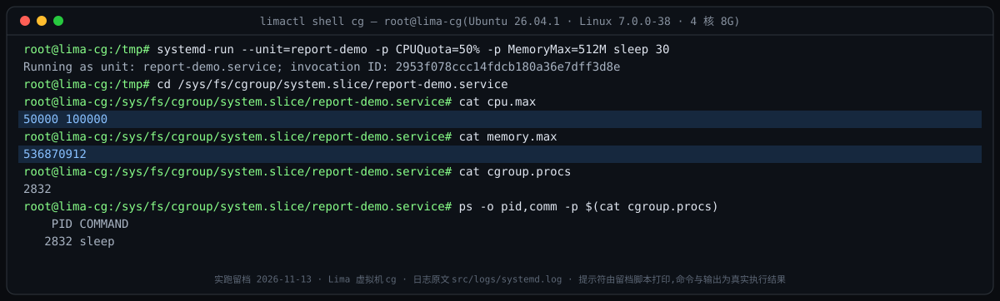

(这类「终端留档图」是把实跑的终端输出原样存成日志再排成图,来历见 §4.3.2 开头的说明。)

写法完全不同(`CPUQuota=50%` 对 `--cpus=0.5`),落下来的却是一模一样的两个数。这两个数是什么、为什么长这样,正是 §4 要倒推的;这里先记住一点:**docker 只是个入口,真正限制资源的是内核里的 cgroup。**

从此报表再怎么起 worker,合起来也只能用半颗核;内存涨到 512M 就是上限,真超了被杀的也只是报表自己,mysqld 不受影响。

磁盘和进程数呢?docker 也有对应的参数(`--device-write-bps` 限某块盘每秒写多少,`--pids-limit` 限进程个数,待核 #9),同事这次没加。§3 不经过 docker,直接在内核的接口上把四种资源一次写齐。

### §0.7 四个值得停下来想的问题

两个参数,十几个字符,效果马上就有。但这里有四件事值得停下来想:

1. `--cpus=0.5` 和 `-m 512m` 是 docker 的参数,不是内核的。内核不认识 docker。**这两个数最后是以什么形式传给内核的?**
2. report 有 9 个进程(1 主 + 8 worker),限制却是「合起来半颗核、合起来 512M」。**内核怎么知道这 9 个进程算同一组?**
3. mysqld 也在同一台机器、同一个内核上跑,**为什么报表超限只杀报表?**
4. 前面四次出事,你翻出四把工具,每把一种单位。到了这条命令里,CPU 和内存成了同一种写法。**磁盘和进程数也能这么写吗?四种性质完全不同的资源,在内核里是四套东西,还是一套?**

这几个问题的答案是同一个东西:cgroup。这一节先回答第 1、2 个问题的表层部分(数传到了哪里、一组进程是怎么圈出来的),和第 4 个问题的外形部分(四种资源在内核里确实是同一套机制,这套机制长什么样);内核拿到数之后怎么记账、怎么限制,为什么只能是一套,是后面的事。

第 4 个问题再往大里说一步,就是这一期的大问题:**Linux 内核怎么统一管理资源。**

从这里开始,请你换一个角色。前面你是 host01 的运维,只能挑现成的工具;接下来你是内核开发者,要让内核统一管理各种资源。这一节先展示现成的结果,看清它长什么样;它为什么只能是这样,下一节让你自己从零设计一遍。

## §1 一句话定义

**cgroup:内核把进程分成组,每种资源按组记账、按账设限的机制。**

(不到 30 字。)

拆开是三个动词,后面会反复用到。三个动词的分量不一样:**分组只有一套,所有资源共用;记账和设限,每种资源各做各的。**

| 动词 | 意思 | 公共的,还是各做各的 | 在开场例子里 |
|---|---|---|---|
| 分组 | 圈定哪些进程算同一组 | 公共的:只分一次,每种资源都认这一次 | report 的 9 个进程是一组,mysqld 是另一组;CPU、内存、磁盘、进程数都按这一个分法算 |
| 记账 | 这一组合起来用了多少,记在这一组的账上 | 各做各的:CPU 记跑了多少微秒,内存记占了多少字节,磁盘记读写了多少字节,进程数记有几个 | 9 个进程用的 CPU 时间加在一起算,占的内存加在一起算 |
| 设限 | 账上的数到了上限,就不再给 | 各做各的:上限的单位不同,超了以后怎么办也不同 | CPU:每 100 ms 里合计只给 50 ms;内存:合计 512 MiB 封顶 |

定义里是「按账设限」:限是对着账设的,账记在哪个组上,限就在哪个组上比。

三个动词的这条分界,决定了 cgroup 内部分成两层:

```
因为   四种资源的单位、记法、超了以后的办法各不相同(§0 的四把工具就是四种单位),
       而 report 这一组进程对哪种资源都是同一组
  ↓
要解决 分组只做一遍;每种资源只管自己的账和限
  ↓
所以   cgroup 分两层:只管「谁和谁一组」的公共层,叫核心;
       每种资源的记账和设限各是一个插件,叫控制器(controller,老版本里叫子系统)
```

「核心」在这一期专指这个公共层;说 CPU 时一律说「颗核」,两个词不混用。

名字本身就是这个意思:cgroup = control group,「受控的一组」。

## §2 类比:合租公寓的分户水电表

**拿合租公寓来比:几家合租一栋楼,住户只登记一次,水、电、燃气各装一块表;每户的限额由物业设定,表只负责计量,到限额就断;表装在楼里原有的进户管线上,不用重铺全楼的管道。这几点对应 cgroup 的几个特征。**

一栋合租公寓,整栋楼只有一路进水、一路进电、一路燃气(对应一台机器的 CPU、内存、磁盘……)。没有分户表的时候,谁家开十台电暖器,全楼一起跳闸;谁家水龙头开一整夜,全楼水压都低。你在 §0 里一次次换工具,就像每出一次事就给出事的那个电器单独加个开关:电暖器加一个,热水器加一个,开关装在电器上,不认「户」。

物业的办法是先分户,再给每一户装表:

| 公寓 | 机器 | cgroup 里的叫法 |
|---|---|---|
| 整栋楼 | 整台机器 | 根组 |
| 一户 | 一个业务(一个容器、一个系统服务) | 一个组(一个目录) |
| 户里的每个人 | 进程 | 组里的成员 |
| 户籍登记:谁住哪一户,只登记一次,水电燃气都按它算 | 分组 | 核心 |
| 水表、电表、燃气表 | CPU、内存、磁盘、进程数各一块表,各记各的 | 控制器 |
| 表上设的限额 | 这一户每种资源最多用多少 | `cpu.max`、`memory.max`、`io.max`、`pids.max` |
| 物业 | 决定每户限额是多少的人 | 管理程序(docker、systemd……) |
| 到限额,这一户的表自己断 | 超了只处理这一组 | 限流 / 组内 OOM / 排队 / fork 失败 |
| 楼里本来就有的水管、电线 | 内核本来就要走的代码路径(调度、分内存、写盘、fork) | 接入点(§6) |

这个类比能推出几条性质,每一条后面都会对应到真实机制:

- **表装在入户总管上,不装在每个电器上。** 一户里添了新电器、来了新住客,不用重新登记,电照样走这块表。对应:进程 fork 出来的子进程自动算在同一组里。
- **表只计量、限额,不负责发电。** 电还是电厂发的。对应:CPU 时间还是调度器在分,内存还是内存管理在分,cgroup 只是让它们分的时候多检查一下账。
- **分表可以套总表。** 一层楼一块总表,下面每户一块分表,各户加起来不能超过这层的总表。对应:cgroup 是一棵树,子组受父组限制。
- **户只分一次,几块表都认它。** 不会出现电表记你住 301、水表记你住 302。再装一块新表(比如加一块热水表),也不用重新分户。对应:分组只有一套,归核心;多管一种资源就是多一个控制器。
- **限额是物业定的,不是表自己定的。** 表不知道这一户该用多少,它只按写上去的数断电;住户自己也不能去改表上的限额。对应:数字由外面的管理程序写进来,内核只负责执行。
- **断电是表自己断的。** 没有物业的人每天挨家挨户抄表、看谁超了。对应到内核,这是一个先记下的问题:cgroup 里有没有一个定期巡查的内核线程?第三节会实际检查。
- **装表不用重铺管线。** 表接在楼里原有的进户管上,水还是走原来那根管子。对应:cgroup 不给内核另修一条路,只在内核本来就要走的代码路径上多做一步。

这几个特征,后面几段会一个个对应到实际的机制上:各种表在 §3 的一个目录里,限额是谁定的在 §4,户只分一次在 §5 的一棵树上,表接在哪根管子上在 §6。

类比到此为止。它说不清的地方(表到底装在内核的哪条代码路径上、超限时是怎么执行的)正是后面要讲的。

## §3 成品长什么样:一个目录,四个文件

**结论:一个组就是 `/sys/fs/cgroup` 下的一个目录。四种资源的上限是目录里的四个文件,写法一模一样:往 `<控制器名>.max` 里写一行字。写完以后,组里的进程 CPU 被限制在半颗核,内存超限被杀,写盘被限到每秒 10 MiB,创建到第 20 个进程被拒绝;旁边没写数的组不受影响。**

先别急着看答案,想一下:如果让你给内核设计一个「按组管四种资源」的接口,你会怎么设计?每种资源加一个系统调用?写一份配置文件让内核去读?

cgroup 的做法很简单:**一个目录,几个文件。** 下面这一段是在实验机上原样跑出来的。

### §3.1 实验是怎么做的

- **机器。** 这一段是在专用实验机 cg-lab 上跑的(2026-11-14),本节其余实验都在虚拟机 cg 上(§4.6)。两台是同一个系统镜像,Ubuntu 26.04.1、内核 7.0.0-38;cg-lab 是 4 核 4G,只跑本文的实验,用完即删。换机器是因为 cg 上后来装了别的服务,吃满 CPU 的实验会干扰它们。
- **组。** 用一个叫 `host01` 的组代表那台机器,下面建 `report` 和 `db` 两个子组。建这三个目录、让 host01 给子组打开 cpu / memory / io / pids 四个控制器(往 `host01/cgroup.subtree_control` 写 `+cpu +memory +io +pids`),这两步在脚本里做了,没有打印进留档(脚本第 59 行)。
- **入组。** `./ingroup <组名> <命令>` 是脚本里一个几行的小程序:先把自己的 pid 写进那个组的 `cgroup.procs`,再用 exec 把自己替换成后面的命令。这和 runc 是同一个顺序,为什么必须这样,§4.4 讲。
- **留档。** 脚本 [`stages/01-what/src/01-quad-session.sh`](stages/01-what/src/01-quad-session.sh),日志原文 `stages/01-what/src/logs/quad.log`,终端留档图如下(日志排成的图,不是窗口截图,说明见 §4.3.2)。正文的代码块都从日志里原样复制,只去掉了每段前的 `###` 标题行。

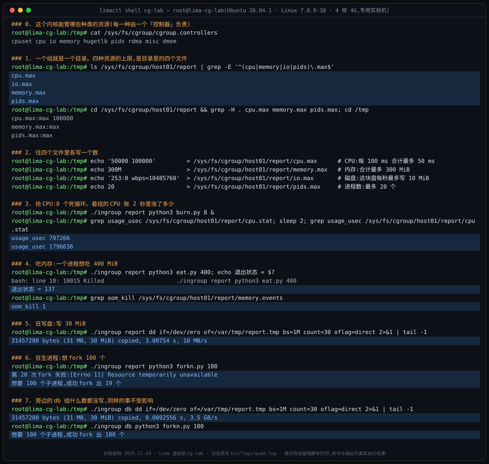

### §3.2 这个内核认得 9 种资源

```
root@lima-cg-lab:/tmp# cat /sys/fs/cgroup/cgroup.controllers
cpuset cpu io memory hugetlb pids rdma misc dmem
```

`cgroup.controllers` 列的是这台机器的内核认得的控制器,一种资源一个,一共 9 个。这一期天天打交道的是四个:

| 控制器 | 管什么 | 上限写在哪 | 超了会怎样 |
|---|---|---|---|
| cpu | CPU 时间 | `cpu.max` | 这组进程停到下一个周期 |
| memory | 物理内存(包括读写文件时的缓存) | `memory.max` | 先回收,回收不动就在组里杀进程 |
| io | 每块磁盘的读写速度 | `io.max` | 读写请求排队等 |
| pids | 进程和线程的个数 | `pids.max` | 再 fork 就失败 |

其余五个管的是更专门的东西:cpuset 管进程能用哪几颗核、哪几个内存节点,hugetlb 管大页,rdma 管 RDMA 网卡上的资源,misc 和 dmem 管几类杂项和设备内存。这一期不展开,第三节 §9 把九个放进一张表。

### §3.3 一个组就是一个目录,四个上限是四个文件

```
root@lima-cg-lab:/tmp# ls /sys/fs/cgroup/host01/report | grep -E '^(cpu|memory|io|pids)\.max$'
cpu.max
io.max
memory.max
pids.max
root@lima-cg-lab:/tmp# cd /sys/fs/cgroup/host01/report && grep -H . cpu.max memory.max pids.max; cd /tmp
cpu.max:max 100000
memory.max:max
pids.max:max
```

第一条命令只挑出 cpu、memory、io、pids 这四种资源的 `.max` 文件:四个文件,名字都是「控制器名 + `.max`」。第二条看它们刚建好时的内容:`max` 就是不设限。`io.max` 没跟着打印,它是按盘一行一行写的,一块盘都没设过时是空文件。

目录里当然不止这四个文件。把一个组目录里的文件按前缀分堆(§4.4 有一个容器组目录的节选):`cpu.` 一堆、`memory.` 一堆、`io.` 一堆、`pids.` 一堆,各归一个控制器;还剩 `cgroup.` 开头的一堆,成员名单 `cgroup.procs`、往下开控制器用的 `cgroup.subtree_control`、`cgroup.controllers` 都在里面。**这一堆不属于任何一种资源,属于核心。** 核心只管「谁和谁一组」,不知道 CPU、内存是什么;认得资源的是控制器。

细看有几个例外:一个组就算一个控制器都没开,目录里也已经有 3 个 `cpu.` 开头、1 个 `io.`、1 个 `memory.` 开头的文件,是几份只读的统计,由核心提供(第三节 §2 一个个打开控制器数过,待核 #13)。资源的上限文件没有例外:`.max` 文件的前缀就是控制器的名字。

### §3.4 往四个文件里各写一个数

```
root@lima-cg-lab:/tmp# echo '50000 100000'         > /sys/fs/cgroup/host01/report/cpu.max      # CPU:每 100 ms 合计最多 50 ms
root@lima-cg-lab:/tmp# echo 300M                   > /sys/fs/cgroup/host01/report/memory.max   # 内存:合计最多 300 MiB
root@lima-cg-lab:/tmp# echo '253:0 wbps=10485760'  > /sys/fs/cgroup/host01/report/io.max       # 磁盘:这块盘每秒最多写 10 MiB
root@lima-cg-lab:/tmp# echo 20                     > /sys/fs/cgroup/host01/report/pids.max     # 进程数:最多 20 个
```

四行逐个看:

| 文件 | 写进去的 | 读法 | 单位 |
|---|---|---|---|
| `cpu.max` | `50000 100000` | 每 100 000 μs 的周期里,合计最多跑 50 000 μs,也就是半颗核。和 §0 的 `--cpus=0.5` 落下的是同一行,§4.3 一步步换算 | 微秒 |
| `memory.max` | `300M` | 合计最多 300 × 1024 × 1024 = 314 572 800 字节。内核认 `K` `M` `G` 后缀;docker 写的是换算好的字节数 | 字节 |
| `io.max` | `253:0 wbps=10485760` | `253:0` 是要限的那块盘的设备号(主号:次号,`lsblk` 的 MAJ:MIN 一列能查到);`wbps` 是 write bytes per second;10 485 760 = 10 × 1024 × 1024,即这块盘每秒最多写 10 MiB。同一行还能写读速度 `rbps` 和每秒次数 `riops` / `wiops` | 每秒字节 |
| `pids.max` | `20` | 组里的进程(连同线程)最多 20 个 | 个 |

四种单位(微秒、字节、每秒字节、个数),写法是同一个:`echo` 一行字到 `<控制器>.max`。§0 那四把工具,四种命令行参数、四种作用范围,到这里收成了一种动作。

### §3.5 四种资源各触发一次上限

写完数,让 report 组里的进程把四种资源各用到上限一遍,最后拿旁边什么数都没写的 db 组对照。

**CPU。** `burn.py 8` 生出 8 个死循环,自己在一旁等着,一共 9 个进程,和 report 的「1 主 + 8 worker」一个样。看组目录里 `cpu.stat` 的 `usage_usec`,这是这个组在 CPU 上的账,单位微秒:

```
root@lima-cg-lab:/tmp# ./ingroup report python3 burn.py 8 &
root@lima-cg-lab:/tmp# grep usage_usec /sys/fs/cgroup/host01/report/cpu.stat; sleep 2; grep usage_usec /sys/fs/cgroup/host01/report/cpu.stat
usage_usec 797266
usage_usec 1796636
```

```
2 秒里 report 组的 CPU 账涨了   1 796 636 − 797 266 = 999 370 μs
按 cpu.max 算的上限              0.5 颗核 × 2 000 000 μs = 1 000 000 μs
实测 ÷ 上限                      999 370 ÷ 1 000 000 = 99.94%,即 0.4997 颗核
```

8 个死循环本来最多能把 4 颗核吃满(2 秒是 8 000 000 μs),账上只记了不到 1 000 000 μs。限制是按组的合计值来执行的。

**内存。** `eat.py 400` 每 0.05 秒吃 10 MiB,打算一直吃到 400 MiB,吃到了就打印一行「吃到了 400 MiB」:

```
root@lima-cg-lab:/tmp# ./ingroup report python3 eat.py 400; echo 退出状态 = $?
bash: line 10: 10015 Killed                     ./ingroup report python3 eat.py 400
退出状态 = 137
root@lima-cg-lab:/tmp# grep oom_kill /sys/fs/cgroup/host01/report/memory.events
oom_kill 1
```

那一行始终没有打印出来。进程被杀,退出状态 137 = 128 + 9,意思是被 9 号信号(SIGKILL)杀掉;组目录里 `memory.events` 的 `oom_kill 1` 是这个组的账上记的「组内 OOM 杀了 1 个进程」。上限 300 MiB 小于它想要的 400 MiB,所以一定会超限;它具体吃到多少时被杀,这一遍没有记录。组内 OOM 只杀组里的进程这一点,第二节 §9.2 会把 db 和 report 放在一起重演。

**磁盘。** `dd` 往一个临时文件写 30 MiB。`oflag=direct` 表示绕过页缓存,写请求直接交给磁盘,这样每一笔写都是 dd 自己发出去的:

```
root@lima-cg-lab:/tmp# ./ingroup report dd if=/dev/zero of=/var/tmp/report.tmp bs=1M count=30 oflag=direct 2>&1 | tail -1
31457280 bytes (31 MB, 30 MiB) copied, 3.00754 s, 10 MB/s
```

```
要写的量         30 MiB = 31 457 280 字节
上限             10 485 760 字节/秒
理论耗时         31 457 280 ÷ 10 485 760 = 3.000 秒
实测             3.00754 秒(多 0.25%)
dd 报的 10 MB/s  是十进制的兆(10⁶ 字节):31 457 280 ÷ 3.00754 ≈ 10.46 × 10⁶ 字节/秒 ≈ 9.97 MiB/s
```

不加 `oflag=direct` 的普通写,数据先进内存里的页缓存,过后由内核线程写盘。那一笔 IO 该记到哪个组的账上,要内存和磁盘两个控制器配合才说得清:第二节 §9.3 实跑,第三节 §6 拆开,第二节会把它列为 `C5·所有资源共用同一套分组` 的后一半。

**进程数。** `forkn.py 100` 连续 fork 100 个子进程(每个睡 3 秒),数成功了几个:

```
root@lima-cg-lab:/tmp# ./ingroup report python3 forkn.py 100
第 20 次 fork 失败:[Errno 11] Resource temporarily unavailable
想要 100 个子进程,成功 fork 出 19 个
```

```
forkn.py 自己                     1 个(ingroup 入组后把自己替换成它)
成功 fork 出来的                  19 个
合计                              20 个 = pids.max
第 20 次 fork                     内核返回错误 11(EAGAIN,「资源暂时不可用」),这个进程没生出来
```

这时组里没有别的进程:死循环在第 3 步之后被脚本清掉了,吃内存的那个已经被杀(合计的算法是按脚本推的,待核 #11)。

**旁边的 db 组。** 同样的两件事,db 组什么数都没写:

```
root@lima-cg-lab:/tmp# ./ingroup db dd if=/dev/zero of=/var/tmp/report.tmp bs=1M count=30 oflag=direct 2>&1 | tail -1
31457280 bytes (31 MB, 30 MiB) copied, 0.0092556 s, 3.5 GB/s
root@lima-cg-lab:/tmp# ./ingroup db python3 forkn.py 100
想要 100 个子进程,成功 fork 出 100 个
```

写同样 30 MiB,db 组用了 0.0092556 秒,report 组用了 3.00754 秒,差 325 倍;fork 100 个,db 组全部成功。上限只落在写了数的那个组上。

### §3.6 写法一样,超了以后的办法不一样

四种资源放在一起:

| 资源 | 控制器 | 上限文件 | 写进去的 | report 组实测 | 超了怎样 | 旁边的 db 组 |
|---|---|---|---|---|---|---|
| CPU | cpu | `cpu.max` | `50000 100000` | 8 个死循环,2 秒记账 999 370 μs ≈ 半颗核 | 停到下一个周期 | 没测 |
| 内存 | memory | `memory.max` | `300M` | 想吃 400 MiB,被杀(退出状态 137,`oom_kill 1`) | 先回收,回收不动就在组里杀进程 | 没测 |
| 磁盘 | io | `io.max` | `253:0 wbps=10485760` | 写 30 MiB 用 3.00754 秒 | 请求排队等 | 0.0092556 秒 |
| 进程数 | pids | `pids.max` | `20` | 第 20 次 fork 失败,成功 19 个 | 这次 fork 失败 | 100 个全部成功 |

左边四列,四行一个样:一个控制器、一个 `.max` 文件、往里写一个数。这是核心定下的规矩:组怎么建、文件怎么摆、数怎么写,对所有资源都一样。右边几列各不相同:CPU 停下来等,内存直接杀,磁盘排队,进程数当场拒绝。这是资源自己的性质决定的:CPU 时间和磁盘带宽下一刻还会有,可以等;fork 有返回值,可以拒绝;内存占用之后不会自己释放,既等不来,也拒绝不了。为什么非这样不可,第二节讲,那里会记成 `C2·记实际用量,超限处理看资源类型`。

这正是 §1 那条分界的实物:分组只有一套,四种资源共用;记账和设限每种资源各做各的。

这一期深挖的是 cpu 和 memory 两条线,因为它们对应开头的前两个问题。磁盘和进程数在第二节 §9.3、§9.4 放进组里重演;核心和控制器怎么配合,第三节从 §2 起一个接入点一个接入点地拆;把管资源拆成「公共的一层 + 一个个插件」,这种结构本身可以用到别的系统里,第三节 §15 专门说。

成品的结构已经清楚了一半:四种资源,同一种写法。另一半是这些目录在整台机器上摆成什么形状(§5)。在那之前,先回答一个更急的问题:这些数是谁写的?实验里是我手敲的,真实的机器上没有人手敲。

## §4 这些数字是谁写进去的:从一条命令倒推

**§3 里那四个数是我在实验机上手敲的。真实的机器上没人这么做:report 该分多少 CPU、多少内存,是业务上的判断,内核不知道,也不该知道。数字是外面的管理程序定下来、逐级传下来、最后写进文件的。**

这一段把 §0 那条 docker 命令倒推一遍,看 `--cpus=0.5` 和 `-m 512m` 怎么变成 `cpu.max` 和 `memory.max` 里的两个数。用 §2 的类比说,就是看物业怎么把限额写到表上。

### §4.1 先说结论

- 从你敲回车到内核生效,中间经过 **五个环节**:docker 命令行 → dockerd → containerd(和它的 shim)→ runc → 内核。
- 前四个环节都是用户态程序,**每个环节只做转换**:把上一个环节的表示换成下一个环节能处理的表示。
- 到内核面前只剩 **三个动作**:建一个目录(建组)、把 pid 写进一个文件(入组)、把数字写进两个文件(设限)。
- **数是外面定的,内核只负责执行。** 「report 该分 0.5 颗核」是你决定的,前四个环节只是把这句话转换成内核能直接使用的形式;内核从头到尾没有参与「该给多少」,它只保证写进来的数被遵守。
- 所以内核并不知道什么是容器、什么是 docker。它只看见有人在 `/sys/fs/cgroup` 下面建了目录、写了文件。**cgroup 对外的全部接口就是一棵目录树。**

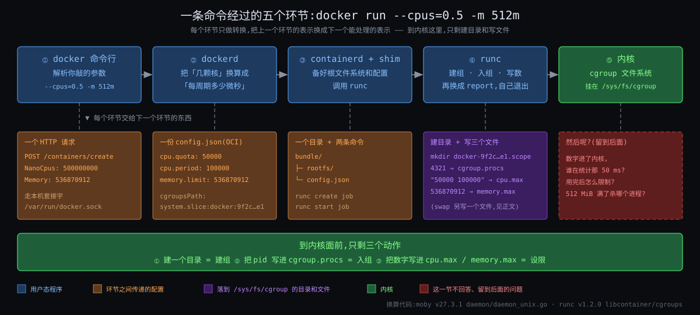

### §4.2 五个环节各自做了什么

先认一下前四个环节的名字,没用过 docker 的话只要知道它们各是哪一类角色:

- **docker 命令行**:你在终端里敲的那个 `docker` 程序,只负责解析你的参数再转发给 dockerd,自己不跑容器。
- **dockerd**:常驻后台的 docker 主程序(名字末尾的 d 是 daemon,守护进程),接收请求的是它。
- **containerd 和 shim**:dockerd 调用的组件,负责管理容器的创建、运行和删除;shim 是它为每个容器保留的一个小进程,负责监视这个容器。
- **runc**:最后向内核发出建组、入组、写数请求的小工具,建完就退出。

名字不用记,记住顺序就行:**docker 命令行 → dockerd → containerd(和 shim) → runc → 内核。**

| 站 | 是谁 | 收到 | 做了什么 | 交给下一站 |
|---|---|---|---|---|
| ① | docker 命令行 | 你敲的 `--cpus=0.5 -m 512m` | 把参数解析成两个整数 | 一个 HTTP 请求 `POST /containers/create`,里面有 `NanoCpus: 500000000`、`Memory: 536870912`,走本机套接字 `/var/run/docker.sock` |
| ② | dockerd(守护进程) | 上面那个请求 | 把「几颗核」换算成「每个周期多少微秒」,生成一份符合 OCI 标准的 `config.json` | `linux.resources.cpu.quota = 50000`、`cpu.period = 100000`、`memory.limit = 536870912`,外加这个容器的组应该建在哪(`cgroupsPath`) |
| ③ | containerd + shim | 镜像和上面的配置 | 把镜像解成根文件系统,和 `config.json` 摆进同一个目录(叫 bundle),然后调用 runc | 两条命令:`runc create`、`runc start` |
| ④ | runc | bundle 目录 | 读 `config.json`,**建组、入组、写数**;然后把容器进程替换成 report 程序;自己退出 | 对内核的几次建目录、写文件 |
| ⑤ | 内核 | 建目录、写文件 | 记下这个组、组里有谁、上限是多少 | (从这里开始才是 cgroup 真正记账和限制的地方,留给后文) |

OCI 是容器行业约定的一份公共格式。有了它,docker、Kubernetes、podman 可以共用同一个 runc。对这一节来说只要记住:**到 runc 手里的是一份 JSON,里面已经是内核使用的单位的数字了。**

### §4.3 算例:0.5 和 512m 怎么变成那三个数

**CPU 这一边。** 内核不懂「0.5 颗核」。它懂的是另一种说法:**把时间切成一个个周期,每个周期里这一组合计最多用多少 CPU 时间**。周期默认 100 ms。换算一步一步来:

```
--cpus=0.5
  → 命令行换成整数(单位:十亿分之一颗核)    NanoCPUs = 0.5 × 10⁹ = 500 000 000
  → dockerd 取周期 period = 100 ms            = 100 000 μs
  → 配额 quota = NanoCPUs × period ÷ 10⁹      = 500 000 000 × 100 000 ÷ 1 000 000 000
                                              = 50 000 μs
  → runc 写进 cpu.max 的内容                  "50000 100000"
                                               配额   周期   (单位都是微秒)
```

读法:**每 100 000 μs(100 ms)里,这一组合计最多跑 50 000 μs(50 ms)**。50 ÷ 100 = 0.5,对上了。

对账:换算公式就三行,在 dockerd 源码里(moby v27.3.1 `daemon/daemon_unix.go` 153~158 行):

```go
if config.NanoCPUs > 0 {
    period := uint64(100 * time.Millisecond / time.Microsecond)   // 100000
    quota := config.NanoCPUs * int64(period) / 1e9                // 50000
    cpu.Period = &period
    cpu.Quota = &quota
}
```

再多算几个,体会「配额可以比周期大」:

| 你敲的 | `cpu.max` 的内容 | 读法 |
|---|---|---|
| `--cpus=0.5` | `50000 100000` | 每 100 ms 合计 50 ms |
| `--cpus=1.5` | `150000 100000` | 每 100 ms 合计 150 ms |
| `--cpus=2` | `200000 100000` | 每 100 ms 合计 200 ms:机器有多颗核,一组进程在 100 ms 的墙上时间里可以合计跑出 200 ms |
| 什么都不写 | `max 100000` | 不设限 |

注意「合计」两个字。`50000 100000` 不是说「绑在半颗核上」,而是说 9 个进程不管散在哪几颗核上,它们的 CPU 时间加起来,每 100 ms 不超过 50 ms。**谁在做这个加法,是这一期要回答的第一个问题。**

#### §4.3.1 你的视角:0.5 颗核不是把核切开

你读到这里时提出:「0.5 个核,肯定不是把一个 CPU 核分开的计算,而是调度器上时间只能是正常的一半。」

**对,这是理解 `cpu.max` 的关键一步。** 核切不开:任何一瞬间,一颗核要么整颗在跑你,要么没在跑你,没有「跑半颗」这种状态。所以 0.5 只能是时间上的比例,不是空间上的切分;执行这件事的也确实是调度器。

在你这句话上再补充三点:

**① 「一半」是相对谁说的。** 是相对「一颗核跑满」,不是相对「它本来能拿到的」。report 的 8 个 worker 本来能吃满 4 颗核,限成 0.5 之后是原来的八分之一,不是二分之一。更准确的单位是:

```
0.5 颗核 = 50 ms CPU 时间 ÷ 100 ms 墙上时间
```

也就是「每过 1 秒钟,这一组合计只能在核上跑 0.5 秒」。`--cpus=2` 同理:每过 1 秒,合计能跑 2 秒(得有至少两颗核同时在跑它)。

**② 不绑核。** 这 50 ms 不指定在哪颗核上花。可以全在核 0 上,也可以 4 颗核各跑一小段,内核只看加起来的总数。§4.4.1 的实测就是这样:8 个进程散在 4 颗核上,一次各拿 6.0% ~ 6.6%,另一次各拿 4.3% ~ 12.0%,加起来都是半颗核(51.0% / 51.5%)。(要把一组进程钉在某几颗核上是另一个文件 `cpuset.cpus` 的事,这一期不展开。)

**③ 体感不是「慢一半」,而是「跑一阵、停一阵」。** CPU 的主频没有变,在核上的时候是全速;变的是「在不在核上」。

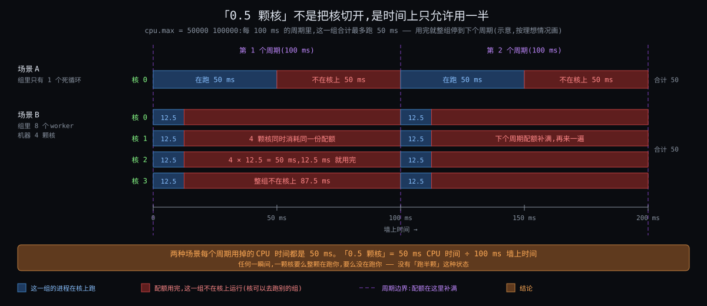

| 场景 | 每 100 ms 周期里发生的事 | 观感 |
|---|---|---|
| A:组里 1 个死循环 | 跑 50 ms,然后 50 ms 不许上核 | 跑一半时间,停一半时间 |
| B:组里 8 个 worker,机器 4 颗核 | 4 颗核同时烧同一份配额,4 × 12.5 ms = 50 ms,**12.5 ms 就烧完**;剩下 87.5 ms 整组不许上核 | 短时间跑满,然后长时间停顿 |

场景 B 是这件事里最反直觉的地方:线程越多、并行度越高,配额烧得越快,停的时间越长。对报表这种后台任务无所谓;但如果被限的是一个在线服务,某个请求恰好落进那 87.5 ms 的停顿里,它的响应时间就凭空多出几十毫秒,尽管整台机器可能很闲。「给容器设了 CPU 上限之后延迟出现毛刺」是线上的常见现象,原因就在这里。

图是按理想情况画的。下一小节用一个完整的例子把两种场景都实跑出来对账。

#### §4.3.2 一个完整的例子:同一份活,放进 0.5 颗核要多久

你接着要求:「举个例子详细说明 cpu=0.5 的具体含义。」下面四个实验都在 §4.6 的虚拟机里实跑(2026-11-13,4 核 8G,内核 7.0.0-38)。

**关于下面的「终端留档图」。** 每个实验配一张图,是把实跑时的终端输出原样存成日志、再排成终端样子的图,不是对着屏幕截的窗口截图。图里每一行都逐字来自日志:命令和输出是真实执行结果,只有提示符 `root@lima-cg:/tmp#` 那几个字是留档脚本打印的。三样东西都在本目录下,可以自己重跑对账:

- 跑实验的脚本:[`stages/01-what/src/01-evidence-sessions.sh`](stages/01-what/src/01-evidence-sessions.sh)
- 日志原文:`stages/01-what/src/logs/*.log`
- 把日志排成图的脚本:[`stages/01-what/src/01-render-shots.py`](stages/01-what/src/01-render-shots.py)

同一批实验当天先跑过一遍,数字很接近(单任务 4.09 s,四任务 55.45 s);正文一律以留档这一遍为准。

**先说结论。**

- `--cpus=0.5` 的含义只有一句:**每 100 ms 墙上时间里,这一组进程合计只能在核上待 50 ms。**
- 它不减少干活需要的 CPU 时间,只是把这些 CPU 时间在墙上时间里摊开:**墙上时间 ≈ 这一组总共需要的 CPU 时间 ÷ 0.5。**
- 配额用完后进程还活着,只是不在核上;到下一个周期边界才被放回来。
- 它管的是「在核上待多久」,不保证「这段时间能干多少活」(实验 4 会看到这一点)。

**准备:一份正好要 2 秒 CPU 的活。** 一个 Python 循环做 1.1 亿次乘加(`work.py`,源码在下图开头),在这台虚拟机上校准为约 2 秒。程序自己报两个数:墙上时间(从开始到结束,表走了多久)和 CPU 时间(它真正在核上跑了多久)。

**实验 1:一个任务。**

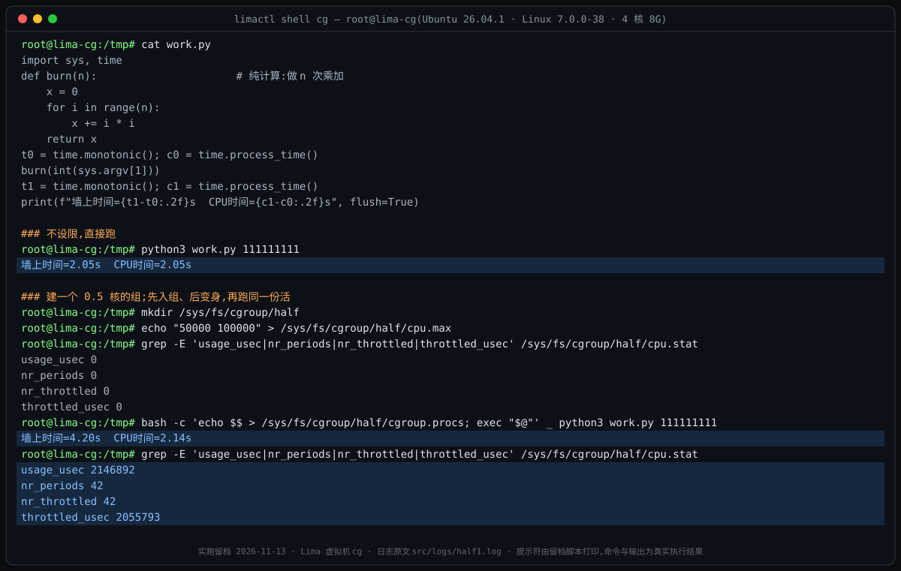

图里的入组写法 `bash -c 'echo $$ > …/cgroup.procs; exec …'` 和 runc 是同一个顺序:先把自己登记进组,再把自己替换成要跑的程序。

| | 墙上时间 | CPU 时间 |
|---|---|---|
| 不设限 | 2.05 s | 2.05 s |
| 放进 0.5 核的组 | **4.20 s** | 2.14 s |

活没有变多,CPU 时间还是 2 秒出头;表上却走了 4 秒多。多出来的 2 秒去哪了,看组目录里的 `cpu.stat` 这份统计(实验前全是 0,所以实验后的读数就是这次实验的量):

| `cpu.stat` 里的字段 | 实验后读数 | 意思 |
|---|---|---|
| `usage_usec` | 2 146 892 | 这一组在核上跑的总时间(微秒) |
| `nr_periods` | 42 | 经过了多少次 100 ms 的周期更替 |
| `nr_throttled` | 42 | 其中多少个周期达到了上限 |
| `throttled_usec` | 2 055 793 | 被限制不能运行的总时间(微秒) |

三步对账:

```
① 时间去哪了          在核上 2.14 s + 被限制不能运行 2.06 s = 4.20 s = 墙上时间   ✓
② 公式                2.14 s ÷ 0.5 = 4.28 s          ≈ 实测 4.20 s         ✓
③ 每个周期用了多少    2 146 892 ÷ 42 = 51 116 μs      ≈ 配额 50 000(高 2%)
                      任务前后跨了 43 个周期(首尾各沾一点),按 43 算是 49 928 μs
```

第 ③ 步的 2% 出入来自首尾两个不完整的周期;任务跑得越久这个误差占比越小,实验 3 跑了 556 个周期,就只差千分之一点五。

**实验 2 和实验 3 的前半:实际观察「运行一段、停一段」。** 换一个探针程序(`gaps.py`):死循环里不停读时钟,只要相邻两次读数相差超过 2 ms,就说明「我刚才被调度出核了」,记一笔。每次跑 500 ms,一共三种情况:

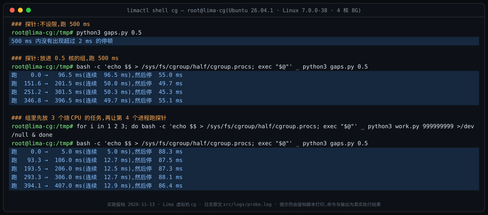

| 情况 | 探针看到的 | 对应上图 |
|---|---|---|
| 不设限 | 500 ms 内没有一次超过 2 ms 的停顿 | —— |
| 组里只有探针自己 | 第二段起:跑 50.0 / 50.3 / 49.7 ms,停 49.7 / 45.3 / 55.1 ms | 场景 A:跑 50 停 50 |
| 组里另有 3 个任务在烧 CPU | 第二段起:跑 12.7 / 12.5 / 12.7 / 12.9 ms,停 87.5 / 87.3 / 88.1 / 86.4 ms | 场景 B:跑 12.5 停 87.5 |

两种场景都和理想化的图对上了,场景 B 尤其整齐:4 颗核同时烧同一份配额,4 × 12.5 = 50。

两次的第一段都不规则(一次连着跑了 96.5 ms,一次只跑了 5.0 ms),这是起步效应:探针入组的时刻不在周期边界上。**周期是组自己的节拍,每 100 ms 一格,不会迁就某个进程什么时候开始干活。**

**实验 3 的后半:四个任务并行,做完要多久。** 按公式:4 份 × 2 s = 8 s CPU,÷ 0.5 = 16 s。

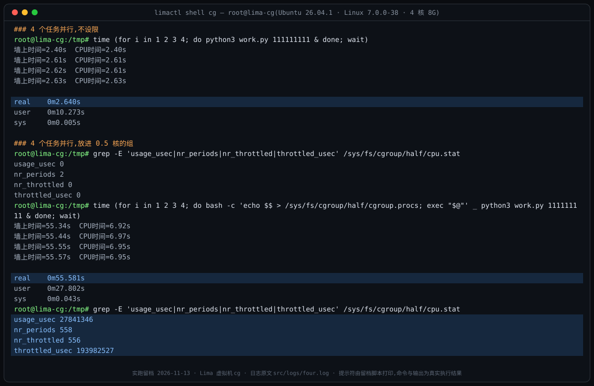

| | 4 个都做完的墙上时间 | 每个任务的 CPU 时间 |
|---|---|---|
| 不设限 | 2.64 s | 2.40 ~ 2.63 s |
| 放进 0.5 核的组 | **55.58 s** | **6.92 ~ 6.97 s** |

不是 16 秒,是 55 秒。先看是不是 cgroup 没有遵守限额:

```
usage_usec      27 841 346 μs,周期更替 558 − 2 = 556 次 → 每周期 50 074 μs    配额被遵守 ✓
throttled_usec  194.0 s;4 颗核 × 55.58 s = 222.3 s 的「核 × 时间」里,87.3% 处于被限制状态
                                                    (理想值 87.5%)            ✓
```

记账是对的。不对的是另一个数:**同样一份活,需要的 CPU 时间从 2.5 秒左右涨到了 6.9 秒。**

**实验 4:追查。** 怀疑和「每次只跑一小会儿」有关,于是只用一个任务(约 0.5 秒 CPU 的活),逐步把配额调小:

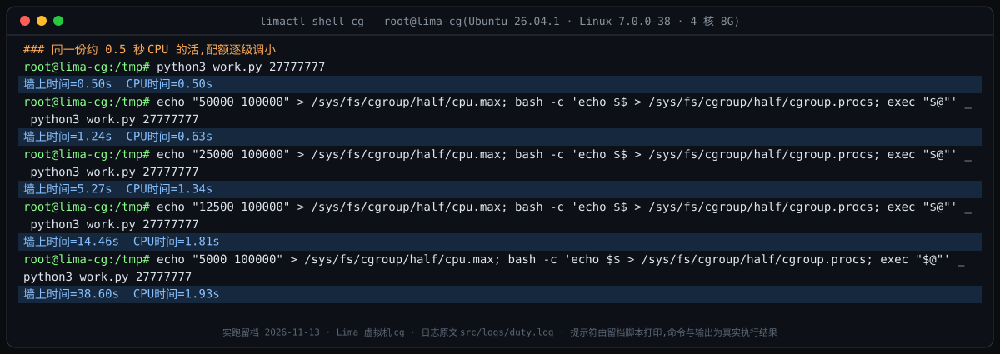

| `cpu.max` | 每周期可跑 | 墙上时间 | CPU 时间 | CPU 时间 ÷ 墙上时间 |
|---|---|---|---|---|
| 不设限 | —— | 0.50 s | 0.50 s | —— |
| `50000 100000` | 50% | 1.24 s | 0.63 s | 50.8% |
| `25000 100000` | 25% | 5.27 s | 1.34 s | 25.4% |
| `12500 100000` | 12.5% | 14.46 s | 1.81 s | 12.5% |
| `5000 100000` | 5% | 38.60 s | 1.93 s | 5.0% |

最后一列说明 cgroup 每一次都遵守了比例。倒数第二列说明:**每次在核上待得越短,同一份活要花的 CPU 时间越多**,到 5% 时接近原来的 4 倍。

原因我只能给推断,没有证实(待核 #8):这是虚拟机环境的副作用,不是 cgroup 的性质。虚拟机的每颗核在 Mac 这边是一个线程;当它每 100 ms 只忙十几毫秒,Mac 的调度器会把这种「不怎么忙」的线程放到省电的小核或较低的频率上,于是同样的 12.5 ms 里干的活变少了。在真正的物理服务器上不应该有这么大的差距,但方向相同的小幅效应(频率来不及升上去、缓存变冷)是存在的。

这个现象说明一点:**`cpu.max` 记的是时间,不是干了多少活。** 它保证你每周期在核上不超过 50 ms,至于这 50 ms 里核跑得快还是慢,它不管。

**小结:`--cpus=0.5` 到底意味着什么。**

| | 说法 | 证据 |
|---|---|---|
| 保证 | 每个 100 ms 周期,这一组合计在核上不超过 50 ms | 实测每周期 49 983 μs(§4.4.1)、50 074 μs(实验 3) |
| 不绑核、不管组内分配 | 只看合计;组内谁多谁少、在哪颗核上都不管 | §4.4.1:两次实测组内分法不同,合计都是半颗核 |
| 只拉长墙上时间,不减少 CPU 时间 | 需要的 CPU 时间不变,墙上时间 ≈ CPU 时间 ÷ 0.5 | 实验 1:2.14 s CPU → 4.20 s 墙上时间 |
| 用完就停 | 配额烧完到下个周期边界之间,整组不在核上;并行度越高,烧得越快、停得越久 | 探针:跑 50 停 50;跑 12.5 停 87.5 |
| 是上限,不是保底 | 机器忙的时候可能连 0.5 都拿不到;保底是另一个文件 `cpu.weight` 的事 | 第二节 §10.1 实跑 |
| 记时间,不记完成的工作量 | 同样的 50 ms,核慢了干的活就少 | 实验 4 |

到这一步「是什么」就够了。配额用完的那一刻内核具体做了什么、谁在统计、下个周期由谁让它们恢复运行,是这一期第一个问题的核心,留到后面。

**内存这一边。** 简单得多,只是换单位:

```
-m 512m
  → 512 × 1024 × 1024 = 536 870 912 字节
  → runc 写进 memory.max 的内容  "536870912"
```

| 你敲的 | `memory.max` 的内容 |
|---|---|
| `-m 512m` | `536870912` |
| `-m 4g` | `4294967296` |
| 什么都不写 | `max` |

顺带一个容易漏的:只写 `-m` 不写 `--memory-swap` 时,dockerd 会把「内存 + 交换区」的总量默认设成内存的两倍(同一个文件 317~320 行),也就是 1 GiB。v2 的文件 `memory.swap.max` 只管交换区那一部分,所以 runc 写进去的是 1 GiB − 512 MiB = `536870912`。这个数这一期不展开,知道 runc 一共写了三个文件即可。

### §4.4 在机器上的执行过程:runc 的三个动作

runc 拿到 `config.json` 后,按时间顺序做这些事(以 pid 4321 为例):

```
runc create job
  ├─ 生出一个子进程(pid 4321)        此刻它跑的还是 runc 自己的代码,还不是 report
  ├─ ① 建组   在 /sys/fs/cgroup/system.slice/ 下出现目录 docker-9f2c…e1.scope/
  ├─ ② 入组   4321 被登记进这个目录的 cgroup.procs
  └─ ③ 写数   cpu.max ← "50000 100000"    memory.max ← "536870912"    memory.swap.max ← "536870912"

runc start job
  └─ 4321 用 exec 替换成 /usr/bin/report    从 report 的第一条指令起,它就已经在组里
       └─ report 起 8 个 worker(pid 4350 ~ 4357)   它们一出生就在组里

runc 退出,容器由 shim 接管
```

三个动作逐个看。

**① 建组 = 建一个目录。** 目录名里那串 `9f2c…e1` 是容器的 64 位 ID。目录建在哪、由谁动手,取决于 docker 用哪种「cgroup 驱动」:

| 驱动 | 谁去建目录 | 目录位置 |
|---|---|---|
| systemd(v2 机器上的默认) | runc 不自己建,而是发消息请 systemd 建一个临时单元,systemd 去建 | `/sys/fs/cgroup/system.slice/docker-<ID>.scope/` |
| cgroupfs | runc 自己 `mkdir` | `/sys/fs/cgroup/docker/<ID>/` |

为什么默认通过 systemd 来建:这台机器上的 cgroup 树本来就是 systemd 在管(每个系统服务都是它建的一个组),两个管理者各建各的容易冲突,所以让 runc 请 systemd 来建,而不是自己建。**对内核来说两种驱动没有区别,它看到的都是一次建目录。**

目录一建好,里面立刻就有一堆文件。没有人创建过它们:

```
$ ls /sys/fs/cgroup/system.slice/docker-9f2c…e1.scope/
cgroup.controllers  cgroup.events  cgroup.procs  cgroup.stat  cgroup.subtree_control  …
cpu.max             cpu.weight     cpu.stat      cpu.pressure                         …
memory.max          memory.high    memory.current  memory.events  memory.stat  memory.swap.max  …
io.max              io.stat        io.pressure                                        …
pids.max            pids.current                                                      …
```

上面是节选。在一台真机上数过(内核 7.0,开了 cpuset / cpu / io / memory / pids 五个控制器):新建一个空目录,里面立刻有 62 个文件。

文件名的规律是「谁管的.管什么」:`cpu.` 开头的归 CPU 这一类资源,`memory.` 开头的归内存,`cgroup.` 开头的是组本身的事(成员名单、状态)。刚建好时 `cpu.max` 里是 `max 100000`,`memory.max` 里是 `max`,意思是不设限。

这些文件不在磁盘上。`/sys/fs/cgroup` 是内核提供的一种特殊文件系统(名字叫 cgroup2),**读文件是在问内核一个数,写文件是在改内核里的一个数**。至于内核把数存在哪,留到后面讲。

**② 入组 = 把 pid 写进 `cgroup.procs`。** 这里有一个顺序上的要求,值得单独说:

> **先入组,后 exec。** 4321 被登记进组的时候,它还没有变成 report。等它 exec 成 report、再 fork 出 8 个 worker,所有这些都发生在「已经在组里」之后。

这就回答了开场第 2 个问题的表层部分:内核怎么知道 9 个进程算同一组?**不是事后一个个去认领,而是第一个进程在干活之前就被放进组,之后它生的每一个子进程自动继承这个身份。** 分户电表装在入户总管上,就是这个意思。

#### §4.4.1 你的视角:事后才把主进程写进组,worker 跟不跟?

反问是这样的:不用 docker,直接在宿主机上把 report 跑起来,它已经 fork 完 8 个 worker;这时才手工建一个组,把 **主进程** 的 pid 写进 `cgroup.procs`,再往 `cpu.max` 写 `50000 100000`。8 个 worker 受不受这半颗核的限制?

你的回答:「应该受限。」

**目的上对。** 从目的上说你是对的:它们是一家子,本来就该一起受限,这正是 cgroup 想做到的效果,也是大多数人的第一直觉。

**机制上不对。** 内核不会自动把已经生出来的子进程一起搬过去。成员资格只有两条规则:

1. **写 `cgroup.procs` 只搬被写的那一个进程**(连同它自己的全部线程),不搬它已经生出来的子进程。
2. **继承只发生在 fork 的那一刻**:子进程出生时抄一份父进程当时所在的组,此后父子各记各的,父进程再搬家与它无关。

所以结果是:主进程进了新组(它只是在等 worker,本来就不吃 CPU);8 个 worker 还留在原来的组里,照样吃满 4 核。只有主进程 **此后** 再 fork 出来的新 worker,才会生在新组里。

拿户口来比:孩子出生时随父母落户;之后父母迁户口,已经分户单过的孩子不会跟着迁。

**实跑对账。** 2026-11-13 在 §4.6 那台 Lima 虚拟机里实跑(Ubuntu 26.04.1,内核 7.0.0-38,4 核 8G,root 身份)。下面两张是终端留档图(图的来历见 §4.3.2 开头的说明;脚本是 [`stages/01-what/src/01-evidence-sessions.sh`](stages/01-what/src/01-evidence-sessions.sh) 的 `join` 会话,日志原文在 `stages/01-what/src/logs/join.log`)。

先是「只把父进程写进组」:

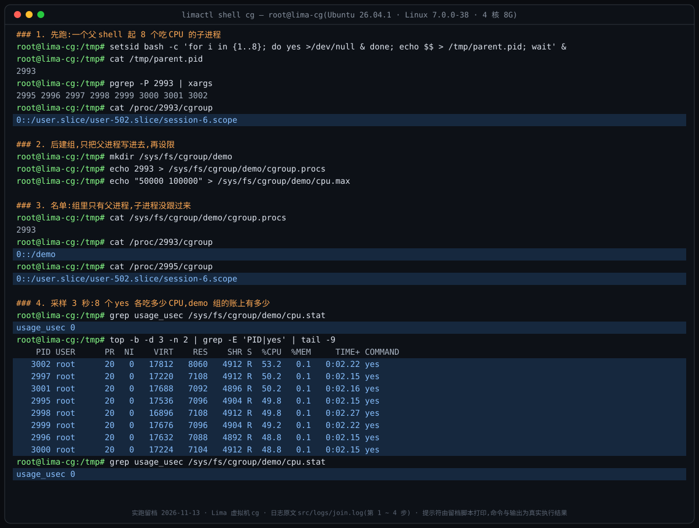

逐步读这张图:

1. 父进程是 2993,它已经生出 2995 ~ 3002 八个 `yes`(一个不停输出的死循环,这里只拿它来吃 CPU)。此时父子都在登录会话的组 `session-6.scope` 里。
2. 建组 `demo`,只写 2993,设 `50000 100000`。
3. `demo/cgroup.procs` 里只有 2993;2993 的组变成了 `/demo`,而子进程 2995 的组 **还是原来那个**。
4. 采样 3 秒:8 个 `yes` 各吃 48.8% ~ 53.2%,合计 400%,4 颗核全满;`demo` 的 `usage_usec` 采样前后都是 0。

(每个 50% 左右是 8 个进程抢 4 颗核、各分到半颗,和限额那个 0.5 只是数字碰巧。)规则 1 和规则 2 对上了。

接着做「事后补救」,把 8 个子进程逐个写进 `demo/cgroup.procs`,再采样一次:

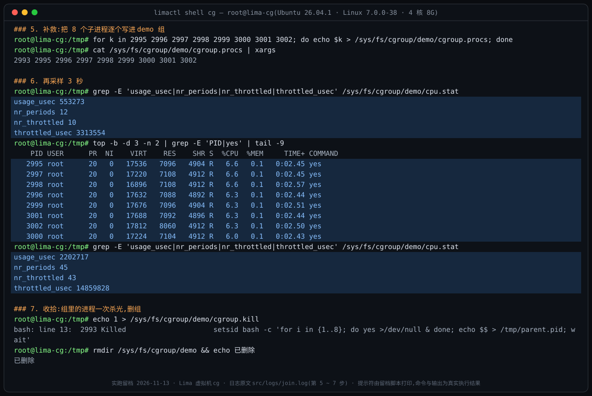

| | 只把父进程写进组 | 9 个进程都写进组 |
|---|---|---|
| 8 个 yes 的 CPU 合计 | 400.0%(各 48.8% ~ 53.2%) | 51.0%(各 6.0% ~ 6.6%) |
| demo 组账上的 CPU 时间 | 0 μs | 采样前后 553 273 → 2 202 717,涨了 1 649 444 μs |
| 经过的周期 | —— | 12 → 45,共 33 个 |
| 平均每个周期 | —— | 1 649 444 ÷ 33 = **49 983 μs** |
| 被限流的周期 | —— | 10 → 43,33 个里 33 个 |

右边这一列值得多看一眼,它是你第一个问题的实测数据:

- 平均每周期 49 983 μs,和写进去的 `50000` 只差万分之三。**限额是按每个周期单独执行的,不是长期平均下来差不多。**
- 这一遍 8 个进程分得很匀(6.0% ~ 6.6%)。但当天第一次跑同一个实验时并不匀:有一个进程拿到 12.0%,其余只有 4.3% ~ 6.6%,合计 51.5%。两次组内的分法不一样,合计都是半颗核。**内核在这一层只管一组的合计,组内谁多谁少不归它管。**(为什么偏偏有一个能拿到 12%,第三节 §7 回答。)
- 33 个周期每一个都达到了上限。这些计数来自同一目录下的 `cpu.stat`,后面讲「谁在数、怎么掐」时会回到这个文件。
- 图的最后一步顺手用了 `cgroup.kill`:往这个文件写 1,组里的进程一次全部杀掉。这是把进程分成一组的另一个用处:想全部杀掉时不会漏掉任何一个。

(如果你自己建的组里没有 `cpu.max` 这个文件,说明父目录没把 cpu 控制器往下开,先执行 `echo +cpu > /sys/fs/cgroup/cgroup.subtree_control`。这台虚拟机默认已经开了。)

这条规则带来两个推论,后面都会用到:

- **事后补救补不全。** 要把 9 个 pid 逐个写进去;而你写的这段时间里它们还可能继续 fork,新生的又落在旧组。所以 runc「先入组、后 exec」不是可有可无,是必须:在程序的第一条指令之前入组,这一组就不会有漏掉的进程。
- **反过来,进程不能靠 fork 离开自己所在的组。** 普通进程无论 fork 多少层,后代都在同一个组里;想离开得有权限去写别的组的 `cgroup.procs`。「按组管理」的可靠性就建立在这上面。

**③ 写数 = 往两个文件里各写一行。** 没有系统调用专门叫「设置 CPU 限额」,就是普通的 `write`。

把三个环节的表示并排放,就是完整的对照表:

| 你敲的 | dockerd 翻译成(OCI 字段) | 落到哪个文件 | 写进去的内容 | 意思 |
|---|---|---|---|---|
| `--name job` | 容器 ID `9f2c…e1` + `cgroupsPath` | 目录 `docker-9f2c…e1.scope/` | (建目录) | 建一个组 |
| (容器的第一个进程) | —— | `cgroup.procs` | `4321` | 这个进程入组 |
| `--cpus=0.5` | `cpu.quota=50000` `cpu.period=100000` | `cpu.max` | `50000 100000` | 每 100 ms 合计最多 50 ms CPU |
| `-m 512m` | `memory.limit=536870912` | `memory.max` | `536870912` | 合计最多 512 MiB 内存 |
| (没写 `--memory-swap`) | `memory.swap=1073741824` | `memory.swap.max` | `536870912` | 交换区最多再用 512 MiB |

倒过来读这张表:第一列是你定的,第二列是 dockerd 翻译的,后面三列是 runc 交给内核的目录、文件和内容。内核在这张表里只是接收方。它管两件事:保证写进来的数被遵守;不让组里的进程自己改,上面的推论说过,进程不能靠 fork 离开自己所在的组,想搬走得有权限去写别的组的 `cgroup.procs`。它不管的只有一件事:「谁该分多少」,这件事从头到尾是外面定的。

这就是 §2 类比里「限额是物业定的,表只按设定的数断电」:内核只提供机制,数字由外面写。第二节会把「管什么、不管什么」这两条合成一条约束,叫 `C3·内核负责执行,配额由外部设定`。也正因为接口只是一些文件,docker、Kubernetes、systemd 这些写法各异的管理程序,才都能接到同一个内核上(§6)。

### §4.5 自己验证

在一台 Linux 宿主机上(systemd 驱动):

```bash
$ ID=$(docker inspect -f '{{.Id}}' job)
$ cd /sys/fs/cgroup/system.slice/docker-$ID.scope

$ cat cpu.max
50000 100000
$ cat memory.max
536870912
$ cat cgroup.procs
4321
4350
…
4357

# 反过来,从任意一个进程查它在哪个组
$ cat /proc/4350/cgroup
0::/system.slice/docker-9f2c…e1.scope
```

最后一条值得记住:**每个进程都能通过 `/proc/<pid>/cgroup` 查到自己属于哪个组**,机器上没有「不属于任何组」的进程,没被特别安排的就在根组或它所在服务的组里。

没有 Linux 机器、只有 Mac 上的 Docker Desktop 时,可以让容器自己读自己的限额(待核 #1):

```bash
$ docker run --rm --cpus=0.5 -m 512m alpine sh -c 'cat /sys/fs/cgroup/cpu.max /sys/fs/cgroup/memory.max'
50000 100000
536870912
```

容器里看到的 `/sys/fs/cgroup` 就是它自己那个组的目录,所以不用拼那串 ID。

### §4.6 手边只有 Mac:要不要一台 Linux

先说结论:**不是必须,但有一台会好很多。**

- **不必须**:这份资料里每条命令都把输出写出来了,只读不跑也能跟上;后面读内核源码更是只需要一份源码。
- **为什么 Mac 本身不行**:cgroup 是 Linux 内核的功能。macOS 的内核是另一套(XNU),没有 `/sys/fs/cgroup`,也没有对应的东西可以凑合。Mac 上的 Docker Desktop 能跑容器,靠的也是在后台起一台 Linux 虚拟机,容器其实跑在那台虚拟机的内核上。
- **有一台的好处**:§4.4.1 那种「你猜会怎样」的问题,五分钟就能自己验证,不用信我的推断;后面讲 CPU 限流和内存 OOM 时,可以直接看到 `cpu.stat` 里的计数在涨、看到组内进程被杀。

所以要动手,就得「虚拟一台」。Apple 芯片的 Mac 上有三种方案,从轻到重:

| 方案 | 是什么 | 适合 |
|---|---|---|
| Lima | 开源的命令行工具,一条命令起一台 Ubuntu 虚拟机,有独立的 Linux 内核、systemd、完整的 `/sys/fs/cgroup` | 只想要一个能 `sudo` 的 Linux 终端做实验(推荐) |
| OrbStack | 带界面的轻量替代品,同时给 docker 和 Linux 机器,启动最快 | 还想顺手在 Mac 上直接用 `docker` 命令 |
| UTM / Parallels | 完整的图形化虚拟机 | 想要一台带桌面的 Linux,做 cgroup 实验用不上 |

**Lima 是什么。** 名字是 Linux Machines 的缩写,一个开源的命令行小工具,作用只有一个:在 Mac 上起一台 Linux 虚拟机,并且把繁琐的步骤自动完成。它自己不是虚拟机,底下用的是 macOS 自带的虚拟化能力(或 QEMU);它负责的是下载系统镜像、建虚拟机、开机、配好登录,让你敲一条命令就得到一个 Linux 终端。可以把它理解成「命令行版的、只管 Linux 的 VirtualBox」。

三点帮助判断要不要装:

- **它和 docker 的关系**:Docker Desktop、Colima、Rancher Desktop 这些让 Mac 能跑容器的工具,背后都要起一台 Linux 虚拟机;Colima 和 Rancher Desktop 用的就是 Lima。区别只是它们不让你直接接触虚拟机、只提供 `docker` 命令,而直接用 Lima 是把这台虚拟机本身交给你 —— 做 cgroup 实验要的正是后者,因为要进去看 `/sys/fs/cgroup`。
- **它里面是真的 Linux**:有自己的内核、自己的 systemd,不是模拟层。在里面建 cgroup、写 `cpu.max`、把进程撑到 OOM,碰到的都是真内核的行为,而且只影响虚拟机,不影响 Mac。
- **它对 Mac 做了什么**:brew 装几个程序;虚拟机的磁盘放在 `~/.lima/` 下;默认会把你的 home 目录以只读方式挂进虚拟机方便取文件。不用了 `limactl delete cg` 加 `brew uninstall lima` 就干净了。

**它用的是芯片原生的虚拟化吗?** 是。和 Intel 那边是同一个思路,只是每一层换了名字:

| 层 | Intel + Linux 上 | Apple 芯片 + macOS 上 |
|---|---|---|
| CPU 硬件能力 | VT-x(客户机模式 + EPT 二级页表) | ARM 虚拟化扩展(EL2 特权级 + 第二阶段页表) |
| 内核暴露的接口 | KVM | Hypervisor.framework |
| 搭出一台虚拟机的程序 | QEMU 等 | Virtualization.framework(Lima 2.3.0 默认用它,实测见下) |
| 你敲的工具 | virsh / vagrant | Lima |

Mac 是 arm64 芯片,虚拟机里跑的也是 arm64 的 Linux,所以客户机的指令直接在真 CPU 上执行,不做翻译,速度接近原生;只有碰到特权操作才陷出来交给宿主处理。

顺带和 §7 对上:这正是「虚拟机」和 cgroup 的分界。虚拟机靠 CPU 硬件划分出一台虚拟的机器,里面有一个完整的 Linux 内核;在 macOS 看来,整台虚拟机只是一个普通进程。而 cgroup 的账,是虚拟机里那个 Linux 内核自己在记。

2026-11-13 在这台 Mac 上实际装了一遍(Lima 2.3.0),能用的命令是这几条:

```bash
$ brew install lima
$ limactl start --name=cg --cpus=4 --memory=8 --containerd=none --tty=false template:ubuntu-lts
                                    # 起一台 4 核 8G 的 Ubuntu,对上本文的例子
$ limactl shell cg                  # 进去,之后就是 Linux 终端(里面的用户名是 lima,sudo 免密)
$ stat -fc %T /sys/fs/cgroup        # 输出 cgroup2fs,说明是 v2
$ limactl stop cg                   # 不用时关机;limactl start cg 再开,十秒左右
```

**自己进这台 Linux 的终端。** 在 Mac 上另开一个终端窗口,敲 `limactl shell cg` 就进去了,提示符变成 Linux 的;`exit` 或 Ctrl-D 退出,退出后虚拟机还在后台跑。几个实测过的细节:

- 进去后的当前目录和你在 Mac 上敲命令时的目录相同。Mac 的 home 目录被只读挂进了虚拟机,所以在仓库目录下进去,能直接看到这份资料和脚本,但不能在里面写文件(要写就去 `/tmp` 或 `~`)。
- 里面的用户叫 `lima`,`sudo` 不要密码;cgroup 实验基本都要 root,`sudo -i` 切成 root 最省事。
- 重跑本文的实验:在仓库目录下进虚拟机,执行 `sudo bash atlas-output/cgroup核心原理-20261112/stages/01-what/src/01-evidence-sessions.sh join`。最后一个词换成 `env` / `systemd` / `half1` / `probe` / `four` / `duty` 就是其余几个实验。

`--containerd=none` 是遇到问题后加的:不加的话 Lima 会顺手从 GitHub 下一个两百多兆的容器工具包,这边网络下它每分钟不到 3 MB,首次启动花了十几分钟;做 cgroup 实验用不上它,关掉后开机只要 11 秒。(说明:我实际走的是先建虚拟机、再用 `limactl edit cg --set '.containerd.user = false | .containerd.system = false'` 关掉它;上面一步到位的 `--containerd=none` 是照 `limactl start --help` 列出的参数写的,这个写法本身没单独跑过。)

起来之后的实际情况:

| 项 | 实测 |
|---|---|
| 虚拟机类型 | `vz`,即 Apple 的 Virtualization.framework |
| 系统 / 内核 | Ubuntu 26.04.1 LTS / 7.0.0-38 |
| cgroup | v2(`cgroup2fs`),根上已往下开 cpuset、cpu、io、memory、pids |
| 占 Mac 的磁盘 | 虚拟机 2.6 GB + 下载缓存 3.4 GB + 程序 0.1 GB ≈ 6 GB |

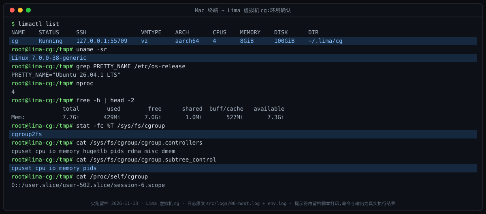

关于磁盘:虚拟机的磁盘文件名义上是 100 GB,但它是稀疏文件,只有真正写过的部分才占地方,现在实占 2.6 GB,上限就是那 100 GB。下载缓存在 `~/Library/Caches/lima`,虚拟机建好后就用不上了,`limactl prune` 可以清掉,清完总占用不到 3 GB。全部不要了:`limactl delete cg` + `limactl prune` + `brew uninstall lima`。

虚拟机是 arm64 的 Linux,对 cgroup 没有影响:目录、文件名、行为和 x86 上一样。它的内核是 7.0,比后面读源码打算钉的 6.12 新;用户能看到的这些文件基本一样,个别新增文件到读源码时再对账。

§3 那一段用的是照同样办法另起的一台专用实验机 cg-lab(同一个系统镜像,4 核 4G,只跑本文的实验,用完即删);它的脚本 [`stages/01-what/src/01-quad-session.sh`](stages/01-what/src/01-quad-session.sh) 开头写着在 Mac 上怎么调用。

## §5 一张全景图:一棵树 + 一排控制器

**结论:cgroup 的外形是一张「树 × 控制器」的表。竖着看是一棵目录树,每个目录一个组,整台机器只有这一棵,所有资源共用,它属于核心;横着看是一排控制器,每种资源一列,每个组在每一列上有一格,格里写着这个组在这种资源上的上限。**

把 §3 和 §4 落下的东西摆到一张图上。还是那台 4 核 8G 的 `host01`,报表容器 job 和数据库容器 db 都在。这是一张示意图,不是某一次实跑的快照:job 那一行的 CPU 和内存是 §0 那条 docker 命令落下的,磁盘和进程数两格借用 §3 实验里写的数;db 和 sshd 的数是设想的。

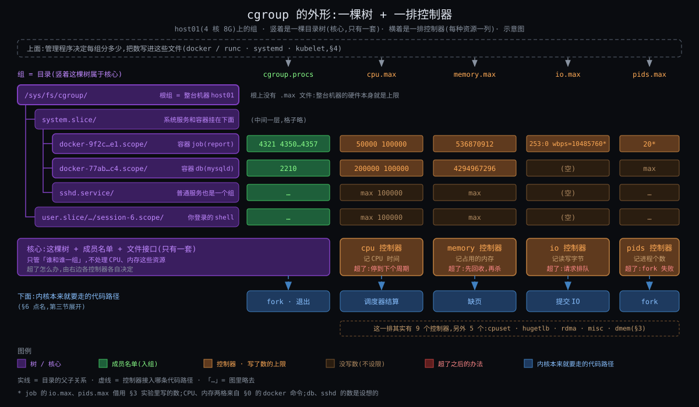

从图上能读出来的六件事:

1. **竖着看,外形是一棵目录树。** 根是 `/sys/fs/cgroup/`,代表整台机器;往下每个目录是一个组。这棵树,连同每个组的成员名单 `cgroup.procs`,属于核心。根上没有 `.max` 文件(待核 #12):整台机器的硬件本身就是上限。
2. **横着看,是一排控制器。** cpu、memory、io、pids 各占一列,每个组在每一列上有一格,就是 §3 里那几个 `.max` 文件。这个内核其实有 9 个控制器,图里只画了四个。
3. **容器不特殊。** `sshd.service` 这样的普通系统服务也是一个组,只是没人给它写 CPU 和内存的限额(`max`)。容器只是「被写了数的组」。一个组的全部配置,就是它那一行格子里的数和成员名单里的 pid。
4. **每个进程恰好在一个组里。** 4321 在 job 的组里,2210 在 db 的组里,不会同时出现在两处。对每一种资源,它都只有这一个组:§4.5 里 `/proc/4350/cgroup` 只有一行 `0::/system.slice/docker-9f2c…e1.scope`。
5. **列与列写法一样,超了以后的办法不一样。** 每一列底下,控制器各自决定超了怎么办:停、杀、排队、拒绝。这是 §3.6 那张表的另一种画法。
6. **图的上下两边各连着另一层。** 上面是写数的管理程序(§4 已经倒推过);下面是每个控制器接入的那条内核代码路径,§6 点名,第三节展开。

第 4 条值得多想一步:为什么只有一棵树?让 CPU 按部门分、内存按服务分,各分各的,不是更灵活吗?cgroup 的第一版(v1)真就是这么做的,每种资源可以各有一棵树;后来的 v2 又改回去,只留一棵。§2 类比里说的是「户只分一次」。改回一棵树的理由,第二节 §8 讲。

还有一处和 §2 的类比对上:「分表可以套总表」。job 和 db 都挂在 `system.slice` 下面,如果给 `system.slice` 也写一个上限,下面所有组加起来就不能超过它。一层管一层的合计,第二节会把它算进 `C1·按组限制合计用量`。

## §6 它在系统里的位置:上面接管理程序,下面接内核的四条代码路径

**结论:cgroup 夹在两层中间。上面是一群管理程序,它们决定数字、写文件;下面是内核本来就有的几条代码路径(fork、调度、缺页、提交 IO),每个控制器在其中一条路上多做一步,在资源被消耗的那一刻记账、比限。cgroup 自己不发 CPU 时间,也不发内存。**

```
 上面(管理程序)        docker / runc     kubelet           systemd
                       └──────── 都只是在建目录、写文件 ─────────┘
 接口                  /sys/fs/cgroup(cgroup 文件系统)
 ══════════════════════════════════════════════════════════════════════════════ 用户态 / 内核
 cgroup 本体           核心:一棵组的树、成员名单(只有一套)
                       控制器:cpu  memory  io  pids …(每种资源一个)
  下面(内核本来的代码路径) fork              调度器结算        缺页              提交 IO
                       (核心、pids)      (cpu)             (memory)          (io)
 平行(相近的机制)      namespace         ulimit            nice / 优先级
```

四句话读这张图:

- **上面**:你平时接触的 docker、Kubernetes、systemd,在资源限制这件事上都只是 cgroup 的入口。它们各有各的参数写法(`--cpus`、`resources.limits.cpu`、`CPUQuota=`),落到内核都是同一批文件。决定数字的是它们,这是 §4 的结论。
- **接口**:一棵目录树。建目录 = 建组,写文件 = 改内核里的数。管理程序和内核之间只隔着这一层文件。
- **下面**:cgroup 自己不发 CPU 时间,也不发内存。发 CPU 的还是调度器,发内存的还是内存管理。cgroup 做的事,是让这些子系统在干活的时候能识别「组」:这一笔记到哪个组、这个组到没到上限。
- **平行**:namespace、ulimit、nice 是相近但不同的机制,区别见 §7。

### §6.1 四条代码路径

「下面」那一行是前面没讲过的,先把它的来路说清楚:

```
因为   cgroup 自己不发 CPU、不发内存(§2:表只计量,不发电),
       而资源是在内核的各条代码路径上被消耗掉的(调度器让进程上核、缺页时分物理页、写盘时提交请求、fork 时生进程)
  ↓
要解决 在资源被消耗的那一刻,把这一笔记到对的组上,并且看看超没超
  ↓
所以   每个控制器在内核本来就要走的那条代码路径上挂一个记账点,叫接入点;
       不另起线程,不另修一条代码路径(§2:装表不重铺管线)
```

先想一下:如果让你来写 cpu 控制器,你会在什么时候记账?最直接的想法是另起一个线程,每隔一会儿把组里每个进程用了多少加一遍,超了就去拦。这个想法差在哪、内核为什么偏偏不这么做,第三节 §13 会对照着讲。这里只记住内核的选择:**账在消耗发生的那条代码路径上顺手记。**

跟着 report 的一个 worker 过一遍它的一生,它会依次经过这几条代码路径:

| worker 一生的一刻 | 内核本来就要走的代码路径 | 谁在这条代码路径上多做一步 | 这一刻要回答的问题 |
|---|---|---|---|
| 出生:被 report 主进程 fork 出来 | fork | 核心、pids 控制器 | 它生在哪个组?这个组还能不能再添一个进程? |
| 跑 CPU:做聚合计算 | 调度器结算它跑了多久 | cpu 控制器 | 这个组这个周期还剩多少配额? |
| 要内存:第一次碰到一页新内存 | 缺页,分一个物理页 | memory 控制器 | 这一页记到哪个组?记上去超没超? |
| 写盘:把中间结果写进临时文件 | 提交 IO 请求给块层 | io 控制器 | 这块盘、这个组、这一秒还能写多少? |
| 生孩子:worker 自己再 fork | fork | 核心、pids 控制器 | 同出生 |
| 退出 | 进程退出 | 核心、pids 控制器 | 名单上摘掉它,进程数减一 |

「写盘」那一行有个小坑:像 §3 那样 `oflag=direct` 直接写,请求是 worker 自己提交的;普通的带缓冲的写,数据先进内存,过后由内核线程提交,这一笔怎么记回 report 这个组的账上,第三节 §6 讲。

四条代码路径分别是第三节的 §3(fork)、§4(调度器结算)、§5(缺页)、§6(提交 IO)。每一条路径上,第三节都会回答同一组问题:内核原本在这条路径上做什么,cgroup 在哪一步之后多做一步,记一次账要花多少开销,没人设限的时候还有没有开销。第二节会把「只能挂在原有的代码路径上,而且必须便宜」记成一条约束,叫 `C4·在内核已有代码路径上记账,开销要小`。

## §7 cgroup 不是什么

四个容易和它混在一起的东西。前三个是与它相近的机制,解决的是不同的问题或者同一个问题的弱化版:

| 容易混的 | 它管的是 | 作用的单位 | 和 cgroup 差在哪(用 job 的例子) |
|---|---|---|---|
| **namespace** | 进程**看得见什么**(进程号、网络、挂载点的视图) | 一组进程的视图 | 它不记账也不设限。容器 job 里敲 `free -m`,看到的还是宿主机的 8G:namespace 没把内存这个「视图」隔开,而限额在 cgroup 那边,是另一套东西。一句话:namespace 管看得见什么,cgroup 管用得了多少 |
| **ulimit**(`setrlimit`) | 单个进程的上限 | **每个进程各算各的** | 给 report 设「每进程最多 512M」,9 个进程就是各有 512M、合计 4.5G,照样把机器撑爆。而且它限内存限的是虚拟地址空间(`RLIMIT_AS`),不是真正占住的物理内存;限 CPU 限的是累计秒数(`RLIMIT_CPU`,到点发信号杀进程),表达不了「每 100 ms 最多 50 ms」这种速率 |
| **nice** | 抢 CPU 时的相对优先权 | 单个线程 | 它只在有人争的时候起作用:把 8 个 worker 都调到 nice 19,mysqld 忙的时候它们会让,但没有「上限」这个概念,机器空闲时照样吃满 4 核;而且多开一个 worker 就多一份权重。它管不了内存 |
| **虚拟机** | 切一份虚拟硬件给你 | 一台假机器 | cgroup 不切硬件、不预留。512 MiB 不是先划出来留着,而是 job 用到 512 MiB 的那一刻被限制;job 没用满的部分,别人可以用 |

还有两个反过来的误会。

**cgroup 不等于容器。** 容器是 namespace + cgroup + 根文件系统三样拼起来的;cgroup 单独就能用,systemd 管的每个服务都在自己的 cgroup 里,和容器无关。

**cgroup 也不是「限 CPU 和内存的专用工具」。** 开场的 docker 命令只用了两个参数,很容易让人这么以为。§3 那台实验机的内核认得 9 种资源,其中四种你已经看着它们各触发了一次上限。它是一个框架:分组那一层是公共的,具体管哪种资源由一个个控制器负责。多管一种资源,是多一个控制器,不是再造一套 cgroup。

ulimit 和 nice 这两行其实已经在回答「为什么需要 cgroup」了:它们都以单个进程为单位,而你要管的是「一组进程」。下一节从这里接着往下挖。

## §8 关键词速查表

| 术语 | 一句话说明 |
|---|---|
| cgroup(控制组) | 一组进程 + 这组进程在每种资源上合用的账;外形是 `/sys/fs/cgroup` 下的一个目录 |
| cgroup 文件系统(cgroup2) | 内核提供的特殊文件系统,挂在 `/sys/fs/cgroup`;建目录 = 建组,读写文件 = 读写内核里的数 |
| 核心 | cgroup 里和具体资源无关的公共层:这棵树、成员名单、文件接口;`cgroup.` 开头的文件归它 |
| 控制器(controller) | 负责某一种资源的插件:`cpu`、`memory`、`io`、`pids` 等,这台机器上一共 9 个;上限文件的前缀就是控制器的名字;v1 里叫子系统 |
| 层级(hierarchy) | 组与组的父子关系,也就是目录树;子组受父组的限额约束 |
| 接入点 | 内核本来就要走的一条代码路径上(fork、调度器结算、缺页、提交 IO、退出),cgroup 多做一步、记账并检查限额的那个位置 |
| `cgroup.procs` | 一个组的成员名单;把 pid 写进去 = 让这个进程入组 |
| `cpu.max` | CPU 上限,内容是 `配额 周期`(微秒),如 `50000 100000` = 每 100 ms 合计最多 50 ms |
| `memory.max` | 内存上限,单位字节,如 `536870912` = 512 MiB;超了先回收,回收不动就在组内杀进程(OOM) |
| v1 / v2 | cgroup 的两套接口。v1 每类资源各一棵树(文件名如 `cpu.cfs_quota_us`),v2 只有一棵树(`cpu.max`)。本期全程用 v2 |
| cgroup 驱动 | 容器运行时用哪种方式建组:`systemd`(请 systemd 建)或 `cgroupfs`(自己建目录) |

## §9 留下的悬念

**这一节只讲到成品的外形和数字的来路:一个目录、几个文件,一棵树加一排控制器,数字由外面写进来。两条线各留下一串问题,难度逐步增加。**

### §9.1 第一条线:一组进程的资源是怎么被管住的

1. **在这之前呢?** cgroup 到 2.6.24 版才进内核。之前的十几年里,一台机器上跑多个互不相让的服务,大家是怎么办的?§0 那四把工具明明早就有,它们到底差在哪里?
2. **那些文件不在磁盘上,数存在哪?** 写进 `cpu.max` 的 `50000 100000`,内核把它记在了什么东西上?
3. **谁在数那 50 ms?** 9 个进程散在 4 颗核上各跑各的,「合计」是谁在加?每跑一微秒就加一次吗?那得多慢?
4. **数满了怎么掐?** 一个周期里 50 ms 用完了,剩下的 50 ms 这 9 个进程处在什么状态?是被杀了、睡了、还是别的?下个周期又是谁让它们恢复运行?
5. **内存的账比 CPU 难在哪?** CPU 时间用完了,下个周期又有;内存占用之后不会自己释放。512 MiB 满了以后内核先做什么、最后才做什么?真到杀进程那一步,为什么只在组里挑、怎么挑?
6. **组内谁多谁少,由什么决定?** §4.4.1 里同一个半颗核的组,一模一样的 8 个死循环,有一次一个拿到 12.0%,其余只有 4.3% ~ 6.6%。

### §9.2 第二条线:cgroup 这套架构

7. **四种性质完全不同的资源,为什么能用同一种写法管?** CPU 时间下一刻还会有,内存占用之后不会自己释放,磁盘带宽可以排队,进程数 fork 一次就多一个。§3 里它们却是同一种目录、同一种文件、同一个 `echo`。公共的那一层到底抽出了什么,才让四种资源都能接进来?
8. **为什么有 v1 和 v2 两套?** 同一个内核功能做了两遍,第一遍错在哪?§5 里「只有一棵树」,是第一遍吃了亏才收回来的吗?
9. **控制器是怎么接进一个已经在跑的内核的?** §6 那四条代码路径上各多做一步,这一步具体挂在哪儿?每次都有开销吗?没人设限的时候也有开销吗?在 fork 这种核心和控制器都要插手的地方,谁先谁后、各做什么?

第 1、7、8 个是下一节的事;第 2 ~ 6 个和第 9 个要到第三节才能答完。

下一节从内核开发者的角度开始。你是内核开发者,手边只有 §0 那四把旧工具,要让内核把各种资源统一管起来。最顺手的办法大概是:CPU 管不住,就给 CPU 写一个限制器;内存管不住,再给内存写一个;磁盘、进程数,再各写一个。这样做到第几个,会遇到什么问题?

## §10 呼应灵魂问题

你带来的三个问题,这一节各走了一小步:

| 你的问题 | 这一节拿到的 | 还缺的 |
|---|---|---|
| ① 往 `cpu.max` 写 `50000 100000`,内核怎么让这组进程最多吃半颗核? | 这行字的来历(`--cpus=0.5` 的换算)、它的读法(每 100 ms 合计 50 ms)、它写在哪、「这组进程」是怎么圈出来的(先入组后 exec,子进程继承);§3 里 8 个死循环 2 秒只记了 999 370 μs 的账 | 内核收到之后的一切:账记在哪、谁在数、数满了怎么掐(悬念 2 / 3 / 4 / 6) |
| ② 容器 OOM 只杀容器里的进程不波及宿主机,边界谁划的、账怎么记? | 边界就是组:一个目录 + 一份成员名单;上限是 `memory.max` 里的一个数,由外面的管理程序写进来;每个进程恰好属于一个组;§3 里想吃 400 MiB 的进程被杀,组的 `memory.events` 记下 `oom_kill 1` | 一页内存记到组的账上的那一刻发生了什么、满了以后先回收还是先杀、为什么只在组内挑(悬念 5) |
| ③ cgroup 通过什么架构实现对各种资源的控制?它怎么融入 Linux 内核?设计哲学是什么? | 外形:一棵树(核心,只有一套)+ 一排控制器(每种资源一个插件),四种资源同一种写法、超了以后各有各的办法(§3、§5);接口就是文件,数字由管理程序写,内核只负责执行(§4);每个控制器挂在内核本来就要走的一条路上(§6,只点了名) | 为什么非分成核心和控制器不可、为什么只能有一棵树(悬念 7 / 8,第二节);每条代码路径上在哪一步记账、记一次账花多少开销(悬念 9,第三节);设计思路这一节只提到几个开头,第二节才逐条推出来 |

粗略估计:前两个问题都只闭环了一成多,我们知道了「问题里的每个词指的是什么」,还不知道任何一步「怎么做到」;第三个问题闭环两成左右,成品的外形看清了,它为什么只能长这样、怎么接进内核,还没开始讲。这是这一节本来的范围。

## 待核清单

| # | 内容 | 状态 |
|---|---|---|
| 1 | §4.5 docker 那几条验证命令的输出(宿主机视角与容器自读两种)都还没实跑:虚拟机里目前没装 docker | 待核 |
| 2 | §4.4 `ls` 的文件清单:已在内核 7.0 上实测(空组 62 个文件,`cpu.max` 默认 `max 100000`、`memory.max` 默认 `max`);与 6.12 的差异进源码一步时再对 | 部分核实 |
| 3 | §9.1(旧 §8)「cgroup 2007 年才进内核」:合入的具体内核版本与日期,讲来路时配一手出处。重构时正文改写为「2.6.24 版才进内核」,版本号依据第二节已核实的 cgroups(7);日期仍未核 **第四节核实:cgroup 框架 2007-10-19 由 Linus 合入主线(提交 ddbcc7e8),随 2.6.24 于 2008-01-24 发布;docker 2013 年 3 月首次公开。见第四节 §3.3、§12** | 已核实,销项 |
| 4 | §4.4.1 实验:已实跑两遍(2026-11-13,Lima 虚拟机,内核 7.0.0-38),结果与推断一致;正文数字与留档图取自第二遍,日志在 `stages/01-what/src/logs/join.log` | 已核实 |
| 5 | §4.6 Lima 的安装与启动命令:已在本机实际执行,正文已改为实际能用的写法(模板写作 `template:ubuntu-lts`,加 `--containerd=none`) | 已核实 |
| 6 | §4.6 Lima 默认虚拟机类型:`limactl list` 的 VMTYPE 一列显示 `vz` | 已核实 |
| 7 | §4.3.1 图上场景 A(跑 50 停 50)与场景 B(跑 12.5 停 87.5):已由 §4.3.2 实验 2 / 3 的探针实测对上;`throttled_usec` 按每颗核分别累加这一点与实测 87% 吻合,源码层面的确认留到讲 CPU 限流时 | 实测吻合,源码待核 |
| 8 | §4.3.2 实验 4「占空比越低,同一份活的 CPU 时间越多」的原因:推断是 Mac 把低负载的虚拟核线程放到小核 / 低频(虚拟机环境效应),未证实;有物理 Linux 机器时重跑对比 | 待核 |
| 9 | §0.6 docker 的 `--device-write-bps`(限某块盘的写速度)与 `--pids-limit`(限进程数)两个参数,以及它们落到 `io.max` / `pids.max`:凭文档写的,没有实跑(虚拟机里没装 docker,同 #1) | 待核 |
| 10 | §3.4 `253:0` 是 cg-lab 上 `/var/tmp` 所在那块盘的设备号:由「写 `/var/tmp` 被限到 10 MB/s」反推,留档里没有 `lsblk` 输出。§3.3「`io.max` 没设过时是空文件」出自内核文档,留档里没打印 | 待核 |
| 11 | §3.5「forkn.py 自己 1 个 + fork 出的 19 个 = 20」是按脚本推的(死循环在第 3 步后被 `cgroup.kill` 清掉,吃内存的进程已被杀),当时没有读 `pids.current` 对账 | 待核 |
| 12 | §5 根组上没有 `cpu.max` / `memory.max` / `io.max` / `pids.max`:出自 cgroup v2 文档(这几个文件「exists on non-root cgroups」),没在实验机上 `ls` 留档 | 待核 |
| 13 | §3.3 一个控制器都没开时,组目录里已有 3 个 `cpu.`、1 个 `io.`、1 个 `memory.` 开头的文件:个数来自第三节的 `fw.log`;具体是哪几个(推测是 `cpu.stat`、`cpu.pressure` 这类只读统计)、由核心提供,没有逐个核对 | 待核 |

已核实(对着源码看过):`--cpus` → quota 的换算与默认周期 100 ms(moby v27.3.1 `daemon/daemon_unix.go` 153~158);`-m` 未配 swap 时总量翻倍(同文件 317~320);v2 机器上默认 systemd 驱动(同文件 `UsingSystemd`);runc 写 `cpu.max` / `memory.max` / `memory.swap.max` 以及 swap 换算(runc v1.2.0 `libcontainer/cgroups/fs2/cpu.go`、`memory.go`);systemd 驱动下组建在 `system.slice`、单元名 `docker-<ID>.scope`(runc v1.2.0 `libcontainer/cgroups/systemd/v2.go`、`common.go`)。

留档说明:§0 的 systemd-run 与 §4 的全部实验在虚拟机 cg 上跑(脚本 `stages/01-what/src/01-evidence-sessions.sh`,日志 `stages/01-what/src/logs/` 下的 `env` `systemd` `join` `half1` `probe` `four` `duty` 七份和 `00-host.log`);§3 在专用实验机 cg-lab 上跑(脚本 `stages/01-what/src/01-quad-session.sh`,日志 `stages/01-what/src/logs/quad.log`)。九张终端留档图都由 `stages/01-what/src/01-render-shots.py` 从日志排成。

---

> 第一篇看的是 cgroup 现在的样子:一个目录、几个文件、一棵树、一排控制器。第二篇换一个问题:如果没有 cgroup,只用 Linux 原来就有的工具(`nice`、`taskset`、`ulimit`、全机 OOM),同样的数据库和报表会怎样。每个工具管不住的地方,就是后面五条约束的来源。这一篇以实验为主,可以先看每节开头的结论,再看数字。

---

<a id="stage-why"></a>

# 第二篇 Why:cgroup 为什么必须存在,为什么长成这样

> 上一节亮出了成品:一个组目录,四个文件,四种资源,同一种写法。它也留下一个问题:CPU、内存、磁盘、进程数,性质完全不同,凭什么能用同一种写法管?
>
> 这一节请你换个位置坐:你是要让 Linux 内核把各种资源统一管起来的内核开发者。面前是 host01 这台机器,手里先只有内核几十年攒下的旧工具。下面讲的是推演,不是史实:如果你来设计,会先怎么做、遇到什么问题、最后做成什么样。真实的历史(谁、哪一年、为什么)留到讲来路的时候。实验是我在虚拟机里替你跑的,数字都是实测。
>
> 读法:每一节先给结论,再真跑一遍,然后记下这一次发现的问题。几个发现合起来成一条根约束,一共五条;每条正式成立的地方,用引用块写出它的完整表述。两条线并排往前走:一条是「一组进程的资源是怎么被管住的」,一条是「cgroup 这套架构为什么长成这样」。
>
> 没用过 docker 也能读:这一节几乎不出现 docker,只有进程、命令和数字。

## §0 先说结论

**一句话:旧工具把用量记在单个进程(或者用户、会话、整台机器)身上,而你要管的是一组进程的合计,所以必须有一个进程自己改不了的「组」;又因为要管的资源不止一种、以后还会更多,这个「组」只能做一遍,做成所有资源共用的公共框架,每种资源各加一个控制器(内核里负责管某一种资源的模块),在内核本来就要走的路径上顺手记账。**

第一条线,为什么非有 cgroup 不可:

- **单位错了。** 调度器、nice、ulimit 认的都是单个进程;业务却是一组会变的进程,多开一个就多拿一份。
- **说不出绝对数。** nice 只能说「抢的时候谁多」,说不出「最多半颗核」;ulimit 限的是地址空间,不是真占住的内存。
- **限制是进程自己设的。** 绑核、进程组、会话,进程自己一个系统调用就能改。
- **出事时不区分责任。** 内存吃光时,内核在全机挑最胖的杀,不问是谁闯的祸。

第二条线,为什么长成这样:

- **一种资源写一个限制器,分组就要做四遍。** 四套分组还互相对不上,而资源的种类还在增加。于是分组抽成公共的一层,每种资源做成一个插件。
- **谁该分多少,内核不知道。** 于是内核只管兑现,数字由外面的管理程序写进文件。
- **每家一个内核太贵,另建一条路径又没人肯走。** 于是记账只能放在内核本来就要走的路径上,而且开销要小到几乎可以忽略。
- **第一版成品 v1 把「树长什么样」也交给了插件。** 写一次文件的用量记录要跨两棵树,对不上;v2 收回这个权限,只留一棵树。

这一路上会得出五条设计原则。每一条都是遇到某个问题之后得出的,出现在它得出的地方,§12 再把它们排在一起。

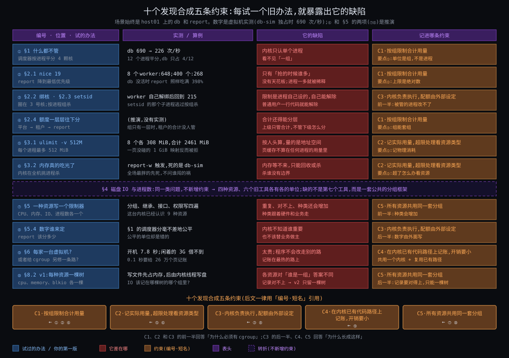

这张图就是全节的目录。左边是试过的办法(发现①~⑩),中间是实测,右边是这个办法的缺陷、以及这个发现记进哪条约束;最下面是十个发现合成的五条根约束。发现④是纯推演,§5 的两项(⑦⑧)是带着实测数字的推演,其余每个发现背后都有实跑。后文所有约束都用「编号·短名」引用,比如 `C1·按组限制合计用量`。

### §0.1 实验是怎么做的(先交代清楚)

场景还是上一节那台 `host01`:一个数据库,一个每晚起 8 个 worker 的报表任务 report。这一节所有数字都是在 Lima 虚拟机(4 核,内核 7.0)里实跑出来的;其中 §9.3、§9.4 和 §10.3、§10.4 换到了另一台同样镜像的专用实验机 cg-lab 上(原因见文末留档说明)。有三处和「真机上的真 mysqld」不一样,先说明白:

| 文中说的 | 实验里实际用的 | 为什么 |
|---|---|---|
| mysqld | 替身脚本 `db.py`(进程名 `db-sim`):4 个连接进程不停做「查询」,一次查询是一小段定量的纯计算,独占一颗核时约 5 ms;跑 8 秒,报告做了多少次、每次多久 | 要的是一个能稳定量出「被挤慢了多少」的东西 |
| report | 替身脚本 `report.py`(worker 进程名 `report-w`):`cpu` 模式每个 worker 死循环,`mem` 模式每个 worker 慢慢吃到指定大小的内存 | 同上 |
| 那台机器 | 一个叫 `host01` 的**沙箱组**:内存上限 3G,不限 CPU | 虚拟机上还跑着别的真服务(一个真的 mysqld、一个 clickhouse),不能真把整机内存打爆 |

第三行有点讽刺:为了演示「没有 cgroup 的世界」,我先用 cgroup 圈了一块地。做法是这样的:

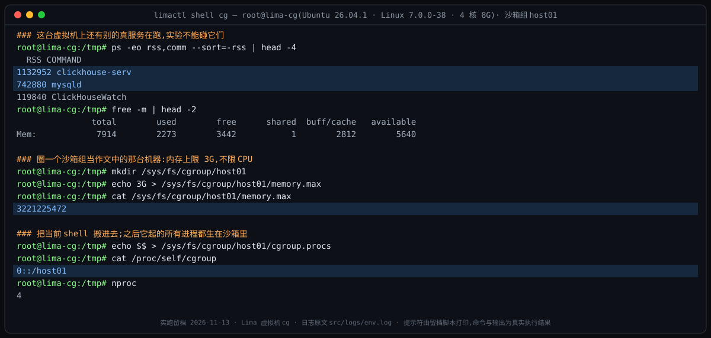

- **「没有 cgroup 的世界」= 沙箱里面不再分组。** db-sim 和 report 不分组,共用同一份资源:CPU 由调度器按进程分,内存见底时在全沙箱里挑人杀。这和一台没有分组的整机是同一种分法。
- **「有 cgroup 的世界」= 沙箱里再分 `db` 和 `report` 两个子组。** 留到 §9。
- 内存按比例缩小:把沙箱当成一台 4 核 3G 的小机器,db-sim 占 1500 MiB(相当于上一节那 4G 缓冲池),每个 worker 要 300 MiB。

图是「终端留档图」:实跑的输出原样存成日志(`stages/02-why/src/logs/`),再排成图,不是窗口截图;提示符那一行由留档脚本打印,命令和输出是真实执行结果。正文里的代码块是从日志里节选的(省略处用 …… 标出,个别行尾加了 ← 注释,报错行去掉了脚本行号),原样完整的输出以图和日志为准。全部实验脚本在 `stages/02-why/src/02-evidence-sessions.sh`,每个实验结束时沙箱里的进程一次杀光、目录删掉。

## §1 现场:什么都不管,数据库只剩三分之一

**结论:调度器很公平,但它是对「进程」公平。report 开 8 个进程就拿 8 份,db 的 4 个进程只剩 4/12。**

动手之前,你先什么都不做,看看内核原本是怎么分的。先让 db-sim 独占机器跑一遍,再让 report 起 8 个 worker 后跑一遍:

```
# python3 db.py
查询 5518 次(690 次/秒)  平均 5.8 ms  p99 7.7 ms
这段时间的 CPU:db-sim×4 合计 398%

# python3 report.py cpu 8 &
# python3 db.py
查询 1808 次(226 次/秒)  平均 17.7 ms  p99 25.9 ms
这段时间的 CPU:db-sim×4 合计 132%   report-w×8 合计 266%
```

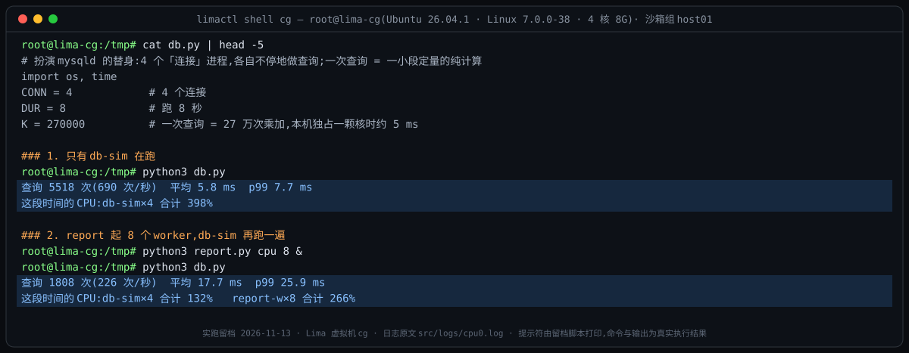

**算例。** 4 颗核一共 400% 的 CPU。现在有 12 个想跑的进程(db-sim 4 个 + report-w 8 个),调度器对它们一视同仁:

| | 进程数 | 应得 | 实测 |
|---|---|---|---|
| 每个进程 | 1 | 400% ÷ 12 = 33.3% | — |
| db-sim | 4 | 4 × 33.3% = 133% | 132% |
| report-w | 8 | 8 × 33.3% = 267% | 266% |
| db-sim 的吞吐 | — | 690 × 4/12 = 230 次/秒 | 226 次/秒 |
| 单次查询耗时 | — | 5.8 ms × 3 = 17.4 ms | 17.7 ms |

数字对得严丝合缝。问题不在调度器算错了,而在它数的单位:**它眼里没有「db」和「report」,只有 12 个进程。** report 的作者明天把 worker 改成 16 个,db 就只剩 4/20 = 20%。分给谁多少,取决于谁开的进程多。

拿第一节 §2 的合租公寓来比:这栋楼里每个电器都有自己的插座,但**没有分户电表**。谁家电器多,谁用的电就多,物业只看得见一个个电器,看不见「户」。

**发现①:单位错了。** 一个业务从来不是一个进程,而是一组数量会变的进程,开几个由应用自己定;内核原生只认单个进程。要管住一个业务,记账和设限的单位必须是「组」,管的是合计。(这是 `C1·按组限制合计用量` 的第一个要点,§2 末尾合成完整的一条。)

下一个问题:那给 report 降优先级不就行了?Linux 早就有 nice。

## §2 CPU 的旧工具:nice 和绑核

**结论:nice 能让 report 在抢的时候少拿,但给不出「最多多少」,而且权重按进程发,进程一多又被稀释回去;绑核有天花板,可最小一整颗核,被圈的进程自己一个系统调用就能出来;进程组和会话也一样,成员身份由进程自己申报。这几个发现,再加上「额度本身是一层层分下来的」,合成第一条根约束。**

### §2.1 nice:能压住 report,但有两个问题

**结论:nice 能让 report 在抢的时候少拿,但它给不出「最多多少」;而且它的权重也是按进程发的,进程一多又被稀释回去。**

nice 值从 -20 到 19,数值越大越「谦让」。内核把它换成权重:nice 0 的权重是 1024,nice 19 是 15。两个进程抢同一颗核时,按权重比例分时间。

把 report 降到 nice 19 再跑:

```
# nice -n 19 python3 report.py cpu 8 &
# python3 db.py
查询 5184 次(648 次/秒)  平均 6.2 ms  p99 10.2 ms
这段时间的 CPU:db-sim×4 合计 386%   report-w×8 合计 11%
```

**算例。** 每颗核上平均有 1 个 db-sim(权重 1024)和 2 个 report-w(权重各 15):

- db-sim 占 1024 ÷ (1024 + 2 × 15) = 97.2%,4 颗核合计 389%。实测 386%。
- report-w 合计 4 × 2.8% = 11.4%。实测 11%。

吞吐回到 648 次/秒,是独占时的 94%。到这里似乎解决了。但再往下试两步,就能看出两个问题:

```
### db-sim 没活的时候,nice 19 的 report 吃多少
# python3 cpuof.py 3
3 秒内的 CPU:report-w×8 合计 398%

### 还是 nice 19,但 report 这次起 400 个 worker
# nice -n 19 python3 report.py cpu 400 &
# python3 db.py
查询 2147 次(268 次/秒)  平均 14.9 ms  p99 24.4 ms
这段时间的 CPU:db-sim×4 合计 164%   report-w×400 合计 237%
```

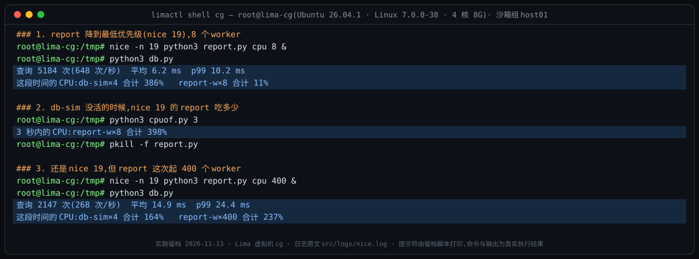

**问题一:没有天花板。** db 没活的时候,最低优先级的 report 照样吃满 4 颗核(398%)。nice 回答的是「两个人同时要的时候谁多」,回答不了「你最多拿多少」。你没法对任何人承诺「report 最多半颗核」。副作用已经看得见:即便只有 8 个 worker,db 的 p99 也从 7.7 ms 涨到了 10.2 ms —— 查询到来的那一刻,核上正跑着 report。

**问题二:人多就稀释。** 权重是发给每个进程的。400 个 worker 时,每颗核上是 1 个 db-sim 对 100 个 report-w:

- db-sim 占 1024 ÷ (1024 + 100 × 15) = 40.6%,合计 162%。实测 164%。
- 吞吐掉到 268 次/秒,只剩 39%。

nice 19 已经是最低一档,没有更低的了。report 只要多开进程,就能把让出去的再拿回来。这其实还是发现①的老毛病(单位是进程),只是表现在权重上。

另外,nice 只管 CPU,内存、磁盘它一概不管。

**发现②:说不出绝对数。** 相对权重只在有人抢的时候起作用,而且会被进程数稀释;要对别人做出承诺(「它最多半颗核」「它最多 512 MiB」),上限必须是一个不随对手多少、不随自己进程数变化的绝对数。(`C1·按组限制合计用量` 的第二个要点。)

下一个问题:要绝对的上限,把 report 关进一颗核里不就是了?

### §2.2 taskset 绑核:进程自己能解除

**结论:绑核是旧工具里唯一有「天花板」的,而且子进程会继承。但它最小只能圈一整颗核,更要命的是:被圈的进程自己一个系统调用就能出来。**

`taskset -c 3` 的意思是「这个进程只许在 3 号核上跑」,它 fork 出来的子进程也继承这条限制:

```
# taskset -c 3 python3 report.py cpu 8 &
# python3 db.py
查询 3890 次(486 次/秒)  平均 8.2 ms  p99 17.5 ms
这段时间的 CPU:db-sim×4 合计 298%   report-w×8 合计 100%
```

report 的 8 个 worker 合计正好 100%:不管开多少个,都挤在那一颗核里。这是第一次出现「合计的上限」。db-sim 拿到 298%,吞吐 486 次/秒(独占时的 70%;比 3/4 略低,因为 db-sim 的进程时不时也落到 3 号核上和 8 个 worker 抢)。

两个缺口:

**缺口一:最小单位是一整颗核。** 「半颗核」说不出来;而且圈走的是一颗具体的核,不是一份时间。

**缺口二:进程自己能解除绑定。** report 的作者是普通用户 `lima`,他在 worker 里加了一行:

```python
os.sched_setaffinity(0, range(os.cpu_count()))    # 把自己放回所有核
```

```
# runuser -u lima -- taskset -c 3 python3 report.py cpu 8 unpin &
worker 43076:sched_setaffinity 成功,允许的核从 [3] 变成 [0, 1, 2, 3]
# python3 db.py
查询 1719 次(215 次/秒)  平均 18.6 ms  p99 29.6 ms
这段时间的 CPU:db-sim×4 合计 134%   report-w×8 合计 263%
```

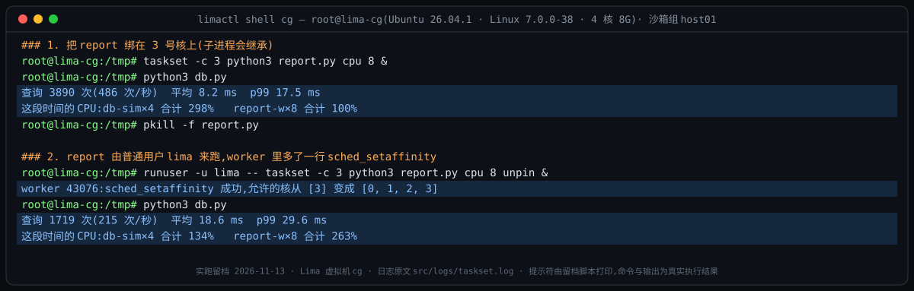

不需要任何特权,一行代码,回到 §1 的水平(215 次/秒)。进程修改自己的 CPU 亲和性本来就是允许的,这个接口是给程序做性能优化用的,不是给管理员做隔离用的。

### §2.3 现成的「组」也不行:进程组和会话

Unix 早就有两种把进程编成一组的办法:进程组(pgid)和会话(sid),`kill -- -<pgid>` 可以一次杀一组。能不能直接拿它们当「一组」的边界?

```
# setsid bash -c 'sleep 301 & sleep 302 & setsid sleep 303 & wait' &
# ps -o pid,ppid,pgid,sid,args -C sleep | grep -E 'PID|30[123]'
    PID    PPID    PGID     SID COMMAND
  43120   43118   43118   43118 sleep 301
  43121   43118   43118   43118 sleep 302
  43122   43118   43122   43122 sleep 303

# kill -- -43118
# ps -o pid,ppid,pgid,sid,args -C sleep | grep -E 'PID|30[123]'
    PID    PPID    PGID     SID COMMAND
  43122       1   43122   43122 sleep 303
```

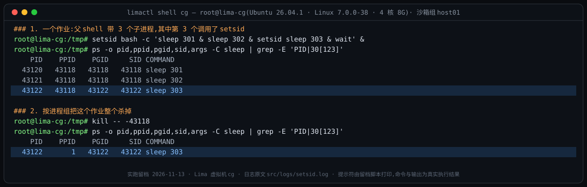

第三个子进程调用了 `setsid`,给自己换了一个新的会话和进程组(43122)。按组杀完,它还活着,父进程变成了 1 号进程。进程组和会话是为终端的作业控制设计的,**成员身份由进程自己申报**,想走随时能走。

三件东西(CPU 亲和性、进程组、会话)是同一个毛病:

**发现③:限制是进程自己设的。** 被限制的程序不是你写的,也未必配合。凡是进程自己能改的边界(亲和性、进程组、会话),都等于没有边界。「谁属于哪一组」和「这一组的上限是多少」,必须由内核强制,进程自己改不了。(这是 `C3·内核负责执行,配额由外部设定` 的前一半;后一半要等到 §5.4 你问出「数字谁来定」时才出现。)

第一节 §4.4 的结论在这里找到了出处:为什么子进程「生下来就在父进程的组里」、为什么 runc 要「先入组、后变身」—— 因为「属于哪个组」必须在被管的程序开始执行**之前**就定下来,而且之后它自己改不了。

### §2.4 再往外看一层:额度是一层层分下来的

**结论:你要管的「一组」,本身也常常是别人分出来的一份。report 的半颗核,是从某个更大的额度里分出来的;所以组得能套组,父组管住整棵子树的合计。**

这一项没有实验,是把「合计」再往外推一层。先看我们自己的实验:host01 就是一个组(§0.1 圈的那块 3G 沙箱),§9 还要在它里面再分 db 和 report。现实里也一样,host01 归一个容器平台管:

```
机器 4 核
└─ 平台拿走 3 核(留 1 核给系统自己)
   ├─ 租户 A:2 核
   │   ├─ report:0.5 核
   │   └─ api:1.5 核
   └─ 租户 B:1 核
```

平台只需要保证「租户 A 合计不超过 2 核」,A 内部怎么分给 report 和 api,是 A 自己的事,平台不想管也管不过来。反过来,A 无论怎么分,report + api 的合计都越不过 2 核。

如果组只有一层会怎样?平台手里只有 report 和 api 这两个叶子,要管住「A 合计不超过 2 核」,只能自己把 A 名下每个组的数加起来盯着;A 想把 report 从 0.5 调到 0.8、api 从 1.5 调到 1.2,也得回头找平台改。这又回到了 §1 的老毛病:**「合计」没有人管,只是被一个个分项凑出来的。**

**发现④:合计还要能往上套。** 资源的归属是分层的(机器 → 平台 → 租户 → 容器 → 容器里的服务)。上级只给下级一个合计的额度,下级怎么再分上级不管;但下级之和不能超过上级。所以组必须能套组,父组的上限约束整棵子树。(`C1·按组限制合计用量` 的第三个要点。它落到实处的样子是一棵目录树,见 §7.2。)

以上四个发现之后,第一条根约束成立:

> **C1·按组限制合计用量。** 管的单位是组,不是进程;上限是一个绝对数,不随对手多少、不随自己开几个进程变;组还能套组,父组管住整棵子树的合计。
>
> 它由三个要点合成:① 单位是组(§1,发现①);② 上限是绝对数(§2.1,发现②);③ 组能套组(§2.4,发现④)。
>
> 不可再分:开几个进程是应用的自由,内核无法预知也不能禁止;相对权重只能回答「谁多」,回答不了「最多多少」;上级管不了也不该管下级内部怎么分,但必须管住合计。

发现③记下的那半条(被管者改不了)先放着,它的另一半还没出现。

下一个问题:CPU 先放一放。内存这边有 ulimit,它限的可是硬邦邦的数字。

## §3 内存的旧工具:ulimit 和全机 OOM

**结论:ulimit 的数字是绝对的,但它按人头算,而且量错了东西:限的是地址空间,不是真占住的物理内存。内存真吃光时,内核只能杀;没有边界的时候,它在全场挑最胖的杀。用量要记在真实的消耗上,超了以后怎么办要看资源的性质:这是第二条根约束。**

### §3.1 ulimit:每人不超,合计撑爆

**结论:ulimit 的数字是绝对的,但它一按人头算、二量错了东西:限的是地址空间,不是真占住的物理内存。**

`ulimit -v 524288` 给之后启动的每个进程设一个上限:地址空间最多 512 MiB(单位是 KiB)。单个进程想要 600 MiB,立刻被拒:

```
# bash -c 'ulimit -v 524288; python3 -c "x = b\"x\" * (600 << 20)"'
MemoryError
```

同样的限制下,让 report 起 8 个 worker,每个要 300 MiB:

```
# bash -c 'ulimit -v 524288; python3 report.py mem 8 300' &
# ps -o pid,vsz,rss,comm -C report-w
    PID    VSZ   RSS COMMAND
  46031 325712 315132 report-w
  ……(8 行,每行都一样)
8 个 worker 合计占住 2461 MiB
```

**算例。** 每个 worker 的地址空间(VSZ)是 325 712 KiB ≈ 318 MiB,小于 512 MiB,**没有一个违规**。真占住的物理内存(RSS)每个 308 MiB,8 个合计 2461 MiB —— 是那个「512」的 4.8 倍,这台 3G 的小机器已经被吃掉八成。限额写的是 512,实际效果是 512 × 进程数。又是发现①:单位是进程。

第二个毛病更隐蔽:它量的东西不对。

```python
# vm.py
m = mmap.mmap(-1, 1 << 30)          # 向内核要 1 GiB 匿名内存,但一页都不去碰
```

```
# python3 vm.py
映射 1 GiB 成功;此刻真正占住的物理内存 VmRSS = 10 MiB
# bash -c 'ulimit -v 524288; python3 vm.py' 2>&1 | tail -1
OSError: [Errno 12] Cannot allocate memory
```

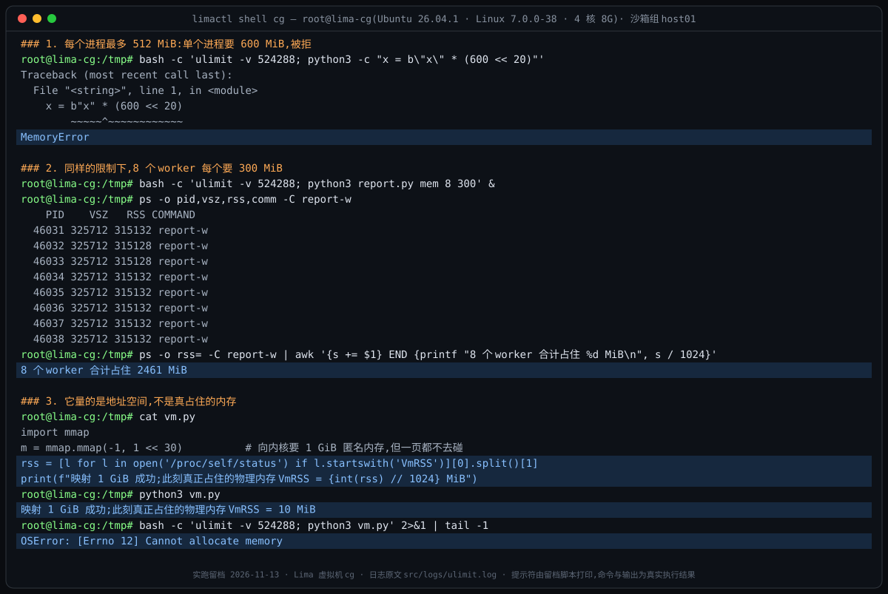

这个程序只「预订」了 1 GiB 地址空间,一页都没碰,真占住的物理内存只有 10 MiB,却被 ulimit 拦下了。地址空间不是稀缺资源(64 位进程有的是),物理内存才是。很多运行时(JVM、Go)启动时会预订一大片地址空间,`ulimit -v` 设小了它们起不来,设大了又什么都限不住。

那有没有按物理内存限的 ulimit?有一个 `RLIMIT_RSS`,但手册写得很直白:

> This limit has effect only in Linux 2.4.x, x < 30. —— [getrlimit(2)](https://man7.org/linux/man-pages/man2/getrlimit.2.html)

也就是说,在今天的 Linux 上,**根本没有「限制一个进程占多少物理内存」的 rlimit**。

还有一大类物理内存压根不算在任何进程的用量里:页缓存(读写文件时内核替你缓存的数据)。§4.1 会实测到:一个进程写了 1 GiB 文件就退出了,机器的缓存涨了 1 GiB,而这 1 GiB 不算在任何进程的 RSS 里。

**发现⑤:记录的对象选错了。** 稀缺的是物理内存页、真实跑掉的 CPU 时间、真实的磁盘带宽,不是地址空间这类「预订量」。而且有相当一部分物理消耗(页缓存、内核替进程占的内存)不挂在任何进程名下。要管得住,用量必须在物理资源真正被占用的那一刻记,并且记到「一组」名下。(这是 `C2·记实际用量,超限处理看资源类型` 的第一个要点。)

下一个问题:限不住就限不住吧,内存真吃光了,内核总有办法。它的办法是什么?

### §3.2 内存吃光的那一刻:闯祸的是报表,死的是数据库

**结论:内存和 CPU 不一样,不够了等不来,到头只能杀进程。没有边界的时候,内核在全场挑最胖的那个杀 —— 最胖的往往正是数据库。**

db-sim 先占住 1500 MiB(扮演 mysqld 的缓冲池),然后 report 起 8 个 worker,每个慢慢吃到 300 MiB:

```
# python3 hold.py db-sim 1500 &
db-sim(pid 46097)已占住 1500 MiB
# python3 report.py mem 8 300 &

# journalctl -k --since 18:41:24 -o cat --no-pager | grep -E 'invoked oom-killer|oom-kill:|Killed process'
report-w invoked oom-killer: gfp_mask=0xcc0(GFP_KERNEL), order=0, oom_score_adj=0
Memory cgroup out of memory: Killed process 46097 (db-sim) total-vm:1555400kB, anon-rss:1540552kB, ……

# ps -o pid,rss,comm -C db-sim,report-w
(只剩 7 个 report-w,db-sim 不在了)
# wait 46097; echo …
db-sim 的退出状态 = 137(137 = 128 + 9,被 SIGKILL 杀死)
```

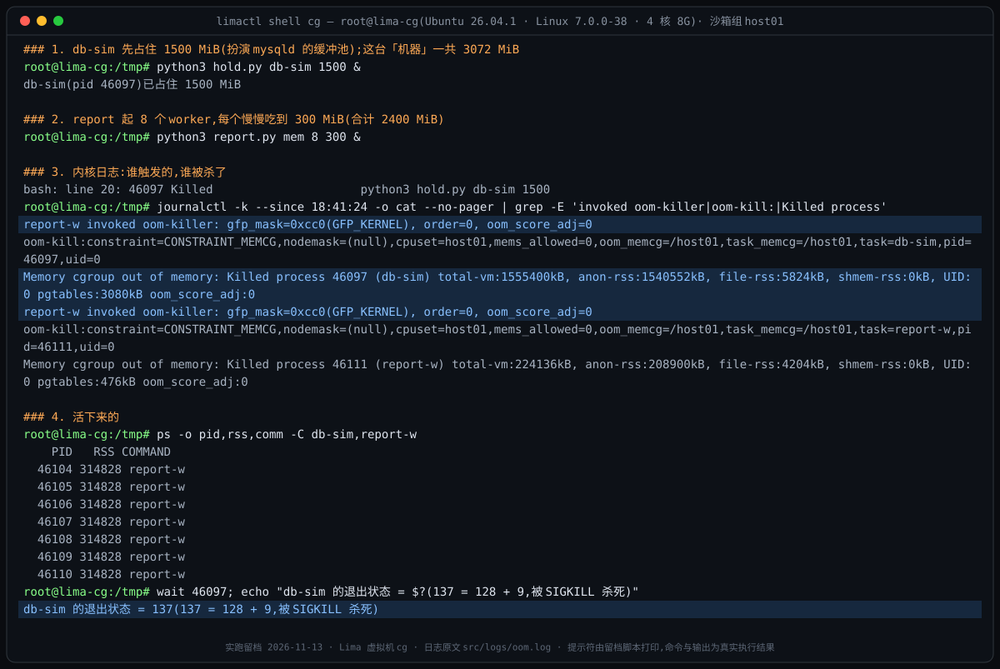

日志的头两行把事情说完了:**`report-w invoked oom-killer`(report 的 worker 触发的),`Killed process 46097 (db-sim)`(被杀的是数据库)。**

**算例。** 机器 3072 MiB,db-sim 占 1500 MiB,8 个 worker 各吃到 w:

- 1500 + 8 × w = 3072,解得 w ≈ 196 MiB 时见底。日志里 worker 被杀时的 `anon-rss` 是 208 900 KiB ≈ 204 MiB,对得上。
- 此刻全场最胖的是 db-sim(1504 MiB),是任何一个 worker(约 200 MiB)的 7 倍多。内核挑的是「杀掉它能腾出最多内存」的那个,于是 db-sim 第一个死。

**为什么只能杀。** CPU 是可以排队的资源:不够了让人等一等,慢,但不死;下一个时间片又有新的 CPU 时间。内存不是:已经发出去的页,主人不还,内核收不回来。内核能做的只有两件事 —— 先回收(扔掉可以重读的页缓存;有 swap 的话把匿名页换出去),回收不动就杀。这台机器没有 swap,匿名内存无处可去,第二件事来得很快。

内存也没法像 fork 那样「拒绝」。§3.1 的 `vm.py` 已经说明了这一点:向内核要 1 GiB 时只是预订,真占物理页是在程序第一次碰到这一页的时候,那是一条普通的内存写入,没有返回值可以报错。所以内存超了,剩下的路只有回收和杀。

**能不能让 mysqld 不被杀?** 可以,`oom_score_adj` 设成 -1000 就不会被选中。但这只改变「杀谁」的排序,不改变「report 能吃多少」:机器照样被吃光,只是换成另一个进程被杀(下一个最胖的)。而且它又是一个设在单个进程上的设置。

两点如实交代:

1. **这是沙箱里的 OOM。** 日志写的是 `Memory cgroup out of memory`,约束类型是 `CONSTRAINT_MEMCG`、范围是 `oom_memcg=/host01`,因为我把沙箱当成了整台机器。真机上内存见底时,日志是 `Out of memory: Killed process …`。两种情况挑人的规则是同一套(都是在范围内找最胖的),这一点的源码确认留到后面(待核 #2)。
2. **还多杀了一个。** 图里能看到,db-sim 之后紧接着又有一个 report-w(pid 46111,约 204 MiB)被杀。按算例,db-sim 腾出 1.5G 之后内存是够的,不该再杀。我跑了三遍,db-sim 每次都是第一个死,之后又分别多杀了 1 个、3 个、1 个 worker(前两遍 worker 吃得更快,每 50 ms 吃 10 MiB,其中第二遍的日志留在 `stages/02-why/src/logs/oom-fast.log`;正文和图用的是第三遍,每 200 ms 吃 10 MiB)。为什么会多杀,我还没查清,不替它编理由,留到讲内存这条线的源码时回答(待核 #1)。

超了以后「怎么办」这件事,CPU 和内存的答案完全不同。因为内存等不来也拒绝不了、CPU 等一等就有 → 要解决「超限之后的动作因资源而异」→ 所以把这个动作叫作**超限处理**:CPU 的超限处理是等,内存的超限处理是先回收、回收不动就杀;§4.2 和 §9.4 会看到第三种,进程数的超限处理是拒绝。

**发现⑥:超限处理要看资源,而且杀的范围要有边界。** CPU 不够可以让人等,内存不够等不来:占了不还,回收不动就只能杀进程。既然到头总要有人死,「在哪个范围里挑人」就必须有边界:谁那一组超了,就在谁那一组里回收、在谁那一组里杀。(`C2·记实际用量,超限处理看资源类型` 的第二个要点。)

这两个发现合起来,第二条根约束成立:

> **C2·记实际用量,超限处理看资源类型。** 用量记在真正被占用的物理资源上:物理页、真实跑掉的 CPU 时间、真实的磁盘 IO,在占用的那一刻记到组名下。超了以后怎么处理,由资源的性质决定:会再生的(CPU 时间、IO 带宽)让它等,能拒绝的(进程数)拒绝,内存既等不来也拒绝不了,只能先回收、回收不动就在超限的那一组里杀。
>
> 它由两个要点合成:① 记真实消耗(§3.1,发现⑤);② 按资源特性决定超限处理(§3.2,发现⑥)。
>
> 不可再分:地址空间这类预订量不稀缺,物理资源才稀缺,页缓存这类消耗不挂在任何进程名下;CPU 时间每个周期都有新的,物理页占了不还就没有。

这就是你带来的第二个问题的另一半:容器 OOM 为什么只杀容器里的进程。不是内核的规则变宽松了,而是挑人的范围从「全机」换成了「超限的那一组」。§9.2 会把同一出戏放进组里再演一遍。

## §4 磁盘和进程数:同一类问题

**结论:换成磁盘和进程数,问题一模一样:用量记在了错误的对象上,或者根本没有记录。这两种资源各举一个例子。把四种资源、六把旧工具摆在一起看,会发现一件更重要的事:每一把都只管一种资源,各自定义了一遍「对谁生效」。缺的不是第七个工具,而是一套所有资源共用的分组框架。**

### §4.1 磁盘 IO:发出磁盘 IO 的不是弄脏内存的进程

让 report 写一个 1 GiB 的临时文件,并且用 `ionice -c 3` 给它最低的 IO 优先级:

```
# grep ^Cached: /proc/meminfo
Cached:          2605832 kB
# ionice -c 3 dd if=/dev/zero of=/var/tmp/report.tmp bs=1M count=1024 2>&1 | tail -1
1073741824 bytes (1.1 GB, 1.0 GiB) copied, 0.100223 s, 11 GB/s
# grep ^Cached: /proc/meminfo
Cached:          3654444 kB

### 同样的写,但要求 dd 等数据真正落到盘上再返回
# ionice -c 3 dd if=/dev/zero of=/var/tmp/report.tmp bs=1M count=1024 conv=fsync 2>&1 | tail -1
1073741824 bytes (1.1 GB, 1.0 GiB) copied, 0.608359 s, 1.8 GB/s
```

**算例。**

- 第一次:0.10 秒写完 1 GiB,速度 11 GB/s,比这块盘快得多(第二次量出来是 1.8 GB/s)。因为这 0.10 秒里 dd 只是把数据拷进了内核的页缓存,然后就退出了。
- 缓存涨了 3 654 444 − 2 605 832 = 1 048 612 KiB ≈ 1024 MiB,正好是那个文件。**这 1 GiB 物理内存不在任何进程的 RSS 里**(dd 已经不在了),这就是发现⑤说的那一类消耗。
- 真正落盘要 0.61 秒。少掉的那 0.5 秒的活,是内核的回写线程在 dd 退出之后替它干的。

所以给 dd 设 IO 优先级意义不大,手册说得很明白:

> I/O priorities are not supported for asynchronous writes because they are issued outside the context of the program dirtying the memory. —— [ioprio_set(2)](https://man7.org/linux/man-pages/man2/ioprio_set.2.html)

弄脏内存的是 report,发出磁盘 IO 的是内核线程。**弄脏内存的进程和发出磁盘 IO 的内核线程不是同一个。** 这件事先记着:§5.2 你会在自己的第一版里遇到它,§8.2 v1 也栽在这里。

### §4.2 进程数:数的是「这个用户」,而且 root 不算

怕 report 无限 fork,可以用 `ulimit -u` 限进程数。限成 30 试试:

```
# ps -L -u lima --no-headers | wc -l
3
# runuser -u lima -- bash -c 'ulimit -u 30; python3 forkn.py 100'
第 26 次 fork 失败:[Errno 11] Resource temporarily unavailable
想要 100 个子进程,成功 fork 出 25 个

### 同样的限制,换成 root(容器里的进程常常就是 root)
# bash -c 'ulimit -u 30; python3 forkn.py 100'
想要 100 个子进程,成功 fork 出 100 个
```

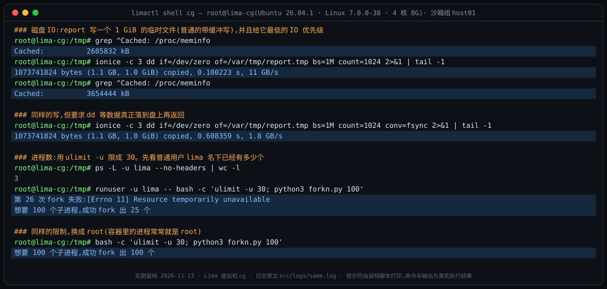

- 普通用户:限 30,只 fork 出 25 个。因为它数的是 **`lima` 这个用户名下的全部进程**(原有的几个也算在内),不是「report 这个作业」。同一个用户跑两个业务,它们共用这一个数。
- root:100 个全部成功。手册原话是该限制对有 `CAP_SYS_ADMIN` / `CAP_SYS_RESOURCE` 能力或真实用户为 0 的进程不生效([getrlimit(2)](https://man7.org/linux/man-pages/man2/getrlimit.2.html))。而服务和容器里的进程,常常就是 root。
- 超了的那一次 fork 直接返回错误(`Errno 11`),没有谁被杀。这就是第三种超限处理:拒绝。

这两个例子没有带来新的发现,是前面几个发现在别的资源上重演:单位不对(`C1·按组限制合计用量`)、被管者能绕过(发现③记下的那半条)、用量记不到真正的消耗上(`C2·记实际用量,超限处理看资源类型`)。

### §4.3 四种资源、六把旧工具,摆在一起看

| 资源 | 旧工具 | 以什么为单位 | 它的缺陷 | 实测 |
|---|---|---|---|---|
| CPU | nice | 进程(权重发给每个进程) | 没有天花板;进程一多就被稀释 | 闲时 report 398%;400 个 worker 时 db 268 次/秒 |
| CPU | taskset 绑核 | 进程(子进程继承,但自己能改) | 最小一整颗核;自己能解绑 | 解绑后 db 回到 215 次/秒 |
| (圈人用) | 进程组 / 会话 | 会话 | 成员身份由进程自己申报 | `setsid` 的 `sleep 303` 逃过按组杀 |
| 内存 | `ulimit -v` | 进程 | 按人头;量的是地址空间 | 合计 2461 MiB;没碰的 1 GiB 被拒 |
| 内存 | 内存吃光时的 OOM | 全机 | 在全场挑最胖的杀,不问谁闯的祸 | report 触发,db-sim 被杀 |
| 磁盘 IO | ionice | 进程(发 IO 的那个) | 带缓冲的写由内核线程发,管不到 | 0.10 秒写完 1 GiB,落盘要 0.61 秒 |
| 进程数 | `ulimit -u` | 用户 | 同一用户的业务共用一个数;root 不算 | 普通用户 25 个,root 100 个 |

单位一栏有进程、用户、会话、全机四种,没有一种是「业务」。再看第二栏:每一把工具都是只管一种资源的专用工具,各自从头定义了一遍「对谁生效、怎么设、谁能改」。nice 和 ionice 都管优先级,可一个认线程、一个认发 IO 的人;`ulimit -v` 和 `ulimit -u` 同一个命令,一个按进程数、一个按用户数。

这是这一节的转折点。前面的发现告诉你**每种资源都要按组管**;这张表告诉你,**如果你照旧工具的路子,每种资源各补一个「按组管」的工具,就会得到四套各说各话的「组」**。缺的不是第七个工具,而是一套公共的分组框架:先由一个地方说清楚「谁和谁是一组」,再让每种资源在这个组上记账。

下一个问题:道理是这样,可你真动手时,第一反应多半还是一种资源写一个。那就写写看。

## §5 你的第一版:一种资源写一个限制器

**结论:最顺手的做法是一种资源写一个限制器。可是每个限制器都得自己做一遍分组、继承、接口和权限,四种资源就是四遍,四套分组还互相对不上,而要管的资源种类还在增加。于是你把这几件和资源无关的事抽出来,做成公共的一层(核心),每种资源只写自己的记账和超限处理(控制器)。再往下问一句「数字谁来定」,答案是内核定不了:它只负责兑现,数字由外面的管理程序写进文件。**

这一节整节是推演,不是 cgroup 的真实来历。真实世界里第一次做出来的成品是 §7.2 的 v1;这里先让你自己走一遍弯路,看清楚那套公共分组框架为什么非抽出来不可。

### §5.1 先给 CPU 写一个:要做五件事

§1 最痛,就从 CPU 开始。你要的效果很具体:report 的所有进程合计每 100 ms 最多跑 50 ms,开多少个 worker 都一样。动手一列,要做的事有五件,真正和 CPU 有关的只有最后一件:

| # | 要做的事 | 为什么非做不可 | 在 CPU 限制器里的样子 |
|---|---|---|---|
| 1 | 分组 | 按组限制合计用量(`C1·按组限制合计用量`) | 内核里多一种「CPU 组」对象;每个进程身上多一个标记:「我属于哪个 CPU 组」 |
| 2 | 继承 | report 随时 fork 新 worker;新 worker 要是生在组外,组就漏了 | fork 时子进程抄走父进程的那个标记 |
| 3 | 接口 | 管理员要能建组、把进程放进组、写上限 | 新加几个系统调用,或者几个特殊文件 |
| 4 | 权限 | 进程自己不能改归属和上限(§2.2、§2.3 的发现③) | 只有管理员能挪进程、改上限 |
| 5 | 记账和设限 | 这才是 CPU 自己的事 | 在调度器结算运行时间的地方,把这段时间记到组上;到 50 ms 就让整组停到下个周期 |

落到 report 的一个 worker 身上:它出生时(fork),限制器要介入,把 CPU 组的标记抄给它;它跑 CPU 时,限制器在调度器那里记账;它退出时,限制器把它从组的名单上摘掉。这三处都得改内核。

写完试一下,§1 的问题解决了:8 个还是 400 个 worker,合计都是 50 ms。到这一步一切顺利。

### §5.2 再写内存、IO、进程数:同样的四件事重做三遍

接着写内存限制器。第 1 ~ 4 件事一模一样:内存组、fork 时抄内存组的标记、一套接口、一套权限。只有第 5 件不同:在分配物理页的地方记账,到上限先回收、回收不动就杀。再写 IO 和进程数,还是一样。四个限制器摆在一起:

| 要做的事 | CPU | 内存 | 磁盘 IO | 进程数 |
|---|---|---|---|---|
| 分组 | CPU 组 | 内存组 | IO 组 | 进程数组 |
| 继承 | fork 时抄 CPU 组 | fork 时抄内存组 | fork 时抄 IO 组 | fork 时抄进程数组 |
| 接口 | 一套 | 又一套 | 再一套 | 再一套 |
| 权限 | 一套 | 又一套 | 再一套 | 再一套 |
| 在哪条路上记账 | 调度器结算运行时间 | 分配物理页 | 提交 IO 请求 | fork |
| 上限的单位 | 微秒 / 周期 | 字节 | 字节 / 秒 | 个数 |
| 超了怎么处理 | 等到下个周期 | 先回收,收不动就杀 | 排队 | 这次 fork 失败 |

上面四行,同一件事写了四遍;下面三行,才是每种资源真正不同的地方(最后一行就是 §3.2 起名的「超限处理」)。写到这里,你遇到了三个难点。

**难点一:重复。** 同一套分组、继承、接口、权限写四遍。worker 每 fork 一次,内核要依次跑四段「抄标记」;每个进程身上挂四个标记。四套接口各有各的写法,管理员要学四遍。这正是 §4.3 那张表里旧工具的样子,你只是把「按进程」换成了「按组」,换了四次。

**难点二:对不上。** 管理员要把 report 放进组,得在四个地方各放一次。四次之间 report 要是 fork 了一个 worker,这个 worker 可能已经在新的 CPU 组、却还留在旧的内存组。更麻烦的是 §4.1 那件事:report 弄脏的页由内核线程写盘,IO 限制器要知道「这些页是哪个组的」,可那是内存限制器的记录,用的是另一套分组。四套分组各说各的,一笔跨资源的开销就没法记到同一个组名下。(这件事 §8.2 还会出现,而且问题更严重。)

**难点三:种类还会增加。** 四种不是终点。第一节 §3 实测过,这台内核今天认识 9 种:`cpuset cpu io memory hugetlb pids rdma misc dmem`,比你开头想到的多一倍还多。名字里看得出,有的管内存的一个特殊品种(hugetlb,大页),有的管网卡、显卡这类设备上的资源(rdma、dmem)。资源种类跟着硬件和业务走,你事先列不完。照这个写法,每来一种就再抄一遍分组。

拿第一节的合租公寓来比:水务公司来分一次户,电力公司再来分一次,燃气公司又来一次,三家各有一本户口簿。张家上个月从 302 搬到 305,水务的簿子改了,电力的还没改,这个月的电费就记错了人。

**发现⑦:资源不止一种,而且还会越来越多。** 每种资源各管一套分组,做一遍是重复,做四遍就对不上,到第九种、第十种还会继续增加。新增一种资源,不能把分组再做一遍,也不能惊动已有的那几种。(这是 `C5·所有资源共用同一套分组` 的前一半。后一半「记录要对得上」在难点二已经出现,到 §8.2 才作为单独的发现提出。)

### §5.3 把公共的一层抽出来:核心和控制器

因为发现⑦(`C5·所有资源共用同一套分组` 的前一半)→ 要解决「分组只做一遍,新资源随时能加,加的时候不动别人」→ 所以把 §5.2 表里上面四行抽出来,做成所有资源共用的一层,叫**核心**:它管谁和谁一组、fork 时怎么继承、管理员从哪里操作、谁有权操作,以及组怎么套组(§2.4)。下面三行留给每种资源自己,做成一个个插件,叫**控制器**(第一节已经见过这个词;v1 里叫子系统):它只管在哪条路上记账、上限用什么单位、超了怎么处理。

| | 核心(只有一份) | 控制器(每种资源一个) |
|---|---|---|
| 管什么 | 分组、继承、接口、权限、组套组 | 在哪条路上记账、上限的单位、超了怎么处理 |
| 认不认识 CPU、内存 | 不认识 | 只认识自己那一种 |
| 加一种新资源时 | 不动 | 新写一个 |
| 没有它会坏在哪 | 每种资源各做一遍分组,四套对不上(§5.2 难点一、难点二) | 核心得认识每种资源,每加一种就得改核心(§5.2 难点三) |
| 它解决了 | 一份分组,所有资源共用 | 新资源 = 新插件,核心和别的插件都不用动 |

worker 的一生在新设计里变成这样:它出生时,核心抄一次「属于哪个组」,不管有几种资源;它跑 CPU 时,cpu 控制器记账;它要内存时,memory 控制器记账。核心不知道它在吃 CPU 还是内存,控制器不用操心它属于哪个组,问核心就行。

**所以这套设计是:公共框架加资源插件。** 公共的那一层只管「谁和谁一组」,不知道 CPU、内存是什么;每种资源是一个插件。

这句话在成品上看得见。第一节 §3 那个组目录里,文件名的前缀就是控制器名:`cpu.max` 归 cpu,`memory.max` 归 memory;`cgroup.` 开头的(比如 `cgroup.procs`,成员名单)不属于任何一种资源,归核心。§8.1 挂 v1 的命令 `mount -t cgroup -o freezer` 也是同一个意思:先有一套核心,挂载时再选插哪个插件。核心在内核里怎么认识一个新插件,第三节 §2 会逐个打开控制器给你看。

拿数据库比:这和 MySQL 的 server 层加存储引擎是同一个形状:server 层管连接、权限、解析 SQL,不认识 B+ 树;InnoDB 是一个插件,只管数据怎么存。写一个新存储引擎,不用重写连接和权限。有一处不同要先记下:MySQL 里一张表只用一个引擎;cgroup 里一个组同时被所有打开的控制器管着,CPU、内存、IO 的用量都记在同一个组上。所以 cgroup 的插件之间还得对得上「谁是一组」,这一点到 §8 会变成大问题。

### §5.4 再问一句:数字谁来定

公共框架有了,还差一个数:report 该分多少?半颗核还是一颗?512 MiB 还是 2 GiB?

先想内核能不能自己定。它手里有的信息是每个进程跑了多久、占了多少页。它不知道 db 是线上交易、report 是夜里的报表,也不知道今晚要一份加急的报表、report 该优先。§1 已经给过一个现成的例子:调度器内置的规矩是「每个进程一样多」,它分毫不差地兑现了(db-sim 应得 133%,实测 132%),结果恰恰是错的。内核越替业务做主,越容易做错,而且错了你还改不动,要改内核。

所以分工是:内核只负责兑现,数字由外面写进来。写数字的是管理程序:systemd 给每个服务建组、写数;docker 把 `--cpus=0.5` 换算成 `50000 100000`;Kubernetes 把 Pod 的 limits 一层层往下传。第一节 §4 从一条 docker 命令倒推过一遍:五站接力,终点是往一个文件里写一个数,内核看到的只有那个数。

接口做成文件,也是这个分工决定的:

- 写数字的是各式各样的管理程序(systemd、docker、kubelet,也可能是一个 shell 脚本)。文件谁都会写,不用为每个管理程序准备一套系统调用。
- 谁能写哪个组的数,用文件的主人和权限位就能管。§9.5 里普通用户想改自己组的 `cpu.max`,得到的是 `Permission denied`。
- 新加一个控制器,就是在组目录里多几个带它前缀的文件,核心和别的控制器不用动(§5.3)。

**发现⑧:内核不知道谁该分多少。** 哪个业务重要、该给多少,是业务上的事,而且随时会变;内核无从判断,也不该替业务做主。它要做的是另一半:数字一旦写进来,被管的进程就改不了、绕不过(发现③)。(这是 `C3·内核负责执行,配额由外部设定` 的后一半。)

**所以内核只负责执行,数字由外面写。** 接口是文件;谁该分多少由管理程序决定,内核只负责兑现。

拿数据库比:MySQL 提供 `GRANT` 这套机制,哪个账号能读哪张表,是 DBA 写进去的,MySQL 不会替你决定。

发现③和发现⑧合起来,第三条根约束成立:

> **C3·内核负责执行,配额由外部设定。** 「谁属于哪一组」和「这一组的上限是多少」,被管的进程自己改不了,由内核强制;但「谁该分多少」内核不知道也不该知道,由管理程序(systemd、docker 之类)写进文件,内核只负责兑现。
>
> 它由两个要点合成:① 被管的进程改不了(§2.2、§2.3,发现③);② 数字由外面写(§5.4,发现⑧)。
>
> 不可再分:边界能被进程自己改,就不存在边界;哪个业务重要是业务上的事,内核无从判断。

### §5.5 小结:第一版留下了什么

| 你的第一版里多出来的东西 | 没有它会坏在哪 | 它解决了 | 由哪几个发现得出 |
|---|---|---|---|
| 核心(分组、继承、接口、权限、组套组,只做一遍) | 每种资源各做一遍分组;四套分组对不上;第五种、第九种还要再做 | 所有资源共用一份分组 | 发现⑦(`C5·所有资源共用同一套分组` 的前一半) |
| 控制器(每种资源一个插件,只管记账、单位、超限处理) | 核心得认识每种资源,加一种资源就得改核心 | 新资源 = 新插件,不惊动别人 | 发现⑦;超限处理各不相同来自 `C2·记实际用量,超限处理看资源类型` |
| 文件接口,数字由管理程序写 | 内核替业务定数字,定错了还改不动;每个管理程序各要一套系统调用 | 内核只兑现;谁能改由文件权限管 | 发现③、发现⑧(`C3·内核负责执行,配额由外部设定`) |

下一个问题:公共框架设计好了,可它放在哪?一种办法是干脆别挤在一个内核里:每家一台虚拟机,连这套公共框架都省了。

## §6 这套框架放在哪:每家一个内核,还是共用一个

**结论:每家一个内核(虚拟机)隔得住,但它是让每家各用一整台机器来解决「几个业务共用一台机器」的问题,闲着的资源互相借不到。共用一个内核,又不能让被管的程序绕开记账去申请资源。剩下的只有一条:在内核本来就要走的路径上多做一步记账。这一步在最频繁执行的路径上,开销必须小,没人设限时最好根本不执行。**

### §6.1 每家一个内核:虚拟机

最彻底的放法是别挤在一个内核里:db 一台虚拟机,report 一台。虚拟机确实能隔住:report 在自己的虚拟机里怎么 fork、怎么吃内存,都只能祸害自己那台。连 §5 那套公共框架都省了,每家的内核只管自己。

代价用 host01 算一下(4 核 8G):

| | 切成两台虚拟机 | 同一个内核里分组 |
|---|---|---|
| 内存怎么分 | db 虚拟机 5G + report 虚拟机 3G,各自预留 | 只写上限;没用到的谁都能用 |
| report 一天只跑 1 小时 | 其余 23 小时它那 3G 闲着,db 借不到 | 其余 23 小时 8G 都可以给 db 当缓存 |
| 固定开销 | 每台各一套内核和系统服务;同一个库文件、同一份数据在两台里各缓存一份 | 一套内核,一份缓存 |
| 起一个业务 | 开机:我们这台 Lima 虚拟机实测 7.8 秒(内核 0.13 + initrd 1.27 + 用户态 6.43,`stages/02-why/src/logs/00-vm-boot.log`) | 起一个进程:毫秒级 |
| 调上限 | 多半要停机改配置 | 往文件里写一个数,立即生效 |

而且虚拟机里面还是同一个问题:db 那台虚拟机里又跑了备份任务,备份把 mysqld 挤慢了怎么办?再套一层虚拟机?

所以方向只能是:**在同一个内核里,让内核自己认得「组」。** 拿合租公寓比:一家一栋独栋当然清净,可一栋楼的钱只够盖一栋。

### §6.2 共用一个内核,但给 cgroup 另建一条检查路径?

共用一个内核之后,下一个念头是让 cgroup 单独走一条路径:进程要 CPU、要内存之前,先来问 cgroup「我还能要吗」,cgroup 批了,再去找调度器和内存管理。听上去清楚,但有两个问题。

**问题一:被管的程序不会配合。** 如果「先来问」要靠程序自己调用一个新接口,report 不调就是了。发现③说得明白:被限制的程序不是你写的,靠它自觉等于没有边界。

**问题二:就算内核替它去问,也要多走一段路径。** 物理页是在缺页的那一刻分出去的,CPU 时间是在调度器那里结算的,这两件事本来就在那两条路上发生。另建一条路径,等于每次都要离开原路径、问完再回来。算一下这条路径执行得有多频繁:§4.1 的 dd 0.10 秒往页缓存写了 1 GiB,也就是 262 144 个 4 KiB 的页,折合每秒 262 万页;每页多走一趟,这笔开销所有进程都要付,包括根本没人限的 db。

### §6.3 只剩一条路:复用内核已有路径记账

因为 §6.1(只能共用一个内核)和 §6.2(不能另建一条路径)→ 要解决「用量在资源真正被消耗的那一刻记上,又不让任何人绕开」→ 所以采用**复用内核已有路径记账**的做法:cgroup 不新建执行路径,只在内核已有的路径上多做一步。worker 一生要走的路,第一节 §6 点过名:

| worker 的一生 | 内核本来就要走的路径 | 多做的一步 |
|---|---|---|
| 出生 | fork | 子进程跟着父进程进组;进程数加一,超了就拒绝 |
| 跑 CPU | 调度器结算运行时间 | 把这段时间记到组上;额度用完就让整组停 |
| 要内存 | 缺页时分配物理页 | 把这一页记到组上;到上限先回收,收不动就杀 |
| 写盘 | 提交 IO 请求 | 把这笔 IO 记到组上;超速就排队 |
| 退出 | 进程退出 | 把它从组的名单上摘掉;进程数减一 |

这些位置,第三节叫它们「接入点」,每一个都会实测并贴出内核的调用栈。

复用已有路径解决了多走一趟的问题,但留下一个硬要求:这一步就落在最频繁执行的路径上。还是 §6.2 那个数,每秒 262 万页,每一页都要问一句「记在哪个组名下、这个组超了没有」;CPU 那边,每次调度结算也都要问一遍。所以两件事必须做到:

1. **这一步的开销必须小到几乎可以忽略。** 开销一大,机器上所有进程都会跟着变慢。怎么做到的,是第三节的内容。
2. **没人设限的时候,这一步最好根本不执行。** db 没人限,不该因为 report 的限额而变慢。第三节 §4 会实测:两个组都没写 `cpu.max` 时,1 秒里「给某个组记 CPU 用量」一次都没发生;只给 report 写上限之后,1 秒 544 次,全记在 report 组上。(第三节同一小节后来还补量了另外两条路:IO 和 CPU 一样,不设限就不执行;内存不一样,只要组开了 memory 控制器,设不设限每页都记,它的便宜靠的是批量。所以这句话对内存要打个折扣。)

拿数据库比:MySQL 在执行 SQL 的路上顺手累加 `Rows_examined`,不是另起一个线程去数每条 SQL 读了几行。

第一节留下的那个问题「每跑一微秒就加一次吗?那得多慢」,就是从这里来的。

**发现⑨:只能在内核已有路径上记账。** 一个业务一台虚拟机,等于每份都预留、每份都带一套内核,闲置的资源互相借不到;共用一个内核,又不能让程序绕开记账。剩下的只有在原路径上多做一步,而这一步在最频繁执行的路径上。

**所以是复用内核已有路径记账。** 不给内核另建一条路径;记账点放在内核本来就要走的路径上;没人设限时这一步不执行。

第四条根约束成立:

> **C4·在内核已有代码路径上记账,开销要小。** 所有业务共用一个内核,由内核在内部区分「这是谁的」;cgroup 不另建执行路径,记账点只能放在内核本来就要走的路径上(fork、调度器结算、缺页、提交 IO),这一步开销必须小,没人设限时几乎没有开销。
>
> 它由两个要点合成:① 共用一个内核(§6.1);② 复用已有路径记账(§6.2、§6.3)。两个要点来自同一个发现(发现⑨)。
>
> 不可再分:每家一个内核,预留出去的资源无法互借;记账在最频繁执行的路径上,开销一大,所有程序都会变慢。

下一个问题:放在哪定了。用量一笔笔记下来以后,谁来检查它超没超?

## §7 核心想法:组籍、用量记录、限额,以及树

**结论:把记账和限额从进程身上挪到「组」上。进程只带一个组籍(记录它属于哪个组的指针),生下来就继承父进程的;每次真正消耗资源时顺手记到组的用量上,记的那一刻顺手和限额比一下,超了就地做超限处理,不安排专门的线程巡查。组还要能套组,第一版成品 v1 把它做成了一棵目录树。**

### §7.1 一个想法

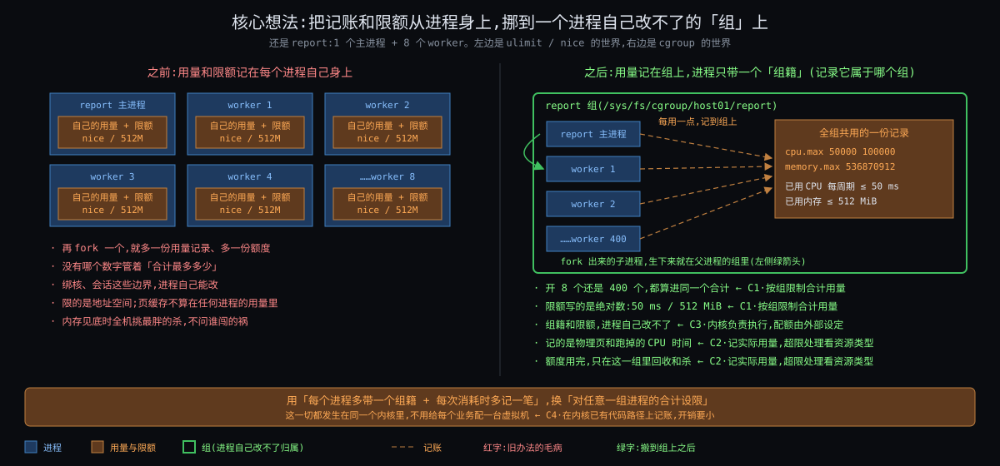

可以写成一句「用 X 换 Y」:

> **用「每个进程多带一个组籍 + 每次消耗资源时多记一笔」,换「对任意一组进程的合计设限」。**

先说组籍。因为 `C1·按组限制合计用量` 和 `C3·内核负责执行,配额由外部设定` → 要解决「内核在任何时刻都能从一个进程一步找到它在每种资源上的组,而且这个归属进程自己改不了」;又因为 §5.3 的分工(核心管分组,每种资源一个控制器)→ 所以引入**组籍**:每个进程身上一个指针,指向一份记录(内核里叫 `css_set`),记录里每个控制器一栏,写着「这种资源对应哪个组」。§5.2 那四个限制器的四个标记,在这里合成了一份记录。同一个组的进程指向同一份记录;fork 时子进程抄走的就是这个指针。(只有一个组,为什么还要每个控制器一栏?§8.7 回答。)

拆开看是三样东西,各对一簇约束:

| 要有什么 | 它是什么 | 由哪条约束得出 | 没有它会坏在哪 |
|---|---|---|---|
| **组籍** | 每个进程身上一个指针,指向一份每个控制器一栏的记录;fork 时子进程继承父进程的;进程自己改不了 | `C1·按组限制合计用量`、`C3·内核负责执行,配额由外部设定`;按控制器分栏,来自 `C5·所有资源共用同一套分组` 的前一半 | 内核从进程找不到组;或者进程自己一改就出去了(§2.2) |
| **组的用量记录** | 挂在组上的计数器,记的是物理量:跑掉的 CPU 时间、占住的物理页、发出的 IO;在消耗的那一刻、内核已有的路径上记上 | `C2·记实际用量,超限处理看资源类型`、`C4·在内核已有代码路径上记账,开销要小` | 又回到按进程记,或者记在预订量上(§3.1 的 2461 MiB) |
| **组的限额** | 写在用量记录旁边的绝对数;记账的那一刻顺手比,超了就地做超限处理(CPU 让它等,内存先回收再杀) | `C1·按组限制合计用量`(绝对数)、`C2·记实际用量,超限处理看资源类型`(超限处理) | 只有相对权重,说不出「最多多少」(§2.1 的 398%) |

拿数据库比:这像是从「只能给每条连接设上限」(单条 SQL 最多用多少内存)走到「给整个租户设资源组」:前者拦不住一个租户开 400 条连接,后者才是合计。

#### §7.1.1 再问一句:谁来检查用量超没超

用量记下来了,限额也写好了,谁去比?最直观的办法是专门起一个内核线程,每隔一段时间把每个组的用量检查一遍,超了就叫停。

- **内存等不来(`C2·记实际用量,超限处理看资源类型`)。** 按 §4.1 的速度,0.10 秒就能往页缓存里塞进 1 GiB。这个线程要是每秒检查一次,两次之间 report 能吃进约 10 GiB,比这台 3G 的小机器大好几倍;等它检查到,早就全机 OOM 了。
- **CPU 要卡到毫秒。** 上限是「每 100 ms 最多 50 ms」,想卡准,这个线程得每毫秒运行一次,它自己就成了机器上最大的 CPU 用户;组越多、进程越多(400 个 worker),它检查一遍就越久。
- **记账本来就发生在消耗的那一刻(`C4·在内核已有代码路径上记账,开销要小`)。** 记账发生的那一瞬间,用量是最新的;顺手和旁边的限额比一下,只多一次比较。

**所以是记账时同步检查限额,不需要巡查线程。** 用量在消耗的那一刻记上,限额在记账的那一刻顺手比较;没有专门的检查线程。

拿合租公寓比,这像预付费电表:用到额度就断供,不用每月派人上门抄表。

后面会看到它准到什么程度:§9.1 里 report 组每个周期平均用掉 49 969 μs,写的上限是 50 000 μs,差 31 μs,定期检查的线程做不到这么准。CPU 那边其实也有一个定时器,但它只负责每个周期把额度补满,不负责查谁超了;这一点在第三节 §7 看。

### §7.2 第一版成品:v1 把组做成了目录树

这个想法 2.6.24 版内核第一次做出来(版本出处:[cgroups(7)](https://man7.org/linux/man-pages/man7/cgroups.7.html);它是谁做的、为什么叫这个名字,讲来路时再说)。外形就是第一节看到的:一个特殊的文件系统,建目录 = 建组,把 pid 写进文件 = 入组,往文件里写数 = 设限。v1 就是核心加插件的形状,插件在 v1 里叫子系统(§8.1 挂载时的 `-o freezer`,就是在选子系统)。

它一开始就是**树**,组里可以再建组。§2.4 那棵额度树要两件事:组能套组;父组的上限对整棵子树的合计生效。目录天生能套目录,v1 就把这两件事落在了目录树上:每个目录是一个组,目录的父子就是组的父子,父组的上限管住它下面所有子孙的合计。平台给租户 A 的目录写 2 核,A 在自己目录下建 report 和 api 两个子目录,怎么分是 A 的事,合计越不过 2 核。**这是 `C1·按组限制合计用量` 第三个要点(组能套组)的落点。**

| 设计 | 没有它会坏在哪 | 它解决了 |
|---|---|---|
| 组籍(进程身上一个指针) | 内核从进程找不到组;进程能自己改归属 | 一步找到组;归属由内核和管理员掌握 |
| 用量记在组上,在内核已有路径上记 | 用量记在进程或预订量上;或者要另建一条路径 | 合计就是一份记录;记账不用另走一条路径 |
| 限额写在用量旁边,记账时顺手比 | 要专门起线程巡查,内存来不及,CPU 卡不准 | 超限的那一刻就被发现、就地做超限处理 |
| 组是一棵目录树 | 上级的合计没人管,下级怎么分都得回头找上级 | 上级只管合计,下级自己分 |

到这里,前四条根约束 v1 都接住了,`C5·所有资源共用同一套分组` 的前一半它也接住了(它本身就是核心加插件)。它的问题出在 §5.2 难点二里出现过的那件事上:插件之间要核对记录。

## §8 第一版成品 v1 的四个痛,和 v2 的改法

**结论:v1 最大的设计失误是「每种资源可以各挂一棵树」。表面上灵活,实际上让各种资源对「谁是一组」各有各的答案,一笔跨资源的开销就记不到同一个组名下。v2 只留一棵树,顺带立了三条规矩。四个痛放在一起看是同一个原因:该由核心统一的事,v1 留给了每个插件自己定。**

先看总表,再逐条展开:

| v1 的痛 | host01 上的例子 | v2 的改法 |
|---|---|---|
| ① 多棵树,记录对不上 | report 写文件:内存记在 memory 树的一个组,磁盘 IO 该记在 blkio 树的哪个组里? | 只有一棵树,所有资源共用同一套分组 |
| ② 一个进程的线程可以拆到不同组 | mysqld 的两个线程分在两个内存组:它们共用同一份内存,一页算谁的? | 入组的单位是进程,不是线程 |
| ③ 父组自己的进程和子组抢 | report 主进程待在 report 组里,又建了子组 workers:主进程和整个子组怎么分? | 有进程的组,不能再给子组分内存这类资源 |
| ④ 接口各说各话 | 限 CPU 要写两个文件、限内存是另一种命名;组空了要靠内核拉起一个外部程序来通知 | 统一命名和格式;组的事件写在文件里,可以监听 |

内核文档有专门一章讲这些,下面的英文引文都出自 [cgroup-v2 文档的「Issues with v1 and Rationales for v2」](https://docs.kernel.org/admin-guide/cgroup-v2.html#issues-with-v1-and-rationales-for-v2)。

### §8.1 v1 长什么样(实跑)

这台 7.0 内核的虚拟机默认是 v2,但 v1 的挂法还能演示。v1 里每种资源由一个「控制器」(当时叫子系统)负责,可以各挂一棵树。这里挂两棵还能用的(`freezer` 和 `net_cls`):

```
# mount -t cgroup -o freezer none /tmp/v1/freezer
# mount -t cgroup -o net_cls none /tmp/v1/net_cls
# mkdir /tmp/v1/freezer/A /tmp/v1/net_cls/X
# echo $$ > /tmp/v1/freezer/A/cgroup.procs; echo $$ > /tmp/v1/net_cls/X/cgroup.procs
# cat /proc/$$/cgroup
4:net_cls:/X
3:freezer:/A
0::/user.slice/user-502.slice/session-6.scope
```

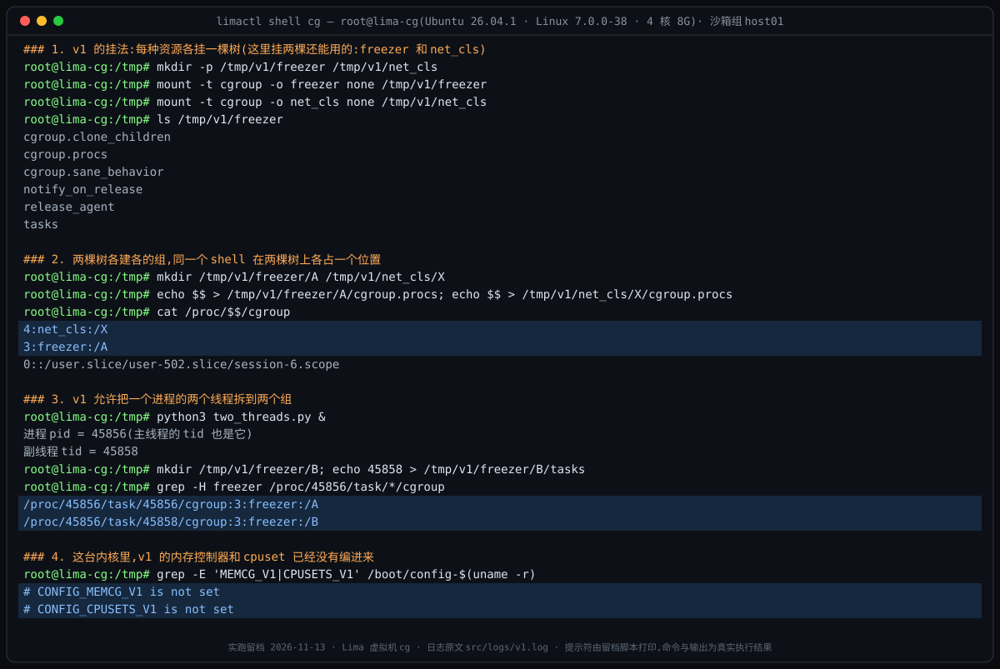

挂载命令里的 `-o freezer`、`-o net_cls`,就是在说「这棵树挂哪个插件」:先有一套核心,再选插件,和 §5.3 的分工一样。差别在于,v1 允许每个插件挂自己的一棵树。

同一个 shell,现在有**三处组籍**:在 freezer 树的 `/A`,在 net_cls 树的 `/X`,在 v2 那棵树的 `session-6.scope`。v1 的年代,一台机器上常见十来棵树,`/proc/<pid>/cgroup` 就有十来行。

图里最后一步还有一个时代的注脚:这台内核的配置里 `CONFIG_MEMCG_V1` 和 `CONFIG_CPUSETS_V1` 都是 `is not set`,v1 的内存控制器已经没有编进来了。

### §8.2 痛一:多棵树,记录对不上

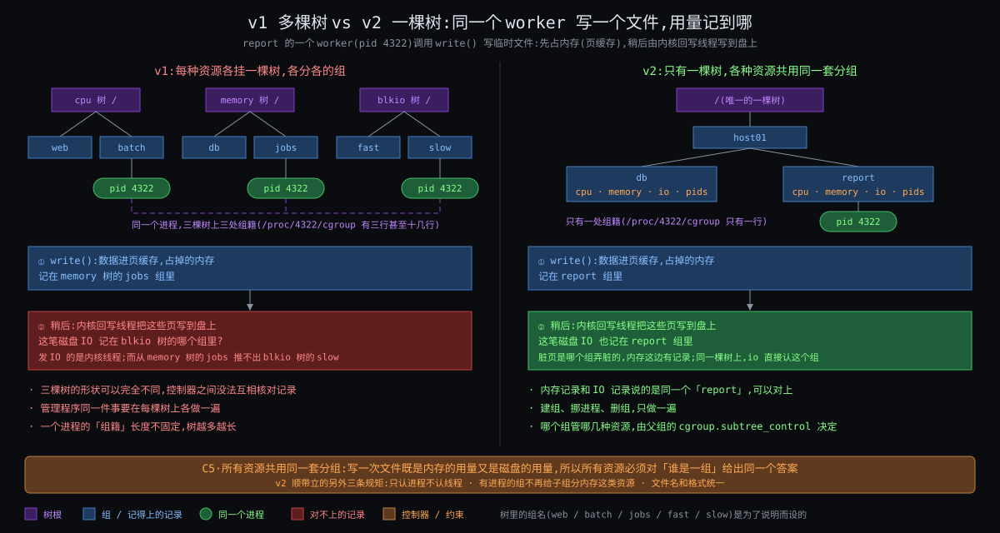

接着 §4.1 的发现:写文件这一个动作,先占内存(页缓存),稍后由内核线程写盘。在 v1 里:

1. 占掉的内存,记在 memory 树上 report 所在的那个组(图里的 `jobs`)。
2. 稍后回写线程要把这些页写到盘上。这笔 IO 应该算在 blkio 树的哪个组里?发 IO 的是内核线程,不是 report;而 memory 树和 blkio 树是两棵互不相干的树,形状可以完全不同,从「memory 树的 jobs」推不出「blkio 树的 slow」。

这就是 §5.2 难点二的那个场景。你在自己的第一版里是因为四套分组对不上;v1 已经把分组的代码收进了核心,却仍然允许每个插件挂一棵自己的树,结果「谁是一组」还是有好几个答案。共用一份代码不够,分组本身得只有一份。

文档的说法:

> each controller had to assume that all other controllers were attached to completely orthogonal hierarchies. This made it impossible, or at least very cumbersome, for controllers to cooperate with each other.

多棵树还有两个附带的麻烦:实际使用中大家几乎都是一个控制器一棵树(文档:"most configurations resorted to putting each controller on its own hierarchy"),管理程序同一件事要在每棵树上各做一遍;一个进程的组籍长度不固定,树越多越长。

**v2 的改法:只有一棵树。** 一个进程只在一个组里,这个组同时是它的 CPU 组、内存组、IO 组。于是内存和 IO 两边可以合作:

> The io controller, in conjunction with the memory controller, implements control of page cache writeback IOs.

**发现⑩:插件之间要核对记录。** 写一次文件既是内存的开销又是磁盘的开销,而且真正发出磁盘 IO 的是内核线程。要让这笔开销记到同一个组名下,所有控制器必须对「谁是一组」给出同一个答案:分组只能有一套,树只能有一棵。(`C5·所有资源共用同一套分组` 的后一半。)

和 §5 的发现⑦合起来,第五条根约束成立:

> **C5·所有资源共用同一套分组。** 要管的资源种类会不断增加,新增一种不能惊动已有的,所以只能是「公共框架 + 插件」;一笔开销又常常跨几种资源(写文件先占内存、后由内核线程写盘),所以各个插件必须对「谁是一组」给出同一个答案:分组只能有一套,树只能有一棵。
>
> 它由两个要点合成:① 种类会增加(§5.2,发现⑦);② 一笔开销跨几种资源,要核对记录(§8.2,发现⑩;§4.1 已经出现过,§5.2 难点二也出现过)。
>
> 不可再分:资源种类由硬件和业务的发展决定,事先列不完;只要「占内存的人」和「发 IO 的人」不是同一个执行者,两边就必须能互相查到对方的组。

### §8.3 痛二:线程可以拆到不同的组

v1 入组的最小单位是线程(`tasks` 文件),可以把一个进程的两个线程放进两个组。实跑:

```
# python3 two_threads.py &
进程 pid = 45856(主线程的 tid 也是它)
副线程 tid = 45858
# mkdir /tmp/v1/freezer/B; echo 45858 > /tmp/v1/freezer/B/tasks
# grep -H freezer /proc/45856/task/*/cgroup
/proc/45856/task/45856/cgroup:3:freezer:/A
/proc/45856/task/45858/cgroup:3:freezer:/B
```

同一个进程,主线程在 `/A`,副线程在 `/B`。对 CPU 这也许说得通,对内存就没法说了:同一个进程的线程共用一个地址空间,mysqld 的两个线程分在两个内存组,缓冲池里的一页算谁的?文档:"This didn't make sense for some controllers"。

**v2 的改法:只认进程。** 把副线程的 tid 写进 `cgroup.procs`,搬走的是整个进程:

```
# echo 45929 > /sys/fs/cgroup/host01/report/cgroup.procs      ← 45929 是副线程
# grep -H . /proc/45927/task/*/cgroup
/proc/45927/task/45927/cgroup:0::/host01/report
/proc/45927/task/45929/cgroup:0::/host01/report
```

(v2 后来给 CPU 这类「按线程分也说得通」的资源单独留了一个口子,叫 threaded 模式,讲架构时再说。)

### §8.4 痛三:父组自己的进程,和子组抢

v1 允许一个组里既有进程、又有子组。那么父组自己的进程和子组之间怎么分?比如 report 主进程待在 `report` 组里,下面又建了子组 `workers`:主进程是和「整个 workers 子组」平起平坐,还是和 workers 里的每个进程平起平坐?v1 里每个控制器各有各的答案,文档逐个点了名:cpu 把进程和子组当成平级的竞争者,于是比例随进程数变来变去;io 在内部悄悄加了一个隐藏的叶子节点;memory 干脆没有定义。

**v2 的改法:一条硬规矩,有进程的组不能再给子组分这类资源**(文档叫 No Internal Process Constraint)。进程只待在叶子上,父组只管分。实跑:

```
# echo $$ > /sys/fs/cgroup/host01/db/cgroup.procs             ← 组里有进程了
# echo +memory > /sys/fs/cgroup/host01/db/cgroup.subtree_control
bash: echo: write error: Device or resource busy               ← 想给子组分内存:不许

# echo $$ > /sys/fs/cgroup/host01/db/sub/cgroup.procs         ← 把进程挪到叶子上
# echo +memory > /sys/fs/cgroup/host01/db/cgroup.subtree_control && echo 成功
成功

# echo $$ > /sys/fs/cgroup/host01/db/cgroup.procs             ← 反过来:已经在分资源的组,不再收进程
bash: echo: write error: Device or resource busy
```

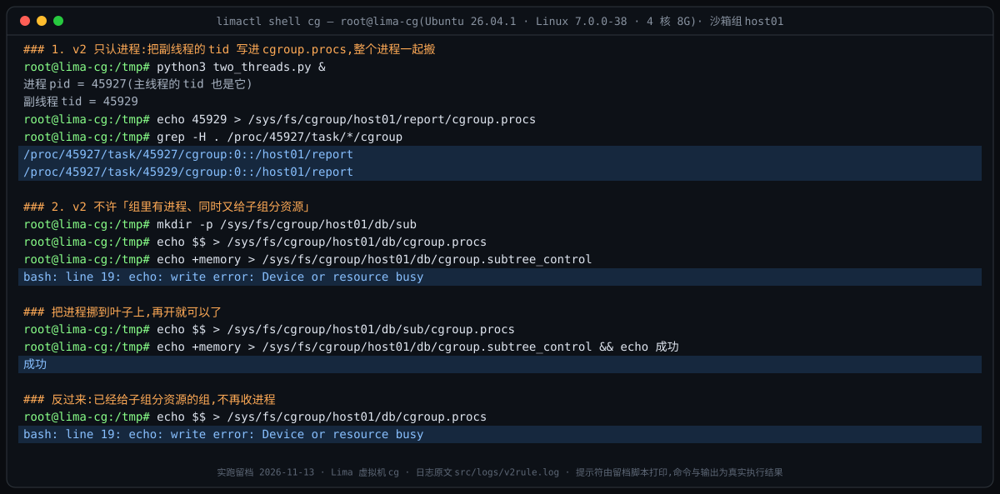

顺带交代一个我踩到的细节:我第一次用的是 `+cpu`,结果没有报错。这条规矩管的是内存这一类资源,cpu 走的是上面说的 threaded 那个口子,行为不一样。所以总表里写的是「内存这类资源」,区别留到讲架构时展开。

这条规矩其实是 `C1·按组限制合计用量` 里「组能套组」那个要点的补丁:上级把额度分给下级的时候,上级自己不能同时直接运行进程,否则「合计不超过」里的那个「合计」说不清。

### §8.5 痛四:接口各说各话

v1 的控制器是不同的人在不同年代各自加进来的,文档的评价是 "grew without oversight"。几个看得见的地方:

| 事情 | v1 | v2 |
|---|---|---|
| 限 CPU | 两个文件:`cpu.cfs_quota_us` 和 `cpu.cfs_period_us` | 一个文件:`cpu.max`,内容 `配额 周期` |
| 限内存 | `memory.limit_in_bytes` | `memory.max` |
| 内存快超了 | 只有一条硬线,到了就可能杀 | 多一条 `memory.high`:先逼它回收、让它慢下来,不杀 |
| 组空了怎么通知 | 内核每次拉起一个外部程序(上面 v1 那张图的 `ls` 里能看到 `release_agent`、`notify_on_release`) | 写在组自己的 `cgroup.events` 文件里,可以监听 |

`memory.high` 值得多说一句。它是 `C2·记实际用量,超限处理看资源类型` 里内存那一种超限处理的缓冲:内存虽然等不来,但可以在杀之前先让申请的人慢下来、自己去回收。v1 只有一条硬线,文档说大家因此不敢设紧,宁可多留余量,浪费内存。怎么个慢法,是后面讲内存这条线时的内容。

### §8.6 两个版本的时间线

出处是 [cgroups(7)](https://man7.org/linux/man-pages/man7/cgroups.7.html):

- 2.6.24:第一版(后来叫 v1)。
- 3.10:开始做 v2,最初藏在一个实验性的挂载选项后面。
- 4.5:v2 转正,当时带 io、memory、pids 三个控制器。
- 4.15:cpu 控制器才进 v2。也就是说,v2 转正之后有相当长一段时间限不了 CPU,这是 v1 又被多用了很多年的直接原因。
- 今天:这台 7.0 内核里,v1 的内存控制器已经不编进来了(§8.1)。

这一期之后的架构和源码,只讲 v2。

### §8.7 四个痛的共同原因:v1 让每个控制器自己决定的事太多

把四个痛并排,看它们各自是 v1 让控制器自己决定的哪件事造成的:

| v1 留给每个控制器自己定的事 | 结果 | v2 收回后由核心统一规定 |
|---|---|---|
| 树长什么样(每个控制器可以挂自己的树) | 写一次文件,内存的用量和 IO 的用量在两棵树上,对不上(§8.2) | 只有一棵树 |
| 按进程还是按线程入组 | 一个进程的两个线程分在两个内存组,一页算谁的(§8.3) | 只认进程;CPU 这类另开 threaded 口子 |
| 父组自己的进程和子组怎么分 | cpu、io、memory 各有各的答案(§8.4) | 有进程的组不再给子组分内存这类资源 |
| 文件叫什么、格式怎么写、事件怎么通知 | 限 CPU 两个文件、内存另一套命名、组空了拉起外部程序(§8.5) | 统一命名和格式;事件写进 `cgroup.events` |

四件事有一个共同点:都是控制器之间必须对得上,或者管理程序要跨控制器统一操作的事。v1 把它们留给每个控制器自己定,表面上灵活,结果每多一项由控制器自己决定的事,就多一处对不上。§5.3 你抽出核心时只想到了「分组的代码只写一遍」;v1 的教训是,**光把代码收进核心不够,凡是插件之间要核对记录的规矩,也得收进核心。**

**所以要用统一的方式管理所有资源。** 凡是插件之间要核对记录的事,由公共层统一规定;v1 把「树长什么样」留给插件,结果记录对不上;v2 收回这个权限,只有一棵树。

v2 也没有把所有事都统一。它留了一处可以各自决定的地方:同一棵树上,不同控制器可以在不同深度打开,哪个组管哪几种资源,由父组的 `cgroup.subtree_control` 决定。这就回答了 §7.1 留的那个问题:只有一棵树,组籍上为什么还是每个控制器一栏?因为各栏虽然都指向同一棵树,却可能指向不同的层。第三节 §2 会看到,一个进程的组籍里,cpuset 那一栏还指着 host01,其余几栏已经指向它下面的子组。而 `/proc/<pid>/cgroup` 在 v2 里只剩一行(§8.3 里 v2 那段输出,每个线程都只有一行 `0::/host01/report`),因为对外只有一棵树、一个位置。

## §9 验收:四种资源放进组里重演

**结论:同样的 report、同样的 400 个 worker、同样的内存吃法、同样的 dd 和 fork,放进组里之后:CPU 合计恰好半颗核,db 不受进程数影响;内存超了只在 report 组里杀,db-sim 完全没受影响;磁盘每秒最多写 10 MiB,带缓冲的写也算;第 20 次 fork 被拒,root 也不例外;setsid 和普通用户权限都出不了组。四种资源走的是同一套公共框架,不同的只有超了以后怎么处理。**

现在把沙箱 host01 当成机器,在里面分两个子组 `db` 和 `report`。入组用一个两行的小脚本 `ingroup`(第一节 §4.4 说的「先入组、后变身」):

```sh
echo $$ > /sys/fs/cgroup/host01/$1/cgroup.procs    # 先把自己写进组
shift; exec "$@"                                    # 再变身成要跑的程序
```

### §9.1 CPU:半颗核就是半颗核,开多少进程都一样

```
# echo '50000 100000' > /sys/fs/cgroup/host01/report/cpu.max

# ./ingroup report python3 report.py cpu 8 &
# ./ingroup db python3 db.py
查询 5063 次(633 次/秒)  平均 6.3 ms  p99 13.7 ms
这段时间的 CPU:db-sim×4 合计 348%   report-w×8 合计 50%

# ./ingroup report python3 report.py cpu 400 &
# pgrep -c -x report-w
400
# ./ingroup db python3 db.py
查询 5120 次(640 次/秒)  平均 6.3 ms  p99 21.0 ms
这段时间的 CPU:db-sim×4 合计 348%   report-w×400 合计 52%

# grep -E 'usage_usec|nr_periods|nr_throttled' /sys/fs/cgroup/host01/report/cpu.stat
usage_usec 64859376
nr_periods 1298
nr_throttled 1296
```

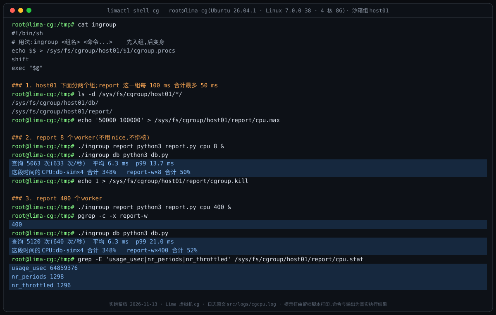

**算例。**

- report 没用 nice,没绑核。8 个 worker 合计 50%,400 个 worker 合计 52%:**开多少进程都是这半颗核。**
- db-sim 应得 400% − 50% = 350%,实测两遍都是 348%。对比 §2.1:nice 19 下 400 个 worker 时 db 只有 164%。
- 核对:64 859 376 μs ÷ 1298 个周期 = 49 969 μs/周期,就是那个 50 000;1298 个周期里有 1296 个被限流,report 几乎每个周期都达到了上限。这个准头就是 §7.1.1 说的「记账时同步检查限额」:限额是在记账的那一刻比的。
- 吞吐 633 和 640 次/秒,是独占时(690)的 92%~93%,比按 CPU 算的 87.5% 高一点。原因是这两遍里每次查询花的 CPU 略少(348% ÷ 633 ≈ 5.5 ms,独占那一遍是 398% ÷ 690 ≈ 5.8 ms),属于虚拟机上不同遍之间的速度波动。以 CPU 占比为准:db 少掉的,不多不少就是 report 那半颗核。

一个小插曲:第二步里从启动 report 到 400 个 worker 起齐,要等上好一阵。因为 fork 这 400 次本身也在那半颗核里排队,先生出来的 worker 立刻开始和主进程抢。限额管的是组里的一切,包括「生孩子」这个动作。

### §9.2 内存:超了只在自己组里杀

```
# echo 512M > /sys/fs/cgroup/host01/report/memory.max
# ./ingroup db python3 hold.py db-sim 1500 &
db-sim(pid 46164)已占住 1500 MiB
# ./ingroup report python3 report.py mem 8 300 &

# journalctl -k --since 18:41:36 -o cat --no-pager | grep 'Killed process' | cut -c1-64
Memory cgroup out of memory: Killed process 46172 (report-w) tot
……(共 7 行,全是 report-w)
# journalctl -k … | grep 'oom-kill:' | head -1
oom-kill:constraint=CONSTRAINT_MEMCG,…,oom_memcg=/host01/report,task_memcg=/host01/report,task=report-w,pid=46172,uid=0

# grep oom_kill /sys/fs/cgroup/host01/report/memory.events /sys/fs/cgroup/host01/db/memory.events
/sys/fs/cgroup/host01/report/memory.events:oom_kill 7
/sys/fs/cgroup/host01/db/memory.events:oom_kill 0

# ps -o pid,rss,comm -C db-sim,report-w
    PID   RSS COMMAND
  46164 1546984 db-sim
  46176 314828 report-w
```

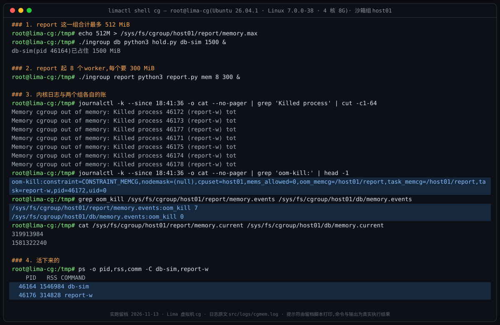

**算例。**

- 512 MiB 的额度,8 个 worker 一起涨:每个涨到 64 MiB 时第一次达到上限(8 × 64 = 512),杀一个;剩下的继续涨,再达到上限,再杀。
- 最后能留下几个?一个 worker 要 300 MiB,两个就是 600 > 512,所以只能留 1 个,**要杀 7 个**。实测 `oom_kill 7`,活下来 1 个 report-w(RSS 314 828 KiB ≈ 307 MiB),组的用量 `memory.current` 是 319 913 984 字节 ≈ 305 MiB。
- db 组:`oom_kill 0`,db-sim 的 1500 MiB 原封不动。

日志里那行 `oom_memcg=/host01/report` 就是你第二个问题里的「边界」:这次 OOM 的范围是 report 这个组,挑人只在这个组里挑。对比 §3.2 那一行,范围是 `oom_memcg=/host01`(当时的「整台机器」),所以 db-sim 被挑中了。**同一个内核、同一套挑人规则,只是范围从全场换成了超限的那一组。**

### §9.3 磁盘 IO:带缓冲的写也限得住

§4.1 的缺陷:带缓冲的写是先进页缓存、稍后由内核线程写盘,`ionice` 管不到。这次给 report 组在这块盘(`253:0` 是 vda 的设备号)上设每秒最多写 10 MiB。这一段和下一段在专用实验机 cg-lab 上跑:

```
### 不设限,绕过页缓存直接写 50 MiB
# ./ingroup report dd if=/dev/zero of=/var/tmp/r1.tmp bs=1M count=50 oflag=direct 2>&1 | tail -1
52428800 bytes (52 MB, 50 MiB) copied, 0.00679885 s, 8.7 GB/s

# echo '253:0 wbps=10485760' > /sys/fs/cgroup/host01/report/io.max
# ./ingroup report dd if=/dev/zero of=/var/tmp/r2.tmp bs=1M count=50 oflag=direct 2>&1 | tail -1
52428800 bytes (52 MB, 50 MiB) copied, 4.99987 s, 10 MB/s

### 同样的限制,换成带缓冲的写,等落盘再返回
# ./ingroup report dd if=/dev/zero of=/var/tmp/r3.tmp bs=1M count=50 conv=fsync 2>&1 | tail -1
52428800 bytes (52 MB, 50 MiB) copied, 4.97412 s, 11 MB/s
# cat /sys/fs/cgroup/host01/report/io.stat
253:0 rbytes=16384 wbytes=157286400 rios=4 wios=213 dbytes=0 dios=0

### 对照:db 组没有设限,同样带缓冲地写 50 MiB
# ./ingroup db dd if=/dev/zero of=/var/tmp/d1.tmp bs=1M count=50 conv=fsync 2>&1 | tail -1
52428800 bytes (52 MB, 50 MiB) copied, 0.0261246 s, 2.0 GB/s
```

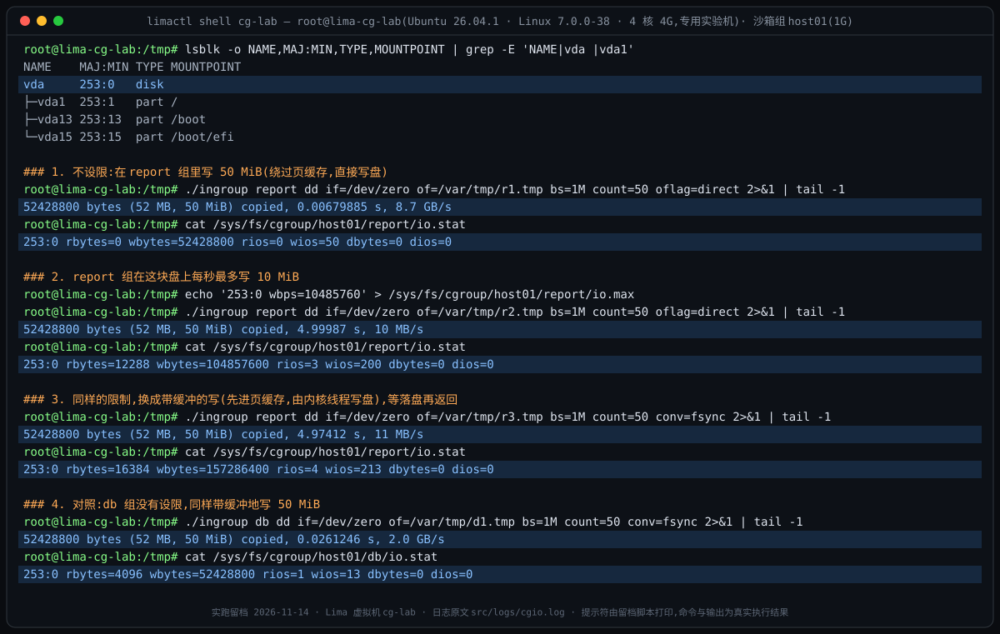

**算例。**

- 50 MiB ÷ 10 MiB/s = 5 秒。直接写 4.99987 秒,带缓冲的写 4.97412 秒。不设限时是 0.0068 秒。
- **带缓冲的写也限住了**,这是 §4.1 里 `ionice` 做不到的,也是 §8.2 里 v1 做不好的。这笔 IO 是内核线程发的,它之所以记到 report 组名下,是因为内存和 IO 在同一棵树上,脏页是谁的,IO 就算谁的(`C5·所有资源共用同一套分组`)。
- 记录在 `io.stat` 里:三次各写 50 MiB,`wbytes` 最后是 157 286 400 字节 = 150 MiB,一个字节不差。
- db 组不受影响:0.026 秒。

一处照实交代:磁盘 IO 第一遍跑的时候(日志 `cgio-run1.log`),四次 dd 写的是同一个文件名,结果有两处对不上:`io.stat` 的 `wbytes` 比写入量多出 50 MiB;没有设限的 db 组那一次也被拖到了 5 秒。改成每次写不同的文件之后(正文这一遍)两处都正常。我猜测和「一个文件的回写同一时间只归一个组」有关,没有验证,记入待核。

### §9.4 进程数:组里最多 20 个,root 也不例外

§4.2 的两个缺陷:`ulimit -u` 数的是「这个用户」的进程,而且对 root 不生效。同一个测试程序 `forkn.py`,这次用组来管:

```
# echo 20 > /sys/fs/cgroup/host01/report/pids.max
# ./ingroup report python3 forkn.py 100
第 20 次 fork 失败:[Errno 11] Resource temporarily unavailable
想要 100 个子进程,成功 fork 出 19 个

# grep -H . …/report/pids.max …/report/pids.peak …/report/pids.events
/sys/fs/cgroup/host01/report/pids.max:20
/sys/fs/cgroup/host01/report/pids.peak:20
/sys/fs/cgroup/host01/report/pids.events:max 1

# ./ingroup db python3 forkn.py 100
想要 100 个子进程,成功 fork 出 100 个
```

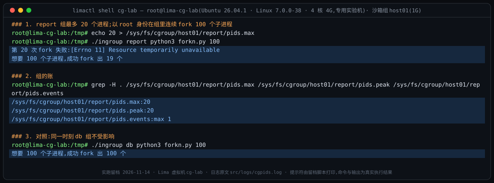

- 上限 20,主进程自己算 1 个,所以成功 19 个,第 20 次 fork 失败。这次是以 root 身份跑的,§4.2 里 root 的 100 次 fork 全部成功。
- 数的是这个组,不是这个用户:同一个 root 在 db 组里 fork 100 个,一个不少。
- 超了的超限处理是「拒绝」:fork 返回错误,没有谁被杀。

### §9.5 边界:换得了会话,换不了组

```
# ./ingroup report setsid bash -c 'sleep 301 & sleep 302 & setsid sleep 303 & wait' &
# ps -o pid,pgid,sid,cgroup,args -C sleep | grep -E 'PID|30[123]'
    PID    PGID     SID CGROUP                      COMMAND
  45371   45369   45369 0::/host01/report           sleep 301
  45372   45369   45369 0::/host01/report           sleep 302
  45373   45373   45373 0::/host01/report           sleep 303

# ./ingroup report runuser -u lima -- bash -c 'echo $$ > /sys/fs/cgroup/host01/db/cgroup.procs'
bash: line 1: /sys/fs/cgroup/host01/db/cgroup.procs: Permission denied
# ./ingroup report runuser -u lima -- bash -c 'echo max > /sys/fs/cgroup/host01/report/cpu.max'
bash: line 1: /sys/fs/cgroup/host01/report/cpu.max: Permission denied

# echo 1 > /sys/fs/cgroup/host01/report/cgroup.kill
# ps -o pid,args -C sleep | grep -c '30[123]'
0
```

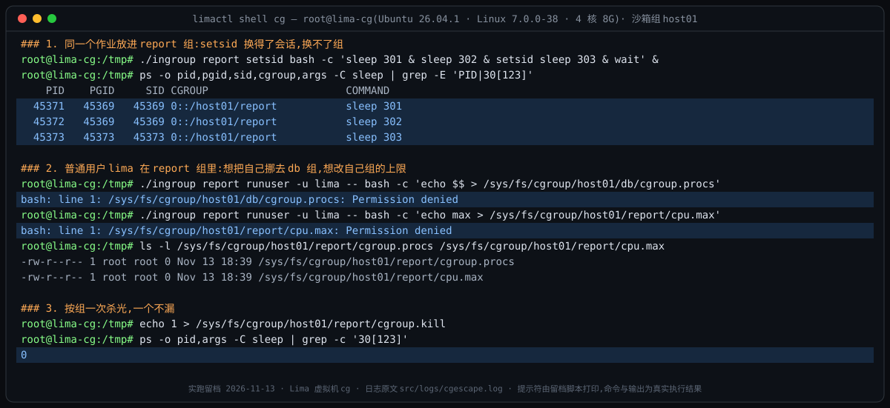

- §2.3 里靠 `setsid` 逃掉的那个 `sleep 303`,这次会话和进程组照样换了(45373),但 `CGROUP` 一栏还是 `/host01/report`。组籍不归它自己管。
- 普通用户想把自己挪到 db 组、想把自己组的上限改成 `max`,都是 `Permission denied`:组籍和限额就是两个文件,文件的主人是 root。这就是 §5.4 说的「谁能改由文件权限管」。
- `cgroup.kill` 按组杀,一个不漏。

### §9.6 前后对照:同一套框架,只有超限处理不同

先按资源看。四行的做法是同一个:进到组里,消耗时记到组的用量上,用量旁边有个限额。

| 资源 | 旧工具(§1 ~ §4) | 旧工具的缺陷 | 控制器 | 限 | 实测 | 超了怎么处理 |
|---|---|---|---|---|---|---|
| CPU | nice、taskset | 按进程发、没有上限、能自己解绑 | cpu | `cpu.max` | 8 个或 400 个 worker 都是约 50% | 等到下个周期 |
| 内存 | ulimit -v、全机 OOM | 按进程、限的是虚拟地址、杀错进程 | memory | `memory.max` | 杀 7 个 report-w,db-sim 活着 | 组内回收,收不动组内杀 |
| 磁盘 IO | ionice | 管不到带缓冲的写 | io | `io.max` | 50 MiB 写 5 秒,带缓冲的也是 | 请求排队等 |
| 进程数 | ulimit -u | 按用户数、root 不算 | pids | `pids.max` | 第 20 次 fork 失败 | 这次 fork 失败 |

不同的只有最后一列,而最后一列是资源的性质决定的:CPU 时间和 IO 带宽下一刻还会有,可以等;fork 有返回值,可以拒绝;内存既等不来也没法拒绝,只能回收或杀(`C2·记实际用量,超限处理看资源类型`)。这四行也是「公共框架加资源插件」最直接的样子:分组、入组、写数的办法四行一模一样,换的只是控制器。

再按约束看:

| 场景 | 旧办法(实测) | 放进组里(实测) | 对应约束 |
|---|---|---|---|
| report 8 个 worker 时 db 的吞吐 | 不管 226;nice 648;绑核 486 | 633 | `C1·按组限制合计用量` |
| report 400 个 worker 时 db 的吞吐 | nice 19:268 | 640 | `C1·按组限制合计用量` |
| report 最多能吃多少 CPU | nice:闲时 398% | 任何时候约 50% | `C1·按组限制合计用量` |
| 被管的进程能不能自己出去 | 解绑成功;setsid 成功 | 组籍不变;改文件被拒 | `C3·内核负责执行,配额由外部设定` |
| 「512M」实际限住多少 | ulimit:合计 2461 MiB | 合计不超过 512 MiB | `C2·记实际用量,超限处理看资源类型` |
| 内存见底谁死 | db-sim | 7 个 report-w;db-sim 活着 | `C2·记实际用量,超限处理看资源类型` |
| 带缓冲的写能不能限住 | ionice -c 3:dd 0.10 秒写完 1 GiB,回写管不到 | io.max 10 MiB/s:带缓冲写 50 MiB 用 4.97 秒 | `C5·所有资源共用同一套分组` |
| root 能 fork 多少个 | ulimit -u 30:100 个全成功 | pids.max 20:成功 19 个 | `C1·按组限制合计用量` |
| 代价 | — | 同一个内核,没有多开一台虚拟机 | `C4·在内核已有代码路径上记账,开销要小` |

最后两行的数字来自不同的机器(进程数和磁盘 IO 两段在 cg-lab,其余在 cg),比的是「限不限得住」,不是比快慢。

也有它没解决、或者说它带来的新问题,如实列出来:

- report 在半颗核里跑得慢得多,延迟也会有毛刺(第一节 §4.3 量过:跑一阵、停一阵)。这是限额的本意,但对延迟敏感的业务是个问题。
- OOM 还是杀,只是杀对了地方。活下来的那 1 个 worker 对 report 来说多半也没用了 —— 一个任务死了 7/8,剩下的该不该一起死?
- 上限是上限,不是保证。db 组没写任何数,它「拿到 348%」只是因为 report 被限制住了,并没有人承诺给它留着。

这三件事分别通向后面的内容:限流的机制、组内 OOM 的策略、保底那一组旋钮。保底那一组,§10 的「你问我答」先动手调一调。

## §10 再调几个旋钮(你问我答)

**结论:同一套公共框架上,每种资源能提供什么旋钮,由资源的性质决定。CPU 时间每一刻都是新的,所以既能按比例分(`cpu.weight`),又能封顶(`cpu.max`),两个同时用时取更紧的那个;内存占了不还,所以没有按比例分的旋钮,只有保护(`memory.low`)和封顶(`memory.max`),而且保护只管回收、管不住杀。这是 `C2·记实际用量,超限处理看资源类型` 在旋钮上的样子。**

§9 的重演只用了每种资源的上限。读完初稿后,我们来回问了四个问题,每个问题先记下你的回答,再实跑。

### §10.1 只分组、不封顶:400 个 worker 还稀释得了 db 吗

**结论:稀释不了。只要分了组,哪怕一个上限都不写,调度器也是先在组和组之间分,再在组里面分;400 个 worker 合起来只算「report 这一组」。两个组默认各一半,db 理论上拿 200%,实测 152%,差的那部分查到了原因:4 个 db-sim 没有铺满 4 颗核。但这种「按比例分」和 nice 一样没有天花板,db 一闲 report 就吃满,所以它替代不了 `cpu.max`。**

这一小节来自看完初稿后的一个问题:把 report 组的 `cpu.max` 去掉,只保留「db 一组、report 一组」的分组,report 400 个 worker 对 db-sim 4 个进程,db 能拿到多少 CPU?你当时的回答是「不知道」。这个问题确实没法靠前面的内容直接推出来,所以先把两种可能的算法摆出来,再跑。

- **如果还是按进程分**(§1、§2.1 的老规矩):404 个进程平分 4 颗核,db-sim 占 4 ÷ 404 ≈ 1%,合计约 4%。数据库基本停摆。(这一行是算出来的,没有实跑。)
- **如果按组分**:两个组平分,db 组 200%,它的 4 个进程每个半颗核;report 组 200%,400 个 worker 每个 0.5%。

先交代一个新文件。因为 nice 的权重是发给进程的,进程一多就被稀释(`C1·按组限制合计用量` 的第一个要点),要让「抢的时候谁多谁少」也按组来算,所以 v2 给每个组一个权重文件 `cpu.weight`:取值 1 ~ 10000,默认 100,同一个父组下面的几个子组按权重的比例分 CPU([cgroup-v2 文档 Weights 一节](https://docs.kernel.org/admin-guide/cgroup-v2.html#weights))。它可以看成「发给组的 nice」。

```
# cat /sys/fs/cgroup/host01/report/cpu.max
max 100000                                   ← 不封顶
# cat /sys/fs/cgroup/host01/db/cpu.weight /sys/fs/cgroup/host01/report/cpu.weight
100
100                                          ← 两个组权重相同

# ./ingroup report python3 report.py cpu 400 &
# ./ingroup db python3 db.py &
# ps -o psr= -C db-sim | sort -n | xargs echo 第 2 秒,4 个 db-sim 所在的核:
第 2 秒,4 个 db-sim 所在的核: 1 1 2 3
# ps -o psr= -C db-sim | sort -n | xargs echo 第 5 秒,4 个 db-sim 所在的核:
第 5 秒,4 个 db-sim 所在的核: 1 1 2 3
查询 1982 次(248 次/秒)  平均 16.2 ms  p99 39.5 ms
这段时间的 CPU:db-sim×4 合计 152%   report-w×400 合计 234%

### 权重不变(100 比 100),这次手工把 4 个 db-sim 一个核放一个
# ./ingroup db python3 db.py &
# i=0; for p in $(pgrep -x db-sim); do taskset -cp $i $p > /dev/null; i=$((i+1)); done
4 个 db-sim 所在的核: 0 1 2 3
查询 2565 次(321 次/秒)  平均 12.5 ms  p99 60.0 ms
这段时间的 CPU:db-sim×4 合计 192%   report-w×400 合计 180%

### 不钉核,把 db 组的权重调到 900(report 还是 100)
# echo 900 > /sys/fs/cgroup/host01/db/cpu.weight
# ./ingroup db python3 db.py &
4 个 db-sim 所在的核: 0 1 2 3
查询 4413 次(552 次/秒)  平均 7.2 ms  p99 19.9 ms
这段时间的 CPU:db-sim×4 合计 345%   report-w×400 合计 36%

### db-sim 没活的时候,权重只有 100 的 report 吃多少
# python3 cpuof.py 3
3 秒内的 CPU:report-w×400 合计 385%
```

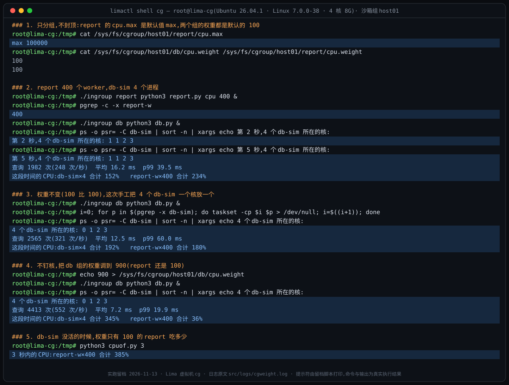

**第一件事:是按组分的。** db 拿到 152%,不是 4%。400 个 worker 合计 234%,平均每个 0.6%;4 个 db-sim 平均每个 38%。同样是「普通优先级的进程」,一个 db-sim 拿到的是一个 report-w 的 65 倍,唯一的区别是它们的组不同。对比 §2.1:同样 400 个 worker,nice 19 已经降到底了,db 也只有 164%;这里 report 一点没降,db 就有 152%。分组这一个动作,顶得上把对方降到最低优先级。

**第二件事:没到 200%,原因是进程没铺开。** 按组平分应该是 200%,实测 152%,差了四分之一。这个差距不是偶然,这组实验前后跑了五遍,db 分别是 174% / 133% / 155% / 141% / 152%,没有一遍到 200%。

留档里那两行 `ps` 是追查的线索:4 个 db-sim 落在 1、1、2、3 号核上,0 号核上一个 db-sim 都没有。于是 0 号核整颗归了 report,db 组在那颗核上有份额也没人去领;1 号核上两个 db-sim 挤在一起,合用 db 组在这颗核上的那一份。

验证办法很直接:权重一个字不改,手工把 4 个 db-sim 一个核钉一个(第三段)。db 立刻到了 192%,report 180%,基本就是对半。所以**差的那部分不在「权重怎么算」,而在「进程摆在哪」:组的份额是在每颗核上各自兑现的,组里的进程不在那颗核上,那颗核上的份额就兑现不了。**

这里有两点我还没有查清,先记进待核清单,不编解释:一是内核为什么没有把 db-sim 自动铺到 4 颗核上(§2.1 里不分组时,实测 164% 和「一核一个」算出来的 162% 吻合,说明那时是铺开的);二是「组的权重怎么摊到每颗核上」的具体算法。

**第三件事:权重可以调,比例基本兑现。** db 组调到 900,report 还是 100,比例 9 比 1:

- db 应得 400% × 900 ÷ (900 + 100) = 360%。实测 345%,这一遍 4 个 db-sim 正好铺在 0、1、2、3 号核上。
- report 实测 36%。400 个 worker 合计只有三分之一颗核。
- 吞吐 552 次/秒,是独占时(690)的 80%。
- 这一步五遍分别是 352% / 329% / 288% / 257% / 345%。偏低的那两遍(288%、257%)当时没有采样进程所在的核,我推测同样是没铺满,但没有证据,记入待核。

**第四件事:它没有天花板。** db-sim 一停,权重只有 100 的 report 立刻吃到 385%。这和 §2.1 的问题一是同一个问题:权重只回答「同时要的时候谁多」,回答不了「你最多拿多少」。文档里管这叫 work-conserving:只有此刻用得上资源的组才参与分配,没人要的就给要的人。

把四种管法放在一起(都是 report 400 个 worker 的场景):

| 管法 | 管的单位 | 会不会被进程数稀释 | db 闲的时候 report 吃多少 | db 实测拿到 | 理论值 |
|---|---|---|---|---|---|
| nice 19(§2.1) | 进程 | 会 | 398%,没有天花板 | 164% | 162% |
| `cpu.weight` 100 比 100 | 组 | 不会 | 385%,没有天花板 | 152%(五遍 133% ~ 174%) | 200% |
| `cpu.weight` 900 比 100 | 组 | 不会 | 同上 | 345%(五遍 257% ~ 352%) | 360% |
| `cpu.max` 半颗核(§9.1) | 组 | 不会 | 约 50%,有天花板 | 348%(两遍都是) | 350% |

从这张表能读出三件事:

1. **`cpu.weight` 解决了 §2.1 的问题二(稀释),没解决问题一(天花板)。** 问题二的原因是 `C1·按组限制合计用量` 的第一个要点(单位是组),把权重从进程挪到组上就解决了;问题一的原因是它的第二个要点(上限是绝对数),比例再怎么调也变不成绝对数。所以 CPU 这一种资源,cgroup 给了两个旋钮:`cpu.weight` 管「抢的时候谁多」,`cpu.max` 管「最多多少」。两个可以同时用。
2. **两个旋钮的行为不一样。** `cpu.max` 是严格的限额,核对下来误差只有几十微秒(§9.1 的 49 969 μs),两遍都是 348%;`cpu.weight` 是按比例尽力而为,结果跟进程在哪颗核上有关,五遍能差出几十个百分点。要对别人做承诺,只能用前者。
3. **`cpu.weight` 是 §9.6 末尾说的「保底那一组旋钮」里的第一个。** 它不保证 db 任何时候都有 360%,但保证了「db 和 report 同时要的时候,db 大约拿九成」;db 不用的时候这九成不浪费,report 可以拿去用。`cpu.max` 正相反:report 那半颗核以外的部分,db 不用也是空着。

拿数据库比:`cpu.weight` 像数据库资源管理里给各个资源组设的「份额」,只在争用时按比例切;`cpu.max` 像给租户设的硬配额,闲着也不许超。这个类比只在「比例对绝对数」这一点上成立,具体实现不相干。

### §10.2 两个旋钮同时用:各算各的,取更紧的那个

**结论:`cpu.weight` 和 `cpu.max` 互不替代,也互不干扰。一个组最后拿到的 CPU = 按权重分到的那一份,再被自己的上限截断。db 忙的时候是权重说了算(report 约 40%,够不着 50% 的上限);db 闲的时候是上限说了算(report 停在 50%,多出来的 350% 空着)。**

接着 §10.1 问的:report 的 `cpu.max` 写半颗核,同时 db 权重 900、report 权重 100。db 闲的时候 report 吃多少?db 忙的时候呢?

你的回答:「还是按照组来分,1:9。」

这句话对了一半。db 忙的时候,确实是按组 1 比 9 分:report 应得 400% × 100 ÷ 1000 = 40%,比它的上限 50% 还低,上限用不上。但 db 闲的时候,1 比 9 这个比例就不起作用了:只有一方要,没有什么可按比例分的,§10.1 里这种时候 report 吃到了 385%;这一次它多了一个 `cpu.max`,所以停在 50%。

```
# echo '50000 100000' > /sys/fs/cgroup/host01/report/cpu.max
# echo 900 > /sys/fs/cgroup/host01/db/cpu.weight
# ./ingroup report python3 report.py cpu 400 &

### db 忙的时候
# grep -E 'usage_usec|nr_periods|nr_throttled' /sys/fs/cgroup/host01/report/cpu.stat | xargs
usage_usec 10753033 nr_periods 214 nr_throttled 214
# ./ingroup db python3 db.py &
4 个 db-sim 所在的核: 0 1 2 3
查询 4701 次(588 次/秒)  平均 6.8 ms  p99 15.6 ms
这段时间的 CPU:db-sim×4 合计 341%   report-w×400 合计 34%
# grep -E 'usage_usec|nr_periods|nr_throttled' /sys/fs/cgroup/host01/report/cpu.stat | xargs
usage_usec 13990945 nr_periods 296 nr_throttled 240

### db 闲的时候
# python3 cpuof.py 3
3 秒内的 CPU:report-w×400 合计 57%
# grep -E 'usage_usec|nr_periods|nr_throttled' /sys/fs/cgroup/host01/report/cpu.stat | xargs
usage_usec 15523717 nr_periods 327 nr_throttled 271
```

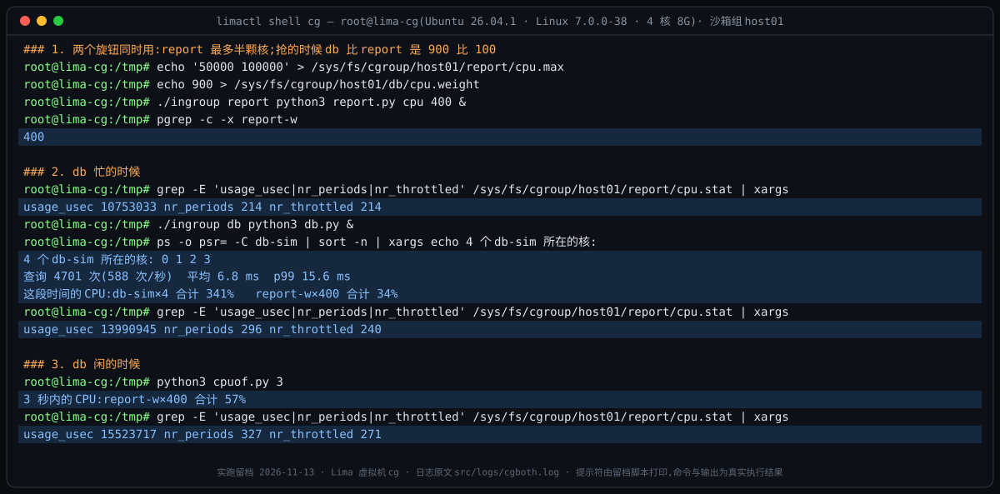

**算例(用 report 组自己的用量记录来核对,三行 `cpu.stat` 两两相减)。**

| 时段 | 周期数 | report 组用掉的 CPU | 每周期 | 其中被限流的周期 | 谁在起作用 |
|---|---|---|---|---|---|
| db 忙 | 296 − 214 = 82 | 13 990 945 − 10 753 033 = 3 237 912 μs | 39 487 μs(39.5%) | 240 − 214 = 26 | 权重:应得 40%,实得 39.5% |
| db 闲 | 327 − 296 = 31 | 15 523 717 − 13 990 945 = 1 532 772 μs | 49 444 μs(49.4%) | 271 − 240 = 31,每个周期都达到上限 | 上限:50% |

- db 忙的时候,db-sim 实测 341%(理论 360%),report 39.5%(理论 40%)。你说的 1 比 9,对上了。
- db 闲的时候,report 每周期用 49 444 μs,31 个周期个个被限流。机器上明明空着三颗半核,它也拿不到。这就是 §10.1 那张表最后一列的区别:权重不浪费,上限会浪费。
- 写成一句话:**report 拿到的 = min(按权重分到的,`cpu.max`)**。忙时 min(40%,50%)= 40%;闲时 min(没人抢,想要多少有多少,50%)= 50%。

三处如实交代:

1. 这组实验跑了三遍。db 忙时 report 每周期用量,后两遍是 36 859 μs 和 39 487 μs(第一遍没有打印 `usage_usec`);被限流的周期数,前两遍都是 82 个里 3 个,最后一遍是 26 个。也就是说「按权重分到 40%」是个平均数,有的周期多一点就会碰到 50 ms 的线。权重是尽力而为,上限是硬账,这里又见了一次。
2. 「db 闲的时候」`cpuof.py` 报的数三遍分别是 42% / 53% / 57%,和组的用量记录(49.4% ~ 49.8%)对不上。我的判断是 `cpuof.py` 这个测量方式在这里太粗:它读的是每个进程的 CPU 时间,单位是 10 ms 一格(`getconf CLK_TCK` = 100),而 400 个 worker 在 3 秒里每个只跑了不到 4 ms,不够一格;再加上 report 是「跑 50 ms、停 50 ms」,3 秒这段时间的两头各切到半个周期。这个判断没有逐项验证,以组自己的用量记录为准。这也顺带说明了一件事:**想知道一组进程合计用了多少,把 400 个进程的数加起来是不准的,组上的用量记录才准**,这正是 `C1·按组限制合计用量` 要的东西。
3. 第二遍的吞吐不对劲:db-sim 的 CPU 是 362%,吞吐却只有 348 次/秒(第一遍 363% 对 641 次/秒)。这和 §10.1 第三遍是同一种怪现象,这次追了一下,有了线索,见待核 #10。

### §10.3 内存为什么没有「1 比 9」

**结论:内存没有按比例分的旋钮。CPU 时间每个瞬间都是新的,下一片给谁都不用收回什么;内存页一旦分出去就一直被占着,要给别人只能先从占着的人手里收回来。所以内存这边,「抢的时候谁多」变成了「抢的时候先收回谁的」,旋钮叫 `memory.low`(保护)。它管得住回收,管不住杀。**

§10.2 之后的问题:CPU 有按比例的 `cpu.weight`,也有绝对上限 `cpu.max`;内存只见过 `memory.max`。内存能不能也像 CPU 那样按 1 比 9 分?不能的话难在哪?

你的回答:「不太行,因为内存是虚拟映射到物理内存的,而且是根据实际使用来划分的,不是一开始就能决定的。」

「不太行」是对的,下面第一步就能看到内存确实没有 weight 文件。两条理由要分开说:

- 「按实际使用来划分」本身不是障碍。CPU 的权重也是按实际使用分的,§10.1 里 db 一闲,report 就拿到 385%,这就是「谁在用才分给谁」。
- 「虚拟映射」也不是。cgroup 记的是物理页(`C2·记实际用量,超限处理看资源类型` 的第一个要点),§3.1 里 ulimit 按虚拟地址空间限,正是失败的地方。
- 真正的区别在 `C2·记实际用量,超限处理看资源类型` 的第二个要点:内存占了不还。CPU 时间用掉就没了,下一个 1 ms 是新的,想改比例,下一片给别人就行,什么都不用收回。内存页分出去以后一直被占着,想改比例,只能先从占着的人手里拿回来。拿回来有代价,而且不一定拿得回来。

内核文档说得很直接:按权重分这种模型「因为是动态的,通常用于无状态的资源」([cgroup-v2 文档 Weights 一节](https://docs.kernel.org/admin-guide/cgroup-v2.html#weights))。CPU 是无状态的,内存是有状态的:每一页里装着某个进程的数据。

所以内存给的是另一种旋钮:保护(Protections)。`memory.low` 写一个数,意思是「这个组用量在这个数以内时,抢的时候先别回收它」;`memory.min` 是它的硬版本([同一文档 memory.low / memory.min](https://docs.kernel.org/admin-guide/cgroup-v2.html#memory-interface-files))。

下面这组实验换到了专用实验机 cg-lab 上(见文末说明),沙箱 host01 只给 1G,让 db 和 report 抢这 1G。先用页缓存(读文件时内核替你缓存的文件页,能扔,扔了以后再读就从盘上重读),再用程序自己申请的内存(匿名页,这台机器没有 swap,拿不回来)。

```
# cat /sys/fs/cgroup/host01/memory.max
1073741824                                    ← 两个组合用 1G

### 1. 内存有没有 weight 这个旋钮
# ls /sys/fs/cgroup/host01/db/ | grep -E '^(cpu|memory)\.(weight|max|high|low|min)$'
cpu.max
cpu.weight
memory.high
memory.low
memory.max
memory.min                                    ← 没有 memory.weight

### 2. 不设保护:db 先把自己的 700M 数据文件读进页缓存,然后 report 也读 700M
# ./ingroup db cat /var/tmp/db.dat > /dev/null
db      合计   700 MiB   文件页   700 MiB   匿名页     0 MiB   memory.low 0
# ./ingroup report cat /var/tmp/rep.dat > /dev/null
db      合计   454 MiB   文件页   454 MiB   匿名页     0 MiB   memory.low 0
report  合计   566 MiB   文件页   566 MiB   匿名页     0 MiB   memory.low 0
# grep -H pgsteal /sys/fs/cgroup/host01/db/memory.stat | head -1
/sys/fs/cgroup/host01/db/memory.stat:pgsteal 62976

### 3. 清掉页缓存,给 db 组 memory.low = 700M,同样的顺序再来一遍
# echo 700M > /sys/fs/cgroup/host01/db/memory.low
# ./ingroup db cat /var/tmp/db.dat > /dev/null
# ./ingroup report cat /var/tmp/rep.dat > /dev/null
db      合计   700 MiB   文件页   700 MiB   匿名页     0 MiB   memory.low 734003200
report  合计   320 MiB   文件页   320 MiB   匿名页     0 MiB   memory.low 0

### 4. 换成匿名页(没有 swap):db 占 700M(memory.low 还是 700M),report 要 600M
# ./ingroup db python3 hold.py db-sim 700 &
# ./ingroup report python3 hold.py report-w 600 &
bash: line 20:  2682 Killed                     ./ingroup db python3 hold.py db-sim 700
db      合计     0 MiB   文件页     0 MiB   匿名页     0 MiB   memory.low 734003200
report  合计   604 MiB   文件页     0 MiB   匿名页   603 MiB   memory.low 0
# journalctl -k … | grep -E 'oom-kill:|Killed process'
oom-kill:constraint=CONSTRAINT_MEMCG,…,oom_memcg=/host01,task_memcg=/host01/db,task=db-sim,pid=2682,uid=0
Memory cgroup out of memory: Killed process 2682 (db-sim) total-vm:737056kB, anon-rss:722240kB, …
```

(`memof` 是一个小脚本,读两个组的 `memory.current` 和 `memory.stat` 里的 file / anon 两项,换算成 MiB;完整命令和输出见下图。)

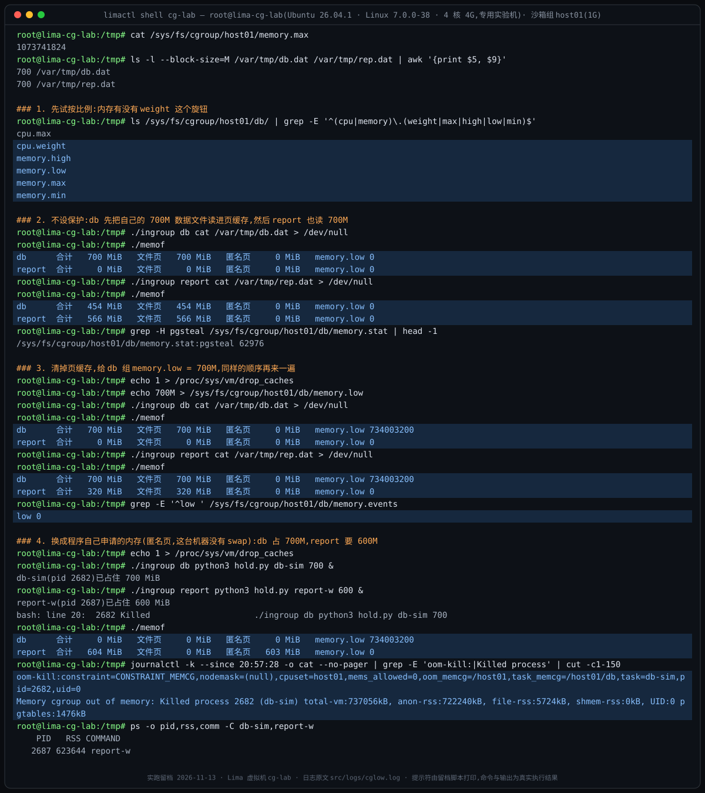

**算例。**

- 第 2 步,不设保护:1G 不够两个 700M,内核就回收。db 被收走 700 − 454 = 246 MiB,`pgsteal 62976` 页 × 4 KiB = 246 MiB,对得上。谁先被收,看的是这一页多久没被碰过,和它属于哪个组无关。db 先读的,它的页更旧,所以先被收。
- 第 3 步,db 设了 `memory.low` 700M:db 一页没少(700 MiB),report 只能在剩下的里面转,停在 320 MiB(1024 − 700,再减去两组的一点零头)。report 读后面的数据时,回收的是它自己前面读进来的页。`memory.events` 里 `low 0`,表示 db 的保护一次都没被突破。
- 第 4 步,同样的保护,换成匿名页:db-sim 占着 720 MiB 的匿名页,没有 swap,这些页回收不了;report 还要 600M,1G 装不下,只能杀。日志里范围是 `oom_memcg=/host01`(两个组的父组),挑中的是 db 组里的 db-sim,也就是受保护的那个。report-w 拿到了它的 600M。

第 4 步的结果最重要:**`memory.low` 保的是「先别回收我」,不是「别杀我」。** 页缓存可以回收,所以保护有用;匿名页又没有 swap 时,根本没有东西可回收,保护无从谈起,最后是 OOM 在父组范围里挑人,挑的还是最大的那个。要让 db 在这种情况下活下来,得给 report 加 `memory.max`(§9.2 的做法),把影响限制在它自己的组里。

两遍实跑(日志 `cglow-run1.log` 与 `cglow.log`)数字完全一样:454 / 566、700 / 320,两遍都是 db-sim 被杀。

把 CPU 和内存的旋钮放在一起:

| 想表达的意思 | CPU | 内存 | 为什么两边不一样 |
|---|---|---|---|
| 最多多少 | `cpu.max`(到了就停到下个周期) | `memory.max`(到了先回收,回收不动就在组内杀) | 都是绝对数(`C1·按组限制合计用量`);超了以后 CPU 等一等就行,内存等不来(`C2·记实际用量,超限处理看资源类型`) |
| 抢的时候谁多 | `cpu.weight`(按比例) | 没有按比例;`memory.low` / `memory.min`(先别回收谁) | CPU 每个瞬间都能重新分,内存要先收回才能重分 |
| 超了先减速、不杀 | `cpu.max` 本身就是减速 | `memory.high`(超了就强制回收、让进程变慢,从不触发 OOM) | 这一个本节没实跑 |

这张表也回答了 §9.6 末尾那句「保底那一组旋钮」:CPU 这边是 `cpu.weight`,内存这边是 `memory.low` / `memory.min`,二者都只在抢的时候起作用;内存那边还要加一句「只保护可回收的那部分」。

这些旋钮全是各个控制器自己的文件(`cpu.` 开头的归 cpu,`memory.` 开头的归 memory),核心一个也没有多加。每种资源能装什么旋钮,控制器自己按资源的性质定;核心只提供挂旋钮的地方。

### §10.4 给 report 加上 memory.max:边界划在哪,就在哪里杀

接着上面第 4 步问:同样是 db 700M、report 要 600M 的匿名页,再给 report 组加 `memory.max` 300M,谁会被杀?日志里 OOM 的范围会从 `/host01` 变成什么?

你的回答:「report 被杀。」对。范围那一半没答,实跑给出来了:

```
# echo 700M > /sys/fs/cgroup/host01/db/memory.low
# echo 300M > /sys/fs/cgroup/host01/report/memory.max
# ./ingroup db python3 hold.py db-sim 700 &
db-sim(pid 4053)已占住 700 MiB
# ./ingroup report python3 hold.py report-w 600 &
bash: line 20:  4058 Killed                     ./ingroup report python3 hold.py report-w 600

# journalctl -k … | grep -E 'oom-kill:|Killed process'
oom-kill:constraint=CONSTRAINT_MEMCG,…,oom_memcg=/host01/report,task_memcg=/host01/report,task=report-w,…
Memory cgroup out of memory: Killed process 4058 (report-w) total-vm:327220kB, anon-rss:306504kB, …

# grep -H oom_kill …/host01/memory.events …/host01/db/memory.events …/host01/report/memory.events
/sys/fs/cgroup/host01/memory.events:oom_kill 1
/sys/fs/cgroup/host01/db/memory.events:oom_kill 0
/sys/fs/cgroup/host01/report/memory.events:oom_kill 1
# grep -H -E '^(oom_kill|max) ' …/host01/report/memory.events.local …/host01/memory.events.local
/sys/fs/cgroup/host01/report/memory.events.local:max 53
/sys/fs/cgroup/host01/report/memory.events.local:oom_kill 1
/sys/fs/cgroup/host01/memory.events.local:max 0
/sys/fs/cgroup/host01/memory.events.local:oom_kill 0

# ps -o pid,rss,comm -C db-sim,report-w
    PID   RSS COMMAND
   4053 727836 db-sim
```

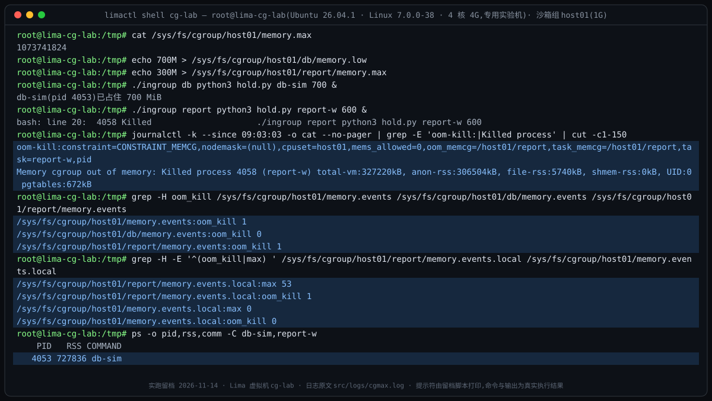

- 范围从 `oom_memcg=/host01` 变成了 `oom_memcg=/host01/report`。哪个组的上限先被达到,OOM 就在哪个组里发生、只在那个组里挑人。report-w 涨到 anon-rss 306 504 kB ≈ 299 MiB 时达到上限(`max 53`:达到上限 53 次,每次先试着回收,收不动),最后被杀。db-sim 的 728 MiB 原封不动。
- 和上面第 4 步对比:两次 db 都有同样的 `memory.low`,结果一死一活。决定谁死的不是保护,是上限划在哪。这正是你灵魂问题②里「边界谁划的」的答案:**边界就是管理员写进某个组 `memory.max` 的那个数,它决定了 OOM 发生在哪一层、在哪些进程里挑人。** 写这个数的是外面的人,内核只管兑现(`C3·内核负责执行,配额由外部设定`)。
- 一个顺带的细节:父组 host01 的 `memory.events` 也显示 `oom_kill 1`,但 `memory.events.local` 是 0。前者把整棵子树的事件都算上,后者只算自己这一层。这次 OOM 发生在 report,往上汇总到了 host01。这是 `C1·按组限制合计用量` 里「组能套组」那个要点在用量记录上的样子:父组能看到子树里发生的一切,但事情是在子组那一层处理的。
- 两遍实跑(`cgmax-run1.log` 与 `cgmax.log`)结果一致。

## §11 约束清单(C1 ~ C5)

**结论:十个发现合成五条根约束。前两条和第三条的前一半回答「为什么必须有 cgroup」;第三条的后一半和后两条回答「为什么长成这样」。**

| 编号·短名 | 内容 | 要点(由哪几个发现合成) | 不可再分性 |
|---|---|---|---|
| `C1·按组限制合计用量` | 管的单位是组,不是进程;上限是绝对数,不随对手多少、不随自己开几个进程变;组能套组,父组管整棵子树的合计 | ① 单位是组:发现①(§1,690 → 226);② 上限是绝对数:发现②(§2.1,闲时 398%,400 个 worker 时 268);③ 组能套组:发现④(§2.4 推演,§7.2 落到目录树上) | 开几个进程是应用的自由,内核无法预知也不能禁止;相对权重只能回答「谁多」,回答不了「最多多少」;上级管不了下级内部怎么分,但必须管住合计 |
| `C2·记实际用量,超限处理看资源类型` | 用量记物理页、真实 CPU 时间、真实 IO,在占用的那一刻记到组名下;超了以后怎么处理由资源性质决定:会再生的等,能拒绝的拒绝,内存只能先回收、再在超限的组里杀 | ① 记真实消耗:发现⑤(§3.1,合计 2461 MiB;没碰的 1 GiB 被拒);② 按资源特性决定超限处理:发现⑥(§3.2,db-sim 被杀) | 地址空间这类预订量不稀缺,页缓存这类消耗不挂在任何进程名下;CPU 时间每个周期都有新的,物理页占了不还就没有 |
| `C3·内核负责执行,配额由外部设定` | 归属和上限被管的进程自己改不了,由内核强制;「谁该分多少」由管理程序写进文件,内核只负责兑现 | ① 被管的进程改不了:发现③(§2.2、§2.3,解绑后 215;setsid 逃过按组杀);② 数字由外面写:发现⑧(§5.4) | 边界能被进程自己改就不存在边界;哪个业务重要是业务上的事,内核无从判断 |
| `C4·在内核已有代码路径上记账,开销要小` | 所有业务共用一个内核;记账点只能放在内核本来就要走的路径上(fork、调度器结算、缺页、提交 IO),开销必须小,没人设限时几乎没有开销 | ① 共用一个内核、② 复用已有路径记账:都是发现⑨(§6,开机 7.8 秒;每秒 262 万页) | 每家一个内核,预留出去的资源无法互借;记账在最频繁执行的路径上,开销一大,所有程序都会变慢 |
| `C5·所有资源共用同一套分组` | 资源种类会不断增加,新增一种不能惊动已有的,所以是「公共框架 + 插件」;一笔开销跨几种资源,所以分组只能有一套、树只能有一棵 | ① 种类会增加:发现⑦(§5.2,9 个控制器);② 要核对记录:发现⑩(§8.2,v1 多棵树;§4.1 已出现过) | 资源种类由硬件和业务的发展决定,事先列不完;占内存的人和发 IO 的人不是同一个执行者 |

这份清单是从上一版的八条压缩来的。八条里的每一条都还在,只是变成了某条根约束下面的一个要点;新增的两个要点(数字由外面写、复用已有路径记账)和一个要点的扩充(种类会增加)是这次补上的:

| 上一版(按旧稿的发现顺序) | 旧稿里由哪个实验得出 | 现在归到 | 新稿位置 |
|---|---|---|---|
| ① 业务是一组进程 | 什么都不管(690 → 226) | `C1·按组限制合计用量` 的要点① | §1 |
| ② 上限要是绝对数 | nice | `C1·按组限制合计用量` 的要点② | §2.1 |
| ③ 被管者不可信 | taskset、setsid | `C3·内核负责执行,配额由外部设定` 的要点① | §2.2、§2.3 |
| ④ 用量要记在物理消耗上 | ulimit | `C2·记实际用量,超限处理看资源类型` 的要点① | §3.1 |
| ⑤ 内存不可压缩 | 全机 OOM | `C2·记实际用量,超限处理看资源类型` 的要点② | §3.2 |
| ⑥ 共用一个内核 | 虚拟机 | `C4·在内核已有代码路径上记账,开销要小` 的要点① | §6.1 |
| ⑦ 限额要能分层下发 | v1 的树 | `C1·按组限制合计用量` 的要点③ | §2.4 提出,§7.2 落地 |
| ⑧ 一笔开销跨多种资源 | v1 多棵树 | `C5·所有资源共用同一套分组` 的要点② | §8.2 |
| (新)数字由外面写 | — | `C3·内核负责执行,配额由外部设定` 的要点② | §5.4 |
| (新)复用已有路径记账 | — | `C4·在内核已有代码路径上记账,开销要小` 的要点② | §6.2、§6.3 |
| (新)种类会增加 | — | `C5·所有资源共用同一套分组` 的要点① | §5.2 |

## §12 设计怎么接住约束

| 设计 | 接住了 | 代价 / 留下的问题 |
|---|---|---|
| 核心 + 控制器:分组、继承、接口、权限、组套组只做一遍,每种资源一个插件 | `C5·所有资源共用同一套分组`(前一半) | 核心和控制器之间要有一套约定,新插件怎么「报到」(留给第三节) |
| 接口是文件,数字由管理程序写 | `C3·内核负责执行,配额由外部设定` | 内核只兑现,不判断数字合不合理:写错了数也照办 |
| 进程带组籍,fork 继承,自己改不了 | `C1·按组限制合计用量`、`C3·内核负责执行,配额由外部设定` | 每个进程多一份数据;fork 和退出都要多做一点事 |
| 用量记在组上,在消耗发生的路径上记账 | `C2·记实际用量,超限处理看资源类型`、`C4·在内核已有代码路径上记账,开销要小` | 记账落在调度和内存分配的热路径上,必须想办法让开销变小 |
| 限额写在用量旁边,记账时顺手比,满了就地做超限处理 | `C1·按组限制合计用量`、`C2·记实际用量,超限处理看资源类型` | CPU 的超限处理是让整组停到下个周期,带来延迟毛刺;内存的超限处理到头还是杀 |
| 组是一棵树 | `C1·按组限制合计用量`(组能套组) | 每次记账都要顺着树往上记到每一层祖先?(这个问题留给第三节) |
| 只有一棵树(v2),插件之间要核对记录的规矩收归核心 | `C5·所有资源共用同一套分组`(后一半) | 放弃了「不同资源按不同方式分组」的自由 |

最后一行是个真实的取舍:v1 的多棵树不是没有用处,有人确实想让 CPU 按部门分、内存按服务分。v2 的判断是这种自由用处不大,而代价(记录对不上)太大,于是砍掉了,换来的折中是「同一棵树上,不同资源可以分到不同的深度」。

### §12.1 一路上得出的五条设计原则

前面每遇到一个问题,都得出了一条设计上的原则。现在把它们排在一起。注意它们得出的顺序和下表的顺序不同:表是按「从整体到细节」排的。

| 原则 | 说的是什么 | 在哪里得出 | 对应的问题 | 根在哪条约束 | 第三节去哪看实证 |
|---|---|---|---|---|---|
| 公共框架加资源插件 | 公共的那一层只管「谁和谁一组」,不知道 CPU、内存是什么;每种资源是一个插件 | §5.3 | 一种资源一个限制器,分组做四遍、对不上、种类还会增加 | `C5·所有资源共用同一套分组` | §2:逐个打开控制器;每个控制器登记时交给核心的回调函数表(内核里叫 `struct cgroup_subsys`) |
| 复用内核已有路径记账 | 不给内核另建一条路径;记账点放在内核本来就要走的路径上;没人设限时这一步不执行 | §6.3 | 每家一个内核太贵;另建一条路径,程序不配合、所有程序都要多走一趟 | `C4·在内核已有代码路径上记账,开销要小` | §3 ~ §6:每个接入点的调用栈;§4:没人设限时 0 次 |
| 记账时同步检查限额 | 用量是消耗的那一刻顺手记的,限额是记账的那一刻顺手比的;没有专门的检查线程 | §7.1.1 | 巡查线程来不及:内存每秒能吃进约 10 GiB,CPU 要卡到毫秒 | `C2·记实际用量,超限处理看资源类型` + `C4·在内核已有代码路径上记账,开销要小` | §4、§5、§7、§8;唯一的定时器只补不查(§7) |
| 内核只负责执行,数字由外面写 | 接口是文件;谁该分多少由管理程序决定,内核只负责兑现 | §5.4 | 内核不知道谁重要;§1 的调度器公平得分毫不差,却是错的 | `C3·内核负责执行,配额由外部设定` | §2:`mkdir` 和 `echo` 就是建组和写数 |
| 用统一的方式管理所有资源 | 凡是插件之间要核对记录的事,由公共层统一规定;v1 把「树长什么样」留给插件,结果记录对不上;v2 收回,只有一棵树 | §8.7 | v1 的四个痛,每一个都是留给插件自己决定的事 | `C5·所有资源共用同一套分组` | §2、§3:组籍每个控制器一栏,`/proc/<pid>/cgroup` 只有一行 |

五条原则各自都能回到一个具体的问题:没有哪一条是先定下来再去找理由的。它们合起来就是灵魂问题③里「设计哲学」那一问在这一节能给的答案。

## §13 这些看着像约束,其实不算

| 常听到的说法 | 为什么不算 |
|---|---|
| 「为了隔离,让进程互相看不见」 | 那是 namespace 的事。cgroup 不管看得见什么,只管用得了多少(第一节 §7) |
| 「为了容器」 | 顺序反了。cgroup 在 2.6.24 就有了,比 docker 早好几年;systemd 给每个服务建组,也和容器无关。是容器用了它,不是它为容器而生 |
| 「为了高性能」 | 这是要求,不是约束。真正的约束是 `C4·在内核已有代码路径上记账,开销要小` 里的那一句:记账在热路径上,所以开销必须小 |
| 「为了公平」 | 调度器本来就公平,§1 的数字分毫不差。缺的不是公平,是公平的单位(`C1·按组限制合计用量`) |
| 「为了保证每个业务拿得到资源」 | `cpu.max` 和 `memory.max` 是上限,不是保底。保底是另一组旋钮(§10.1 的 `cpu.weight`、§10.3 的 `memory.low`),属于「怎么分」,不属于「为什么要有」 |
| 「为了安全」 | cgroup 管用量,不管权限。它让 report 吃不垮机器,但拦不住 report 去读别人的文件 |
| 「做成插件是为了代码好看、好维护」 | 插件化是由需求决定的:资源种类会增加,而且一个组要同时被几种资源管(`C5·所有资源共用同一套分组`)。只为好维护的话,四个专用工具各自写好也说得过去,§5.2 的三个难点才是非抽不可的理由 |

## §14 呼应灵魂问题

| 你的问题 | 这一节拿到的 | 还缺的 |
|---|---|---|
| ① 往 `cpu.max` 写 `50000 100000`,内核怎么让这组进程最多吃半颗核? | 为什么必须是「组 + 绝对数」而不是 nice 或绑核(`C1·按组限制合计用量`);实测它确实做到了:8 个或 400 个 worker 都是约 50%,每周期 49 969 μs;为什么进程自己逃不掉(`C3·内核负责执行,配额由外部设定`);为什么准到微秒:限是在记账的那一刻比的(§7.1.1) | 机制本身:用量记在哪个结构上、谁在加、数满那一刻 400 个进程是怎么同时被限制住的、下个周期谁放它们出来 |
| ② 容器 OOM 只杀容器里的进程,边界谁划的、账怎么记? | 为什么内存超了只能杀(`C2·记实际用量,超限处理看资源类型`);没有边界时杀的是全场最胖的(db-sim);有了组,范围变成 `oom_memcg=/host01/report`,7 个 report-w 死、db-sim 活;边界是管理员写进 `memory.max` 的那个数(§10.4);用量必须按物理页记,包括页缓存 | 一页内存记到组上的那一刻发生了什么;到上限后先回收什么、何时才杀;组里挑谁;为什么 §3.2 多杀了一个 |
| ③ cgroup 通过什么架构实现对各种资源的控制?它怎么融入 Linux 内核?设计哲学是什么? | 架构:一个核心(分组、继承、文件接口、权限、树)加一排控制器(每种资源一个,只管记账和超限处理),是由「一种资源一个限制器」带来的问题得出的(§5,`C5·所有资源共用同一套分组`);融入内核的方式:复用内核已有路径记账,记账点放在 fork、调度器结算、缺页、提交 IO 这些本来就要走的路径上(§6,`C4·在内核已有代码路径上记账,开销要小`);只有一棵树是 v1 翻车之后收回的(§8);设计原则五条,每条都在这一节得出过(§12.1);四种资源在同一套公共框架上实跑通过(§9) | 核心和控制器在内核里各是什么样;控制器怎么向核心报到;每个接入点上核心做什么、控制器做什么;没人设限时这一步为什么真的没有开销 |

粗略估计:①② 两个问题各闭环到三成左右,上一节知道了问题里每个词指什么,这一节知道了为什么非这样设计不可,并且亲眼看到它生效,还不知道的是内核里的每一步是怎么做的;③ 闭环到四成左右,「为什么是这个形状」和「设计哲学从哪来」这一节基本说完了,「它在内核里长什么样、怎么接进去」是第三节的事。

## §15 留下的悬念

**这一节每个结论背后都压着一个「那它是怎么做到的」。两条线各留几个。**

第一条线,一组进程的资源是怎么被管住的:

1. **每秒几百万次,怎么记得起?** §6.2 算过,每秒要给 262 万个页记账,每次调度结算也要记。每一次都去改组上的同一个计数器吗?4 颗核同时改呢?(`C4·在内核已有代码路径上记账,开销要小`)
2. **50 ms 用完的那一刻发生了什么?** 400 个 worker 散在 4 颗核上,是谁、用什么办法把它们同时限制住的?为什么连 fork 都要排队?
3. **树怎么约束?** 子组记一笔用量,父组、祖父组的用量怎么跟着变?每次都要爬一遍树吗?(`C1·按组限制合计用量`)
4. **组内 OOM 的细节。** 先回收什么?挑谁?为什么 §3.2 里 db-sim 死了之后还要多杀一个 worker?
5. **组的份额怎么落到每颗核上?** §10.1 里两个组权重相同,db 却只拿到 152% 而不是 200%,因为 4 个 db-sim 只占了 3 颗核。一个组的权重是怎么摊到 4 颗核上的?内核为什么没把它们铺开?

还有第一节挂着的那个问题:9 个一模一样的死循环都在同一个 0.5 核的组里,为什么有一个拿到 12%、其余只有 4%~6%?

第二条线,这套公共框架。说起来容易,它怎么接进一个已经在跑的内核?

6. **组籍存在哪?** 每个进程「多带一个组籍」,带在什么东西上?那份每个控制器一栏的记录长什么样?fork 的那一刻内核做了什么,让子进程生在父进程的组里?
7. **控制器怎么报到?** 核心不管具体是哪种资源,那新写一个控制器时,它要向核心交出些什么?建组、入组、fork、退出的时候,核心怎么知道该调用谁?
8. **一个接入点上,谁做什么?** worker fork 的那一刻,核心在抄组籍,pids 控制器在数「还能不能生」,这两件事是怎么排在同一条路上的?缺页、调度结算、提交 IO 又各是谁在动手?
9. **没人设限的时候,这一步真的没有开销吗?** db 一个上限都没写,它跑的每一段 CPU、要的每一页内存,还要不要经过记账那一步?

这些都是「它是怎么解决的」那一段的内容。

## 待核清单

| # | 内容 | 状态 |
|---|---|---|
| 1 | §3.2:db-sim 被杀之后为什么还多杀 worker(三遍实跑分别多杀 1 / 3 / 1 个)。原因未查清,留到讲内存 OOM 路径的源码时回答 | 待核 |
| 2 | §3.2 / §9.2:全机 OOM 和组内 OOM 用的是同一套挑人规则(范围内找最胖的,再按 `oom_score_adj` 调整)。目前只有实测与两处日志对照,源码层面未确认 **第四节核实:2008 年合入内存控制器组内 OOM 的提交说明原话是 "chosen using the existing OOM logic",设计上同一套;今天的源码未读。见第四节 §6.1** | 设计出处已核实,源码待核 |
| 3 | §2.1:nice 0 的权重 1024、nice 19 的权重 15。实测比例(97.2% / 40.6%)与之吻合;源码位置与行号进源码时补 | 实测吻合,源码待核 |
| 4 | §8.2:v1 时代带缓冲的写入在 blkio 那边到底限不限得住,需要一条一手出处(目前只引了 v2 文档对「控制器无法合作」的总体说法) **第四节核实:Tejun Heo 2015-01 的补丁说明:块 IO 控制器分不清回写 IO 该算谁,全部记到根组。见第四节 §7.1** | 已核实,销项 |
| 5 | §9.1:吞吐是独占时的 92%~93% 而 CPU 占比是 87%,差的那几个百分点归因于「不同遍之间单次查询的 CPU 开销波动」,未进一步验证(可能与上一节待核 #8 的虚拟机效应有关) | 待核 |
| 6 | §4.1:这台机器上 dd 结束后 `Dirty` 计数几乎不涨、回写启动得很快,和预想的「脏页攒一阵再写」不一样。结论(写盘的是内核线程、页缓存不在进程名下)不受影响,但回写的时序没有深究 | 待核 |
| 7 | §13:「cgroup 比 docker 早好几年」里 docker 的首发年份;§7.2 第一版的作者与合入经过。讲来路时配一手出处(与上一节待核 #3 合并处理) **第四节核实:docker 2013 年 3 月首次公开;cgroup 框架 2007-10-19 合入,早五年多;作者 Paul Menage,经过见第四节 §3** | 已核实,销项 |
| 8 | §10.1:两组权重相同时 db 只有 133% ~ 174%(理论 200%)。已证实的部分:4 个 db-sim 每遍都只落在 2 ~ 3 颗核上,手工一核钉一个之后是 192%。未查清的部分:内核为什么不把它们铺开(§2.1 不分组时是铺开的);组的权重摊到每颗核上的算法。留到讲 CPU 控制器的机制与源码时回答 | 现象已证实,机制待核 |
| 9 | §10.1:权重 900 比 100 的五遍里有两遍偏低(288%、257%,理论 360%),当时没有采样进程所在的核,「同样是没铺满」只是推测 | 待核 |
| 10 | 同样的 CPU 占比,吞吐有时只有一半:§10.1 第三遍(`cgweight-run3.log`,155% 对 142 次/秒)和 §10.2 第二遍(`cgboth-run2.log`,362% 对 348 次/秒),相当于每次查询花的 CPU 时间从 5.8 ms 变成了 10 ms 左右。追查到的线索(`stages/02-why/src/logs/hostspeed-diag.log`):虚拟机空闲时单独跑同一段计算,「算一阵、睡半秒」的跑法每次要 9.1 ~ 10.6 ms,连续跑则是 4.6 ms,4 个进程一起连续跑是 5.3 ~ 6.5 ms。也就是说同一段计算在这台虚拟机里花的 CPU 时间能差一倍多,而且虚拟机内部看不出被抢(墙上时间等于 CPU 时间)。宿主机有两档核(5 + 10),我怀疑是虚拟机的 CPU 有时被排到了慢的那一档核上,或者频率没升上去;宿主机一侧没有验证。影响:**不同遍之间的「次/秒」不能直接比,CPU 占比和组的用量记录可以**;正文的结论都落在 CPU 占比上。#5 和上一节待核 #8 很可能是同一个原因 | 有线索,宿主机一侧待核 |
| 11 | §10.3 第 4 步:受 `memory.low` 保护的 db-sim 被父组 OOM 挑中。实测两遍都是如此,和「OOM 挑人时不看 memory.low,只看谁大」一致;源码层面未确认。memory.min 在同样情况下会不会不同,也没有实跑 | 实测两遍一致,源码待核 |
| 12 | §10.3 第 2 步:「谁先被收,看这一页多久没被碰过,和组无关」是按 db 先读、先被收的现象推的,没有单独实验(比如反过来让 report 先读)验证 | 待核 |
| 13 | §9.3:磁盘 IO 第一遍(`cgio-run1.log`,四次 dd 覆盖写同一个文件)里,`io.stat` 的 `wbytes` 是 200 MiB 而不是 150 MiB,且没有设限的 db 组写这个文件也是 5 秒。换成不同文件后正常。猜测与文件回写的归属有关,未验证 **第四节核实:内核文档原话 "Memory is tracked per page while writeback per inode":回写按文件归属于一个组,所以 db 组往归 report 的文件里写,也算 report 的用量、受 report 的限速。按文档解释,未再做实验。见第四节 §12** | 有文档依据,实验未补 |

已核实(出处都在正文链接里):`RLIMIT_AS` 限的是地址空间、`RLIMIT_RSS` 只在 2.4.30 之前有效、`RLIMIT_NPROC` 按真实用户计数且对 root 与两种能力不生效([getrlimit(2)](https://man7.org/linux/man-pages/man2/getrlimit.2.html));异步写不受 IO 优先级影响([ioprio_set(2)](https://man7.org/linux/man-pages/man2/ioprio_set.2.html));2.6.24 / 3.10 / 4.5 / 4.15 四个版本节点([cgroups(7)](https://man7.org/linux/man-pages/man7/cgroups.7.html));v1 的四类问题与 No Internal Process Constraint、Writeback 三处引文([cgroup-v2 文档](https://docs.kernel.org/admin-guide/cgroup-v2.html))。

§9.3 / §9.4 的留档说明:进程数与磁盘 IO 两段在 cg-lab 上跑,日志 `stages/02-why/src/logs/cgpids.log`、`cgio.log`(磁盘 IO 的第一遍另存为 `cgio-run1.log`)。

实验机的说明:§9.3、§9.4、§10.3、§10.4 这四段在专用实验机 cg-lab 上跑(和 cg 同一个系统镜像,同样是内核 7.0.0-38;4 核 4G,只跑本文的实验,用完删除),其余实验都在 cg 上。换机器是因为 cg 上跑着别的服务,之前吃满 CPU 的实验已经干扰到它们。

§10.3 的留档说明:§10.3 跑了两遍,数字一致,正文与图用后一遍(`stages/02-why/src/logs/cglow.log`),前一遍是 `cglow-run1.log`;§10.4 同样两遍一致(`cgmax.log`、`cgmax-run1.log`)。之前各节的数字都来自 cg,没有重跑。

§10.2 的留档说明:跑了三遍,正文与图用最后一遍(`stages/02-why/src/logs/cgboth.log`),前两遍原样保留为 `cgboth-run1.log`、`cgboth-run2.log`。

§10.1 的留档说明:这组实验前后跑了五遍。正文与图用的是最后一遍(`stages/02-why/src/logs/cgweight.log`);第二到第四遍的日志原样保留为 `cgweight-run2.log` ~ `cgweight-run4.log`;第一遍(174% / 352%)当时还没加采样核号的命令,日志被后一遍覆盖了,只剩这两个数。另有一遍只用于排查的运行(每半秒采样一次核号,db 138%),没有留日志。

实验环境的一处变化,如实记录:做这一节实验时发现虚拟机里多了 mysqld、clickhouse、redis 三个真服务(当天 17:36 之后装的,不是这一节的实验装的)。因此所有实验都关进了沙箱组,没有做真正的全机 OOM;实验前后这三个服务的进程和内存占用没有变化。

---

> 第二篇得出了五条约束,和「公共框架加资源插件」这个设计。第三篇看这个设计在内核里落在哪里:跟着一个 worker 进程从 fork 到退出,看它经过的五个接入点上,cgroup 各多做了什么,每个接入点都有 bpftrace 抓到的调用栈。这一篇最长,可以按接入点挑着读。

---

<a id="stage-how"></a>

# 第三篇 How:cgroup 的设计怎么接进内核

第二节结束时,你手里已经有了一套设计:公共的一层(核心)管树、组籍、文件接口和生命周期通知;每种资源一个插件(控制器);再加上一个想法:进程带组籍,消耗资源时记到组的账上,账旁边写着限。第二节最后留下的问题是:这套设计说起来容易,它怎么接进一个已经在跑的内核?

这一节回答它。你还是那个要让 Linux 内核把各种资源统一管起来的开发者,只是现在要动手了。你面前的内核早就有一套成熟的路:fork 造进程,调度器分 CPU,缺页时给内存,块层把数据交给磁盘,exit 收拾退出的进程。`C4·在内核已有代码路径上记账,开销要小` 不许你另修一条路,你只能在这些路上找位置,把记账的那一步加进去。

讲法是跟着一个进程走。主角还是 report 的一个 worker,它的一生是:出生(fork)→ 跑 CPU → 要内存 → 写盘 → 生孩子 → 退出。它每经过一条路,就碰到一个**接入点**。每个接入点讲六件事:内核原本在这条路上做什么;cgroup 在哪一步之后接入(用实测的内核调用栈作证);核心做了什么;哪个控制器做了什么;这笔账为什么记得起;超了怎么处置。

只讲 cgroup v2,不贴内核源码。跟踪输出里出现的内核函数名只用来标明位置,不展开实现。所有终端输出都在专用实验机上实跑过,原样贴出。

## §0 从「为什么」走到「怎么做」:三件事记住

第二节 §7.1 的核心想法里有三个名词:组籍、组的账、组的限;§5 和 §8 又把整套设计切成两层:和资源无关的核心,每种资源一个的控制器。这一节要把它们落进内核。落下去之后,worker 一生中碰到的只有三样东西:**组籍、账、接入点**。前两样是「东西」,第三样是「位置」:东西放在哪,在哪一刻被用到。

### §0.1 组籍:进程身上的一个指针(归核心)

因为 `C1·按组限制合计用量`(管的是组,要按组加总)和 `C3·内核负责执行,配额由外部设定`(归属不能由进程自己说了算)→ 要解决「内核在任何时刻都能从一个进程一步找到它的组,而且这个归属进程自己改不了」→ 所以每个进程在内核里的档案上多一个指针,指向一张**组籍**(内核里叫 `css_set`)。组籍上每个控制器一个格子,写着「这种资源的账在哪个组上」。同一个组的进程指向同一张组籍;fork 的时候,子进程抄走的就是这个指针。组籍和具体资源无关,归核心管。

### §0.2 账:每个组、每种资源一本,限写在旁边(归控制器)

因为 `C2·记实际用量,超限处理看资源类型`(记的是花掉的,超了怎么办随资源而定)和 `C5·所有资源共用同一套分组`(每种资源各有各的记法,但分组只有一套)→ 要解决「消耗发生的那一刻就记到组头上,超没超当场知道,而且每种资源可以有自己的记法和处置」→ 所以每个组、每种资源各有**一本账**(一个记录用量的数据结构),挂在同一棵树的节点上;**限就写在账的旁边**,每次记账都是「加上去,看超没超」。CPU 的账是每个周期补满一次的时间额度,内存的账是已用页数,进程数的账是个数,IO 的账是每秒的字节数。这本账长什么样、超了怎么办,由各自的控制器决定。

### §0.3 接入点:记账的那一步加在哪(核心和控制器衔接的地方)

因为 `C4·在内核已有代码路径上记账,开销要小`(所有业务共用一个内核,不能另修一条路,而记账恰好落在最热的路径上)→ 要解决「记账的那一步放在哪,才能不漏记、不另起炉灶,还足够便宜」→ 所以引入**接入点**:在内核本来就要走的路上(fork、调度器结算、缺页、提交 IO、退出)找一个位置,多执行一小步。

同一条约束还逼出一样东西。多颗核同时往一本账上记,就要抢同一把锁,核越多抢得越凶 → 要解决「记得勤,又不互相打扰」→ 所以再引入**每颗核的本地额度**:每颗核先从组的总额度里领一小份,平时只扣自己这一份,用完才去动全组共享的那本账。一份多大,§4、§5 再算。

接入点是核心和控制器碰头的地方。有的接入点由核心参与,挨个通知控制器(fork、退出);有的由控制器自己负责,核心不参与(调度器结算、缺页、提交 IO)。

### §0 结论

| 三件事 | 是什么 | 为什么存在 |
|---|---|---|
| 组籍(核心) | 进程身上的一个指针,指向一张每个控制器一个格子的卡片 | 让内核一步从进程找到组;进程自己改不了(`C1·按组限制合计用量`、`C3·内核负责执行,配额由外部设定`) |
| 账(控制器) | 每个组每种资源一本,挂在树上;限写在旁边 | 消耗发生时当场记、当场比;每种资源记法和处置各不同(`C2·记实际用量,超限处理看资源类型`、`C5·所有资源共用同一套分组`) |
| 接入点(碰头处) | 内核本来就要走的路上多走的那一步;每颗核先领一小份本地额度 | 不另修路,不漏记,开销小(`C4·在内核已有代码路径上记账,开销要小`) |

三者的关系:**进程 →(组籍)→ 账 →(旁边)→ 限**。这条链什么时候被走一遍,由接入点决定:worker 每消耗一点资源,内核在自己本来就要走的那条路上多走一步,顺着组籍找到账,加上去,比一下限。

放回第一节那套合租公寓:组籍是户籍登记,写着你住哪一户;账是每户的水表、电表、燃气表,各管各的,限额写在表旁边;接入点是表装的位置,装在每户的入户管上,不用把全楼的水管重铺一遍。物业(管理程序)只负责往表旁边写限额。

下面按 worker 的一生走:§2 是开场前的准备(核心怎么建树、控制器怎么接入);§3 ~ §6 是四个接入点(fork、调度器结算、缺页、提交 IO);§7 ~ §9 是超了之后;§10 是树和退出;§11 把这一生压成一张表。

## §1 一张全景图

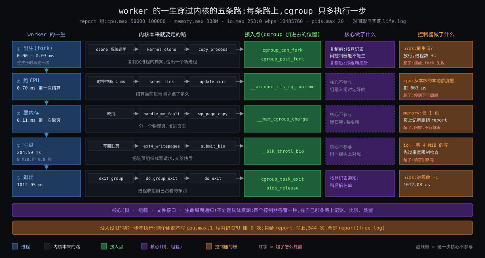

从图上能读出五件事:

1. worker 的一生穿过内核的五条路。每条路上灰色的那一段,是内核本来就要走的,和 cgroup 无关。
2. 每条路的末端多出一个接入点(绿色),cgroup 的记账就加在这里。没有哪一格是 cgroup 自己新修的路。
3. 核心(紫色)只在 fork 和退出两处参与:复制之前问控制器、复制之后抄组籍、退出时摘名单。另外三条路上核心不参与,控制器顺着组籍自己找到账。
4. 四种资源的账和处置各不相同(橙色和红字):CPU 停到下个周期,内存回收或杀,IO 排队,进程数拒绝。
5. 最下面一行:没人设限的组,CPU 那一步干脆不执行(§4.5;IO 也是这样,内存不是,同一小节有对照)。

这张图对应一次实跑。report 组四种资源各写一个上限,然后让 report 生出一个 worker:worker 先烧 0.2 秒 CPU,再要 20 MiB 内存,写 8 MiB 文件并等它落盘,生一个孩子,退出(小程序 `stages/03-how/src/prog/life.py`)。跟踪脚本(`stages/03-how/src/prog/t7-life.bt`)在每个接入点第一次被碰到时打印一行,时间从 report 生 worker 的那一刻算起:

```
# echo '50000 100000' > /sys/fs/cgroup/host01/report/cpu.max
# echo 300M > /sys/fs/cgroup/host01/report/memory.max
# echo '253:0 wbps=10485760' > /sys/fs/cgroup/host01/report/io.max
# echo 20 > /sys/fs/cgroup/host01/report/pids.max

# bpftrace t7-life.bt 0 > life.out 2>&1 &
# ./ingroup report python3 life.py
# grep -v -e Attached -e '^$' life.out
  0.00 ms  [fork]      pids 控制器被问「能生吗」→ 放行,report 组的进程数 +1
  0.03 ms  [fork]      核心:子进程 9356 抄走父进程的组籍 0xffff0000c5b97400,挂上名单
  0.11 ms  [缺页]      memory 控制器:分到物理页,给 report 组记 1 页
  0.70 ms  [调度结算]  cpu 控制器:刚跑掉 663 微秒,从 report 组在核 3 的零钱里扣
204.59 ms  [提交 IO]   io 控制器:一笔 4194304 字节的写请求,交给磁盘前先过 report 组的带宽闸门
1011.44 ms  [fork]      worker 自己生孩子:pids 控制器又被问一次 → 放行
1012.05 ms  [退出]      核心:把 worker 从组籍的名单上摘掉
1012.08 ms  [退出]      pids 控制器:report 组的进程数 -1
```

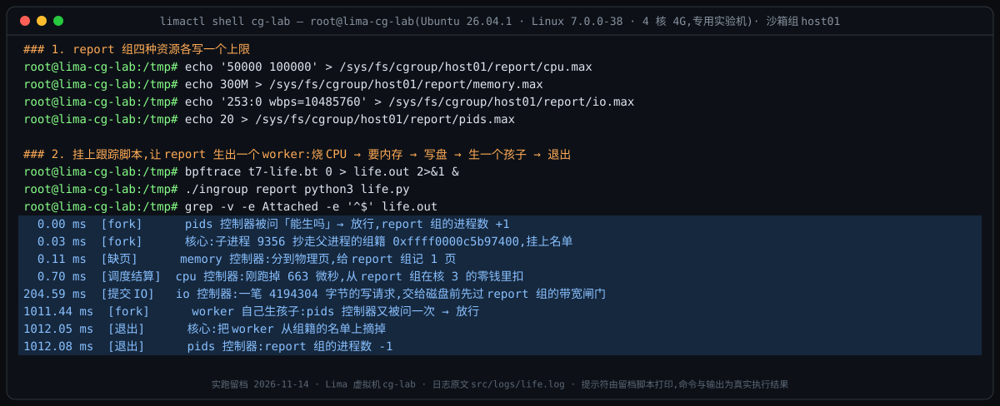

这八行就是这一节的提纲。0.00 和 0.03 ms 两行是出生(§3);0.70 ms 是跑 CPU(§4);0.11 ms 是要内存(§5),它比 CPU 那一行还早,原因在 §5.2;204.59 ms 是写盘(§6),从这一行到下一行隔了约 0.8 秒,8 MiB 按每秒 10 MiB 算正好要这么久,所以我推断这段时间主要花在 io 控制器让写请求排队等待上(没有抓到排队本身,见 §6.5);1011.44 ms 是 worker 自己生孩子,又走一遍 fork;最后两行是退出(§10.3)。每种接入点只打印第一次,后面成千上万次照样发生,只是没有打印。

worker 出生之前,先要把这些准备工作做好。

## §2 准备工作:核心建好树,控制器依次接入

**结论:worker 出生之前,管理员只做了两种动作:`mkdir` 和 `echo`。`mkdir` 让核心在树上多一个节点,核心再按「父组往下开了哪些控制器」挨个通知控制器来建账;`echo` 把数字写进某本账旁边的限。核心本身不处理任何一种具体资源,它只管树上的节点和登记过的控制器;数字是怎么定的,内核也不过问,它只负责执行。**

### §2.1 先建组设限:`mkdir` 和 `echo` 在内核里各做了什么

如果你是内核开发者,第一件要定的事是:管理程序怎么把「report 最多半颗核」告诉内核?第二节 §5 已经定了一半:report 该分多少,内核不知道也不该知道,数字由外面写进来(`C3·内核负责执行,配额由外部设定`)。剩下的是用什么接口。cgroup 选的是文件:建组就是建目录,设限就是往文件里写一行。

§1 那次实跑开场前写的四个上限,加上更早的建组,在内核里对应这些事:

| 管理员做的 | 内核里发生的 | 归谁 |
|---|---|---|
| `mkdir /sys/fs/cgroup/host01/report` | 核心在树上多一个节点 report;父组往下开了哪几种控制器,就通知哪几个控制器给它建一本账 | 核心建节点,控制器建账 |
| `echo '50000 100000' > report/cpu.max` | 把这两个数写进 report 的 CPU 账:每 100 000 μs 一个周期,每周期额度 50 000 μs | cpu 控制器 |
| `echo 300M > report/memory.max` | 把 76 800 页(300 MiB ÷ 4 KiB)写进 report 的内存账,作为上限 | memory 控制器 |
| `echo '253:0 wbps=10485760' > report/io.max` | 在设备 253:0(这台机器的 vda)上,report 每秒最多写 10 485 760 字节,也就是 10 MiB | io 控制器 |
| `echo 20 > report/pids.max` | report 这棵子树里最多 20 个进程 | pids 控制器 |

这几步只改了账,没有动任何进程。此刻 report 组里一个进程都没有。

这些文件的主人是 root,普通进程打不开(第二节 §9.5 试过,`Permission denied`)。这是 `C3·内核负责执行,配额由外部设定` 前一半的落点:账和限放在被管的进程改不到的地方。

后一半落在数字上。`50000 100000` 这两个数,内核不问来由。report 为什么值半颗核、db 为什么不设限,是写这个文件的那一方(管理员、systemd、docker)决定的;第一节 §4 倒推过这几个数是怎么一站站传到这个文件里的。这一点的具体做法是:内核只提供「目录 + 文件 + 写进来就生效」这套机制,数字全由外面写,内核自己一个数也不填。

### §2.2 实验环境、路牌,和怎么读调用栈

这一节的实验都在专用实验机 cg-lab 上跑(Ubuntu 26.04.1,内核 7.0.0-38,4 核 4G,arm64)。抓现行用的是内核跟踪工具 bpftrace:写几行脚本,告诉它「内核执行到某个函数时,把这几个数打印出来」。下面会出现的内核函数和结构(用作定位标记):

| 内核函数 / 结构 | 它是什么 | 在哪一节 |
|---|---|---|
| `css_set` | 组籍 | §3 |
| `<控制器>_css_alloc` | 核心通知某个控制器给新组建一本账 | §2.4 |
| `cgroup_can_fork` / `pids_can_fork` | fork 的半路上,核心问各控制器「能生吗」/ pids 控制器的回答 | §3 |
| `cgroup_post_fork` | fork 快结束时,把新进程挂到组籍上的那一步 | §3 |
| `__account_cfs_rq_runtime` | 某个组在某颗核上刚跑掉一段时间,记一笔 | §4 |
| `sched_cfs_period_timer` | 每个周期触发一次、给组补额度的定时器 | §4、§7 |
| `throttle_cfs_rq` / `unthrottle_cfs_rq` | 在某颗核上给这个组设置 / 清除「限流中」标记 | §7 |
| `throttle_cfs_rq_work` | 某个进程发现标记后停下 | §7 |
| `__mem_cgroup_charge` / `try_charge_memcg` / `page_counter_try_charge` | 给新分到的页记账 / 给组记若干页 / 真正去改组的计数器 | §5 |
| `__blk_throtl_bio` | 写请求交给块层时,io 控制器的带宽限制检查 | §6 |
| `try_to_free_mem_cgroup_pages` | 在某个组的范围内回收内存 | §8 |
| `mem_cgroup_out_of_memory` / `oom_badness` | 组内 OOM / 给一个进程打分 | §8 |
| `cgroup_task_exit` / `pids_release` | 进程退出时核心按登记表通知各控制器 / pids 控制器的进程数减一(从名单上摘掉在更后面,见 §10.3 的更正) | §10.3 |

图是日志的渲染,不是窗口截图;正文代码块是日志的节选(提示符缩写成 `#`),数字和图、日志是同一遍。跟踪脚本和小程序都在 `stages/03-how/src/prog/`。

这一节最重要的一类证据是**调用栈**。跟踪工具可以在某个函数被调用的那一刻,把「是谁一路调用到这里的」打印出来,一行一个函数。读法是**从下往上**:最下面一行最先被调用,它调用了上面一行,上面一行再调用更上面一行,最上面一行就是被抓住的那个函数。Java 程序抛异常时打印的栈也是这个顺序,最上面是出事的那一行,越往下越靠近 `main`。

从每个栈里要读出两样东西:**下面那几行是内核本来就要走的路**,一个没有 cgroup 的内核也一样要走;**最上面一到三行是 cgroup 加进去的调用**。这次跟踪每个栈只打 11 层,去掉跟踪工具自己的几层后剩 8 行,更早的调用者被截掉了。五个接入点的栈都画在下面这张图里,先扫一眼;§3 ~ §6 和 §10.3 各读其中一列。

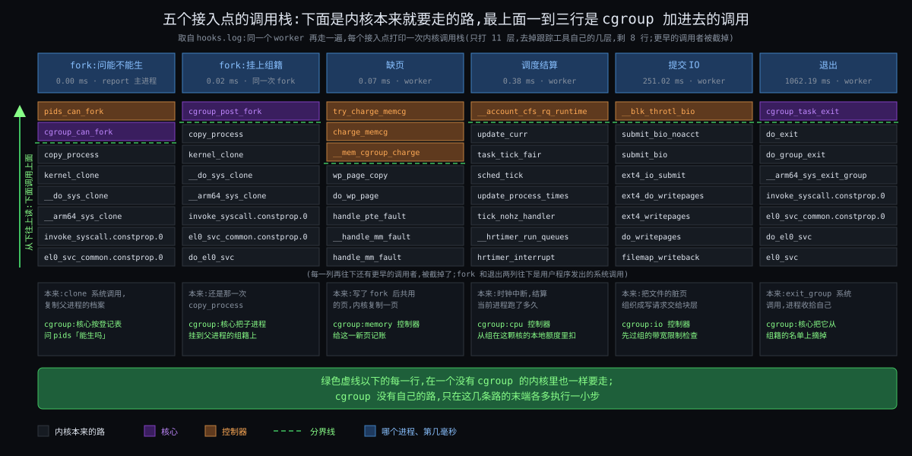

### §2.3 核心的四项功能,和控制器的三个问题

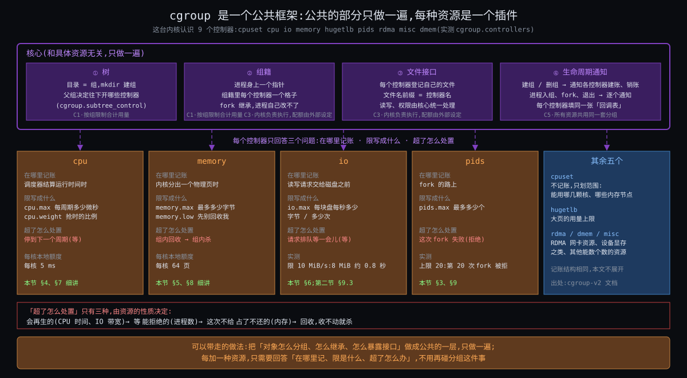

第二节 §5 里,你的第一版是「一种资源写一个限制器」,写到第二个就发现分组、继承、接口、权限要重做一遍,写到第四个,四套分组互相对不上。于是你把和资源无关的那部分抽出来,只做一遍。抽出来的就是**核心**,它不处理任何一种具体资源,只做四件事:

| 核心提供的 | 是什么 | 本节在哪见 |
|---|---|---|
| 树 | 目录就是组;父组决定往下开哪些控制器(`cgroup.subtree_control`) | §2.4、§10.1 |
| 组籍 | 进程身上的指针;一张组籍里每个控制器一个格子;fork 继承 | §2.4、§3 |
| 文件接口 | 每个控制器登记自己的一组文件,文件名前缀就是控制器名;读写和权限由核心统一处理 | §2.1、§2.4 |
| 生命周期通知 | 建组、删组、进程入组、fork、退出时,核心挨个通知控制器 | §2.5、§3、§10.3 |

为什么切在这里:因为 `C1·按组限制合计用量` 和 `C3·内核负责执行,配额由外部设定` 对任何资源都一样,而 `C2·记实际用量,超限处理看资源类型` 说的两件事(记在哪、超了怎么办)每种资源都不同,`C5·所有资源共用同一套分组` 又说种类还会增加 → 要解决「分组只做一遍,新增一种资源不用重做」→ 所以切成两层:核心管所有资源都一样的部分;**控制器**只管自己那种资源的三个问题:

1. **在哪里记账**:把记账的那一步加在这种资源被消耗的那条路上(接入点)。
2. **限写成什么**:暴露哪几个文件,数字是什么含义。
3. **超了怎么处置**:等、拒绝,还是回收和杀。

回头看 §0:组籍属于核心;账和限属于控制器;接入点是两者碰头的地方。

### §2.4 实跑:开启一个控制器,内核里发生了什么

建一个组 host01 和它的子组 demo,先不往下开任何控制器,在 demo 里放一个每半秒 fork 一次的小进程 ticker;然后在 host01 上一个个往下开控制器,看三样东西怎么变:demo 目录里的文件、内核里的建账动作、ticker 的组籍。

```
# cat /sys/fs/cgroup/cgroup.controllers
cpuset cpu io memory hugetlb pids rdma misc dmem
# cat /sys/fs/cgroup/cgroup.subtree_control
cpuset cpu io memory pids

# mkdir -p /sys/fs/cgroup/host01/demo
# ls /sys/fs/cgroup/host01/demo | cut -d. -f1 | sort | uniq -c | xargs
13 cgroup 3 cpu 1 io 1 memory
# bpftrace t5-framework.bt > t5.out 2>&1 &
# ./ingroup demo python3 ticker.py &

# echo '+pids' > /sys/fs/cgroup/host01/cgroup.subtree_control
# ls /sys/fs/cgroup/host01/demo | cut -d. -f1 | sort | uniq -c | xargs
13 cgroup 3 cpu 1 io 1 memory 5 pids

# echo '+cpu +memory +io' > /sys/fs/cgroup/host01/cgroup.subtree_control
# ls /sys/fs/cgroup/host01/demo | cut -d. -f1 | sort | uniq -c | xargs
13 cgroup 10 cpu 5 io 21 memory 5 pids
# ./ingroup demo sleep 30 &

# grep -v -e Attached -e '^$' t5.out
入组  框架询问 pids 控制器:pid 8993 能搬进来吗
入组  框架通知 cpuset 控制器:pid 8993 搬进来了
入组  框架通知 cpu 控制器:pid 8993 搬进来了
入组  框架通知 memory 控制器:pid 8993 搬进来了
组籍  ticker(pid 8993)现在的组籍 0xffff0000cb982c00,五个格子:cpuset → host01   cpu → host01   io → host01   memory → host01   pids → host01
建账  框架请 pids 控制器给 host01 的一个子组建账
组籍  ticker(pid 8993)现在的组籍 0xffff0000cb39b800,五个格子:cpuset → host01   cpu → host01   io → host01   memory → host01   pids → demo
建账  框架请 cpu 控制器给 host01 的一个子组建账
建账  框架请 io 控制器给 host01 的一个子组建账
建账  框架请 memory 控制器给 host01 的一个子组建账
组籍  ticker(pid 8993)现在的组籍 0xffff0000c40f8000,五个格子:cpuset → host01   cpu → demo   io → demo   memory → demo   pids → demo
入组  框架询问 pids 控制器:pid 9042 能搬进来吗
入组  框架通知 cpuset 控制器:pid 9042 搬进来了
入组  框架通知 cpu 控制器:pid 9042 搬进来了
入组  框架通知 memory 控制器:pid 9042 搬进来了
```

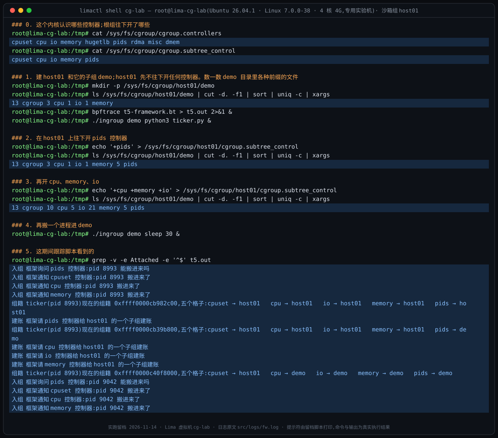

(跟踪输出里的「框架」就是核心,当时脚本里是这么叫的。)

**读数。**

- **这台内核认识 9 个控制器。** 第一行就是清单。根组往下开了其中 5 个。
- **开一个控制器,目录里就多出它的那组文件。** 开 pids,多了 5 个 `pids.*`;再开 cpu、memory、io,`cpu.*` 从 3 个变 10 个,`io.*` 从 1 个变 5 个,`memory.*` 从 1 个变 21 个。(没开时也有的那几个,是每个组都带的统计和压力文件。)13 个 `cgroup.*` 文件始终不变,它们属于核心。
- **开一个控制器,核心就通知它给子组建一本账。** 「建账」那四行,每个控制器被调用的是同一类函数,名字都是 `<控制器>_css_alloc`:`pids_css_alloc`、`cpu_cgroup_css_alloc`、`blkcg_css_alloc`(io)、`mem_cgroup_css_alloc`。四个控制器互不相干,核心按同一种方式挨个调用。
- **组籍是「每个控制器一个格子」。** 一开始五个格子都指向 host01:demo 自己没有任何一本账,它的进程花的资源都记在父组 host01 的账上。开了 pids,pids 那一格改指 demo,其余不动,而且**组籍换了一张**(地址从 `…cb982c00` 变成 `…cb39b800`):格子里的内容变了,就是另一张组籍。全开之后,cpu、io、memory、pids 四格指向 demo,cpuset 没开,仍指向 host01。前后一共三张组籍,三个地址。
- **入组时,核心挨个通知。** 把一个进程搬进 demo,pids、cpuset、cpu、memory 四个控制器各被调用一次,pids 那一次是「询问」:它可以拒绝(组满了就不让进)。

从这几条能直接读出 cgroup 的第一条设计原则:**公共框架加资源插件**。核心不知道 `cpu.max` 是什么意思,只知道 cpu 控制器登记过这么一个文件;它不知道一个组的 CPU 账长什么样,只知道「开了 cpu 就通知 cpu 控制器来建账」。第二节 §5 里推出的那个分层,在这里有了实物。

还有一条容易漏看:组籍上五个格子指向的,都是**同一棵树**上的节点,区别只在深度(demo 或 host01)。第二节 §12 说过,v2 只留一棵树之后的折中是「同一棵树上,不同资源可以分到不同的深度」,这就是它在内核里的样子:一个组没开某个控制器,那种资源的格子就指向最近的、开了这个控制器的祖先。v1 当年允许每个控制器各挂一棵树,v2 把这个自由取消了,**用统一的方式管理所有资源**这条原则,在组籍上的体现就是「五个格子,一棵树」。

### §2.5 登记表:控制器交给核心的一张表

上面的「建账」和「入组」,核心是怎么知道该通知谁、调用它的哪个函数的?

因为 `C5·所有资源共用同一套分组`(控制器会一个个加进来,新加一个不能要求核心改代码)→ 要解决「建组、入组、fork、退出这些时刻,核心怎么知道该通知谁、让它做什么」→ 所以引入**登记表**(内核里叫 `struct cgroup_subsys`,是控制器交给 cgroup 核心的那张回调函数表):每个控制器向核心交一张固定格式的回调表。表上有一排固定的格子(建账、账上线、销账、能不能搬进来、搬进来了、能不能生、生了、退出了、最后释放……),控制器在关心的格子里填上自己的函数,不关心的空着。到了约定的时刻,核心按表挨个调用。

这张表在内核里摸不到,但填进去的函数有名字,而且命名很规矩:`<控制器前缀>_<格子名>`。从内核的函数清单里按名字筛一遍,就能看到每个控制器填了哪些格子:

```
# grep -oE '^(pids|cpu_cgroup|mem_cgroup|blkcg|cpuset)_(css_alloc|css_online|css_free|can_attach|attach|can_fork|fork|exit|release)\b' /sys/kernel/tracing/available_filter_functions | sort | column -c 132 | expand
blkcg_css_alloc         cpu_cgroup_css_alloc    cpuset_css_alloc        mem_cgroup_css_free     pids_css_alloc
blkcg_css_free          cpu_cgroup_css_free     cpuset_css_free         mem_cgroup_css_online   pids_css_free
blkcg_css_online        cpu_cgroup_css_online   cpuset_css_online       mem_cgroup_exit         pids_release
blkcg_exit              cpuset_attach           cpuset_fork             mem_cgroup_fork
cpu_cgroup_attach       cpuset_can_attach       mem_cgroup_attach       pids_can_attach
cpu_cgroup_can_attach   cpuset_can_fork         mem_cgroup_css_alloc    pids_can_fork
```

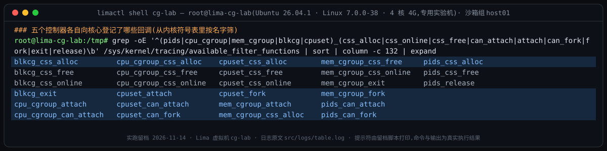

命令拆开看:`/sys/kernel/tracing/available_filter_functions` 是跟踪工具能挂钩的内核函数清单;`grep` 按名字筛,前缀五种(`pids`、`cpu_cgroup` 是 cpu、`mem_cgroup` 是 memory、`blkcg` 是 io,io 控制器在内核里沿用了老名字 block cgroup、`cpuset`),后缀九种;`sort | column` 只是排版,按列从上往下读。

按控制器重新排一遍:

| 格子 | 意思 | pids | cpu | memory | io | cpuset |
|---|---|---|---|---|---|---|
| `css_alloc` | 给新组建账 | ✓ | ✓ | ✓ | ✓ | ✓ |
| `css_online` | 账上线 | | ✓ | ✓ | ✓ | ✓ |
| `css_free` | 销账 | ✓ | ✓ | ✓ | ✓ | ✓ |
| `can_attach` | 进程能搬进来吗 | ✓ | ✓ | | | ✓ |
| `attach` | 进程搬进来了 | | ✓ | ✓ | | ✓ |
| `can_fork` | 能生吗 | ✓ | | | | ✓ |
| `fork` | 生了 | | | ✓ | | ✓ |
| `exit` | 退出了 | | | ✓ | ✓ | |
| `release` | 最后释放 | ✓ | | | | |
| 合计 | | 5 | 5 | 6 | 4 | 7 |

**读数。**

- 五个控制器都填了建账和销账两格。这是「入场」的最低要求。
- pids 填了「能生吗」:§3 会看到,它就是靠这一格在 fork 的路上数进程、满了拒绝。它还填了「最后释放」,§10.3 看到进程数在那一刻减一。
- cpu 一个和 fork、退出有关的格子都没填。CPU 的账不在 fork 时记,在调度器结算时记(§4),那一步由 cpu 控制器自己负责。io 只填了四格,它的账在写请求交给块层时记(§6),也是自己负责。
- 各控制器填的格子不一样多,核心不在乎,它只管在约定的时刻按表调用。
- 表上的格子全是「建组、入组、fork、退出」这类和资源无关的时刻,**没有一格叫「记 CPU 账」或「分一个页」**。核心不处理具体资源,在这张表上看得最清楚:记账的那一步根本不在登记表上,它在内核各条路的接入点里(§3 ~ §6)。所以控制器和内核打交道有两条线:生命周期那条线经过核心,按登记表调用;消耗资源那条线不经过核心,控制器直接在内核各条路径上记账。

两处照实交代。第一,这张表是从符号表里按名字筛出来的,它说明内核里有这些名字的函数,而且和 fw.log 里被调用的函数对得上;但「这些函数都填在登记表上」「表上一共有哪些格子」(这次只按九种名字筛)没有逐个核对,记入待核 #14。第二,fw.log 入组时只看到四个控制器被叫,是因为当时只给这四个函数挂了探针;表里 io 确实没有 `attach` 这一格,两边不矛盾,但 fw.log 本身证明不了 io 没被叫。

### §2.6 再逼问:核心为什么不处理具体资源

如果核心处理具体资源,会出什么问题?核心里就得写着「如果是 CPU 就这样,如果是内存就那样」。加第十种资源要改核心;九种资源的特殊情况全挤在公共代码里,改一处可能碰坏另外八种。`C5·所有资源共用同一套分组` 要的「新增一种不能惊动已有的」就做不到。

| 没有它会坏在哪 | 它解决了 |
|---|---|
| 每种资源自己做一套分组、继承、接口,第二节 §5 那四套分组对不上 | 核心只做一遍,控制器只回答三个问题 |
| 核心里写死每种资源,加一种就要改核心 | 控制器交一张登记表,核心按表调用;实测这台内核接了 9 个控制器 |
| 每个控制器自己定接口格式,管理程序要学 9 种写法 | 文件接口统一,前缀就是控制器名 |
| 数字写死在内核里,或者由内核去猜 | 数字由外面写进文件,内核只兑现(`C3·内核负责执行,配额由外部设定`) |

台搭好了,账也建了。worker 该出生了:一个新进程,是怎么带上这张组籍的?

## §3 接入点一 fork:组籍是怎么带上的

**结论:fork 这条路内核本来就要走:复制父进程的档案,造出一个新进程。cgroup 在复制的过程中加了两次调用:复制之前,核心按登记表问一圈「能生吗」,pids 控制器在这里把进程数加一,满了就拒绝;复制之后,核心把子进程挂到父进程那张组籍上。子进程不需要「加入」组,它一出生就在组里。同一个接入点上,核心管组籍,控制器管账,两者的分工在这里第一次看清。**

### §3.1 如果是你:新进程怎么带上组籍

你已经有了组籍。现在 report 要 fork 一个 worker,worker 得属于 report 组。你会把这件事放在哪?

让 report 生完孩子以后自己去登记「刚生的那个也是我们组的」,不行:`C3·内核负责执行,配额由外部设定` 说归属不能由进程自己说了算,它可能忘了,也可能故意不报。开一个后台线程定期扫描新进程、按父进程补登记,也不行:扫描有间隔,间隔里新进程已经在花资源了,而且这是另修一条路(`C4·在内核已有代码路径上记账,开销要小`)。

剩下的办法是:fork 这条路内核反正要走,就在这条路上把组籍带过去。

**内核原本在这条路上做什么。** 程序调用 fork(在 Linux 上发的是 clone 系统调用),内核进入 `kernel_clone`,再进入 `copy_process`:给子进程建一份新档案,把父进程的内存映射、打开的文件、信号处理方式等一样样复制或共享过去。这条路在不带 cgroup 的内核里也一模一样。

### §3.2 概念:进程、组籍、入组的两条路

每个进程在内核里有一份档案。档案里有一个指针,指向一张组籍。组籍上的内容很少,主要是一排指针:CPU 的账在哪、内存的账在哪、进程数的账在哪……每个控制器一个格子(§2.4 亲眼看到过五个格子)。

入组分两种情况:

- **写 `cgroup.procs`**(把一个已有的进程搬进组):内核给它换一张组籍。只换它自己的,它已经生出来的子进程不动(第一节 §4.4 实测过)。
- **fork**:子进程直接用父进程那一张。

所以开场那个两行的小脚本 `ingroup` 才要「先入组、后变身」:先把自己写进 `cgroup.procs`,换上 report 的组籍,再变身成要跑的程序。此后它 fork 出来的每一个 worker 都带着同一张组籍。

### §3.3 调用栈:cgroup 在 `copy_process` 的中途加了两次调用

同一个 worker 再走一遍,这次每到一个接入点,跟踪脚本把当时的内核调用栈也打印出来(同一个脚本 `t7-life.bt`,参数换成 1)。先看 fork 的两段:

```
# bpftrace t7-life.bt 1 > hooks.out 2>&1 &
# ./ingroup report python3 life.py
# grep -v -e Attached -e bpf_ -e '^$' hooks.out | sed -E 's/^\t[0-9a-f]+ ([^+]+)\+[0-9]+$/             \1/'
  0.00 ms  [fork]      pids 控制器被问「能生吗」→ 放行,report 组的进程数 +1
             pids_can_fork
             cgroup_can_fork
             copy_process
             kernel_clone
             __do_sys_clone
             __arm64_sys_clone
             invoke_syscall.constprop.0
             el0_svc_common.constprop.0
  0.02 ms  [fork]      核心:子进程 9578 抄走父进程的组籍 0xffff0000c40f8400,挂上名单
             cgroup_post_fork
             copy_process
             kernel_clone
             __do_sys_clone
             __arm64_sys_clone
             invoke_syscall.constprop.0
             el0_svc_common.constprop.0
             do_el0_svc
```

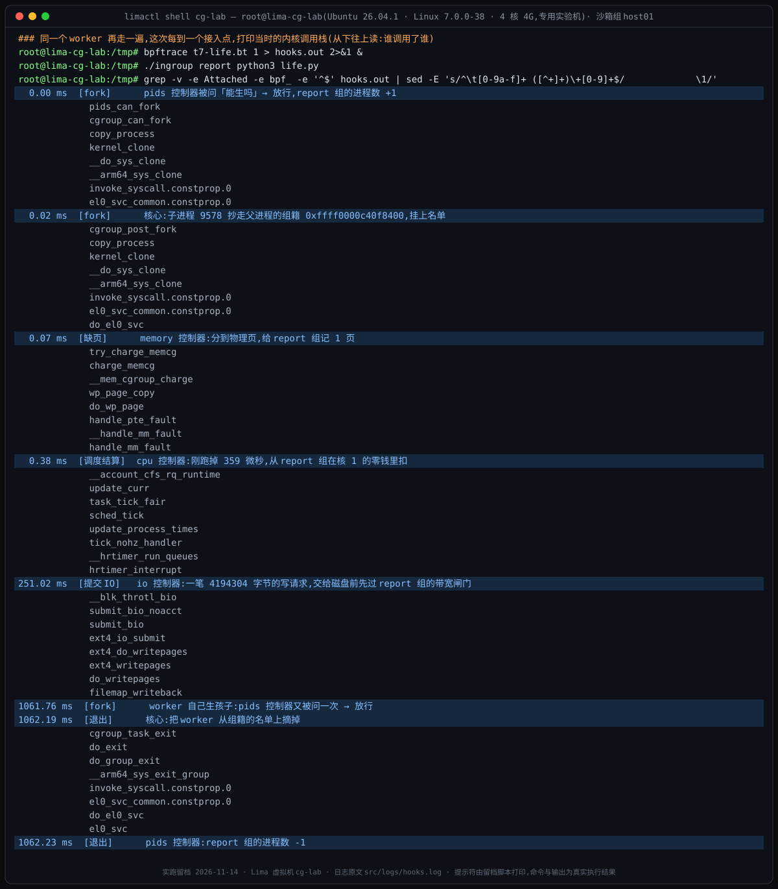

(第三条命令里的 `grep` 去掉跟踪工具自己那几层,`sed` 去掉每行前面的地址和后面的偏移,只留函数名。)

**第一个栈,从下往上读:**

- `el0_svc_common.constprop.0`、`invoke_syscall.constprop.0`:用户程序发起系统调用之后,arm64 处理器进入内核的入口。名字后面的 `.constprop.0` 是编译器优化时加的后缀,不用管。
- `__arm64_sys_clone`、`__do_sys_clone`:clone 系统调用在内核里的入口。python 的 `os.fork()` 最后发的就是它。
- `kernel_clone`:内核里「造一个新进程」的通用入口。
- `copy_process`:真正干活的地方,复制父进程的档案。**到这一行为止,全是内核本来就要走的路。**
- `cgroup_can_fork`:核心加的调用。`copy_process` 复制到一半时调用它,核心按登记表把填了「能生吗」那一格的控制器挨个问一遍。
- `pids_can_fork`:pids 控制器的回答。它在这里给 report 组的进程数加一,超了就拒绝(§3.5)。

**第二个栈**是同一次 fork,0.02 ms 之后。下面七行还是 `copy_process` 和它的调用者;最下面多露出一行 `do_el0_svc`,是因为这个栈顶上少了一层,同样只打 11 层,底下就多露出一层。最上面一行:

- `cgroup_post_fork`:复制基本完成后,核心把子进程挂到父进程的组籍上,加进组籍的名单。日志那一行里的 `0xffff0000c40f8400` 就是这张组籍的地址。

这两次调用都在 `copy_process` 里面。**cgroup 没有给 fork 另修一条路,它只是在 fork 这条路上加了两个调用。** 这是第二节 §6 说的「复用内核已有路径记账」第一次在实测里出现。

先问、后挂的顺序在时间上看得出来:0.00 ms 问 pids,0.02 ms 挂组籍。为什么这么排,一个说得通的理由是:要拒绝,就得在子进程露面之前拒绝;挂组籍则要等子进程差不多造好了才有意义。这是我对顺序的理解,跟踪只看到了先后。

### §3.4 实跑:抓 fork 的那一刻

上面那一遍只打印第一次 fork。再换一个专门的跟踪脚本(`stages/03-how/src/prog/t0-fork.bt`),让 report 入组后连续 fork 三个 worker,看组籍上发生了什么。脚本只有两个探针:一个在「进程被搬进组」时打印,一个在 `cgroup_post_fork` 结束时打印父子两个进程的组籍地址。

```
# bpftrace t0-fork.bt > t0.out 2>&1 &
# ./ingroup report python3 report.py 3 0.2 &
# grep -v -e Attached -e '^$' t0.out
入组  pid 7405(ingroup)被搬进 /host01/report
fork  父 7405(report)的组籍 0xffff0000c40f8400   子 7407 的组籍 0xffff0000c40f8400   这张组籍上现在有 2 个进程
      这张组籍里写着:CPU 的账 → 0xffff0000c0dae100(组 report)   内存的账 → 0xffff0000c5794a40(组 report)
fork  父 7405(report)的组籍 0xffff0000c40f8400   子 7408 的组籍 0xffff0000c40f8400   这张组籍上现在有 3 个进程
fork  父 7405(report)的组籍 0xffff0000c40f8400   子 7409 的组籍 0xffff0000c40f8400   这张组籍上现在有 4 个进程

# for p in $(pgrep -x 'report|report-w'); do echo "$p $(cat /proc/$p/cgroup)"; done
7405 0::/host01/report
7407 0::/host01/report
7408 0::/host01/report
7409 0::/host01/report
```

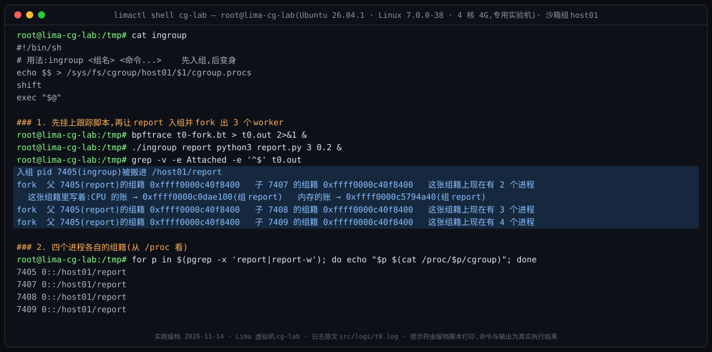

**读数。**

- 第一行:pid 7405 入组时名字还叫 `ingroup`,入组之后才 exec 成 python,再改名叫 report。先入组,后变身。
- 三次 fork,父子的组籍是同一个地址 `0x…c40f8400`。子进程没有得到一张新的组籍,只是多了一个指向旧组籍的指针。
- 组籍上的进程数 2 → 3 → 4:内核在这张组籍上记着「有哪些进程指着我」。第二节 §9.5 的 `cgroup.kill` 能一个不漏,靠的就是这份名单。
- 第三行是组籍的内容:CPU 的账和内存的账是两个不同的地址,但都属于组 report。一张组籍,几个控制器的格子,同一个组。
- `/proc/<pid>/cgroup` 里那一行 `0::/host01/report`,是内核顺着「进程 → 组籍 → 组」现查出来的,不是存在进程身上的一个字符串。它只有一行:v2 只有一棵树,`0::` 就是这棵唯一的树。第二节 §8.1 的实跑里,挂了两棵 v1 树的 shell 这个文件有三行。只有一行,也体现了「用统一的方式管理所有资源」。

§1 那一遍的两行(0.00 ms 问 pids,0.03 ms 子进程 9356 抄走组籍 `0xffff0000c5b97400`)是同一件事,只是另一次运行,地址和进程号不同。

### §3.5 同一个接入点上,pids 控制器被问「能生吗」

fork 这个接入点上,核心抄组籍,控制器记账。记的是哪本账?进程数。pids 是最简单的控制器,正好拿来看控制器在接入点上干活的样子。report 组最多 20 个进程,在组里连续 fork 100 个,跟踪脚本(`stages/03-how/src/prog/t6-pids.bt`)盯着 `pids_can_fork`:

```
# echo 20 > /sys/fs/cgroup/host01/report/pids.max
# bpftrace t6-pids.bt > t6.out 2>&1 &
# ./ingroup report python3 forkn.py 100
第 20 次 fork 失败:[Errno 11] Resource temporarily unavailable
想要 100 个子进程,成功 fork 出 19 个
# grep -v -e Attached -e '^$' t6.out
放行  pid 9104 要 fork:report 组的进程数账 → 2(上限 20)   父组 host01 的账 → 2
放行  pid 9104 要 fork:report 组的进程数账 → 3(上限 20)   父组 host01 的账 → 3
放行  pid 9104 要 fork:report 组的进程数账 → 4(上限 20)   父组 host01 的账 → 4
拒绝  pid 9104 要 fork:report 组的进程数账 20,上限 20,再加 1 就超 → fork 失败(返回 -11)
pids 控制器一共被问了 20 次
# grep -H . /sys/fs/cgroup/host01/report/pids.peak /sys/fs/cgroup/host01/report/pids.events
/sys/fs/cgroup/host01/report/pids.peak:20
/sys/fs/cgroup/host01/report/pids.events:max 1
```

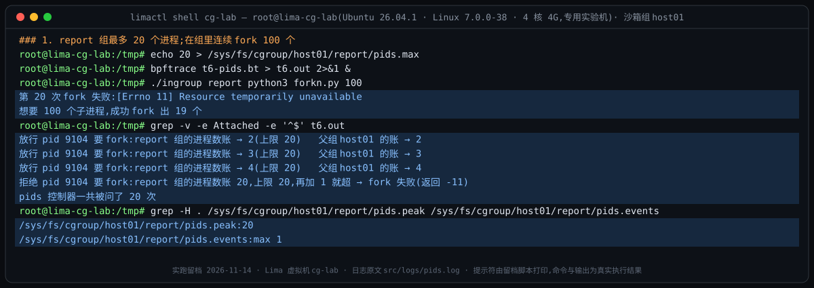

**读数。**

- 每次 fork,pids 控制器都被问一次,一共 20 次:19 次放行,1 次拒绝。
- 账是这样变的:主进程自己算 1 个,第一个孩子 fork 时账变成 2,第二个 3,第三个 4……(只打印了前三次放行)。到第 20 次,账上已经是 20,再加 1 就超过上限 20,拒绝。所以成功 19 个。
- **report 和父组 host01 两本账一起涨。** 子组记一笔,父组也记一笔,父组的上限管整棵子树的合计,这是 `C1·按组限制合计用量` 里「层层转包」那个要点的落点(§10.1 再看树)。
- 拒绝的方式是让这次 fork 返回 -11,也就是 `EAGAIN`,python 报 `Resource temporarily unavailable`。谁也不用死。
- `pids.peak` 是 20(到过的最高值),`pids.events` 的 `max 1` 是「撞线被拒」发生过 1 次。

问「能生吗」的那一刻,账就记上了(加一),限也就比过了(20 + 1 > 20)。**记账和检查限额是同一个动作**,第一次在这里出现;§7、§8 会看到 CPU 和内存也是这样。

为什么进程数能拒绝,而内存只能回收或杀,留到 §9.1 和其他资源一起对照。

### §3.6 再逼问:为什么中间要隔一张组籍

为什么不让进程直接指向组?

- **因为一个进程要找的不是「组」,是「账」。** 调度器只关心 CPU 的账在哪,内存分配只关心内存的账在哪。组籍把这几个答案提前摆好,记账时一步就能拿到,不用先找组、再在组里找账。记账每秒发生几十万次,这一步省得值(`C4·在内核已有代码路径上记账,开销要小`)。
- **因为同组的进程答案完全一样。** 400 个 worker 共用一张组籍,fork 时什么都不用新建(`C1·按组限制合计用量`)。
- **因为归属要内核说了算。** 进程能改的只有自己内存里的东西;这个指针在内核的档案上,只有写 `cgroup.procs`(受文件权限管)和 fork(只能继承)两条路能改它(`C3·内核负责执行,配额由外部设定`)。
- **因为一张组籍要管所有资源。** 每个控制器一个格子,几种资源的账从同一张卡片出发,指向同一棵树上的节点,谁和谁一组只有一个答案(`C5·所有资源共用同一套分组`)。

| 没有它会坏在哪 | 它解决了 |
|---|---|
| 每次记账都要从进程出发重新查「它属于哪个组、那个组的账在哪」 | 一步拿到账 |
| fork 时要为子进程登记归属,多一次分配 | fork 只多一个指针 |
| 归属如果存在进程能改的地方,就等于没有边界 | 指针在内核档案上,进程碰不到 |
| 每种资源各存一份归属,彼此可能对不上 | 一张组籍,每个控制器一个格子 |

worker 生出来了,开始烧 CPU。它每跑 1 毫秒,report 组的账上怎么就多了 1 毫秒?这一次核心不参与,谁来记?

## §4 接入点二 调度器结算:CPU 的账

**结论:调度器本来就要不停地结算「当前进程刚才跑了多久」,这是它排队要用的。cpu 控制器在结算之后多执行一步:把这段时间也从这个组在这颗核上的本地额度里扣掉;本地额度扣完了,才去全组共享的总额度里领下一份,一份 5 ms。实测 2 秒记了 1660 笔账,只有 181 笔动了总额度。没给 `cpu.max` 设限的组,这一步直接跳过:1 秒 0 次。**

### §4.1 内核原本在这条路上做什么

调度器要决定下一个让谁上 CPU,依据之一是每个进程已经跑了多久。所以它要不停地结算当前进程的运行时间:时钟中断来的时候(这台机器每 1 ms 一次,`CONFIG_HZ=1000`)、进程被换下去的时候,都要结算一次。这件事和 cgroup 无关,不分组的内核也要做。

如果是你,CPU 的账记在哪?另起一个定时器、每隔一会儿去看每个进程跑了多少再加到组上,那是另修一条路,还得定期扫一遍所有进程(`C4·在内核已有代码路径上记账,开销要小`)。调度器结算这一步本来就在,而且结算的那一刻正好知道三件事:谁、在哪颗核上、刚跑了多久。账就记在它后面。

### §4.2 调用栈:时钟中断一路调到 cpu 控制器

还是 §3.3 那一遍(hooks.log),调度结算这一段:

```
  0.38 ms  [调度结算]  cpu 控制器:刚跑掉 359 微秒,从 report 组在核 1 的零钱里扣
             __account_cfs_rq_runtime
             update_curr
             task_tick_fair
             sched_tick
             update_process_times
             tick_nohz_handler
             __hrtimer_run_queues
             hrtimer_interrupt
```

**从下往上读:**

- `hrtimer_interrupt`:时钟中断到了。
- `__hrtimer_run_queues`:处理到期的定时器。
- `tick_nohz_handler`:其中一个定时器是「节拍」,每 1 ms 一次的周期性工作从这里开始。(nohz 指 CPU 空闲时可以停掉节拍,这里不用管。)
- `update_process_times`:更新这颗核上当前进程的时间统计。
- `sched_tick`:调度器的节拍处理。
- `task_tick_fair`:当前进程属于普通进程这一类,交给这一类的节拍处理。
- `update_curr`:结算当前进程刚才跑了多久。**到这一行为止,是调度器本来就要做的。**
- `__account_cfs_rq_runtime`:cpu 控制器加的调用。把刚结算出来的那段时间,从这个组在这颗核上的本地额度里扣掉。

只有最上面一行是 cgroup 的。这一次核心没有参与:调度器手里本来就有当前进程,cpu 控制器顺着它找到组的账。cpu 控制器怎么从进程找到组,和组籍有关:进程入组时 cpu 控制器被通知过(§2.4 fw.log 里「框架通知 cpu 控制器」那一行,登记表上它填了「搬进来了」那一格),fork 时子进程跟着父进程走。它被通知之后在调度器里具体改了什么,这一节没有跟,记入待核 #18。

对一下时间。life.log 那一遍,worker 在 0.03 ms 出生,0.70 ms 第一次结算,刚跑掉 663 μs:0.70 − 0.03 = 0.67 ms,差不多就是它出生以来跑的全部时间。hooks.log 那一遍是 0.02 ms 出生,0.38 ms 结算 359 μs,0.38 − 0.02 = 0.36 ms,也对得上。hooks.log 的栈说明,这一次结算是时钟中断触发的。

### §4.3 概念:一个总额度,四份本地额度

report 的 CPU 账由两层组成(图在 §7.1):

- **全组总额度**:全组只有一个。周期定时器每 100 ms 把它补到 50 ms(就是 `cpu.max` 里的两个数)。它被 4 颗核共用,改它要加锁。
- **每颗核一份本地额度**:report 组在核 0、核 1、核 2、核 3 上各有一份。worker 在哪颗核上跑,就花哪颗核上的这一份。这一份只有本核会改,不用锁。

调度器每结算一次,cpu 控制器就从本核的本地额度里扣掉同样多。本地额度扣到零以下,就去总额度领一份。领的时候要加锁,但这种事不常发生。

### §4.4 实跑:数一数记了多少笔

report 组限半颗核,8 个 worker。跟踪脚本(`stages/03-how/src/prog/t1-cpuacct.bt`)统计 2 秒。

```
# echo '50000 100000' > /sys/fs/cgroup/host01/report/cpu.max
# ./ingroup report python3 report.py 8 &
# bpftrace t1-cpuacct.bt | grep .
2 秒内,report 组:
  记账 1660 次,合计记下 1000 ms 的 CPU 时间
  其中要去公共额度池领额度的 181 次
  周期定时器响了 20 次
  每次从公共池领到多少(微秒):
[0, 1000)              5 |@                                                   |
[1000, 2000)           3 |                                                    |
[2000, 3000)           6 |@                                                   |
[3000, 4000)           4 |@                                                   |
[4000, 5000)           1 |                                                    |
[5000, 6000)         157 |@@@@@@@@@@@@@@@@@@@@@@@@@@@@@@@@@@@@@@@@@@@@@@@@@@@@|
[6000, ...)            5 |@                                                   |
```

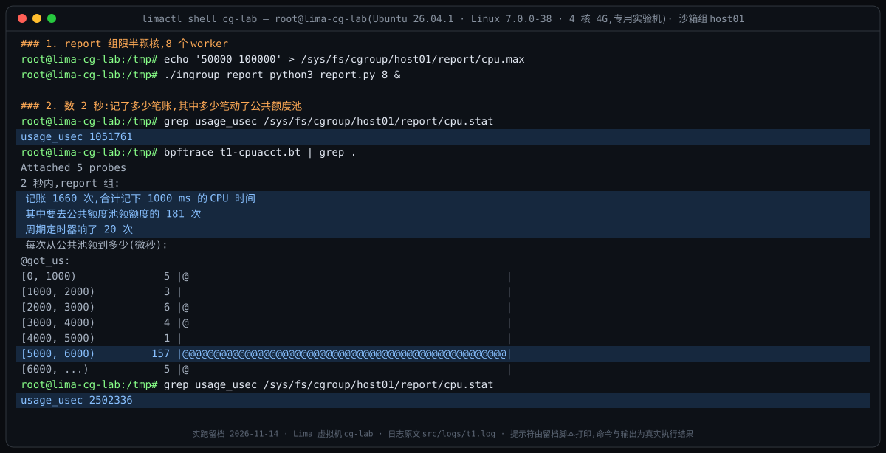

**算例。**

- 2 秒 × 半颗核 = 1000 ms。跟踪脚本把每一笔账的金额加起来,正好 1000 ms。组的 CPU 用量不是事后统计出来的,就是这一笔笔账的和。
- 周期定时器 2 秒响 20 次,每 100 ms 一次。
- 181 次领额度 ÷ 20 个周期 ≈ 每周期 9 次。每周期 50 ms、一份 5 ms,最多领 10 份,量级对得上。
- 181 次里有 157 次领到的是 5 ~ 6 ms。比 5 ms 多出来的部分,是补上一次透支的部分:本地额度可能被扣成负数(时钟中断 1 ms 才来一次,来的时候才发现花超了),下次领的时候先把欠的补上。不足 5 ms 的那十几次,是总额度里剩的不够一整份了,剩多少领多少。
- **1660 笔账里,只有 181 笔(11%)动了全组共享的总额度,其余 89% 只改了本核自己的本地额度。**

留档图里 `cpu.stat` 的 `usage_usec` 前后差 1 450 575 μs,比 1000 ms 多。这不矛盾:这两次读数夹着整条 bpftrace 命令,包括它启动和挂探针的那段时间(将近 1 秒),而脚本只统计挂好之后的 2 秒。

账是消耗的那一刻记上的,没有谁事后去加。这是第二节 §7.1 说的「记账时同步检查限额」的前一半(记账);后一半(检查限额)在 §7。

### §4.5 没人设限时,这一步不执行

记账加在调度器结算后面,而调度器每颗核每毫秒都在结算。机器上大多数组根本没写 `cpu.max`,难道它们也要每毫秒记一笔?`C4·在内核已有代码路径上记账,开销要小` 里说的「开销一大,机器上所有程序都会跟着变慢」,在这里是实际的问题。实测一下:db 和 report 两个组里各放一个死循环(`spin.py`,内容就是 `while True: pass`),跟踪脚本(`stages/03-how/src/prog/t8-free.bt`)按组数 1 秒内 `__account_cfs_rq_runtime` 被调用了多少次。

```
### 1. 两个组里各有一个死循环,谁都没写 cpu.max
# cat /sys/fs/cgroup/host01/db/cpu.max /sys/fs/cgroup/host01/report/cpu.max
max 100000
max 100000
# ./ingroup db python3 spin.py &
# ./ingroup report python3 spin.py &
# bpftrace t8-free.bt | grep .
Attached 4 probes
1 秒内「给某个组记 CPU 账」一共发生 0 次,按组分:

### 2. 只给 report 写一个上限,db 不动
# echo '50000 100000' > /sys/fs/cgroup/host01/report/cpu.max
# bpftrace t8-free.bt | grep .
Attached 4 probes
1 秒内「给某个组记 CPU 账」一共发生 544 次,按组分:
@n[report]: 544
```

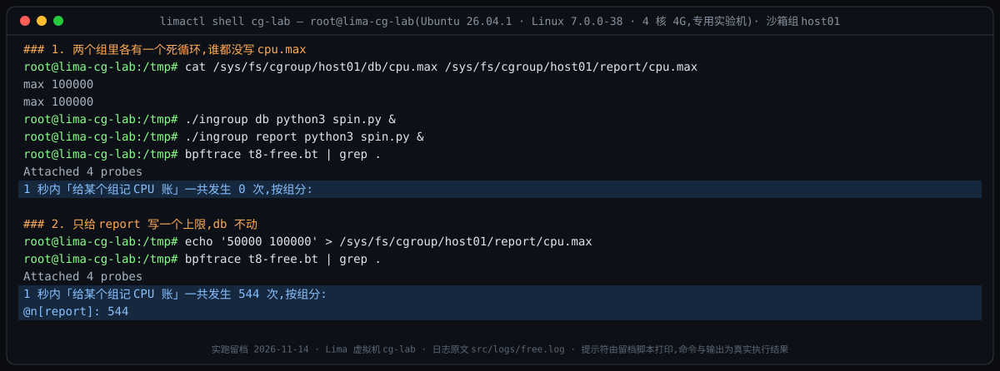

**读数。**

- `max 100000` 的意思是「不设上限,周期 100 000 μs」,这是新建组的默认值。
- 两个死循环都在跑,但「给组记 CPU 账」这一步,1 秒 0 次。
- 只给 report 写上 `cpu.max`,这一步才开始走:1 秒 544 次,全部记在 report 头上。db 还是一次没有:它没设限,就不用记额度账。
- 算例:report 限半颗核,1 秒里大约跑 500 ms;它跑着的时候,时钟中断每 1 ms 来一次,每次结算一笔,约 500 次;多出来的 44 次,应该是它被换下、换上时的结算。这个拆分是推算,没有单独数。

**这是「复用内核已有路径记账」的另一半:只有设了限的组才记账。** 不设限的组,调度器那条路照走,cgroup 那一步不执行。说「几乎」零成本,是因为「要不要走这一步」本身还得判断一下;这一下花多少,没有量。

照实交代三点。第一,内核靠什么做到「没人设限就不执行」,我印象中是两层开关:全机一层(整台机器有没有任何一个组设了 `cpu.max`),每个组在每颗核上一层(这个组设没设)。「只给 report 设限,db 仍是 0 次」和第二层吻合,但两层开关的说法是凭记忆写的,没有实测支撑,记入待核 #15。第二,这里数的只是「按额度记账」这一步;`cpu.stat` 里的用量统计走的是另一条路(§10.2),它在没人设限时花多少,这一节没量。第三,这个结论当时只在 CPU 这条路上量过,不能直接搬到别的接入点:内存的账本身就是 `memory.current` 那个数,只要组开了 memory 控制器,大概每一页都得记,开销小靠的是 §5 的每核本地额度。这在当时是推断,下面的补跑证实了它。

**补跑:三条路一起数,「路」和「车」分开数。** 上面第三点的推断后来补了一个实验验证(2026-11-15,会话 `cost`)。三条路各数两个数:这条路走了多少次(输出里叫「路」),其中 cgroup 的记账那一步执行了多少次(输出里叫「车」)。负载是 `load.sh`:db 组、report 组、根组里各有一个进程吃 40 MiB;db 组和 report 组各直接写 20 MiB 到盘;另外两个组里各有一个死循环。先在两个组都不设任何上限时数 4 秒,再只给 report 写上三个上限数 4 秒。

```
### 1. 两个组什么上限都没写
CPU   路(调度器结算)各组走了多少次:
@road_cpu[report]: 12133
@road_cpu[db]: 12164
CPU   车(给组记 CPU 账)一共 0 次:
内存  路(缺页)各组走了多少次(另有根组里的那个进程 1562 次):
@road_mem[report]: 1562
@road_mem[db]: 1562
内存  车(给组记内存账)一共 3159 次:
@ride_mem[db]: 1579
@ride_mem[report]: 1580
IO    路(提交读写请求)各组走了多少次:
@road_io[report]: 23
@road_io[db]: 23
IO    车(过组的带宽闸门)一共 0 次:

### 2. 只给 report 写上三个上限,db 还是什么都不写
CPU   路(调度器结算)各组走了多少次:
@road_cpu[report]: 6401
@road_cpu[db]: 13411
CPU   车(给组记 CPU 账)一共 2082 次:
@ride_cpu[report]: 2082
内存  路(缺页)各组走了多少次(另有根组里的那个进程 2073 次):
@road_mem[db]: 1562
@road_mem[report]: 2073
内存  车(给组记内存账)一共 3667 次:
@ride_mem[db]: 1579
@ride_mem[report]: 2088
IO    路(提交读写请求)各组走了多少次:
@road_io[report]: 23
@road_io[db]: 23
IO    车(过组的带宽闸门)一共 23 次:
@ride_io[report]: 23
```

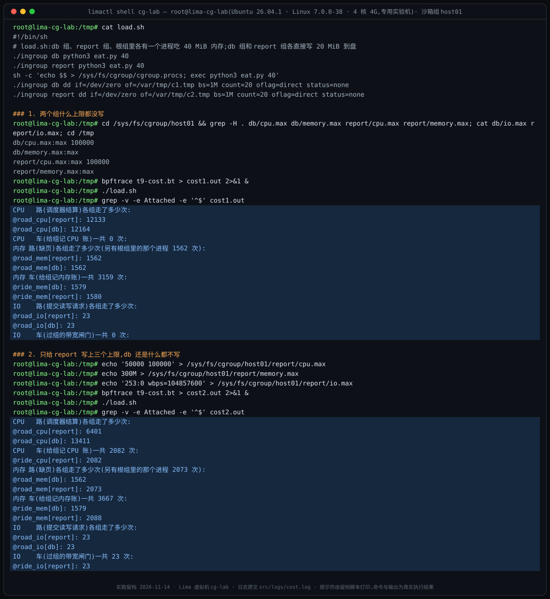

| 接入点 | 路照走吗 | 没人设限时 cgroup 记账吗 | 只给 report 设限后 | 根组里的进程 |
|---|---|---|---|---|
| CPU(调度器结算) | 照走:两个组各一万两千多次 | **不记:0 次** | 只有 report 记(2082 次),db 仍是 0 | 没测 |
| IO(提交读写请求) | 照走:各 23 次 | **不记:0 次** | 只有 report 记(23 次,和它走的路一样多),db 仍是 0 | 没测 |
| 内存(缺页) | 照走:各 1562 次 | **照记:db 1579 次,report 1580 次** | 没有变化:db 1579,report 2088 | 缺页 1562 次,记账 0 次 |

三件事:

- **「路照走,cgroup 不记账」在 CPU 和 IO 两条路上成立。** 没人设限时,调度器照样结算了两万四千多次,块层照样提交了 46 笔请求,cgroup 那一步一次没执行。
- **内存不是这样,上面的推断是对的。** `memory.max` 写不写,每次缺页都给组记账。原因不难想:CPU 和 IO 的这一步是检查限额(查额度),没有额度就没什么可查;内存的这一步是「记账」本身,`memory.current` 那个数任何时候都得是准的,否则哪天写上 `memory.max`,内核不知道这个组已经占了多少。所以内存的开销小不靠「不执行」,靠 §5 的每核本地额度。
- **对内存来说,「不用的人」指的是根组。** 根组里那个进程缺页 1562 次,记账 0 次(`@ride_mem` 里没有它)。一个进程的内存要不要记账,看的是它所在的组有没有开 memory 控制器,不是看写没写上限。

所以「不用的人几乎零成本」这句话要分开说:**CPU 和 IO,不设限就不记账;内存,只要进了一个开了 memory 控制器的组,就每页都记。**

两处照实交代。report 第二段缺页 2073 次、第一段 1562 次,根组那个进程两段也是 1562 和 2073,同样吃 40 MiB 次数却不同;这一段没有关透明大页,我猜是每次能拿到的大页数量不一样,没有验证。「记账」比「缺页」多十几到二十几次(1579 对 1562),按 §5.4 的经验应该是页表页,同样没有核对。

### §4.6 再逼问:为什么每颗核要先领一份本地额度

**如果没有本地额度,每一笔都直接从全组总额度里扣?**

4 颗核每毫秒都要去改同一个数,每次都要抢同一把锁。组里进程越多、核越多,抢得越凶。记账的开销会和干活的开销抢 CPU,这就违反了 `C4·在内核已有代码路径上记账,开销要小`:记账不能比干活还贵。

本地额度的做法是批量领取:一次从总额度里拿 5 ms,拿回来慢慢扣,扣的时候不影响其他核。

**代价是什么?** 不那么准了。总额度用完的时候,别的核手里可能还留着没用完的本地额度;反过来,本地额度也可能被扣成负数。所以第二节 §9.1 量到的每周期用量是 49 969 μs 而不是整 50 000,第二节 §10.2 里「按权重分到 40%」的那一幕也会有些周期碰到 50 ms 的线。

**为什么一份是 5 ms?** 因为份越大越省锁(`C4·在内核已有代码路径上记账,开销要小`),但份越大,分散在各核、暂时没人用的额度就越多,上限就越不准(`C1·按组限制合计用量` 要的是一个说到做到的绝对数)→ 要在两者之间取一个折中 → 所以引入「一份」这个量,默认 5 ms,是 100 ms 周期的二十分之一。这个数可以调(实验机上 `/proc/sys/kernel/sched_cfs_bandwidth_slice_us` 的值是 5000)。更精确的推导留给读源码那一步。

| 没有它会坏在哪 | 它解决了 |
|---|---|
| 每笔账都抢全组的锁,核越多越慢 | 89% 的记账只动本核的数 |
| 记账开销随进程数、核数上涨 | 去总额度领取的次数只和「额度 ÷ 5 ms」有关,每周期 10 次上下 |
| 没设限的组也每毫秒记一笔 | 没设限就不执行这一步(1 秒 0 次) |

同样的做法,能不能用到内存上?内存的「一笔」是什么,它在哪条路上记?

## §5 接入点三 缺页:内存的账

**结论:进程第一次碰一块新内存,或者 fork 之后第一次写一块和父进程共用的内存时,会缺页,内核要给它分一个物理页。memory 控制器在「页分到了」之后执行记账:给这个进程所在的组记 1 页。这 1 页也是先从本核的预付页数里扣;预付的用完了,才去改组的计数器,一次改 64 页,并且顺着树把父组、祖父组的计数器一起改掉。同时,这一页上会记下它属于哪个组。实测吃 100 MiB:缺页 25 610 次,真正改计数器只有 400 次。**

### §5.1 内核原本在这条路上做什么

程序 `malloc` 一块内存,或者 python 建一个大对象时,内核只是答应给它一段地址,并不马上给物理内存。等程序第一次往这段地址里写,处理器发现这个地址还没有对应的物理页,就停下来交给内核处理,这叫**缺页**。内核分一个物理页,填进页表,程序接着跑,毫无察觉。

还有一种缺页和 fork 有关。fork 之后,父子进程先共用同一批物理页,内核把它们都标成只读;谁先往其中一页写,就会缺页,内核给它复制一份自己的。这叫**写时复制**。

这些都是内核本来就要做的。`C2·记实际用量,超限处理看资源类型` 要记的正是「真的分出去的物理页」,不是「答应给的地址」(第二节 §3.1 的 `ulimit -v` 就是按后者限制的,所以不准),所以分页的那一刻就是记账的时机。

### §5.2 调用栈:worker 的第一页,是写时复制

hooks.log 里缺页这一段:

```
  0.07 ms  [缺页]      memory 控制器:分到物理页,给 report 组记 1 页
             try_charge_memcg
             charge_memcg
             __mem_cgroup_charge
             wp_page_copy
             do_wp_page
             handle_pte_fault
             __handle_mm_fault
             handle_mm_fault
```

**从下往上读:**

- `handle_mm_fault`、`__handle_mm_fault`:缺页处理的入口。再往下(被截掉的部分)是处理器报告缺页、陷入内核的那几层。
- `handle_pte_fault`:找到出问题的那一条页表项。
- `do_wp_page`:判断出这是「往一个写保护的页里写」。wp 是 write-protect 的缩写。
- `wp_page_copy`:给写的那一方复制一页新的。**到这一行为止,是内核本来就要做的写时复制。**
- `__mem_cgroup_charge`:memory 控制器加的调用:新页分到了,给它记账。
- `charge_memcg`、`try_charge_memcg`:记账往里走的两层,后者就是 §5.4 里数的「问给 report 组记账」。

这一次 cgroup 加的是最上面三行。

再对时间。life.log 那一遍,worker 的第一次内存记账在 0.11 ms,而它 0.03 ms 才出生,还没开始要那 20 MiB,比第一次 CPU 结算(0.70 ms)还早。hooks.log 的栈说明了这是什么:写时复制。worker 刚从 report 身上 fork 出来,一跑起来就写到了和父进程共用的某一页(多半是 python 解释器自己的数据,没有查是哪一页),内核给它复制一页,这一页记在 worker 所在的 report 组上。

### §5.3 概念:计数器、每核预付页数、页上的所属组记号

内存的账比 CPU 的简单,核心就是一个数:**这个组名下现在有多少页**。旁边写着上限(`memory.max`)。每个组的计数器还带一个指针,指向父组的计数器。

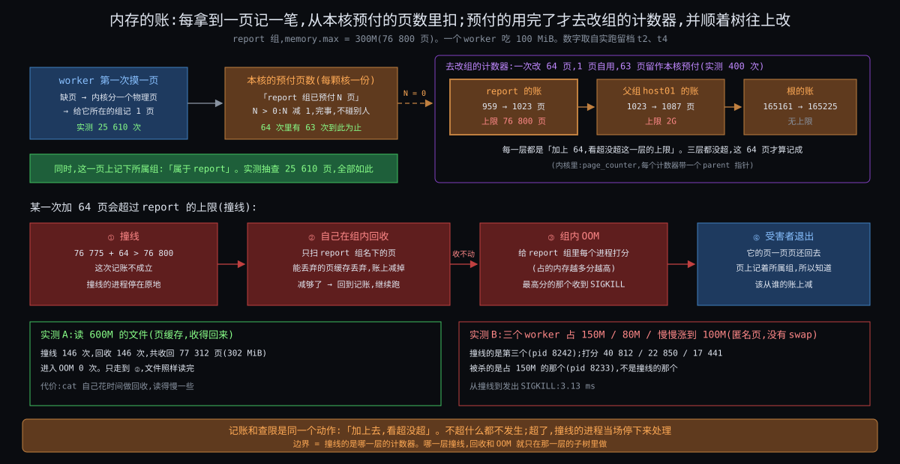

便宜的办法和 CPU 一样:

- 每颗核有一份预付记录,内容是「某个组已经预付了 N 页」。记 1 页时,如果本核有这个组的预付,N 减 1 就完事。
- 预付的用完了,才去改组的计数器:**一次加 64 页**,1 页自用,剩下 63 页留在本核作为预付。(为什么是 64,§5.5 再算。)

还有一件 CPU 没有的事:**这个物理页上要记下「我属于 report 组」。** 原因在 §5.5,用处在 §6。

### §5.4 实跑:吃 100 MiB,数一数

为了让页数好数,实验前关掉了透明大页(否则内核可能一次给 512 页,数字就不整齐了)。report 组内存上限 300M,一个 worker 吃 100 MiB。

```
# echo 300M > /sys/fs/cgroup/host01/report/memory.max
# bpftrace t2-memacct.bt > t2.out 2>&1 &
# ./ingroup report python3 hold.py report-w 100 &
report-w(pid 8124)已占住 100 MiB
# grep -v -e Attached -e '^$' t2.out
第 1 次改账(+64 页):report 959 → 1023 页   父组 host01 1023 → 1087 页   根 165161 → 165225 页
第 2 次改账(+64 页):report 1023 → 1087 页   父组 host01 1087 → 1151 页   根 165225 → 165289 页
第 3 次改账(+64 页):report 1087 → 1151 页   父组 host01 1151 → 1215 页   根 165289 → 165353 页
worker 第一次摸到新内存页(缺页)25610 次
问「给 report 组记账」 25660 次,共 25660 页
真正去改 report 组那本账 400 次,共 25600 页;每次改多少页:
[64, 96)             400 |@@@@@@@@@@@@@@@@@@@@@@@@@@@@@@@@@@@@@@@@@@@@@@@@@@@@|

# cat /sys/fs/cgroup/host01/report/memory.current /sys/fs/cgroup/host01/memory.current
108785664
109047808

# python3 pageowner.py $(pgrep -x report-w) /sys/fs/cgroup/host01/report
/sys/fs/cgroup/host01/report 的编号(inode)= 22007
  虚拟地址 0xedc99eb9b000 → 物理页号 1227989 → 所属组编号 22007
  虚拟地址 0xedc99eb9c000 → 物理页号 1227991 → 所属组编号 22007
  虚拟地址 0xedc99eb9d000 → 物理页号 1227992 → 所属组编号 22007
共查了 25610 个物理页:25610 页记在编号 22007 的组上
```

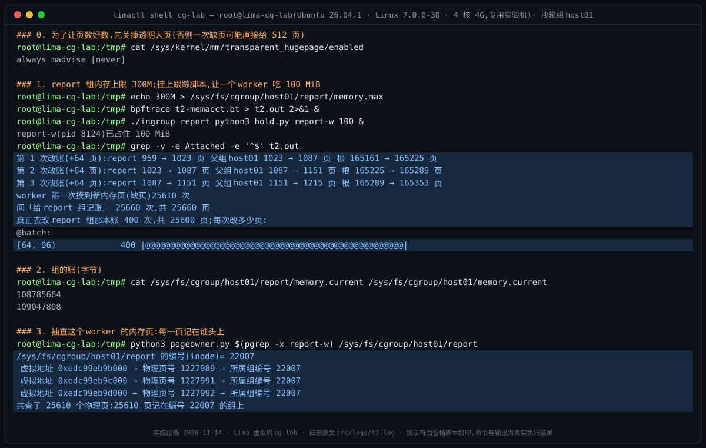

**算例。**

- 100 MiB ÷ 4 KiB = 25 600 页。缺页 25 610 次,多出来的 10 次是 python 自己的零碎内存。
- 问「给 report 组记账」25 660 次,比缺页多 50 次。25 600 页的内存需要 25 600 ÷ 512 = 50 个页表页(一个页表页管 512 页),数字正好对上。我判断这 50 次是页表页:内核替这个进程花的内存也记在组上。没有逐个核对。
- 真正改计数器 400 次,每次 64 页:400 × 64 = 25 600 页。**25 660 次记账里,只有 400 次(1.6%)动了组的计数器,其余 98.4% 只改了本核的预付记录。**
- 每次改账,三个数同时加 64:report、父组 host01、根。`C1·按组限制合计用量` 里「层层转包」那个要点,在这里是字面意思:子组记一笔,每一层祖先都记同样的一笔,每一层都拿自己的上限比一次。
- 账面对得上:report 的 `memory.current` 是 108 785 664 字节,÷ 4096 = 26 559 页,正好是第 1 次改账前的 959 页加上 400 次 × 64 = 25 600 页。父组 host01 是 109 047 808 字节 = 26 623 页,比 report 多 64 页,和第 1 次改账时两边差的 1023 − 959 = 64 页一致(这 64 页是 host01 名下别的东西,没查)。
- `pageowner.py` 用的是内核给的两个文件:`/proc/<pid>/pagemap`(虚拟页 → 物理页号)和 `/proc/kpagecgroup`(物理页号 → 所属组的编号)。抽查这个 worker 的 25 610 个物理页,每一页的所属组编号都是 22007,就是 report 目录的 inode 号。**账不光记在组上,每一页自己身上也记着它属于哪个组。**

### §5.5 再逼问:为什么页上要记所属组

**CPU 的账记完就完了,内存为什么还要在页上留所属组的记号?**

因为 CPU 时间花掉就没了,内存页要还。`C2·记实际用量,超限处理看资源类型` 说物理页占了不还就没有,它的另一面是:一页从分出去到还回来,中间隔着很久,而且还回来的时候,当初要这一页的进程可能早就不在了。

- **页缓存。** worker 读一个文件,文件内容留在页缓存里。worker 退出了,这些页还在,还占着物理内存。第二节说过「页缓存不在任何进程名下」(§3.1 的 ulimit、§4.1 的磁盘 IO),旧工具因此管不了它。现在它记在组名下:账不跟进程走,跟页走。
- **回收和释放。** 这一页被回收或释放时,要从某个组的计数器上减 1。减谁的?看页上记的所属组。
- **回写。** worker 写文件,脏页稍后才写到盘上,写盘的可能是内核线程。这笔磁盘 IO 该记给谁?从页上查到所属组是 report,IO 就记给 report。这正是 `C5·所有资源共用同一套分组` 要的:内存和 IO 对「谁是一组」给出同一个答案,而答案就记在页上。§6 细讲。

**为什么一次改 64 页?** 道理和 5 ms 一样:因为改计数器要顺着树一层层往上改(`C1·按组限制合计用量` 的层层转包),树有几层就要改几个数,所以要尽量少去(`C4·在内核已有代码路径上记账,开销要小`);但预付的页数是「账上已经记了、实际还没用」的页,攒得越多,账面就比实际偏高得越多(`C2·记实际用量,超限处理看资源类型`)→ 要在两者之间折中 → 所以引入一个批量,取 64 页(256 KiB)。4 颗核各留 63 页,最多偏 1 MiB 上下,对 300M 的组可以忽略。更精确的推导留给读源码那一步。

| 没有它会坏在哪 | 它解决了 |
|---|---|
| 每次缺页都改全组共享的计数器,还要爬一遍树 | 98.4% 的记账只动本核的预付记录 |
| 页还回来时不知道该减谁的账 | 页上记着所属组 |
| 页缓存、回写的 IO 不知道算谁的 | 跟着页上记的所属组走 |

页上记了所属组,这件事马上就要派上用场:worker 接下来要写盘。而写盘的那一刻,把数据交给磁盘的未必是 worker 自己。

## §6 接入点四 提交 IO:磁盘的账

**结论:写文件的时候,数据先进页缓存,过一会儿才由内核的回写路径整理成一笔笔写请求,交给块层,块层再交给磁盘。io 控制器在「请求交给块层」这一步之后执行检查:这笔请求先过 report 组的带宽限制检查,通过了才往磁盘走。实测:worker 写 8 MiB,第一笔 4 194 304 字节的写请求在 204.59 ms 到达这个检查,到 1011.44 ms 它去生孩子,中间约 0.8 秒,正是 `io.max` 里写的每秒 10 MiB。带缓冲的写要被限住,检查时得知道这笔 IO 属于哪个组,这个答案来自 §5 记在页上的所属组:memory 和 io 两个控制器对「谁是一组」给出同一个答案。io 控制器在检查里面怎么让请求排队,这次没有抓到实际过程。**

### §6.1 内核原本在这条路上做什么

先看 worker 写文件时内核做了什么。程序调用 `write`,内核把数据拷进页缓存里的几个页,把这些页标成**脏页**,`write` 就返回了。这时数据还在内存里,一个字节也没到磁盘。过一会儿(或者程序主动调 `fsync` 催它),内核的**回写路径**把脏页收集起来,问文件系统「这些页该写到磁盘的哪几个块」,再把它们打包成一笔笔写请求(内核里叫 bio),交给**块层**。块层排好队、合并、交给设备驱动,驱动再交给磁盘。

这条路和 cgroup 没有关系,不分组的内核也要这样走。

如果是你,磁盘的账记在哪?有三个候选位置:

- **记在 `write` 上。** 不行。`write` 返回时数据只进了页缓存,没有占一点磁盘带宽。程序可以写 8 MiB 然后一个小时后才 `fsync`,也可以写完马上删文件,让这些页永远不用写盘。这是第二节 §4.1 那个洞:发 IO 的时刻和花钱的时刻不是一个时刻。`C2·记实际用量,超限处理看资源类型` 要记的是真正交给磁盘的字节。
- **记在最底下的设备驱动里。** 这时候各组的请求已经在块层里合并、混在一起排队,「这一笔是谁的」这条线索很可能已经丢了;而且驱动是各种设备各写各的,要在每一种驱动里都加一份。这是我的设计推演,没有去核对驱动里的实际情况。
- **记在请求刚交给块层的那一刻。** 每一笔请求在这时候是完整的、独立的,字节数一清二楚,而且是真的要去占磁盘了。设备驱动再多也没关系,所有设备共用这一个入口。`C4·在内核已有代码路径上记账,开销要小`:不用另修一条路,在 `submit_bio` 这条必经之路上多执行一步。

内核选的是第三个。

### §6.2 调用栈:`__blk_throtl_bio` 是路上最后加的调用

还是 §3.3 那一遍(hooks.log),提交 IO 那一段:

```
251.02 ms  [提交 IO]   io 控制器:一笔 4194304 字节的写请求,交给磁盘前先过 report 组的带宽闸门
             __blk_throtl_bio
             submit_bio_noacct
             submit_bio
             ext4_io_submit
             ext4_do_writepages
             ext4_writepages
             do_writepages
             filemap_writeback
```

**从下往上读:**

- `filemap_writeback`:把一个文件的脏页写出去的入口。它再往下是谁调用它的,被 11 层的限制截掉了,栈里看不到。
- `do_writepages`:「把这个文件的一批脏页写出去」的通用入口,不管下面是哪种文件系统。
- `ext4_writepages`、`ext4_do_writepages`:这块盘上是 ext4,上面这个通用入口交给 ext4 自己的实现,它负责把页换算成磁盘上的块。
- `ext4_io_submit`:ext4 把攒好的一批页打包,往块层交。
- `submit_bio`、`submit_bio_noacct`:块层的入口。每一笔写请求在这里正式进入块层。**到这一行为止,全是内核本来就要走的路。**
- `__blk_throtl_bio`:io 控制器加的调用。名字里的 throtl 是 throttle(节流)的缩写。这笔请求在 `submit_bio_noacct` 里面被拿出来,先问 report 组「这一秒的额度还够不够」,够了放行,不够就留在这个检查里等待。

最上面只有一行是 cgroup 的。和 §4、§5 一样,核心没有参与。io 控制器怎么从这笔请求找到 report 组的账,栈里看不出来;按我的了解,请求身上带着它属于哪个组的记号,这一点没有实测,见 §6.5。

这一遍的时间戳是 251.02 ms,和 §1 那一遍的 204.59 ms 不一样:两遍是各自独立的运行,这一遍每个接入点都要打印调用栈,慢一些。两遍差了约 46 ms,具体慢在哪没有查,记入待核 #21。

**谁在走这条路,要说清楚。** 这个栈是 worker 自己 `fsync` 的时候走出来的:跟踪脚本给这个接入点加了一个条件「进程号等于 worker 的进程号」(`/pid == @w/`),所以抓到的这一次,是 worker 本人在它自己的上下文里进了回写路径。栈底被截掉了,看不到 `fsync` 的系统调用入口,说它是 `fsync` 引起的,是我根据 `life.py` 里写着 `os.fsync(fd)` 这一行判断的。

如果 worker 不调 `fsync`,通常是内核的回写线程过一会儿来写,那时走进这条路的就不是 worker 了。这一种情况这次没有抓,见 §6.5。

### §6.3 概念:带缓冲的写,到底是谁把数据交给磁盘的

回头看第二节 §4.1 的洞:`ionice` 管不到带缓冲的写,因为发 IO 的不是花钱的人。现在可以把「谁发 IO」摆成三种情况:

| 写法 | 谁走进回写路径、把请求交给块层 | 本次有没有实测 |
|---|---|---|
| 直接写(`O_DIRECT`) | worker 自己,`write` 的时候就交 | 第二节 §9.3 里 `dd oflag=direct` 用过,栈没抓 |
| 带缓冲的写 + `fsync` | worker 自己,在 `fsync` 里 | 本节 hooks.log:栈上是回写路径,条件是 worker 的进程号 |
| 带缓冲的写,不 `fsync` | 内核的回写线程,过一会儿来写 | 没有抓。按我对内核的了解是这样,第二节待核 #6 记过「回写启动得很快」,时序没深究 |

三种写法,请求最后都要经过同一个入口 `submit_bio_noacct`。**这个检查加在这个入口上,不加在 `write` 或 `fsync` 上,所以不管谁走进来、走哪条回写路径,都要经过它。** 这是 `C4·在内核已有代码路径上记账,开销要小` 的一个落点:所有写盘的路在块层汇合,记账只需要加在汇合处。

但第三种情况有个难处:回写线程是内核线程,它自己不在 report 组里。这个检查如果只看「当前是哪个进程」,看到的是内核线程,带缓冲的写就会全部记到根组上,report 的 `io.max` 形同虚设。**这笔 IO 得记到 report 上,需要有地方记着「这几个脏页是 report 的」。** 这正是 §5.5 里说的:

> 回写。worker 写文件,脏页稍后才写到盘上,写盘的可能是内核线程。这笔磁盘 IO 该记给谁?从页上查到所属组是 report,IO 就记给 report。

这里有一个 `C5·所有资源共用同一套分组` 的兑现:内存和 IO 是两种资源,由两个控制器各记各的账,但它们对「这一笔是谁的」必须给出同一个答案。memory 控制器在缺页那一刻把所属组记在页上(§5.4 抽查 25 610 页全归 report);io 控制器在回写时读这个记号。**分组只有一套,所以两边的记录才对得上。** 如果每个控制器自己认一套分组,就是第二节 §8.2 里 v1 那种「多棵树,记录对不上」。

### §6.4 实跑:8 MiB 的写,0.8 秒

测的还是 §1 那一遍(life.log)。report 组写了 `io.max`:

```
# echo '253:0 wbps=10485760' > /sys/fs/cgroup/host01/report/io.max
```

`253:0` 是 vda 的设备号,`wbps=10485760` 是每秒最多写 10 485 760 字节,10 MiB。worker 要内存之后,往 `/var/tmp/worker.dat` 写 8 MiB,再 `fsync` 等它落盘。下面是 life.log 里和它有关的两行(前一行是 io 控制器,后一行是 worker 写完后去生孩子):

```
204.59 ms  [提交 IO]   io 控制器:一笔 4194304 字节的写请求,交给磁盘前先过 report 组的带宽闸门
1011.44 ms  [fork]      worker 自己生孩子:pids 控制器又被问一次 → 放行
```


**算例。**

- 4 194 304 字节 = 4 × 1 048 576,正好 4 MiB。第一笔写请求是 4 MiB。8 MiB 的写大概分成两笔,各 4 MiB。这是推断:脚本只打印每类接入点的第一次,第二笔没有打印。
- 204.59 ms:worker 先用 0.2 秒烧 CPU(`life.py` 里是 `while time.monotonic() - t < 0.2`,按墙上时钟计时,所以 §7 的限流不会把这 0.2 秒拉长),再要 20 MiB 内存,再把 8 MiB 拷进页缓存,最后进 `fsync`。0.2 秒加上要内存、拷页缓存的几毫秒,和 204.59 ms 对得上。这几毫秒没有逐段拆开。
- 到 1011.44 ms:1011.44 − 204.59 = 806.85 ms。
- 理论值:8 MiB ÷ 10 MiB/s = 0.8 秒 = 800 ms。实测 806.85 ms,多出的 6.85 ms 是 `fsync` 返回、关文件、开始 fork 孩子这几步的开销,没有拆开。
- hooks.log 那一遍同样的两个时刻是 251.02 ms 和 1061.76 ms,相差 810.74 ms,也在 0.8 秒上下。

这一段和第二节 §9.3 是同一件事的两个尺寸:那里 50 MiB 的写,不设限时直接写 0.00679885 秒,设限之后直接写 4.99987 秒、带缓冲写 4.97412 秒,50 MiB ÷ 10 MiB/s = 5 秒;这里 8 MiB,0.8 秒。**两个尺寸算出来的都是 10 MiB/s,说明 io 控制器兑现的是 `io.max` 里写的那个数,和写多少、怎么写无关。**第二节 §9.3 里的 `io.stat`(三次各写 50 MiB,`wbytes` 最后是 157 286 400)是账一侧的对照,这里不重复。

这个 0.8 秒要小心读:它是 life.log 里两个时间戳之差,不是看到请求排队的过程。「请求在 io 控制器里等了多久」这个说法是从总时间倒推的,没有抓到。

### §6.5 如实交代:这一节没抓到的

1. **io 控制器里请求怎么排队没抓到。** 跟踪只在入口 `__blk_throtl_bio` 看到一笔请求进去。请求在 io 控制器里怎么排队,按字节还是按次数算,什么时候被谁唤醒放行,都没有抓。「0.8 秒是排队时间」是我从 10 MiB/s 倒推的,记入待核 #19(沿用第二节 §9.3 给的出处:内核文档对 io 控制器的说明,没有读源码)。
2. **带缓冲、不 `fsync` 的写,由内核回写线程来写,这一种当时没抓,后来补上了(见本小节末尾的补跑)。** §6.3 表里第三行写的时候是我的了解,补跑证实了「提交的是内核线程、请求记在 report 上」。「io 控制器是怎么知道这笔属于 report 的」那一步内部怎么查,日志里仍然没有看到。
3. **页上的所属组记号在 io 一侧是按页用还是按文件用,没查。** §5.4 实测的是 memory 一侧:每个物理页上记着它属于哪个组。io 一侧怎么用这个记号,有两种可能:逐页查,或者按文件整体归一个组。第二节 §9.3 的一处照实交代给过线索:第一遍四次 `dd` 覆盖写同一个文件,`io.stat` 的 `wbytes` 多出 50 MiB,当时猜测和「一个文件的回写同一时间只归一个组」有关,没有验证。如果这个猜测对,回写归属就是按文件算的,和「页上记所属组」不是一回事,只是页上的记号决定了文件归谁。这两点记入待核 #20。

**补跑:不 `fsync` 的写,是谁交给 io 控制器检查的。** 上面第 2 点后来补抓到了(2026-11-15,会话 `wb`)。report 组里的一个进程 `bufwrite` 带缓冲地写 30 MiB,不 `fsync`,文件也不关;然后在组外的终端里执行 `sync`,催内核把脏页写到盘上。跟踪脚本这次不限进程,打印是谁走进了 `__blk_throtl_bio`、这笔请求记在哪个组上。

```
# echo '253:0 wbps=10485760' > /sys/fs/cgroup/host01/report/io.max
# ./ingroup report python3 bufwrite.py 30 &
bufwrite(pid 162472)写完 30 MiB,文件没关,也没 fsync
# cat /sys/fs/cgroup/host01/report/io.stat; grep -E '^file_dirty' /sys/fs/cgroup/host01/report/memory.stat
253:0 
file_dirty 31457280

# cat /proc/self/cgroup; time sync
0::/user.slice/user-502.slice/session-6.scope
real	0m3.075s
# cat /sys/fs/cgroup/host01/report/io.stat; grep -E '^file_dirty' /sys/fs/cgroup/host01/report/memory.stat
253:0 rbytes=0 wbytes=31457280 rios=0 wios=8 dbytes=0 dios=0
file_dirty 0

第一笔:提交它的进程是 kworker/u16:4(pid 162205),8388608 字节,这笔请求记在 report 组头上。当时的调用栈:
             __blk_throtl_bio
             submit_bio_noacct
             submit_bio
             ext4_io_submit
             ext4_do_writepages
             ext4_writepages
             do_writepages
             __writeback_single_inode
             writeback_sb_inodes
             wb_writeback
             wb_do_writeback
             wb_workfn
             process_one_work
走进闸门一共 4 次。按「提交的进程, 记在哪个组」分,次数:
@n[kworker/u16:4, report]: 4
字节数:
@bytes[kworker/u16:4, report]: 31457280

### 对照:去掉上限,同样的事再做一遍
# time sync
real	0m0.024s
走进闸门一共 0 次。按「提交的进程, 记在哪个组」分,次数:
```

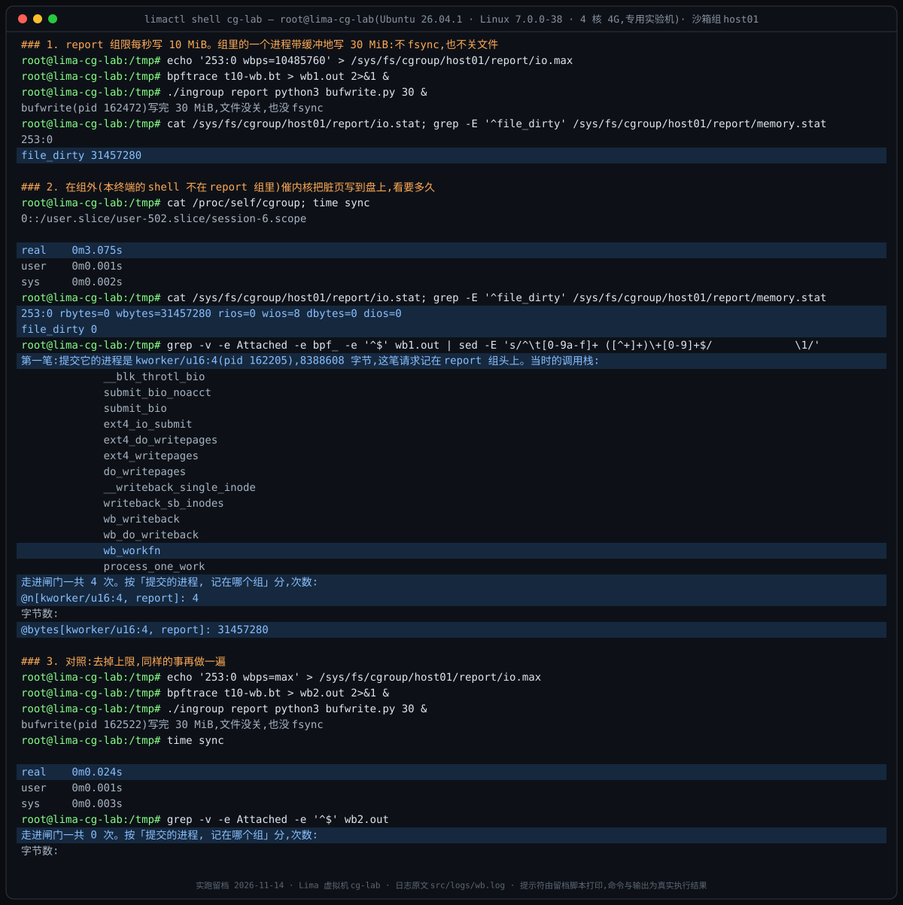

**读数。**

- `bufwrite` 写完的那一刻,report 的 IO 账上什么都没有(`io.stat` 那一行是空的),内存账上有 31 457 280 字节的脏页(`file_dirty`)。**写完了,磁盘一个字节没动,这 30 MiB 先记在 memory 控制器的账上。**
- 把这 30 MiB 交给 io 控制器检查的是 `kworker/u16:4`,一个内核线程,不是 `bufwrite`。栈从下往上读:`process_one_work`、`wb_workfn`、`wb_do_writeback`、`wb_writeback` 是内核回写线程的入口;`writeback_sb_inodes`、`__writeback_single_inode` 是一个文件一个文件地写回;再往上的七行和 §6.2 里 worker 自己 `fsync` 的那个栈一模一样。**两条路在 `do_writepages` 汇合,最后都经过同一个检查。**
- 4 笔请求、31 457 280 字节,全部是「kworker 提交,记在 report 上」。kworker 自己不在 report 组里,它提交的请求却记给了 report。`sync` 之后 `io.stat` 的 `wbytes` 正好是 31 457 280,`file_dirty` 归零:**同一笔 30 MiB,从 memory 的账上转到了 io 的账上,两本账说的是同一个 report。** 这是 `C5·所有资源共用同一套分组` 在实测里的表现。
- `sync` 用了 3.075 秒:30 MiB ÷ 10 MiB/s = 3 秒。去掉上限后,这个检查一次没走(又一次「没人设限就不记账」),`sync` 0.024 秒。

**这次补跑还带出两件事,照实写。**

- **被拖住的可能是组外的人。** 执行 `sync` 的终端不在 report 组里(`/proc/self/cgroup` 那一行),它等了 3 秒,等的是 report 的限速。限的是 report 的写请求,慢下来的却是来催它落盘的那个进程。这是 io 限速的一个实际代价,和 §7.4 说的「在内核里停住会连累别人」是同一类问题。
- **排队的是写请求,不是提交它的进程。** 第一遍补跑用的是 `dd`(日志 `wb-run1.log`):`dd` 0.009 秒就返回了,提交请求的是 `dd` 自己(它关文件时 ext4 顺手把数据推了下去,栈里是 `ext4_release_file → ext4_alloc_da_blocks → filemap_flush`),而随后的 `sync` 同样等了 3.000 秒。也就是说请求进了 io 控制器以后在里面排队,提交的进程不用陪着等。这回答了第 1 点的一部分;按什么规则放行仍然没抓(待核 #19)。

第 3 点(io 一侧是按页还是按文件认所属组)这次没有回答:30 MiB 都是 report 一个组写的,看不出区别。

### §6.6 再逼问:为什么限速检查放在这里

**为什么不放在 `write` 里限速?** 因为 `write` 返回时没有 IO,限它限的是内存拷贝的速度,不是磁盘带宽。程序写完就删文件,根本没用磁盘,却被拖慢了。`C2·记实际用量,超限处理看资源类型`:记的是真花掉的。

**为什么不看「当前进程」就好?** 因为回写常常是内核线程做的,当前进程是内核线程,不是花钱的人。要追到「谁的页」,需要页上记着所属组,这个记号是 memory 控制器在 §5 记下的。**两个控制器共用同一套分组,账才对得上**(`C5·所有资源共用同一套分组`)。

**为什么要让请求排队,不直接拒绝?** 磁盘带宽和 CPU 时间一样,下一秒还会有(`C2·记实际用量,超限处理看资源类型` 的「会再生的等」)。`write` 已经返回了,数据已经在页缓存里,没有一个调用者可以收到「不行」,只能在块层的入口让请求等。这也是 §9 要对照的:能拒绝的拒绝,能等的等。

**为什么 `fsync` 的 worker 看上去「被卡住」?** 它在 `fsync` 里等回写完成,而回写里的请求被 io 控制器留了 0.8 秒,所以 `fsync` 要 0.8 秒才返回。别的组的写请求不受影响:第二节 §9.3 里 db 组同样带缓冲写 50 MiB,只用了 0.0261246 秒。

| 没有它会坏在哪 | 它解决了 |
|---|---|
| 记在 `write` 上:写进页缓存就算,真正占磁盘的时刻没人记,删文件的程序白白被限 | 在 `submit_bio` 那一步记,每一笔都是真的交给磁盘的字节 |
| 只看当前进程:内核线程替 report 回写时,带宽记到根组,`io.max` 被绕开 | 回写时通过页上记的所属组找到 report |
| io 控制器自己另认一套分组,和 memory 的对不上 | 分组只有一套,memory 记的所属组 io 能读 |
| 请求交给块层之后才限,各设备驱动各限一遍 | 检查加在所有设备共用的入口 |

四个接入点走完了:fork、调度结算、缺页、提交 IO。每一处都是内核本来的路,每一处都是账一笔笔记下来、限在账旁边同时比较。但到现在,CPU 的账一直是在额度之内;内存的账也没有撞线。账记到限上了,会怎么样?先看最容易的那种:CPU 用完了。

## §7 超了之后(一):CPU 额度用完,进程是怎么停下来的

**结论:全组总额度用完以后,某颗核再来领额度就领不到。内核在这颗核上给 report 组设一个「限流中」标记,组里的进程各自在下一次要回到用户态时检查到标记,自己停下,进入等候名单。下一个周期定时器一触发,总额度补满,标记清除,名单上的进程放回运行队列。4 颗核一起消耗,50 ms 的额度十来毫秒就用完,剩下八十多毫秒全组都停着。整个过程没有单独的检查线程:账是进程跑的时候记的,限是核领额度的时候检查的,唯一的定时器只补额度、不检查用量。**

这是 `C2·记实际用量,超限处理看资源类型` 里「会再生的等」的实景:CPU 时间下个周期还会有,所以超了不杀不拒绝,停下来等。

### §7.1 实跑:两个周期的时间线

§4 看了没超限的记账,现在看超限的那一刻。这次起 7 个 worker。4 颗核放 7 个进程,必然不均匀:实测是 1 / 1 / 2 / 3。先看 3 秒里每个 worker 拿到多少,再看时间线。

```
# python3 percpu.py 3
  核 0   pid 7538    12.3%
  核 1   pid 7539    12.3%
  核 2   pid 7537     6.0%
  核 2   pid 7541     6.0%
  核 3   pid 7536     4.0%
  核 3   pid 7540     4.0%
  核 3   pid 7542     4.0%
按核合计:核 0:1 个进程共 12.3%   核 1:1 个进程共 12.3%   核 2:2 个进程共 12.0%   核 3:3 个进程共 12.0%   总计 48.6%

# bpftrace t3-throttle.bt | grep .
   0.00 ms  周期定时器响(第 1 个周期开始),公共池补到 50000 微秒
   0.01 ms  核 2:解除限流,等候名单上的进程放回队列
   0.02 ms  核 0:解除限流,等候名单上的进程放回队列
   0.02 ms  核 3:解除限流,等候名单上的进程放回队列
   0.02 ms  核 1:解除限流,等候名单上的进程放回队列
   0.21 ms  核 1 领 5181 微秒,公共池还剩 32984 微秒
   0.21 ms  核 3 领 5183 微秒,公共池还剩 27797 微秒
   0.21 ms  核 0 领 5187 微秒,公共池还剩 27797 微秒
   0.21 ms  核 2 领 5187 微秒,公共池还剩 27797 微秒
   5.21 ms  核 3 领 5000 微秒,公共池还剩 22797 微秒
   5.21 ms  核 2 领 5000 微秒,公共池还剩 17796 微秒
   6.21 ms  核 0 领 5999 微秒,公共池还剩 11797 微秒
   6.21 ms  核 1 领 5931 微秒,公共池还剩  5865 微秒
  10.21 ms  核 2 领 5000 微秒,公共池还剩   864 微秒
  11.21 ms  核 3 领  864 微秒,公共池还剩     0 微秒
  11.21 ms  核 3:公共池空了,report 组在这颗核上被标记为「限流中」
  11.21 ms  核 0:公共池空了,report 组在这颗核上被标记为「限流中」
  11.21 ms  核 0:进程 7538(report-w)在返回用户态的路上被请下场
  11.21 ms  核 3:进程 7542(report-w)在返回用户态的路上被请下场
  11.21 ms  核 3:进程 7536(report-w)在返回用户态的路上被请下场
  11.21 ms  核 3:进程 7540(report-w)在返回用户态的路上被请下场
  12.21 ms  核 1:公共池空了,report 组在这颗核上被标记为「限流中」
  12.22 ms  核 1:进程 7539(report-w)在返回用户态的路上被请下场
  16.21 ms  核 2:公共池空了,report 组在这颗核上被标记为「限流中」
  16.22 ms  核 2:进程 7541(report-w)在返回用户态的路上被请下场
  16.22 ms  核 2:进程 7537(report-w)在返回用户态的路上被请下场
 100.86 ms  周期定时器响(第 2 个周期开始),公共池补到 50000 微秒
 ……(第 2 个周期同样的过程,见图)
```

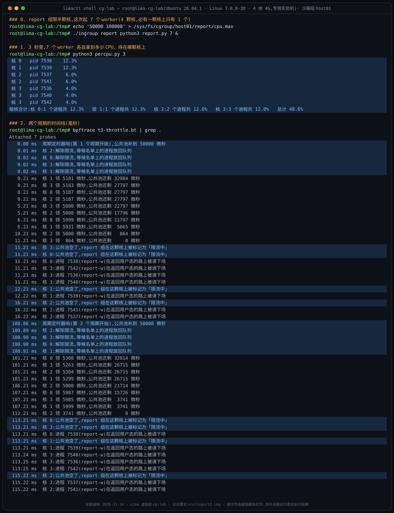

下面这张图把同一件事画成额度的流向:一个全组总额度,四份本地额度,一个周期里四颗核各自跑了多久。


### §7.2 逐行读时间线

- **0.00 ms**:定时器触发,总额度补到 50 000 μs。
- **0.01 ~ 0.02 ms**:四颗核依次清除「限流中」标记,上个周期等在名单上的进程放回队列。
- **0.21 ms**:四颗核各领第一份,约 5.18 ms(5 ms 加上刚跑掉的 0.18 ms)。「公共池还剩」那一栏(日志里的原话)有三行是同一个数,是因为四颗核几乎同时在领,打印时别人已经领完了。
- **5.21 ~ 6.21 ms**:各核第一份花完,领第二份。
- **10.21 ms**:核 2 领第三份(它第一、二份都是整 5 ms,花得快),总额度里只剩 864 μs。
- **11.21 ms**:核 3 把最后的 864 μs 领走,总额度用完。
- **11.21 ms 起**:核 3、核 0 的本地额度用完,来领,领不到 → 设置限流标记。标记设上后的同一个 0.01 ms 里,这两颗核上的 4 个 worker 逐个停下。
- **12.21 ms**:核 1 同样。**16.21 ms**:核 2 手里那份 5 ms 花完,最后一个停下。
- **16.22 ~ 100.86 ms**:84 毫秒,什么都没发生。7 个 worker 全在等候名单上。
- **100.86 ms**:定时器再响,重来一遍。

**算例。** 各核这个周期领到的:核 0 是 5187 + 5999 = 11 186 μs;核 1 是 5181 + 5931 = 11 112;核 2 是 5187 + 5000 + 5000 = 15 187;核 3 是 5183 + 5000 + 864 = 11 047。合计 48 532 μs。离 50 000 差的约 1.5 ms,我的推断是周期开头清除标记时,内核先替各核把上个周期透支的部分补上了,那一笔不经过这个探针。这是推断,没有单独验证,记入待核 #3。

### §7.3 回收一个旧问题:为什么有的 worker 拿 12%,有的只有 4%

第一节留了一个问题:一组一模一样的死循环,都在同一个半颗核的组里,为什么有一个拿到 12%,其余只有 4% ~ 6%?

答案就在上面两段输出里:**额度是按核领的,不是按进程发的。**

- 四颗核各自来总额度领额度,先到先得,每颗核每个周期大致领到 11 ~ 15 ms,3 秒平均下来每颗核都是 12% 左右。
- 这 12% 由这颗核上的 worker 平分。核 0、核 1 上各只有 1 个 worker,独得 12.3%;核 2 上 2 个,各 6.0%;核 3 上 3 个,各 4.0%。
- 规律就是 12.5% ÷ 这颗核上的 worker 数:1 个是 12.5%,2 个是 6.25%,3 个是 4.2%。第一节看到的 12% 和 4% ~ 6% 正是这三档。

`cpu.max` 保证的是组的合计(48.6%,接近 50%),不保证组内每个进程一样多。这和第二节 §10.1 里「组的份额是在每颗核上各自兑现的」是同一件事的两个侧面。这是 `C1·按组限制合计用量` 的另一面:管的是合计,所以合计之内怎么分,内核不替你保证。

### §7.4 400 个进程是怎么「同时」停下来的

第二节 §15 的悬念:400 个 worker 散在 4 颗核上,是谁、用什么办法让它们同时停下的?

```
### 8 个 worker                                    ### 400 个 worker
1 秒内,report 组:                                 1 秒内,report 组:
  周期定时器响 10 次                                 周期定时器响 10 次
  「在某颗核上标记限流」 40 次                       「在某颗核上标记限流」 40 次
  「在某颗核上解除限流」 40 次                       「在某颗核上解除限流」 40 次
  「某个进程被请下场」   80 次,涉及 8 个不同的进程    「某个进程被请下场」   4000 次,涉及 400 个不同的进程
```

(两段输出来自同一份留档 t3n.log,这里并排放,原样见图。)


- **设置限流标记的次数和进程数无关。** 8 个也好,400 个也好,都是每秒 40 次:4 颗核 × 10 个周期。内核要做的决定只有「这颗核上这个组没额度了」,一颗核一次。
- **每个进程各自停下。** 80 = 8 × 10,4000 = 400 × 10:每个进程每个周期停下一次(日志里叫「被请下场」)。
- 所以答案是:**没有谁去挨个让 400 个进程停下,也并不是同时。** 内核只设 4 个限流标记;每个进程在自己下一次要从内核回到用户态的那一刻检查到标记,自己退到等候名单上。

**为什么要等到「回用户态的路上」才停下?** 如果在任意位置把进程冻住,它可能正在内核里拿着一把锁,比如正在改某个文件系统的结构。它一停就是八十多毫秒,别的组的进程要用这把锁,也得跟着等。限 report 的额度,结果拖慢了 db,限流就影响到了组外。等进程走到回用户态的那一步,它在内核里的事已经办完,手里什么锁都没有,这时候停下最干净。

据我所知,在这个位置停下进程是比较新的内核才有的做法(印象中是 6.18 前后改的),更早的内核是把这个组在这颗核上的整个队列直接摘下来。这句话是凭记忆写的,记入待核 #1,讲来路时配出处。「在内核里拿着锁时被冻住会连累别的组」是改成这种做法的动机,同样凭记忆,记入待核 #2。

**为什么连 fork 都要排队?** 第二节 §9.1 看到,在半颗核的组里起 400 个 worker 要等很久。fork 是主进程在内核里执行的一段代码,也要花 CPU 时间;主进程自己也在这个组里,也花这个组的额度。总额度一用完,它和 worker 一样停下。限额管的是「这个组的进程占用 CPU 的时间」,不区分这段时间在干什么。

### §7.5 再逼问:定时器会检查用量吗

不会。定时器每 100 ms 触发一次,做的事只有两件:**把总额度补满,把限流标记清除。** 它不检查任何人用了多少。

发现「用完了」的,是来领额度的那颗核自己。整个机制里没有单独的检查线程:账是进程跑的时候记的,限是领额度的时候检查的。这就是第二节 §7.1 说的「记账时同步检查限额」的后一半(前一半是 §4.4 的记账);§3.5 里 pids 问「能生吗」的那一刻,账加一和比限是同一个动作,也是这样。

| 没有它会坏在哪 | 它解决了 |
|---|---|
| 要有人周期性扫描所有组、所有进程的用量,组越多越贵 | 超限在领额度的那一刻被发现,不需要扫描 |
| 要挨个通知 400 个进程停下 | 每颗核设一个标记,进程自己停下 |
| 在内核里冻住进程会连累别的组 | 只在回用户态的路上停下 |

留下的代价前两节都说过:延迟毛刺(第一节量过「跑一阵、停一阵」)。一个请求如果在 16 ms 这个时刻到达 report,要等 84 ms 才有人处理它。

悬念:CPU 超了可以等。内存超了等不来,那一刻又是什么样?

## §8 超了之后(二):内存撞线,先回收再杀

**结论:某一次给计数器加 64 页会超过上限,这次记账就不成立,撞线的进程停在原地。它自己先在本组的范围内回收内存;收够了就继续跑,收不动就进入组内 OOM:给本组的每个进程打分,杀掉分最高的。被杀的是组里最大的,不一定是撞线的那个。边界就是撞线的那一层计数器:哪一层撞线,回收和杀就只在那一层的子树里做。**

CPU 超了可以让进程等,因为下个周期额度还会补满。内存不行:物理页占了不还就没有,等不来(`C2·记实际用量,超限处理看资源类型` 里「内存既等不来也拒绝不了,只能回收或杀」)。流程图在 §5.3 那张图的下半部分,这里再放一次,四步依次对应 §8.1、§8.2:


### §8.1 实跑 A:收得回来

在 300M 的组里用 `cat` 读一个 600M 的文件。文件内容进页缓存,记在 report 名下;页缓存可以丢弃,扔了以后要用再从盘上读。

```
# ./ingroup report cat /var/tmp/rep.dat > /dev/null
# grep -v -e Attached -e '^$' t4a.out
   0.00 ms  撞线:pid 8198(cat)要再记 512 页,report 组的账 76672 页 + 512 > 上限 76800 页
   0.24 ms  回收:pid 8198(cat)自己动手在 report 组里回收,想要 512 页,收回 696 页
   0.33 ms  回收:pid 8198(cat)自己动手在 report 组里回收,想要 512 页,收回 768 页
   0.42 ms  回收:pid 8198(cat)自己动手在 report 组里回收,想要 512 页,收回 776 页
合计:撞线 146 次;组内回收 146 次,共收回 77312 页;进入 OOM 0 次
# grep -E '^(max|oom|oom_kill) ' /sys/fs/cgroup/host01/report/memory.events | xargs
max 146 oom 0 oom_kill 0
```

**读数。**

- 上限 300M = 76 800 页。账上 76 672 页时,`cat` 要再记 512 页(读文件时内核一次读进来一大块),76 672 + 512 > 76 800,撞线。
- **回收的是 `cat` 自己**(pid 8198)。没有后台线程替它做,谁撞线谁自己回收。回收的范围只有 report 组名下的页:内核顺着「页上记的所属组」找,别的组的页它不碰。
- 每次撞线都收回了七百多页,够用,回到记账,继续读。
- 整个文件读下来撞线 146 次,回收 146 次,共收回 77 312 页 = 302 MiB,正好是 600M 的文件减去 300M 的上限。OOM 0 次。`memory.events` 里的 `max 146` 就是这 146 次撞线。第二节 §10.4 看到的 `max 53` 也是这个计数。

文件照样读完了,只是慢一点:`cat` 花了一部分时间替自己腾地方。

### §8.2 实跑 B:收不回来

三个 worker 都用匿名页(程序自己申请的内存,这台机器没有 swap,扔不了):两个先占 150M 和 80M,第三个每 0.1 秒吃 10M,慢慢涨到 100M。150 + 80 + 100 = 330 > 300,第三个涨到 70M 上下时会撞线。

```
# ./ingroup report python3 hold.py report-w 150 &
# ./ingroup report python3 hold.py report-w 80 &
report-w(pid 8237)已占住 80 MiB
report-w(pid 8233)已占住 150 MiB
# ./ingroup report python3 hold.py report-w 100 10 0.1 &
report-w(pid 8242)已占住 100 MiB
# grep -v -e Attached -e '^$' t4b.out
   0.00 ms  撞线:pid 8242(report-w)要再记 64 页,report 组的账 76775 页 + 64 > 上限 76800 页
   0.31 ms  回收:pid 8242(report-w)自己动手在 report 组里回收,想要 1 页,收回 148 页
   0.63 ms  回收:pid 8242(report-w)自己动手在 report 组里回收,想要 1 页,收回 48 页
   0.82 ms  回收:pid 8242(report-w)自己动手在 report 组里回收,想要 1 页,收回 44 页
   2.83 ms  回收不动了,进入 OOM:范围 = report 组,触发的是 pid 8242(report-w)
   2.87 ms    打分:pid 8233(report-w) 40812 分
   2.87 ms    打分:pid 8237(report-w) 22850 分
   2.87 ms    打分:pid 8242(report-w) 17441 分
   3.13 ms    选中:pid 8233(report-w),匿名内存 157056 kB,发 SIGKILL
   3.43 ms    打分:pid 8237(report-w) 22850 分
   3.45 ms    打分:pid 8242(report-w) 17441 分
   3.58 ms    选中:pid 8237(report-w),匿名内存 85376 kB,发 SIGKILL
合计:撞线 560 次;组内回收 63 次,共收回 575 页;进入 OOM 2 次
# ps -o pid,rss,comm -C report-w
    PID   RSS COMMAND
   8242 111776 report-w
# grep -E '^(max|oom|oom_kill) ' /sys/fs/cgroup/host01/report/memory.events | xargs
max 209 oom 2 oom_kill 2
```


**逐行读。**

- **0.00 ms**:第三个 worker(pid 8242)要再记 64 页,76 775 + 64 > 76 800,撞线。
- **0.31 ~ 0.82 ms**:它自己动手回收,收回了 148、48、44 页。这是组里仅有的一点能丢弃的东西(三个 python 进程读进来的程序文件的页缓存)。合计 63 次回收只收回 575 页,2 MiB 多一点。
- **2.83 ms**:回收不动了,进入 OOM。范围是 report 组。
- **2.87 ms**:给 report 组的三个进程打分:40 812、22 850、17 441。分数基本就是它占的页数:pid 8233 的匿名内存是 157 056 kB ÷ 4 = 39 264 页,加上页表等零头,40 812 分。
- **3.13 ms**:选中分最高的 pid 8233(占 150M 的那个),发 SIGKILL。**从撞线到开杀,3.13 毫秒。**
- **撞线的是 8242,被杀的是 8233。** 8242 活到了最后(`ps` 里只剩它,RSS 111 776 kB)。

**这一遍多杀了一个,照实说明。** 3.43 ms 又进了一次 OOM,这次只给剩下的两个打分,把 80M 的 pid 8237 也杀了。按算例,杀掉 150M 的那个以后,80 + 100 = 180 < 300,不该再杀。

这和第二节 §3.2 记进待核的现象(db-sim 被杀之后还多杀 worker,第二节待核 #1)是同一回事,这次抓到了现场:第一个受害者被选中后 0.3 ms,触发者再次撞线、再次进入 OOM;这时第一个受害者已经不在候选名单里了,但它的内存显然还没有全部还到账上,于是又挑了剩下的里面最大的。

正式留档之前试跑的那一遍(`stages/03-how/src/logs/t4b-trial.log`),同样的场景只杀了 1 个:第一个受害者被选中后,触发者又进了 24 次 OOM,每次都没有打分、没有再杀,直到内存还回来。那一遍的合计是撞线 961 次、组内回收 458 次(共收回 575 页)、OOM 25 次,`memory.events` 是 `max 604 oom 25 oom_kill 1`。两遍的差别在时序。内核靠什么判断「已经有人在死了,先等等」,这个条件为什么有时不起作用,要看源码,仍在待核里(#5),但有了明确的线索。

另有一处口径对不上,同样记在待核里(#10):A 段 `memory.events` 的 `max` 等于探针数到的撞线次数(146),B 段是 209,探针数到的是 560。两个数的口径不同,一次记账里可以重试多次,具体口径没有查。

### §8.3 再逼问

**为什么不杀撞线的那个?** 撞线的进程不一定占得多。它可能只占了很少的内存,杀了它腾不出多少,马上又会撞线。杀最大的,一次腾出最多。

**为什么不干脆让这次申请失败,返回一个错误?** 因为大多数时候没有地方可以返回错误。worker 不是在调用一个「申请内存」的函数,它只是往自己已经申请到的地址里写了一个字节,这时才缺页、才真正要物理页。一条赋值语句没有返回值。内核要么给它这一页,要么让它没法继续执行。这是 `C2·记实际用量,超限处理看资源类型` 落到实处的样子:CPU 不够可以让它等,内存不够没法让一条写内存的指令「等一等」。对比 §9.1:fork 是一个有返回值的系统调用,所以进程数可以直接拒绝。

**边界是谁划的?** 你的第二个灵魂问题。从上面的时间线能直接读出来:

1. 撞线撞的是 **report 组的计数器**。如果是 host01 的计数器先超,撞的就是 host01 的线(§5.4 里每次改账三层都要比一次)。
2. 回收只在**撞线的那个组**的范围里做。
3. 打分只给**撞线的那个组**里的进程打。db 组的进程、宿主机上别的进程,根本不在名单上。

所以边界 = 撞线的是哪一层的计数器。哪一层的上限是谁写的,边界就是谁划的。第二节 §10.3 和 §10.4 里同样的进程,一次死 db-sim、一次死 report-w,区别只在于先撞线的是 host01 的计数器还是 report 的计数器。这一点是 `C1·按组限制合计用量` 的落点:账一层层往上加,每一层都拿自己的上限比。

| 没有它会坏在哪 | 它解决了 |
|---|---|
| 内存超了只能等全机见底,由全机 OOM 挑人,可能杀到别的业务 | 在组的计数器上撞线,回收和杀都限在这个组里 |
| 页缓存撑满也要杀进程 | 先回收,能丢弃的先丢弃 |
| 回收的开销摊给全机 | 谁撞线谁自己回收 |

CPU 可以等,内存只能回收或杀。还有两种资源,各是什么处置?

## §9 超了之后(三):进程数拒绝,磁盘排队;三种处置

**结论:CPU 等,内存回收或杀,进程数拒绝,磁盘排队。四个接入点上「怎么发现超限」是同一个动作(加上去,看超没超),只有最后「超了怎么办」不一样,而这一格是资源的性质决定的,不是 cgroup 决定的。cgroup 的核心不知道「超了」该怎么处理,这一格由每个控制器自己决定。九个控制器里,这一节只对其中四个有实测。**

### §9.1 同样的三个问题,换成进程数

§3.5 已经看过 pids 的实跑:report 组最多 20 个进程,连续 fork 100 个,第 20 次被拒绝,成功 19 个,`pids.events` 里 `max 1`。这里不重贴,把它和 §5、§8 的内存线逐项对照:

| 三个问题 | memory(§5、§8) | pids(§3.5) |
|---|---|---|
| 在哪里记账 | 内核分出一个物理页时 | fork 的路上,核心问一句「能生吗」(`pids_can_fork`) |
| 账长什么样 | 已用页数,带父指针 | 已有进程数,带父指针。实测 report 和 host01 两本账一起从 2 加到 4 |
| 限写成什么 | `memory.max` | `pids.max` |
| 怎么发现超限 | 加上去,看超没超 | 一样。20 + 1 > 20 |
| 超了怎么处置 | 回收,收不动就杀 | **拒绝**:这次 fork 返回错误(-11 就是 `EAGAIN`),谁也不用死 |
| 事件记在哪 | `memory.events` 的 `max` | `pids.events` 的 `max 1` |

结构一模一样,只有最后的处置不同,而处置不同是因为资源的性质不同:fork 是一个有返回值的系统调用,可以直接说「不行」;§8.3 说过,往内存里写一个字节没有返回值,所以内存只能回收或杀。

第二节 §4.2 的两个洞也顺带补上了:`ulimit -u` 数的是「这个用户」的进程,而且对 root 不生效;`pids.max` 数的是这个组的,第二节 §9.4 里 fork 的就是 root,同一个 root 在没设限的 db 组里 fork 100 个全部成功。

### §9.2 同样的三个问题,换成磁盘 IO

IO 在 §6 已经走过一遍。和前面几种资源并排:

| 三个问题 | io |
|---|---|
| 在哪里记账 | 写请求交给块层的那一刻(`submit_bio_noacct` 里的 `__blk_throtl_bio`,§6.2) |
| 账长什么样 | 每块盘每个组的字节数和次数,账里带着 `io.max` 写的速率;`io.stat` 里能读到(第二节 §9.3:三次各写 50 MiB,`wbytes` 最后是 157 286 400) |
| 限写成什么 | `io.max`:每块盘每秒多少字节、多少次 |
| 怎么发现超限 | 请求到达检查处,看这一秒的额度够不够 |
| 超了怎么处置 | **等**:请求留在 io 控制器里,到时间才放行。和 CPU 一样,带宽下一秒还会有 |

IO 这一条没有抓到 io 控制器内部的实际过程,上表中「账长什么样」「超了怎么处置」两格出自内核文档对 io 控制器的说明([cgroup-v2 文档 IO 一节](https://docs.kernel.org/admin-guide/cgroup-v2.html#io))和 §6.4 的实测现象(8 MiB 用了约 0.8 秒),内部细节记在待核 #19。

### §9.3 九个控制器,三种处置

| 控制器 | 管什么 | 超了怎么处置 | 本文讲到哪 |
|---|---|---|---|
| cpu | CPU 时间(上限 `cpu.max`,比例 `cpu.weight`) | 等到下个周期 | §4、§7 细讲 |
| memory | 物理内存,含页缓存(上限 `memory.max`,保护 `memory.low`) | 组内回收,收不动就组内杀 | §5、§8 细讲 |
| io | 每块盘的读写带宽和次数(`io.max`、`io.weight`) | 请求排队等 | §6、§9.2 |
| pids | 进程和线程的个数(`pids.max`) | 这次 fork 失败 | §3.5、§9.1 |
| cpuset | 能用哪几颗核、哪些内存节点 | 不记账,只划范围 | 不展开 |
| hugetlb | 大页的用量 | 缺页时拒绝 | 不展开 |
| rdma | RDMA 网卡上的资源 | — | 不展开 |
| dmem | 设备自带的内存区域(如显存) | — | 不展开 |
| misc | 其他只能数个数的资源 | — | 不展开 |

后五行的「管什么」取自 [cgroup-v2 文档](https://docs.kernel.org/admin-guide/cgroup-v2.html#controllers)各控制器的开头一段,没有实跑;rdma、dmem、misc 的处置方式我没有查,留空。这些记入待核 #12。

处置只有三种,由资源的性质决定,不由 cgroup 决定(`C2·记实际用量,超限处理看资源类型`):

- **会再生的资源**(CPU 时间、IO 带宽):等。下一个周期、下一秒还会有。
- **能当场拒绝的资源**(进程数、大页):这次不给,返回错误。
- **占了不还、又没法拒绝的资源**(内存):回收,收不动就杀。

把四个有实测的接入点摆在一起,四种处置的样子是这样的:

| 接入点 | 资源 | 处置 | 本节的实测 |
|---|---|---|---|
| 调度结算(§7) | CPU | 等:设限流标记,下个周期放回 | 11 ~ 16 ms 用完,停 84 ms;设标记每秒 40 次,与进程数无关 |
| 缺页(§8) | 内存 | 回收,收不动就杀 | 页缓存 146 次全靠回收;匿名页 3.13 ms 后开杀 |
| fork(§9.1) | 进程数 | 拒绝 | 第 20 次 fork 失败,返回 -11 |
| 提交 IO(§6) | 磁盘 | 排队等 | 8 MiB 约 0.8 秒,10 MiB/s |

也有不太合身的地方,照实说:cpuset 根本不记账;内存没有按比例的旋钮(第二节 §10.3);v2 里管设备访问的那个控制器干脆没有文件,靠挂在组上的 BPF 程序实现(文档原话:「has no interface files and is implemented on top of cgroup BPF」)。核心只规定公共的部分,不要求每个插件都一样。

回头看 §2.5 的登记表:`pids` 填了「能生吗」,`memory` 填了「退出了」,`cpu` 一个都没填 fork 和退出的格子。登记表上的格子只负责建账、入组、fork、退出这些生命周期的时刻;「超了怎么办」这一步不在表上,它在每个控制器各自负责的那条路里。这又是一次「公共框架加资源插件」的体现。

账都记了,限都比了,处置也各就各位。但账还有一个问题没有回答:它们是挂在一棵树上的。树上的一层动了,别的层怎么跟着动?worker 最后退出的时候,账又怎么收拾?

## §10 把账放回树上;以及退出

**结论:树上每一层都有自己的账和自己的限。内存:子组改计数器时,顺着父指针把每一层祖先都改一遍、比一遍。CPU:每一层都有自己的总额度,进程跑掉的时间每一层都扣,哪一层的总额度用完了,那一层下面的进程全停。worker 退出时,核心把它从组籍的名单上摘掉,pids 控制器在最后释放那一步把进程数减一:生命周期通知的最后一环。**

### §10.1 树上的账:父组是怎么跟着动的

内存这边 §5.4 已经看到了:每次改账,report、host01、根三个数一起加 64。

CPU 这边做一个实验:report 自己的上限是半颗核不动,给它的父组 host01 写一个更紧的上限 0.3 颗核。

```
# echo '50000 100000' > /sys/fs/cgroup/host01/report/cpu.max
# cat /sys/fs/cgroup/host01/cpu.max
max 100000
# ./ingroup report python3 report.py 8 &
# python3 percpu.py 2 | tail -1
按核合计:核 0:1 个进程共 12.5%   核 1:2 个进程共 12.0%   核 2:3 个进程共 13.0%   核 3:2 个进程共 12.5%   总计 49.9%

# echo '30000 100000' > /sys/fs/cgroup/host01/cpu.max
# grep -H nr_throttled /sys/fs/cgroup/host01/cpu.stat /sys/fs/cgroup/host01/report/cpu.stat
/sys/fs/cgroup/host01/cpu.stat:nr_throttled 5
/sys/fs/cgroup/host01/report/cpu.stat:nr_throttled 42
# python3 percpu.py 2 | tail -1
按核合计:核 0:1 个进程共 8.0%   核 1:2 个进程共 8.0%   核 2:3 个进程共 7.5%   核 3:2 个进程共 7.0%   总计 30.4%
# grep -H nr_throttled /sys/fs/cgroup/host01/cpu.stat /sys/fs/cgroup/host01/report/cpu.stat
/sys/fs/cgroup/host01/cpu.stat:nr_throttled 25
/sys/fs/cgroup/host01/report/cpu.stat:nr_throttled 42
```


**读数。**

- report 自己的 `cpu.max` 一个字没动,用量从 49.9% 掉到 30.4%。父组的上限管住了整棵子树(`C1·按组限制合计用量` 里「层层转包」那个要点)。
- 这 2 秒里,host01 的 `nr_throttled` 从 5 涨到 25(20 个周期,每个周期都撞线);report 自己的停在 42 不动。**是哪一层限制了进程,账上看得出来:** 现在每个周期先用完的是 host01 的总额度,report 自己的 50 ms 永远用不完。
- 第二节 §10.4 的 `memory.events`(整棵子树的事件)和 `memory.events.local`(只算本层)是同一个道理。

**为什么记得起?** 树有几层,一笔账就要改几个数。所以两边都靠批量:内存 64 页才爬一次树,CPU 5 ms 才去领一次总额度。实际的树一般三到六层(机器 → 平台 → 租户 → 容器),批量摊下来不贵。这也是 `C1·按组限制合计用量` 和 `C4·在内核已有代码路径上记账,开销要小` 碰在一起时的解法。「一般三到六层」是我的印象,没有统计过,记入待核 #23。

### §10.2 没抓到现行的两件事

两件事这一节没有抓到现行,如实列出:

- **统计数字的汇总。** `cpu.stat`、`memory.stat` 里那一大串计数(用了多少 CPU 时间、多少文件页、多少匿名页……)走的是另一条路:每颗核各记各的流水,有人来读文件时才汇总、才顺着树往上加。我给这条路下的探针没有触发,原因没查清。这段描述出自我对内核的了解,没有实测支撑,记入待核 #7。§4.5 里说「`cpu.stat` 里的用量统计走的是另一条路」,指的就是它。
- **权重(`cpu.weight`)在树上怎么算。** 第二节 §10.1 的待核(第二节待核 #8:组的权重怎么摊到每颗核上)属于调度器内部的排队规则,这一节不展开,留给读源码那一步。

### §10.3 退出:核心摘名单,pids 减一

worker 的一生最后一步是退出。同一个 worker 的退出,在 life.log 里是两行:

```
1012.05 ms  [退出]      核心:把 worker 从组籍的名单上摘掉
1012.08 ms  [退出]      pids 控制器:report 组的进程数 -1
```

hooks.log 那一遍给第一行附了调用栈:

```
1062.19 ms  [退出]      核心:把 worker 从组籍的名单上摘掉
             cgroup_task_exit
             do_exit
             do_group_exit
             __arm64_sys_exit_group
             invoke_syscall.constprop.0
             el0_svc_common.constprop.0
             do_el0_svc
             el0_svc
1062.23 ms  [退出]      pids 控制器:report 组的进程数 -1
```

**从下往上读:**

- `el0_svc`、`do_el0_svc`、`el0_svc_common.constprop.0`、`invoke_syscall.constprop.0`:用户程序发起系统调用后,arm64 进入内核的入口。
- `__arm64_sys_exit_group`:`exit_group` 系统调用在内核里的入口。python 的 `os._exit(0)` 最后发的就是它。
- `do_group_exit`、`do_exit`:整个线程组退出、进程退出。**到这一行为止,是内核本来就要走的路。**
- `cgroup_task_exit`:核心加的调用。进程退出时,核心按 §2.5 的登记表,把填了「退出了」那一格的控制器通知一遍。**更正(第五节读源码后)**:它只做通知,不摘名单。把进程从组籍名单上摘掉(§3.4 里那份 2 → 3 → 4 的名单往回走)是在更后面:进程最后一次被换下 CPU 时,`finish_task_switch` 调 `cgroup_task_dead`,由 `do_cgroup_task_dead`(v7.0 `kernel/cgroup/cgroup.c:7072`)摘。这一步的时刻没有抓到。

对一下 §1 的提纲和 §3.4 的名单:进来时,fork 的第二步 `cgroup_post_fork` 把子进程挂上名单;出去时,先由 `cgroup_task_exit` 通知各控制器,最后一次换下 CPU 时再由 `cgroup_task_dead` 摘下名单。一进一出,都由核心负责,控制器的账在中间自己记。

**pids 的那一行没有附栈。** 跟踪脚本只在 `pids_release` 上打印了一行。从登记表看(§2.5),pids 填的是「最后释放」,不是「退出了」。我的理解是:进程退出之后,它的档案还要留到父进程收尸(`wait`)才真正释放,pids 控制器在这最后一步才把进程数减一,所以 §3.5 里的 20 个名额,被没来得及 `wait` 的僵尸进程占着的也算在内。life.log 里两行只差 0.03 ms,和这个理解不矛盾(report 主进程正停在 `os.wait()` 里等它)。这段话写的时候是凭了解,本小节末尾的补跑把它抓实了(待核 #22 销项)。

还有两件事,日志里没有看到:

- 登记表上,memory 和 io 也填了「退出了」(`mem_cgroup_exit`、`blkcg_exit`),这次的探针只挂了 `cgroup_task_exit` 和 `pids_release`,这两个控制器的退出回调有没有被调用、做了什么,没有抓。
- worker 退出时它名下的页(§8 图里的第④步「它的页一页页还回去」)怎么靠页上记的所属组从账上减掉,同样没有在 worker 这一遍里数。

**补跑:退出的全过程,以及僵尸占不占名额。** 上面三处后来补抓了(2026-11-15,会话 `exit`)。report 主进程 fork 一个 worker,worker 占 50 MiB,0.6 秒后退出;主进程故意等 1.6 秒才去 `wait`,中间这 1 秒 worker 是僵尸。

```
### worker 活着(第 0.3 秒)
    PID STAT   RSS COMMAND
 162264 S     9616 report
 162266 S    58768 worker
memory.current:56885248
pids.current:2
### worker 已退出,主进程还没收尸(第 1.1 秒)
    PID STAT   RSS COMMAND
 162264 S     9616 report
 162266 Z        0 worker
memory.current:3846144
pids.current:2
### 主进程收尸之后(第 2.0 秒)
    PID STAT   RSS COMMAND
 162264 S     9680 report
memory.current:3846144
pids.current:1
### 跟踪脚本看到的
  0.00 ms  worker(pid 162266)开始退出
  5.44 ms  这之前,memory 控制器已经从 report 的账上减了 454 次,共 12883 页(最后一次在 5.36 ms)
  5.46 ms  核心:把 worker 从组籍的名单上摘掉(cgroup_task_exit),然后按登记表挨个通知
  (更正:这一行是跟踪脚本当时打印的标签。cgroup_task_exit 只做通知;摘名单在 cgroup_task_dead,见上面 §10.3 的更正)
  5.47 ms    io 控制器被通知「它退出了」(blkcg_exit)
  5.47 ms    memory 控制器被通知「它退出了」(mem_cgroup_exit)
 978.03 ms  核心:worker 被收尸,做最后的释放(cgroup_task_release),由 report(pid 162264)触发
 978.05 ms    pids 控制器:report 组的进程数 -1(pids_release)
```


**读数。**

- **内存在退出的头 5 毫秒里就还清了。** worker 开始退出后,它的页一页页还回去,memory 控制器从 report 的账上减了 454 次,共 12 883 页。50 MiB 是 12 800 页,多出的 83 页是 python 自己的零碎和页表。账面上 `memory.current` 从 56 885 248 掉到 3 846 144,少了 53 039 104 字节,12 949 页,和 12 883 页差 66 页,我没有去对这 66 页(探针只数了 worker 自己减的那些)。还钱和记账一样是成批的:454 次减 12 883 页,平均一次 28 页。
- **顺序是:先还内存,再摘名单,再通知控制器。** 5.36 ms 最后一次还页,5.46 ms 核心把它从组籍的名单上摘掉,5.47 ms io 和 memory 两个控制器各被通知一次「它退出了」。上面说「没有抓」的 `mem_cgroup_exit`、`blkcg_exit`,确实都被调用了。它们各自在里面做了什么,没有跟。
- **僵尸占着进程数的名额。** 第 1.1 秒,worker 的状态是 `Z`、RSS 是 0,内存账已经还清,`pids.current` 却还是 2。直到 978.03 ms 主进程 `wait` 收尸,核心做最后的释放,pids 控制器才在 978.05 ms 把进程数减一,`pids.current` 变成 1。上面凭了解写的那段话(pids 填的是「最后释放」而不是「退出了」)这次有了实测。

这给 `pids.max` 带来一个要留意的后果:一个只生不收的程序,就算孩子全死了,名额也照样会被僵尸占满。道理是通的:僵尸还占着一个进程号和一份内核档案,pids 控制器管的正是这个。

再往后是整个组的收尾:空的组被 `rmdir` 之后,核心通知每个控制器销账(登记表里的「销账」那一格,五个控制器都填了,§2.5)。这一步我们没有跑,只有登记表上的格子作证。

| 没有它会坏在哪 | 它解决了 |
|---|---|
| 进程退出了,组籍名单上还留着它,后面的 `cgroup.kill` 会去找一个不存在的进程 | 退出时核心摘名单 |
| 进程数的账只加不减,`pids.max` 满了就永远满 | pids 在最后释放时减一 |
| 控制器各自去发现「进程没了」,各写一套 | 核心在退出的路上按登记表统一通知 |

账放回树上,也收好了。worker 的一生走完了一遍,但每一站都是分开讲的。接下来把它们压在一起,按时间顺序再看一次。

## §11 worker 的一生回放

**结论:把 §1 那八行输出摊开,worker 的一生是:开场前管理员建组设限;出生时核心问一圈、抄组籍;跑 CPU、要内存、写盘,每一站都是内核本来的路,控制器在路上多执行一步;生孩子再走一遍 fork;退出时核心摘名单、pids 减一。核心参与三次(fork 两步、退出一步),四个控制器各负责自己那条路。这一整条链里没有任何一处是 cgroup 自己新修的路。**

先看主证据,life.log 里的八行(§1 已经贴过一遍,这里原样再贴,下面的表逐行展开):

```
  0.00 ms  [fork]      pids 控制器被问「能生吗」→ 放行,report 组的进程数 +1
  0.03 ms  [fork]      核心:子进程 9356 抄走父进程的组籍 0xffff0000c5b97400,挂上名单
  0.11 ms  [缺页]      memory 控制器:分到物理页,给 report 组记 1 页
  0.70 ms  [调度结算]  cpu 控制器:刚跑掉 663 微秒,从 report 组在核 3 的零钱里扣
204.59 ms  [提交 IO]   io 控制器:一笔 4194304 字节的写请求,交给磁盘前先过 report 组的带宽闸门
1011.44 ms  [fork]      worker 自己生孩子:pids 控制器又被问一次 → 放行
1012.05 ms  [退出]      核心:把 worker 从组籍的名单上摘掉
1012.08 ms  [退出]      pids 控制器:report 组的进程数 -1
```

### §11.1 一张表:worker 的一生

| 时刻(life.log) | 接入点 | 内核原本在做什么 | 核心做了什么 | 哪个控制器做了什么 | 实测 | 约束 |
|---|---|---|---|---|---|---|
| 开场前 | (没有进程在走路) | — | 在树上多一个节点 report;通知开了的控制器各建一本账 | 各控制器建账,管理员写进四个限 | §2.4:9 个控制器,逐个打开后文件、建账、组籍都对得上 | `C3·内核负责执行,配额由外部设定`、`C5·所有资源共用同一套分组` |
| 0.00 ms | fork 前半 | `copy_process` 复制父进程的档案 | `cgroup_can_fork`:按登记表问一圈「能生吗」 | pids:report 组进程数 +1,没超,放行(登记表上 cpuset 也填了「能生吗」,这次没打印) | §3.5:20 次询问,19 次放行,第 20 次拒绝(−11) | `C1·按组限制合计用量`、`C3·内核负责执行,配额由外部设定` |
| 0.03 ms | fork 后半 | 子进程基本造好 | `cgroup_post_fork`:子进程抄走父进程的组籍,挂上名单 | 这次没打印控制器(登记表上 memory、cpuset 填了「生了」,§2.5) | §3.4:父子同一个地址,名单 2 → 3 → 4 | `C1·按组限制合计用量`、`C3·内核负责执行,配额由外部设定`、`C5·所有资源共用同一套分组` |
| 0.11 ms | 缺页 | 写时复制:给 worker 复制一页 | 不参与 | memory:给 report 组记 1 页,页上记下所属组 | §5.4:缺页 25 610 次,记账 25 660 次,改计数器 400 次 × 64 页 | `C2·记实际用量,超限处理看资源类型`、`C4·在内核已有代码路径上记账,开销要小`、`C5·所有资源共用同一套分组` |
| 0.70 ms | 调度结算 | `update_curr` 结算刚跑了多久 | 不参与 | cpu:663 μs 从核 3 的本地额度里扣,本地额度用完才动总额度 | §4.4:2 秒 1660 笔,181 笔动了总额度;§4.5:没人设限时 1 秒 0 次 | `C2·记实际用量,超限处理看资源类型`、`C4·在内核已有代码路径上记账,开销要小` |
| 204.59 ms | 提交 IO | 回写路径把脏页打成写请求,交给块层 | 不参与 | io:4 194 304 字节过 report 组的带宽限制检查,8 MiB 约 0.8 秒 | §6.4:806.85 ms,对 8 MiB ÷ 10 MiB/s = 800 ms | `C2·记实际用量,超限处理看资源类型`、`C5·所有资源共用同一套分组` |
| 1011.44 ms | fork(孩子) | 同 0.00 ms | 同 0.00 ms(问一圈) | pids 又被问一次,放行 | life.log 这一行;孩子的组籍没有再打印 | `C1·按组限制合计用量` |
| 1012.05 ms | 退出前半 | `do_exit` | `cgroup_task_exit`:按登记表通知(摘名单在之后的 `cgroup_task_dead`) | 登记表上 memory、io 填了「退出了」,这次没抓 | §10.3:hooks.log 的栈 | `C4·在内核已有代码路径上记账,开销要小` |
| 1012.08 ms | 退出后半 | 档案最后释放 | 不参与 | pids:report 组进程数 −1 | §10.3:life.log 这一行,两行相隔 0.03 ms | `C1·按组限制合计用量` |

「超了怎么办」不在 life.log 这一遍的八行里:worker 一生中没有撞过任何一个限(没打印限流和撞线事件)。下面这几个是另外几遍的实测,各在自己的一节:

| 超限的情形 | 谁处置 | 怎么处置 | 实测 | 约束 |
|---|---|---|---|---|
| CPU 总额度用完(§7) | 来领额度的那颗核,和进程自己 | 设限流标记,进程回用户态时停下,定时器补满后清除标记 | 11 ~ 16 ms 用完,停 84 ms;设标记每秒 40 次,与进程数无关 | `C2·记实际用量,超限处理看资源类型` |
| 内存撞线(§8) | 撞线的进程自己 | 组内回收,收不动就组内打分、杀最大的 | 页缓存 146 次全靠回收;匿名页 3.13 ms 后开杀 | `C2·记实际用量,超限处理看资源类型`、`C1·按组限制合计用量` |
| 进程数满(§3.5、§9.1) | fork 路上的 pids 控制器 | 这次 fork 返回 −11 | 第 20 次 fork 失败 | `C2·记实际用量,超限处理看资源类型` |
| 磁盘带宽超(§6、§9.2) | io 控制器 | 请求排队等 | 8 MiB 约 0.8 秒 | `C2·记实际用量,超限处理看资源类型` |
| 父组撞线(§10.1) | 先用完的那一层的总额度 | 那一层下面的进程全停 | 父组写 0.3 核,report 从 49.9% 掉到 30.4% | `C1·按组限制合计用量` |

### §11.2 对账:时间戳读出来的几件事

- **一生 1012 ms,有 800 ms 在等 IO。** 0.00 到 204.59 ms 是烧 CPU 和要内存(`life.py` 里烧 0.2 秒,按墙上时钟);204.59 到 1011.44 ms 是 io 控制器限速的约 0.8 秒;最后一个孩子和退出不到 1 ms。每个接入点那一步本身花多少,这次没有量(§4.5 也说过),时间轴上看不出它们。
- **缺页(0.11 ms)比第一次 CPU 结算(0.70 ms)早。** 原因在 §5.2:worker 刚 fork 出来,第一件事是写时复制,不是 CPU 结算。CPU 结算是时钟中断触发的(§4.2 的栈),这台机器 1 ms 一次。
- **20 MiB 的内存,在 life.log 里只有一行。** 因为脚本每类只打印第一次。按 §5.4 的比例推算:20 MiB = 5120 页,一次改 64 页,约 80 次去碰组的计数器。这是推算,life.log 没有数。
- **worker 在 0.2 秒里是否被限流,life.log 没有打印。** `cpu.max` 是半颗核,单线程死循环在每个 100 ms 周期里只能跑 50 ms;按这个算法,0.2 秒的死循环大概会被限流两三次。这一遍没有给限流挂探针,不能断言。

### §11.3 这张表的几个读法

1. **按列读「核心做了什么」:** 只有 fork 的两步和退出的一步有内容,其余三行都是「不参与」。核心不处理具体资源,它只在和资源无关的时刻参与(§2.5 登记表上的格子全是生命周期时刻)。
2. **按列读「哪个控制器做了什么」:** 四种资源四个控制器,各占一行,各管各的路。每一行只打印了一个控制器,实际上 fork 和退出两处,登记表上不止一个控制器填了格子(§2.5),这次的脚本只打印了 pids;缺页和提交 IO 两行用页上同一个所属组记号对上了账(§6.3)。
3. **按列读「内核原本在做什么」:** 每一格都是「没有 cgroup 也要做的事」。这就是 `C4·在内核已有代码路径上记账,开销要小` 的全部含义:cgroup 的一生,是在内核的一生上多出来的几个调用。

表读完了。接下来用不到八十行代码,把这套结构写出来。

## §12 最小伪代码

把上面的内容写成不到八十行的伪代码。不是内核源码,变量名是为了好读起的;每个函数对应前面的一个接入点,注释里写着它加在内核哪条本来就有的路上,以及它对应哪条约束。分三块:核心(登记表、组籍、fork、退出),控制器(每个控制器填的格子和负责的路),接入点(记账的那一步)。

```python
# ===== 核心:不处理任何具体资源,只管树、组籍、登记表、生命周期通知 =====
登记表 = {}                                # 控制器名 → 它填的格子           C5·所有资源共用同一套分组
def 登记(名, **格子): 登记表[名] = 格子     # 建账 / 能生吗 / 退出了 / 最后释放 ...(不关心的空着)

def 建组(父, 名):                           # mkdir                            §2.1
    组 = 节点(父, 名)
    for 控制器 in 父.往下开了的控制器:       # cgroup.subtree_control
        组.账[控制器] = 登记表[控制器]["建账"](组)   # 每个控制器建自己那一本

def 写限(组, 名, 数字):                     # echo ... > cpu.max               C3·内核负责执行,配额由外部设定
    组.账[名].限 = 数字                      # 内核一个数也不填,只兑现

class 组籍:                                 # 进程 → 账 的那张卡片,同组共用      §3
    格子: dict                              # 每个控制器一格,指向树上的某个组的账
    进程名单: list

def fork(父进程):                           # 加在 copy_process 上               C4·在内核已有代码路径上记账,开销要小
    for 名, 格子 in 登记表.items():          # 复制之前,按表问一圈
        if "能生吗" in 格子 and not 格子["能生吗"](父进程.组籍): return EAGAIN
    子 = 复制(父进程)
    子.组籍 = 父进程.组籍; 子.组籍.进程名单.append(子)    # 复制之后,只抄一个指针  C1·按组限制合计用量
    return 子

def 退出(进程):                             # 加在 do_exit 上
    进程.组籍.进程名单.remove(进程)
    for 格子 in 登记表.values():
        if "退出了" in 格子: 格子["退出了"](进程)

# ===== 控制器:各填格子,各负责自己那条路 =====
登记("pids", 建账=lambda 组: 数账(上限=∞, 父=组.父.账["pids"]),
             能生吗=lambda 籍: 加一并比较(籍.格子["pids"]))     # 超了:拒绝

class CPU账:                                # 总额度 + 每核本地额度 + 每核一个限流标记
    额度, 周期, 总额度, 本地额度, 限流中, 父 = 50_ms, 100_ms, 0, [0]*4, [False]*4, None
def 周期定时器(账):                         # 每 100 ms 一次,只补额度,不检查用量
    账.总额度 = 账.额度; 账.限流中 = [False]*4; 放回队列(等候名单)

class 内存账:
    已用页, 上限页, 父 = 0, 76_800, None

# ===== 接入点:内核本来就要走的路,多执行一步 =====
def 调度结算(进程, 核, 跑了多久):            # 加在 update_curr 之后              C2·记实际用量,超限处理看资源类型
    账 = 进程.组籍.格子["cpu"]
    if 账 是 None 或 没设限: return          # CPU 没人设限,这一步不执行(IO 同理)   C4·在内核已有代码路径上记账,开销要小
    while 账:                               # 每一层都扣
        账.本地额度[核] -= 跑了多久           # 只动本核的数,不加锁
        if 账.本地额度[核] <= 0:
            领 = min(5_ms, 账.总额度); 账.总额度 -= 领; 账.本地额度[核] += 领
            if 账.本地额度[核] <= 0: 账.限流中[核] = True    # 处置:设限流标记,进程回用户态时自己停下
        账 = 账.父

def 缺页(进程, 核):                          # 加在 wp_page_copy 等分页路径之后
    页 = 分一个物理页()
    账 = 进程.组籍.格子["memory"]
    if 本核预付[核].get(账, 0) == 0:         # 本核预付的用完了,才碰共享的数
        记账(账, 64); 本核预付[核][账] = 64
    本核预付[核][账] -= 1
    页.所属组 = 账                           # 页上记所属组,给回写时对账用          C5·所有资源共用同一套分组

def 记账(账, n):
    while True:
        层, 撞线 = 账, None
        while 层:                            # 每一层都加、都比                   C1·按组限制合计用量
            if 层.已用页 + n > 层.上限页: 撞线 = 层; break
            层.已用页 += n; 层 = 层.父
        if not 撞线: return
        撤销已加的层()
        if 在子树里回收(撞线) > 0: continue   # 处置:谁撞线谁自己回收
        发SIGKILL(max(撞线.子树里的进程, key=占的页数)); return   # 回收不动:杀最大的

def 提交IO(请求):                            # 加在 submit_bio_noacct 之后
    组 = 请求.页.所属组.所在的组             # 不看当前进程,看页上记的所属组(怎么传到请求上,§6.5 没抓到)
    等到(组.账["io"].放行(请求.字节数))       # 处置:排队,下一秒还有带宽
```

读这段代码有三个抓手:

1. **核心那一块没有一个 `if 是CPU`。** 它只处理登记表和格子,新增一个控制器只要多一次 `登记(...)`(`C5·所有资源共用同一套分组`)。
2. **接入点那一块,每个函数都加在一条已有的路上**,注释里写着是哪条;没有一个函数是「定期被唤起」的,唯一定时的是 `周期定时器`,它只补额度、不检查用量(§7.5)。
3. **处置那一格各写各的:** 拒绝、设限流标记、回收再杀、排队。`记账` 里的「加上去,看超没超」几乎一样,这就是第二节 §7.1 说的「记账时同步检查限额」。

这几个函数和旧的做法比起来,差在哪里?§13 把朴素做法一个个摆出来。

## §13 朴素方案对比真实方案

| 问题 | 朴素的做法 | 坏在哪 | 真实的做法 | 约束 |
|---|---|---|---|---|
| 每种资源怎么管 | 每种资源写一个自己的限制器,各自分组、各自继承、各自一套接口(第二节 §5 的第一版) | 分组、继承、权限、接口要重做四遍,四套分组互相对不上;加第五种再重做一遍 | 公共的一层(核心)只做一遍,每种资源是一个控制器,向核心交一张登记表(§2.5) | `C5·所有资源共用同一套分组` |
| 怎么知道进程属于哪个组 | 每个组存一份 pid 名单,要用时去查 | 记账每秒几十万次,每次查名单太慢;名单和进程容易对不上 | 进程身上一个指针,指向组籍(§3) | `C1·按组限制合计用量`、`C4·在内核已有代码路径上记账,开销要小` |
| 怎么知道组用了多少 | 定期把组里每个进程的用量加起来 | 进程退出了数就丢了;页缓存不在任何进程名下;第二节实测 400 个进程加起来还不准 | 消耗发生时直接记在组的账上 | `C2·记实际用量,超限处理看资源类型` |
| 账记在哪 | 全组一个计数器,每次都改它 | 多核抢一把锁,核越多越慢 | 每颗核先领一小份本地额度,批量从共享的账上领(§4、§5) | `C4·在内核已有代码路径上记账,开销要小` |
| 谁来做记账、比限、处置这些事 | 另起一个后台线程,定期扫描每个组的用量、统计、处罚 | 扫描有间隔,间隔里可以超很多;组越多扫得越贵;这个线程自己要占 CPU,还是另修了一条路;它看不到「当下这一笔」,来不及阻止 | 不用后台线程:账是消耗那一刻记的,限是记账那一刻比的(§3.5、§4.4、§7.5) | `C4·在内核已有代码路径上记账,开销要小`、`C2·记实际用量,超限处理看资源类型` |
| 怎么发现超限 | 后台线程定期检查每个组 | 检查有间隔,间隔内可以超很多;组越多越贵 | 记账那一刻同时比较 | `C1·按组限制合计用量` |
| CPU 超了怎么停 | 给组里每个进程发信号让它停 | 400 个进程发 400 次;进程在内核里拿着锁时停下会连累别人 | 每颗核设一个限流标记,进程回用户态时自己停下(§7.4) | `C4·在内核已有代码路径上记账,开销要小` |
| 内存超了怎么办 | 等全机内存见底,全机挑人杀 | 杀到别的业务 | 在组的计数器上撞线,组内回收,组内杀(§8) | `C2·记实际用量,超限处理看资源类型` |
| 带缓冲的写,磁盘账记给谁(推演) | 记给回写时的当前进程 | 回写常是内核线程,带宽全记到根组,`io.max` 被绕开 | 页上记着所属组,回写时对回 report(§6.3);怎么传到请求上这次没抓 | `C5·所有资源共用同一套分组` |
| 父组怎么管子组 | 父组的上限除以子组个数,分给每个子组 | 子组之间不能互借,闲着也是闲着 | 每一层有自己的账,子组记一笔,每层祖先都记一笔(§10.1) | `C1·按组限制合计用量` |

表里「每种资源写一个限制器」和「另起一个后台线程」这两行是整个设计最容易想到、但行不通的两条路:第一条推出「公共框架加登记表」,第二条推出「接入点加每核本地额度」。第二节 §5 和 §6 各讲过一遍它们是怎么推出来的,这一节的实测(fw.log、table.log、四个调用栈)是它们在内核里的样子。

## §14 三个常见误解

**误解一:`cpu.max` 写半颗核,组里每个进程就各限到半颗核,或者至少大家平分。**

都不是。限的是全组合计。合计之内怎么分,看进程落在哪颗核上:§7.1 里 7 个一模一样的 worker,拿到的是 12.3% / 12.3% / 6.0% / 6.0% / 4.0% / 4.0% / 4.0%。额度是各颗核来领的,不是发给进程的(`C1·按组限制合计用量`:管的是合计,不管组内怎么分)。

**误解二:cgroup 是内核里一个独立的大模块,里面有个后台线程,定期检查各个组用了多少,超了就处罚。**

两半都不对。没有独立的大模块:核心只做树、组籍、文件接口、生命周期通知四件事,登记表上没有一格叫「记 CPU 账」或「分一个页」(§2.5);记账和处置散在内核已有的几条路上,控制器各管各的路(§3 ~ §6 的四个调用栈,下面是内核本来的路,最上面一到三行是 cgroup 加进去的调用)。也没有后台检查线程:账是进程自己消耗资源时记的,限是记账那一刻比的。整个机制里唯一的定时器是每 100 ms 触发一次的周期定时器,它只做「补满额度、清除限流标记」,不检查任何人的用量(§7.5)。内存这边连定时器都没有。

**误解三:OOM 杀的是把内存撑爆的那个进程。**

杀的是撞线的那个组里占内存最多的进程。§8.2 里撞线的是 pid 8242,被杀的是 8233 和 8237,8242 活到了最后。「谁触发」只决定了 OOM 发生在哪个组、发生在什么时刻。

## §15 收拢:五条设计原则,和可以带走的做法

**结论:这一节把前面已经出现过的五条设计原则排在一起。它们不是新的发现,每一条都是由某个具体的痛点或某段实测推出来的:公共框架加资源插件;复用内核已有路径记账;记账时同步检查限额;提供机制,策略由需求定制;用统一的方式管理所有资源。把 cgroup 这个名字拿掉,剩下的是一个可以带走的做法:公共的一层只做一遍,每一种要管的东西是插件,只填一张固定的表。**

### §15.1 五条设计原则,和本节哪一段实测支撑它

| 设计原则 | 一句话 | 根在哪条约束 | 在前两节怎么被逼出来 | 本节哪一段实测支撑它 |
|---|---|---|---|---|
| 公共框架加资源插件 | 公共的那一层只管「谁和谁一组」,不处理 CPU、内存这些具体资源;每种资源是一个插件 | `C5·所有资源共用同一套分组` | 第一节 §3 成品目录里文件名前缀就是控制器名;第二节 §5「你的第一版」行不通 | §2.4 fw.log:13 个 `cgroup.*` 文件始终不变,每开一个控制器多出对应前缀的文件,各控制器被通知去建账用的是同一类函数;§2.5 table.log:登记表的格子全是建账、入组、fork、退出这类生命周期时刻,没有一格叫「记 CPU 账」 |
| 复用内核已有路径记账 | 不给内核另修一条路;记账点加在内核本来就要走的路上;没人设限时这一步不执行 | `C4·在内核已有代码路径上记账,开销要小` | 第一节 §6 下面接内核的四条路;第二节 §6「设计放在哪」对照虚拟机 | §3.3、§4.2、§5.2、§6.2、§10.3 五个调用栈:每个栈下面是内核本来就要走的路,最上面一到三行是 cgroup 加进去的调用;§4.5 free.log:两个组都没写 `cpu.max` 时 1 秒 0 次,只给 report 写上后 544 次、全是 report |
| 记账时同步检查限额 | 账是消耗的那一刻记的,限是记账的那一刻比的;没有后台检查线程 | `C2·记实际用量,超限处理看资源类型`、`C4·在内核已有代码路径上记账,开销要小` | 第一节 §1 定义里的「按账设限」;第二节 §7.1 核心想法 | §3.5 pids.log:问「能生吗」那一刻账加一、限也比过了;§4.4 t1.log:1660 笔账合计正好 1000 ms;§7.4 t3n.log:设限流标记每秒 40 次与进程数无关;§7.5:定时器只补额度、不检查用量;§8.1、§8.2 t4.log:谁撞线谁自己回收 |
| 提供机制,策略由需求定制 | 接口是文件;谁该分多少由管理程序决定,内核只负责执行 | `C3·内核负责执行,配额由外部设定` | 第一节 §4 倒推五站接力的终点是写文件;第二节 §5.4「数字谁来定」 | §2.1 `mkdir` 和 `echo`:内核一个数也不填;§6.4 life.log:`io.max` 写 10 485 760,8 MiB 就用了约 0.8 秒,内核只执行;§10.1 tree.log:父组写 0.3 核,report 自己一个字没动,用量从 49.9% 掉到 30.4% |
| 用统一的方式管理所有资源 | 凡是插件之间要对账的事,由公共层统一规定;v1 把「树长什么样」留给插件,结果对不上账;v2 改成只有一棵树 | `C5·所有资源共用同一套分组` | 第一节的 v1 / v2 关键词;第二节 §8 v1 的四个痛与 v2 | §2.4:组籍五个格子指向同一棵树;§3.4:`/proc/<pid>/cgroup` 只有一行 `0::`;§5.4 和 §6.3:memory 在页上记所属组(25 610 页全归 report),io 在回写时读它,两个控制器对「谁是一组」只有一个答案 |

这张表里每一句的「本节哪一段实测」,都是前面各节的数字原样引用,没有新的实验。支撑强弱不一:第二条和第三条最扎实(有栈、有数),第一条靠 fw.log 和 table.log,第四条的 io 一侧(§6.4)是倒推出来的;第五条里「io 在回写时认得出这笔属于 report」这一半,后来由 §6.5 的补跑抓到了(内核线程提交、记在 report 上),但它是按页认还是按文件认仍然待核(#20)。

### §15.2 这个做法可以带走

把 cgroup 这个名字拿掉,剩下的是一种做法:

> **把「对象怎么分组、怎么继承归属、怎么暴露接口、生命周期里什么时候通知谁」做成公共的一层,只做一遍;每一种要管的东西作为插件,只填一张固定的表。**

你在前两期已经见过两次同样的做法:

| 系统 | 公共的一层(只做一遍) | 插件 | 插件填的表 |
|---|---|---|---|
| cgroup | 树、组籍、文件接口、生命周期通知 | cpu、memory、io、pids…… | 建账、入组、fork、退出时的回调 + 一组文件(§2.5 登记表) |
| VFS(文件 IO 那一期) | 路径查找、打开的文件、页缓存 | ext4、xfs、tmpfs…… | 一组文件操作函数 |
| 调度器(调度器那一期) | 核心调度循环、每颗核的运行队列 | 普通任务、实时任务、deadline 任务等调度类 | 入队、出队、挑下一个 |
| MySQL | server 层:连接、解析、优化、执行 | InnoDB 等存储引擎 | 存储引擎接口 |

(后三行是按我对这些系统的了解写的类比,只在「公共层 + 插件填表」这一点上成立。)

从 cgroup 这个例子里能带走三条判断:

1. **什么时候值得做成这样。** 有一件事对所有品类都一样、而且容易做错(这里是分组、继承、权限:`C1·按组限制合计用量`、`C3·内核负责执行,配额由外部设定`);品类会不断增加(cgroup 的控制器从最初的几个长到现在 9 个);新增一个品类不应该惊动已有的(`C5·所有资源共用同一套分组`)。
2. **公共层要管到哪里为止。** v1 也是「核心 + 控制器」,但它把「树长什么样」也交给了控制器,每个控制器可以有自己的树,结果控制器之间对不上账(第二节 §8.2)。v2 取消了这个自由:树只有一棵,所有控制器共用同一套分组。**凡是插件之间需要对账的东西,必须由公共层统一规定,不能留给插件各自决定。** 这是 `C5·所有资源共用同一套分组` 给的教训,也是这个框架最不显眼、最值钱的一条。§6.3 里 memory 和 io 靠页上同一个所属组记号对上账,是这条教训在内核里的体现。
3. **插件之间的差异要留在哪里。** 留在「记账点」和「处置」上。这两样由资源的性质决定,公共层不该替它们做主。cgroup 的核心不知道「超了」该怎么处理(§9.3)。

「cgroup 的控制器从最初的几个长到现在 9 个」里最初有哪几个,我没有查,记入待核 #13。

如果哪天要在自己的系统里做多租户的资源管理,比如给数据库加资源组,可以直接套这张表来问:

- 会话怎么归到组上、新会话怎么继承?(组籍,§3)
- 每种资源在哪条路径上记账、记给谁?(账和接入点,§4 ~ §6)
- 限写成什么,超了是排队、拒绝还是杀掉查询?(处置,§9)
- 哪些事要所有资源共用一个答案?(公共层,尤其是「谁是一组」)
- 没人设限的会话,记账那一步是不是真的不执行?(§4.5)

## §16 约束回扣

| 组件 | 对应约束 | 怎么兑现的 | 在哪一节看到 |
|---|---|---|---|
| 组籍(进程身上的指针,fork 继承) | `C1·按组限制合计用量`、`C3·内核负责执行,配额由外部设定` | 同组进程共用一张;指针在内核档案上,只有写 `cgroup.procs` 和 fork 能改 | §3.4、§3.6 |
| 账挂在组上、在消耗路径里记 | `C2·记实际用量,超限处理看资源类型` | 调度器结算时间时记 CPU;分物理页时记内存;请求交给块层时记 IO | §4、§5、§6 |
| 页上记所属组 | `C2·记实际用量,超限处理看资源类型`、`C5·所有资源共用同一套分组` | 页缓存归组不归进程;回写的 IO 顺着页找到同一个组(io 一侧没抓到现行) | §5.4、§6.3 |
| 接入点(加在内核已有的路上) | `C4·在内核已有代码路径上记账,开销要小` | 四个接入点加退出,每个栈下面是内核原路,最上面一到三行是 cgroup 的 | §3.3、§4.2、§5.2、§6.2、§10.3 |
| 没人设限就不执行这一步 | `C4·在内核已有代码路径上记账,开销要小` | CPU、IO 两侧实测 0 次;内存一侧不成立:设不设限都记,只有根组不记 | §4.5 |
| 每核本地额度(5 ms / 64 页) | `C4·在内核已有代码路径上记账,开销要小` | 89% 的 CPU 记账、98.4% 的内存记账不碰共享的数 | §4.4、§5.4 |
| 限写在账旁边,记账时比较 | `C1·按组限制合计用量` | 不靠后台检查;超限在记账那一刻被发现;上限是绝对数,不随进程数变 | §3.5、§7.5 |
| 周期定时器 + 限流标记 + 进程自己停下 | `C2·记实际用量,超限处理看资源类型`、`C4·在内核已有代码路径上记账,开销要小` | CPU 会再生,所以等;每周期补满;设标记的次数与进程数无关;只在回用户态时停下 | §7.4 |
| 组内回收 → 组内 OOM | `C2·记实际用量,超限处理看资源类型` | 内存等不来也拒绝不了;撞线的进程自己回收;范围 = 撞线的那一层的子树 | §8 |
| pids 的「能生吗」 | `C2·记实际用量,超限处理看资源类型`、`C1·按组限制合计用量` | 进程数能拒绝,所以拒绝;report 和父组两本账一起涨 | §3.5、§9.1 |
| io 的限速检查 | `C2·记实际用量,超限处理看资源类型` | 带宽会再生,所以排队;兑现的是 `io.max` 里写的数 | §6、§9.2 |
| 每层一本账,父指针 | `C1·按组限制合计用量` | 子组记一笔,每层祖先都记、都比;哪层撞线哪层处置 | §5.4、§10.1 |
| 一棵树、一张组籍管所有资源 | `C5·所有资源共用同一套分组` | CPU 的账、内存的账、IO 的账从同一张组籍出发,指向同一棵树上的节点 | §2.4、§3.4、§6.3 |
| 核心 + 控制器 + 登记表 | `C5·所有资源共用同一套分组`、`C3·内核负责执行,配额由外部设定` | 分组、继承、文件接口、生命周期通知只做一遍,归核心;每种资源只回答记账点、限、处置三个问题,归控制器;数字由外面写进文件 | §2.3、§2.5 |

五条约束各自的总账:

| 约束 | 这一节给出的兑现 | 还没闭合的 |
|---|---|---|
| `C1·按组限制合计用量` | 组籍、父指针、每层一本账;父组 0.3 核把 report 从 49.9% 压到 30.4% | 组的权重怎么摊到每颗核(第二节待核 #8) |
| `C2·记实际用量,超限处理看资源类型` | 四个接入点四种处置(§9.3 表) | rdma、dmem、misc 的处置没查 |
| `C3·内核负责执行,配额由外部设定` | 归属进程改不了;数字一个不填,由 `mkdir` 和 `echo` 写进来 | 管理程序怎么算出这些数是第一节 §4 的事,这里没有重跑 |
| `C4·在内核已有代码路径上记账,开销要小` | 五个调用栈;CPU 和 IO 两侧没人设限时 cgroup 记账 0 次(§4.5 补跑) | 内存不是「不设限就不执行」:开了 memory 控制器的组每页都记,开销小靠每核预付页数;只有根组不记(§4.5 补跑) |
| `C5·所有资源共用同一套分组` | fw.log、table.log;组籍五格一棵树;页上记的所属组 | io 一侧怎么读这个记号没抓(§6.5) |

## §17 呼应灵魂问题

| 你的问题 | 这一节拿到的 | 还缺的 |
|---|---|---|
| ① 往 `cpu.max` 写 `50000 100000`,内核怎么让这组进程最多吃半颗核? | 这两个数写进组的 CPU 账(§2.1);定时器每 100 ms 把总额度补到 50 ms;进程每跑一段(调度器结算,§4.2 的栈)就从本核的本地额度里扣,用完去总额度里领 5 ms(§4.4:1660 笔账只有 181 笔动了总额度);总额度用完了,来领的核给这个组设限流标记,进程回用户态时停下,等下个周期(§7)。实测 4 颗核 11 ~ 16 ms 用完,停 84 ms;没人设限时这一步不执行(§4.5) | 源码里这几步分别在哪个函数、哪几行;「一份 5 ms」「周期 100 ms」的由来;权重和上限在调度器内部怎么配合;为什么改成在回用户态时停下 |
| ② 容器 OOM 只杀容器里的进程,边界谁划的、账怎么记? | 每分一个物理页给组记 1 页(先扣本核预付的页数,64 页一批改计数器,父组一起改),页上记所属组(§5);加上去会超就是撞线;撞线的进程自己在组内回收,收不动就给组内进程打分、杀最大的(§8)。边界 = 撞线的是哪一层的计数器,那一层的上限是谁写的,边界就是谁划的 | 回收具体先丢弃什么、丢弃多少;OOM 打分的完整公式;为什么有时会多杀一个(§8.2 抓到现场,两遍结果不同,条件未闭合);页上的所属组记号存在哪个字段、共享的页归谁 |
| ③ cgroup 通过什么架构实现对各种资源的控制?它怎么融入 Linux 内核?设计哲学是什么? | 架构:核心(树、组籍、文件接口、生命周期通知)+ 每种资源一个控制器 + 一张登记表(§2.3、§2.5);核心不处理具体资源。融入:不新修路,在内核本来就要走的五条路上各多执行一步(fork、调度结算、缺页、提交 IO、退出),每条路一个调用栈作证(§3 ~ §6、§10.3);没人设限的组,CPU 和 IO 两侧这一步不执行;内存一侧只要组开了 memory 控制器就每页都记,只有根组不记(§4.5)。三个资源之外,pids 和 io 的记账结构相同,只有处置不同(§9)。设计原则:五条(§15.1),每条有一段实测支撑 | 登记表上完整的格子和核心按表调用的所有时刻(只按九种名字筛过,待核 #14);io 控制器内部怎么排队;九个控制器里五个没有实跑;这套设计怎么从 v1 变成现在的样子(来路,留给后面) |

粗略估计,三个问题各闭环到多少:

- 问题 ① 约七成。「是什么」「为什么」「大致怎么做」都有了,每一步都亲眼看到了;剩下三成是源码层面的精确答案。
- 问题 ② 约六成。边界和记账都闭环了,回收、打分的内部规则和「多杀一个」的原因还没有。
- 问题 ③ 约七成。架构和融入点有实物、有调用栈,五条原则各有数字;剩下的是登记表的完整内容、io 一侧怎么认所属组、以及来路。

这是我的主观估计,不是核对出来的。

## §18 留给下一步的悬念

1. **那些数是怎么定的?** 每颗核一次领 5 ms、一批 64 页、周期 100 ms。这一节只说了它们各自在哪两条约束之间折中,没有说为什么是这个值。
2. **为什么改成「回用户态时停下」?** 老内核怎么做、出过什么问题。
3. **OOM 为什么有时多杀一个?** 这一节抓到了现场,两遍结果不同。判断「已经有人在死了,先等等」的条件是什么?
4. **回收到底先丢弃谁的页?** 第二节 §10.3 不设保护时,先读的 db 先被收。`memory.low` 是怎么插进这个顺序的?
5. **权重在树上怎么兑现?** 第二节 §10.1 里 4 个 db-sim 没铺满 4 颗核,db 只拿到 152%。
6. **统计数字怎么汇总?** `cpu.stat` 里的 `usage_usec` 是谁、在什么时候加起来的?(§10.2)
7. **共享的页归谁?** 两个组的进程读同一个文件,页缓存记在谁名下?
8. **io 控制器内部是什么样?** §6 只看到请求进去,0.8 秒后出来。里面怎么排队、按什么算、谁唤醒?带缓冲、不 `fsync` 的写,回写线程提交请求时,io 控制器是怎么知道这笔属于 report 的?
9. **内存为什么不能「不设限就不记」?** §4.5 的补跑量出来了:CPU 和 IO 不设限就不记账,内存每页都记。这一节给的解释(那个数任何时候都得是准的)是推理,内核里是不是出于这个考虑,要看源码和设计讨论。
10. **这套设计是怎么一步步变成现在这样的?** 为什么 v1 先有、v2 后来取消了插件各自定树的自由,中间是谁、在什么时候、因为什么问题改的?这一节讲的是它现在的样子,不是它的来路。

前九个是源码层面的追问,第十个是下一个话题:来路。

## 已回收的旧问题

| 来自 | 问题 | 回答在 |
|---|---|---|
| 第一节 §9.1 第 6 条 | 同一个半颗核的组里,一模一样的死循环为什么有一个拿到 12%,其余 4% ~ 6% | §7.3:额度按核领,每颗核约 12.5%,由核上的进程平分 |
| 第二节 §15 第 6 条 | 组籍存在哪?fork 那一刻内核做了什么 | §3 |
| 第二节 §15 第 1 条 | 每秒几百万次,怎么记得起 | §4.6、§5.5:每核本地额度 |
| 第二节 §15 第 2 条 | 50 ms 用完的那一刻发生了什么?为什么连 fork 都要排队 | §7.2、§7.4 |
| 第二节 §15 第 3 条 | 子组记一笔,父组的账怎么跟着动 | §5.4、§10.1 |
| 第二节 §15 第 4 条 | 组内 OOM 的细节;为什么多杀一个 | §8.2 讲了流程并抓到多杀的现场;判断条件仍待核 |
| 第二节待核 #1 | OOM 多杀 worker 的原因 | 有线索(§8.2),未闭合 |
| 第二节 §15 第 7 条 | 控制器怎么向核心报到,核心怎么知道该通知谁 | §2.5:登记表(完整格子待核 #14) |
| 第二节 §15 第 8 条 | 一个接入点上谁做什么;缺页、调度结算、提交 IO 各是谁在做 | §3.3 ~ §3.5(fork)、§4(调度结算)、§5(缺页)、§6(提交 IO) |
| 第二节 §15 第 9 条 | 没人设限的时候,这一步真的不花钱吗 | §4.5:CPU 和 IO 不设限就不记账(0 次);内存只要组开了 memory 控制器就每页都记,只有根组不记 |
| 第一节 §9.2 第 7 条 | 四种性质完全不同的资源,凭什么能用同一种写法管 | §2.3、§9.3、§15.2:公共层只管分组,记账点和处置留给控制器 |
| 第一节 §9.2 第 9 条 | 控制器是怎么接进一个已经在跑的内核的 | §3 ~ §6、§10.3:五个接入点,各有调用栈 |
| 旧稿悬念第 8 条 | 控制器向核心登记的那张表长什么样 | §2.5 |

## 待核清单

| # | 内容 | 状态 |
|---|---|---|
| 1 | §7.4:「进程在回用户态的路上停下」是较新的内核才有的做法(印象中 6.18 前后),老内核是把组在这颗核上的整个队列摘下来。凭记忆,未查出处。本文的现象(`throttle_cfs_rq_work` 每个进程每周期触发一次)是在 7.0.0-38 上实测的 **第四节核实:属实,就是 6.18(2025-11-30 发布)。提交 e1fad12d "sched/fair: Switch to task based throttle model",署名 Valentin Schneider(Red Hat),Aaron Lu(字节跳动)接力。见第四节 §5.4** | 已核实,销项 |
| 2 | §7.4:「在内核里拿着锁时被冻住会连累别的组」是改成这种做法的动机,同样凭记忆 **第四节核实:方向对。原文:读写锁的读者被限流,拖住写者,再拖住后续读者,最后任务挂起;实时内核上会循环死锁。见第四节 §5.4** | 已核实,销项 |
| 3 | §7.2:各核一个周期领到的合计 48 532 μs,离 50 000 差约 1.5 ms,推断是周期开头清除限流标记时先补了上个周期的透支,这一笔不经过探针。未验证 | 待核 |
| 4 | §5.4:记账次数比缺页多 50 次,推断是 50 个页表页。数字吻合,未逐个核对 | 待核 |
| 5 | §8.2:多杀一个的原因。线索:第一个受害者被选中后 0.3 ms 再次进入 OOM,此时它已不在候选名单里;试跑那一遍则空转 24 次没有再杀。判断条件待看源码(与第二节待核 #1 合并) | 有线索 |
| 6 | §8.2:OOM 分数「基本等于占的页数」。三个分数与各自内存大小吻合,完整公式(是否含页表、swap、`oom_score_adj`)待看源码(与第二节待核 #2 合并) | 实测吻合,公式待核 |
| 7 | §10.2:统计数字「每核记流水,读时汇总上树」。探针(`css_rstat_updated`)没有触发,原因未查清;描述无实测支撑 | 待核 |
| 8 | §3.4、§3.6:fork 时「只多一个指针、不分配任何东西」。实测到的是父子组籍地址相同、名单计数 +1;「不分配」是据此的推断 | 待核 |
| 9 | §4.6、§5.5:5 ms 与 64 页这两个默认值的来历和推导 **第四节核实:5 ms:合入时是 5,首发与论文里是 10,为什么改没查到;100 ms 没查到来历;64 页:2009 年提交说明写 64 而代码是 32,2022 年才改成 64,理由是 32 成了瓶颈。见第四节 §5.3、§6.2** | 部分核实 |
| 10 | §8.1、§8.2:`memory.events` 的 `max` 计数在 A 段等于撞线次数(146),在 B 段是 209 而探针数到 560 次计数器撞线。两个数的口径不同(一次记账里可以重试多次),具体口径待看源码 | 待核 |
| 11 | §9.2:io 控制器「在请求交给磁盘之前记账、超了让请求排队」没有抓内核现行,出自文档与实测现象(§6 补了入口处的调用栈,io 控制器内部仍没抓,见 #19) | 待核 |
| 12 | §9.3:rdma、dmem、misc 三个控制器超限后的处置方式没有查;后五个控制器都没有实跑 | 待核 |
| 13 | §15.2:VFS、调度类、MySQL 存储引擎三行类比凭了解所写;「cgroup 的控制器从最初的几个长到现在 9 个」里最初有哪几个没有查 **第四节核实:VFS 的类比是 Paul Menage 2007 年论文的原话;调度类与 MySQL 仍是类比;最初的控制器:合入的框架里零个,2.6.24 发布时五个。见第四节 §3.2、§3.3** | 部分核实 |
| 14 | §2.5:登记表是从内核符号表里按名字筛出来的(前缀 5 种 × 后缀 9 种)。「这些函数都填在登记表上」「表上一共有哪些格子」没有逐个核对;fw.log 入组时只给四个函数挂了探针,证明不了 io 没被调用 | 待核 |
| 15 | §4.5:「没人设限就不执行」靠两层开关(全机一层、每个组在每颗核上一层)是凭记忆写的,只有「只给 report 设限、db 仍是 0 次」与第二层吻合 | 待核 |
| 16 | §5.2:worker 的第一次缺页是写时复制,复制的是哪一页(多半是 python 解释器自己的数据)没有查 | 待核 |
| 17 | §5.4:host01 的 `memory.current` 比 report 多 64 页,判断是 host01 名下别的东西,没有查是什么 | 待核 |
| 18 | §4.2:cpu 控制器在进程入组时被通知之后,在调度器里具体改了什么,没有跟 | 待核 |
| 19 | §6.4、§6.5:io 控制器内部怎么排队(按字节还是按次数、谁唤醒、第一笔是否立即放行)没有抓;「0.8 秒是排队时间」是从 806.85 ms 和 10 MiB/s 倒推的 | 待核 |
| 20 | §6.3、§6.5:带缓冲、不 `fsync` 的写由内核回写线程交给块层、请求记在 report 上,已由 §6.5 的补跑(`wb.log`)实测。仍未验证的一半:io 一侧认所属组是按页还是按文件(与第二节待核 #13 同一个线索:「一个文件的回写同一时间只归一个组」) **第四节核实:后一半:按文件。内核文档原话 "Memory is tracked per page while writeback per inode"。见第四节 §12** | 已核实,销项 |
| 21 | §6.2、§6.4:hooks.log 与 life.log 两遍的提交 IO 时刻分别是 251.02 ms 和 204.59 ms,差约 46 ms,原因没查;8 MiB 分成两笔 4 MiB 是推断(脚本只打印第一笔) | 待核 |
| 22 | §10.3:pids 在父进程收尸时才减一、僵尸进程占名额;memory、io 的「退出了」回调都会被调用。已由 §10.3 的补跑(`exit.log`)实测。两个回调各自在里面做了什么没有跟 | 已实测,销项 |
| 23 | §10.1:「实际的树一般三到六层」是印象,没有统计 | 待核 |
| 24 | §11.2:worker 在 `life.py` 的 0.2 秒死循环里是否被 `cpu.max` 限流,life.log 没有打印;「大概会被限流两三次」是按算法推的 | 待核 |
| 25 | §4.5、§15:「没人设限就不执行」。已由 §4.5 的补跑(`cost.log`)实测:CPU、IO 成立(0 次);内存不成立(设不设限都记),只有根组里的进程不记 | 已实测,销项 |
| 26 | §4.5 补跑:同样吃 40 MiB,缺页次数两段分别是 1562 和 2073(report、根组里的进程都是如此),猜是透明大页拿到的数量不同;「记账」比「缺页」多十几到二十几次,猜是页表页。都没有核对 | 待核 |
| 27 | §6.5 补跑:组外执行 `sync` 的进程等了 3 秒。io 限速会拖住组外等待落盘的进程,这个现象是实测的;它在什么条件下出现、有没有办法避免,没有查 | 现象实测,范围待核 |
| 28 | §10.3 补跑:`memory.current` 掉了 12 949 页,探针数到 worker 自己减的是 12 883 页,差 66 页没有对 | 待核 |

已核实:实验机时钟中断频率 `CONFIG_HZ=1000`、`sched_cfs_bandwidth_slice_us` = 5000(都在实验机上直接读到);`/proc/kpagecgroup` 的含义(物理页号 → 所属组的 inode 号,[内核文档 pagemap](https://docs.kernel.org/admin-guide/mm/pagemap.html))。

留档说明:t0 ~ t4、tree、fw、pids 共九段会话,加上这次补的 life、hooks、free、table 四段,共十三段,全部在专用实验机 cg-lab 上跑(Ubuntu 26.04.1,内核 7.0.0-38,4 核 4G,arm64),脚本 `stages/03-how/src/03-evidence-sessions.sh`(会话名 `t0 | t1 | t3 | t3n | t2 | t4 | tree | fw | pids | life | hooks | free | table`),跟踪脚本和小程序在 `stages/03-how/src/prog/`(新增的有 `t7-life.bt`、`t8-free.bt`、`life.py`),日志 `stages/03-how/src/logs/*.log`,渲染脚本 `stages/03-how/src/03-render-shots.py`。life 和 hooks 是同一个脚本 `t7-life.bt`(参数 0 / 1)的两次独立运行,每类接入点只打印第一次,所以 hooks 那一遍的时间戳和 life 那一遍不同(见待核 #21)。hooks.log 里去掉了跟踪工具自己的几层并截成 11 层,栈底更早的调用者看不到。§8.2 另有一份试跑记录 `stages/03-how/src/logs/t4b-trial.log`(当时的跟踪脚本每次进入 OOM 都打印一行,其中 23 行重复内容从略并已标明)。t2、t4 两段实验期间关掉了透明大页,结束后已恢复。手绘图 `03-overview.svg`、`03-framework.svg`、`03-hook-stacks.svg`、`03-cpu-pool.svg`、`03-mem-charge.svg` 不是日志渲染;其中 `03-hook-stacks.svg` 的函数名取自 hooks.log。

补跑的三段(2026-11-15):会话 `cost`、`wb`、`exit`,日志 `stages/03-how/src/logs/cost.log`、`wb.log`、`exit.log`,跟踪脚本 `stages/03-how/src/prog/t9-cost.bt`、`t10-wb.bt`、`t11-exit.bt`。`wb` 的第一遍(用 `dd`,提交者是 `dd` 自己)另存为 `wb-run1.log`。`cost` 没有关透明大页;`exit` 关了,结束后已恢复。

---

> 第三篇讲的是 cgroup 现在怎么工作。第四篇看它是怎么变成这样的:2006 年 Paul Menage 动手时已经有什么,为什么一开始是每种资源一棵树,Paul Turner 和 Johannes Weiner 分别加了什么,Tejun Heo 为什么把多棵树收回成一棵。引用的原话都附了链接。

---

<a id="stage-origin"></a>

# 第四篇 Origin:cgroup 是怎么来的

前三节有两处是「推演」而不是史实:第二节 §5 让你设想「先给每种资源各写一个限制器,再被逼着抽出公共框架」,§6 让你设想「公共框架只能复用内核已有路径记账」。这一节拿真实的历史去对。

主线是人。两位主角:做出第一版公共框架的 Paul Menage,和推翻重来做 v2 的 Tejun Heo。两位配角:给 CPU 加上绝对上限的 Paul Turner,重做内存控制器的 Johannes Weiner。四个人前后二十年,用一条时间线串起来。

关于资料。这一节的事实都出自这次实际打开读过的一手资料:内核邮件列表的原始邮件、内核提交、作者本人的论文、内核文档,少数地方用了 LWN 当时的报道。引语保留英文原文,后面跟一句中文大意。检索由四个助手分头做,我回原始网页或原文核对了其中 28 处关键引语,全部对得上(有一处我自己转录时写错了半句,核对时改正了);没有逐条复核的,以及查不到的,在文末单独列出。我动笔之前凭记忆列过一些人名和事迹,有几处和查到的不一样,也在文末写明。

## §0 从「怎么做」走到「怎么来的」:三件事记住

第三节看到的是今天的成品:一个核心、一排控制器、五个接入点。这一节看它是怎么一步步变成这样的。二十年的历史压成三件事。

### §0.1 2006 年:分组被抽了出来,只做一遍

因为 `C5·所有资源共用同一套分组`(当时至少有四拨人在各做各的资源管理,每一拨都自带一套分组)→ 要解决「同一件事被重复做了四遍,而且互不相通」→ 所以 Paul Menage 把分组这件事从已有的 cpusets 里抽出来,做成一个与具体资源无关的公共框架,让各种资源的管理代码都挂在它上面。这就是今天「核心 + 控制器」这种结构的起点。

### §0.2 2006 → 2016 年:多棵树加进去以后,用了九年多才改回一棵

因为不同的人想按不同的方式给不同的资源分组(一个有名有姓的大学服务器例子)→ 要解决「一种分法满足不了所有资源」→ 所以第一版发出两个月后加上了「多棵树」:每种资源可以挂在自己的一棵树上。多棵树后来让控制器之间对不上账(`C5·所有资源共用同一套分组` 的后一半),Tejun Heo 从 2012 年开始要把它去掉,到 2016 年 v2 转正,中间争论了四年;cpu 控制器又因为另一场争论,到 2018 年才进 v2。

### §0.3 2008 → 2025 年:记账的做法一直在返工,为了更便宜、更准

因为 `C4·在内核已有代码路径上记账,开销要小`(记账落在最热的路上)和 `C2·记实际用量,超限处理看资源类型`→ 要解决「第一版的账太贵或者罚得不对」→ 所以每个控制器都被返工过不止一次:内存控制器最初每个物理页要多带五个指针,被发行版嫌贵,十几年里一步步减到一个;CPU 的绝对上限 2011 年才有,它「超了怎么停」的办法到 2025 年又换了一种。第三节里实测到的 5 ms、64 页、「进程回用户态时才停下」,都是这条线上某一次返工的结果。

### §0 结论

| 三件事 | 是什么 | 为什么发生 |
|---|---|---|
| 分组被抽出来(2006) | 把「谁和谁一组」做成公共的一层,与具体资源无关 | 四拨人各做一套分组,互不相通(`C5·所有资源共用同一套分组`) |
| 多棵树加入又去掉(2006 → 2016) | 第一版允许每种资源各挂一棵树;v2 只留一棵 | 当时想要灵活;后来发现控制器之间对不上账(`C5·所有资源共用同一套分组`) |
| 记账方式不断返工(2008 → 2025) | 内存的每页开销、CPU 额度的分配和限流方式,都重做过 | 记账在热路径上,必须便宜(`C4·在内核已有代码路径上记账,开销要小`);罚法要合资源的性质(`C2·记实际用量,超限处理看资源类型`) |

三件事的关系:第一件做出了公共框架;第二件是公共框架自己犯的错和改正;第三件是挂在框架上的各个控制器各自的返工。两位主角各管前两件,两位配角在第三件里。

## §1 一张时间线


从图上能读出五件事:

1. Menage 首发(2006-09-28)之前的两个月里,另外两套方案刚刚发出来(UBC 是 8 月,Rohit Seth 的 containers 是 9 月 14 日)。他是在一堆互不相通的方案中间动手的。
2. 多棵树(红色)是首发之后不到两个月加上的,不是一开始就有。
3. 框架 2007 年 10 月就合入了,但 CPU 的绝对上限要到 2011 年,内存控制器 v2 的接口要到 2015 年。框架先合入,控制器陆续加进来。
4. Tejun Heo 那条线上有两块红色:2013 年 Google 的反对,2016 年调度器维护者的拒绝。v2 不是一次想清楚、顺利落地的设计。
5. 控制器那条线一直延伸到 2025 年。第三节实测到的「进程回用户态时才停下」,在做实验时才合入一年。

## §2 前史:他动手时,桌上已经有什么

**结论:2006 年秋天,Linux 内核里和邮件列表上至少有四套「管一组进程的资源」的方案,出自四拨人。它们管的资源不同,但每一套都自己做了一遍「把进程分成组」。第二节 §5 的推演(一种资源写一个限制器,分组被重复做)和这段历史对得上,只是历史上不是一个人写了四个,而是四拨人各写各的。**

| 方案 | 谁做的 | 管什么 | 怎么给进程分组 | 结局 |
|---|---|---|---|---|
| cpusets | Simon Derr(Bull)2003 年写出原型,Paul Jackson(SGI)2004 年重写 | 进程能用哪几颗 CPU、哪些内存节点(大型 NUMA 机器) | 一个伪文件系统;`mkdir` 建组;把 pid 写进 `tasks` 文件入组;每个任务一个指针;fork 时继承 | 2.6.12 进了主线 |
| CKRM,后改名 Resource Groups | IBM(Shailabh Nagar、Chandra Seetharaman 等) | CPU、内存、IO、socket 等多种 | 「class」;归属由可插拔的分类器决定;界面是一个虚拟文件系统 | 没进主线 |
| UBC / beancounters | OpenVZ / SWsoft(Kirill Korotaev、Pavel Emelianov) | 内核内存、虚拟内存页、网络缓冲、任务数、文件数 | 「beancounter」,一个进程只属于一个,只有一层 | 没有原样进主线 |
| containers | Google 的 Rohit Seth,2006-09-14 | 内存页数、任务数 | 走 configfs,自己一套 | 被下面要讲的方案取代 |

来源:cpusets 的文件头与文档见 [2.6.12-rc2 的 kernel/cpuset.c](https://git.kernel.org/pub/scm/linux/kernel/git/torvalds/linux.git/plain/kernel/cpuset.c?id=1da177e4c3f41524e886b7f1b8a0c1fc7321cac2)、[cpuset(7)](https://man7.org/linux/man-pages/man7/cpuset.7.html);CKRM 见 [LWN 2004 年内核峰会报道](https://lwn.net/Articles/94573)、[2006-04 的改版 RFC](https://lwn.net/Articles/181151/);UBC 见 [2006-08-16 的首发邮件](https://lore.jethome.com/lkml/44E57F15.204@sw.ru/T/);Rohit Seth 见 [LWN 2006-09-19](https://lwn.net/Articles/200073/)。这张表由助手检索,我没有逐条复核。

注意 cpusets 那一行。目录是组、把 pid 写进一个文件就入组、fork 继承:第一节 §3 看到的成品外形,2004 年的 cpusets 里就已经是这样了。它只管一种资源,但它的分组做得最成熟。这一点决定了后面的事。

## §3 Paul Menage:把分组抽出来

**结论:Paul Menage 当时在 Google。他没有再做第五套资源管理方案,而是做了一件别人没做的事:把 cpusets 里已经做好的分组代码抽出来,变成一个与具体资源无关的公共框架,让 cpusets 反过来成为它的第一个客户。他自己把这个框架和「子系统」的关系比作 VFS 和具体文件系统。**

### §3.1 那封邮件

2006 年 9 月 28 日,Menage 往内核邮件列表发了一组四个补丁,标题是 "[RFC][PATCH 0/4] Generic container system"。开头这样写:

> There have recently been various proposals floating around for resource management/accounting subsystems in the kernel, including Res Groups, User BeanCounters and others. These all need the basic abstraction of being able to group together multiple processes in an aggregate, in order to track/limit the resources permitted to those processes, and all implement this grouping in different ways.

大意:最近有好几套资源管理方案在讨论,它们都需要「把多个进程聚成一组」这个基本抽象,又都用各自不同的方式实现了它。

> This patchset extracts the process grouping code from cpusets into a generic container system, and makes the cpusets code a client of the container system.

大意:这组补丁把进程分组的代码从 cpusets 里抽出来,做成一个通用的容器系统,并让 cpusets 成为它的一个客户。

出处:[2006-09-28 的邮件](https://lkml.iu.edu/hypermail/linux/kernel/0609.3/1487.html)(这两段我回原页核对过)。

他给的好处里有一条很实在:各家方案不用再自带分组,代码量小了,进主线的机会反而更大。他还提到,有了公共的分组,可以把 IBM 那套的 CPU 控制器和 OpenVZ 那套的内存控制器放在一起试。这正是 `C5·所有资源共用同一套分组` 的前一半:要管的资源不止一种,做它们的人也不止一拨。

### §3.2 他怎么描述这个框架

2007 年他在 Ottawa Linux Symposium 上发了一篇论文,把设计讲得很清楚。下面五段引语都出自这篇论文([论文 PDF](https://www.cs.ucr.edu/~nael/cs202/containers.pdf),用的是一份课程网站托管的副本,页眉与论文集一致;五段我都在全文里核对过)。

**框架和子系统的关系:**

> The relationship between the container framework and a subsystem is similar to that between the Linux VFS and a specific filesystem—the framework handles many of the common operations, and passes notifications/requests to the subsystem.

大意:框架和子系统的关系,类似 Linux 的 VFS 和具体文件系统的关系:框架处理大量公共操作,再把通知和请求转给子系统。

第三节 §15 里我把 cgroup 和 VFS 排在一张表里,说它们结构相同,当时注明是「凭我的了解写的类比」。现在可以去掉这个保留:这个类比是作者本人给的。

**框架不规定资源长什么样:**

> (Specifically, this framework does not attempt to prescribe any particular resource abstraction.)

大意:这个框架不打算规定任何特定的资源抽象。

这是他和 IBM、OpenVZ 两套方案的分界。那两套都自带一个资源模型,要求每种资源往里套;他在论文里说,cpusets 现有的界面在那两套上面根本实现不出来。五条设计原则里的第一条「公共框架加资源插件」,在这里有了出处。

**为什么界面是文件:**

> A filesystem interface, where each subsystem can register files that the user can write (for configuration) and/or read (for reporting) has the advantages that it can be manipulated by many standard unix tools and library routines, has built-in support for permission delegation, and can provide arbitrary input/output formats and behaviour.

大意:用文件系统做界面,每个子系统登记自己的文件。好处是标准的 unix 工具都能操作它,权限委派是现成的,输入输出格式也自由。

**两条要求,和第二节的约束逐字对得上:**

> Once a process has been assigned to a container, it shouldn't be possible for the process (or any of its children) to move to a different container without action by a privileged (i.e. root) user, or by a user to whom that capability has been delegated

大意:进程一旦被分到某个组,它自己和它的孩子都不该能换组,除非有特权用户或被授权的用户出手。这就是 `C3·内核负责执行,配额由外部设定` 的前一半。

> The container framework should provide minimal additional runtime overhead over a system where individual subsystems are hard-coded into the source at all appropriate points

大意:和把各个子系统直接硬编码进内核相比,框架带来的额外运行时开销应当尽量小。这就是 `C4·在内核已有代码路径上记账,开销要小`。

### §3.3 从首发到合入

- 从 2006 年 9 月到 2007 年 7 月,补丁至少发了 11 版。
- 名字改过。最初叫 containers,但这个词别的项目也在用;2007 年 9 月 17 日他发了 33 个补丁,把名字统一改成 control groups。LWN 当时给的理由是原来的名字太泛:这套代码只是容器方案的一部分([LWN 2007-10-29](https://lwn.net/Articles/256389/))。是谁提议改名的,没有查到。
- 2007 年 10 月 19 日,Linus 把框架合入主线。它随 2.6.24 在 2008 年 1 月 24 日发布。
- 合入的那个框架提交里,一个子系统都没有。到 2.6.24 发布时有五个:cpuset、debug、ns、cpu(按权重的组调度)、cpuacct。内存控制器要到下一个版本 2.6.25。

出处:[合入提交 ddbcc7e8](https://git.kernel.org/pub/scm/linux/kernel/git/torvalds/linux.git/commit/?id=ddbcc7e8e50aefe467c01cac3dec71f118cd8ac2)、[2.6.24 的子系统清单](https://git.kernel.org/pub/scm/linux/kernel/git/torvalds/linux.git/plain/include/linux/cgroup_subsys.h?h=v2.6.24)、[改名补丁的邮件](https://lkml.iu.edu/hypermail/linux/kernel/0709.2/0663.html)。这一小节由助手检索,我没有逐条复核。

「先合入一个空的框架,控制器之后一个个加」这件事本身,就是这个框架想要的效果:新增一种资源,不用惊动已有的。

悬念:框架合入了。但首发两个月后,Menage 往里加了一样东西,后来的人花了九年多才把它拿掉。

## §4 多棵树:一个当时看来合理的决定

**结论:第一版只有一棵树。多棵树是 2006 年 11 月加上的,理由是不同资源想按不同方式分组。Menage 本人当时就看到了它的代价,但选择了保留这份灵活。**

**一句话:因为不同的资源想按不同的标准给同一批进程分组,一棵树只能表达一种分法。**

拿那台大学服务器说:CPU 想按「教授 / 学生」分,网络想按「浏览器 / NFS / 其他」分。这是两种互不相干的分法。只有一棵树,就得把两种分法乘起来建组(教授的浏览器、教授的 NFS、学生的浏览器……),分法一多,组的个数成倍涨;有了多棵树,CPU 一棵、网络一棵,各分各的。

2006 年 9 月的首发版是一棵树、多个子系统。11 月 17 日,他发了新的一版,标题就叫 "Multi-hierarchy Process Containers":

> The major change is support for multiple hierarchies of containers (up to a limit specified at build time).

大意:主要变化是支持多棵容器的树。([邮件](https://lkml.indiana.edu/0611.2/0537.html),助手检索)

为什么加?他在论文里交代,最早做过「所有子系统共用同一种分法」的版本,被人用例子驳倒了:

> However, very plausible scenarios were presented to demonstrate that this was too limiting.

大意:有人给出了很合情理的场景,说明这样限制太死。(论文,我核对过)

那个场景写进了内核文档,出自 IBM 的 Srivatsa Vaddagiri:一台大学的服务器,CPU 想按「教授 / 学生」分,内存和磁盘想按用户类别分,网络想按流量类型分(浏览器 20%、NFS 60%、其他 20%)。只有一棵树的话,每开一个浏览器都得单独建一个组。

所以合入时的文档这样写多棵树的好处:

> having parallel hierarchies allows each hierarchy to be a natural division of tasks, without having to handle complex combinations of tasks that would be present if several unrelated subsystems needed to be forced into the same tree of cgroups.

大意:几棵树并存,每棵树都可以是对任务的一种自然划分;不必把几个不相干的子系统硬塞进同一棵树,去处理各种组合。([合入时的 cgroups.txt](https://git.kernel.org/pub/scm/linux/kernel/git/torvalds/linux.git/plain/Documentation/cgroups.txt?id=ddbcc7e8e50aefe467c01cac3dec71f118cd8ac2),助手检索)

代价他自己说过。2006 年 12 月,cpusets 的作者 Paul Jackson 主张走得更远:每个子系统自成一棵树。Menage 回信不同意,理由有两条:

> you have to manage N hierarchies of containers for N subsystems, rather than just one.

> if a task is forking just as you start moving it from one container to another (in each of the N hierarchies) you could end up with the child in the original container in some hierarchies, and in the new container in others, which isn't ideal.

大意:N 个子系统就得管 N 棵树;而且如果一个任务正好在你搬它的时候 fork,孩子可能在一些树上留在旧组、在另一些树上进了新组。([邮件](https://lists.openwall.net/linux-kernel/2006/12/22/134),助手检索)

第二条说的,就是第二节 §8.2 里「同一个进程在三棵树上有三处组籍」的毛病(组籍是进程身上记录它属于哪个组的那个指针,内核里叫 `css_set`)。它在多棵树加入一个月后就被作者本人指了出来。最后的折中是两头都允许:子系统可以各挂各的树,也可以几个共用一棵。

### §4.1 你的视角:如果是我,不加

读完这一节后的一个问题:多棵树在 2006 年有道理,2012 年被认定是错的。如果你是 2006 年的 Menage,手里只有当时的信息,会不会加?

你的回答:「不会。」

这个答案和历史最后走到的地方一致,而且 2006 年就有支持它的理由:Menage 自己写下了两条代价(要管 N 棵树;fork 时孩子可能落在不一致的组里)。按这两条,不加是站得住的。

但「不会」要回答一个问题:那台大学服务器怎么办?不加多棵树,只剩两条路。

- **把分法乘起来。** 教授的浏览器、教授的 NFS、学生的浏览器……每种组合一个组。两种分法还能忍,三四种就建不过来了。
- **放弃其中一种分法。** 承认「CPU 按身份分、网络按流量类型分」这种互不相干的需求,这套东西不支持。

十年后的 v2 选的就是第二条,只是做了一点弥补:同一棵树上,不同的资源可以开到不同的深度(父组往下开哪些控制器是可以选的)。这能解决「CPU 分得粗、内存分得细」,解决不了「两种分法互不相干」。真正互不相干的分法,v2 就是不支持。

所以「不加」不是没有代价的选择,它等于替一部分用户说「你这个需求我不管」。2006 年很难做出这个取舍,有两个原因,都是当时看不到、后来才看得到的:

- **代价当时还没有出现。** 多棵树最大的毛病是控制器之间对不上账。可 2006 年还没有需要对账的控制器:内存控制器 2008 年才合入,带缓冲的写该记给谁的问题到 2015 年才被解决。`C5·所有资源共用同一套分组` 的后一半,当时还不存在。
- **需求是真的,而且就在眼前。** 例子是 IBM 的人提的;Google 自己后来把多棵树用得很深,2013 年 Tim Hockin 反对收回时说过,拆分层级的能力「救了我们的机群」。Tejun 能提出收回,是因为又过了六年,他能说出「没有人给出足够有力的理由」这句话。

这就是「用统一的方式管理所有资源」这条原则难的地方:**它是在押一个判断:被去掉的那些用法,很少有人真的需要。** 2012 年有六年的使用情况可以参考,2006 年没有。你说「不会」,是在没有这六年证据的情况下做了同样的判断;结果和历史一致,但要认下:那台大学服务器的需求,这个选择就不管了。

2011 年 11 月,Menage 交出了维护权。提交说明只有一句:

> As is probably painfully obvious, I don't have time to be a cgroups maintainer.

大意:大家大概都痛苦地看出来了,我没有时间做 cgroups 的维护者。([邮件](https://lkml.iu.edu/hypermail/linux/kernel/1111.1/03027.html),我核对过)

接手的是 Tejun Heo,和已经在共同维护的 Li Zefan。

悬念:框架和多棵树先放一放。框架合入时,CPU 只能按权重分,没有上限;内存控制器还没进来。第一节那两个灵魂问题问的东西,当时都还不存在。

## §5 配角一 Paul Turner:给 CPU 加上绝对上限

**结论:`cpu.max` 背后的机制叫 CFS bandwidth control,是 Google 的 Paul Turner 做的,2011 年 7 月合入,随 3.2 发布。第三节看到的「组的总额度 + 每颗核各领一小份」是他和前一个方案争出来的结果。那两个数字里,5 ms 最初其实是 10 ms。而「超了以后怎么停」的办法,在 2025 年被换掉了。**

### §5.1 只有权重时缺什么

框架合入的同一天,IBM 的 Srivatsa Vaddagiri 把组调度接到了 cgroup 上:组和组之间可以按权重分 CPU。这就是第二节 §10.1 实测的 `cpu.weight` 的前身。

两年后,Turner 等人在论文里写了只有权重为什么不够:

> The maximum amount of CPU time available to a group is not predictable. While this is closely related to the first point, the distinction is worth noting as this directly affects capacity planning.

大意:一个组最多能拿到多少 CPU 时间是不可预测的,这直接影响容量规划。

> In such systems, customers would object should they receive less and its in the provider's interest that they not provided more.

大意:给多个客户提供服务的系统里,客户拿少了会抗议;而多给,又不符合提供方的利益。

出处:[Paul Turner、Bharata B Rao、Nikhil Rao,"CPU bandwidth control for CFS",OLS 2010](https://www.kernel.org/doc/ols/2010/ols2010-pages-245-254.pdf)(助手检索)。

这和第二节 §2.1 实测到的「洞一:没有天花板」是同一件事。`C1·按组限制合计用量` 里「上限是绝对数」那个要点,在历史上比「单位是组」晚了四年才兑现。

### §5.2 两个方案

最早提出给 CFS 加硬上限的是 IBM 的 Bharata B Rao,2009 年 6 月。他的做法是照搬实时调度已有的带宽控制:每颗 CPU 一份本地额度,不够了互相借。

2010 年 2 月 12 日,Turner 发出了另一种做法,并说明为什么不沿用前者:

> In particular we felt the original approach did not scale well with increasing number-of-cores or small reservations.

大意:我们觉得原来的做法在核数增多、或者额度很小的时候,扩展性不好。([邮件](https://lwn.net/Articles/374237/),助手检索)

论文里把两个极端都否了:每颗核各有一份额度、互相借,是多对多的关系,核一多就不行;只有一份全局额度,所有核都来抢,也不行。于是取中间:

> Our design for the distribution of quota is a hybrid model which attempts to combine both local and global quota tracking.

大意:我们分发额度的设计是一个混合模型,把本地记账和全局记账结合起来。

> Since this lock is already held for existing CFS accounting, this allows the local tracking of quota to be performed with no additional locking.

大意:本地那一份额度的记账,可以在调度器本来就要拿的那把锁的保护下做,不需要额外加锁。

第二句值得多读一遍。它说的就是第三节 §4 的两个发现:89% 的记账只动本核领到的那一小份额度;记账那一步放在调度器本来就要走的 `update_curr` 上。「复用内核已有路径记账」在 CPU 这条线上,是作者写在论文里的设计理由。

Bharata 后来停掉了自己的系列,转而和 Turner 合作。2011 年 7 月 21 日,这组补丁合入,随 3.2 发布。

### §5.3 两个数字

第三节 §4.6 说过,5 ms 和 100 ms 的来历「留给读源码那一步」。这次查到了一半。

- **每次领一份,5 ms。** 合入的代码里确实写着默认 5 毫秒([提交 ec12cb7f](https://github.com/torvalds/linux/commit/ec12cb7f31e28854efae7dd6f9544e0a66379040.patch),我核对过)。但 Turner 2010 年 2 月的首发邮件里写的是 "default currently 10ms"(我核对过),同年的论文里也是 10 ms,并且说把它调小「没有观察到可测的性能影响」。从 10 改成 5 是在哪一版、为什么,没有查到作者的解释。
- **周期 100 ms。** 合入的代码里默认值是 0.1 秒。论文只测了 100、250、500 毫秒三种周期,结论是周期越长偏差越小。为什么默认选 100,同样没有查到解释。

内核文档对每次领多少的取舍只有一句话:份大一些,领取的开销小;份小一些,消耗得更细([sched-bwc 文档](https://docs.kernel.org/scheduler/sched-bwc.html))。这和第三节 §4.6 的推理方向一致,但那两个具体的数为什么是它们,目前只能写成:没有找到出处。

### §5.4 「超了怎么停」在 2025 年被换掉了

2010 年的论文里,限流是这样描述的:

> Since bandwidth is defined on at the group level it should be noted that an individual task entity will never be throttled, only its parent.

大意:额度定义在组这一层,所以单个任务永远不会被限流,被限流的只是它上面的组。

也就是说,原来的做法是把这个组在这颗核上的整个队列从运行队列上摘下来,组里的任务自然就跑不了。

第三节 §7.4 实测到的不是这样:内核只给这个组设一个限流标记,每个进程在自己回用户态的路上检查到标记后停下。当时我写「印象中是 6.18 前后改的」,记进了待核。现在核实了:

- 提交标题是 "sched/fair: Switch to task based throttle model",提交署名是 Red Hat 的 Valentin Schneider,由字节跳动的 Aaron Lu 接力发完整个系列,合入 6.18(2025 年 11 月 30 日发布)。6.17 的源码里没有这套机制,6.18 里有。
- 动机写在提交说明里:

> This has a drawback though: assume a task is a reader of percpu_rwsem and is waiting. When it gets woken, it can not run till its task group's next period comes, which can be a relatively long time. Waiting writer will have to wait longer due to this and it also makes further reader build up and eventually trigger task hung.

大意:旧做法有个缺点。设想一个任务是某把读写锁的读者,正在等。它被唤醒后要等到它那个组的下一个周期才能跑,这可能很久。等着写的人因此要等更久,后面的读者越积越多,最后触发任务挂起。

> In this way, tasks throttled will not hold any kernel resources.

大意:这样一来,被限流的任务不会占着任何内核资源。

出处:[提交 e1fad12d](https://github.com/torvalds/linux/commit/e1fad12dcb66b7f35573c52b665830a1538f9886.patch)(这两段我核对过)。Aaron Lu 在封面信里还说,他们的环境里因为 CPU 限额时不时出现任务挂起;在实时内核上,同样的情形会形成循环死锁。

第三节 §7.4 凭记忆写的动机(「在内核里拿着锁时被冻住会连累别的组」)方向是对的,原文更具体:是一把读写锁上,被限流的读者拖住了写者,写者又拖住了后面所有读者。

这件事对理解第二条主线有分量。**从 2011 年合入到 2025 年改掉,旧的限流办法用了十四年。它出的问题,正是「限一个组的额度,结果拖慢了组外的程序」。** 第三节 §6.5 补跑时看到的「组外的 `sync` 被 report 的 io 限速拖了 3 秒」是同一类问题,只是发生在磁盘那条线上,那一处今天还在。

中间还有两次返工,各记一笔:2019 年 Indeed 的 Dave Chiluk 发现,线程多、用不满额度的程序也会被大量限流,原因是各核领到手但没用完的额度到周期末会作废;修法是把作废机制整个删掉(5.4)。2021 年阿里巴巴的 Huaixin Chang 加了「突发」:平时没用完的额度可以攒一点留给高峰(5.14)。

| 没有它会坏在哪 | 它解决了 |
|---|---|
| 只有权重时,一个组最多能吃多少 CPU 说不出一个数 | 2011 年有了绝对上限 |
| 每颗核各有额度、互相借,核一多就不行;只有全局额度,大家抢锁 | 全局额度 + 每核各领一小份 |
| 整组摘下运行队列,拿着锁的任务被冻住,连累组外 | 2025 年改成任务回用户态时才停下 |

悬念:CPU 的账返工了三四次。内存的账更曲折,它差一点因为太贵而没人用。

## §6 配角二 Johannes Weiner:内存控制器的两个阶段

**结论:内存控制器 2008 年 2 月合入,最初出自 IBM 的 Balbir Singh 和 OpenVZ 的 Pavel Emelianov。它一进来就被嫌贵:每个物理页要多带几个指针。此后十几年,富士通的 KAMEZAWA Hiroyuki 和 Johannes Weiner 等人一步步把这笔开销降下来。Weiner 另一件事是在 v2 里重做了内存的界面:`memory.low`、`memory.high`、`memory.max` 是他 2015 年提交的,提交说明里有他对旧界面的逐条批评。动笔前我说「整组一起杀」也是他做的,这一条错了。**

### §6.1 第一阶段:合入,然后被嫌开销大

2007 年 2 月,Balbir Singh 在 Menage 的框架上发出了第一个内存控制器。当时列的卖点第一条是:

> 1. Zero overhead in struct page (struct page is not expanded)

大意:每个物理页的描述结构(struct page)零开销,不会变大。([邮件](https://lkml.indiana.edu/0702.2/0977.html),助手检索)

这句话没能保持到合入。要按组回收,就得知道每一页属于哪个组、在这个组的回收队列里排在哪。到 2007 年 7 月,LWN 这样描述当时的版本:

> There is, thus, a significant cost associated with the memory controller - the addition of five pointers (one in struct page, four in struct meta_page) and one atomic_t for every active page in the system can only hurt.

大意:内存控制器的代价很可观:系统里每个活跃的页要多五个指针和一个计数,这只会带来损害。([LWN 2007-07-31](https://lwn.net/Articles/243795/),助手检索)

2008 年 2 月 7 日,内存控制器合入,随 2.6.25 发布。这组提交里,Balbir 署名了记账、每组的回收队列和回收,Pavel Emelianov 署名了页的归属和组内 OOM。组内 OOM 的那个提交说明只有两句,第一句就是第三节 §8 看到的行为:

> Out of memory handling for cgroups over their limit. A task from the cgroup over limit is chosen using the existing OOM logic and killed.

大意:处理超限的组的内存耗尽:用已有的 OOM 逻辑,在超限的那个组里挑一个任务杀掉。([提交 c7ba5c9e](https://github.com/torvalds/linux/commit/c7ba5c9e8176704bfac0729875fa62798037584d.patch),助手检索)

「用已有的 OOM 逻辑」这几个字,回答了第二节的待核 #2:组内 OOM 和全机 OOM 用同一套挑人规则,从第一天起就是这么设计的,只是范围不同。

合入之后,开销的问题没有过去。KAMEZAWA 2010 年在邮件里回忆:

> Fedora maintaienr said "we never enable memcg if you contiue to use page->page_cgroup pointer, 8bytes per page costs!".

大意:Fedora 的维护者说:你们要是继续在每页上放那个指针,我们永远不会启用内存控制器,每页 8 字节太贵!([邮件](https://lkml.iu.edu/hypermail/linux/kernel/1004.0/01845.html),原文有拼写错误,照录;这是当事人事后的回忆,Fedora 一方的原始记录没有查到)

这是 `C4·在内核已有代码路径上记账,开销要小` 最直白的一次体现:一个记账机制如果让不用它的人也承担开销,发行版就不开它,它就等于不存在。

#### §6.1.1 你的视角:0.2% 为什么有人在意

KAMEZAWA 算过,48 GB 的机器上每页 8 字节合 96 MB,大约 0.2%。问:听起来不多,发行版为什么这么在意?

你的回答:「Linux 要求极致的性能,所以在意。」

这一半是对的。内核的人对每个物理页的描述结构(struct page)抠得很紧,因为它是全系统份数最多的结构,每 4 KiB 内存就有一份。同一封邮件往来里,IBM 的 Heiko Carstens 说过一句:

> we do everything to not even waste a single bit in struct page and all of a sudden on the enterprise distros we allocate (by default!) 40 additional bytes per page.

大意:我们想尽办法连一个比特都不在 struct page 里浪费,结果企业发行版上突然(默认!)每页多分配 40 字节。([邮件](https://lkml.iu.edu/hypermail/linux/kernel/1004.0/01845.html),助手检索)

但要紧的不只是「追求性能」,还有另一半:**这笔开销由谁承担。**

- 这 0.2% 不是只由用内存控制器的人承担,而是所有人。只要内核编译时带了它,每台机器的每个页都多这几个字节,哪怕这台机器上一个组都没建。
- 发行版只发一个内核,配置是给所有用户的。2008 年用得上按组限内存的用户是少数。为少数人的功能让所有人付 0.2%,发行版的回答就是不开。
- 发行版不开,这个功能对绝大多数用户就等于不存在。

所以这件事的教训比「要快」更具体:**一个机制如果让不用它的人也承担开销,它就进不了默认配置;进不了默认配置,就等于没有。** 这是 `C4·在内核已有代码路径上记账,开销要小` 里「不用的人几乎零成本」那一半的来历,它是发行版用「不启用」这个选择表达出来的。后来的每一步返工(开机时整块预分配、关掉就没有这笔开销;v2 的 socket 记账写明「只在建了非根组并开启记账时才有开销」)都在回答同一句话。

拿数据库比:这就像为了一个只有少数租户才用的功能,给每张表的每一行都加一个隐藏列。功能本身再好,默认打开它的那个版本也很难被接受。

第三节 §4.5 的补跑实验量到的现象(根组里的进程缺页 1562 次,记账 0 次)是这段历史今天的样子:不用的人,这一步不走。

### §6.2 把账做便宜

接下来是一连串返工,都是为了一件事:降低开销。

- **2008 年**,KAMEZAWA 把「每页一个指针」改成开机时整块预分配,关掉内存控制器时可以不付这笔钱。他在提交说明里算过:48 GB 内存的机器省下 96 MB。
- **2009 年底**,KAMEZAWA 引入了每颗 CPU 的批量记账,这就是第三节 §5 里每颗核先领一小份、用完再领的做法。提交说明里的理由和第三节 §5.5 的推理一样:

> The most important point of this patch is that we never touch res_counter in fast path. The res_counter is system-wide shared counter which is modified very frequently. We shouldn't touch it as far as we can for avoiding false sharing.

大意:这个补丁最要紧的一点是,快路径上不再碰那个全系统共享的计数器。它被改得太频繁,能不碰就不碰。([提交 cdec2e42](https://github.com/torvalds/linux/commit/cdec2e4265dfa09490601b00aeabd8a8d4af30f0.patch),助手检索)

- **2014 年**,Weiner 走了回头路,而且有道理:此时每页只剩一个指针了,为了省它而多绕一层的复杂度不值得,他把这个指针直接放回了页的描述结构 struct page 里。第三节 §5.4 用 `/proc/kpagecgroup` 查到的「页上记着它属于哪个组」,就是这个指针。

**「一批 64 页」的来历有个插曲。** 2009 年那个提交,说明里写的是一次预扣 64 页,代码里的常量却是 32 页。这个不一致留了十几年。2022 年 8 月,Google 的 Shakeel Butt 把它改成 64:

> For several years, MEMCG_CHARGE_BATCH was kept at 32 but with bigger machines and the network intensive workloads requiring througput in Gbps, 32 is too small and makes the memcg charging path a bottleneck.

大意:这个批量多年来一直是 32,但机器变大、网络密集型负载要求每秒上吉比特的吞吐之后,32 太小,让内存记账的路径成了瓶颈。([提交 1813e51e](https://github.com/torvalds/linux/commit/1813e51eece0ad6f4aacaeb738e7cced46feb470.patch),我核对过)

他给的数字是:72 核机器上,一个网络测试的吞吐提高了 62.7%。所以第三节 §5.4 实测到的「400 次,每次 64 页」,是 2022 年以后的内核才有的;早四年做同一个实验,会是 800 次,每次 32 页。第三节 §5.5 给 64 的解释(批量越大越省,但账面偏差越大)方向没错,不过历史上推动它从 32 变成 64 的理由更直接:32 已经成了瓶颈。

### §6.3 第二阶段:Weiner 重做界面

Weiner 从 2008 年起做内存管理,2011 年起做 cgroup。2015 年 2 月,他提交了 v2 的内存界面:`memory.low`、`memory.high`、`memory.max`(随 4.0)。提交说明很长,里面有他对旧界面的批评。下面两段都出自 [提交 241994ed](https://github.com/torvalds/linux/commit/241994ed8649f7300667be8b13a9e04ae04e05a1.patch)(我核对过)。

对 v1 的软限制(soft limit):

> First off, the soft limit has no hierarchical meaning. All configured groups are organized in a global rbtree and treated like equal peers, regardless where they are located in the hierarchy. This makes subtree delegation impossible. Second, the soft limit reclaim pass is so aggressive that it not just introduces high allocation latencies into the system, but also impacts system performance due to overreclaim, to the point where the feature becomes self-defeating.

大意:第一,软限制没有层级的含义。所有设了它的组被放进一棵全局的树里当作平级对待,不管它们在层级里的位置,这让子树没法委派。第二,软限制的回收太凶,不仅带来很高的分配延迟,还因为回收过头而影响整机性能,到了适得其反的地步。

第一条批评的是 `C1·按组限制合计用量` 里「组套组」那个要点:一个不讲层级的设置项,在一棵树上是用不了的。新的 `memory.low` 改成了自上而下分配的保留量,第二节 §10.3 实测的就是它。

对硬上限,以及为什么要加一个 `memory.high`:

> Since working set size estimation is hard and error prone, and getting it wrong results in OOM kills, most users tend to err on the side of a looser limit and end up wasting precious resources.

大意:估计一个程序到底需要多少内存很难,也容易错;估错了的后果是被 OOM 杀掉,所以大多数用户宁可把上限设松,结果浪费了宝贵的资源。

> The memory.high boundary on the other hand can be set much more conservatively. When hit, it throttles allocations by forcing them into direct reclaim to work off the excess, but it never invokes the OOM killer.

大意:`memory.high` 可以设得保守得多。撞上它,内核会强制进程自己去回收、把超出的部分消化掉,以此让分配慢下来,但绝不触发 OOM。

第二节 §10.3 的表里有一行「超了先减速、不杀」,当时注明没有实跑。它的来历在这里:内存「等不来」(`C2·记实际用量,超限处理看资源类型`),硬上限的处置只能是杀;Weiner 加的这一档,是想在杀之前给内存也造一个「慢下来」的处置。

**这里要纠正两处我动笔前的说法。**

- 我说 Weiner 做这些时在 Facebook。查到的证据是:2014 年他署名的源文件头写的是 Red Hat,2018 年的提交里才出现 Facebook 的邮箱。2015 年提交 `memory.low / high / max` 时他在哪家公司,没有直接证据;他什么时候换的公司,没有查到。
- 我说「整组一起杀」(`memory.oom.group`)是 Weiner 做的。不是。它是 Facebook 的 Roman Gushchin 做的,2018 年随 4.19。动机是:OOM 只杀组里的一个进程,会把一个由多个进程组成的任务留在不一致的状态。这正是第二节 §9.2 末尾提过的那个问题(「一个任务死了 7/8,剩下的该不该一起死」)。

### §6.4 之后:压力信号

Weiner 在 Facebook 期间做的另一件事是 PSI(pressure stall information,2018 年随 4.20)。它不设限,只量一件事:这个组的进程因为缺资源而干等了多久。他在邮件里讲了来由:

> the OOM killer is triggered by reclaim not being able to free pages, but with fast flash devices there is *always* some clean and uptodate cache to reclaim; the OOM killer never kicks in, even as tasks spend 90% of the time thrashing the cache pages of their own executables.

大意:OOM 是在回收不出页的时候触发的。但有了很快的闪存盘,总有一些干净的缓存可以回收,于是 OOM 永远不来,哪怕任务 90% 的时间都耗在反复换入自己可执行文件的缓存页上。([邮件](https://lwn.net/ml/cgroups/20180712172942.10094-1-hannes@cmpxchg.org/),助手检索)

这段话对着第三节 §8.1 读很有意思。那里实测:页缓存撞线 146 次,全部靠回收解决,一次 OOM 都没有。当时把它当好事讲。Weiner 说的是它的另一面:回收得动不等于活得好,一个组可以一直卡在「回收、再读回来」的循环里,既不死也不干活。内核里「回收不动才杀」的规则管不了这种情况,所以他们在内核外面写了一个盯着压力信号、提前动手的程序。这又是 `C3·内核负责执行,配额由外部设定`:什么时候该杀,是策略,放在外面。

| 没有它会坏在哪 | 它解决了 |
|---|---|
| 每页多带五个指针,不用的人也承担开销,发行版不肯开 | 预分配、批量记账、最后压到一个指针 |
| 软限制不讲层级、回收过头 | `memory.low`:自上而下的保留量 |
| 上限只有「杀」一种处置,用户只好把上限设松 | `memory.high`:先慢下来 |
| OOM 只杀一个进程,留下半死的任务 | `memory.oom.group`(Roman Gushchin) |

悬念:两个控制器各自返工的时候,框架那边的多棵树一直没动。直到换了维护者。

## §7 Tejun Heo:把多棵树收回来

**结论:Tejun Heo 2011 年 11 月接手,三个月后就公开说多棵树是个问题,再过三周说要把它列入要去掉的名单。从这句话到 v2 转正用了四年,中间 Google 的人公开反对;转正时 v2 里连 cpu 控制器都没有,因为调度器的维护者拒绝接受 v2 的规矩,这场争论又拖了两年,以一个折中收场。**

### §7.1 他点了什么名

2012 年 2 月 21 日,Tejun 在邮件列表上发起讨论,标题是 "[RFD] cgroup: about multiple hierarchies"。几句原话:

> The support for multiple process hierarchies always struck me as rather strange.

> A related limitation is that as different subsystems don't know which hierarchies they'll end up on, they can't cooperate.

> It seems to me that cgroup interface is too complicated and inflexible at the same time to be useful in generic manner.

大意:对多棵进程树的支持,我一直觉得很奇怪。一个相关的限制是:各个子系统不知道自己最后会落在哪棵树上,所以没法协作。在我看来,cgroup 的界面既太复杂、又不够灵活,很难被通用地用起来。([邮件](https://lists.openwall.net/linux-kernel/2012/02/21/451),助手检索)

第二句就是第二节 §8.2 的「痛一:多棵树,记录对不上」。那一节用的例子是带缓冲的写:占内存的账在 memory 那棵树上,写盘的 IO 该记在 blkio 那棵树的哪个组的账上?第二节的待核 #4 一直缺一条一手出处,说明 v1 时代带缓冲的写确实限不住。这次找到了,是 Tejun 2015 年 1 月的补丁说明:

> blkcg can't tell which cgroup should be held responsible for a given writeback IO and charges all of them to the root cgroup - all normal write traffic ends up in the root cgroup.

大意:块 IO 的控制器分不清一笔回写 IO 该算在哪个组的账上,于是全部记到根组,所有普通的写流量最后都落在根组。([邮件,LWN 收录](https://lwn.net/Articles/628631/),我核对过)

也就是说,在 v1 里,第二节 §9.3 那个「带缓冲的写也被限住」的实验根本做不出来:那 50 MiB 会全部记在根组的账上,report 的限速对它无效。

2012 年 3 月 12 日,讨论了三周之后,他下了结论:

> At least to me, nobody seems to have strong enough justification for orthogonal multiple hierarchies, so, yeah, unless something else happens, I'm scheduling multiple hierarchy support for the chopping block. This is a long term thing (think years), so no need to panic right now

大意:至少在我看来,没有人给出足够有力的理由来保留互相独立的多棵树。所以,除非出别的事,我打算把多棵树的支持列入要去掉的名单。这是一件长期的事(以年计),现在不用慌。([邮件](https://lkml.iu.edu/hypermail/linux/kernel/1203.1/02252.html),我核对过)

### §7.2 反对的声音

收回一份已经给出去的自由,不会没有人反对。2013 年 4 月 22 日,Google 的 Tim Hockin 回信:

> We absolutely depend on the ability to split cgroup hierarchies.

> A mandated unified hierarchy is madness.

大意:我们绝对依赖把 cgroup 的层级拆开的能力。强制统一成一棵树是疯了。([邮件](https://lkml.rescloud.iu.edu/1304.2/03013.html),我核对过)

这里有一层讽刺:多棵树正是七年前同一家公司的 Menage 加进去的,Google 是把它用得最深的用户之一。

Tejun 的回应里有一句,最接近第二节 §8.7 总结的「用统一的方式管理所有资源」:

> The level of flexibility makes it very difficult to scope the common usage models.

大意:灵活到这种程度,让人很难给常见的用法划出一个范围。([邮件,2013-06-26](https://lkml.iu.edu/hypermail/linux/kernel/1306.3/02520.html),我核对过)

同一封信里他还说,旧界面会继续维护,但新功能只给统一的那一棵树。这是他推进的办法:不删旧的,只让新功能加在新的统一层级上。

要如实说明的是:「把多棵树收回来」是我的概括。Tejun 本人有没有用过这样的字面说法,没有查到;能引的最接近的原话就是上面这一句,以及他说 cgroup 的现状「招来一些相当疯狂的用法,而我们以后没法收回」。

### §7.3 转正,和一个没进来的控制器

- **2014 年 8 月**(3.16),统一层级第一次出现在内核里,但藏在一个名字带 `__DEVEL__` 的开发选项后面,只给明确要用的人。
- **2015 年 8 月**(4.2),Tejun 做的回写归属合入:带缓冲的写,IO 记到弄脏这些页的那个组的账上。这是统一层级带来的第一件 v1 做不到的事。
- **2016 年 3 月**(4.5),开发标志去掉,v2 转正,用新的文件系统类型 `cgroup2` 挂载。

转正时 v2 带了哪些控制器,两个来源说法不同。第二节 §8.6 引的手册 cgroups(7) 列的是 io、memory、pids 三个「自 4.5 起」;kernelnewbies 的 4.5 页面写的是「only memory and io controllers are available at the moment」(我核对过)。两处都照录,以哪个为准我没有再去查提交。可以确定的是:**没有 cpu。**

cpu 控制器进不来,不是技术上做不出,是调度器的维护者 Peter Zijlstra 不接受 v2 的规矩。他要的是按线程分组(同一个进程里的线程可以在不同的组里,有些用户确实这么用),而 v2 只认进程,并且不许有进程的组再往下分资源。2016 年 10 月他在邮件里写:

> My NAK on v2 stands.

大意:我对 v2 的否决不变。([邮件](https://lkml.iu.edu/hypermail/linux/kernel/1610.0/01478.html),我核对过。这封信里他的措辞很重,这里只引这一句)

Tejun 同年 8 月专门写了一份说明,承认僵局:

> Unfortunately, no consensus was reached and cgroup v2 is sorely lacking CPU controller support.

大意:很遗憾,没有达成共识,v2 严重缺少对 CPU 控制器的支持。([邮件](https://lkml.iu.edu/hypermail/linux/kernel/1608.0/04477.html),助手检索)

收场的办法是各让一步。2017 年 9 月(4.14),v2 加了一个「线程模式」:在一棵明确标成线程模式的子树里,允许按线程分组,「只认进程」和「有进程的组不再往下分」这两条规矩在子树里不适用。有了它,2018 年 1 月(4.15)cpu 控制器进了 v2。「折中」是我的概括,原话里没有这个词。

第二节 §8.3 和 §8.4 把「只认进程」和「No Internal Process」讲成 v2 立的两条规矩,第二节 §8.4 里还实测到一个当时没解释的现象:开 `+cpu` 不报错,开 `+memory` 才报错。原因就在这里:cpu 是可以在线程模式下工作的控制器,它不受那条规矩约束。这两条规矩不是一次定下来的,是争论了两年、留了一个例外之后才成立的。

### §7.4 今天

- 发行版陆续把默认切到 v2:Fedora 31(2019 年)较早,之后是 Debian 11、Ubuntu 21.10、RHEL 9。这一条的来源是 Kubernetes 文档的汇总,各发行版自己的发行说明没有查,所以只能说「较早」和「之后」。
- v1 没有被删。2024 年(6.11),Roman Gushchin 把内存控制器里 v1 专用的代码隔离到一个单独的配置项下面,可以不编译进去。第二节 §8.1 做 v1 演示时发现这台内核里 `CONFIG_MEMCG_V1` 没有打开,就是这个改动的结果。
- v1 有没有一份正式的「已废弃」公告,没有查到。

| 没有它会坏在哪 | 它解决了 |
|---|---|
| 每个控制器各在一棵树上,互相不知道对方的分组 | 只有一棵树,控制器共用同一套分组 |
| 带缓冲的写全部记在根组的账上,限不住 | 回写的 IO 记到对应的组的账上(4.2) |
| 线程可以拆到不同的组,父组的进程和子组抢 | 只认进程,有进程的组不再往下分(线程模式除外) |

## §8 拿推演对历史:对上的,和没对上的

第二节 §5 到 §8 是「如果你来设计」的推演。逐条对一遍。

| 第二节的推演 | 历史 | 对上了吗 |
|---|---|---|
| §5:一种资源写一个限制器,每个都要重做分组、继承、接口、权限 | 四拨人各做一套,每套自带分组。Menage 原话:"all implement this grouping in different ways" | 对上。差别是历史上不是一个人写四遍,是四家公司各写一遍,所以「对不上」发生在公司之间 |
| §5:于是抽出公共的一层,即公共框架加资源插件 | Menage 把分组从 cpusets 抽出来;论文原话「不打算规定任何特定的资源抽象」 | 对上。而且历史比推演更省事:不是从零设计框架,是把一个已经成熟的分组实现抽出来 |
| §5.4:数字谁来定 → 界面是文件,策略在外 | Menage 选文件系统界面的理由:标准工具能操作、权限委派现成、格式自由 | 对上一半。他给的理由是工程上的方便和委派;「内核不知道谁重要」这层意思,原文里没有直接说 |
| §6:公共框架只能复用内核已有路径记账,开销要小 | 论文把「额外开销尽量小」列为要求;内存控制器因为每页 8 字节被 Fedora 拒绝;CPU 额度的分配方式是为了不加锁 | 对上,而且历史给了推演没有的教训:贵了的后果不是慢,是发行版不开,等于没有 |
| §7.2:组做成树,父组管子树 | cpusets 2004 年就是带层级的伪文件系统 | 对上。树是从 cpusets 继承来的,不是 cgroup 新想出来的 |
| §8:v1 是多棵树,后来翻车 | 首发是一棵树;两个月后因为大学服务器的例子加了多棵树;作者当时就指出了 fork 时落在不一致的组里的问题 | 没完全对上。推演把多棵树当成 v1 的出厂设置;历史上它是后加的,加的时候利弊都摆在桌上,是一次明知有代价的取舍 |
| §8:v2 立了几条规矩,把多棵树收回 | 争论了四年才转正;转正时没有 cpu;线程模式是给「只认进程」留的例外 | 没完全对上。推演把 v2 讲成一次想清楚的设计;历史上规矩是谈出来的,而且让了步 |
| 第三节 §15:cgroup 和 VFS 是同一个形状 | Menage 论文原话:框架和子系统的关系类似 VFS 和具体文件系统 | 对上。这个类比是作者自己给的 |

三条推演没讲、历史里很要紧的事:

1. **公共框架是抽出来的,不是设计出来的。** 最成熟的那一套分组(cpusets)只管一种资源。Menage 的贡献是看出它的分组部分可以单独拿出来给所有人用。
2. **「上限是绝对数」比「单位是组」晚到四年。** 2007 年合入的 CPU 控制只有权重;绝对上限 2011 年才有。第二节把这两个要点合进同一条 `C1·按组限制合计用量`,它们在历史上是分两次兑现的。
3. **返工从来没有停。** 最近的一次是 2025 年。第三节的实验如果早做一年,限流那一节看到的会是另一种现象。

## §9 遗憾与历史债

站在今天回头看,哪些东西是当年的约束留下的。

- **多棵树。** 加进去用了两个月,拿出来用了九年多,而且没有真的拿掉:v1 还在内核里,只是可以选择不编译。当年要它的理由(不同资源想按不同方式分)今天仍然有人有,v2 的回答是「同一棵树上,不同资源可以开到不同的深度」,这是个折中,不是完全替代。
- **旧的限流办法用了十四年。** 「整组摘下运行队列」在 2010 年的论文里是被当作优点讲的(单个任务不用管)。它的毛病(拿着锁的任务被冻住,连累组外)要在大规模使用之后才显出来。
- **那两个数没有来历。** 5 ms 和 100 ms 写在代码里十五年,第一个还从 10 改成过 5,但没有找到一句解释为什么是它们。它们多半是当年在当时的机器上试出来的值,后来没有人有理由去动。这是我的猜测。
- **内存的软限制。** 做出来,不好用,2015 年有了替代,又过了将近十年才被标成废弃(6.12);2026 年 8 月的一个补丁让那个文件写进去不再有任何效果。
- **io 限速会拖住组外的人。** 第三节 §6.5 实测到的现象。它和旧限流办法的毛病是同一类,CPU 那边 2025 年修了,磁盘这边没有查到类似的改动。
- **文档跟不上代码。** v2 的官方文档里至今留着一句「内存压力的监测机制还没有实现」,而 PSI 2018 年就合入了。这句话从 4.5 的文档一直留到现在。读一手文档也要留个心眼。

## §10 约束回扣:当年的人面对的是哪几条

五条约束不是同时被看见的。把它们放回时间线上。

| 约束 | 历史上什么时候被明确说出来 | 谁,在哪 | 当年没看见的部分 |
|---|---|---|---|
| `C1·按组限制合计用量` | 「单位是组」:2004 年 cpusets 就是按组的;「绝对上限」:2010 年 | Paul Jackson 的 cpusets 文档;Turner 等人的论文(容量规划、按量付费) | 2007 年合入时 CPU 只有权重,没有上限 |
| `C2·记实际用量,超限处理看资源类型` | 内存超了只能杀:2008 年;想给内存造一个「慢下来」:2015 年 | Emelianov 的 OOM 提交;Weiner 的 `memory.high` | 「回收得动不等于活得好」到 2018 年 PSI 才被量出来 |
| `C3·内核负责执行,配额由外部设定` | 「不可逃逸」:2007 年;「什么时候杀是外面的事」:2018 年 | Menage 论文 2.3 节;Weiner 讲 PSI 的邮件 | 界面选文件,当初主要是为了方便和委派 |
| `C4·在内核已有代码路径上记账,开销要小` | 2007 年就是明文要求;2008 ~ 2010 年被发行版用不启用来表态 | Menage 论文 2.8 节;KAMEZAWA 回忆的 Fedora 那句话 | 「限一个组会拖慢组外的程序」到 2025 年才在 CPU 上修掉 |
| `C5·所有资源共用同一套分组` | 前一半(种类多、分组重复):2006 年;后一半(要对账):2012 年 | Menage 的首发邮件;Tejun 的 RFD | 2006 年为了灵活加了多棵树,正好挡住了后一半 |

五条设计原则在历史上的出处:

| 原则 | 最接近的原话 | 谁,哪年 |
|---|---|---|
| 公共框架加资源插件 | "this framework does not attempt to prescribe any particular resource abstraction" | Menage,2007 |
| 复用内核已有路径记账 | "minimal additional runtime overhead";"with no additional locking" | Menage,2007;Turner 等,2010 |
| 记账时同步检查限额 | 没有找到谁把它当作一条原则说出来。它是做法里带的:额度在结算时扣,页在分配时记 | — |
| 提供机制,策略由需求定制 | 文件系统界面那一段;PSI 之后「提前杀」放在内核外面 | Menage,2007;Weiner,2018 |
| 用统一的方式管理所有资源 | "The level of flexibility makes it very difficult to scope the common usage models." | Tejun Heo,2013 |

第三条(记账时同步检查限额)要老实说:五条里只有它,我没有找到任何当事人的表述。它是我从做法里归纳出来的,历史没有给它背书,也没有否定它。

## §11 呼应灵魂问题

| 你的问题 | 从来路上看 |
|---|---|
| ① 往 `cpu.max` 写 `50000 100000`,内核怎么让这组进程最多吃半颗核? | 这个文件背后的机制是 Paul Turner 2010 ~ 2011 年做的。「组的总额度 + 每核各领一小份」是他否掉了「每核各有额度、互相借」和「只有一份全局额度」之后取的中间。周期 100 ms 和每次领一份的 5 ms 写在代码里,没有找到来历。「额度用完了怎么停」在 2025 年换成了今天这种:进程回用户态时自己停下,因为旧办法会把拿着锁的任务冻住 |
| ② 容器 OOM 只杀容器里的进程,边界谁划的、账怎么记? | 「用已有的 OOM 逻辑,在超限的那个组里挑一个」是 2008 年合入时的原话,边界从第一天起就是「超限的那个组」。账是按页记的,每页要多带东西,这笔开销差点让它没人用;「页上记着它属于哪个组」那个指针被拿出去又放回来。一批 64 页是 2022 年才有的,之前是 32 |
| ③ cgroup 通过什么架构实现对各种资源的控制?它怎么融入内核?设计哲学是什么? | 架构:不是从零设计的,是 2006 年 Paul Menage 把 cpusets 里的分组抽出来,做成与具体资源无关的公共层;他自己把它比作 VFS。融入内核:「开销尽量小」是 2007 年论文里的明文要求,内存控制器因为太贵被发行版拒绝过,这条约束是发行版用不启用来表态才变得明确的。设计哲学:五句里四句找得到当事人的原话;「用统一的方式管理所有资源」这一句是用九年多换来的,而且至今没有完全做到 |

粗略估计:① 和 ② 各推进到七成左右(多了来历,机制本身的源码细节没有动);③ 到八成左右。第二条主线在这一节补得最多:架构从哪来、为什么长成这样、哪些是教训,都有了出处。剩下的是源码里这个框架具体怎么写的。

## §12 前三节的待核,这次核实的结果

| 来自 | 原来的说法 | 核实结果 |
|---|---|---|
| 第三节待核 #1 | 「进程回用户态时才停下」印象中是 6.18 前后改的 | 属实,就是 6.18(2025-11-30 发布)。提交 e1fad12d,署名 Valentin Schneider(Red Hat),Aaron Lu(字节跳动)接力。销项 |
| 第三节待核 #2 | 动机是在内核里拿着锁被冻住会连累别人 | 方向对。原文是:读写锁的读者被限流,拖住写者,再拖住后续读者,最后任务挂起;实时内核上会循环死锁。销项 |
| 第三节待核 #9 | 5 ms 与 64 页的来历 | 5 ms:合入时就是 5,但首发和论文里是 10,为什么改没查到。100 ms:没查到。64 页:2009 年说明写 64、代码是 32,2022 年才改成 64,理由是 32 成了瓶颈。销一半 |
| 第三节待核 #13 | VFS、调度类、MySQL 三行类比凭了解所写;控制器最初有哪几个没查 | VFS 的类比是 Menage 论文原话。调度类和 MySQL 仍是我的类比。最初的控制器:合入的框架里零个,2.6.24 发布时五个(cpuset、debug、ns、cpu、cpuacct)。销一半 |
| 第三节待核 #20 | io 一侧确定归属是按页还是按文件 | 按文件。内核文档原话:"Memory is tracked per page while writeback per inode."一个文件的回写归属于一个组;页属于哪个组和文件的回写归属可以不同,内核会持续统计,某个别的组长期占多数时才把文件的归属换过去。销项 |
| 第二节待核 #2 | 全机 OOM 和组内 OOM 用同一套挑人规则,源码层面未确认 | 2008 年合入的提交说明原话:"chosen using the existing OOM logic"。设计上是同一套。今天的源码里是否仍然如此,没有读。销一半 |
| 第二节待核 #4 | v1 时代带缓冲的写限不住,缺一手出处 | Tejun 2015-01 的补丁说明:全部记到根组。销项 |
| 第二节待核 #7、第一节待核 #3 | docker 的年份;v1 的作者与合入经过 | docker 2013 年 3 月首次公开(仓库里 v0.1.0 的标签是 2013-03-24);cgroup 框架 2007-10-19 合入,比它早五年多。作者与经过见 §3。销项 |
| 第二节待核 #13 | 四次 dd 覆盖写同一个文件时,账上多 50 MiB,没设限的 db 组也被拖慢;猜测与文件回写的归属有关 | 猜测有了依据:回写按文件归属(见上面第三节待核 #20 那一行)。那个文件当时归 report,db 组往里写的数据也算在 report 的账上、受 report 的限速。这是按文档的说法解释现象,没有再做实验验证。销一半 |
| 第二节 §8.6 | v2 在 4.5 转正时带 io、memory、pids | 手册 cgroups(7) 这么列;kernelnewbies 说当时只有 memory 和 io。两处并存,没有再查 |

第二节 §8.4 里「开 `+cpu` 不报错、开 `+memory` 才报错」当时只说了 cpu「可以按线程工作」,这次知道了背景:线程模式是 2017 年为了让 cpu 控制器进 v2 而加的例外(§7.3)。

## 一手资料清单

邮件(内核邮件列表及其镜像):

- Paul Menage,"[RFC][PATCH 0/4] Generic container system",2006-09-28。https://lkml.iu.edu/hypermail/linux/kernel/0609.3/1487.html
- Paul Menage,"[PATCH 0/6] Multi-hierarchy Process Containers",2006-11-17。https://lkml.indiana.edu/0611.2/0537.html
- Paul Menage,"containers: Generic Process Containers (V6)",2006-12-22。https://lists.openwall.net/linux-kernel/2006/12/22/134
- Paul Menage,改名为 Control Groups 的补丁,2007-09-17。https://lkml.iu.edu/hypermail/linux/kernel/0709.2/0663.html
- Paul Menage 交出维护权(Li Zefan 的回复里引了原文),2011-11-14。https://lkml.iu.edu/hypermail/linux/kernel/1111.1/03027.html
- Balbir Singh,第一个内存控制器,2007-02-19。https://lkml.indiana.edu/0702.2/0977.html
- KAMEZAWA Hiroyuki 回忆 Fedora 的意见,2010-04-07。https://lkml.iu.edu/hypermail/linux/kernel/1004.0/01845.html
- Paul Turner,"[RFC PATCH v1 0/4] CFS Bandwidth Control",2010-02-12(LWN 收录)。https://lwn.net/Articles/374237/
- Tejun Heo,"[RFD] cgroup: about multiple hierarchies",2012-02-21。https://lists.openwall.net/linux-kernel/2012/02/21/451
- Tejun Heo,计划去掉多棵树,2012-03-12。https://lkml.iu.edu/hypermail/linux/kernel/1203.1/02252.html
- Tim Hockin 的反对,2013-04-22。https://lkml.rescloud.iu.edu/1304.2/03013.html
- Tejun Heo 的回应,2013-06-26。https://lkml.iu.edu/hypermail/linux/kernel/1306.3/02520.html
- Tejun Heo,cgroup writeback 的补丁说明,2015-01-06(LWN 收录)。https://lwn.net/Articles/628631/
- Tejun Heo,"State of CPU controller in cgroup v2",2016-08-05。https://lkml.iu.edu/hypermail/linux/kernel/1608.0/04477.html
- Peter Zijlstra,2016-10-05。https://lkml.iu.edu/hypermail/linux/kernel/1610.0/01478.html
- Johannes Weiner,PSI 补丁说明,2018-07-12。https://lwn.net/ml/cgroups/20180712172942.10094-1-hannes@cmpxchg.org/

内核提交:

- ddbcc7e8,"Task Control Groups: basic task cgroup framework",Paul Menage,2007-10。https://git.kernel.org/pub/scm/linux/kernel/git/torvalds/linux.git/commit/?id=ddbcc7e8e50aefe467c01cac3dec71f118cd8ac2
- c7ba5c9e,内存控制器的组内 OOM,Pavel Emelianov,2008-02。https://github.com/torvalds/linux/commit/c7ba5c9e8176704bfac0729875fa62798037584d.patch
- cdec2e42,每 CPU 批量记账,KAMEZAWA Hiroyuki,2009-12。https://github.com/torvalds/linux/commit/cdec2e4265dfa09490601b00aeabd8a8d4af30f0.patch
- ec12cb7f,CPU 额度每次领的一份(5 ms),Paul Turner,2011-07。https://github.com/torvalds/linux/commit/ec12cb7f31e28854efae7dd6f9544e0a66379040.patch
- 241994ed,`memory.low / high / max`,Johannes Weiner,2015-02。https://github.com/torvalds/linux/commit/241994ed8649f7300667be8b13a9e04ae04e05a1.patch
- 1813e51e,批量 32 改 64,Shakeel Butt,2022-08。https://github.com/torvalds/linux/commit/1813e51eece0ad6f4aacaeb738e7cced46feb470.patch
- e1fad12d,"Switch to task based throttle model",Valentin Schneider / Aaron Lu,2025-08。https://github.com/torvalds/linux/commit/e1fad12dcb66b7f35573c52b665830a1538f9886.patch

论文与文档:

- Paul B. Menage,"Adding Generic Process Containers to the Linux Kernel",Ottawa Linux Symposium 2007。https://www.cs.ucr.edu/~nael/cs202/containers.pdf (课程网站托管的副本)
- Paul Turner、Bharata B Rao、Nikhil Rao,"CPU bandwidth control for CFS",Ottawa Linux Symposium 2010。https://www.kernel.org/doc/ols/2010/ols2010-pages-245-254.pdf
- 内核文档 cgroup-v2。https://docs.kernel.org/admin-guide/cgroup-v2.html
- 内核文档 CFS Bandwidth Control。https://docs.kernel.org/scheduler/sched-bwc.html
- cgroups(7)、cpuset(7) 手册。https://man7.org/linux/man-pages/man7/cgroups.7.html

当时的报道(不算一手,用到时已注明):LWN 2004 年内核峰会、2006-09-19、2007-07-31、2007-10-29 各篇;kernelnewbies 的 4.5 页面;Kubernetes 文档对发行版的汇总。

## 没有一手资料、或者没有查到的

1. Menage 首发之前是否还有更早的版本;改名是谁提议的。
2. IBM 那套(CKRM / Resource Groups)和 OpenVZ 那套(UBC)为什么没进主线,没有找到维护者的明确表态,只有 2004 年 LWN 转述的一句「有人认为它过度设计」。
3. Menage 后来是否离开了 Google。
4. Tejun Heo 2011 年接手时在哪家公司,什么时候去的 Facebook。2013 年的会议页面上 Red Hat 和 Facebook 两种写法并存。
5. Johannes Weiner 什么时候从 Red Hat 去的 Facebook。
6. CPU 的周期为什么默认 100 ms,一份为什么从 10 ms 改成 5 ms。
7. Fedora 一方拒绝默认启用内存控制器的原始记录(只有 KAMEZAWA 的回忆)。
8. 有没有当事人直接说过「所以内存没有按比例的旋钮」。内核文档只有两句分开的话:按权重的模型「通常用于无状态的资源」;内存「是有状态的」。把它们连成因果,是第二节 §10.3 的推理,不是原文。
9. v1 有没有正式的废弃公告。
10. 各发行版默认切到 v2 的官方发行说明。
11. Google 内部当年为什么需要 CPU 绝对上限的具体业务,论文里只有泛化的场景。

## 和我动笔前说的不一样的地方

1. 我说「整组一起杀」是 Johannes Weiner 做的。实际是 Roman Gushchin。
2. 我把 Weiner 做 v2 内存界面的时期说成 Facebook。2015 年提交时没有证据显示他在 Facebook,此前的证据指向 Red Hat。
3. 我在第三节把「回用户态时才停下」的改动只记得一个大概的版本。实际是 6.18,提交署名 Valentin Schneider,Aaron Lu 接力。
4. 我一直以为一份 5 ms 是 Turner 从头就定的。首发和论文里是 10 ms。
5. 我以为「一批 64 页」是很早就有的。代码里长期是 32,2022 年才改。
6. 我在第二节把多棵树当作 v1 的出厂设置来讲。首发是一棵树,多棵树是两个月后加的。
7. 我在第二节 §5 的推演里没有写「公共框架是从 cpusets 抽出来的」。这是历史上最关键的一步。

## 待核清单

| # | 内容 | 状态 |
|---|---|---|
| 1 | 本节引语里,我回原页或原文核对的是 28 处:§3.1 两段、§3.2 五段、§4 的「very plausible scenarios」与交出维护权两段、§5.3 的 5 ms 与 10 ms 两处、§5.4 两段及提交标题、§6.2 批量 32 一段、§6.3 三段、§7.1 的回写与「去掉多棵树」两段、§7.2 三句、§7.3 的 kernelnewbies 与否决两句、§12 里文档「per inode」一句,另有论文里「cpusets 是主线里唯一的同类系统」一句。其余引语和 §2、§3.3、§5.1、§5.2、§6.1、§6.4、§7.4 的事实由助手检索,没有逐条复核 | 待核 |
| 2 | §3.2 用的论文是课程网站托管的副本,没有打开论文集官方站点的原件 | 待核 |
| 3 | §5.4:Chiluk 的修复进 5.4、突发特性进 5.14,这两个版本号是助手用源码比对推断的 | 待核 |
| 4 | §6.2:每 CPU 批量记账进 2.6.33,是按提交日期推断的 | 待核 |
| 5 | §7.3:4.5 转正时带哪些控制器,两个来源不一致,没有查提交 | 待核 |
| 6 | §9:「那两个数多半是当年试出来的」是我的猜测 | 待核 |
| 7 | §12:用「回写按文件归属」解释第二节那次 dd 的异常,没有做实验验证 | 待核 |

---

> 前四篇都没有进源码。第五篇按上游 v7.0 的源码,把三个问题各走一遍:`cpu.max` 从写入到限流,内存从记账到组内 OOM,公共框架怎么维护组籍和登记表。行号都对 v7.0,每段代码尽量拿前面实验抓到的数字去对。

---

<a id="stage-deep"></a>

# 第五篇 Deep:cgroup 的源码

前四节讲到了「是什么、为什么、大致怎么做、怎么来的」。这一节进源码:三条主线各对一个灵魂问题,都钉在上游 **v7.0**,和做实验的那台机器的内核版本一致。函数名、行号以 v7.0 为准,源码副本在 `stages/05-deep/src/linux-v7.0/`。读到的每一段代码,尽量拿前几节在实验机上抓到的数字去对。

这一节要回答前几节留下的问题。前几节记下的「凭记忆」「没查清」,凡是源码能回答的,在这里回答;其中最大的一个是第二节就记下的「组内 OOM 为什么有时多杀一个」,这次在源码里找到了原因,并在实验机上抓到了现场(§4)。

## §0 从「怎么来的」走到「源码里怎么写的」:三件事记住

第三节说 cgroup 由三样东西组成:组籍(进程身上记录它属于哪个组的那个指针,内核里叫 `css_set`)、记账用的数据、接入点;第四节说它们是怎么一步步长成今天这样的。这一节把三样东西各自落到 v7.0 的结构和函数上。三条主线就是三件事。

### §0.1 公共额度和回用户态时停下(cpu 控制器的记账与限流)

因为 `C1·按组限制合计用量`(上限是绝对数)和 `C4·在内核已有代码路径上记账,开销要小`(记账在调度器最热的路上)→ 要解决「每 1 毫秒结算一次,却不让四颗核抢同一把锁;额度用完的那一刻,在不冻住内核里拿着锁的任务的前提下让整组停下」→ 所以 v7.0 里是 `struct cfs_bandwidth` 一个公共池(整个组的总额度)、每个 `cfs_rq` 一份本核额度、一个周期定时器,外加 6.18 引入的「进程回用户态时才停下」。

### §0.2 沿树记账和组内 OOM(memory 控制器的记账与超限处理)

因为 `C2·记实际用量,超限处理看资源类型`(内存既等不来也拒绝不了)和 `C1·按组限制合计用量`(父组管子树)→ 要解决「每分一个物理页就记一笔、每一层祖先都要比一次上限;撞线之后只在撞线的那一层里回收和挑人」→ 所以有了 `page_counter` 的父指针链、每核 64 页的预领额度、`try_charge_memcg` 里的重试循环,以及按组遍历的 OOM。

### §0.3 组籍和登记表(cgroup 核心)

因为 `C5·所有资源共用同一套分组` 和 `C3·内核负责执行,配额由外部设定` → 要解决「cgroup 核心不认识任何具体资源,却要在 fork、入组、退出时让每个控制器都知道」→ 所以有了 `struct css_set`(每个控制器一格的组籍)和 `struct cgroup_subsys`(登记表:每个控制器交给核心的一张回调函数表),核心只按表逐个调用。

### §0 结论

| 三件事 | v7.0 里的实物 | 为什么存在 |
|---|---|---|
| 公共额度和回用户态时停下 | `struct cfs_bandwidth`、`cfs_rq->runtime_remaining`、`throttle_cfs_rq_work` | 绝对上限要准,又不能抢锁、不能冻住拿锁的任务(`C1·按组限制合计用量`、`C4·在内核已有代码路径上记账,开销要小`) |
| 沿树记账和组内 OOM | `struct page_counter` 的 `parent`、`memcg_stock_pcp`、`try_charge_memcg`、`mem_cgroup_scan_tasks` | 内存只能回收或杀,且范围只能是撞线的那一层(`C2·记实际用量,超限处理看资源类型`、`C1·按组限制合计用量`) |
| 组籍和登记表 | `struct css_set`、`struct cgroup_subsys` | 新增一种资源不惊动核心,分组只有一套(`C5·所有资源共用同一套分组`、`C3·内核负责执行,配额由外部设定`) |

前两件是两个控制器各自的事,第三件是把它们接进内核的公共框架。主线一、二回答灵魂问题 ① ②,主线三回答 ③。

## §1 一张全景图


从图上能读出四件事:

1. 三条主线是从同一条时间线上分出去的,不是三个互不相干的话题。§2 先把这条时间线走一遍。
2. 主线一的函数全在 `kernel/sched/` 里,主线二的全在 `mm/` 里,主线三的全在 `kernel/cgroup/` 里。三块代码分属内核的三个子系统,彼此只通过登记表接上。
3. 主线一、二都有一个「领预留额度」的函数(`assign_cfs_rq_runtime`、`consume_stock`),都有一个「比上限」的地方,都有一个「超了以后」的分支。第三节说的「记账时同步检查限额」在源码里就是这个形状。
4. 主线三那一栏最后一行:核心不直接调用任何控制器。§5 会用 grep 给出证据。

## §2 端到端时间线:一个 worker 的一生

**结论:report 组限半颗核、300M 内存,让一个 worker 先烧 0.3 秒 CPU、再一点点要内存直到被杀。从 fork 到被收尸一共 1.967 秒,内核里经过的关键函数按时间排开,正好是三条主线的入口。**

实验:report 组 `cpu.max` 为 `50000 100000`、`memory.max` 为 300M(透明大页已关,页数好数)。worker 先在死循环里烧 0.3 秒墙上时间,然后每 50 毫秒要 10 MiB,直到被 OOM 杀掉。跟踪脚本 `stages/05-deep/src/prog/t13-life.bt`,每类事件只打印前一两次;时间是从 fork 起算的微秒。

```
        0 us  [fork]   pids_can_fork:report 组进程数 +1,放行(返回 0)
       53 us  [fork]   cgroup_post_fork:子进程 164941 挂到父进程的组籍 0xffff0000cfd3c000 上
      144 us  [内存]   try_charge_memcg:第一次要给 report 组记 1 页
      150 us  [内存]   page_counter_try_charge:改计数器 +64 页,report 的账 960 页
      490 us  [CPU]    __account_cfs_rq_runtime:第一笔 CPU 账 427 us,扣核 0 上 report 的零钱
    68496 us  [CPU]    throttle_cfs_rq:公共池空了,核 0 上 report 组挂牌「限流中」
    68518 us  [CPU]    throttle_cfs_rq_work:worker 在回用户态的路上下场
   115539 us  [CPU]    unthrottle_cfs_rq:周期定时器补满额度,核 0 上摘牌
   165482 us  [CPU]    throttle_cfs_rq:公共池空了,核 0 上 report 组挂牌「限流中」
   165488 us  [CPU]    throttle_cfs_rq_work:worker 在回用户态的路上下场
   219246 us  [CPU]    unthrottle_cfs_rq:周期定时器补满额度,核 0 上摘牌
  1953473 us  [内存]   page_counter_try_charge:撞线,report 的账 76800 页 + 64 > 上限 76800 页
  1953653 us  [内存]   try_to_free_mem_cgroup_pages:worker 自己在组内回收,收回 0 页
  1953693 us  [内存]   try_to_free_mem_cgroup_pages:worker 自己在组内回收,收回 0 页
  1953874 us  [内存]   mem_cgroup_out_of_memory:回收不动,进入组内 OOM
  1953893 us  [内存]   oom_badness:给 pid 164940 打分 2416
  1953894 us  [内存]   oom_badness:给 pid 164941 打分 77763
  1954143 us  [内存]   mark_victim:选中 pid 164941,发 SIGKILL
  1954364 us  [退出]   do_exit:worker 开始退出
  1954405 us  [退出]   exit_mmap:开始拆内存
  1966703 us  [退出]   exit_mmap 返回:report 的账降到 1043 页
  1966729 us  [退出]   cgroup_task_exit:核心把 worker 从组籍名单上摘掉
                      (这一行的标签是跟踪脚本里写的;读完源码后更正:cgroup_task_exit 只按登记表通知控制器,摘名单在稍后的 cgroup_task_dead,见 §5.6)
  1966767 us  [退出]   pids_release:父进程收尸,report 组进程数 -1
```


逐段读:

| 时刻 | 发生了什么 | 归哪条主线 |
|---|---|---|
| 0 ~ 53 us | fork 的路上,核心先问 pids 控制器「允许再创建一个进程吗」(`cgroup_can_fork` → `pids_can_fork`),复制完进程再把孩子挂到父进程的组籍上(`cgroup_post_fork`) | §5 |
| 144 ~ 150 us | worker 第一次写内存就要记账。只要 1 页,却一次改了计数器 64 页:多出的 63 页留在本核,留作下次记账用。账上已有 960 页,是 report 主进程 python 自己的内存 | §4 |
| 490 us | 第一次结算 CPU 时间,从 report 组在核 0 上的本核额度里扣 427 us | §3 |
| 68.5 ms、165.5 ms | 公共池空了,核 0 给 report 组设上限流标记;worker 在回用户态的路上停下。两次设标记之间约 97 ms,接近一个 100 ms 周期 | §3 |
| 115.5 ms、219.2 ms | 周期定时器补满额度、清除限流标记。从停下到清除标记分别隔了 47.0 ms 和 53.8 ms,一个周期里跑约一半、停约一半 | §3 |
| 1.953 s | 要内存撞线:76 800 + 64 > 76 800 | §4 |
| 之后 180 ~ 220 us | 两次组内回收都收回 0 页(全是匿名内存,没有 swap,扔不掉) | §4 |
| 之后 0.67 ms | 进 OOM,给组里两个进程打分(主进程 2416,worker 77763),选中 worker | §4 |
| 1.954 ~ 1.967 s | worker 退出:12.3 ms 里拆完内存,账从 76 800 页附近降到 1043 页;然后核心按登记表通知各控制器(`cgroup_task_exit`),父进程收尸时 pids 才减一 | §4、§5 |

**算例。**

- 撞线到选中受害者:1954143 − 1953473 = 670 us。这 0.67 毫秒里做了两次回收、一次全组打分。
- worker 的分数 77 763,比 76 800 页的上限还高。分数不只算内存页,还算页表和交换区(§4 的打分公式)。主进程只有 2416 分,所以挑中的是 worker,虽然撞线的也是它。
- 拆内存用了 1966703 − 1954405 = 12 298 us,还回去约 75 700 页,平均每毫秒六千多页。这 12 毫秒正是 §4 要讲的那段空档:受害者已经开始退出,账还没有清。这一次组里只有它一个能杀,没有造成多杀;组里多几个进程时就会出事。
- 两次限流之间(68.5 ms 到 165.5 ms)隔 97 ms,不是整 100 ms:周期定时器的起点和 worker 开始跑的时刻无关,worker 是在第一个周期进行到一半时开始跑的。这是推断,没有单独验证。

这条时间线上的每一行,下面三条主线都会读到它背后的源码。

## §3 主线一:`cpu.max` 是怎么兑现的

**结论:往 `cpu.max` 写 `50000 100000`,内核只做一件事:把 50 ms 和 100 ms 存进这个组的 `struct cfs_bandwidth`,开一个 100 ms 的定时器,再把这组每颗核上的本核额度清成 1 纳秒。之后没有任何代码去定期检查这个组。记账放在调度器本来就要做的 `update_curr` 后面(`fair.c:1323`),本核额度用完就一份一份从公共池领;领不到,就在下次选进程时给这颗核设上限流标记(`throttle_cfs_rq`),组里每个进程检查到标记,在回用户态的路上自己停下(`throttle_cfs_rq_work`);定时器每 100 ms 只做两件事,补充公共池、清除限流标记。没人设限的组,`fair.c:5740` 那一行 `if` 就让这条记账路径直接跳过。**

源码以上游 v7.0 为准(`stages/05-deep/src/linux-v7.0/kernel/sched/` 下的 `core.c`、`fair.c`、`sched.h`)。实验机是 Ubuntu 7.0.0-38,第三节抓到的函数名在上游都找得到,但补丁差异没有逐行比过(D1)。

### §3.1 写文件那一刻:两个数存进哪

`C3·内核负责执行,配额由外部设定`:谁该分多少,由管理程序往文件里写;内核要做的,是把写进来的数变成自己能强制的状态。所以先看写入口(`core.c:10177`):

```c
// kernel/sched/core.c:10177-10190(节选)
static ssize_t cpu_max_write(struct kernfs_open_file *of,
			     char *buf, size_t nbytes, loff_t off)
{
	struct task_group *tg = css_tg(of_css(of));   /* 这个 cgroup 对应的 cpu 账本 */
	/* ... */
	tg_bandwidth(tg, &period_us, NULL, &burst_us);
	ret = cpu_period_quota_parse(buf, &period_us, &quota_us);  /* "50000 100000" 或 "max" */
	if (!ret)
		ret = tg_set_bandwidth(tg, period_us, quota_us, burst_us);
	return ret ?: nbytes;
}
```

`task_group` 是 cpu 控制器给每个 cgroup 建的数据结构,记着这个组的 CPU 额度(第三节 §2.5 里 `css_alloc` 建出来的就是它)。写入后先到 `tg_set_bandwidth`(`core.c:9775`),它只做合法性检查:根组不能设(`-EINVAL`);额度和周期都不能小于 1 ms(`core.c:9742`),周期不能大于 1 s(`core.c:9741`)。检查过了才进 `tg_set_cfs_bandwidth`(`core.c:9504`,CFS 是普通进程调度类的名字,「CFS 带宽」就是 `cpu.max` 的内核名):

```c
// kernel/sched/core.c:9527-9566(节选)
	ret = __cfs_schedulable(tg, period, quota);        /* 整棵树装不装得下 */
	/* ... */
	if (runtime_enabled && !runtime_was_enabled)
		cfs_bandwidth_usage_inc();                      /* 全局开关 +1,见 §3.2 */

	scoped_guard (raw_spinlock_irq, &cfs_b->lock) {
		cfs_b->period = ns_to_ktime(period);            /* 两个数落地 */
		cfs_b->quota = quota;
		cfs_b->burst = burst;
		__refill_cfs_bandwidth_runtime(cfs_b);          /* 公共池先补一次 */
		if (runtime_enabled)
			start_cfs_bandwidth(cfs_b);                 /* 启动周期定时器 */
	}
	for_each_online_cpu(i) {                            /* 每颗核上这个组的队列 */
		struct cfs_rq *cfs_rq = tg->cfs_rq[i];
		/* ... */
		cfs_rq->runtime_enabled = runtime_enabled;      /* 第二层开关 */
		cfs_rq->runtime_remaining = 1;                  /* 零钱清成 1 ns */
		if (cfs_rq->throttled)
			unthrottle_cfs_rq(cfs_rq);                  /* 正被限着的,先放开 */
	}
```

两个数存进 `struct cfs_bandwidth`(`sched.h:447`):`quota` 是每周期的额度(纳秒),`period` 是周期,`runtime` 是公共池里现在还剩多少,`throttled_cfs_rq` 是被限流的各核队列的名单(`sched.h:462`)。每颗核上这个组的本核额度在 `struct cfs_rq`:`runtime_enabled`(这个组在这颗核上有没有设限)和 `runtime_remaining`(本核额度的余额)(`sched.h:752-753`)。「一个公共池、每核一份本核额度」就是这两个结构的字面样子。

写入时 `runtime_remaining` 被设成 1:余额只够再用一纳秒,下一次结算一扣就变负,迫使这颗核马上去公共池领第一份。`__cfs_schedulable` 我没有细读,从名字和调用位置看是在检查父子组的额度装不装得下(`C1·按组限制合计用量` 里「父组管整棵子树」),记 D2。

| 没有它会坏在哪 | 它解决了 |
|---|---|
| 两个数只存在管理程序那边,内核没法在结算的那一刻查 | 额度、周期落进 `cfs_bandwidth`,公共池和各核的本核额度有了确定的位置 |
| 额度小到几乎为 0,会欠下很大的透支,被限期间退出都排不上队(`core.c:9790` 的注释) | 额度和周期有上下限 |

### §3.2 记账:`update_curr` 后面那一步,和两层开关

内核原本在做什么:每次时钟中断、每次换进程,调度器都要结算「当前进程刚跑了多久」,函数是 `update_curr`(`fair.c:1286`)。这是它排队要用的,与 cgroup 无关。`C4·在内核已有代码路径上记账,开销要小`:cpu 控制器的记账就放在它后面,只多一行(`fair.c:1323`):

```c
// kernel/sched/fair.c:5737-5744 + 5719-5735(节选)
static __always_inline
void account_cfs_rq_runtime(struct cfs_rq *cfs_rq, u64 delta_exec)
{
	if (!cfs_bandwidth_used() || !cfs_rq->runtime_enabled)   /* 5740:两层开关 */
		return;
	__account_cfs_rq_runtime(cfs_rq, delta_exec);
}

static void __account_cfs_rq_runtime(struct cfs_rq *cfs_rq, u64 delta_exec)
{
	cfs_rq->runtime_remaining -= delta_exec;             /* 先扣零钱,只动本核数据 */
	if (likely(cfs_rq->runtime_remaining > 0))
		return;                                          /* 还有钱,结束 */
	if (cfs_rq->throttled)
		return;
	if (!assign_cfs_rq_runtime(cfs_rq) && likely(cfs_rq->curr))
		resched_curr(rq_of(cfs_rq));                     /* 领不到:请调度器重新选一次 */
}
```

这回答了第三节待核 #15。两层开关都在第 5740 行:

- 第一层 `cfs_bandwidth_used()`(`fair.c:5619`)是一个全局的 static key(内核的跳转标签机制:运行时把这条 `if` 直接改写成空操作或跳转)。`cfs_bandwidth_usage_inc()`(`fair.c:5624`)在整台机器上第一个组设上限时加一(上一节 `core.c:9538`),最后一个组取消时减回去。
- 第二层 `cfs_rq->runtime_enabled` 是每个组、每颗核一个,上一节循环里写的。

第三节 §4.5 的两组实测正好卡着这两层:全机没人设限时记账函数 0 次(`cost.log` 第一段),只给 report 设限后 db 仍是 0 次(`cost.log` 第二段、`t8-free` 的 544 对 0)。不过这两组数分不出第一层单独省了多少:`account_cfs_rq_runtime` 是内联的,探针只挂得到里面的 `__account_cfs_rq_runtime`,不管哪层让记账跳过,探针都只看到「没走」。第一层的用意是让没人设限的机器连 `runtime_enabled` 那个字段都不用读,这是读代码得出的设计意图,没有量过(D3)。

本核额度扣到零以下,才进 `assign_cfs_rq_runtime`(`fair.c:5707`),它拿公共池的锁,调 `__assign_cfs_rq_runtime`(`fair.c:5679`):

```c
// kernel/sched/fair.c:5686-5703(节选)
	min_amount = target_runtime - cfs_rq->runtime_remaining;  /* 一份 + 欠的 */
	if (cfs_b->quota == RUNTIME_INF)
		amount = min_amount;
	else {
		start_cfs_bandwidth(cfs_b);                       /* 保证周期定时器在转 */
		if (cfs_b->runtime > 0) {
			amount = min(cfs_b->runtime, min_amount);     /* 池里有多少给多少 */
			cfs_b->runtime -= amount;
		}
	}
	cfs_rq->runtime_remaining += amount;
	return cfs_rq->runtime_remaining > 0;                 /* 补完仍是正的才算领到 */
```

`target_runtime` 传进来的是 `sched_cfs_bandwidth_slice()`(`fair.c:5713`),默认 5000 us(`fair.c:125`,可经 `/proc/sys/kernel/sched_cfs_bandwidth_slice_us` 改,`fair.c:137`)。因为 `C4·在内核已有代码路径上记账,开销要小` 要少抢锁、`C1·按组限制合计用量` 要上限别漂 → 要在两者间折中 → 所以引入「一份」(每次从公共池领的固定量),5 ms 是 100 ms 周期的二十分之一(为什么是 5 不是别的数,第四节 §5.3 没查到出处,本节也没有)。

`min_amount = 一份 − 余额` 解释了第三节 t3.log 里「领 5181」这种数:余额是 −181 us(透支,因为大约 1 ms 才结算一次),所以领 5000 + 181 = 5181。透支不是 bug,是不想在每次结算时都加锁的代价。

| 没有它会坏在哪 | 它解决了 |
|---|---|
| 每次结算都改公共池,4 核抢同一把锁 | 先扣本核额度,余额为负才拿锁(1660 笔里 181 笔) |
| 不设限的组也被每毫秒记一笔 | 两层 `if` 在最前面直接跳过 |
| 领的量固定为 5 ms,透支就永远还不上 | `min_amount` 把欠的一并补上 |

### §3.3 公共池空了:设限流标记,然后每个进程自己停下

领不到,上面的代码只做了一件事:`resched_curr`,让调度器重新选一个进程。真正限流发生在选进程的那一步(`pick_task_fair`,`fair.c:8941`):

```c
// kernel/sched/fair.c:8956-8972 + 6473-6488(节选)
	do {                                         /* 从根往下,逐层选 */
		if (cfs_rq->curr && cfs_rq->curr->on_rq)
			update_curr(cfs_rq);
		throttled |= check_cfs_rq_runtime(cfs_rq);   /* 每一层都问一句:你被限了吗 */
		se = pick_next_entity(rq, cfs_rq);
		/* ... */
	} while (cfs_rq);
	p = task_of(se);
	if (unlikely(throttled))
		task_throttle_setup_work(p);             /* 选中的进程,身上挂一个「回用户态时做」的活 */

static bool check_cfs_rq_runtime(struct cfs_rq *cfs_rq)
{
	if (!cfs_bandwidth_used()) return false;
	if (likely(!cfs_rq->runtime_enabled || cfs_rq->runtime_remaining > 0))
		return false;
	if (cfs_rq_throttled(cfs_rq)) return true;   /* 已经挂过牌了,不重复 */
	return throttle_cfs_rq(cfs_rq);              /* 第一次发现:挂牌 */
}
```

`throttle_cfs_rq`(`fair.c:6001`)先最后试一次(`__assign_cfs_rq_runtime(cfs_b, cfs_rq, 1)`,只要 1 ns,防止刚好有人还了钱),还是没有就把这颗核的队列加进 `cfs_b->throttled_cfs_rq` 名单,用 `walk_tg_tree_from(..., tg_throttle_down, ...)`(`fair.c:6030`)把这个组以及整棵子树的 `throttle_count` 加一(`fair.c:5983`),最后 `cfs_rq->throttled = 1`(`fair.c:6037`)。`C1·按组限制合计用量` 里「父组管整棵子树」就落在这一步:标记设在父组,子孙组靠 `throttle_count` 都知道自己在被限流。注意这一步只设标记,没有把任何进程从队列里摘下来。

把进程摘下来是下一步。`task_throttle_setup_work`(`fair.c:5952`)给选中的进程登记一个任务回调,时机是 `TWA_RESUME`,即这个进程下次从内核回用户态时(`fair.c:5964`);到那时执行 `throttle_cfs_rq_work`(`fair.c:5773`):

```c
// kernel/sched/fair.c:5787-5814(节选)
	if ((p->flags & PF_EXITING))                       /* 正在退出的不用管 */
		return;
	scoped_guard(task_rq_lock, p) {
		se = &p->se;  cfs_rq = cfs_rq_of(se);
		if (!cfs_rq->throttle_count)                   /* 牌已经摘了,算了 */
			return;
		update_rq_clock(rq);
		dequeue_task_fair(rq, p, DEQUEUE_SLEEP | DEQUEUE_THROTTLE);   /* 摘下队列 */
		list_add(&p->throttle_node, &cfs_rq->throttled_limbo_list);   /* 挂上等候名单 */
		p->throttled = true;
		resched_curr(rq);
	}
```

选在「回用户态」这个时刻很关键:这时进程在内核里的事已经做完,手里不会拿着锁(第三节 §7.4 的推理,代码里对应的是它用任务回调而不是在 `throttle_cfs_rq` 里直接摘进程)。

旧做法在这份 v7.0 副本里没有,不能对着代码讲,只能引第四节 §5.4:合入 6.18 之前,`throttle_cfs_rq` 自己把整个组在这颗核上的队列从运行队列摘掉,组里谁都跑不了,哪怕有个读者正拿着 `percpu_rwsem` 读锁等着,也要等到下个周期(提交 e1fad12d 的说明,第四节 §5.4)。我没有下载 6.17 的源码对照(D4)。

| | 6.18 之前(据第四节 §5.4) | v7.0(上面的代码) |
|---|---|---|
| 谁把进程摘下来 | `throttle_cfs_rq` 一次摘整个组 | 每个进程回用户态时自己摘 |
| 内核里拿着锁的进程 | 一并被停住,组外的进程要等它 | 先让它回到用户态,锁已经放了 |
| 代价 | 一个动作 | 每进程每周期一次回调(t3n:400 进程 4000 次) |

### §3.4 周期定时器:补充公共池,清除限流标记,不检查任何进程

`sched_cfs_period_timer`(`fair.c:6501`)每个周期响一次,调 `do_sched_cfs_period_timer`(`fair.c:6253`):

```c
// kernel/sched/fair.c:6253-6300(节选)
	throttled = !list_empty(&cfs_b->throttled_cfs_rq);   /* 有没有被挂牌的核 */
	__refill_cfs_bandwidth_runtime(cfs_b);               /* 池 += quota,上限 quota+burst */
	if (cfs_b->idle && !throttled)
		goto out_deactivate;                             /* 整个周期没人用,定时器停 */
	/* ... */
	while (throttled && cfs_b->runtime > 0) {
		throttled = distribute_cfs_runtime(cfs_b);       /* 给挂牌的核发钱,摘牌 */
	}
```

`__refill_cfs_bandwidth_runtime`(`fair.c:5655`)的第一行就是 `cfs_b->runtime += cfs_b->quota`(`fair.c:5662`),加不是赋:上个周期剩的会累进来,再被 `min(runtime, quota + burst)` 封顶(`fair.c:5669`),`burst` 默认 0,所以封顶就是 `quota`。然后 `distribute_cfs_runtime`(`fair.c:6165`)沿名单,对每个被限流的核:

```c
// kernel/sched/fair.c:6197-6210(节选)
		runtime = -cfs_rq->runtime_remaining + 1;     /* 先还清欠的,再多 1 ns */
		if (runtime > cfs_b->runtime)
			runtime = cfs_b->runtime;
		cfs_b->runtime -= runtime;
		cfs_rq->runtime_remaining += runtime;
		if (cfs_rq->runtime_remaining > 0) {
			if (cpu_of(rq) != this_cpu)
				unthrottle_cfs_rq_async(cfs_rq);      /* 别的核:发一个跨核请求让它自己摘 */
			else
				/* ... 本核:排进 local_unthrottle,稍后 unthrottle_cfs_rq */
		}
```

`unthrottle_cfs_rq`(`fair.c:6042`)把 `throttled` 清掉,从名单上拿下来,再 `walk_tg_tree_from(..., tg_unthrottle_up, ...)`(`fair.c:6073`)——`tg_unthrottle_up` 对 `throttled_limbo_list` 上的每个进程调 `enqueue_task_fair`(`fair.c:5937`),把它们放回队列。

这里没有一行代码去比较「谁用了多少」。定时器知道的只有「哪几个核被限流了」。`C2·记实际用量,超限处理看资源类型` 里「能等的等」在代码里就是这个样子:CPU 时间下个周期还会有,所以只补额度、清除限流标记。

还有一条不在主路径上的路:一颗核的组队列空了,多余的本核额度会还回公共池(`return_cfs_rq_runtime`,`fair.c:5468` 在出队时调,留下 1 ms,`fair.c:6309`),公共池超过一份且有核被限流时,5 ms 后由 slack 定时器再发一次(`fair.c:6339-6353`)。这条路 t3 没有触发,我没有实测它的次数(D5)。

| 没有它会坏在哪 | 它解决了 |
|---|---|
| 要有人周期扫所有组、所有进程 | 定时器只补公共池、清除限流标记,发现额度用完的是领额度的那颗核自己 |
| 组一直没人跑也每 100 ms 响一次 | `cfs_b->idle` 标记,整个周期没人用就让定时器停下(`fair.c:6272`) |

### §3.5 用源码解释第三节的数字

| 日志里的数 | 源码里的原因 |
|---|---|
| `t1.log`:2 秒记账 1660 笔,其中 181 笔动公共池 | 只有余额扣到 ≤ 0 才走到 `assign_cfs_rq_runtime`(`fair.c:5724` 的提前返回)。1000 ms ÷ 181 ≈ 5.5 ms 一份,与直方图里 157 次落在 5 ~ 6 ms 一致 |
| `t1.log`:领到的多是 5 ~ 6 ms | `min_amount = 一份 + 透支`(`fair.c:5687`) |
| `t3.log` 第 1 周期:四核领到的合计 48 532 μs,比 50 000 少 1 468 | `distribute_cfs_runtime` 在清除标记前先替各核还清透支(`fair.c:6197`),这一笔不经过 `__account_cfs_rq_runtime`,探针看不到。这回答了第三节待核 #3。第 2 周期合计 47 878,少 2 122,同方向 |
| `t3.log`:11.21 ms 核 3 领 864 μs 的同一刻就被设了限流标记 | `amount = min(池, min_amount)`(`fair.c:5695`)只给了 864,透支更大时余额仍 ≤ 0,`assign` 返回 0,下一步 `pick_task_fair` 里 `throttle_cfs_rq` 再试公共池,已空,设限流标记。这是对着代码的推断,日志里没有打印余额(D6) |
| `t3.log`:7 个 worker 12.3 / 6.0 / 4.0 % | 额度按核领(`cfs_rq` 每核一个),各核各领 11 ~ 15 ms;核上的 1、2、3 个进程再平分 |
| `t3n.log`:设限流标记 40 次/秒,与 8 或 400 个进程无关 | `throttle_cfs_rq` 每个(组、核)每周期一次,已设标记的 `check_cfs_rq_runtime` 在 `cfs_rq_throttled` 处直接返回(`fair.c:6485`);4 核 × 10 周期 |
| `t3n.log`:清除标记 40 次 | `distribute_cfs_runtime` 遍历名单,每核一次 `unthrottle_cfs_rq` |
| `t3n.log`:停下 80 次(8 进程)和 4000 次(400 进程) | `throttle_cfs_rq_work` 每进程每周期一次;`sched_throttle_work.next` 防止重复挂(`fair.c:5781`、`5822`) |
| `cost.log` 第一段:CPU 路径 12 133 / 12 164 次,记账 0 次 | 「路」指 `update_curr`,「车」指 `__account_cfs_rq_runtime`(`cost.log` 里的叫法);没人设限,第 5740 行让记账直接跳过 |
| `cost.log` 第二段:report 记账 2 082 次,db 0 | 4 秒 × 0.5 核 ≈ 2 000 ms,每毫秒结算一次,与 2 082 吻合;db 的 `runtime_enabled` 是 0 |
| `cost.log` 第二段:report 路径 6 401,约为记账次数的 3 倍 | 我的推断:`update_curr` 沿 report、host01、根三层各调一次,只有 report 那层 `runtime_enabled` 为真。没有分层数过(D7)。这也是 `C1·按组限制合计用量` 的另一面:每层都结算,只有设了限的那层记额度 |

t3 里第一个周期定时器时刻记为 0.00,第二个是 100.86 ms,多出的 0.86 ms 本节没有追查(D8)。

### §3.6 反事实小试:换一种做法行不行

| 候选 | 违反哪条约束 | 代价 | 现实里有人这么做吗 |
|---|---|---|---|
| 每核各有一份额度,不够了互相借 | `C1·按组限制合计用量`:上限变成各核账之和,要精确得靠核间借还 | 借还是多对多,核数多、额度小时开销和误差都涨 | 有:Bharata 2009 年的提案,照搬实时调度带宽(第四节 §5.2);Turner 以「扩展性差」为由另起方案,没有合入 |
| 只有一个全局池,每次结算直接扣 | `C4·在内核已有代码路径上记账,开销要小`:记账比干活还贵 | 4 核每毫秒抢同一把锁;按 t1 的数,锁次数从 181 变成 1660,约 9 倍 | Turner 的论文把它和上一条一起否了(第四节 §5.2),没有实现 |
| 整组一次摘下运行队列(6.18 之前) | `C4·在内核已有代码路径上记账,开销要小`:限的是这一组,代价却落到了组外等那把锁的人头上 | 读者被冻住拖住写者,写者拖住后面所有读者,触发任务挂起 | 有:2011 年到 6.18 一直是这样,2025 年被换掉(第四节 §5.4,提交 e1fad12d) |
| 超限就给每个进程发信号让它停 | `C3·内核负责执行,配额由外部设定`:进程的状态要靠外部程序反复改;还得有人轮询,违反「记账时同步检查限额」 | 400 个进程每周期各发一次信号;发送与记账之间有空隙 | 用户态有工具这么做(据我所知 `cpulimit` 是 SIGSTOP / SIGCONT 轮询,没有查出处,D9) |
| 不设上限,只用权重(`nice` / `cpu.weight`) | `C1·按组限制合计用量` 里「上限是绝对数」 | 机器空闲时一个组能占满所有核,多少说不出一个数 | 有,而且和 `cpu.max` 并存:第二节 §2.1「洞一:没有天花板」;第四节 §5.1 引 Turner 论文说的就是它不够 |
| 一份取 1 ms 或取 50 ms | `C4·在内核已有代码路径上记账,开销要小` 与 `C1·按组限制合计用量` 的折中点被推向一端 | 1 ms:每笔账几乎都要拿锁,约 5 倍;50 ms(整个池):先到的一颗核领走全部,其余核当周期直接被限流 | 有人调:`sched_cfs_bandwidth_slice_us` 就是为此开的(`fair.c:137`);Turner 首发是 10 ms,合入时 5 ms(第四节 §5.3,没有查到原因) |

结论:`cpu.max` 的形状是由两个要求决定的:要精确(一个必须兑现的绝对数)就得有公共池,要开销小(复用内核已有路径记账)就得有各核的本核额度;超限处理选「设限流标记、进程自己停下」,因为 CPU 时间会再生,而且不能拖累组外的进程。

### §3.7 一段可运行演示:看着额度被领光

演示脚本是第三节的 `t3` 会话,不新增文件。在 Mac 上(需要第三节用的 Lima 实验机 `cg-lab`,内核 7.0.0-38,4 核):

```
cd stages/03-how/src
limactl shell cg-lab sudo bash -s -- t3 < 03-evidence-sessions.sh
```

会话里做的事:建 `host01/report` 组,写 `echo '50000 100000' > .../report/cpu.max`,起 7 个死循环 worker(`./ingroup report python3 report.py 7 &`),再跑 `bpftrace t3-throttle.bt | grep .`。预期输出是 `stages/03-how/src/logs/t3.log` 里的样子,摘一段:

```
   0.00 ms  周期定时器响(第 1 个周期开始),公共池补到 50000 微秒
   0.21 ms  核 1 领 5181 微秒,公共池还剩 32984 微秒
  11.21 ms  核 3 领  864 微秒,公共池还剩     0 微秒
  11.21 ms  核 3:公共池空了,report 组在这颗核上被标记为「限流中」
  11.21 ms  核 0:进程 7538(report-w)在返回用户态的路上被请下场
 100.86 ms  周期定时器响(第 2 个周期开始),公共池补到 50000 微秒
```

具体数字每次不同:进程号、各核领的先后和零头会变;不变的是形状(前 16 ms 领光、后 84 ms 全停、每核一次设限流标记)。

探针与源码行的对应(脚本是 `stages/03-how/src/prog/t3-throttle.bt`):

| 探针 | 对应源码 | 打印的那一行 |
|---|---|---|
| `fentry:sched_cfs_period_timer` | `fair.c:6501` | 「周期定时器响」,`$b->quota` 就是 `cfs_b->quota`(`sched.h:451`) |
| `fentry` + `fexit:__account_cfs_rq_runtime` | `fair.c:5719` | 「核 N 领 X 微秒」:进出两次读 `runtime_remaining`,差值加上 `delta_exec`,就是 `fair.c:5701` 加进去的 `amount`;公共池剩余读 `tg->cfs_bandwidth.runtime`(`sched.h:452`) |
| `fexit:throttle_cfs_rq`,`retval` 为真 | `fair.c:6001`,返回 true 在设好限流标记之后 | 「公共池空了……标记为限流中」 |
| `fentry:throttle_cfs_rq_work` | `fair.c:5773` | 「进程 N 在返回用户态的路上被请下场」(日志原文) |
| `fentry:unthrottle_cfs_rq` | `fair.c:6042` | 「解除限流,等候名单上的进程放回队列」 |

### 本小节新增待核

- D1:实验机 Ubuntu 7.0.0-38 与上游 v7.0 的补丁差异没有逐行比对,只确认了文中涉及的函数名都在。
- D2:`__cfs_schedulable`(`core.c:9527`)没有细读,「检查整棵树装得下」是从名字和位置推的。
- D3:全局 static key 那一层省了多少没有量;文中说它「避免读 `runtime_enabled`」是读代码的推断。
- D4:6.18 之前的整组摘队列做法没有读 6.17 源码,只靠第四节 §5.4 引的提交说明。
- D5:slack 定时器和 `return_cfs_rq_runtime` 这条路没有实测。
- D6:`t3.log` 11.21 ms 核 3 的「领 864 后立刻设限流标记」是对着代码的推断,探针没有打印余额。
- D7:`cost.log` report 路径次数是记账次数的约 3 倍,解释为三层层级各结算一次,没有分层数。
- D8:`t3.log` 第二个周期为什么是 100.86 ms 而不是 100.00,没有追查。
- D9:`cpulimit` 靠 SIGSTOP / SIGCONT 的说法凭记忆,没有查出处。
## §4 主线二:内存的账与组内 OOM

**结论:内存的账记在一个叫 `page_counter` 的计数器上,每个组一个,每个计数器带一个指向父组的指针。缺页分到物理页之后,`__mem_cgroup_charge` 先扣本核预先记好的页数;不够,才去改计数器,一次 64 页,从本组一路加到根,每一层拿自己的上限比一次。哪一层先超,`page_counter_try_charge` 就把那一层的指针交出来,回收和杀人的范围就是那一层的子树,这就是第三节 §8.3 说的「边界是谁划的」。回收不动时,`out_of_memory` 在这个子树里按「页数 + 页表 + swap + 调整值」打分,杀分最高的。有时会多杀一个,原因是遍历组内进程的迭代器会跳过「已经开始退出」的进程,而这个进程的内存还没还回去,防止重复挑人的那个检查看不到它。这一条是读源码加实测得出的解释,上游有没有人讨论过、有没有修,没有查。**

### §4.1 记账入口:每核预先记一批页数,一个字节记一个组

内核原本在做什么:缺页处理分到一个物理页之后,要把它挂进页表。memory 控制器就在「页分到了」这一步记账(第三节 §5.2 的调用栈:`__mem_cgroup_charge` ← `wp_page_copy`)。

要解决什么:`C4·在内核已有代码路径上记账,开销要小` 要求这一步便宜。每页都去改组的计数器,就要对树上每一层做一次原子加,所以引入本核预领:每颗核一次预先记一小批页数,之后先用这一批。`C2·记实际用量,超限处理看资源类型` 又要求账面不能偏离实际太多,所以批量要有上限。

调用链很短,`memcontrol.c:4755` 的 `__mem_cgroup_charge`(取出这个进程所在的组)→ `memcontrol.c:4739` 的 `charge_memcg`(记账成功后把所属的组记到页上)→ `memcontrol.c:2355` 的 `try_charge_memcg`(真正的记账逻辑)。先看每核预领的页数:

```c
/* mm/memcontrol.c:1793-1799 */
#define NR_MEMCG_STOCK 7
struct memcg_stock_pcp {
	local_trylock_t lock;
	uint8_t nr_pages[NR_MEMCG_STOCK];
	struct mem_cgroup *cached[NR_MEMCG_STOCK];
	/* ... */
};
/* mm/memcontrol.c:1851-1867,删去锁和变量声明 */
	for (i = 0; i < NR_MEMCG_STOCK; ++i) {
		if (memcg != READ_ONCE(stock->cached[i]))
			continue;
		stock_pages = READ_ONCE(stock->nr_pages[i]);
		if (stock_pages >= nr_pages) {
			WRITE_ONCE(stock->nr_pages[i], stock_pages - nr_pages);
			ret = true;
		}
		break;
	}
```

逐段读:

- `struct memcg_stock_pcp` 是每颗核一份的预领页数记录。`cached[]` 记这颗核替哪几个组预付过(最多 7 个),`nr_pages[]` 是对应的预付页数。用 `uint8_t` 存页数,所以批量必须小于 128:`memcontrol.c:1953` 有一句 `BUILD_BUG_ON(MEMCG_CHARGE_BATCH > S8_MAX)`,批量超过 127 编译就过不了。`include/linux/memcontrol.h:332` 定义 `MEMCG_CHARGE_BATCH 64U`,第四节 §6.2 讲过它 2022 年由 32 改成 64。
- `consume_stock`(`:1841`):在本核找到这个组的那一格,预领的页数够就减掉并返回 `true`,记账到此为止,没碰任何共享的东西。这就是第三节 §5.4 里 25 660 次记账只有 400 次动计数器的原因。请求大于一批、或拿不到本核的锁,返回 `false` 走慢路。
- 补充在 `refill_stock`(`:1939`):整批记成功后,多出的 63 页放回本核;还页时也是先还进本核预领的页数,攒过一批才真还给计数器。

| 没有它会坏在哪 | 它解决了 |
|---|---|
| 每页一次、每层一次原子加,多核抢同一条缓存行 | 本核预领的页数够用就不碰共享计数器 |
| 预领的页数无上限,账面比实际偏高没有边界 | 批量 64 页,字节装得下,4 核最多偏 252 页左右 |

### §4.2 沿树往上记:`page_counter_try_charge`

`page_counter` 是 `mm/page_counter.c` 里的计数器:一个原子的 `usage`,一个 `max`,一个 `parent`。`C1·按组限制合计用量` 说父组管整棵子树的合计,在这里的实现就是:子组加一笔,每个祖先都加同样的一笔。

```c
/* mm/page_counter.c:118-160,删去水位线统计 */
bool page_counter_try_charge(struct page_counter *counter,
			     unsigned long nr_pages,
			     struct page_counter **fail)
{
	/* ... */
	for (c = counter; c; c = c->parent) {
		long new;
		new = atomic_long_add_return(nr_pages, &c->usage);
		if (new > c->max) {
			atomic_long_sub(nr_pages, &c->usage);
			if (track_failcnt)
				data_race(c->failcnt++);
			*fail = c;
			goto failed;
		}
		/* ... */
	}
	return true;

failed:
	for (c = counter; c != *fail; c = c->parent)
		page_counter_cancel(c, nr_pages);
	return false;
}
```

- 先加后比(`add_return` 之后才和 `max` 比),注释写的理由是避免昂贵的 CAS;代价是并发时一个大请求失败,可能让同时到的小请求也被误判撞线,误差不超过两者之差。
- 循环从叶子往根走,所以撞线的永远是**离叶子最近的那一层**。先把这一层自己加的退回去(第 144 行),让 `*fail` 指向它,再由 `failed:` 把下面已加成功的层逐层退掉。账不会留下半笔。
- `try_charge_memcg` 拿到 `*fail` 以后,第 2384 行 `mem_over_limit = mem_cgroup_from_counter(counter, memory)` 把计数器换回它所属的组。后面的回收和 OOM 都以 `mem_over_limit` 为范围。边界由此划定。

对照 `03-how/src/logs/t2.log`:每次改账三层同时加 64 页,例如「第 1 次改账(+64 页):report 959 → 1023 页,父组 host01 1023 → 1087 页,根 165161 → 165225 页」,就是循环走了三圈、每圈 `+64`。根组的 `max` 是 `PAGE_COUNTER_MAX`(`page_counter.h` 里的上限常量),永远比不过。

### §4.3 撞线之后:回收、重试、OOM

`try_charge_memcg` 是一个带 `retry:` 标号的循环(`memcontrol.c:2370`)。要解决的问题:内存「等不来也拒绝不了」(`C2·记实际用量,超限处理看资源类型`),所以撞线以后能做的只有先回收、实在不行再杀。

```c
/* mm/memcontrol.c:2370-2460,只留主干 */
retry:
	if (consume_stock(memcg, nr_pages))
		return 0;
	/* ... 先试一整批(batch),成功则 goto done_restock ... */
		mem_over_limit = mem_cgroup_from_counter(counter, memory);   /* 2384 */
	if (batch > nr_pages) {                                          /* 2390 */
		batch = nr_pages;
		goto retry;                  /* 整批放不下,退回只要自己那几页再试 */
	}
	/* ... */
	if (!gfpflags_allow_blocking(gfp_mask))                          /* 2407 */
		goto nomem;
	__memcg_memory_event(mem_over_limit, MEMCG_MAX, allow_spinning); /* 2410 */
	nr_reclaimed = try_to_free_mem_cgroup_pages(mem_over_limit, nr_pages,
						    gfp_mask, reclaim_options, NULL);
	if (mem_cgroup_margin(mem_over_limit) >= nr_pages)               /* 2418 */
		goto retry;
	if (!drained) {                                                  /* 2421 */
		drain_all_stock(mem_over_limit);
		drained = true;
		goto retry;
	}
	if (nr_retries--)                                                /* 2441 */
		goto retry;
	if (mem_cgroup_oom(mem_over_limit, gfp_mask,
			   get_order(nr_pages * PAGE_SIZE))) {           /* 2456 */
		passed_oom = true;
		nr_retries = MAX_RECLAIM_RETRIES;
		goto retry;
	}
```

逐段读:
- 第 2390 行解释了 t4.log 里的两种「想要」:第一次试一整批,探针看到「要再记 64 页」;放不下就把 `batch` 降到 `nr_pages` 重试,回收时「想要 1 页」。这两次失败探针都会数一次,`memory.events` 的 `max` 却只在第 2410 行、过了降批这一步才加,这很可能是第三节待核 #10 里 560 对 209 的一部分原因,但我没有逐次对账,只是线索(D1)。
- `try_to_free_mem_cgroup_pages`(`mm/vmscan.c`,本节没读)是撞线的进程自己动手回收,范围是 `mem_over_limit` 这棵子树,第三节 §8.1 的「谁撞线谁动手」就是这一行。
- `drain_all_stock`(`memcontrol.c:2036`)把各核预领的页数退回计数器,只做一次(`drained`)。这些页是「账上已记、实际没用」的,回收不动时先把它们还出来,可能就够了。
- 回收、退还预领页数、重试都用完,`nr_retries`(初值 `MAX_RECLAIM_RETRIES`,`mm/internal.h:610` 定义为 16,这个文件是我另外下的,不在本地副本里)减到头,才调 `mem_cgroup_oom`(`memcontrol.c:1706`)。它记一次 `oom` 事件,调 `mem_cgroup_out_of_memory`(`:1673`),后者先拿全局的 `oom_lock`,拿到后再看一眼余量(`:1688`,够了就不杀),最后调 `out_of_memory`(`oom_kill.c:1119`)。
- `mem_cgroup_oom` 返回 `true` 的意思是「有进展」,于是 `nr_retries` 重置、回到 `retry:` 再试一遍记账。这个 `true` 不等于「杀了人」:挑人被防重复检查拦下时也返回 `true`,下一节要用到。

`out_of_memory` 里 memcg 相关的分叉很少:`constrained_alloc`(`oom_kill.c:261`)把 `totalpages` 设成这个组 `memory.max` 的页数;`select_bad_process`(`:365`)在全机 OOM 时 `for_each_process` 遍历所有进程(`:375`),在组内 OOM 时只调 `mem_cgroup_scan_tasks`(`memcontrol.c:1170`)遍历 `memcg` 这棵子树,对每个进程调一次 `oom_evaluate_task`(`oom_kill.c:309`)。挑人规则是同一套,只差遍历范围(第二节待核 #2 的源码确认;第四节 §6.1 的「用已有的 OOM 逻辑」就是这个意思)。

**打分公式(第三节待核 #6)。** `oom_badness`(`oom_kill.c:202`):

```c
/* mm/oom_kill.c:202-240,只留公式 */
	if (adj == OOM_SCORE_ADJ_MIN || mm_flags_test(MMF_OOM_SKIP, p->mm) ||
	    in_vfork(p))
		/* ... return LONG_MIN ... */;
	points = get_mm_rss_sum(p->mm) + get_mm_counter_sum(p->mm, MM_SWAPENTS) +
		mm_pgtables_bytes(p->mm) / PAGE_SIZE;
	adj *= totalpages / 1000;
	points += adj;
```

分数 = 常驻页数(匿名 + 文件映射 + 共享内存)+ 换出到 swap 的页数 + 页表占的页数 + `oom_score_adj × 范围总页数 / 1000`。`oom_score_adj` 是 −1000 到 1000 的调整值,设成 −1000 直接免死,打分时返回 `LONG_MIN`。已经被标成 `MMF_OOM_SKIP` 的也返回 `LONG_MIN`:它的内存已经放掉了,杀它没用。

对 t4.log 的数:pid 8233 匿名内存 157 056 kB = 39 264 页,分数 40 812,多出 1 548 页。这 1 548 页应当是 python 映射的文件页加页表(150 MiB 的页表约 77 页),我没有拆开核对;`oom_score_adj` 一项按默认值 0 算,日志里没打印,没验证(D2)。分数的单位是「页」,和第三节 §8.2 说的「基本等于占的页数」吻合。

选完之后 `oom_kill_process`(`:1024`)发 SIGKILL。`memory.oom.group` 也在这里:`:1056` 调 `mem_cgroup_get_oom_group` 查受害者所在的组有没有设,设了就在 `:1066` 用同一个 `mem_cgroup_scan_tasks` 把整组都杀掉。

| 没有它会坏在哪 | 它解决了 |
|---|---|
| 撞线就杀,页缓存本来能扔 | 先回收、退还预领页数、重试 16 轮,最后才 OOM |
| 范围靠约定,杀到别的组 | 范围就是 `mem_over_limit` 子树,由 `*fail` 决定 |

### §4.4 为什么有时多杀一个

这一节回答两个遗留问题:第二节待核 #1(db-sim 被杀之后还多杀 worker)和第三节待核 #5(第一个受害者被选中 0.3 ms 后再次进入 OOM,它已不在候选名单里)。

内核原本要防什么:一个进程被选中、发了 SIGKILL,它的内存要等它真正退出、拆掉地址空间才还回来,这要几毫秒。这几毫秒里触发者可能再撞线、再进 OOM,如果再挑一个,就多杀了人。所以 `oom_evaluate_task` 里有一个检查(下面日志里叫「闸门」):

```c
/* mm/oom_kill.c:327-331 */
	if (!is_sysrq_oom(oc) && tsk_is_oom_victim(task)) {
		if (mm_flags_test(MMF_OOM_SKIP, task->signal->oom_mm))
			goto next;
		goto abort;
	}
```

- `tsk_is_oom_victim` 在 `include/linux/oom.h:74`(另下的文件),就是看 `task->signal->oom_mm` 非空。这个字段由 `mark_oom_victim` 在选中时填(`oom_kill.c:778`),`__oom_kill_process` 在发完 SIGKILL 后紧接着调它(`:959` 发信号,`:960` 标记)。
- 已经是受害者、而且 `MMF_OOM_SKIP` 还没立:`goto abort`,把 `oc->chosen` 设成 `-1`、返回 1,遍历停止。这一轮不杀任何人。`out_of_memory` 末尾 `return !!oc->chosen`(`:1187`)对 `-1` 也是 `true`,所以 `mem_cgroup_oom` 返回 `true`,触发者回到 `retry:` 再试,不会误以为 OOM 失败。
- `MMF_OOM_SKIP` 由谁立:`exit_mmap`(`mm/mmap.c:1275`)里 `unmap_vmas`(`:1302`)拆完所有映射之后,第 1309 行 `mm_flags_set(MMF_OOM_SKIP, mm)`。也就是说「内存已放掉」这个事实,是拆完映射才宣布的。另一个路径是 OOM reaper 内核线程,`queue_oom_reaper`(`:702`)把它延后 `OOM_REAPER_DELAY`(2 秒,`:701`)才启动,本节日志只有 10 毫秒量级,reaper 没有参与(推断,没有抓它)。

这个检查要在遍历时看到受害者才起作用。看不到它的原因在遍历器里:
```c
/* kernel/cgroup/cgroup.c:5114-5117 */
	/* Hide tasks that are exiting but not yet removed. Keep zombie
	 * leaders with live threads visible. */
	if ((task->flags & PF_EXITING) && !atomic_read(&task->signal->live))
		goto repeat;
```

`mem_cgroup_scan_tasks` 用 `css_task_iter_start(..., CSS_TASK_ITER_PROCS, ...)` 遍历(`memcontrol.c:1182`),每个任务先过 `css_task_iter_advance` 这一关。`PF_EXITING` 置位、`signal->live` 归零的任务被跳过,`oom_evaluate_task` 根本不会对它调用。这个跳过是为 `cgroup.procs` 之类的列表设计的,注释写得很清楚:已经在退出的不要给用户看。

再看进程自己的退出:
```c
/* kernel/exit.c:918-923, 964 */
	exit_signals(tsk);  /* sets PF_EXITING */
	/* ... */
	group_dead = atomic_dec_and_test(&tsk->signal->live);
	/* ... */
	exit_mm();
```

`PF_EXITING` 在 918 行置位,`live` 在 923 行减到 0,从这一刻起遍历器就看不到它了。可是 `exit_mm`(964 行)还没调,地址空间一页没拆,`memory.current` 一点没降。

于是有一段空档:**受害者已经不在遍历器的结果里(防重复检查没有东西可查),内存却还没还回去(账还是满的)。** 触发者此时再进 OOM,看不到它,在剩下的进程里再挑一个。这段空档的长度,就是 `exit.c:923` 到 `exit_mmap` 拆完映射的时间,拆内存要几毫秒。反过来,如果受害者还没被调度到 `do_exit`(刚收到信号,还在运行队列里排队),遍历器仍然能看到它,防重复检查就能拦下。

下面的数字出自第一遍留档 `05-deep/src/logs/oomrace-run1.log`。同一个场景(上限 300M,150M、80M 先占,第三个每 0.1 秒吃 10M)跑 4 轮,杀的个数是 3、2、3、3。逐条对:

| 轮 | 第二次进 OOM 的时刻 | 受害者开始 exit_mmap | 打分名单 | 结果 |
|---|---|---|---|---|
| 1 | 472 us | 165274:337 us | 只有 165275、165277 | 654 us 杀 165275 |
| 3 | 475 us | 165334:351 us | 只有 165335、165337 | 608 us 杀 165335 |
| 4 | 514 us | 165361:396 us | 只有 165362、165364 | 671 us 杀 165362 |
| 2 | 第 3 ~ 6 次:1020 ~ 1306 us | 165303:1743 us(915 us 已选中) | 无打分 | 没有杀人 |

- **第 1 轮是主证据。** 第 1 次进 OOM 时三个都打分(165275 22 843、165274 40 732、165277 17 574),279 us 选中最大的 165274;337 us 它已进 `exit_mmap`,所以 472 us 第 2 次进 OOM 时只给另外两个打分,165274 没有出现(它不在遍历里);654 us 杀 165275。账面一直是 76 800 页,它占的 39 194 页(日志 9223 us 一行)要到 9079 us 才拆完映射、9223 us 才还清。第 3 次进 OOM(784 us)只剩触发者自己,打分只有 165277,1040 us 杀了它。**本该活下来的触发者也被杀。**
- **第 3、4 轮同样,第 4 轮还多一层。** 第二个受害者 165362 在 872 us 才进 `exit_mmap`,之前的第 3、4 次进 OOM(771、840 us)没有打分,防重复检查拦下了;902 us 的第 5 次已在其后,名单里只剩触发者 165364,1021 us 杀了它。**时间线以 `exit_mmap` 的开始时刻为界:之前拦得住,之后拦不住。**
- **第 2 轮是反例。** 第二个受害者 165303 在 915 us 被选中,到 1743 us 才开始拆内存,中间 1020、1090、1235、1306 us 四次进 OOM,没有任何打分、没有杀人,就是防重复检查在起作用。这一轮触发者 165305 活了下来。日志里的名单顺序也对得上:第 2 次进 OOM 的打分顺序是 165303 在前、165305 在后,遍历到 165303 就 abort,165305 根本没轮到打分。
- **第三节 §8.2 的现场(t4.log)是同一回事。** 2.87 ms 三个打分,3.13 ms 杀 8233;3.43 ms 再进 OOM,只给 8237 和 8242 打分,3.58 ms 杀 8237。试跑那遍(`t4b-trial.log`)只杀 1 个,进了 24 次 OOM 都没有打分,是第 2 轮的情形。

第一遍的探针看不到两件事:受害者什么时候进 `do_exit`,防重复检查什么时候拦下。于是又加了两个探针重跑(会话不变,日志 `oomrace.log`;第二遍另存为 `oomrace-run2.log`):`fentry:exit_signals`(只看受害者,`exit.c:918` 的入口)和 `fexit:oom_evaluate_task` 返回 1 的时刻(就是走了 `abort`)。最后这一遍第 1 轮的前半段:

```
       4 us  第 1 次进入组内 OOM(触发者 pid 165757):report 的账 76800 页,上限 76800 页
     316 us      选中 pid 165754,发 SIGKILL
     331 us  受害者 pid 165754 进入 do_exit(exit_signals);几微秒后 signal->live 归零,从那以后遍历看不到它
     594 us  第 2 次进入组内 OOM(触发者 pid 165757):report 的账 76800 页,上限 76800 页
     741 us      选中 pid 165755,发 SIGKILL
     821 us  第 3 次进入组内 OOM(触发者 pid 165757):report 的账 76800 页,上限 76800 页
     822 us      遍历到 pid 165755:它是还没拆完的受害者,闸门挡住,这一轮不杀(abort)
    1000 us  第 4 次进入组内 OOM(触发者 pid 165757):report 的账 76800 页,上限 76800 页
    1002 us      遍历到 pid 165755:它是还没拆完的受害者,闸门挡住,这一轮不杀(abort)
    ……(1179、1241、1306、1366 us 又四次,每次都是 abort)
    1458 us  受害者 pid 165755 进入 do_exit(exit_signals);几微秒后 signal->live 归零,从那以后遍历看不到它
```

(打分行在这里略去,原样见日志和下图。)


两件事在这里同时看见了:

- **防重复检查确实起了作用。** 第二个受害者 165755 在 741 us 被选中,但直到 1458 us 才进 `do_exit`。这中间触发者六次撞线、六次进 OOM,每次遍历到 165755 都走了 `abort`,一个人也没多杀。
- **受害者一进 `do_exit`,检查就看不到它了。** 第一个受害者 165754 在 331 us 进 `do_exit`;594 us 第 2 次进 OOM 时没有任何 abort,直接选中了下一个 165755。

所以界线不是「`exit_mmap` 开始」,而是更早的「进 `do_exit`、`signal->live` 归零」。第二遍(`oomrace-run2.log`)里有一处把这条界线卡得更细:受害者 165586 在 1622 us 进 `exit_signals`,1645 us 第 4 次进 OOM 时检查**还拦下了它**,1680 us 它开始拆内存,1825 us 第 5 次进 OOM 就选中了下一个。也就是说,从 `exit_signals` 入口到 `signal->live` 归零(918 到 923 行)之间还有几十微秒,这段时间它仍然可见。这和源码的顺序一致。

剩下没有直接证据的一处:上游有没有人讨论过这段空档、有没有修,没有查(D5)。

| 没有它会坏在哪 | 它解决了 |
|---|---|
| 受害者拆内存要几毫秒,触发者每次撞线都重新挑人,一次 OOM 杀一串 | `abort` 检查:见到未拆完的受害者就不再挑 |
| 遍历器若给用户看正在退出的进程,`cgroup.procs` 里满是将死的 | 遍历时跳过退出中的进程 |
| (两者合起来的缺口)受害者先被跳过、后还内存 | 没有解决,这就是多杀的来源 |

### §4.5 反事实小试

| 候选 | 违反哪条 | 代价 | 现实里有没有 |
|---|---|---|---|
| 不批量,每页都改计数器 | `C4·在内核已有代码路径上记账,开销要小` | 25 660 次记账变成 25 660 次沿父指针逐层累加;第四节 §6.2 里 Butt 的数字:批量 32 太小时,72 核上网络测试吞吐就差 62.7% | 2009 年之前没有批量,第四节 §6.2 有提交说明 |
| 只记本组,父组的数在需要时现求和 | `C1·按组限制合计用量` | 每次记账省了爬树,但查「父组有没有超」要遍历所有后代,而撞线检查就在每次记账上 | 没查到有人这么做(D5) |
| 超限直接让这次分配失败 | `C2·记实际用量,超限处理看资源类型` | 缺页处理里没有地方返回错误,一条赋值语句没有返回值(第三节 §8.3) | 部分有:`__GFP_NORETRY` 之类的分配走 `nomem` 返回 `-ENOMEM`(`memcontrol.c:2427`、`2470`),缺页走 OOM |
| 全机统一 OOM,不分组 | `C1·按组限制合计用量` | 一个组撑满,全机见底才动手,杀的可能是别的业务;前三节的沙箱实验没法保护宿主 | 有:没设组的机器就是这样,`select_bad_process` 的 `for_each_process` 分支(`oom_kill.c:375`) |
| 杀的时候整组一起杀 | `C3·内核负责执行,配额由外部设定` 的边界:该不该整组死,是策略 | 多杀进程,但不会留下半死的任务;也不依赖「剩下的够不够」 | 有:`memory.oom.group`,Gushchin 2018 年(第四节 §6.3),`oom_kill.c:1056 ~ 1066`;**整组杀也要先过上面那个防重复检查**,检查本身没有变 |
| 假设:受害者开始退出后遍历器仍能看到它,直到内存还完 | 不违反五条;动的是遍历器的语义 | `cgroup.procs` 之类的列表也要显示将死进程,或者给 OOM 单开一个不跳过它的遍历;改动在 `cgroup.c`,波及所有用 `css_task_iter` 的人 | 没有查到。这是我按源码设想的一种修法,没有验证(D5) |

**结论:多杀是两个各自合理的规则(遍历时跳过退出中的进程、拆完映射才宣布放内存)在毫秒级时间上留下的缺口。**

### §4.6 一段可运行演示

脚本:`05-deep/src/prog/oomrun.sh`(同一个场景循环若干轮,每轮读 `memory.events` 的 `oom_kill`)加 `05-deep/src/prog/t12-oomrace.bt`。会话 `oomrace` 在 `05-deep/src/05-evidence-sessions.sh` 里。运行命令(Mac 上,实验机 cg-lab,需要 root):

```
cd /tmp && limactl shell cg-lab sudo bash -s -- oomrace < 05-evidence-sessions.sh > logs/oomrace.log
```

预期输出的头几行(摘自第一遍 `oomrace-run1.log`;杀的个数每遍会变:三遍各 4 轮,分别是 3、2、3、3,3、3、3、3,3、3、3、2;第三节正式留档那遍是 2,试跑那遍是 1):

```
=== 第 1 轮:oom_kill 3,活下来 0 个
       3 us  第 1 次进入组内 OOM(触发者 pid 165277):report 的账 76800 页,上限 76800 页
      31 us      打分:pid 165275 22843 分
     279 us      选中 pid 165274,发 SIGKILL
     337 us  受害者 pid 165274 开始拆自己的内存(exit_mmap)
```

探针和源码的对应:

| 探针(`t12-oomrace.bt`) | 对着的源码 | 打印什么 |
|---|---|---|
| `fentry:mem_cgroup_out_of_memory`(只看 report 组) | `memcontrol.c:1673`,调用者 `mem_cgroup_oom:1706` | 「第 N 次进入组内 OOM」,当时的 `memory.usage` 和 `memory.max` |
| `fexit:oom_badness` | `oom_kill.c:202` | 「打分」,分数是返回值 |
| `tracepoint:oom:mark_victim` | `trace_mark_victim`,`oom_kill.c:790`,在 `mark_oom_victim:767` 里 | 「选中 pid」 |
| `fentry:exit_mmap`(只看受害者) | `mm/mmap.c:1275` | 「开始拆自己的内存」 |
| `fexit:unmap_vmas` | `mmap.c:1302`,紧接着 `:1309` 立 `MMF_OOM_SKIP` | 「拆完映射,马上被标成跳过」,此刻的账 |
| `fentry:page_counter_uncharge` | `page_counter.c:179` | 累计还回的页数,在 `exit_mmap` 返回时打印 |

| `fexit:oom_evaluate_task`,返回值为 1 | `oom_kill.c:330` 的 `goto abort` | 「闸门挡住,这一轮不杀」(日志原文) |
| `fentry:exit_signals`(只看受害者) | `exit.c:918` | 「进入 do_exit」,之后几微秒 `signal->live` 归零(923 行) |

后两个探针是第二遍加的,用来确认防重复检查和这段空档的起点。

### §4.7 如果来修这段空档:三种改法

这一小节来自一个反问:多杀一个的那段空档,如果你来修,改哪一边?你的回答是「不清楚」。这个问题前面确实没有给够材料,下面从问题的来源讲起。以下是我按 v7.0 源码做的设计分析,不是上游的结论;上游有没有人讨论过、怎么修的,没有查(待核)。

**问题来源。** 多杀不是哪一行代码写错了,是两条各自合理的规则在毫秒级的时间上碰到了一起:

1. 遍历器跳过正在退出的进程(`cgroup.c:5114-5117`)。它是核心的公共设施,`cgroup.procs` 的读取、`cgroup.kill`、cpuset 迁移、内存的 OOM 都用它;对大多数用户来说,「将死的进程不要列出来」是对的。
2. 防重复检查靠「遍历时看见受害者」来判断要不要等(`oom_kill.c:327-331`)。受害者只要还在遍历结果里,这个检查就可靠。

这段空档 = 规则 1 先让遍历器跳过受害者,规则 2 就看不见它了,而它的内存还要几毫秒才还。

**能改的地方有三处。**

| | 改法 | 改在哪 | 好处 | 代价 |
|---|---|---|---|---|
| A | OOM 遍历时不跳过正在退出的进程 | 核心:给 `css_task_iter` 加一个新的标志(现有的只有 `CSS_TASK_ITER_PROCS` 和 `CSS_TASK_ITER_THREADED`,`include/linux/cgroup.h:46-47`),`mem_cgroup_scan_tasks` 用它 | 防重复检查原样不动,就能重新看见受害者 | 改的是核心的公共遍历器。在这份只含部分文件的源码副本里就有 11 处调用(cgroup 核心 6 处、cpuset 3 处、调度器 1 处、内存 1 处),完整内核里只会更多;加一个只给 OOM 用的口子,就是让核心为某一个控制器的需要开特例,和 `C5·所有资源共用同一套分组` 要的「核心不为某种资源改」相反。而且看见了还不够:受害者此时可能已经拆完一部分内存,检查要不要拦,还得再判断 |
| B | 不靠遍历判断,在组上记一个标记「这一组已经有受害者在退出」 | 内存控制器自己:选中受害者时在撞线的那个组上做标记,受害者的内存还完时清掉;下一次进 OOM 先看标记 | 改动只在 `mm/memcontrol.c` 和 `mm/oom_kill.c`,核心不动;标记是按组记的,正好就是「撞线的那一层」这个边界 | 要回答「标记什么时候清」。受害者如果卡在内核里迟迟不退出(比如等一个不会来的 IO),标记一直不清,这一组就再也不会进 OOM 挑人,只能一直等。所以还得配一个超时或兜底,这正是现有的 `MMF_OOM_SKIP` 和 2 秒后才启动的 OOM reaper 在解决的问题。也就是说,B 要和那一套机制配合着设计 |
| C | 退出时先拆内存,再让遍历器看不到它 | 进程退出的公共路径 `do_exit`:把 `signal->live` 减到 0(`exit.c:923`)挪到 `exit_mm()`(`:964`)之后 | 这段空档从根上消失 | 风险最大。`signal->live` 归零代表「整个线程组都在死」,`do_exit` 里它之后的许多步骤(计时器、记账、会话、tty 等)都依赖这个先后;而且多线程进程里每个线程各自走 `do_exit`,地址空间只在最后一个用户退出时才拆。为了一个控制器的问题改所有进程的退出顺序,波及面远远超出 cgroup |

**结果:我会选 B。** 理由是前四节反复出现的那条线:cgroup 核心不认识具体资源(公共框架加资源插件),问题出在哪个控制器,就在哪个控制器里修。A 和 C 都是为了内存控制器的一个时序问题去改公共设施(核心的遍历器、所有进程的退出路径);B 把「这组已经有进程在退出」这件事记在内存控制器自己的数据旁边,和 `memory.max`、`memory.events` 放在一起。它的难点(标记什么时候清)是真问题,但它是内存子系统内部本来就在处理的问题。

拿数据库比:这像死锁检测选了一个事务回滚。回滚要花时间,期间它占的锁还没放。如果检测器只看「活跃事务列表」,而回滚中的事务已经不在这张表上,下一轮检测就会以为死锁还在,再选一个牺牲者。合理的修法不是让活跃事务列表也列出回滚中的事务(那张表很多地方在用),而是在锁管理器里记下「这个环已经选过牺牲者,正在回滚」。B 就是这个思路。

| 没有它会坏在哪 | 它解决了 |
|---|---|
| 只靠遍历判断有没有进程在退出,受害者一被跳过就判断错 | 方案 B:判断依据记在组上,和遍历器无关 |
| 为一个控制器的问题改核心或退出路径,波及所有人 | 修在控制器内部,核心不动 |


### 本小节新增待核

| 编号 | 内容 | 状态 |
|---|---|---|
| D1 | §4.3:探针数到的撞线 560 次对 `memory.events` 的 `max` 209 次,线索是降批重试(`:2390`)和 `MEMCG_MAX` 只在 2410 行记,没有逐次对账 | 有线索,未核 |
| D2 | §4.3:pid 8233 分数 40 812 比匿名页数 39 264 多出的 1 548 页没拆开;`oom_score_adj` 按默认 0 算,未打印 | 未核 |
| D3 | §4.4:「不可见」从 `exit.c:923` 开始。第二、三遍加了 `exit_signals` 探针:进入后几十微秒内仍可见,之后不可见,与源码顺序一致 | 已实测,销项 |
| D4 | §4.4:防重复检查的 abort 已由 `oom_evaluate_task` 返回值探针实测(销项);OOM reaper 没参与仍是推断(它延后 2 秒才启动) | 前一半销项,后一半推断 |
| D5 | §4.4、§4.5:上游有没有讨论这段空档、有没有修;「仍可见」的修法只是设想;「只记本组、父组现求和」有没有人做过 | 没有查 |
| D6 | §4.3:`try_to_free_mem_cgroup_pages`、`memcg1_oom_prepare`、`task_in_memcg_oom` 没读;`MAX_RECLAIM_RETRIES` 取自另下的 `mm/internal.h:610`(不在本地副本) | 未读 |
## §5 主线三:公共框架,组籍与登记表

**结论:cgroup 的公共框架只有四样东西:`struct cgroup`(树上的节点)、`struct cgroup_subsys_state`(每个控制器给每个组的一份记账数据)、`struct css_set`(组籍:一排指针,每个控制器一格)、`struct cgroup_subsys`(登记表:一排回调函数,每个控制器填自己需要的格子)。进程身上只有一个指针 `task->cgroups`,指向组籍;核心调用控制器只有两种办法,通过 `ss->xxx()` 回调,或者用 `do_each_subsys_mask` 按位图逐个调用。源码里 `cgroup.c` 有 7534 行,`mem_cgroup`、`memcg`、`cfs_`、`sched_` 一次都没出现。「公共框架加资源插件」「用统一的方式管理所有资源」这两点在代码里都能找到对应。**

这一节回答灵魂问题 ③ 的前两问:架构是什么,怎么融入内核。上游 v7.0。每段代码标「文件:行号」,中间删掉的地方写 `/* ... */`。

### §5.1 四个结构,和一张登记表

因为 `C5·所有资源共用同一套分组`(一笔开销跨几种资源,分组只能有一套)和 `C4·在内核已有代码路径上记账,开销要小`(第三节 §3.6 说记账每秒发生几十万次,要一步拿到账)→ 要解决「进程到它每种资源的账,中间隔几层、谁来存」→ 所以进程只带一个指针指向组籍,组籍里每个控制器一格,格子指向那个控制器的记账数据。

| 结构 | 位置 | 一句话 |
|---|---|---|
| `struct cgroup` | `cgroup-defs.h:472` | 树上的一个节点,对应一个目录。`subsys[]`(544 行)是这个组自己开了的账,`subtree_control`(538 行)是往下开了哪些控制器 |
| `struct cgroup_subsys_state`(css) | `cgroup-defs.h:179` | 一份记账数据的公共头:`cgroup` 指回所属的组,`ss` 指向控制器,`parent`、`children` 串成树 |
| `struct css_set` | `cgroup-defs.h:272` | 组籍。`subsys[CGROUP_SUBSYS_COUNT]` 每个控制器一格,`dfl_cgrp` 是默认那棵树上的组,`nr_tasks` 是指着它的进程数 |
| `struct cgroup_subsys` | `cgroup-defs.h:772` | 登记表。一排回调,加几个开关 |

先看登记表(`include/linux/cgroup-defs.h:772-795`,删掉了统计类的几格):

```c
struct cgroup_subsys {
	struct cgroup_subsys_state *(*css_alloc)(struct cgroup_subsys_state *parent_css);
	int  (*css_online)(struct cgroup_subsys_state *css);
	void (*css_offline)(struct cgroup_subsys_state *css);
	void (*css_free)(struct cgroup_subsys_state *css);
	/* css_released / css_reset / css_killed / css_rstat_flush / css_*_stat_show */
	int  (*can_attach)(struct cgroup_taskset *tset);
	void (*cancel_attach)(struct cgroup_taskset *tset);
	void (*attach)(struct cgroup_taskset *tset);
	int  (*can_fork)(struct task_struct *task, struct css_set *cset);
	void (*cancel_fork)(struct task_struct *task, struct css_set *cset);
	void (*fork)(struct task_struct *task);
	void (*exit)(struct task_struct *task);
	void (*release)(struct task_struct *task);
	void (*bind)(struct cgroup_subsys_state *root_css);
	/* ... early_init, implicit_on_dfl, threaded, id, name, cfts, depends_on ... */
```

这些格子(一共 19 个)按时刻分三类:记账数据的创建和销毁(`css_*`)、进程进出(`can_attach` / `attach` / `can_fork` / `fork` / `exit` / `release`)、统计和接口。没有任何一格叫「记 CPU 账」或「分一个页」,和第三节 §2.5 从符号表里看到的一致。

组籍(`cgroup-defs.h:265-278`、`292`、`295`):

```c
/*
 * A css_set is a structure holding pointers to a set of cgroup_subsys_state objects.
 * This saves space in the task struct object and speeds up fork()/exit(), since a single
 * inc/dec and a list_add()/del() can bump the reference count on the entire cgroup set
 * for a task.
 */
struct css_set {
	struct cgroup_subsys_state *subsys[CGROUP_SUBSYS_COUNT];
	/* ... */
	struct cgroup *dfl_cgrp;	/* the default cgroup associated with this css_set */
	int nr_tasks;			/* internal task count, protected by css_set_lock */
```

注释是作者自己写的理由:省 `task_struct` 的空间,fork 和退出时加减一次引用计数就够。进程这一头,`struct task_struct` 里只有 `struct css_set __rcu *cgroups` 和一个链表节点 `cg_list`(`include/linux/sched.h:1321-1323`,这个文件不在本地副本里,从上游 v7.0 现取)。从进程到账是两步:`task->cgroups->subsys[id]`,`task_css_check` 的定义就是这一行(`include/linux/cgroup.h:436-437`)。

三点要看清:

- **css 是被嵌进去的。** `struct pids_cgroup`(`pids.c:49-50`)、`struct task_group`(`kernel/sched/sched.h:474-475`)、`struct mem_cgroup`(`include/linux/memcontrol.h:190-191`)的第一个成员都是 `struct cgroup_subsys_state css`。核心只认识 css,控制器的 `css_alloc` 返回 `&pids->css`,用的时候 `container_of` 换回来。核心从头到尾不知道控制器的数据结构里有什么。
- **`cgroup->subsys[]` 和 `css_set->subsys[]` 不是一回事。** 前者只放这个组自己开了的账;后者放的是**有效**账,`cgroup_e_css_by_mask`(`cgroup.c:543-556`)往父组一路找,找到最近的、开了这个控制器的祖先。第三节 §2.4 里 demo 组五个格子指向 host01,就是这个函数的结果。
- **格子的个数在编译期定。** `CGROUP_SUBSYS_COUNT` 来自 `cgroup_subsys.h` 里一行一个的 `SUBSYS(x)`(`cgroup-defs.h:41-45`),`cgroup.c:155-158` 用同一份清单生成控制器指针数组 `cgroup_subsys[]`。新增一个控制器要加一行 `SUBSYS`,文件头写着不经维护者同意不许加(`cgroup_subsys.h:5`)。所以「新增一种不惊动已有的」精确地说是:不用改核心的任何逻辑,但要在清单上登一行。

| 没有它会坏在哪 | 它解决了 |
|---|---|
| 进程直接存每种资源的账,fork 要复制 n 个指针、加 n 次引用 | 进程只一个指针,fork 加一次引用(注释原话) |
| 核心要知道每个控制器的账长什么样 | css 是公共头,控制器嵌在自己结构的开头 |
| 几种资源各存一份「我属于哪个组」,可能对不上 | 一张组籍,几个格子,谁和谁一组只有一个答案 |

### §5.2 三个控制器各填了哪些格子(第三节待核 #14)

三个控制器在内核里各有一个 `struct cgroup_subsys` 变量:`cpu_cgrp_subsys`(`kernel/sched/core.c:10244`)、`memory_cgrp_subsys`(`mm/memcontrol.c:4698`)、`pids_cgrp_subsys`(`kernel/cgroup/pids.c:449`)。pids 最短,全文如下:

```c
struct cgroup_subsys pids_cgrp_subsys = {		/* pids.c:449-460 */
	.css_alloc	= pids_css_alloc,
	.css_free	= pids_css_free,
	.can_attach 	= pids_can_attach,
	.cancel_attach 	= pids_cancel_attach,
	.can_fork	= pids_can_fork,
	.cancel_fork	= pids_cancel_fork,
	.release	= pids_release,
	.legacy_cftypes = pids_files_legacy,
	.dfl_cftypes	= pids_files,
	.threaded	= true,
};
```

`dfl_cftypes` 是 v2 下这个控制器登记的一组文件(`pids.max`、`pids.current` 等),核心统一建文件、管权限,这是第三节 §2.3 说的「文件接口」。io 和 cpuset 的表不在本地副本里,我从上游 v7.0 现取读了(`block/blk-cgroup.c:1541`、`kernel/cgroup/cpuset.c:3647`)。五张表合起来:

| 格子 | pids | cpu | memory | io | cpuset |
|---|---|---|---|---|---|
| `css_alloc` / `css_free` | ✓ ✓ | ✓ ✓ | ✓ ✓ | ✓ ✓ | ✓ ✓ |
| `css_online` / `css_offline` | | ✓ ✓ | ✓ ✓ | ✓ ✓ | ✓ ✓ |
| `can_attach` / `cancel_attach` | ✓ ✓ | ✓ ✓ | | | ✓ ✓ |
| `attach` | | ✓ | ✓ | | ✓ |
| `can_fork` / `cancel_fork` | ✓ ✓ | | | | ✓ ✓ |
| `fork` | | | ✓ | | ✓ |
| `exit` | | | ✓ | ✓ | |
| `release` | ✓ | | | | |
| 合计(含上面没列的 `css_released` 等) | 7 | 10 | 10 | 6 | 12 |

对照 table.log(第三节 §2.5,按九个名字从符号表筛出来的):pids 5、cpu 5、memory 6、io 4、cpuset 7,和上表把那九个名字数出来**逐格一致**,例如 pids 的 `css_alloc`、`css_free`、`can_attach`、`can_fork`、`release`,memory 的 `css_alloc`、`css_online`、`css_free`、`attach`、`fork`、`exit`。第三节待核 #14 有两问,现在答一半:表上的格子就是 `cgroup-defs.h:773-795` 这些(第三节只筛了九种,实际有 19 个);table.log 筛出来的函数确实都填在表里。fw.log 里 io 没有入组通知,源码说明它没填 `attach`,两边对上了。没读的是 hugetlb、rdma、misc、dmem 四个控制器的表(D3)。

三个细节顺手回答前几节留下的问题:

- **`.threaded = true`**:cpu 和 pids 有,memory 没有(`core.c:10258`、`pids.c:459`)。`cgroup-defs.h:813-822` 的注释说,线程子树里「进程粒度」和「不许有进程的组往下分」两条规矩不适用,所以得控制器自己能承受。这就是第四节 §7.3 那个现象的源码出处:开 `+cpu` 不报错,开 `+memory` 才报错。
- **io 填了 `.depends_on = 1 << memory_cgrp_id`**(`blk-cgroup.c:1557`)。注释写的是为了在回写时能从页上找到它所属的组,所以 io 一开,memory 跟着自动开。第三节 §6.5 实测到的「回写记在 report 组名下」,先决条件在这一行。
- **cpu 的 `css_extra_stat_show` 不在核心里**:核心只有 `cpu_stat_show`(`cgroup.c:3950-3957`),把 cpu 的额外统计转给控制器,见 §5.7。

### §5.3 fork:`cgroup_can_fork` 和 `cgroup_post_fork`

内核原本在做:`copy_process` 复制父进程的信息。cgroup 在这个过程里插入两处调用。因为 `C3·内核负责执行,配额由外部设定`(归属不能由进程自己报)和 `C1·按组限制合计用量`(要在子进程露面前就能拒绝)→ 要解决「新进程怎么在出生那一刻就带上组籍,而且超限能拦」→ 所以拆成「先询问(`can_fork`)、后挂入(`post_fork`)」两步。

```c
int cgroup_can_fork(struct task_struct *child, struct kernel_clone_args *kargs)   /* cgroup.c:6905-6920 */
{
	ret = cgroup_css_set_fork(kargs);		/* 取父进程的组籍,引用计数 +1(6783-6792) */
	if (ret)
		return ret;
	do_each_subsys_mask(ss, i, have_canfork_callback) {
		ret = ss->can_fork(child, kargs->cset);	/* 只点名填了 can_fork 的控制器 */
		if (ret)
			goto out_revert;		/* 某个控制器说不行:前面问过的要撤销 */
	} while_each_subsys_mask();
	return 0;
	/* ... out_revert: 对前面已经答应过的调 cancel_fork ... */

void cgroup_post_fork(struct task_struct *child, struct kernel_clone_args *kargs) /* 6965 起 */
{
	/* ... */
		cset->nr_tasks++;			/* 6992 */
		css_set_move_task(child, NULL, cset, false);	/* 6993:挂进这张组籍的名单 */
	/* ... */
	do_each_subsys_mask(ss, i, have_fork_callback) {	/* 7034-7036 */
		ss->fork(child);			/* 注释:必须在挂上名单之后 */
	} while_each_subsys_mask();
```

`have_canfork_callback`、`have_fork_callback` 是两个 `u32` 位图。控制器注册时,`cgroup_init_subsys` 看它填没填这一格,填了就把自己的位置 1(`cgroup.c:6368-6371`)。之后每次 fork,`do_each_subsys_mask` 只对置位的控制器调用。cpu 一个 fork 格子都没填,它在这个循环里一次也不被叫到,fork 路径上的代价是零。这是 `C4·在内核已有代码路径上记账,开销要小` 里「不用某个控制器的进程几乎没有开销」的具体做法。

pids 填的 `can_fork`(`pids.c:273-283`、`166-195`):

```c
static int pids_can_fork(struct task_struct *task, struct css_set *cset)
{
	pids = css_pids(cset->subsys[pids_cgrp_id]);	/* 从组籍的 pids 那一格拿到账 */
	err = pids_try_charge(pids, 1, &pids_over_limit);
	if (err)
		pids_event(pids, pids_over_limit);	/* pids.events 的 max 计数 */
	return err;
}
static int pids_try_charge(struct pids_cgroup *pids, int num, struct pids_cgroup **fail)
{
	for (p = pids; parent_pids(p); p = parent_pids(p)) {	/* 沿父指针往上,到根为止 */
		int64_t new = atomic64_add_return(num, &p->counter);
		int64_t limit = atomic64_read(&p->limit);
		if (new > limit) { *fail = p; goto revert; }	/* 先加再比;撞线的那一层记下来 */
		pids_update_watermark(p, new);
	}
	return 0;
revert:	/* 已经加过的各层减回去,返回 -EAGAIN */
```

**记账和限额检查是同一个动作**:先加一,再和上限比,超了就减回去、返回 `-EAGAIN`。循环条件是 `parent_pids(p)`,根组没有父,所以根组不记;`css` 是 `pids_cgroup` 的第一个成员,`css_pids(NULL)` 仍是 NULL,这是我读代码的推断,没有实测根组(D8)。

对照日志:

- hooks.log:`0.00 ms` `pids_can_fork` → `cgroup_can_fork` → `copy_process`,`0.02 ms` `cgroup_post_fork`。先询问后挂入,和上面的顺序一致。
- t0.log:三次 fork,父子的组籍地址同为 `0xffff0000c40f8400`,`nr_tasks` 2 → 3 → 4。这就是 `cset->nr_tasks++`(6992)。子进程没得到新组籍,因为 `cgroup_css_set_fork` 默认直接取父进程当前的那一张(6783-6792)。
- pids.log:`pids.max` 20,成功 19 个,第 20 次被拒,返回 -11(`EAGAIN`);`pids.peak` 20,`pids.events` 里 `max 1`;放行时 report 和 host01 的账同涨(2、3、4),对应 `for` 循环每层一加。

### §5.4 入组:写 `cgroup.procs`

fork 是继承,把一个已有的进程搬进另一个组走另一条路。因为 `C3·内核负责执行,配额由外部设定`(搬家要受文件权限管)→ 要解决「把进程换到另一张组籍,而且几个控制器要先同意再通知」→ 所以引入 `can_attach`(问)和 `attach`(通知)两个时刻,中间夹一个不能失败的提交点。

调用链(`cgroup.c`):`cgroup_procs_write`(5411)→ `__cgroup_procs_write`(5366)→ `cgroup_attach_task`(3020)→ `cgroup_migrate`(2990)→ `cgroup_migrate_execute`(2693)。最后这个函数是整条路的核心:

```c
static int cgroup_migrate_execute(struct cgroup_mgctx *mgctx)	/* cgroup.c:2693-2753 */
{
	/* check that we can legitimately attach to the cgroup */
	do_each_subsys_mask(ss, ssid, mgctx->ss_mask) {
		if (ss->can_attach) {
			ret = ss->can_attach(tset);
			if (ret) { failed_ssid = ssid; goto out_cancel_attach; }
		}
	} while_each_subsys_mask();

	/* ... there are no failure cases after here, so this is the commit point. */
	spin_lock_irq(&css_set_lock);
	/* ... 对每个任务: */
			get_css_set(to_cset);
			to_cset->nr_tasks++;
			css_set_move_task(task, from_cset, to_cset, true);	/* 2728 */
			from_cset->nr_tasks--;
			put_css_set_locked(from_cset);
	spin_unlock_irq(&css_set_lock);

	/* Migration is committed ... Notify controllers that migration is complete. */
	do_each_subsys_mask(ss, ssid, mgctx->ss_mask) {
		if (ss->attach) ss->attach(tset);
	} while_each_subsys_mask();
```

`to_cset` 从哪来?`cgroup_migrate_prepare_dst` 调 `find_css_set`(`cgroup.c:1220`)。这个函数先在一张 128 桶的哈希表 `css_set_table`(959-960)里找:`find_existing_css_set` 照目标组算出一排新的有效账作模板,用 `css_set_hash`(模板里每格指针相加后折叠)定位,`compare_css_sets` 用一句 `memcmp(template, cset->subsys, ...)`(1035)比对。找到就复用,找不到才 `kzalloc` 一张新的(1244)再 `hash_add`(1287)。**组籍是按内容共享的**:几个 worker 只要五个格子完全相同,就共用一张,这是 t0.log 里同一个地址出现在三个进程身上的原因。

对照 fw.log:顺序是 pids(`can_attach`)→ cpuset → cpu → memory(`attach`)。`do_each_subsys_mask` 按 `ssid` 从小到大走,`cgroup_subsys.h` 里 cpuset、cpu、io、memory、pids 就是这个顺序;`can_attach` 阶段 pids 在表里有,所以先被询问;`attach` 阶段 io 没填,不出现。这回答了第三节 §2.4 里入组时四个控制器的先后。

### §5.5 开控制器:写 `cgroup.subtree_control`

因为 `C5·所有资源共用同一套分组`(要让「开不开某种资源」按组、按子树选择)→ 要解决「往下开一种资源时,每个子组立刻要有账,正在跑的进程的组籍也要跟着换」→ 所以开控制器分两步:先建账,再把子树里所有进程的组籍整体迁一遍。

`cgroup_subtree_control_write`(3542)改 `cgrp->subtree_control` 之后调 `cgroup_apply_control`(3466):

```c
static int cgroup_apply_control(struct cgroup *cgrp)		/* cgroup.c:3466-3481 */
{
	cgroup_propagate_control(cgrp);
	ret = cgroup_apply_control_enable(cgrp);	/* 3472:缺账的子组建账 */
	if (ret)
		return ret;
	/* ... cgroup_e_css_by_mask() results reflect the new csses ... */
	return cgroup_update_dfl_csses(cgrp);		/* 3481:子树里的进程改认新账 */
}
```

`cgroup_apply_control_enable`(3375)对子树里每个组的每个控制器,没有 css 就 `css_create`(5792);`css_create` 第一件事就是请控制器出面(`cgroup.c:5802`、`5808`、`5827`):

```c
	css = ss->css_alloc(parent_css);	/* 控制器分配自己的账,pids_css_alloc / mem_cgroup_css_alloc ... */
	init_and_link_css(css, ss, cgrp);	/* 核心把公共头接好:css->cgroup、css->ss、父子关系 */
	/* ... percpu_ref、idr、css_rstat_init ... */
	err = online_css(css);			/* 调 css_online,账本上线 */
```

第二步 `cgroup_update_dfl_csses`(3179)对子树里每个组算新模板,迁进程用的就是上一节的 `cgroup_migrate_prepare_dst` 和 `cgroup_migrate_execute`。所以「开控制器」在内核里就是一次批量入组,对应 fw.log:四行「建账」(`pids_css_alloc`、`cpu_cgroup_css_alloc`、`blkcg_css_alloc`、`mem_cgroup_css_alloc`),紧跟着 ticker 的组籍地址换了三次(`…cb982c00` → `…cb39b800` → `…c40f8000`)。换地址的原因在 1035 行的 `memcmp`:格子里的指针变了,内容就不同,`find_css_set` 找不到现成的,只好新建。三张组籍,三个地址。(跟踪脚本只在 ticker 的 fork 之后读组籍,所以地址是下一次 fork 才打出来。)

这里 cpuset 保持指向 host01,因为 host01 的 `subtree_control` 没往下开 cpuset(`cgroup_e_css_by_mask` 沿父往上找,找到的就是 host01)。

### §5.6 退出:`cgroup_task_exit` 和 `cgroup_task_release`

`do_exit` 的顺序(`kernel/exit.c`):`exit_mm()` 在 964 行,拆内存、还页;`cgroup_task_exit(tsk)` 在 980 行,再往后才是别的收尾。`cgroup_task_exit` 的全部内容(`cgroup.c:7061-7070`)是逐个调用 `ss->exit`。pids 不填 `exit`,它填 `release`,调用在 `cgroup_task_release`(7155-7163),由 `release_task` 调(`exit.c:258`),也就是父进程 `wait` 收尸的那一刻:

```c
void cgroup_task_exit(struct task_struct *tsk)			/* cgroup.c:7061 */
{	do_each_subsys_mask(ss, i, have_exit_callback) { ss->exit(tsk); } while_each_subsys_mask(); }

void cgroup_task_release(struct task_struct *task)		/* cgroup.c:7155 */
{	do_each_subsys_mask(ss, ssid, have_release_callback) { ss->release(task); } while_each_subsys_mask(); }

static void pids_release(struct task_struct *task)		/* pids.c:294-299 */
{	pids = css_pids(task_css(task, pids_cgrp_id));  pids_uncharge(pids, 1);  }
```

对照日志:exit.log 里,`5.36 ms` 最后一次还页,`5.46 ms` `cgroup_task_exit`,`5.47 ms` `blkcg_exit`、`mem_cgroup_exit` 各一次;僵尸期 `pids.current` 一直是 2,`978.03 ms` 收尸做最后释放,`978.05 ms` `pids_release`,`pids.current` 变 1。顺序和 `exit.c` 的行号一致,僵尸占名额也有了出处:`pids_uncharge` 在 `release` 里,而不在 `exit` 里。05 节的 life.log 同一个顺序:`exit_mmap` 返回 `1966703 us`,`cgroup_task_exit` `1966729 us`,`pids_release` `1966767 us`。

**这里要更正第三节 §10.3。** 那一节和 exit.log、life.log 的脚本标签都写「`cgroup_task_exit`:核心把 worker 从组籍的名单上摘掉」。v7.0 的 `cgroup_task_exit` 只调 `ss->exit`,不碰名单。摘名单在 `do_cgroup_task_dead`(`cgroup.c:7072-7083`:`css_set_move_task(tsk, cset, NULL, false)`、`cset->nr_tasks--`),它由 `cgroup_task_dead` 调,而后者在 `finish_task_switch` 里、任务最后一次切走时才跑(`kernel/sched/core.c:5193`)。日志里没有给 `cgroup_task_dead` 挂探针,这一步的时点没实测,只有源码(D2)。`proc_cgroup_show` 的注释(`cgroup.c:6664-6672`)也说僵尸不出现在 `cgroup.procs` 里,但 `/proc/PID/cgroup` 仍显示它退出前的组,和「名单早已摘掉、`task->cgroups` 还在」吻合。

| 没有它会坏在哪 | 它解决了 |
|---|---|
| 退出时不调用 `ss->exit`,memory、io 不知道进程走了 | `cgroup_task_exit` 按位图逐个调用 |
| 进程数在退出时就减,僵尸不占名额,fork 炸弹的僵尸不受限 | pids 把减一放在 `release`,收尸才还名额 |
| 名单上留着死进程,`cgroup.kill` 找不到人 | `do_cgroup_task_dead` 在最后一次切走时摘掉 |

### §5.7 「公共框架加资源插件」的源码证据,和「用统一的方式管理所有资源」

**第一条:数一数。** 对本地 `kernel/cgroup/cgroup.c`(7534 行)用 `grep -c`:`mem_cgroup` 0 次,`memcg` 0 次,`cfs_` 0 次,`sched_` 0 次,`memory_cgrp_id`、`pids_cgrp_id`、`io_cgrp_id` 各 0 次。通过回调调用控制器的 `ss->xxx(` 调用点有 18 种(`css_alloc`、`css_online`、`can_attach`、`attach`、`can_fork`、`fork`、`exit`、`release` 等),每种基本只有一两处。

**不是零,要如实列。** 有三类直接用到控制器名字的地方:

- `cpu_cgrp_id` 出现 2 次(`cgroup.c:3956`、`3967`):`cpu.stat` 是核心文件,但它要把 cpu 控制器的额外统计拼进来,所以直接用了 cpu 的编号;也只用了编号,没调 cpu 的函数。
- `cpuset` 出现 28 次:多数是为兼容旧用户态保留的 `cpuset` 文件系统类型和 `cpuset_v2_mode` 挂载选项(`cgroup.c:2410-2477`,`6523` 注册),少数是注释。cpuset 是核心的出身(第四节 §3:框架从 cpusets 里抽出来),留了历史包袱。这些是在核心里提到某个控制器的名字,但没有调用它的函数。
- `pids_` 出现 5 次,全是挂载选项 `pids_localevents`(1991-2091),不是调用。

**第二条:`cgroup_subsys.h` 就是登记。** 控制器的名字只在一处进入核心,就是 `SUBSYS(x)` 清单(§5.1)。

**「用统一的方式管理所有资源」的证据**:

- v2 下 `/proc/<pid>/cgroup` 只有一行。`proc_cgroup_show`(`cgroup.c:6626`)对 `for_each_root`(6641)每棵树打一行,v2 只有一棵(`cgrp_dfl_root`),所以只有 `0::/host01/report`(t0.log 四个进程都是这样)。同一个函数里为 v1 保留着逐控制器打印的分支(6655-6659)。
- `css_set` 里 `subsys[]` 每个控制器一格,`dfl_cgrp` 只有**一个**默认层级指针(`cgroup-defs.h:292`)。进程在 v2 下只有一个位置,几种资源只是在这棵树上取不同的深度。
- v7.0 仍保留着 v1 的多棵树路径:`find_existing_css_set` 里 `root->subsys_mask & (1UL << i)` 那个分支,对不在当前树里的控制器保留旧格子(`cgroup.c:1117-1128`)。第四节 §7.2 说的收回自由,不是删掉 v1 的代码,而是不再让新功能走那条路。

### §5.8 反事实小试

1. **进程直接指向 cgroup,没有 css_set。** 违反 `C4·在内核已有代码路径上记账,开销要小`:每次记账要先到 cgroup,再按控制器编号找账;没开的控制器还要沿父指针找。fork 和退出也要为每个进程各做一遍引用计数和名单操作,而 `css_set` 让「几百个进程共用一张」。代价是热路径多一跳。现实:没有查到这样做的内核;能引的是 `cgroup-defs.h:265-271` 的注释,作者自己的理由。
2. **每个控制器在 `task_struct` 里各放一个指针。** 违反 `C5·所有资源共用同一套分组`:新增一种资源就要改 `task_struct`,而且指针各自维护,谁和谁一组可能不一致。fork 要加 n 次引用。现实:没有查到。v1 的多棵树在效果上就是这样(进程在每棵树上各一个位置),只是当时也经由 `css_set` 汇总;第四节 §4 记了它带来的对不上账。
3. **控制器自己维护进程名单。** 违反 `C5·所有资源共用同一套分组` 和 `C3·内核负责执行,配额由外部设定`:几份名单会漂移,`cgroup.kill` 要问所有控制器才能找全。现实:Menage 2006 年的邮件说各家方案都以「不同的方式」各自实现分组(第四节 §3.1),整套框架就是为了结束这种状态。
4. **核心直接调用各控制器的函数,不用回调表。** 违反 `C5·所有资源共用同一套分组`:加一个控制器就要改核心,核心里积累所有资源的特殊情况。代价是核心不可能「合入时一个控制器都没有」,而 2.6.24 的框架正是这样合入的(第四节 §3.3)。现实里登记表也不是零成本:登记还要在 `cgroup_subsys.h` 加一行(§5.1)。
5. **多棵树(v1)。** 违反 `C5·所有资源共用同一套分组`(分组不止一套,记录对不上)和「用统一的方式管理所有资源」。代价是 N 棵树、fork 与搬家时孩子落在不一致的组里(第四节 §4,Menage 本人 2006 年 12 月的回信)。现实:v1 就是这样,2006 到 2016 年;v7.0 代码里还保留着(§5.7 的最后一条)。
6. **fork 时不继承,由管理程序逐个指派。** 违反 `C3·内核负责执行,配额由外部设定` 的另一面和 `C1·按组限制合计用量`:子进程出生到被指派之间有一段空窗,它在花资源却不在任何限制里;管理程序要追着 fork 跑。现实:`clone3` 的 `CLONE_INTO_CGROUP` 是折中,让子进程**出生时**就落进指定的组,不经父组(`cgroup_css_set_fork`,`cgroup.c:6754-6798`;注释把它写成 `openat` + `write(cgroup.procs)` 的原子版本),默认的继承仍是主路。它是哪个版本引进的,我没有查(D5)。

结论一句话:这五个结构不是随便切的。组籍把「几种资源的账」绑在同一张组籍里(`C5·所有资源共用同一套分组`),登记表把「谁来管什么」留给控制器(`C5·所有资源共用同一套分组`、`C3·内核负责执行,配额由外部设定`),回调只挂在内核本来就要走的地方(`C4·在内核已有代码路径上记账,开销要小`),任何一样拿掉,新增一种资源时核心就得去了解这种资源的细节。

### §5.9 一段可运行演示

两个会话沿用第三节的脚本和跟踪程序:

```
cd /tmp && limactl shell cg-lab sudo bash -s -- t0 < 03-how/src/03-evidence-sessions.sh > logs/t0.log
cd /tmp && limactl shell cg-lab sudo bash -s -- fw < 03-how/src/03-evidence-sessions.sh > logs/fw.log
```

预期输出就是 `03-how/src/logs/t0.log` 和 `fw.log` 里的那两段,地址和 pid 每次不同,个数和顺序不变:

- `t0`:`入组` 一行,`fork` 三行,`nr_tasks` 2、3、4,父子组籍地址相同;`/proc/<pid>/cgroup` 四行都是 `0::/host01/report`。
- `fw`:`cgroup.controllers` 一行九个名字;`ls | cut` 在 `+pids` 后 `pids` 前缀 0 → 5 个,`+cpu +memory +io` 后 `cpu` 3 → 10、`io` 1 → 5、`memory` 1 → 21;跟踪输出四行「建账」、三个不同的组籍地址、一次入组的「询问 + 三次通知」。

探针和源码行对应(脚本 `03-how/src/prog/t0-fork.bt`、`t5-framework.bt`):

| 探针 | 对应源码 |
|---|---|
| `tracepoint:cgroup:cgroup_attach_task`(t0) | `cgroup_attach_task` 末尾的 `TRACE_CGROUP_PATH`(`cgroup.c:3045`) |
| `fexit:cgroup_post_fork` 读 `args.child->cgroups`、`nr_tasks`(t0、fw) | 6992-6993 行 `nr_tasks++` 和挂名单之后 |
| `fentry:pids_css_alloc` 等四个(fw) | `css_create` 里的 `ss->css_alloc`(5802) |
| `fentry:pids_can_attach`(fw) | `cgroup_migrate_execute` 的 `can_attach` 循环(2704-2706) |
| `fentry:cpu_cgroup_attach` 等三个(fw) | 同一个函数的 `attach` 循环(2751-2753) |

跟踪脚本只对 `comm == "ingroup"` 打印入组,所以开控制器引发的批量迁移(由 bash 写 `subtree_control` 触发)不出现在「入组」行里,只表现为组籍地址的变化。这一点是我对照脚本和源码看出来的,没有另外抓包验证(D4)。

### 本小节新增待核

- D1:`css_set_move_task` 里调用的 `cgroup_move_task(task, to_cset)`(`cgroup.c:948`)的定义,我在本地副本和上游 v7.0 的 `cgroup-internal.h`、`rstat.c`、`cgroup-v1.c`、`cgroup.h` 里都没找到。猜它是改 `task->cgroups` 的那一步,没有验证。
- D2:第三节 §10.3 和 exit.log、life.log 脚本标签的「`cgroup_task_exit` 摘名单」不准确;v7.0 里摘名单在 `do_cgroup_task_dead`,时点没有实测(需要对 `cgroup_task_dead` 加探针)。
- D3:io、cpuset 的表是从上游 v7.0 现取读的(`block/blk-cgroup.c:1541`、`cpuset.c:3647`),不在本地副本;hugetlb、rdma、misc、dmem 四个表没读。
- D4:各控制器回调的函数体(`cpu_cgroup_attach`、`mem_cgroup_attach`、`mem_cgroup_fork` 等)只读到登记,没读它们做了什么;开控制器时 cgroup_migrate_execute 里的 `attach` 回调有没有被调用,没有挂探针抓。
- D5:`CLONE_INTO_CGROUP` 是哪个版本引进的,没查。
- D6:实验机是 Ubuntu 7.0.0-38,表格对照上游 v7.0;table.log 和上游填表逐格一致,可以认为两边没有影响这张表的补丁,但没有比对二进制。
- D7:`css_set_table` 128 桶对应机器上实际有多少张 `css_set`,没有数。
- D8:`pids_try_charge` 的循环不含根组,是读代码推出来的,日志里只有 report 和 host01 两层,没有看根组的计数。

## §6 约束回扣

三条主线读下来,五条约束各自落在哪几行代码上。

| 机制 | v7.0 里的位置 | 对应约束 | 代价 |
|---|---|---|---|
| 公共池 + 每核本核额度(5 ms) | `struct cfs_bandwidth`;`__assign_cfs_rq_runtime`(fair.c:5679) | `C1·按组限制合计用量`、`C4·在内核已有代码路径上记账,开销要小` | 额度分散在各核,上限不再每个周期精确(§3) |
| 两层开关 | `account_cfs_rq_runtime`(fair.c:5740) | `C4·在内核已有代码路径上记账,开销要小` | 只有设了限的组才有记账开销;内存那边没有这种开关 |
| 回用户态时停下 | `throttle_cfs_rq_work`(fair.c:5773)、`throttled_limbo_list` | `C4·在内核已有代码路径上记账,开销要小`:限的是这一组,代价不能落到组外 | 一个组可以「部分限流」:还在内核里跑的任务先跑完 |
| 定时器只补额度,不检查进程 | `sched_cfs_period_timer`(fair.c:6501)→ `distribute_cfs_runtime` | `C1·按组限制合计用量`(上限每周期兑现) | 周期 100 ms 决定了最坏要等多久 |
| 沿树记账 | `page_counter_try_charge`(page_counter.c:118) | `C1·按组限制合计用量`(父组管子树) | 树有几层,一次改账就改几个数;靠批量摊薄 |
| 每核预领 64 页 | `consume_stock` / `refill_stock`(memcontrol.c:1841 / 1939) | `C4·在内核已有代码路径上记账,开销要小` | 账面比实际最多偏几百页 |
| 撞线先回收、后组内 OOM | `try_charge_memcg` 的 `retry:` 循环(memcontrol.c:2370 起) | `C2·记实际用量,超限处理看资源类型` | 回收由撞线的进程自己做,它变慢 |
| 组内遍历挑人 | `mem_cgroup_scan_tasks`(memcontrol.c:1170) | `C1·按组限制合计用量`(边界 = 撞线的那一层) | 和「遍历时跳过退出中的进程」拼在一起,会多杀(§4.4) |
| 组籍,每个控制器一格 | `struct css_set`(cgroup-defs.h:272) | `C5·所有资源共用同一套分组`、`C3·内核负责执行,配额由外部设定` | fork 只抄一个指针;换组要换一张组籍 |
| 登记表 | `struct cgroup_subsys`(cgroup-defs.h:772) | `C5·所有资源共用同一套分组` | 核心只能在表上有的时刻调用控制器;表外的事(记账)由控制器自己在内核已有的路径上做 |

## §7 呼应灵魂问题

| 你的问题 | 这一节给的答案 |
|---|---|
| ① 往 `cpu.max` 写 `50000 100000`,内核怎么让这组进程最多吃半颗核? | 写文件时两个数进了 `struct cfs_bandwidth`(§3.1)。之后,调度器每次结算运行时间(`update_curr`),只要这台机器上有人设过限、这个组设了限(两层开关),就从这个组在本核的额度里扣;本核额度不够,去公共池领一份 5 ms(§3.2)。公共池空了,下一次挑任务时给这一核设限流标记,组里的任务在回用户态时自己停下,移到等候名单上(§3.3)。周期定时器每 100 ms 把公共池补满、替各核还清透支、清除限流标记、把名单上的任务放回去(§3.4)。第三节量到的 1660 笔账、181 次领钱、每秒 40 次设限流标记,都能在这几段代码里数出来(§3.5) |
| ② 容器 OOM 只杀容器里的进程,边界谁划的、账怎么记? | 账:每分一个物理页,`try_charge_memcg` 先扣本核预领的页数,不够就一次改 64 页,`page_counter_try_charge` 沿着父指针一层层加、一层层比(§4.1、§4.2)。边界:哪一层比输了,`mem_over_limit` 就是那一层;回收、OOM 打分、挑人全在那一层的子树里做(§4.3)。打分公式是常驻内存 + 交换区 + 页表,再按 `oom_score_adj` 调整。这一节还查清了一个前几节一直没解释的现象:受害者一进 `do_exit` 就从遍历结果里消失,内存却要几毫秒后才还,这段时间里再撞线就会多杀一个(§4.4) |
| ③ cgroup 通过什么架构实现对各种资源的控制?它怎么融入内核?设计哲学是什么? | 架构:`struct css_set` 每个控制器一格,`struct cgroup_subsys` 是每个控制器交给核心的一张回调表;fork、入组、开控制器、退出时,核心用 `do_each_subsys_mask` 按表逐个调用控制器(§5.1 ~ §5.6)。融入:核心只在这几个时刻调用控制器;记账不在表上,由各控制器自己在内核本来就要走的路径上做(调度器结算、缺页、提交 IO),§2 的时间线把这些位置排在了一起。设计哲学:「公共框架加资源插件」在 `cgroup.c` 里有 grep 证据(§5.7);「复用内核已有路径记账」对应两层开关和每核预领的额度;「记账时同步检查限额」对应 `__account_cfs_rq_runtime` 和 `page_counter_try_charge` 里记完紧接着就比;「用统一的方式管理所有资源」对应 `css_set` 里只有一个默认层级 |

粗略估计:三个问题到这里都闭合到九成左右。剩下的一成是这一节明确没读的部分:回收具体扔哪些页、io 控制器怎么限速排队、统计数字怎么沿树汇总,以及几处只有推断没有实测的细节(见待核清单)。

## 前几节待核,这一节的结果

| 来自 | 原来的问题 | 结果 |
|---|---|---|
| 第二节 #1、第三节 #5 | 组内 OOM 为什么有时多杀一个 | **查清,销项。** 防重复检查(`oom_kill.c:327-331`)只拦得住遍历得到的受害者;遍历器(`cgroup.c:5114-5117`)跳过 `PF_EXITING` 且 `signal->live` 归零的进程;`do_exit` 先减 `live`(`exit.c:923`)、后拆内存(`:964`)。三遍 12 轮实测,每一次多杀都落在这段时间里;检查拦下的那几次也抓到了(§4.4) |
| 第二节 #2 | 全机 OOM 与组内 OOM 是不是同一套挑人规则 | **销项。** 都走 `out_of_memory` → `select_bad_process` → `oom_evaluate_task` → `oom_badness`,区别只在遍历的范围:组内用 `mem_cgroup_scan_tasks`,全机用 `for_each_process`(§4.3) |
| 第三节 #3 | 各核领到的合计比 50 ms 少约 1.5 ms | **机制销项。** `distribute_cfs_runtime` 清除限流标记前先替各核还清上个周期的透支(§3.4);金额没有直接量 |
| 第三节 #6 | OOM 打分公式 | **销项。** `oom_badness`(`oom_kill.c:202`):常驻页 + 交换区页 + 页表页,再加 `oom_score_adj` × 总页数 / 1000(§4.3) |
| 第三节 #10 | `memory.events` 的 `max` 计数口径 | **有线索。** 降批重试(先试 64 页、失败再按实际页数试)和 `MEMCG_MAX` 只在一处记,所以和探针数到的撞线次数不同;没有逐次对账(§4.3,D 项) |
| 第三节 #14 | 登记表的完整格子 | **销项。** `struct cgroup_subsys` 的回调成员与五个控制器各自填的格子,见 §5.2 |
| 第三节 #15 | 「没人设限就不走」靠两层开关 | **销项。** `account_cfs_rq_runtime`(fair.c:5740):全局 static key `cfs_bandwidth_used()` + 本 `cfs_rq` 的 `runtime_enabled`(§3.2) |
| 第三节 #22 | 退出时谁做什么 | **更正。** `cgroup_task_exit` 只按登记表通知各控制器;从组籍名单上摘掉在 `cgroup_task_dead`(`cgroup.c:7072` 的 `do_cgroup_task_dead`)。第三节 §10.3 已同步改,日志里的旧标签保留原样并注明(§5.6) |
| 第三节 #7 | `cpu.stat` 这类统计怎么汇总 | **未做。** 这一节没有读 rstat |

## 待核清单

三条主线各自列了新增待核(D 编号),合稿时统一编号如下。

| # | 来自 | 内容 | 状态 |
|---|---|---|---|
| 1 | 全节 | 实验机是 Ubuntu 7.0.0-38,源码对照上游 v7.0;文中涉及的函数名都在两边,登记表(`table.log`)与上游逐格一致,但没有逐行比对补丁差异 | 待核 |
| 2 | §2 | 两次设限流标记之间隔 97 ms 而不是 100 ms,推断是 worker 在第一个周期进行到一半时才开始跑;没有单独验证 | 推断 |
| 3 | §3 | `__cfs_schedulable`(core.c:9527)没有细读,「检查整棵树装得下」从名字和位置推的 | 待核 |
| 4 | §3 | 全局 static key 那一层省了多少没有量 | 待核 |
| 5 | §3 | 6.18 之前的整组摘队列做法没有读 6.17 源码,只靠第四节 §5.4 引的提交说明 | 待核 |
| 6 | §3 | slack 定时器与 `return_cfs_rq_runtime` 那条路没有实测 | 待核 |
| 7 | §3 | `t3.log` 里核 3 领 864 us 后立刻被设限流标记,是对着代码推的,探针没打印余额 | 推断 |
| 8 | §3 | `cost.log` 里 report 的「路」约为「车」的 3 倍,解释为三层层级各结算一次,没有分层数 | 推断 |
| 9 | §3 | `t3.log` 第二个周期为什么是 100.86 ms | 未查 |
| 10 | §3 | 反事实里「`cpulimit` 靠 SIGSTOP / SIGCONT」凭记忆 | 待核 |
| 11 | §4 | 撞线次数与 `memory.events` 的 `max` 计数不一致,线索是降批重试,没有逐次对账 | 有线索 |
| 12 | §4 | 分数比匿名页多出的部分(页表、文件页)没有拆开;`oom_score_adj` 按默认 0 算 | 待核 |
| 13 | §4 | OOM reaper 没参与多杀,依据是它延后 2 秒才启动,日志只有 10 毫秒量级;没有抓 | 推断 |
| 14 | §4 | 上游有没有人讨论过「受害者先被遍历器跳过、后还内存」这段空档、有没有修;§4.7 三种改法的分析是我按源码做的,没有对照上游的讨论;「只记本组、父组现求和」有没有人做过 | 未查 |
| 15 | §4 | `try_to_free_mem_cgroup_pages`、`memcg1_oom_prepare`、`task_in_memcg_oom` 没有读;`MAX_RECLAIM_RETRIES`(16,`mm/internal.h:610`,已补进本地副本) | 未读 |
| 16 | §5 | `css_set_move_task` 里调用的 `cgroup_move_task` 的定义没找到,猜是改 `task->cgroups` 的那一步 | 待核 |
| 17 | §5 | 摘名单的 `cgroup_task_dead` 时刻没有实测 | 待补实验 |
| 18 | §5 | io、cpuset 的登记表(`block/blk-cgroup.c:1541`、`kernel/cgroup/cpuset.c:3647`)已补进本地副本;hugetlb、rdma、misc、dmem 四张表没读 | 待核 |
| 19 | §5 | 各控制器回调的函数体(`cpu_cgroup_attach`、`mem_cgroup_attach`、`mem_cgroup_fork` 等)只读到登记,没读内容 | 未读 |
| 20 | §5 | `CLONE_INTO_CGROUP` 是哪个版本引进的 | 未查 |
| 21 | §5 | `css_set_table` 128 个桶对应机器上实际有多少张 `css_set`,没有数 | 未查 |
| 22 | §5 | `pids_try_charge` 的循环不含根组,读代码推的,日志里只有两层 | 推断 |

留档说明:这一节的实验在专用实验机 cg-lab 上跑,脚本 `stages/05-deep/src/05-evidence-sessions.sh`(会话 `life`、`oomrace`),跟踪脚本和小程序在 `stages/05-deep/src/prog/`,日志在 `stages/05-deep/src/logs/`。`oomrace` 跑了三遍:第一遍 `oomrace-run1.log`(§4.4 的表格用它),第二遍加了防重复检查和 `exit_signals` 两个探针 `oomrace-run2.log`,第三遍改了一处探针的说明文字,即 `oomrace.log`(§4.4 的代码块和留档图用它)。源码副本 `stages/05-deep/src/linux-v7.0/` 是从上游 v7.0 标签逐个下载的文件(合稿时补了 `mm/internal.h`、`include/linux/oom.h`、`include/linux/sched.h`、`kernel/cgroup/cpuset.c`、`block/blk-cgroup.c` 五个,正文引用的行都核对过),不是完整树。代码摘录合稿时逐行比对过源码:183 行里 176 行与源码原样一致,另 7 行是把源码里折成两三行的语句合成一行、或保留了源码自带的行尾注释,内容没有改动。

---

> 第六篇换到 Windows,看另一个操作系统怎么处理同样的问题。Job Object 也能按组限制 CPU 和内存,但内存超限时的处理、加一种新资源的方式都和 cgroup 不同。这一篇短:一张对照表加几段说明。

---

<a id="stage-comparison"></a>

# 第六篇 Comparison:cgroup 与 Windows Job Object

Windows 也要回答「怎么给一组进程设资源上限」这个问题,它的答案叫 Job Object。拿它来比,是因为它和 Linux 来历完全不同:一家公司设计、闭源、没有经历过「四拨人各做一套」的前史。看两边哪里一样、哪里不一样,就能分清 cgroup 的设计里哪些是这个问题本身逼出来的,哪些是 Linux 这条路特有的选择。

只比架构这一层:怎么分组、账记在哪、超了怎么办、数字谁来写、新增一种资源要动哪里。Windows 一侧全部出自微软官方文档(链接附在正文),没有读 Windows 的代码,手边也没有 Windows 机器,所以这一节**没有实验**。

## §0 三件事记住

### §0.1 一样的地方:问题本身逼出来的

因为 `C1·按组限制合计用量` 和 `C3·内核负责执行,配额由外部设定` 对任何操作系统都成立 → 两边都要解决「按组算合计、组能套组、进程自己不能退出这个组、数字由外面定」→ 所以 Job Object 和 cgroup 在这几点上几乎一样:按组记账,嵌套时子组的上限不能比父组松,父组的账包含子组,子进程默认继承,配置由 docker 这类管理程序来写。

### §0.2 不一样的地方之一:谁来增加新的资源种类

因为 `C5·所有资源共用同一套分组` 的前一半(资源种类会增加)在两边的处境不同:Linux 上是很多家公司各自加,Windows 上是微软一家加 → 要解决的问题不同 → 所以 cgroup 长成「公共框架加插件」,Job Object 长成「一个对象自带一组固定的限额结构」。

### §0.3 不一样的地方之二:内存记的是什么

因为 `C2·记实际用量,超限处理看资源类型` 里的「处置」取决于这笔账能不能当场拒绝 → Windows 的内存模型是申请时就记「提交量」,这一刻有返回值可以拒绝;Linux 允许先答应、用到时才给物理页,用到的那一刻没有返回值 → 所以 Job Object 超了内存是「这次申请失败」,cgroup 超了内存是「回收,收不动就杀」。

### §0 结论

| 三件事 | 是什么 | 为什么 |
|---|---|---|
| 一样的部分 | 按组合计、父管子树、进程不能自己退出、数字由外面写 | 问题本身(`C1·按组限制合计用量`、`C3·内核负责执行,配额由外部设定`) |
| 公共框架不同 | 插件式 vs 固定结构 | 谁来加新资源(`C5·所有资源共用同一套分组`) |
| 内存处置不同 | 杀 vs 拒绝 | 记物理页还是记提交量(`C2·记实际用量,超限处理看资源类型`) |

## §1 一张图


## §2 逐条对照

| 维度 | Linux cgroup v2 | Windows Job Object | 一样吗 |
|---|---|---|---|
| 组是什么 | 一个目录 | 一个内核对象,有句柄、有名字、有安全描述符([Job Objects](https://learn.microsoft.com/en-us/windows/win32/procthread/job-objects)) | 形式不同,作用相同 |
| 子进程 | fork 时继承组籍(进程身上记录它属于哪个组的那个指针,内核里叫 `css_set`),没有例外 | 默认跟着进;job 可以允许「脱离」(`JOB_OBJECT_LIMIT_BREAKAWAY_OK`,子进程创建时带 `CREATE_BREAKAWAY_FROM_JOB`)(同上) | **不同**:Windows 留了一个例外,但开不开由设 job 的人决定 |
| 能不能换组 | root 可以把进程写到别的组的 `cgroup.procs` | 「进程一旦加入 job,就不能解除」(原文 "the association cannot be broken");只能再加入一个嵌套在里面的 job(同上) | **不同**:Windows 只进不出 |
| 嵌套 | 一开始就是一棵树 | Windows 8 起才支持;子 job 的进程必须是父 job 的子集,否则加入失败([Nested Jobs](https://learn.microsoft.com/en-us/windows/win32/procthread/nested-jobs)) | 一样(Windows 晚了十几年) |
| 父管子树 | 父组的上限约束整棵子树 | 子 job 的有效限额「可以比父 job 更严,不能更松」,对提交内存、优先级、亲和性等生效(同上) | 一样 |
| 账向上汇总 | 父组的统计包含子组 | 「每个 job 的账包含它自己的进程和下面所有子 job 的进程」(同上) | 一样 |
| CPU 上限 | `cpu.max`:每周期最多多少微秒 | `CpuRate`:每个调度间隔里每 10 000 个周期最多用多少个,设 20% 就写 2000;硬上限模式下「用完之后,这个 job 的线程在下一个间隔之前都不会运行」([CPU 速率控制](https://learn.microsoft.com/en-us/windows/win32/api/winnt/ns-winnt-jobobject_cpu_rate_control_information)) | 几乎一样:都是「本周期额度用完就停到下个周期」 |
| CPU 按比例 | `cpu.weight` | `Weight` 模式;另有最小 / 最大值模式(同上) | 一样,Windows 还多一个「保底」 |
| 内存记什么 | 物理页(含页缓存) | 提交的虚拟内存(commit),进程级和 job 级两个上限([扩展限额](https://learn.microsoft.com/en-us/windows/win32/api/winnt/ns-winnt-jobobject_extended_limit_information)) | **不同**,见 §3 |
| 内存超了 | 组内回收,收不动在组内杀 | 「进程想提交的内存会超过 job 级上限时,这次提交失败」,并往完成端口发一条消息([基本限额](https://learn.microsoft.com/en-us/windows/win32/api/winnt/ns-winnt-jobobject_basic_limit_information)) | **不同**,见 §3 |
| 进程数 | `pids.max`,超了 fork 失败 | `ActiveProcessLimit`:同时活着的进程数上限(同上) | 一样(超限后的具体行为我没有查到原文) |
| 磁盘 IO | `io.max` | 曾有 `JOBOBJECT_IO_RATE_CONTROL_INFORMATION`,文档注明「Windows 10 1607 及以后不再支持」([IO 速率控制](https://learn.microsoft.com/en-us/windows/win32/api/jobapi2/ns-jobapi2-jobobject_io_rate_control_information)) | **不同**:Windows 上这条路收回了,原因文档没写 |
| 时间上限 | 没有 | 累计用户态时间上限,「系统定期检查」,超了终止进程(基本限额) | **不同**:这一项是系统定期检查的,不是记账时同步比较 |
| 配置方式 | 读写文件,权限就是文件权限 | `CreateJobObject`、`SetInformationJobObject` 等 API;把进程加入 job 需要 job 句柄上的 `JOB_OBJECT_ASSIGN_PROCESS` 权限和进程句柄上的 `PROCESS_SET_QUOTA`、`PROCESS_TERMINATE` 权限([AssignProcessToJobObject](https://learn.microsoft.com/en-us/windows/win32/api/jobapi2/nf-jobapi2-assignprocesstojobobject)) | 形式不同,作用相同(`C3·内核负责执行,配额由外部设定`) |
| 通知 | `memory.events` 等文件,可以监听变化 | 发到绑定的 IO 完成端口;除「通知限额」这一类外,「消息不保证送达」(Job Objects) | **不同**:cgroup 的计数在文件里,不会丢 |
| 容器 | docker 写 cgroup 文件 | 「Windows 容器用 job object 给每个容器的进程分组和记账,资源控制设在容器对应的 job 上」([Windows 容器资源控制](https://learn.microsoft.com/en-us/virtualization/windowscontainers/manage-containers/resource-controls)) | 一样:容器在两边都只是「被写了数的组」 |

## §3 最有意思的一处不同:超了内存,一个杀、一个拒

第三节 §8.3 讲过,Linux 超了内存只能杀,因为「往内存里写一个字节没有返回值」:程序申请内存时内核先答应(只分了地址),真正用到那一页时才去要物理页,这时已经没有地方返回错误了。

Windows 的做法不一样。它记的是「提交量」:程序申请内存时,系统就要保证将来有地方放这些页(物理内存加页面文件),这个保证当场就记到账上。Job Object 的内存上限管的就是这笔提交量。所以超限发生在申请的那一刻,那一刻是一次有返回值的调用,系统可以直接说「不行」。文档原文:「When a process attempts to commit memory that would exceed the job-wide limit, it fails.」

放回约束里看,两边都遵守 `C2·记实际用量,超限处理看资源类型`:处置方式由「这笔账在哪一刻记」决定。在申请时记,就能拒绝;在用到时记,就只能回收或杀。差别不在 cgroup 和 Job Object,而在 Linux 和 Windows 两套内存管理的底子。

代价也不一样。Windows 的提交量是「预订」,一个程序申请了 1 GB 但只用了 10 MB,也按 1 GB 算,上限会更早撞到;第二节 §3.1 里 `ulimit -v` 限地址空间被认为「记错了东西」,Windows 的提交量处在两者之间:它比地址空间准(只算真正承诺了的),但比物理页松(承诺了不一定用)。Linux 记物理页更贴近真实消耗,代价是只能事后处置。这一段是我按两边的内存模型做的对照,不是微软文档的原话。

## §4 另一处不同:为什么 Windows 不需要「公共框架加插件」

cgroup 的公共框架是 2006 年为了一个具体的麻烦抽出来的:四拨人各做一套资源管理,每套自带分组(第四节 §2)。Job Object 没有这段前史。它的限额是 job 对象里的几个结构,要加一种新限额,就是由微软给 job 对象加一个信息类和一个结构,例如 Windows 8 加了 CPU 速率控制;IO 速率控制加了又在 Windows 10 1607 起不再支持。

这说明「公共框架加插件」不是这个问题的唯一解,而是 `C5·所有资源共用同一套分组` 在一个特定处境下的解:**加新资源的人很多、彼此独立、谁也不能等谁。** Linux 是这个处境,所以要一个与具体资源无关的核心,让每家只写自己的插件;Windows 由一家维护,加一种限额就是改一处代码,一个固定结构的对象就够用,还更简单。这个判断是我的解读,微软的文档里没有讨论为什么这样设计。

反过来,Windows 这条路也有代价,从文档里能看到两处:

- **时间限额是定期检查的。** 「系统定期检查每个进程累计的用户态时间,超了就终止。」cgroup 的 CPU 上限是在结算时间那一刻同步比较的(第五节 §3),没有定期检查。不过 Windows 的 CPU 速率硬上限(每个间隔用完就停)和 cgroup 是同一种做法,定期检查只在「累计时间」这一项上。
- **通知会丢。** 完成端口上的消息除一类外不保证送达。cgroup 把事件计数写在文件里(`memory.events`),读多少次都在。

## §5 约束回扣

| 约束 | cgroup | Job Object | 结论 |
|---|---|---|---|
| `C1·按组限制合计用量` | 组、树、父管子树 | job、嵌套 job、有效限额只能更严 | 两边一样,问题本身逼出来的 |
| `C2·记实际用量,超限处理看资源类型` | 记物理页,超了回收或杀 | 记提交量,超了拒绝 | 规则一样,记账时刻不同导致处置不同 |
| `C3·内核负责执行,配额由外部设定` | 文件权限;root 能搬进程;数字由 docker 写 | 句柄权限;进程只进不出;数字由 docker 写 | 一样,Windows 更严(不能退出 job) |
| `C4·在内核已有代码路径上记账,开销要小` | CPU、IO 不设限时不走记账这一步 | 文档没有讲开销,不知道 | 无法比较 |
| `C5·所有资源共用同一套分组` | 公共框架加插件;只有一棵树 | 一个对象自带固定结构;一个进程只在一条 job 链上 | 后一半(分组只有一套)两边一样;前一半(怎么加新资源)因处境不同而不同 |

## §6 呼应灵魂问题

| 你的问题 | 这一节的补充 |
|---|---|
| ① `cpu.max` 怎么兑现半颗核 | Windows 的硬上限是同一种做法:每个调度间隔的额度用完,这个 job 的线程停到下个间隔。两个独立设计的系统走到了一起,说明「按周期给额度」是这个问题很自然的解 |
| ② 容器 OOM 的边界谁划的、账怎么记 | 边界两边一样:组的上限由管理程序写;Windows 容器同样用 job 划边界。账记什么不一样:Linux 记物理页所以只能杀,Windows 记提交量所以可以拒 |
| ③ 架构、怎么融入内核、设计哲学 | 「核心 + 插件」是为「很多家各加各的资源」这个处境选的形状,不是唯一答案;Windows 一家维护,用一个固定结构的对象就够了。五条设计原则里,「提供机制,策略由需求定制」和「用统一的方式管理所有资源」(只进不出、只有一条 job 链)两边都有;「公共框架加资源插件」是 Linux 特有的 |

## 待核清单

| # | 内容 | 状态 |
|---|---|---|
| 1 | 全节:没有在 Windows 上做实验,全部出自微软官方文档;文档没有写的(内部实现、开销)一律没有比较 | 说明 |
| 2 | §2:`ActiveProcessLimit` 超限后具体是新进程创建失败还是被终止,没有查到原文 | 未查 |
| 3 | §2:IO 速率控制为什么从 Windows 10 1607 起不再支持,文档没写 | 未查 |
| 4 | §3:「提交量比地址空间准、比物理页松」是我按两边的内存模型做的对照 | 解读 |
| 5 | §4:「Windows 不需要插件式公共框架是因为一家维护」是我的解读,微软文档没有讨论设计动机 | 解读 |
| 6 | §2:Windows 容器隔离命名空间用的「server silo」没有查,这一节只比资源控制 | 未查 |

---

> 第七篇是一篇可以单独发表的博文,写给没读过前六篇的人。它把前六篇的内容重新组织成八个设计想法,再拿这八个想法设计一个数据库的资源组,所以和前文有意重复。

---

<a id="stage-synthesis"></a>

# 第七篇 Synthesis:Linux 怎么把各种资源统一管起来(可单独读的博文)

*这是「cgroup 核心原理」系列的总结篇,写给会写程序、没读过内核的读者。文中的数字都来自前六节在一台 4 核 Linux 虚拟机(内核 7.0)上的实测,源码对照上游 v7.0;每一处都注明了出自哪一节,想看实验过程可以回去翻。*

## 先说问题

一台 4 核 8G 的机器上跑着一个数据库。同事加了一个每晚跑的报表任务,为了快,它起了 8 个进程并行算。

第一晚,数据库的查询从每秒 690 次掉到了 226 次(第二节 §1)。报表并没有做错什么,8 个进程加上数据库的 4 个连接,一共 12 个进程平分 4 颗核,数据库正好只剩三分之一。

接下来你会一件件去找工具:

- 把报表的优先级调到最低(`nice 19`)。数据库回到了每秒 648 次。但数据库一闲下来,最低优先级的报表照样吃满 4 颗核(398%);报表改成 400 个进程,数据库又掉回 268 次(第二节 §2.1)。
- 把报表绑在一颗核上(`taskset`)。数据库到了 486 次。可是报表的进程用普通用户的身份调一行系统调用,就把自己解绑了,数据库又回到 215 次(第二节 §2.2)。
- 给报表每个进程限 512M 内存(`ulimit -v`)。8 个进程每个都没超,合起来占住了 2461 MiB(第二节 §3.1)。
- 内存真的用光那一刻,内核挑了全机最胖的进程杀掉。闯祸的是报表,被杀的是数据库(第二节 §3.2)。

磁盘和进程数也一样:每种资源有自己的工具,每种工具都有管不住的情况。

这些工具的毛病是同一个:**它们各有各的单位。** `nice` 和 `taskset` 管单个进程,`ulimit -u` 管一个用户,进程组和会话管一次登录,内存见底时的 OOM 管整台机器。没有一把工具认得「报表这一摊」。

这个系列要回答的大问题是:**Linux 内核怎么把各种资源统一管起来?** 答案是 cgroup。把同样的报表放进一个 cgroup,给它写「每 100 毫秒最多用 50 毫秒 CPU」,8 个进程也好、400 个进程也好,数据库都稳在 348% 的 CPU(每秒 633 和 640 次);给它写「最多 512M 内存」,超了的时候被杀的是 7 个报表进程,数据库一页内存都没少(第二节 §9.1、§9.2)。

下面用八个想法讲清楚它是怎么做到的、为什么长成这样。


## 本文用到的五条约束

前几节从「为什么」里切出了五条约束,下面八个想法都在回答它们。

#### C1 — 按组限制合计用量
管的单位是组不是进程;上限是绝对数;组能套组,父组管整棵子树的合计。

#### C2 — 记实际用量,超限处理看资源类型
记物理页、真实 CPU 时间、真实 IO;超了以后能等的等、能拒的拒,内存只能回收或杀。

#### C3 — 内核负责执行,配额由外部设定
归属和上限被管的进程改不了;谁该分多少内核不知道,由管理程序写进来。

#### C4 — 在内核已有代码路径上记账,开销要小
所有业务共用一个内核;记账点只能挂在内核本来就要走的路上,必须便宜。

#### C5 — 所有资源共用同一套分组
资源种类会不断增加,新增一种不能惊动已有的;一笔开销会跨几种资源,所以分组只能有一套。

## 想法一:分进程组记账

**cgroup 做的事:给每个进程标明它属于哪个组;进程每消耗一次资源,内核除了原来的记账,还往这个组的账上记一笔。有了组的账,就能对一组进程的合计设上限。**

拆开是三样东西:

- **组籍**:每个进程在内核里有一份档案,cgroup 在上面加了一个指针,指向一张卡片。卡片上写着「这个进程的 CPU 账在哪个组、内存账在哪个组……」。同一组的进程共用一张卡片。fork 出来的子进程直接抄父进程的指针,所以一生下来就在组里(第三节 §3,实测父子两个进程的卡片是同一个地址)。
- **账**:每个组、每种资源一本账,挂在组上,不挂在进程上。进程开 8 个还是 400 个,都记在同一本账上。
- **限**:写在账旁边的一个数。

这三样合起来,就是 `C1·按组限制合计用量` 的答案:账户从进程身上搬到了组上。

它是怎么让「半颗核」兑现的?报表组的账上写着「每 100 毫秒最多 50 毫秒」。调度器每结算一次「这个进程刚跑了多久」,就从组的账上扣掉同样多;扣完了,这一组的进程都停下,等下一个 100 毫秒开始,账上补满,再放它们出来(第三节 §7)。不管组里有几个进程,它们花的是同一个 50 毫秒。

| 没有组籍会坏在哪 | 它解决了 |
|---|---|
| 内核只认识单个进程,看不见「一摊」 | 组成了记账的单位 |
| 进程越多,分走的越多 | 进程数变成组内部的事,合计不变 |

## 想法二:将工具统一成框架

**前面那些工具不是不够好,是它们各自用自己的方式给进程分组。缺的是一套所有资源共用的分组办法。**

这不是事后的总结,是历史。2006 年秋天,Linux 内核和它的邮件列表上至少已经有四套「管一组进程的资源」的方案,出自四拨人:SGI 和 Bull 的 cpusets(管进程能用哪几颗 CPU)、IBM 的 CKRM、OpenVZ 的 beancounters、Google 的 Rohit Seth 的 containers(第四节 §2)。每一套都自己做了一遍「把进程分成组」。

Google 的 Paul Menage 在 2006 年 9 月 28 日发到邮件列表的补丁里这样说(第四节 §3.1):

> These all need the basic abstraction of being able to group together multiple processes in an aggregate, in order to track/limit the resources permitted to those processes, and all implement this grouping in different ways.

大意:它们都需要「把多个进程聚成一组」这个基本抽象,又都用各自不同的方式实现了它。

他没有再做第五套资源管理方案,而是把 cpusets 里已经做好的分组代码抽了出来,做成一个通用的框架,再让 cpusets 反过来成为它的第一个用户。这就是 cgroup 的起点。

| 没有统一框架会出什么问题 | 统一之后 |
|---|---|
| 每种资源各做一套分组,互不相通,管理员要维护四套 | 分组只做一遍 |
| CPU 按一种分法、内存按另一种分法,同一个业务在两边对不上 | 所有资源共用同一套组 |

## 想法三:公共框架加资源插件

**cgroup 分成两半:一个「核心」,只管谁和谁一组;一排「控制器」,每种资源一个。核心不知道 CPU、内存是什么,它只按每个控制器交上来的一张表,在固定的时刻调用它。**

在一台 7.0 内核的机器上问一句「这个内核认识哪些控制器」:

```
cpuset cpu io memory hugetlb pids rdma misc dmem
```

9 个(第一节 §3.2)。一个组的目录里,`cpu.max` 归 cpu 控制器,`memory.max` 归 memory 控制器,以 `cgroup.` 开头的那几个文件归核心。

控制器交给核心的那张表,内核里叫 `struct cgroup_subsys`。表上的格子是一组生命周期时刻:建组时给它建一本账、进程入组时通知它、fork 时问它「能不能生」、进程退出时通知它……(第五节 §5.1、§5.2)。新加一种资源,就是新写一个控制器,填一张表,核心一行不用改。

核心是真的不认识资源,源码里看得见:在 cgroup 核心的主文件里搜内存控制器和 CPU 调度器的函数名,一次都没有出现(第五节 §5.7)。

Menage 在 2007 年的论文里给了一个类比(第四节 §3.2):

> The relationship between the container framework and a subsystem is similar to that between the Linux VFS and a specific filesystem

大意:框架和子系统的关系,类似 Linux 的 VFS 和具体文件系统的关系。

VFS 不认识 ext4 和 xfs,只定义「打开、读、写」这些动作,每个文件系统填一张函数表。cgroup 的核心不认识 CPU 和内存,只定义「建组、入组、fork、退出」这些时刻,每个控制器填一张回调表。这就是 `C5·所有资源共用同一套分组` 的前一半:资源种类会增加,新增一种不能惊动已有的。

| 没有这条分界会坏在哪 | 它解决了 |
|---|---|
| 每加一种资源,都要改分组的代码 | 加资源只写插件 |
| 各家做资源管理的人互相等 | 各写各的控制器,互不干扰 |

## 想法四:复用内核已有路径记账

**cgroup 不给内核另修一条路。记账的那一步,挂在内核本来就要走的路上:调度器结算运行时间的地方、给进程分物理页的地方、把读写请求交给磁盘的地方。而且没人设限的时候,这一步尽量不走。**

在内核里抓「记账那一刻」的调用栈,读法是从下往上:下面几行是内核本来就在做的事,最上面一两行才是 cgroup 加的。比如 CPU 这一条:时钟中断 → 调度器的周期处理 → 结算当前进程跑了多久(`update_curr`)→ cgroup 记一笔(第三节 §4.2)。内存那一条:缺页 → 分一个物理页 → cgroup 给组记一页(第三节 §5.2)。

为什么必须这样?因为所有业务共用一个内核(`C4·在内核已有代码路径上记账,开销要小`)。如果每个业务一台虚拟机,资源能隔开,但闲着的资源借不出去,开一台还要几秒(第二节 §6)。共用一个内核,记账就落在最热的路上:调度器每毫秒结算一次,内存每分一页就要记一笔。这一步的开销一大,机器上所有程序都会跟着变慢。

所以有两个省钱的办法。

**不用的人不付钱。** 实测:两个组各跑一个死循环,都没写 CPU 上限,1 秒里「给组记 CPU 账」这一步一次都没发生;只给其中一个组写上上限,这一步才开始走,而且全部记在那个组头上。磁盘 IO 一样。内存不一样:只要开了内存控制器,设不设上限都要每页记账,因为「这个组现在占了多少内存」这个数任何时候都得准(第三节 §4.5)。CPU 那边靠的是两层开关:整台机器有没有人设过限、这一组有没有设限,两个都是「否」就直接返回(第五节 §3.2)。

**每颗核先领一小份额度。** 每颗核先从组的总额度里领一小份,花的时候只扣自己领到的这份。实测 2 秒里记了 1660 笔 CPU 账,只有 181 笔动了全组共用的总额度;吃 100 MiB 内存记了 25 660 次账,真正改组的计数器只有 400 次(第三节 §4.4、§5.4)。

这条约束的分量,历史上有一个直白的例子。2008 年内存控制器刚合入时,每个物理页要多带几个字节,不用它的机器也一样要付。Fedora 的维护者说,只要这个指针还在,他们就永远不会默认打开它(第四节 §6.1)。一个让不用的人也付钱的机制,进不了默认配置,就等于不存在。

| 没有它会坏在哪 | 它解决了 |
|---|---|
| 另起一套专门的记账流程,程序要配合,所有程序都多一层开销 | 记账加在内核原有的代码路径上 |
| 每笔账都抢全组的锁,核越多越慢 | 每颗核预领一小份额度,大多数记账不碰共享的数 |
| 没用 cgroup 的程序也要承担开销 | CPU、IO 没设上限时跳过记账 |

## 想法五:记账时同步检查限额

**cgroup 里没有一个后台程序定期去查各组用了多少。消耗资源的那一刻记账,记账的同时和上限比较:加上去之后超没超,超了当场处理。**

CPU:每颗核会先从组的总额度里领一小份,用完再领。某颗核去领时发现总额度已经用完,就在这颗核上给这个组设一个「限流中」的标记;组里的进程下一次从内核返回用户程序时检查到这个标记,就停下来(第三节 §7)。整个机制里只有一个定时器,每 100 毫秒触发一次,只做两件事:把总额度补满,清掉标记。它不检查任何进程用了多少(第三节 §7.5)。

内存:给组记账时发现加上这一笔会超过上限,这次记账就不成立,触发超限的进程当场停下来处理:先在组里回收内存,收不回来再挑一个进程杀掉(第三节 §8)。

所以 400 个进程是怎么停下来的?不是内核逐个去停它们。实测:报表组 8 个进程也好、400 个也好,内核设「限流中」标记的次数都是每秒 40 次(4 颗核 × 10 个周期),和进程数无关;每个进程是自己检查到标记后停下的(第三节 §7.4)。

| 没有它会坏在哪 | 它解决了 |
|---|---|
| 定期检查有间隔,间隔里可能超出很多;组越多检查越慢 | 超限在记账那一刻就被发现 |
| 要逐个通知 400 个进程停下 | 每颗核设一个标记,进程自己检查后停下 |

## 想法六:按资源特性决定超限处理

**超了以后怎么办,不由 cgroup 决定,由资源的性质决定。只有三种:会再生的资源让你等,能当场拒绝的资源直接拒,占了不还又没法拒的资源只能回收或杀。**

| 资源 | 超了怎么办 | 为什么 |
|---|---|---|
| CPU 时间 | 停到下一个周期 | 下一个 100 毫秒还会有 |
| 磁盘带宽 | 读写请求排队 | 下一秒还会有 |
| 进程数 | 这次 fork 失败 | fork 是一次有返回值的调用,可以直接说「不行」 |
| 内存 | 先回收,收不回来就杀 | 等不来,又拒绝不了 |

内存为什么拒绝不了?因为 Linux 给程序内存是「先答应、后兑现」:程序申请时内核只给了地址,真正往里写第一个字节时才去要物理页。这时候程序在执行一条普通的赋值语句,没有返回值,没法告诉它「失败了」(第三节 §8.3)。这就是 `C2·记实际用量,超限处理看资源类型`:账记在真正花掉物理页的那一刻,这一刻就只剩回收或杀。

拿 Windows 一比就看清了。Windows 给一组进程设限用的是 Job Object,它的内存上限管的是「提交量」:程序申请内存的那一刻,系统就要保证将来有地方放,并当场记账。所以超了上限是「这次申请失败」,不用杀(第六节 §3)。两边都是按资源特性决定超限处理,差别只在什么时候记账。

杀的范围也是有边界的:哪个组的计数器先碰到上限,回收和挑人就只在那个组里做。报表组的用量碰到它自己的 512M 上限,被杀的只会是报表组里的进程,数据库在另一个组,不在名单上(第三节 §8.3)。容器 OOM「只杀容器里的进程」,边界就是这么划的。


## 想法七:提供机制,策略由需求定制

**内核不知道报表该给多少 CPU、数据库该给多少内存,也不该知道。它只负责「写多少就兑现多少」。数字由 docker、systemd、Kubernetes 这类管理程序写进来,写的方式就是写文件。**

你在命令行敲 `docker run --cpus=0.5 -m 512m ...`,这两个数要经过好几站才到内核:docker 交给 containerd,再交给 runc,runc 在 `/sys/fs/cgroup` 下面建一个目录,往 `cpu.max` 里写 `50000 100000`,往 `memory.max` 里写 `536870912`(第一节 §4)。内核看到的只有这两个文件里的数。

为什么界面是文件?Menage 在 2007 年的论文里给了三个理由(第四节 §3.2):标准的 Unix 工具都能操作它,权限委派是现成的(文件权限),输入输出的格式也自由。权限这一条正好是 `C3·内核负责执行,配额由外部设定` 的前一半:这些文件的主人是 root,被管的进程打不开,它想把自己挪出报表组、想把自己的上限改成无限,都会得到「Permission denied」(第二节 §9.5)。

| 没有它会坏在哪 | 它解决了 |
|---|---|
| 内核要判断哪个业务重要,它没法知道 | 策略留给管理程序 |
| 被管的程序能改自己的上限,边界就不存在 | 文件权限挡住了它 |

## 想法八:用统一的方式管理所有资源

**cgroup 第一版给了一份很大的自由:每种资源可以挂在自己的一棵树上,按自己的方式分组。这份自由让控制器之间对不上账,花了九年多才收回来。今天的 cgroup v2 只有一棵树,所有资源共用一套分组。**

当年加这份自由是有道理的。一个来自 IBM 的例子:一台大学的服务器,CPU 想按「教授 / 学生」分,网络想按「浏览器 / NFS / 其他」分。两种分法互不相干,只有一棵树的话,就得把它们乘起来建组(第四节 §4)。

它的代价是后来才显形的。写一个文件时,数据先进内存,稍后由内核的回写线程写到盘上。占内存的账记在 memory 那棵树的某个组上,写盘的 IO 该记在磁盘那棵树的谁头上?两棵树的分法不一样,对不上。Tejun Heo 2015 年在补丁说明里写道:块 IO 控制器分不清一笔回写该算谁,于是全部记到根组(第四节 §7.1)。也就是说,在多棵树的年代,带缓冲的写根本限不住。

2012 年,接手维护的 Tejun Heo 说要把多棵树「送上砧板」(第四节 §7.1):

> I'm scheduling multiple hierarchy support for the chopping block. This is a long term thing (think years)

Google 的人回信:「A mandated unified hierarchy is madness.」(强制统一成一棵树是疯了)。v2 在 2016 年才正式可用,CPU 控制器又因为另一场争论拖到 2018 年才进来(第四节 §7.2、§7.3)。

只有一棵树之后,这件事就能做了:同一笔写,先记在报表组的内存账上,落盘时 IO 也记在报表组头上。实测带缓冲地写 30 MiB 时,把数据交给磁盘的是内核线程,不是报表的进程,可这笔 IO 照样记在了报表组头上,报表的限速对它生效(第三节 §6.5)。这是 `C5·所有资源共用同一套分组` 的后一半:一笔开销跨几种资源,分组就只能有一套。

这个取舍是有代价的:总有人确实需要被去掉的那种用法。那台大学服务器的需求,v2 就是不支持。Tejun 能下这个决心,是因为有六年的使用经验可以说「没有人给出足够有力的理由保留它」;2006 年的 Menage 没有这六年(第四节 §4.1)。收回这份灵活,前提是判断被去掉的用法很少有人真的需要。

| 没有它会坏在哪 | 它解决了 |
|---|---|
| 每种资源一棵树,控制器之间对不上账 | 一棵树,所有资源共用一套分组 |
| 带缓冲的写全部记到根组,限不住 | 回写的 IO 记到对应的组 |

## 把这套做法搬到别处:给数据库设计资源组

八个想法不只属于操作系统。拿一个数据库工程师熟悉的问题来试:**一个数据库进程里跑着几个租户的查询,怎么让一个租户的大查询拖不垮别人?**

这是一个设计推演,不对应某个具体产品。现实里的数据库(MySQL、Oracle 等)的资源组具体管了哪些资源,这篇没有查,不作对照。


逐条过一遍。

1. **分进程组记账。** 会话带一个组号。登录时按用户或应用映射到组;一个查询派生出的并行工作线程继承发起会话的组号,就像 fork 继承组籍。
2. **将工具统一成框架。** 不要给每个功能各加一个开关(单条查询超时、每用户连接数、全局并发线程数……那是本文开头那些各有各单位的旧工具)。做一个资源组框架,把 CPU、内存、IO、并发数做成四个插件,建组、会话入组时按表通知它们。
3. **公共框架加资源插件。** 框架只管「这个会话属于哪个组、组怎么嵌套」。以后要加「每组的临时表空间上限」,就是加第五个插件。
4. **复用已有路径记账。** 记账挂在数据库本来就要走的路上:执行线程让出 CPU 的地方、内存分配器、缓冲池取页、发 IO 的地方。没设限的组不记。每个线程先领一小份额度,用完再去组上领,不要每一笔都碰组的共享计数器。
5. **记账时同步检查限额。** 分配内存时就比上限,不要另起一个后台线程定期扫描「谁超了」。
6. **按资源特性决定超限处理。** CPU 超了:让出,排到下一个时间片。并发超了:新查询在门口排队。IO 超了:限速。内存超了:这里和 Linux 不一样,和 Windows 一样。数据库的内存是自己的分配器分的,每次分配都有返回值,所以可以让这条查询报错退出,而不必杀掉别人。缓冲池里的页像操作系统的页缓存,可以先淘汰。
7. **提供机制,策略由需求定制。** 组和上限用 SQL 语句定义,数字由 DBA 或上层的控制面写;引擎只负责兑现。
8. **用统一的方式管理所有资源。** 所有资源共用一套分组,不要让 CPU 按租户分、内存按应用分。会话自己不能换组,要有权限才行。

做完会发现,最难的那一条和 cgroup 一样是第四条。数据库的执行器也是一条热路径,每处理一行都可能要记账;记账贵了,资源组本身就成了瓶颈。

## 附:设计决策总表

把前六节的主要设计决策收成一张表,给想按图索骥的读者。

| 设计决策 | 约束 | 代价 | 还能怎么做(反事实) | 现实里谁这么做 |
|---|---|---|---|---|
| 进程带组籍,fork 继承 | `C1·按组限制合计用量`、`C3·内核负责执行,配额由外部设定` | 每个进程多一个指针;换组要换一张组籍 | 由管理程序逐个指派新进程 | Windows Job Object 也是默认继承,但允许设置「可以脱离」(第六节 §2) |
| 核心 + 控制器 + 登记表 | `C5·所有资源共用同一套分组` | 核心只能在表上列出的时刻调用控制器 | 一个对象自带固定的几种限额 | Windows Job Object,由微软一家加新限额(第六节 §4) |
| 记账挂在已有的路上 | `C4·在内核已有代码路径上记账,开销要小` | 记账在热路径上,必须做便宜 | 每个业务一台虚拟机 | KVM 等虚拟化,闲置资源不能互借(第二节 §6) |
| 每颗核预领一小份额度(CPU 5 ms、内存 64 页) | `C4·在内核已有代码路径上记账,开销要小` | 上限不再每个周期精确 | 每笔都改共享计数器 | 2009 年以前的内存控制器就是这样(第四节 §6.2) |
| 记账时同步比较上限 | `C2·记实际用量,超限处理看资源类型` | 超限只能在记账点被发现 | 后台线程定期巡查 | Windows 的累计用户态时间限额是定期检查的(第六节 §4) |
| 内存记物理页,超了回收或杀 | `C2·记实际用量,超限处理看资源类型` | 会杀进程;回收拖慢正在申请内存的进程 | 记提交量,超了拒绝 | Windows Job Object(第六节 §3) |
| 界面是文件 | `C3·内核负责执行,配额由外部设定` | 管理程序要自己维护一棵目录树 | 专用系统调用或 API | Windows 用 API 和句柄权限(第六节 §2) |
| 只有一棵树 | `C5·所有资源共用同一套分组` | 不支持「不同资源按不同方式分组」 | 每种资源一棵树 | cgroup v1(2007 ~ 2016,第四节 §4) |
| 限流时进程回到用户态再停下 | `C4·在内核已有代码路径上记账,开销要小` | 一个组可能「部分限流」 | 整组从运行队列上摘下 | Linux 6.17 及以前,会把拿着锁的进程冻住(第四节 §5.4) |

## 这套做法的边界

最后照实说几件它没解决、或者说它带来的问题,都是前几节量到或查到的:

- **限流有毛刺。** 半颗核的意思是「跑一阵、停一阵」,一个请求如果在停的那一段到达,要等几十毫秒才有人处理(第三节 §7)。
- **组内 OOM 有时会多杀。** 被选中的进程一开始退出,内核挑下一个要杀的进程时就看不到它了,可它的内存要几毫秒后才还回去;这几毫秒里组的用量再碰到上限,就会多杀一个(第五节 §4.4)。
- **IO 限速会拖住组外的人。** 在组外执行 `sync` 催报表的数据落盘,等的是报表的限速(第三节 §6.5)。
- **上限不是保底。** `cpu.max` 和 `memory.max` 只管「最多」,不管「至少」;保底要用另一组旋钮(`cpu.weight`、`memory.low`),而内存的「保底」只保得住可以回收的那部分(第二节 §10)。

这些不是 cgroup 做错了,是同一套取舍的另一面:复用已有路径记账、记账时同步检查、按资源特性处理超限,就会有这些边角。

---

<a id="tail-reading"></a>

## 延伸阅读

- `/atlas cgroup 的 CPU 控制器`:本文只走了 `cpu.max` 一条线。权重(`cpu.weight`)在树上怎么兑现、和上限怎么配合,第二篇 §10.1 留下了一个没解释的数(4 个 db-sim 只拿到 152%)。
- `/atlas sched_ext`:第三篇 §15 说「提供机制,策略由需求定制」。sched_ext 把这句话推到了调度策略本身,可以和 cgroup 对照着看。
- `/atlas Linux 内存回收`:撞到 `memory.max` 之后,回收先丢弃谁的页、`memory.low` 怎么插进这个顺序,本文没有读(第三篇 §18 第 4 条,第五篇待核 #15)。

(Codex 里把 `/atlas` 换成 `$atlas`。)

<a id="tail-qa"></a>

## 还没回答的问题

读完之后,可以接着追问:

1. 组内 OOM 多杀一个的原因已经查清(第五篇 §4.4):受害者开始退出后,遍历名单就看不到它,但它的内存还没还。上游有没有人讨论过这段时间、有没有修?(第五篇待核 #14)
2. io 控制器内部怎么排队、按什么限速、谁来唤醒等待的请求?(第三篇 §18 第 8 条)
3. `cpu.stat` 里的 `usage_usec` 这类统计是谁、在什么时候沿着树加起来的?(第五篇没有读 rstat)
4. 两个组的进程读同一个文件,页缓存记在谁名下?(第三篇 §18 第 7 条)
