# 阶段 1:cgroup 是什么

> 这一节独立成篇:没看过 docker 那一期也能跟上。读完你应该能用一句话说清 cgroup 是什么,能指着 `/sys/fs/cgroup` 下的一个目录说出「这一组的 CPU、内存、磁盘、进程数上限各写在哪」,并且带着三个问题往下读。
>
> 这一期有两条线。一条是具体的:一组进程的 CPU 和内存是怎么被管住的。另一条是整体的:cgroup 靠一套什么样的架构把各种资源都管起来,它怎么嵌进内核,背后是什么设计思路。
>
> 全篇以 cgroup v2 为准(文件名是 `cpu.max` / `memory.max` 这一套)。还有一套更老的 v1,为什么会有两套,放到下一节讲。

## §0 开场:同一台机器,四种资源先后出事

**一台机器上,CPU、内存、磁盘、进程数先后出过问题。每次都能找到一个现成的工具,但四个工具单位不同、用法不同,没有一个能按「报表任务的全部进程」来限制。后来一条 docker 命令同时限住了其中两种资源,背后起作用的是同一个东西:cgroup。它为什么能用同一种办法管性质完全不同的资源,是这一期的大问题。**

先设想一个场景(数字是为了讲清楚而设的,不是实测)。

你手上有一台 4 核 8G 的机器 `host01`,上面跑着数据库 mysqld(下文把这个业务叫 db),白天晚上都有查询,它的缓冲池占着 4G。同事写了一个每晚跑的报表任务 `report`:为了快,它起 8 个 worker 进程并行做聚合,每个 worker 都把一大块数据读进内存再算。后面三节会盯住其中一个 worker,看它从出生到退出的每一步是怎么被管住的。

接下来一个月,这台机器出了四次事。

### §0.1 第一次:CPU 被抢

第一晚上线,8 个 worker 都是纯计算,4 颗核全满。mysqld 的查询线程要上核,得跟 8 个 worker 排队,原来几毫秒的查询变成几十毫秒。

你想到的工具是 nice:给进程标一个「谦让程度」,数值越大,抢 CPU 的时候越让着别人。你把 report 的启动命令改成 `nice -n 19 ./report`,8 个 worker 生出来就带着这个标记。

它确实让 report 在抢的时候少拿了。但你心里有两个顾虑:nice 说的是「抢的时候谁让谁」,说不出「report 最多用多少」;而且它是一个进程一个进程标的,report 明天改成 16 个 worker,每个都带着这个标记,合起来是不是又多抢回去一些?(这两处第二节 §2.1 实跑。)

### §0.2 第二次:内存被吃光

第二晚,数据量大了一些。8 个 worker 一共吃到 7G 多,机器内存见底。内核被逼到要杀进程腾内存,而全机最胖的进程恰恰是占着 4G 缓冲池的 mysqld。**出问题的是报表,被杀的可能是数据库。**

这次你拿起的是 ulimit:在 report 的启动脚本里加一行 `ulimit -v 524288`,让每个进程最多用 512 MiB。

问题马上就来了:这个限额是每个进程各一份。9 个进程(1 主 + 8 worker)就是 9 份,合计 4.5G,照样能把机器撑爆。而且 `-v` 限的是进程的地址空间,不是真正占住的物理内存(第二节 §3.1 实跑)。

### §0.3 第三次:磁盘带宽被占满

过了一周,report 改成把中间结果先落盘。一个 worker 狂写临时文件,mysqld 写日志、刷脏页的请求排在后面,提交一个事务要等很久。你用 ionice 把 report 降成「磁盘空闲时才轮到它」。ionice 同样是按进程标的,只排先后、不限速度;带缓冲的写它管不管得住,第二节 §4.1 实跑。

### §0.4 第四次:进程不停地创建

又过了一周,report 的新版本有个 bug:worker 出错就再 fork 一个顶上,一晚上生出几万个进程,最后连 ssh 登录都起不来新进程。你给跑 report 的那个用户设了 `ulimit -u`。它按用户算:同一个用户名下的进程挤在同一个数里,root 跑的进程根本不受它管(第二节 §4.2 实跑)。

### §0.5 四把工具,四种单位

一个月下来,你的运维笔记上记着这样一张表:

| 第几次 | 出事的资源 | 你拿起的工具 | 它按什么算 | 能不能说「report 合计最多用多少」 |
|---|---|---|---|---|
| 1 | CPU | `nice` | 一个进程(严格说是一个线程) | 不能:它只管抢的时候谁让谁 |
| 2 | 内存 | `ulimit -v` | 一个进程 | 不能:每个进程各一份,9 个进程就是 9 份 |
| 3 | 磁盘 | `ionice` | 一个进程 | 不能:它只排先后,不限速度 |
| 4 | 进程数 | `ulimit -u` | 一个用户 | 不能:按用户算,root 不算 |

一个月换了四个工具。每个只处理一种资源,用法和单位各不一样,而且没有一个能按「report 的全部进程」来限制。

### §0.6 一条命令管住两样

一个月后,一位用过容器的同事看了你的笔记,只改了 report 的启动命令:

```bash
docker run -d --name job --cpus=0.5 -m 512m report:1.0
```

没用过 docker 也不要紧,这条命令逐段拆开是这样:

| 这一段 | 意思 |
|---|---|
| `docker` | 一个工具:把程序连同它需要的运行环境打成一个包,再把它隔离起来运行。被它跑起来的程序叫「容器」。容器并不是一台小机器,它仍然是宿主机上的普通进程,只是被内核圈了起来 |
| `run` | 子命令:用一个打好的包启动一个容器 |
| `-d` | 放到后台跑(detach)。命令立刻返回,只打印一串容器 ID |
| `--name job` | 给这个容器起名叫 `job`,后面好指代它。不写的话 docker 会随机起一个 |
| `--cpus=0.5` | **这个容器里的所有进程,合计最多用 0.5 颗核的 CPU** |
| `-m 512m` | **这个容器里的所有进程,合计最多用 512 MiB 内存**(`-m` 是 `--memory` 的简写) |
| `report:1.0` | 要跑的那个包,docker 里叫镜像,写法是「名字:版本」。`report` 是本文设想的报表程序,不是一个真实存在的公共镜像 |

这一期只关心加粗的那两段,其余几段和 cgroup 无关。

而且这两段也不是 docker 独有的本事。同一件事不用 docker 也能做,比如交给 Linux 上管服务的 systemd(在 §4.6 的虚拟机里实跑过,这里用 `sleep 30` 代替报表程序;下面的代码块是整理过的节选,原样输出见紧跟着的留档图):

```bash
$ sudo systemd-run --unit=report-demo -p CPUQuota=50% -p MemoryMax=512M sleep 30
Running as unit: report-demo.service

$ cat /sys/fs/cgroup/system.slice/report-demo.service/cpu.max
50000 100000
$ cat /sys/fs/cgroup/system.slice/report-demo.service/memory.max
536870912
```

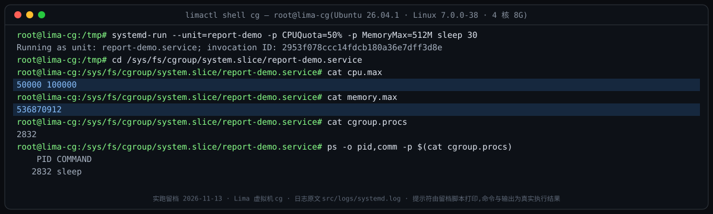

(这类「终端留档图」是把实跑的终端输出原样存成日志再排成图,来历见 §4.3.2 开头的说明。)

写法完全不同(`CPUQuota=50%` 对 `--cpus=0.5`),落下来的却是一模一样的两个数。这两个数是什么、为什么长这样,正是 §4 要倒推的;这里先记住一点:**docker 只是个入口,真正限制资源的是内核里的 cgroup。**

从此报表再怎么起 worker,合起来也只能用半颗核;内存涨到 512M 就是上限,真超了被杀的也只是报表自己,mysqld 不受影响。

磁盘和进程数呢?docker 也有对应的参数(`--device-write-bps` 限某块盘每秒写多少,`--pids-limit` 限进程个数,待核 #9),同事这次没加。§3 不经过 docker,直接在内核的接口上把四种资源一次写齐。

### §0.7 四个值得停下来想的问题

两个参数,十几个字符,效果马上就有。但这里有四件事值得停下来想:

1. `--cpus=0.5` 和 `-m 512m` 是 docker 的参数,不是内核的。内核不认识 docker。**这两个数最后是以什么形式传给内核的?**
2. report 有 9 个进程(1 主 + 8 worker),限制却是「合起来半颗核、合起来 512M」。**内核怎么知道这 9 个进程算同一组?**
3. mysqld 也在同一台机器、同一个内核上跑,**为什么报表超限只杀报表?**
4. 前面四次出事,你翻出四把工具,每把一种单位。到了这条命令里,CPU 和内存成了同一种写法。**磁盘和进程数也能这么写吗?四种性质完全不同的资源,在内核里是四套东西,还是一套?**

这几个问题的答案是同一个东西:cgroup。这一节先回答第 1、2 个问题的表层部分(数传到了哪里、一组进程是怎么圈出来的),和第 4 个问题的外形部分(四种资源在内核里确实是同一套机制,这套机制长什么样);内核拿到数之后怎么记账、怎么限制,为什么只能是一套,是后面的事。

第 4 个问题再往大里说一步,就是这一期的大问题:**Linux 内核怎么统一管理资源。**

从这里开始,请你换一个角色。前面你是 host01 的运维,只能挑现成的工具;接下来你是内核开发者,要让内核统一管理各种资源。这一节先展示现成的结果,看清它长什么样;它为什么只能是这样,下一节让你自己从零设计一遍。

## §1 一句话定义

**cgroup:内核把进程分成组,每种资源按组记账、按账设限的机制。**

(不到 30 字。)

拆开是三个动词,后面会反复用到。三个动词的分量不一样:**分组只有一套,所有资源共用;记账和设限,每种资源各做各的。**

| 动词 | 意思 | 公共的,还是各做各的 | 在开场例子里 |
|---|---|---|---|
| 分组 | 圈定哪些进程算同一组 | 公共的:只分一次,每种资源都认这一次 | report 的 9 个进程是一组,mysqld 是另一组;CPU、内存、磁盘、进程数都按这一个分法算 |
| 记账 | 这一组合起来用了多少,记在这一组的账上 | 各做各的:CPU 记跑了多少微秒,内存记占了多少字节,磁盘记读写了多少字节,进程数记有几个 | 9 个进程用的 CPU 时间加在一起算,占的内存加在一起算 |
| 设限 | 账上的数到了上限,就不再给 | 各做各的:上限的单位不同,超了以后怎么办也不同 | CPU:每 100 ms 里合计只给 50 ms;内存:合计 512 MiB 封顶 |

定义里是「按账设限」:限是对着账设的,账记在哪个组上,限就在哪个组上比。

三个动词的这条分界,决定了 cgroup 内部分成两层:

```
因为   四种资源的单位、记法、超了以后的办法各不相同(§0 的四把工具就是四种单位),
       而 report 这一组进程对哪种资源都是同一组
  ↓
要解决 分组只做一遍;每种资源只管自己的账和限
  ↓
所以   cgroup 分两层:只管「谁和谁一组」的公共层,叫核心;
       每种资源的记账和设限各是一个插件,叫控制器(controller,老版本里叫子系统)
```

「核心」在这一期专指这个公共层;说 CPU 时一律说「颗核」,两个词不混用。

名字本身就是这个意思:cgroup = control group,「受控的一组」。

## §2 类比:合租公寓的分户水电表

**拿合租公寓来比:几家合租一栋楼,住户只登记一次,水、电、燃气各装一块表;每户的限额由物业设定,表只负责计量,到限额就断;表装在楼里原有的进户管线上,不用重铺全楼的管道。这几点对应 cgroup 的几个特征。**

一栋合租公寓,整栋楼只有一路进水、一路进电、一路燃气(对应一台机器的 CPU、内存、磁盘……)。没有分户表的时候,谁家开十台电暖器,全楼一起跳闸;谁家水龙头开一整夜,全楼水压都低。你在 §0 里一次次换工具,就像每出一次事就给出事的那个电器单独加个开关:电暖器加一个,热水器加一个,开关装在电器上,不认「户」。

物业的办法是先分户,再给每一户装表:

| 公寓 | 机器 | cgroup 里的叫法 |
|---|---|---|
| 整栋楼 | 整台机器 | 根组 |
| 一户 | 一个业务(一个容器、一个系统服务) | 一个组(一个目录) |
| 户里的每个人 | 进程 | 组里的成员 |
| 户籍登记:谁住哪一户,只登记一次,水电燃气都按它算 | 分组 | 核心 |
| 水表、电表、燃气表 | CPU、内存、磁盘、进程数各一块表,各记各的 | 控制器 |
| 表上设的限额 | 这一户每种资源最多用多少 | `cpu.max`、`memory.max`、`io.max`、`pids.max` |
| 物业 | 决定每户限额是多少的人 | 管理程序(docker、systemd……) |
| 到限额,这一户的表自己断 | 超了只处理这一组 | 限流 / 组内 OOM / 排队 / fork 失败 |
| 楼里本来就有的水管、电线 | 内核本来就要走的代码路径(调度、分内存、写盘、fork) | 接入点(§6) |

这个类比能推出几条性质,每一条后面都会对应到真实机制:

- **表装在入户总管上,不装在每个电器上。** 一户里添了新电器、来了新住客,不用重新登记,电照样走这块表。对应:进程 fork 出来的子进程自动算在同一组里。
- **表只计量、限额,不负责发电。** 电还是电厂发的。对应:CPU 时间还是调度器在分,内存还是内存管理在分,cgroup 只是让它们分的时候多检查一下账。
- **分表可以套总表。** 一层楼一块总表,下面每户一块分表,各户加起来不能超过这层的总表。对应:cgroup 是一棵树,子组受父组限制。
- **户只分一次,几块表都认它。** 不会出现电表记你住 301、水表记你住 302。再装一块新表(比如加一块热水表),也不用重新分户。对应:分组只有一套,归核心;多管一种资源就是多一个控制器。
- **限额是物业定的,不是表自己定的。** 表不知道这一户该用多少,它只按写上去的数断电;住户自己也不能去改表上的限额。对应:数字由外面的管理程序写进来,内核只负责执行。
- **断电是表自己断的。** 没有物业的人每天挨家挨户抄表、看谁超了。对应到内核,这是一个先记下的问题:cgroup 里有没有一个定期检查的内核线程?第三节会实际检查。
- **装表不用重铺管线。** 表接在楼里原有的进户管上,水还是走原来那根管子。对应:cgroup 不给内核另修一条路,只在内核本来就要走的代码路径上多做一步。

这几个特征,后面几段会一个个对应到实际的机制上:各种表在 §3 的一个目录里,限额是谁定的在 §4,户只分一次在 §5 的一棵树上,表接在哪根管子上在 §6。

类比到此为止。它说不清的地方(表到底装在内核的哪条代码路径上、超限时是怎么执行的)正是后面要讲的。

## §3 成品长什么样:一个目录,四个文件

**结论:一个组就是 `/sys/fs/cgroup` 下的一个目录。四种资源的上限是目录里的四个文件,写法一模一样:往 `<控制器名>.max` 里写一行字。写完以后,组里的进程 CPU 被限制在半颗核,内存超限被杀,写盘被限到每秒 10 MiB,创建到第 20 个进程被拒绝;旁边没写数的组不受影响。**

先别急着看答案,想一下:如果让你给内核设计一个「按组管四种资源」的接口,你会怎么设计?每种资源加一个系统调用?写一份配置文件让内核去读?

cgroup 的做法很简单:**一个目录,几个文件。** 下面这一段是在实验机上原样跑出来的。

### §3.1 实验是怎么做的

- **机器。** 这一段是在专用实验机 cg-lab 上跑的(2026-11-14),本节其余实验都在虚拟机 cg 上(§4.6)。两台是同一个系统镜像,Ubuntu 26.04.1、内核 7.0.0-38;cg-lab 是 4 核 4G,只跑本文的实验,用完即删。换机器是因为 cg 上后来装了别的服务,吃满 CPU 的实验会干扰它们。
- **组。** 用一个叫 `host01` 的组代表那台机器,下面建 `report` 和 `db` 两个子组。建这三个目录、让 host01 给子组打开 cpu / memory / io / pids 四个控制器(往 `host01/cgroup.subtree_control` 写 `+cpu +memory +io +pids`),这两步在脚本里做了,没有打印进留档(脚本第 59 行)。
- **入组。** `./ingroup <组名> <命令>` 是脚本里一个几行的小程序:先把自己的 pid 写进那个组的 `cgroup.procs`,再用 exec 把自己替换成后面的命令。这和 runc 是同一个顺序,为什么必须这样,§4.4 讲。
- **留档。** 脚本 [`src/01-quad-session.sh`](src/01-quad-session.sh),日志原文 `src/logs/quad.log`,终端留档图如下(日志排成的图,不是窗口截图,说明见 §4.3.2)。正文的代码块都从日志里原样复制,只去掉了每段前的 `###` 标题行。

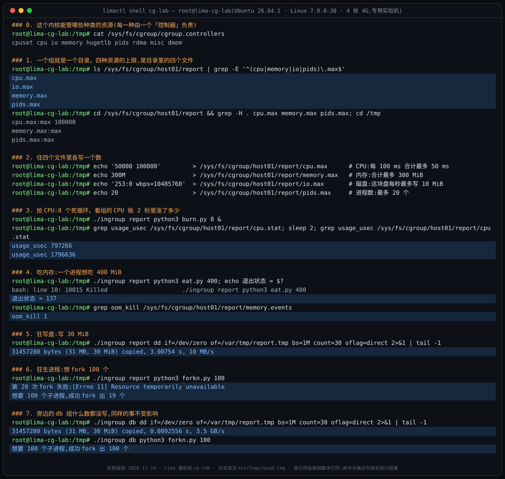

### §3.2 这个内核认得 9 种资源

```
root@lima-cg-lab:/tmp# cat /sys/fs/cgroup/cgroup.controllers
cpuset cpu io memory hugetlb pids rdma misc dmem
```

`cgroup.controllers` 列的是这台机器的内核认得的控制器,一种资源一个,一共 9 个。这一期天天打交道的是四个:

| 控制器 | 管什么 | 上限写在哪 | 超了会怎样 |
|---|---|---|---|
| cpu | CPU 时间 | `cpu.max` | 这组进程停到下一个周期 |
| memory | 物理内存(包括读写文件时的缓存) | `memory.max` | 先回收,回收不动就在组里杀进程 |
| io | 每块磁盘的读写速度 | `io.max` | 读写请求排队等 |
| pids | 进程和线程的个数 | `pids.max` | 再 fork 就失败 |

其余五个管的是更专门的东西:cpuset 管进程能用哪几颗核、哪几个内存节点,hugetlb 管大页,rdma 管 RDMA 网卡上的资源,misc 和 dmem 管几类杂项和设备内存。这一期不展开,第三节 §9 把九个放进一张表。

### §3.3 一个组就是一个目录,四个上限是四个文件

```
root@lima-cg-lab:/tmp# ls /sys/fs/cgroup/host01/report | grep -E '^(cpu|memory|io|pids)\.max$'
cpu.max
io.max
memory.max
pids.max
root@lima-cg-lab:/tmp# cd /sys/fs/cgroup/host01/report && grep -H . cpu.max memory.max pids.max; cd /tmp
cpu.max:max 100000
memory.max:max
pids.max:max
```

第一条命令只挑出 cpu、memory、io、pids 这四种资源的 `.max` 文件:四个文件,名字都是「控制器名 + `.max`」。第二条看它们刚建好时的内容:`max` 就是不设限。`io.max` 没跟着打印,它是按盘一行一行写的,一块盘都没设过时是空文件。

目录里当然不止这四个文件。把一个组目录里的文件按前缀分堆(§4.4 有一个容器组目录的节选):`cpu.` 一堆、`memory.` 一堆、`io.` 一堆、`pids.` 一堆,各归一个控制器;还剩 `cgroup.` 开头的一堆,成员名单 `cgroup.procs`、往下开控制器用的 `cgroup.subtree_control`、`cgroup.controllers` 都在里面。**这一堆不属于任何一种资源,属于核心。** 核心只管「谁和谁一组」,不知道 CPU、内存是什么;认得资源的是控制器。

细看有几个例外:一个组就算一个控制器都没开,目录里也已经有 3 个 `cpu.` 开头、1 个 `io.`、1 个 `memory.` 开头的文件,是几份只读的统计,由核心提供(第三节 §2 一个个打开控制器数过,待核 #13)。资源的上限文件没有例外:`.max` 文件的前缀就是控制器的名字。

### §3.4 往四个文件里各写一个数

```
root@lima-cg-lab:/tmp# echo '50000 100000'         > /sys/fs/cgroup/host01/report/cpu.max      # CPU:每 100 ms 合计最多 50 ms
root@lima-cg-lab:/tmp# echo 300M                   > /sys/fs/cgroup/host01/report/memory.max   # 内存:合计最多 300 MiB
root@lima-cg-lab:/tmp# echo '253:0 wbps=10485760'  > /sys/fs/cgroup/host01/report/io.max       # 磁盘:这块盘每秒最多写 10 MiB
root@lima-cg-lab:/tmp# echo 20                     > /sys/fs/cgroup/host01/report/pids.max     # 进程数:最多 20 个
```

四行逐个看:

| 文件 | 写进去的 | 读法 | 单位 |
|---|---|---|---|
| `cpu.max` | `50000 100000` | 每 100 000 μs 的周期里,合计最多跑 50 000 μs,也就是半颗核。和 §0 的 `--cpus=0.5` 落下的是同一行,§4.3 一步步换算 | 微秒 |
| `memory.max` | `300M` | 合计最多 300 × 1024 × 1024 = 314 572 800 字节。内核认 `K` `M` `G` 后缀;docker 写的是换算好的字节数 | 字节 |
| `io.max` | `253:0 wbps=10485760` | `253:0` 是要限的那块盘的设备号(主号:次号,`lsblk` 的 MAJ:MIN 一列能查到);`wbps` 是 write bytes per second;10 485 760 = 10 × 1024 × 1024,即这块盘每秒最多写 10 MiB。同一行还能写读速度 `rbps` 和每秒次数 `riops` / `wiops` | 每秒字节 |
| `pids.max` | `20` | 组里的进程(连同线程)最多 20 个 | 个 |

四种单位(微秒、字节、每秒字节、个数),写法是同一个:`echo` 一行字到 `<控制器>.max`。§0 那四把工具,四种命令行参数、四种作用范围,到这里收成了一种动作。

### §3.5 四种资源各触发一次上限

写完数,让 report 组里的进程把四种资源各用到上限一遍,最后拿旁边什么数都没写的 db 组对照。

**CPU。** `burn.py 8` 生出 8 个死循环,自己在一旁等着,一共 9 个进程,和 report 的「1 主 + 8 worker」一个样。看组目录里 `cpu.stat` 的 `usage_usec`,这是这个组在 CPU 上的账,单位微秒:

```
root@lima-cg-lab:/tmp# ./ingroup report python3 burn.py 8 &
root@lima-cg-lab:/tmp# grep usage_usec /sys/fs/cgroup/host01/report/cpu.stat; sleep 2; grep usage_usec /sys/fs/cgroup/host01/report/cpu.stat
usage_usec 797266
usage_usec 1796636
```

```
2 秒里 report 组的 CPU 账涨了   1 796 636 − 797 266 = 999 370 μs
按 cpu.max 算的上限              0.5 颗核 × 2 000 000 μs = 1 000 000 μs
实测 ÷ 上限                      999 370 ÷ 1 000 000 = 99.94%,即 0.4997 颗核
```

8 个死循环本来最多能把 4 颗核吃满(2 秒是 8 000 000 μs),账上只记了不到 1 000 000 μs。限制是按组的合计值来执行的。

**内存。** `eat.py 400` 每 0.05 秒吃 10 MiB,打算一直吃到 400 MiB,吃到了就打印一行「吃到了 400 MiB」:

```
root@lima-cg-lab:/tmp# ./ingroup report python3 eat.py 400; echo 退出状态 = $?
bash: line 10: 10015 Killed                     ./ingroup report python3 eat.py 400
退出状态 = 137
root@lima-cg-lab:/tmp# grep oom_kill /sys/fs/cgroup/host01/report/memory.events
oom_kill 1
```

那一行始终没有打印出来。进程被杀,退出状态 137 = 128 + 9,意思是被 9 号信号(SIGKILL)杀掉;组目录里 `memory.events` 的 `oom_kill 1` 是这个组的账上记的「组内 OOM 杀了 1 个进程」。上限 300 MiB 小于它想要的 400 MiB,所以一定会超限;它具体吃到多少时被杀,这一遍没有记录。组内 OOM 只杀组里的进程这一点,第二节 §9.2 会把 db 和 report 放在一起重演。

**磁盘。** `dd` 往一个临时文件写 30 MiB。`oflag=direct` 表示绕过页缓存,写请求直接交给磁盘,这样每一笔写都是 dd 自己发出去的:

```
root@lima-cg-lab:/tmp# ./ingroup report dd if=/dev/zero of=/var/tmp/report.tmp bs=1M count=30 oflag=direct 2>&1 | tail -1
31457280 bytes (31 MB, 30 MiB) copied, 3.00754 s, 10 MB/s
```

```
要写的量         30 MiB = 31 457 280 字节
上限             10 485 760 字节/秒
理论耗时         31 457 280 ÷ 10 485 760 = 3.000 秒
实测             3.00754 秒(多 0.25%)
dd 报的 10 MB/s  是十进制的兆(10⁶ 字节):31 457 280 ÷ 3.00754 ≈ 10.46 × 10⁶ 字节/秒 ≈ 9.97 MiB/s
```

不加 `oflag=direct` 的普通写,数据先进内存里的页缓存,过后由内核线程写盘。那一笔 IO 该记到哪个组的账上,要内存和磁盘两个控制器配合才说得清:第二节 §9.3 实跑,第三节 §6 拆开,第二节会把它列为 `C5·所有资源共用同一套分组` 的后一半。

**进程数。** `forkn.py 100` 连续 fork 100 个子进程(每个睡 3 秒),数成功了几个:

```
root@lima-cg-lab:/tmp# ./ingroup report python3 forkn.py 100
第 20 次 fork 失败:[Errno 11] Resource temporarily unavailable
想要 100 个子进程,成功 fork 出 19 个
```

```
forkn.py 自己                     1 个(ingroup 入组后把自己替换成它)
成功 fork 出来的                  19 个
合计                              20 个 = pids.max
第 20 次 fork                     内核返回错误 11(EAGAIN,「资源暂时不可用」),这个进程没生出来
```

这时组里没有别的进程:死循环在第 3 步之后被脚本清掉了,吃内存的那个已经被杀(合计的算法是按脚本推的,待核 #11)。

**旁边的 db 组。** 同样的两件事,db 组什么数都没写:

```
root@lima-cg-lab:/tmp# ./ingroup db dd if=/dev/zero of=/var/tmp/report.tmp bs=1M count=30 oflag=direct 2>&1 | tail -1
31457280 bytes (31 MB, 30 MiB) copied, 0.0092556 s, 3.5 GB/s
root@lima-cg-lab:/tmp# ./ingroup db python3 forkn.py 100
想要 100 个子进程,成功 fork 出 100 个
```

写同样 30 MiB,db 组用了 0.0092556 秒,report 组用了 3.00754 秒,差 325 倍;fork 100 个,db 组全部成功。上限只落在写了数的那个组上。

### §3.6 写法一样,超了以后的办法不一样

四种资源放在一起:

| 资源 | 控制器 | 上限文件 | 写进去的 | report 组实测 | 超了怎样 | 旁边的 db 组 |
|---|---|---|---|---|---|---|
| CPU | cpu | `cpu.max` | `50000 100000` | 8 个死循环,2 秒记账 999 370 μs ≈ 半颗核 | 停到下一个周期 | 没测 |
| 内存 | memory | `memory.max` | `300M` | 想吃 400 MiB,被杀(退出状态 137,`oom_kill 1`) | 先回收,回收不动就在组里杀进程 | 没测 |
| 磁盘 | io | `io.max` | `253:0 wbps=10485760` | 写 30 MiB 用 3.00754 秒 | 请求排队等 | 0.0092556 秒 |
| 进程数 | pids | `pids.max` | `20` | 第 20 次 fork 失败,成功 19 个 | 这次 fork 失败 | 100 个全部成功 |

左边四列,四行一个样:一个控制器、一个 `.max` 文件、往里写一个数。这是核心定下的规矩:组怎么建、文件怎么摆、数怎么写,对所有资源都一样。右边几列各不相同:CPU 停下来等,内存直接杀,磁盘排队,进程数当场拒绝。这是资源自己的性质决定的:CPU 时间和磁盘带宽下一刻还会有,可以等;fork 有返回值,可以拒绝;内存占用之后不会自己释放,既等不来,也拒绝不了。为什么非这样不可,第二节讲,那里会记成 `C2·记实际用量,超限处理看资源类型`。

这正是 §1 那条分界的实物:分组只有一套,四种资源共用;记账和设限每种资源各做各的。

这一期深挖的是 cpu 和 memory 两条线,因为它们对应开头的前两个问题。磁盘和进程数在第二节 §9.3、§9.4 放进组里重演;核心和控制器怎么配合,第三节从 §2 起一个接入点一个接入点地拆;把管资源拆成「公共的一层 + 一个个插件」,这种结构本身可以用到别的系统里,第三节 §15 专门说。

成品的结构已经清楚了一半:四种资源,同一种写法。另一半是这些目录在整台机器上摆成什么形状(§5)。在那之前,先回答一个更急的问题:这些数是谁写的?实验里是我手敲的,真实的机器上没有人手敲。

## §4 这些数字是谁写进去的:从一条命令倒推

**§3 里那四个数是我在实验机上手敲的。真实的机器上没人这么做:report 该分多少 CPU、多少内存,是业务上的判断,内核不知道,也不该知道。数字是外面的管理程序定下来、逐级传下来、最后写进文件的。**

这一段把 §0 那条 docker 命令倒推一遍,看 `--cpus=0.5` 和 `-m 512m` 怎么变成 `cpu.max` 和 `memory.max` 里的两个数。用 §2 的类比说,就是看物业怎么把限额写到表上。

### §4.1 先说结论

- 从你敲回车到内核生效,中间经过 **五个环节**:docker 命令行 → dockerd → containerd(和它的 shim)→ runc → 内核。
- 前四个环节都是用户态程序,**每个环节只做转换**:把上一个环节的表示换成下一个环节能处理的表示。
- 到内核面前只剩 **三个动作**:建一个目录(建组)、把 pid 写进一个文件(入组)、把数字写进两个文件(设限)。
- **数是外面定的,内核只负责执行。** 「report 该分 0.5 颗核」是你决定的,前四个环节只是把这句话转换成内核能直接使用的形式;内核从头到尾没有参与「该给多少」,它只保证写进来的数被遵守。
- 所以内核并不知道什么是容器、什么是 docker。它只看见有人在 `/sys/fs/cgroup` 下面建了目录、写了文件。**cgroup 对外的全部接口就是一棵目录树。**

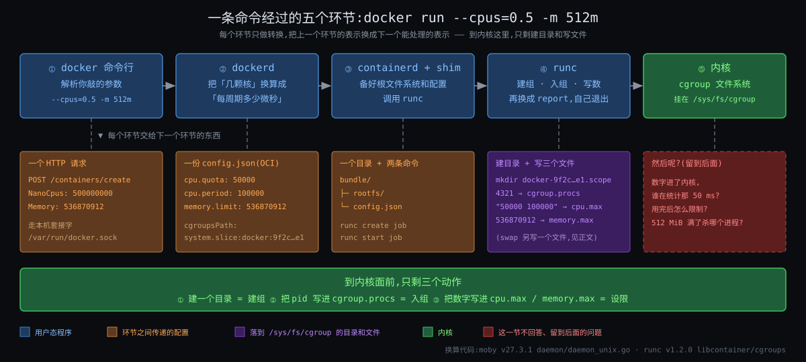

### §4.2 五个环节各自做了什么

先认一下前四个环节的名字,没用过 docker 的话只要知道它们各是哪一类角色:

- **docker 命令行**:你在终端里敲的那个 `docker` 程序,只负责解析你的参数再转发给 dockerd,自己不跑容器。
- **dockerd**:常驻后台的 docker 主程序(名字末尾的 d 是 daemon,守护进程),接收请求的是它。
- **containerd 和 shim**:dockerd 调用的组件,负责管理容器的创建、运行和删除;shim 是它为每个容器保留的一个小进程,负责监视这个容器。
- **runc**:最后向内核发出建组、入组、写数请求的小工具,建完就退出。

名字不用记,记住顺序就行:**docker 命令行 → dockerd → containerd(和 shim) → runc → 内核。**

| 站 | 是谁 | 收到 | 做了什么 | 交给下一站 |
|---|---|---|---|---|
| ① | docker 命令行 | 你敲的 `--cpus=0.5 -m 512m` | 把参数解析成两个整数 | 一个 HTTP 请求 `POST /containers/create`,里面有 `NanoCpus: 500000000`、`Memory: 536870912`,走本机套接字 `/var/run/docker.sock` |
| ② | dockerd(守护进程) | 上面那个请求 | 把「几颗核」换算成「每个周期多少微秒」,生成一份符合 OCI 标准的 `config.json` | `linux.resources.cpu.quota = 50000`、`cpu.period = 100000`、`memory.limit = 536870912`,外加这个容器的组应该建在哪(`cgroupsPath`) |
| ③ | containerd + shim | 镜像和上面的配置 | 把镜像解成根文件系统,和 `config.json` 摆进同一个目录(叫 bundle),然后调用 runc | 两条命令:`runc create`、`runc start` |
| ④ | runc | bundle 目录 | 读 `config.json`,**建组、入组、写数**;然后把容器进程替换成 report 程序;自己退出 | 对内核的几次建目录、写文件 |
| ⑤ | 内核 | 建目录、写文件 | 记下这个组、组里有谁、上限是多少 | (从这里开始才是 cgroup 真正记账和限制的地方,留给后文) |

OCI 是容器行业约定的一份公共格式。有了它,docker、Kubernetes、podman 可以共用同一个 runc。对这一节来说只要记住:**到 runc 手里的是一份 JSON,里面已经是内核使用的单位的数字了。**

### §4.3 算例:0.5 和 512m 怎么变成那三个数

**CPU 这一边。** 内核不懂「0.5 颗核」。它懂的是另一种说法:**把时间切成一个个周期,每个周期里这一组合计最多用多少 CPU 时间**。周期默认 100 ms。换算一步一步来:

```
--cpus=0.5
  → 命令行换成整数(单位:十亿分之一颗核)    NanoCPUs = 0.5 × 10⁹ = 500 000 000
  → dockerd 取周期 period = 100 ms            = 100 000 μs
  → 配额 quota = NanoCPUs × period ÷ 10⁹      = 500 000 000 × 100 000 ÷ 1 000 000 000
                                              = 50 000 μs
  → runc 写进 cpu.max 的内容                  "50000 100000"
                                               配额   周期   (单位都是微秒)
```

读法:**每 100 000 μs(100 ms)里,这一组合计最多跑 50 000 μs(50 ms)**。50 ÷ 100 = 0.5,对上了。

对账:换算公式就三行,在 dockerd 源码里(moby v27.3.1 `daemon/daemon_unix.go` 153~158 行):

```go
if config.NanoCPUs > 0 {
    period := uint64(100 * time.Millisecond / time.Microsecond)   // 100000
    quota := config.NanoCPUs * int64(period) / 1e9                // 50000
    cpu.Period = &period
    cpu.Quota = &quota
}
```

再多算几个,体会「配额可以比周期大」:

| 你敲的 | `cpu.max` 的内容 | 读法 |
|---|---|---|
| `--cpus=0.5` | `50000 100000` | 每 100 ms 合计 50 ms |
| `--cpus=1.5` | `150000 100000` | 每 100 ms 合计 150 ms |
| `--cpus=2` | `200000 100000` | 每 100 ms 合计 200 ms:机器有多颗核,一组进程在 100 ms 的墙上时间里可以合计跑出 200 ms |
| 什么都不写 | `max 100000` | 不设限 |

注意「合计」两个字。`50000 100000` 不是说「绑在半颗核上」,而是说 9 个进程不管散在哪几颗核上,它们的 CPU 时间加起来,每 100 ms 不超过 50 ms。**谁在做这个加法,是这一期要回答的第一个问题。**

#### §4.3.1 你的视角:0.5 颗核不是把核切开

你读到这里时提出:「0.5 个核,肯定不是把一个 CPU 核分开的计算,而是调度器上时间只能是正常的一半。」

**对,这是理解 `cpu.max` 的关键一步。** 核切不开:任何一瞬间,一颗核要么整颗在跑你,要么没在跑你,没有「跑半颗」这种状态。所以 0.5 只能是时间上的比例,不是空间上的切分;执行这件事的也确实是调度器。

在你这句话上再补充三点:

**① 「一半」是相对谁说的。** 是相对「一颗核跑满」,不是相对「它本来能拿到的」。report 的 8 个 worker 本来能吃满 4 颗核,限成 0.5 之后是原来的八分之一,不是二分之一。更准确的单位是:

```
0.5 颗核 = 50 ms CPU 时间 ÷ 100 ms 墙上时间
```

也就是「每过 1 秒钟,这一组合计只能在核上跑 0.5 秒」。`--cpus=2` 同理:每过 1 秒,合计能跑 2 秒(得有至少两颗核同时在跑它)。

**② 不绑核。** 这 50 ms 不指定在哪颗核上花。可以全在核 0 上,也可以 4 颗核各跑一小段,内核只看加起来的总数。§4.4.1 的实测就是这样:8 个进程散在 4 颗核上,一次各拿 6.0% ~ 6.6%,另一次各拿 4.3% ~ 12.0%,加起来都是半颗核(51.0% / 51.5%)。(要把一组进程钉在某几颗核上是另一个文件 `cpuset.cpus` 的事,这一期不展开。)

**③ 体感不是「慢一半」,而是「跑一阵、停一阵」。** CPU 的主频没有变,在核上的时候是全速;变的是「在不在核上」。

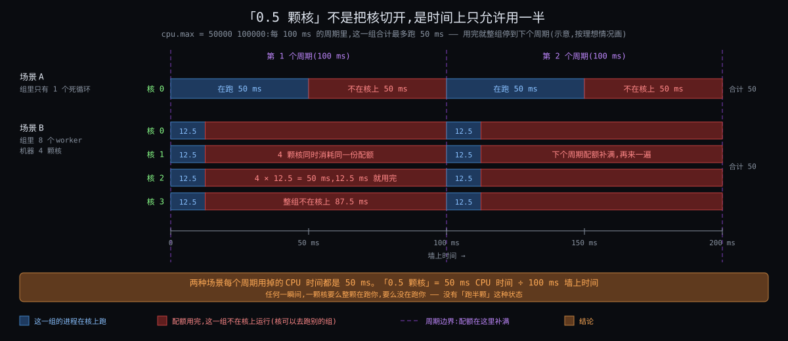

| 场景 | 每 100 ms 周期里发生的事 | 观感 |
|---|---|---|
| A:组里 1 个死循环 | 跑 50 ms,然后 50 ms 不许上核 | 跑一半时间,停一半时间 |
| B:组里 8 个 worker,机器 4 颗核 | 4 颗核同时烧同一份配额,4 × 12.5 ms = 50 ms,**12.5 ms 就烧完**;剩下 87.5 ms 整组不许上核 | 短时间跑满,然后长时间停顿 |

场景 B 是这件事里最反直觉的地方:线程越多、并行度越高,配额烧得越快,停的时间越长。对报表这种后台任务无所谓;但如果被限的是一个在线服务,某个请求恰好落进那 87.5 ms 的停顿里,它的响应时间就凭空多出几十毫秒,尽管整台机器可能很闲。「给容器设了 CPU 上限之后延迟出现毛刺」是线上的常见现象,原因就在这里。

图是按理想情况画的。下一小节用一个完整的例子把两种场景都实跑出来对账。

#### §4.3.2 一个完整的例子:同一份活,放进 0.5 颗核要多久

你接着要求:「举个例子详细说明 cpu=0.5 的具体含义。」下面四个实验都在 §4.6 的虚拟机里实跑(2026-11-13,4 核 8G,内核 7.0.0-38)。

**关于下面的「终端留档图」。** 每个实验配一张图,是把实跑时的终端输出原样存成日志、再排成终端样子的图,不是对着屏幕截的窗口截图。图里每一行都逐字来自日志:命令和输出是真实执行结果,只有提示符 `root@lima-cg:/tmp#` 那几个字是留档脚本打印的。三样东西都在本目录下,可以自己重跑对账:

- 跑实验的脚本:[`src/01-evidence-sessions.sh`](src/01-evidence-sessions.sh)
- 日志原文:`src/logs/*.log`
- 把日志排成图的脚本:[`src/01-render-shots.py`](src/01-render-shots.py)

同一批实验当天先跑过一遍,数字很接近(单任务 4.09 s,四任务 55.45 s);正文一律以留档这一遍为准。

**先说结论。**

- `--cpus=0.5` 的含义只有一句:**每 100 ms 墙上时间里,这一组进程合计只能在核上待 50 ms。**
- 它不减少干活需要的 CPU 时间,只是把这些 CPU 时间在墙上时间里摊开:**墙上时间 ≈ 这一组总共需要的 CPU 时间 ÷ 0.5。**
- 配额用完后进程还活着,只是不在核上;到下一个周期边界才被放回来。
- 它管的是「在核上待多久」,不保证「这段时间能干多少活」(实验 4 会看到这一点)。

**准备:一份正好要 2 秒 CPU 的活。** 一个 Python 循环做 1.1 亿次乘加(`work.py`,源码在下图开头),在这台虚拟机上校准为约 2 秒。程序自己报两个数:墙上时间(从开始到结束,表走了多久)和 CPU 时间(它真正在核上跑了多久)。

**实验 1:一个任务。**

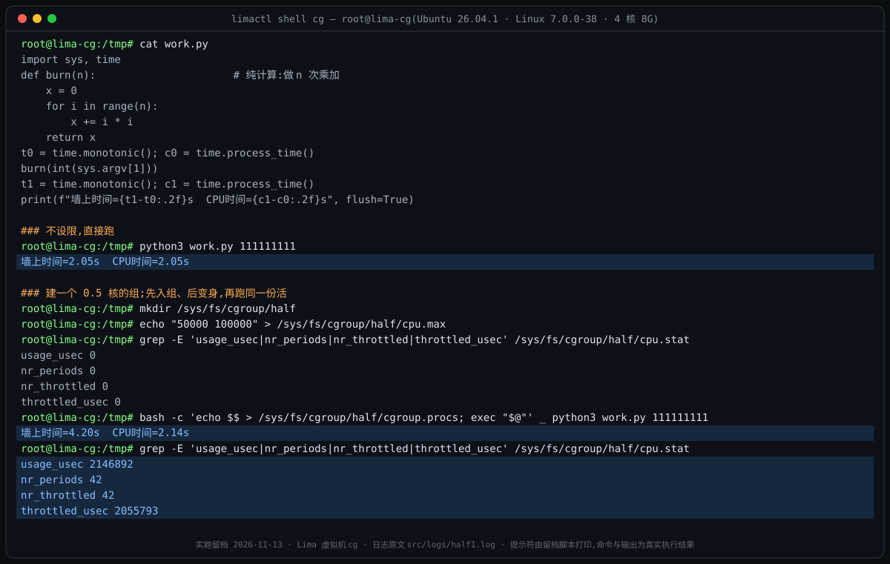

图里的入组写法 `bash -c 'echo $$ > …/cgroup.procs; exec …'` 和 runc 是同一个顺序:先把自己登记进组,再把自己替换成要跑的程序。

| | 墙上时间 | CPU 时间 |
|---|---|---|
| 不设限 | 2.05 s | 2.05 s |
| 放进 0.5 核的组 | **4.20 s** | 2.14 s |

活没有变多,CPU 时间还是 2 秒出头;表上却走了 4 秒多。多出来的 2 秒去哪了,看组目录里的 `cpu.stat` 这份统计(实验前全是 0,所以实验后的读数就是这次实验的量):

| `cpu.stat` 里的字段 | 实验后读数 | 意思 |
|---|---|---|
| `usage_usec` | 2 146 892 | 这一组在核上跑的总时间(微秒) |
| `nr_periods` | 42 | 经过了多少次 100 ms 的周期更替 |
| `nr_throttled` | 42 | 其中多少个周期达到了上限 |
| `throttled_usec` | 2 055 793 | 被限制不能运行的总时间(微秒) |

三步对账:

```
① 时间去哪了          在核上 2.14 s + 被限制不能运行 2.06 s = 4.20 s = 墙上时间   ✓
② 公式                2.14 s ÷ 0.5 = 4.28 s          ≈ 实测 4.20 s         ✓
③ 每个周期用了多少    2 146 892 ÷ 42 = 51 116 μs      ≈ 配额 50 000(高 2%)
                      任务前后跨了 43 个周期(首尾各沾一点),按 43 算是 49 928 μs
```

第 ③ 步的 2% 出入来自首尾两个不完整的周期;任务跑得越久这个误差占比越小,实验 3 跑了 556 个周期,就只差千分之一点五。

**实验 2 和实验 3 的前半:实际观察「运行一段、停一段」。** 换一个探针程序(`gaps.py`):死循环里不停读时钟,只要相邻两次读数相差超过 2 ms,就说明「我刚才被调度出核了」,记一笔。每次跑 500 ms,一共三种情况:

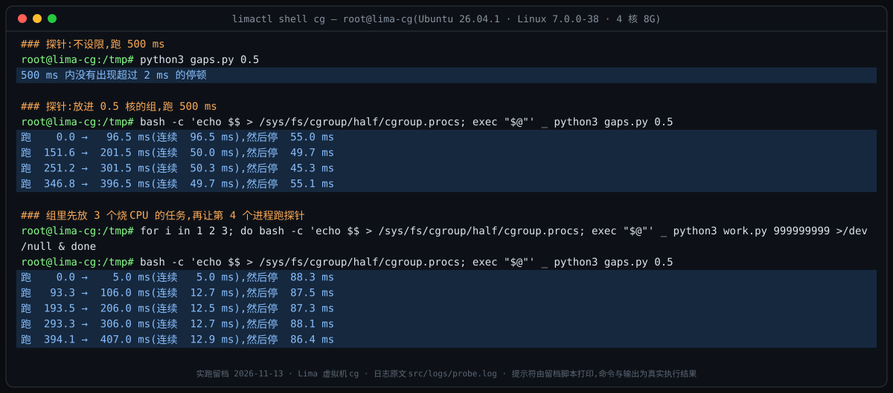

| 情况 | 探针看到的 | 对应上图 |
|---|---|---|
| 不设限 | 500 ms 内没有一次超过 2 ms 的停顿 | —— |
| 组里只有探针自己 | 第二段起:跑 50.0 / 50.3 / 49.7 ms,停 49.7 / 45.3 / 55.1 ms | 场景 A:跑 50 停 50 |
| 组里另有 3 个任务在烧 CPU | 第二段起:跑 12.7 / 12.5 / 12.7 / 12.9 ms,停 87.5 / 87.3 / 88.1 / 86.4 ms | 场景 B:跑 12.5 停 87.5 |

两种场景都和理想化的图对上了,场景 B 尤其整齐:4 颗核同时烧同一份配额,4 × 12.5 = 50。

两次的第一段都不规则(一次连着跑了 96.5 ms,一次只跑了 5.0 ms),这是起步效应:探针入组的时刻不在周期边界上。**周期是组自己的节拍,每 100 ms 一格,不会迁就某个进程什么时候开始干活。**

**实验 3 的后半:四个任务并行,做完要多久。** 按公式:4 份 × 2 s = 8 s CPU,÷ 0.5 = 16 s。

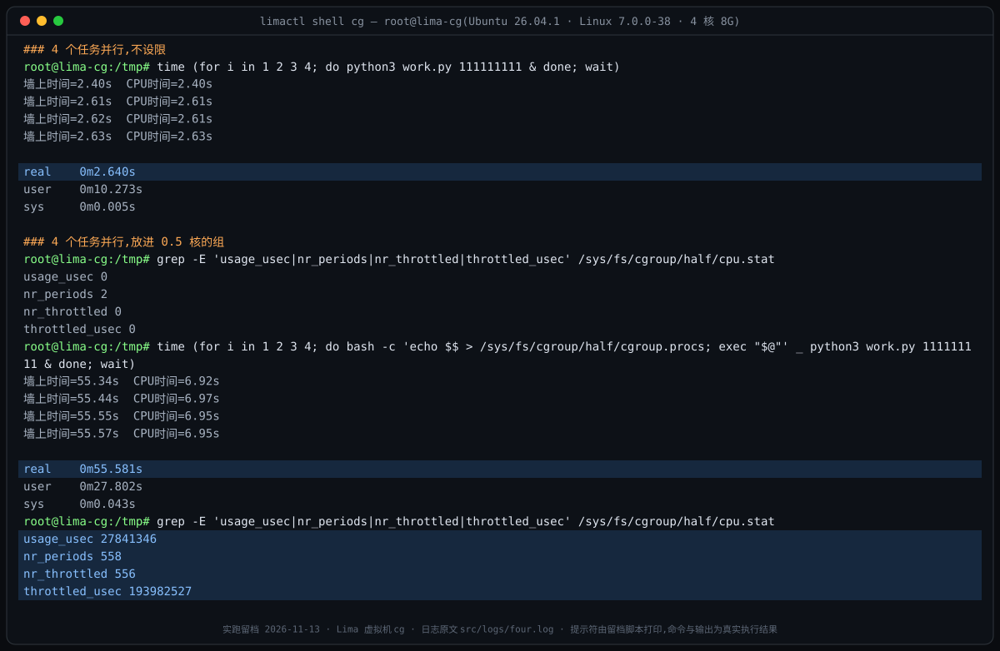

| | 4 个都做完的墙上时间 | 每个任务的 CPU 时间 |
|---|---|---|
| 不设限 | 2.64 s | 2.40 ~ 2.63 s |
| 放进 0.5 核的组 | **55.58 s** | **6.92 ~ 6.97 s** |

不是 16 秒,是 55 秒。先看是不是 cgroup 没有遵守限额:

```
usage_usec      27 841 346 μs,周期更替 558 − 2 = 556 次 → 每周期 50 074 μs    配额被遵守 ✓
throttled_usec  194.0 s;4 颗核 × 55.58 s = 222.3 s 的「核 × 时间」里,87.3% 处于被限制状态
                                                    (理想值 87.5%)            ✓
```

记账是对的。不对的是另一个数:**同样一份活,需要的 CPU 时间从 2.5 秒左右涨到了 6.9 秒。**

**实验 4:追查。** 怀疑和「每次只跑一小会儿」有关,于是只用一个任务(约 0.5 秒 CPU 的活),逐步把配额调小:

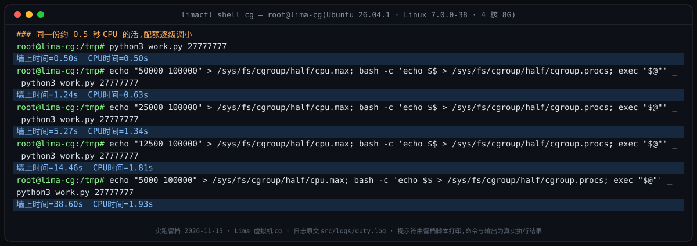

| `cpu.max` | 每周期可跑 | 墙上时间 | CPU 时间 | CPU 时间 ÷ 墙上时间 |
|---|---|---|---|---|
| 不设限 | —— | 0.50 s | 0.50 s | —— |
| `50000 100000` | 50% | 1.24 s | 0.63 s | 50.8% |
| `25000 100000` | 25% | 5.27 s | 1.34 s | 25.4% |
| `12500 100000` | 12.5% | 14.46 s | 1.81 s | 12.5% |
| `5000 100000` | 5% | 38.60 s | 1.93 s | 5.0% |

最后一列说明 cgroup 每一次都遵守了比例。倒数第二列说明:**每次在核上待得越短,同一份活要花的 CPU 时间越多**,到 5% 时接近原来的 4 倍。

原因我只能给推断,没有证实(待核 #8):这是虚拟机环境的副作用,不是 cgroup 的性质。虚拟机的每颗核在 Mac 这边是一个线程;当它每 100 ms 只忙十几毫秒,Mac 的调度器会把这种「不怎么忙」的线程放到省电的小核或较低的频率上,于是同样的 12.5 ms 里干的活变少了。在真正的物理服务器上不应该有这么大的差距,但方向相同的小幅效应(频率来不及升上去、缓存变冷)是存在的。

这个现象说明一点:**`cpu.max` 记的是时间,不是干了多少活。** 它保证你每周期在核上不超过 50 ms,至于这 50 ms 里核跑得快还是慢,它不管。

**小结:`--cpus=0.5` 到底意味着什么。**

| | 说法 | 证据 |
|---|---|---|
| 保证 | 每个 100 ms 周期,这一组合计在核上不超过 50 ms | 实测每周期 49 983 μs(§4.4.1)、50 074 μs(实验 3) |
| 不绑核、不管组内分配 | 只看合计;组内谁多谁少、在哪颗核上都不管 | §4.4.1:两次实测组内分法不同,合计都是半颗核 |
| 只拉长墙上时间,不减少 CPU 时间 | 需要的 CPU 时间不变,墙上时间 ≈ CPU 时间 ÷ 0.5 | 实验 1:2.14 s CPU → 4.20 s 墙上时间 |
| 用完就停 | 配额烧完到下个周期边界之间,整组不在核上;并行度越高,烧得越快、停得越久 | 探针:跑 50 停 50;跑 12.5 停 87.5 |
| 是上限,不是保底 | 机器忙的时候可能连 0.5 都拿不到;保底是另一个文件 `cpu.weight` 的事 | 第二节 §10.1 实跑 |
| 记时间,不记完成的工作量 | 同样的 50 ms,核慢了干的活就少 | 实验 4 |

到这一步「是什么」就够了。配额用完的那一刻内核具体做了什么、谁在统计、下个周期由谁让它们恢复运行,是这一期第一个问题的核心,留到后面。

**内存这一边。** 简单得多,只是换单位:

```
-m 512m
  → 512 × 1024 × 1024 = 536 870 912 字节
  → runc 写进 memory.max 的内容  "536870912"
```

| 你敲的 | `memory.max` 的内容 |
|---|---|
| `-m 512m` | `536870912` |
| `-m 4g` | `4294967296` |
| 什么都不写 | `max` |

顺带一个容易漏的:只写 `-m` 不写 `--memory-swap` 时,dockerd 会把「内存 + 交换区」的总量默认设成内存的两倍(同一个文件 317~320 行),也就是 1 GiB。v2 的文件 `memory.swap.max` 只管交换区那一部分,所以 runc 写进去的是 1 GiB − 512 MiB = `536870912`。这个数这一期不展开,知道 runc 一共写了三个文件即可。

### §4.4 在机器上的执行过程:runc 的三个动作

runc 拿到 `config.json` 后,按时间顺序做这些事(以 pid 4321 为例):

```
runc create job
  ├─ 生出一个子进程(pid 4321)        此刻它跑的还是 runc 自己的代码,还不是 report
  ├─ ① 建组   在 /sys/fs/cgroup/system.slice/ 下出现目录 docker-9f2c…e1.scope/
  ├─ ② 入组   4321 被登记进这个目录的 cgroup.procs
  └─ ③ 写数   cpu.max ← "50000 100000"    memory.max ← "536870912"    memory.swap.max ← "536870912"

runc start job
  └─ 4321 用 exec 替换成 /usr/bin/report    从 report 的第一条指令起,它就已经在组里
       └─ report 起 8 个 worker(pid 4350 ~ 4357)   它们一出生就在组里

runc 退出,容器由 shim 接管
```

三个动作逐个看。

**① 建组 = 建一个目录。** 目录名里那串 `9f2c…e1` 是容器的 64 位 ID。目录建在哪、由谁动手,取决于 docker 用哪种「cgroup 驱动」:

| 驱动 | 谁去建目录 | 目录位置 |
|---|---|---|
| systemd(v2 机器上的默认) | runc 不自己建,而是发消息请 systemd 建一个临时单元,systemd 去建 | `/sys/fs/cgroup/system.slice/docker-<ID>.scope/` |
| cgroupfs | runc 自己 `mkdir` | `/sys/fs/cgroup/docker/<ID>/` |

为什么默认通过 systemd 来建:这台机器上的 cgroup 树本来就是 systemd 在管(每个系统服务都是它建的一个组),两个管理者各建各的容易冲突,所以让 runc 请 systemd 来建,而不是自己建。**对内核来说两种驱动没有区别,它看到的都是一次建目录。**

目录一建好,里面立刻就有一堆文件。没有人创建过它们:

```
$ ls /sys/fs/cgroup/system.slice/docker-9f2c…e1.scope/
cgroup.controllers  cgroup.events  cgroup.procs  cgroup.stat  cgroup.subtree_control  …
cpu.max             cpu.weight     cpu.stat      cpu.pressure                         …
memory.max          memory.high    memory.current  memory.events  memory.stat  memory.swap.max  …
io.max              io.stat        io.pressure                                        …
pids.max            pids.current                                                      …
```

上面是节选。在一台真机上数过(内核 7.0,开了 cpuset / cpu / io / memory / pids 五个控制器):新建一个空目录,里面立刻有 62 个文件。

文件名的规律是「谁管的.管什么」:`cpu.` 开头的归 CPU 这一类资源,`memory.` 开头的归内存,`cgroup.` 开头的是组本身的事(成员名单、状态)。刚建好时 `cpu.max` 里是 `max 100000`,`memory.max` 里是 `max`,意思是不设限。

这些文件不在磁盘上。`/sys/fs/cgroup` 是内核提供的一种特殊文件系统(名字叫 cgroup2),**读文件是在问内核一个数,写文件是在改内核里的一个数**。至于内核把数存在哪,留到后面讲。

**② 入组 = 把 pid 写进 `cgroup.procs`。** 这里有一个顺序上的要求,值得单独说:

> **先入组,后 exec。** 4321 被登记进组的时候,它还没有变成 report。等它 exec 成 report、再 fork 出 8 个 worker,所有这些都发生在「已经在组里」之后。

这就回答了开场第 2 个问题的表层部分:内核怎么知道 9 个进程算同一组?**不是事后一个个去认领,而是第一个进程在干活之前就被放进组,之后它生的每一个子进程自动继承这个身份。** 分户电表装在入户总管上,就是这个意思。

#### §4.4.1 你的视角:事后才把主进程写进组,worker 跟不跟?

反问是这样的:不用 docker,直接在宿主机上把 report 跑起来,它已经 fork 完 8 个 worker;这时才手工建一个组,把 **主进程** 的 pid 写进 `cgroup.procs`,再往 `cpu.max` 写 `50000 100000`。8 个 worker 受不受这半颗核的限制?

你的回答:「应该受限。」

**目的上对。** 从目的上说你是对的:它们是一家子,本来就该一起受限,这正是 cgroup 想做到的效果,也是大多数人的第一直觉。

**机制上不对。** 内核不会自动把已经生出来的子进程一起搬过去。成员资格只有两条规则:

1. **写 `cgroup.procs` 只搬被写的那一个进程**(连同它自己的全部线程),不搬它已经生出来的子进程。
2. **继承只发生在 fork 的那一刻**:子进程出生时抄一份父进程当时所在的组,此后父子各记各的,父进程再搬家与它无关。

所以结果是:主进程进了新组(它只是在等 worker,本来就不吃 CPU);8 个 worker 还留在原来的组里,照样吃满 4 核。只有主进程 **此后** 再 fork 出来的新 worker,才会生在新组里。

拿户口来比:孩子出生时随父母落户;之后父母迁户口,已经分户单过的孩子不会跟着迁。

**实跑对账。** 2026-11-13 在 §4.6 那台 Lima 虚拟机里实跑(Ubuntu 26.04.1,内核 7.0.0-38,4 核 8G,root 身份)。下面两张是终端留档图(图的来历见 §4.3.2 开头的说明;脚本是 [`src/01-evidence-sessions.sh`](src/01-evidence-sessions.sh) 的 `join` 会话,日志原文在 `src/logs/join.log`)。

先是「只把父进程写进组」:

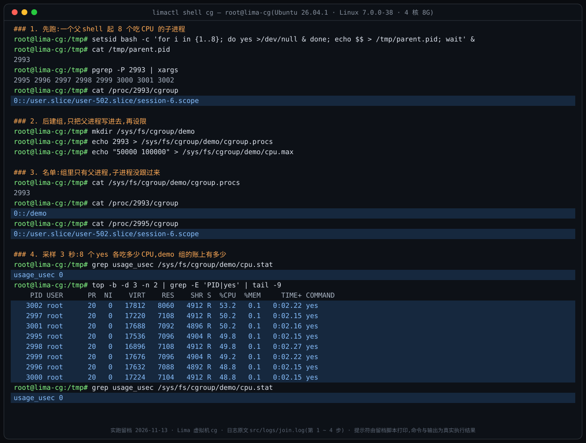

逐步读这张图:

1. 父进程是 2993,它已经生出 2995 ~ 3002 八个 `yes`(一个不停输出的死循环,这里只拿它来吃 CPU)。此时父子都在登录会话的组 `session-6.scope` 里。
2. 建组 `demo`,只写 2993,设 `50000 100000`。
3. `demo/cgroup.procs` 里只有 2993;2993 的组变成了 `/demo`,而子进程 2995 的组 **还是原来那个**。
4. 采样 3 秒:8 个 `yes` 各吃 48.8% ~ 53.2%,合计 400%,4 颗核全满;`demo` 的 `usage_usec` 采样前后都是 0。

(每个 50% 左右是 8 个进程抢 4 颗核、各分到半颗,和限额那个 0.5 只是数字碰巧。)规则 1 和规则 2 对上了。

接着做「事后补救」,把 8 个子进程逐个写进 `demo/cgroup.procs`,再采样一次:

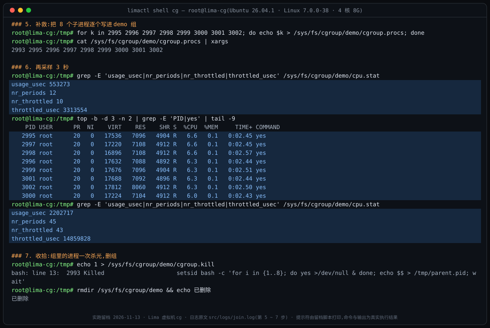

| | 只把父进程写进组 | 9 个进程都写进组 |
|---|---|---|
| 8 个 yes 的 CPU 合计 | 400.0%(各 48.8% ~ 53.2%) | 51.0%(各 6.0% ~ 6.6%) |
| demo 组账上的 CPU 时间 | 0 μs | 采样前后 553 273 → 2 202 717,涨了 1 649 444 μs |
| 经过的周期 | —— | 12 → 45,共 33 个 |
| 平均每个周期 | —— | 1 649 444 ÷ 33 = **49 983 μs** |
| 被限流的周期 | —— | 10 → 43,33 个里 33 个 |

右边这一列值得多看一眼,它是你第一个问题的实测数据:

- 平均每周期 49 983 μs,和写进去的 `50000` 只差万分之三。**限额是按每个周期单独执行的,不是长期平均下来差不多。**
- 这一遍 8 个进程分得很匀(6.0% ~ 6.6%)。但当天第一次跑同一个实验时并不匀:有一个进程拿到 12.0%,其余只有 4.3% ~ 6.6%,合计 51.5%。两次组内的分法不一样,合计都是半颗核。**内核在这一层只管一组的合计,组内谁多谁少不归它管。**(为什么偏偏有一个能拿到 12%,第三节 §7 回答。)
- 33 个周期每一个都达到了上限。这些计数来自同一目录下的 `cpu.stat`,后面讲「谁在数、怎么掐」时会回到这个文件。
- 图的最后一步顺手用了 `cgroup.kill`:往这个文件写 1,组里的进程一次全部杀掉。这是把进程分成一组的另一个用处:想全部杀掉时不会漏掉任何一个。

(如果你自己建的组里没有 `cpu.max` 这个文件,说明父目录没把 cpu 控制器往下开,先执行 `echo +cpu > /sys/fs/cgroup/cgroup.subtree_control`。这台虚拟机默认已经开了。)

这条规则带来两个推论,后面都会用到:

- **事后补救补不全。** 要把 9 个 pid 逐个写进去;而你写的这段时间里它们还可能继续 fork,新生的又落在旧组。所以 runc「先入组、后 exec」不是可有可无,是必须:在程序的第一条指令之前入组,这一组就不会有漏掉的进程。
- **反过来,进程不能靠 fork 离开自己所在的组。** 普通进程无论 fork 多少层,后代都在同一个组里;想离开得有权限去写别的组的 `cgroup.procs`。「按组管理」的可靠性就建立在这上面。

**③ 写数 = 往两个文件里各写一行。** 没有系统调用专门叫「设置 CPU 限额」,就是普通的 `write`。

把三个环节的表示并排放,就是完整的对照表:

| 你敲的 | dockerd 翻译成(OCI 字段) | 落到哪个文件 | 写进去的内容 | 意思 |
|---|---|---|---|---|
| `--name job` | 容器 ID `9f2c…e1` + `cgroupsPath` | 目录 `docker-9f2c…e1.scope/` | (建目录) | 建一个组 |
| (容器的第一个进程) | —— | `cgroup.procs` | `4321` | 这个进程入组 |
| `--cpus=0.5` | `cpu.quota=50000` `cpu.period=100000` | `cpu.max` | `50000 100000` | 每 100 ms 合计最多 50 ms CPU |
| `-m 512m` | `memory.limit=536870912` | `memory.max` | `536870912` | 合计最多 512 MiB 内存 |
| (没写 `--memory-swap`) | `memory.swap=1073741824` | `memory.swap.max` | `536870912` | 交换区最多再用 512 MiB |

倒过来读这张表:第一列是你定的,第二列是 dockerd 翻译的,后面三列是 runc 交给内核的目录、文件和内容。内核在这张表里只是接收方。它管两件事:保证写进来的数被遵守;不让组里的进程自己改,上面的推论说过,进程不能靠 fork 离开自己所在的组,想搬走得有权限去写别的组的 `cgroup.procs`。它不管的只有一件事:「谁该分多少」,这件事从头到尾是外面定的。

这就是 §2 类比里「限额是物业定的,表只按设定的数断电」:内核只提供机制,数字由外面写。第二节会把「管什么、不管什么」这两条合成一条约束,叫 `C3·内核负责执行,配额由外部设定`。也正因为接口只是一些文件,docker、Kubernetes、systemd 这些写法各异的管理程序,才都能接到同一个内核上(§6)。

### §4.5 自己验证

在一台 Linux 宿主机上(systemd 驱动):

```bash
$ ID=$(docker inspect -f '{{.Id}}' job)
$ cd /sys/fs/cgroup/system.slice/docker-$ID.scope

$ cat cpu.max
50000 100000
$ cat memory.max
536870912
$ cat cgroup.procs
4321
4350
…
4357

# 反过来,从任意一个进程查它在哪个组
$ cat /proc/4350/cgroup
0::/system.slice/docker-9f2c…e1.scope
```

最后一条值得记住:**每个进程都能通过 `/proc/<pid>/cgroup` 查到自己属于哪个组**,机器上没有「不属于任何组」的进程,没被特别安排的就在根组或它所在服务的组里。

没有 Linux 机器、只有 Mac 上的 Docker Desktop 时,可以让容器自己读自己的限额(待核 #1):

```bash
$ docker run --rm --cpus=0.5 -m 512m alpine sh -c 'cat /sys/fs/cgroup/cpu.max /sys/fs/cgroup/memory.max'
50000 100000
536870912
```

容器里看到的 `/sys/fs/cgroup` 就是它自己那个组的目录,所以不用拼那串 ID。

### §4.6 手边只有 Mac:要不要一台 Linux

先说结论:**不是必须,但有一台会好很多。**

- **不必须**:这份资料里每条命令都把输出写出来了,只读不跑也能跟上;后面读内核源码更是只需要一份源码。
- **为什么 Mac 本身不行**:cgroup 是 Linux 内核的功能。macOS 的内核是另一套(XNU),没有 `/sys/fs/cgroup`,也没有对应的东西可以凑合。Mac 上的 Docker Desktop 能跑容器,靠的也是在后台起一台 Linux 虚拟机,容器其实跑在那台虚拟机的内核上。
- **有一台的好处**:§4.4.1 那种「你猜会怎样」的问题,五分钟就能自己验证,不用信我的推断;后面讲 CPU 限流和内存 OOM 时,可以直接看到 `cpu.stat` 里的计数在涨、看到组内进程被杀。

所以要动手,就得「虚拟一台」。Apple 芯片的 Mac 上有三种方案,从轻到重:

| 方案 | 是什么 | 适合 |
|---|---|---|
| Lima | 开源的命令行工具,一条命令起一台 Ubuntu 虚拟机,有独立的 Linux 内核、systemd、完整的 `/sys/fs/cgroup` | 只想要一个能 `sudo` 的 Linux 终端做实验(推荐) |
| OrbStack | 带界面的轻量替代品,同时给 docker 和 Linux 机器,启动最快 | 还想顺手在 Mac 上直接用 `docker` 命令 |
| UTM / Parallels | 完整的图形化虚拟机 | 想要一台带桌面的 Linux,做 cgroup 实验用不上 |

**Lima 是什么。** 名字是 Linux Machines 的缩写,一个开源的命令行小工具,作用只有一个:在 Mac 上起一台 Linux 虚拟机,并且把繁琐的步骤自动完成。它自己不是虚拟机,底下用的是 macOS 自带的虚拟化能力(或 QEMU);它负责的是下载系统镜像、建虚拟机、开机、配好登录,让你敲一条命令就得到一个 Linux 终端。可以把它理解成「命令行版的、只管 Linux 的 VirtualBox」。

三点帮助判断要不要装:

- **它和 docker 的关系**:Docker Desktop、Colima、Rancher Desktop 这些让 Mac 能跑容器的工具,背后都要起一台 Linux 虚拟机;Colima 和 Rancher Desktop 用的就是 Lima。区别只是它们不让你直接接触虚拟机、只提供 `docker` 命令,而直接用 Lima 是把这台虚拟机本身交给你 —— 做 cgroup 实验要的正是后者,因为要进去看 `/sys/fs/cgroup`。
- **它里面是真的 Linux**:有自己的内核、自己的 systemd,不是模拟层。在里面建 cgroup、写 `cpu.max`、把进程撑到 OOM,碰到的都是真内核的行为,而且只影响虚拟机,不影响 Mac。
- **它对 Mac 做了什么**:brew 装几个程序;虚拟机的磁盘放在 `~/.lima/` 下;默认会把你的 home 目录以只读方式挂进虚拟机方便取文件。不用了 `limactl delete cg` 加 `brew uninstall lima` 就干净了。

**它用的是芯片原生的虚拟化吗?** 是。和 Intel 那边是同一个思路,只是每一层换了名字:

| 层 | Intel + Linux 上 | Apple 芯片 + macOS 上 |
|---|---|---|
| CPU 硬件能力 | VT-x(客户机模式 + EPT 二级页表) | ARM 虚拟化扩展(EL2 特权级 + 第二阶段页表) |
| 内核暴露的接口 | KVM | Hypervisor.framework |
| 搭出一台虚拟机的程序 | QEMU 等 | Virtualization.framework(Lima 2.3.0 默认用它,实测见下) |
| 你敲的工具 | virsh / vagrant | Lima |

Mac 是 arm64 芯片,虚拟机里跑的也是 arm64 的 Linux,所以客户机的指令直接在真 CPU 上执行,不做翻译,速度接近原生;只有碰到特权操作才陷出来交给宿主处理。

顺带和 §7 对上:这正是「虚拟机」和 cgroup 的分界。虚拟机靠 CPU 硬件划分出一台虚拟的机器,里面有一个完整的 Linux 内核;在 macOS 看来,整台虚拟机只是一个普通进程。而 cgroup 的账,是虚拟机里那个 Linux 内核自己在记。

2026-11-13 在这台 Mac 上实际装了一遍(Lima 2.3.0),能用的命令是这几条:

```bash
$ brew install lima
$ limactl start --name=cg --cpus=4 --memory=8 --containerd=none --tty=false template:ubuntu-lts
                                    # 起一台 4 核 8G 的 Ubuntu,对上本文的例子
$ limactl shell cg                  # 进去,之后就是 Linux 终端(里面的用户名是 lima,sudo 免密)
$ stat -fc %T /sys/fs/cgroup        # 输出 cgroup2fs,说明是 v2
$ limactl stop cg                   # 不用时关机;limactl start cg 再开,十秒左右
```

**自己进这台 Linux 的终端。** 在 Mac 上另开一个终端窗口,敲 `limactl shell cg` 就进去了,提示符变成 Linux 的;`exit` 或 Ctrl-D 退出,退出后虚拟机还在后台跑。几个实测过的细节:

- 进去后的当前目录和你在 Mac 上敲命令时的目录相同。Mac 的 home 目录被只读挂进了虚拟机,所以在仓库目录下进去,能直接看到这份资料和脚本,但不能在里面写文件(要写就去 `/tmp` 或 `~`)。
- 里面的用户叫 `lima`,`sudo` 不要密码;cgroup 实验基本都要 root,`sudo -i` 切成 root 最省事。
- 重跑本文的实验:在仓库目录下进虚拟机,执行 `sudo bash atlas-output/cgroup核心原理-20261112/stages/01-what/src/01-evidence-sessions.sh join`。最后一个词换成 `env` / `systemd` / `half1` / `probe` / `four` / `duty` 就是其余几个实验。

`--containerd=none` 是遇到问题后加的:不加的话 Lima 会顺手从 GitHub 下一个两百多兆的容器工具包,这边网络下它每分钟不到 3 MB,首次启动花了十几分钟;做 cgroup 实验用不上它,关掉后开机只要 11 秒。(说明:我实际走的是先建虚拟机、再用 `limactl edit cg --set '.containerd.user = false | .containerd.system = false'` 关掉它;上面一步到位的 `--containerd=none` 是照 `limactl start --help` 列出的参数写的,这个写法本身没单独跑过。)

起来之后的实际情况:

| 项 | 实测 |
|---|---|
| 虚拟机类型 | `vz`,即 Apple 的 Virtualization.framework |
| 系统 / 内核 | Ubuntu 26.04.1 LTS / 7.0.0-38 |
| cgroup | v2(`cgroup2fs`),根上已往下开 cpuset、cpu、io、memory、pids |
| 占 Mac 的磁盘 | 虚拟机 2.6 GB + 下载缓存 3.4 GB + 程序 0.1 GB ≈ 6 GB |

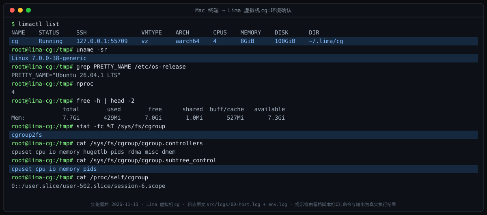

关于磁盘:虚拟机的磁盘文件名义上是 100 GB,但它是稀疏文件,只有真正写过的部分才占地方,现在实占 2.6 GB,上限就是那 100 GB。下载缓存在 `~/Library/Caches/lima`,虚拟机建好后就用不上了,`limactl prune` 可以清掉,清完总占用不到 3 GB。全部不要了:`limactl delete cg` + `limactl prune` + `brew uninstall lima`。

虚拟机是 arm64 的 Linux,对 cgroup 没有影响:目录、文件名、行为和 x86 上一样。它的内核是 7.0,比后面读源码打算钉的 6.12 新;用户能看到的这些文件基本一样,个别新增文件到读源码时再对账。

§3 那一段用的是照同样办法另起的一台专用实验机 cg-lab(同一个系统镜像,4 核 4G,只跑本文的实验,用完即删);它的脚本 [`src/01-quad-session.sh`](src/01-quad-session.sh) 开头写着在 Mac 上怎么调用。

## §5 一张全景图:一棵树 + 一排控制器

**结论:cgroup 的外形是一张「树 × 控制器」的表。竖着看是一棵目录树,每个目录一个组,整台机器只有这一棵,所有资源共用,它属于核心;横着看是一排控制器,每种资源一列,每个组在每一列上有一格,格里写着这个组在这种资源上的上限。**

把 §3 和 §4 落下的东西摆到一张图上。还是那台 4 核 8G 的 `host01`,报表容器 job 和数据库容器 db 都在。这是一张示意图,不是某一次实跑的快照:job 那一行的 CPU 和内存是 §0 那条 docker 命令落下的,磁盘和进程数两格借用 §3 实验里写的数;db 和 sshd 的数是设想的。

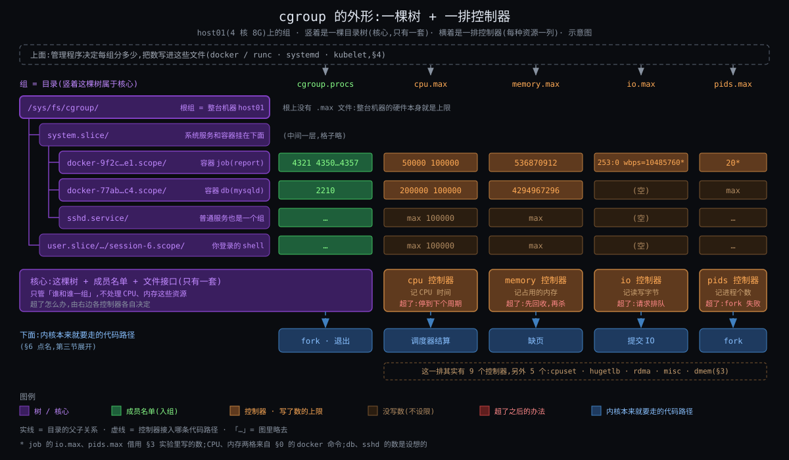

从图上能读出来的六件事:

1. **竖着看,外形是一棵目录树。** 根是 `/sys/fs/cgroup/`,代表整台机器;往下每个目录是一个组。这棵树,连同每个组的成员名单 `cgroup.procs`,属于核心。根上没有 `.max` 文件(待核 #12):整台机器的硬件本身就是上限。
2. **横着看,是一排控制器。** cpu、memory、io、pids 各占一列,每个组在每一列上有一格,就是 §3 里那几个 `.max` 文件。这个内核其实有 9 个控制器,图里只画了四个。
3. **容器不特殊。** `sshd.service` 这样的普通系统服务也是一个组,只是没人给它写 CPU 和内存的限额(`max`)。容器只是「被写了数的组」。一个组的全部配置,就是它那一行格子里的数和成员名单里的 pid。
4. **每个进程恰好在一个组里。** 4321 在 job 的组里,2210 在 db 的组里,不会同时出现在两处。对每一种资源,它都只有这一个组:§4.5 里 `/proc/4350/cgroup` 只有一行 `0::/system.slice/docker-9f2c…e1.scope`。
5. **列与列写法一样,超了以后的办法不一样。** 每一列底下,控制器各自决定超了怎么办:停、杀、排队、拒绝。这是 §3.6 那张表的另一种画法。
6. **图的上下两边各连着另一层。** 上面是写数的管理程序(§4 已经倒推过);下面是每个控制器接入的那条内核代码路径,§6 点名,第三节展开。

第 4 条值得多想一步:为什么只有一棵树?让 CPU 按部门分、内存按服务分,各分各的,不是更灵活吗?cgroup 的第一版(v1)真就是这么做的,每种资源可以各有一棵树;后来的 v2 又改回去,只留一棵。§2 类比里说的是「户只分一次」。改回一棵树的理由,第二节 §8 讲。

还有一处和 §2 的类比对上:「分表可以套总表」。job 和 db 都挂在 `system.slice` 下面,如果给 `system.slice` 也写一个上限,下面所有组加起来就不能超过它。一层管一层的合计,第二节会把它算进 `C1·按组限制合计用量`。

## §6 它在系统里的位置:上面接管理程序,下面接内核的四条代码路径

**结论:cgroup 夹在两层中间。上面是一群管理程序,它们决定数字、写文件;下面是内核本来就有的几条代码路径(fork、调度、缺页、提交 IO),每个控制器在其中一条路上多做一步,在资源被消耗的那一刻记账、比限。cgroup 自己不发 CPU 时间,也不发内存。**

```
 上面(管理程序)        docker / runc     kubelet           systemd
                       └──────── 都只是在建目录、写文件 ─────────┘
 接口                  /sys/fs/cgroup(cgroup 文件系统)
 ══════════════════════════════════════════════════════════════════════════════ 用户态 / 内核
 cgroup 本体           核心:一棵组的树、成员名单(只有一套)
                       控制器:cpu  memory  io  pids …(每种资源一个)
  下面(内核本来的代码路径) fork              调度器结算        缺页              提交 IO
                       (核心、pids)      (cpu)             (memory)          (io)
 平行(相近的机制)      namespace         ulimit            nice / 优先级
```

四句话读这张图:

- **上面**:你平时接触的 docker、Kubernetes、systemd,在资源限制这件事上都只是 cgroup 的入口。它们各有各的参数写法(`--cpus`、`resources.limits.cpu`、`CPUQuota=`),落到内核都是同一批文件。决定数字的是它们,这是 §4 的结论。
- **接口**:一棵目录树。建目录 = 建组,写文件 = 改内核里的数。管理程序和内核之间只隔着这一层文件。
- **下面**:cgroup 自己不发 CPU 时间,也不发内存。发 CPU 的还是调度器,发内存的还是内存管理。cgroup 做的事,是让这些子系统在干活的时候能识别「组」:这一笔记到哪个组、这个组到没到上限。
- **平行**:namespace、ulimit、nice 是相近但不同的机制,区别见 §7。

### §6.1 四条代码路径

「下面」那一行是前面没讲过的,先把它的来路说清楚:

```
因为   cgroup 自己不发 CPU、不发内存(§2:表只计量,不发电),
       而资源是在内核的各条代码路径上被消耗掉的(调度器让进程上核、缺页时分物理页、写盘时提交请求、fork 时生进程)
  ↓
要解决 在资源被消耗的那一刻,把这一笔记到对的组上,并且看看超没超
  ↓
所以   每个控制器在内核本来就要走的那条代码路径上挂一个记账点,叫接入点;
       不另起线程,不另修一条代码路径(§2:装表不重铺管线)
```

先想一下:如果让你来写 cpu 控制器,你会在什么时候记账?最直接的想法是另起一个线程,每隔一会儿把组里每个进程用了多少加一遍,超了就去拦。这个想法差在哪、内核为什么偏偏不这么做,第三节 §13 会对照着讲。这里只记住内核的选择:**账在消耗发生的那条代码路径上顺手记。**

跟着 report 的一个 worker 过一遍它的一生,它会依次经过这几条代码路径:

| worker 一生的一刻 | 内核本来就要走的代码路径 | 谁在这条代码路径上多做一步 | 这一刻要回答的问题 |
|---|---|---|---|
| 出生:被 report 主进程 fork 出来 | fork | 核心、pids 控制器 | 它生在哪个组?这个组还能不能再添一个进程? |
| 跑 CPU:做聚合计算 | 调度器结算它跑了多久 | cpu 控制器 | 这个组这个周期还剩多少配额? |
| 要内存:第一次碰到一页新内存 | 缺页,分一个物理页 | memory 控制器 | 这一页记到哪个组?记上去超没超? |
| 写盘:把中间结果写进临时文件 | 提交 IO 请求给块层 | io 控制器 | 这块盘、这个组、这一秒还能写多少? |
| 生孩子:worker 自己再 fork | fork | 核心、pids 控制器 | 同出生 |
| 退出 | 进程退出 | 核心、pids 控制器 | 名单上摘掉它,进程数减一 |

「写盘」那一行有个小坑:像 §3 那样 `oflag=direct` 直接写,请求是 worker 自己提交的;普通的带缓冲的写,数据先进内存,过后由内核线程提交,这一笔怎么记回 report 这个组的账上,第三节 §6 讲。

四条代码路径分别是第三节的 §3(fork)、§4(调度器结算)、§5(缺页)、§6(提交 IO)。每一条路径上,第三节都会回答同一组问题:内核原本在这条路径上做什么,cgroup 在哪一步之后多做一步,记一次账要花多少开销,没人设限的时候还有没有开销。第二节会把「只能挂在原有的代码路径上,而且必须便宜」记成一条约束,叫 `C4·在内核已有代码路径上记账,开销要小`。

## §7 cgroup 不是什么

四个容易和它混在一起的东西。前三个是与它相近的机制,解决的是不同的问题或者同一个问题的弱化版:

| 容易混的 | 它管的是 | 作用的单位 | 和 cgroup 差在哪(用 job 的例子) |
|---|---|---|---|
| **namespace** | 进程**看得见什么**(进程号、网络、挂载点的视图) | 一组进程的视图 | 它不记账也不设限。容器 job 里敲 `free -m`,看到的还是宿主机的 8G:namespace 没把内存这个「视图」隔开,而限额在 cgroup 那边,是另一套东西。一句话:namespace 管看得见什么,cgroup 管用得了多少 |
| **ulimit**(`setrlimit`) | 单个进程的上限 | **每个进程各算各的** | 给 report 设「每进程最多 512M」,9 个进程就是各有 512M、合计 4.5G,照样把机器撑爆。而且它限内存限的是虚拟地址空间(`RLIMIT_AS`),不是真正占住的物理内存;限 CPU 限的是累计秒数(`RLIMIT_CPU`,到点发信号杀进程),表达不了「每 100 ms 最多 50 ms」这种速率 |
| **nice** | 抢 CPU 时的相对优先权 | 单个线程 | 它只在有人争的时候起作用:把 8 个 worker 都调到 nice 19,mysqld 忙的时候它们会让,但没有「上限」这个概念,机器空闲时照样吃满 4 核;而且多开一个 worker 就多一份权重。它管不了内存 |
| **虚拟机** | 切一份虚拟硬件给你 | 一台假机器 | cgroup 不切硬件、不预留。512 MiB 不是先划出来留着,而是 job 用到 512 MiB 的那一刻被限制;job 没用满的部分,别人可以用 |

还有两个反过来的误会。

**cgroup 不等于容器。** 容器是 namespace + cgroup + 根文件系统三样拼起来的;cgroup 单独就能用,systemd 管的每个服务都在自己的 cgroup 里,和容器无关。

**cgroup 也不是「限 CPU 和内存的专用工具」。** 开场的 docker 命令只用了两个参数,很容易让人这么以为。§3 那台实验机的内核认得 9 种资源,其中四种你已经看着它们各触发了一次上限。它是一个框架:分组那一层是公共的,具体管哪种资源由一个个控制器负责。多管一种资源,是多一个控制器,不是再造一套 cgroup。

ulimit 和 nice 这两行其实已经在回答「为什么需要 cgroup」了:它们都以单个进程为单位,而你要管的是「一组进程」。下一节从这里接着往下挖。

## §8 关键词速查表

| 术语 | 一句话说明 |
|---|---|
| cgroup(控制组) | 一组进程 + 这组进程在每种资源上合用的账;外形是 `/sys/fs/cgroup` 下的一个目录 |
| cgroup 文件系统(cgroup2) | 内核提供的特殊文件系统,挂在 `/sys/fs/cgroup`;建目录 = 建组,读写文件 = 读写内核里的数 |
| 核心 | cgroup 里和具体资源无关的公共层:这棵树、成员名单、文件接口;`cgroup.` 开头的文件归它 |
| 控制器(controller) | 负责某一种资源的插件:`cpu`、`memory`、`io`、`pids` 等,这台机器上一共 9 个;上限文件的前缀就是控制器的名字;v1 里叫子系统 |
| 层级(hierarchy) | 组与组的父子关系,也就是目录树;子组受父组的限额约束 |
| 接入点 | 内核本来就要走的一条代码路径上(fork、调度器结算、缺页、提交 IO、退出),cgroup 多做一步、记账并检查限额的那个位置 |
| `cgroup.procs` | 一个组的成员名单;把 pid 写进去 = 让这个进程入组 |
| `cpu.max` | CPU 上限,内容是 `配额 周期`(微秒),如 `50000 100000` = 每 100 ms 合计最多 50 ms |
| `memory.max` | 内存上限,单位字节,如 `536870912` = 512 MiB;超了先回收,回收不动就在组内杀进程(OOM) |
| v1 / v2 | cgroup 的两套接口。v1 每类资源各一棵树(文件名如 `cpu.cfs_quota_us`),v2 只有一棵树(`cpu.max`)。本期全程用 v2 |
| cgroup 驱动 | 容器运行时用哪种方式建组:`systemd`(请 systemd 建)或 `cgroupfs`(自己建目录) |

## §9 留下的悬念

**这一节只讲到成品的外形和数字的来路:一个目录、几个文件,一棵树加一排控制器,数字由外面写进来。两条线各留下一串问题,难度逐步增加。**

### §9.1 第一条线:一组进程的资源是怎么被管住的

1. **在这之前呢?** cgroup 到 2.6.24 版才进内核。之前的十几年里,一台机器上跑多个互不相让的服务,大家是怎么办的?§0 那四把工具明明早就有,它们到底差在哪里?
2. **那些文件不在磁盘上,数存在哪?** 写进 `cpu.max` 的 `50000 100000`,内核把它记在了什么东西上?
3. **谁在数那 50 ms?** 9 个进程散在 4 颗核上各跑各的,「合计」是谁在加?每跑一微秒就加一次吗?那得多慢?
4. **数满了怎么掐?** 一个周期里 50 ms 用完了,剩下的 50 ms 这 9 个进程处在什么状态?是被杀了、睡了、还是别的?下个周期又是谁让它们恢复运行?
5. **内存的账比 CPU 难在哪?** CPU 时间用完了,下个周期又有;内存占用之后不会自己释放。512 MiB 满了以后内核先做什么、最后才做什么?真到杀进程那一步,为什么只在组里挑、怎么挑?
6. **组内谁多谁少,由什么决定?** §4.4.1 里同一个半颗核的组,一模一样的 8 个死循环,有一次一个拿到 12.0%,其余只有 4.3% ~ 6.6%。

### §9.2 第二条线:cgroup 这套架构

7. **四种性质完全不同的资源,为什么能用同一种写法管?** CPU 时间下一刻还会有,内存占用之后不会自己释放,磁盘带宽可以排队,进程数 fork 一次就多一个。§3 里它们却是同一种目录、同一种文件、同一个 `echo`。公共的那一层到底抽出了什么,才让四种资源都能接进来?
8. **为什么有 v1 和 v2 两套?** 同一个内核功能做了两遍,第一遍错在哪?§5 里「只有一棵树」,是第一遍吃了亏才收回来的吗?
9. **控制器是怎么接进一个已经在跑的内核的?** §6 那四条代码路径上各多做一步,这一步具体挂在哪儿?每次都有开销吗?没人设限的时候也有开销吗?在 fork 这种核心和控制器都要插手的地方,谁先谁后、各做什么?

第 1、7、8 个是下一节的事;第 2 ~ 6 个和第 9 个要到第三节才能答完。

下一节从内核开发者的角度开始。你是内核开发者,手边只有 §0 那四把旧工具,要让内核把各种资源统一管起来。最顺手的办法大概是:CPU 管不住,就给 CPU 写一个限制器;内存管不住,再给内存写一个;磁盘、进程数,再各写一个。这样做到第几个,会遇到什么问题?

## §10 呼应灵魂问题

你带来的三个问题,这一节各走了一小步:

| 你的问题 | 这一节拿到的 | 还缺的 |
|---|---|---|
| ① 往 `cpu.max` 写 `50000 100000`,内核怎么让这组进程最多吃半颗核? | 这行字的来历(`--cpus=0.5` 的换算)、它的读法(每 100 ms 合计 50 ms)、它写在哪、「这组进程」是怎么圈出来的(先入组后 exec,子进程继承);§3 里 8 个死循环 2 秒只记了 999 370 μs 的账 | 内核收到之后的一切:账记在哪、谁在数、数满了怎么掐(悬念 2 / 3 / 4 / 6) |
| ② 容器 OOM 只杀容器里的进程不波及宿主机,边界谁划的、账怎么记? | 边界就是组:一个目录 + 一份成员名单;上限是 `memory.max` 里的一个数,由外面的管理程序写进来;每个进程恰好属于一个组;§3 里想吃 400 MiB 的进程被杀,组的 `memory.events` 记下 `oom_kill 1` | 一页内存记到组的账上的那一刻发生了什么、满了以后先回收还是先杀、为什么只在组内挑(悬念 5) |
| ③ cgroup 通过什么架构实现对各种资源的控制?它怎么融入 Linux 内核?设计哲学是什么? | 外形:一棵树(核心,只有一套)+ 一排控制器(每种资源一个插件),四种资源同一种写法、超了以后各有各的办法(§3、§5);接口就是文件,数字由管理程序写,内核只负责执行(§4);每个控制器挂在内核本来就要走的一条路上(§6,只点了名) | 为什么非分成核心和控制器不可、为什么只能有一棵树(悬念 7 / 8,第二节);每条代码路径上在哪一步记账、记一次账花多少开销(悬念 9,第三节);设计思路这一节只提到几个开头,第二节才逐条推出来 |

粗略估计:前两个问题都只闭环了一成多,我们知道了「问题里的每个词指的是什么」,还不知道任何一步「怎么做到」;第三个问题闭环两成左右,成品的外形看清了,它为什么只能长这样、怎么接进内核,还没开始讲。这是这一节本来的范围。

## 待核清单

| # | 内容 | 状态 |
|---|---|---|
| 1 | §4.5 docker 那几条验证命令的输出(宿主机视角与容器自读两种)都还没实跑:虚拟机里目前没装 docker | 待核 |
| 2 | §4.4 `ls` 的文件清单:已在内核 7.0 上实测(空组 62 个文件,`cpu.max` 默认 `max 100000`、`memory.max` 默认 `max`);与 6.12 的差异进源码一步时再对 | 部分核实 |
| 3 | §9.1(旧 §8)「cgroup 2007 年才进内核」:合入的具体内核版本与日期,讲来路时配一手出处。重构时正文改写为「2.6.24 版才进内核」,版本号依据第二节已核实的 cgroups(7);日期仍未核 **第四节核实:cgroup 框架 2007-10-19 由 Linus 合入主线(提交 ddbcc7e8),随 2.6.24 于 2008-01-24 发布;docker 2013 年 3 月首次公开。见第四节 §3.3、§12** | 已核实,销项 |
| 4 | §4.4.1 实验:已实跑两遍(2026-11-13,Lima 虚拟机,内核 7.0.0-38),结果与推断一致;正文数字与留档图取自第二遍,日志在 `src/logs/join.log` | 已核实 |
| 5 | §4.6 Lima 的安装与启动命令:已在本机实际执行,正文已改为实际能用的写法(模板写作 `template:ubuntu-lts`,加 `--containerd=none`) | 已核实 |
| 6 | §4.6 Lima 默认虚拟机类型:`limactl list` 的 VMTYPE 一列显示 `vz` | 已核实 |
| 7 | §4.3.1 图上场景 A(跑 50 停 50)与场景 B(跑 12.5 停 87.5):已由 §4.3.2 实验 2 / 3 的探针实测对上;`throttled_usec` 按每颗核分别累加这一点与实测 87% 吻合,源码层面的确认留到讲 CPU 限流时 | 实测吻合,源码待核 |
| 8 | §4.3.2 实验 4「占空比越低,同一份活的 CPU 时间越多」的原因:推断是 Mac 把低负载的虚拟核线程放到小核 / 低频(虚拟机环境效应),未证实;有物理 Linux 机器时重跑对比 | 待核 |
| 9 | §0.6 docker 的 `--device-write-bps`(限某块盘的写速度)与 `--pids-limit`(限进程数)两个参数,以及它们落到 `io.max` / `pids.max`:凭文档写的,没有实跑(虚拟机里没装 docker,同 #1) | 待核 |
| 10 | §3.4 `253:0` 是 cg-lab 上 `/var/tmp` 所在那块盘的设备号:由「写 `/var/tmp` 被限到 10 MB/s」反推,留档里没有 `lsblk` 输出。§3.3「`io.max` 没设过时是空文件」出自内核文档,留档里没打印 | 待核 |
| 11 | §3.5「forkn.py 自己 1 个 + fork 出的 19 个 = 20」是按脚本推的(死循环在第 3 步后被 `cgroup.kill` 清掉,吃内存的进程已被杀),当时没有读 `pids.current` 对账 | 待核 |
| 12 | §5 根组上没有 `cpu.max` / `memory.max` / `io.max` / `pids.max`:出自 cgroup v2 文档(这几个文件「exists on non-root cgroups」),没在实验机上 `ls` 留档 | 待核 |
| 13 | §3.3 一个控制器都没开时,组目录里已有 3 个 `cpu.`、1 个 `io.`、1 个 `memory.` 开头的文件:个数来自第三节的 `fw.log`;具体是哪几个(推测是 `cpu.stat`、`cpu.pressure` 这类只读统计)、由核心提供,没有逐个核对 | 待核 |

已核实(对着源码看过):`--cpus` → quota 的换算与默认周期 100 ms(moby v27.3.1 `daemon/daemon_unix.go` 153~158);`-m` 未配 swap 时总量翻倍(同文件 317~320);v2 机器上默认 systemd 驱动(同文件 `UsingSystemd`);runc 写 `cpu.max` / `memory.max` / `memory.swap.max` 以及 swap 换算(runc v1.2.0 `libcontainer/cgroups/fs2/cpu.go`、`memory.go`);systemd 驱动下组建在 `system.slice`、单元名 `docker-<ID>.scope`(runc v1.2.0 `libcontainer/cgroups/systemd/v2.go`、`common.go`)。

留档说明:§0 的 systemd-run 与 §4 的全部实验在虚拟机 cg 上跑(脚本 `src/01-evidence-sessions.sh`,日志 `src/logs/` 下的 `env` `systemd` `join` `half1` `probe` `four` `duty` 七份和 `00-host.log`);§3 在专用实验机 cg-lab 上跑(脚本 `src/01-quad-session.sh`,日志 `src/logs/quad.log`)。九张终端留档图都由 `src/01-render-shots.py` 从日志排成。

## 修订记录

| 时间 | 修订摘要 | 触发原因 |
|---|---|---|
| 2026-11-12 | 初稿:开场场景 + 定义 + 分户电表类比 + docker 命令五站倒推(加厚)+ 目录树全景 + 不是什么 + 六个悬念;两张 SVG | 开场对齐后用户「开始」 |
| 2026-11-13 | 新增 §3.4.1《你的视角:事后才把主进程写进组,worker 跟不跟?》:认一半(目的上该受限)、纠一半(只搬被写的进程,继承只在 fork 时)+ 验证实验 + 两条推论 | 用户答反问「应该受限」 |
| 2026-11-13 | 新增 §3.6《手边只有 Mac:要不要一台 Linux》:不必须但有更好;macOS 没有 cgroup;Lima / OrbStack / UTM 三条路 | 用户追问「本地是 mac,例子要 linux 怎么办,需要虚拟一个吗」 |
| 2026-11-13 | §3.6 补「Lima 是什么」:命令行起 Linux 虚拟机的工具;和 docker / Colima 的关系;里面是真内核;对 Mac 的改动与卸载 | 用户追问「lima是什么」 |
| 2026-11-13 | §3.6 补「它用的是芯片原生的虚拟化吗」:Intel VT-x / KVM / QEMU 与 ARM EL2 / Hypervisor.framework / Virtualization.framework 四层对照;回扣 §5 虚拟机与 cgroup 的分界 | 用户追问「是用 apple 芯片原生的虚拟能力吗,类似 intel 的 hypervisor 技术吧」 |
| 2026-11-13 | 装好 Lima 虚拟机并实跑:§3.4.1 换成真实输出,新增「事后补救」一步与对照表(每周期 50 037 μs、33 / 33 周期限流);§3.4 补空组 62 个文件;§3.6 改为实际可用的命令 + 实测表 + 磁盘占用说明;新增实验脚本(当时名为 01-join-after-fork.sh,后并入 `src/01-evidence-sessions.sh`);待核 #4 / #5 / #6 销项 | 用户「装吧」+ 追问「会不会用很多磁盘空间」 |
| 2026-11-13 | §3.6 补「自己进这台 Linux 的终端」:`limactl shell cg`、目录只读挂载、sudo 免密、重跑实验的命令 | 用户追问「我可以访问这个 linux 的终端吗」 |
| 2026-11-13 | §0 补 docker 命令逐段拆解表(docker / run / -d / --name / --cpus / -m / 镜像)+ 不用 docker 的等价做法(systemd-run 实跑,落下同样的 `50000 100000` 与 `536870912`) | 用户读稿反馈「这条命令的含义要解释下,避免没有用过 docker 的人不清楚」 |
| 2026-11-13 | §3.2 开头补四个角色的白话介绍(前台 → 接单 → 管家 → 动手的人 → 内核) | 同上,顺带把 §3 的 docker 术语也铺平 |
| 2026-11-13 | 新增 §3.3.1《你的视角:0.5 颗核不是把核切开》:认(时间比例而非空间切分,调度器执行)+ 拧紧三处(相对一颗核跑满 / 不绑核 / 体感是跑一阵停一阵)+ 场景 A / B 对照表 + 新图 `pics/01-half-core-timeline.svg`;待核 #7 | 用户读稿提出「0.5 个核肯定不是把一个 cpu 核分开,而是调度器上时间只能是正常的一半」 |
| 2026-11-13 | 新增 §3.3.2《一个完整的例子:同一份活,放进 0.5 颗核要多久》:四个实跑实验(单任务 2.05 s → 4.09 s 三步对账;停顿探针跑 50 停 50;四任务跑 12 停 87;配额逐级调小追查 CPU 时间膨胀)+ 小结表;新增两个实验脚本(后并入 `src/01-evidence-sessions.sh`);待核 #7 改为实测吻合,新增待核 #8 | 用户「对。举个例子详细说明 cpu=0.5 的具体含义」 |
| 2026-11-13 | 全部实验重跑一遍并留档:日志原文存 `src/logs/`,由 `src/01-render-shots.py` 排成 8 张终端留档图(`pics/01-shot-*.svg`)贴进 §0 / §3.3.2 / §3.4.1 / §3.6;正文数字统一改为留档这一遍(单任务 4.20 s、四任务 55.58 s、每周期 49 983 / 50 074 μs);说明这些图是日志渲染而非窗口截图;三个旧脚本并入 `src/01-evidence-sessions.sh` | 用户「能把通过 lima 跑的实际截图保存下来贴在文档中吗?跑的过程、关键证据」 |
| 2026-11-14 | 新增 §4.1《它管的不止 CPU 和内存:一棵树 + 一排控制器》:实测 9 个控制器;文件名前缀 = 控制器名;四个常用控制器对照表;指向第二节 §10.8 与第三节 §9 | 用户读完前三节后指出:「cgroup 不止能管理 CPU,还能管理内存、IO……是个架构」 |
| 2026-11-14 | 按三节共用的重构纲要重写全篇,让「cgroup 这套架构」这条线从开场贯穿到结尾,而不是另加一节:§0 从一次事故扩成同一台机器上四种资源先后出事、四把旧工具四种单位,抛出大问题「Linux 内核怎么统一管理资源」,并请读者换到内核开发者的座位;§1 定义改成能装下各种资源(分组公共,记账、设限各做各的),由此引出核心与控制器;§2 类比扩成合租公寓的分户表(户只分一次、水电燃气各一块表、限额物业定、表自己跳闸、装表不重铺管线);新写 §3《成品长什么样:一个目录,四个文件》,用 cg-lab 实跑的 `quad.log`(9 个控制器;四个文件写四个数;CPU 2 秒记账 999 370 μs、吃 400 MiB 被杀、写 30 MiB 用 3.00754 秒、第 20 次 fork 失败;db 组写盘 0.0092556 秒、fork 100 个全成功)与留档图 `01-shot-quad.svg`,旧 §4.1 拆进 §3 和 §5;旧 §3 整节搬到 §4(§3.1 ~ §3.6 → §4.1 ~ §4.6,内容与实测不动),框架改为「数字是外面的管理程序写进来的」,并埋下 `C3·内核强制,策略在外`;§5 全景图 `01-overview.svg` 重画成「一棵树 + 一排控制器」;§6 升级为「上面接管理程序,下面接内核的四条路」,点名接入点并跟着 worker 过一遍;§7 加「不是限 CPU 和内存的专用工具」;§8 补核心、接入点;§9 悬念按两条线重排;§10 改成三个灵魂问题;待核 #1 ~ #8 的章节号换成新编号、#3 补版本号,新增待核 #9 ~ #13 | 用户读完前三节后纠正:「你理解错了。你得从根上开始修改。就是重点要放在cgroup的架构,通过什么架构来实现对各种资源的控制的,怎么融入linux内核的,设计哲学是什么。这是本系列的第二条主线。01-what 02-why 03-how都要加上这个线索。而且要融入得自然,不要通过加新的章节来敷衍。要有故事性。」 |
| 2026-11-15 | 待核 #3 回填第四节的核实结果(合入日期与发布日期) | 第四节查一手资料后回填 |
| 2026-11-17 | 全篇改白话:去掉口号、比喻、拟人(约 130 处措辞:拟人和口号约 25 处,比喻约 55 处,渲染气氛和口语化表达约 50 处;「五站接力」改为「五个环节」、「内核的路」改为「内核代码路径」、「一摊」改为「一组」);三张手绘图(`01-docker-relay.svg`、`01-half-core-timeline.svg`、`01-overview.svg`)同步改文字;约束名已统一换新 | 用户:「都改成白话」 |
| 2026-11-17 | 「巡查(线程)」改为「检查(线程)」,与第三节及视频用词一致 | 做视频审稿时统一用词 |
