# 阶段 2:cgroup 为什么必须存在,为什么长成这样

> 上一节亮出了成品:一个组目录,四个文件,四种资源,同一种写法。它也留下一个问题:CPU、内存、磁盘、进程数,性质完全不同,凭什么能用同一种写法管?
>
> 这一节请你换个位置坐:你是要让 Linux 内核把各种资源统一管起来的内核开发者。面前是 host01 这台机器,手里先只有内核几十年攒下的旧工具。下面讲的是推演,不是史实:如果你来设计,会先怎么做、遇到什么问题、最后做成什么样。真实的历史(谁、哪一年、为什么)留到讲来路的时候。实验是我在虚拟机里替你跑的,数字都是实测。
>
> 读法:每一节先给结论,再真跑一遍,然后记下这一次发现的问题。几个发现合起来成一条根约束,一共五条;每条正式成立的地方,用引用块写出它的完整表述。两条线并排往前走:一条是「一组进程的资源是怎么被管住的」,一条是「cgroup 这套架构为什么长成这样」。
>
> 没用过 docker 也能读:这一节几乎不出现 docker,只有进程、命令和数字。

## §0 先说结论

**一句话:旧工具把用量记在单个进程(或者用户、会话、整台机器)身上,而你要管的是一组进程的合计,所以必须有一个进程自己改不了的「组」;又因为要管的资源不止一种、以后还会更多,这个「组」只能做一遍,做成所有资源共用的公共框架,每种资源各加一个控制器(内核里负责管某一种资源的模块),在内核本来就要走的路径上顺手记账。**

第一条线,为什么非有 cgroup 不可:

- **单位错了。** 调度器、nice、ulimit 认的都是单个进程;业务却是一组会变的进程,多开一个就多拿一份。
- **说不出绝对数。** nice 只能说「抢的时候谁多」,说不出「最多半颗核」;ulimit 限的是地址空间,不是真占住的内存。
- **限制是进程自己设的。** 绑核、进程组、会话,进程自己一个系统调用就能改。
- **出事时不区分责任。** 内存吃光时,内核在全机挑最胖的杀,不问是谁闯的祸。

第二条线,为什么长成这样:

- **一种资源写一个限制器,分组就要做四遍。** 四套分组还互相对不上,而资源的种类还在增加。于是分组抽成公共的一层,每种资源做成一个插件。
- **谁该分多少,内核不知道。** 于是内核只管兑现,数字由外面的管理程序写进文件。
- **每家一个内核太贵,另建一条路径又没人肯走。** 于是记账只能放在内核本来就要走的路径上,而且开销要小到几乎可以忽略。
- **第一版成品 v1 把「树长什么样」也交给了插件。** 写一次文件的用量记录要跨两棵树,对不上;v2 收回这个权限,只留一棵树。

这一路上会得出五条设计原则。每一条都是遇到某个问题之后得出的,出现在它得出的地方,§12 再把它们排在一起。

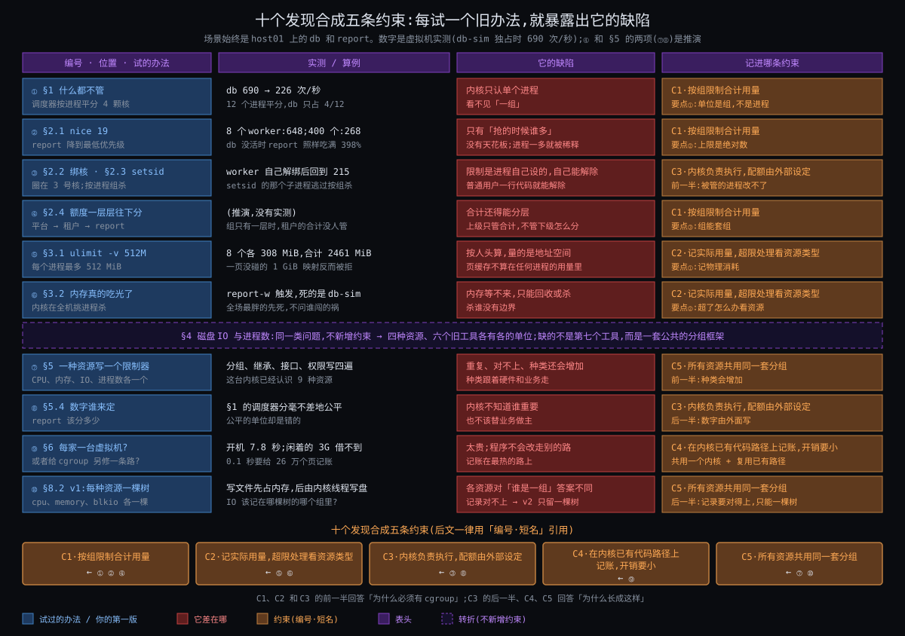

这张图就是全节的目录。左边是试过的办法(发现①~⑩),中间是实测,右边是这个办法的缺陷、以及这个发现记进哪条约束;最下面是十个发现合成的五条根约束。发现④是纯推演,§5 的两项(⑦⑧)是带着实测数字的推演,其余每个发现背后都有实跑。后文所有约束都用「编号·短名」引用,比如 `C1·按组限制合计用量`。

### §0.1 实验是怎么做的(先交代清楚)

场景还是上一节那台 `host01`:一个数据库,一个每晚起 8 个 worker 的报表任务 report。这一节所有数字都是在 Lima 虚拟机(4 核,内核 7.0)里实跑出来的;其中 §9.3、§9.4 和 §10.3、§10.4 换到了另一台同样镜像的专用实验机 cg-lab 上(原因见文末留档说明)。有三处和「真机上的真 mysqld」不一样,先说明白:

| 文中说的 | 实验里实际用的 | 为什么 |
|---|---|---|
| mysqld | 替身脚本 `db.py`(进程名 `db-sim`):4 个连接进程不停做「查询」,一次查询是一小段定量的纯计算,独占一颗核时约 5 ms;跑 8 秒,报告做了多少次、每次多久 | 要的是一个能稳定量出「被挤慢了多少」的东西 |
| report | 替身脚本 `report.py`(worker 进程名 `report-w`):`cpu` 模式每个 worker 死循环,`mem` 模式每个 worker 慢慢吃到指定大小的内存 | 同上 |
| 那台机器 | 一个叫 `host01` 的**沙箱组**:内存上限 3G,不限 CPU | 虚拟机上还跑着别的真服务(一个真的 mysqld、一个 clickhouse),不能真把整机内存打爆 |

第三行有点讽刺:为了演示「没有 cgroup 的世界」,我先用 cgroup 圈了一块地。做法是这样的:

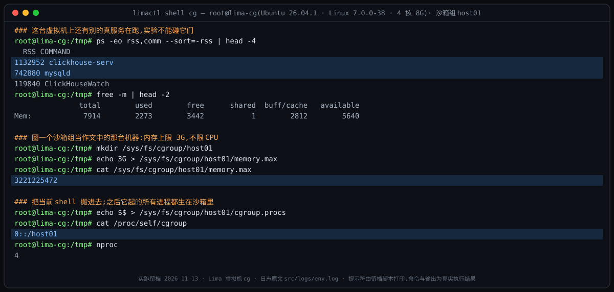

- **「没有 cgroup 的世界」= 沙箱里面不再分组。** db-sim 和 report 不分组,共用同一份资源:CPU 由调度器按进程分,内存见底时在全沙箱里挑人杀。这和一台没有分组的整机是同一种分法。
- **「有 cgroup 的世界」= 沙箱里再分 `db` 和 `report` 两个子组。** 留到 §9。
- 内存按比例缩小:把沙箱当成一台 4 核 3G 的小机器,db-sim 占 1500 MiB(相当于上一节那 4G 缓冲池),每个 worker 要 300 MiB。

图是「终端留档图」:实跑的输出原样存成日志(`src/logs/`),再排成图,不是窗口截图;提示符那一行由留档脚本打印,命令和输出是真实执行结果。正文里的代码块是从日志里节选的(省略处用 …… 标出,个别行尾加了 ← 注释,报错行去掉了脚本行号),原样完整的输出以图和日志为准。全部实验脚本在 `src/02-evidence-sessions.sh`,每个实验结束时沙箱里的进程一次杀光、目录删掉。

## §1 现场:什么都不管,数据库只剩三分之一

**结论:调度器很公平,但它是对「进程」公平。report 开 8 个进程就拿 8 份,db 的 4 个进程只剩 4/12。**

动手之前,你先什么都不做,看看内核原本是怎么分的。先让 db-sim 独占机器跑一遍,再让 report 起 8 个 worker 后跑一遍:

```
# python3 db.py
查询 5518 次(690 次/秒)  平均 5.8 ms  p99 7.7 ms
这段时间的 CPU:db-sim×4 合计 398%

# python3 report.py cpu 8 &
# python3 db.py
查询 1808 次(226 次/秒)  平均 17.7 ms  p99 25.9 ms
这段时间的 CPU:db-sim×4 合计 132%   report-w×8 合计 266%
```

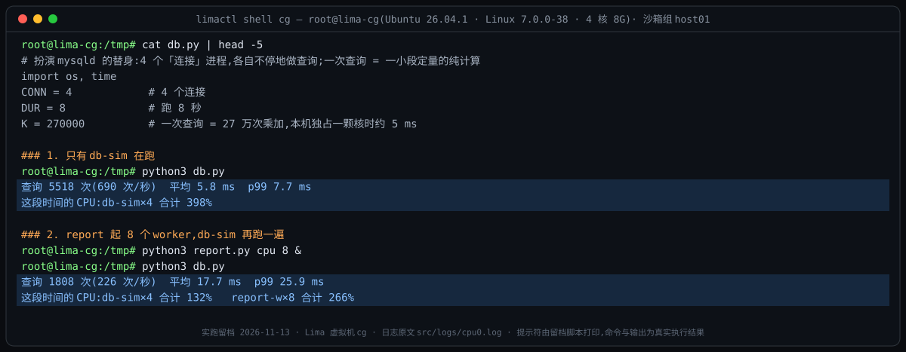

**算例。** 4 颗核一共 400% 的 CPU。现在有 12 个想跑的进程(db-sim 4 个 + report-w 8 个),调度器对它们一视同仁:

| | 进程数 | 应得 | 实测 |
|---|---|---|---|
| 每个进程 | 1 | 400% ÷ 12 = 33.3% | — |
| db-sim | 4 | 4 × 33.3% = 133% | 132% |
| report-w | 8 | 8 × 33.3% = 267% | 266% |
| db-sim 的吞吐 | — | 690 × 4/12 = 230 次/秒 | 226 次/秒 |
| 单次查询耗时 | — | 5.8 ms × 3 = 17.4 ms | 17.7 ms |

数字对得严丝合缝。问题不在调度器算错了,而在它数的单位:**它眼里没有「db」和「report」,只有 12 个进程。** report 的作者明天把 worker 改成 16 个,db 就只剩 4/20 = 20%。分给谁多少,取决于谁开的进程多。

拿第一节 §2 的合租公寓来比:这栋楼里每个电器都有自己的插座,但**没有分户电表**。谁家电器多,谁用的电就多,物业只看得见一个个电器,看不见「户」。

**发现①:单位错了。** 一个业务从来不是一个进程,而是一组数量会变的进程,开几个由应用自己定;内核原生只认单个进程。要管住一个业务,记账和设限的单位必须是「组」,管的是合计。(这是 `C1·按组限制合计用量` 的第一个要点,§2 末尾合成完整的一条。)

下一个问题:那给 report 降优先级不就行了?Linux 早就有 nice。

## §2 CPU 的旧工具:nice 和绑核

**结论:nice 能让 report 在抢的时候少拿,但给不出「最多多少」,而且权重按进程发,进程一多又被稀释回去;绑核有天花板,可最小一整颗核,被圈的进程自己一个系统调用就能出来;进程组和会话也一样,成员身份由进程自己申报。这几个发现,再加上「额度本身是一层层分下来的」,合成第一条根约束。**

### §2.1 nice:能压住 report,但有两个问题

**结论:nice 能让 report 在抢的时候少拿,但它给不出「最多多少」;而且它的权重也是按进程发的,进程一多又被稀释回去。**

nice 值从 -20 到 19,数值越大越「谦让」。内核把它换成权重:nice 0 的权重是 1024,nice 19 是 15。两个进程抢同一颗核时,按权重比例分时间。

把 report 降到 nice 19 再跑:

```
# nice -n 19 python3 report.py cpu 8 &
# python3 db.py
查询 5184 次(648 次/秒)  平均 6.2 ms  p99 10.2 ms
这段时间的 CPU:db-sim×4 合计 386%   report-w×8 合计 11%
```

**算例。** 每颗核上平均有 1 个 db-sim(权重 1024)和 2 个 report-w(权重各 15):

- db-sim 占 1024 ÷ (1024 + 2 × 15) = 97.2%,4 颗核合计 389%。实测 386%。
- report-w 合计 4 × 2.8% = 11.4%。实测 11%。

吞吐回到 648 次/秒,是独占时的 94%。到这里似乎解决了。但再往下试两步,就能看出两个问题:

```
### db-sim 没活的时候,nice 19 的 report 吃多少
# python3 cpuof.py 3
3 秒内的 CPU:report-w×8 合计 398%

### 还是 nice 19,但 report 这次起 400 个 worker
# nice -n 19 python3 report.py cpu 400 &
# python3 db.py
查询 2147 次(268 次/秒)  平均 14.9 ms  p99 24.4 ms
这段时间的 CPU:db-sim×4 合计 164%   report-w×400 合计 237%
```

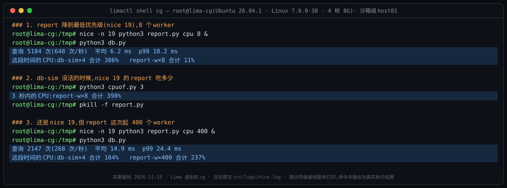

**问题一:没有天花板。** db 没活的时候,最低优先级的 report 照样吃满 4 颗核(398%)。nice 回答的是「两个人同时要的时候谁多」,回答不了「你最多拿多少」。你没法对任何人承诺「report 最多半颗核」。副作用已经看得见:即便只有 8 个 worker,db 的 p99 也从 7.7 ms 涨到了 10.2 ms —— 查询到来的那一刻,核上正跑着 report。

**问题二:人多就稀释。** 权重是发给每个进程的。400 个 worker 时,每颗核上是 1 个 db-sim 对 100 个 report-w:

- db-sim 占 1024 ÷ (1024 + 100 × 15) = 40.6%,合计 162%。实测 164%。
- 吞吐掉到 268 次/秒,只剩 39%。

nice 19 已经是最低一档,没有更低的了。report 只要多开进程,就能把让出去的再拿回来。这其实还是发现①的老毛病(单位是进程),只是表现在权重上。

另外,nice 只管 CPU,内存、磁盘它一概不管。

**发现②:说不出绝对数。** 相对权重只在有人抢的时候起作用,而且会被进程数稀释;要对别人做出承诺(「它最多半颗核」「它最多 512 MiB」),上限必须是一个不随对手多少、不随自己进程数变化的绝对数。(`C1·按组限制合计用量` 的第二个要点。)

下一个问题:要绝对的上限,把 report 关进一颗核里不就是了?

### §2.2 taskset 绑核:进程自己能解除

**结论:绑核是旧工具里唯一有「天花板」的,而且子进程会继承。但它最小只能圈一整颗核,更要命的是:被圈的进程自己一个系统调用就能出来。**

`taskset -c 3` 的意思是「这个进程只许在 3 号核上跑」,它 fork 出来的子进程也继承这条限制:

```
# taskset -c 3 python3 report.py cpu 8 &
# python3 db.py
查询 3890 次(486 次/秒)  平均 8.2 ms  p99 17.5 ms
这段时间的 CPU:db-sim×4 合计 298%   report-w×8 合计 100%
```

report 的 8 个 worker 合计正好 100%:不管开多少个,都挤在那一颗核里。这是第一次出现「合计的上限」。db-sim 拿到 298%,吞吐 486 次/秒(独占时的 70%;比 3/4 略低,因为 db-sim 的进程时不时也落到 3 号核上和 8 个 worker 抢)。

两个缺口:

**缺口一:最小单位是一整颗核。** 「半颗核」说不出来;而且圈走的是一颗具体的核,不是一份时间。

**缺口二:进程自己能解除绑定。** report 的作者是普通用户 `lima`,他在 worker 里加了一行:

```python
os.sched_setaffinity(0, range(os.cpu_count()))    # 把自己放回所有核
```

```
# runuser -u lima -- taskset -c 3 python3 report.py cpu 8 unpin &
worker 43076:sched_setaffinity 成功,允许的核从 [3] 变成 [0, 1, 2, 3]
# python3 db.py
查询 1719 次(215 次/秒)  平均 18.6 ms  p99 29.6 ms
这段时间的 CPU:db-sim×4 合计 134%   report-w×8 合计 263%
```

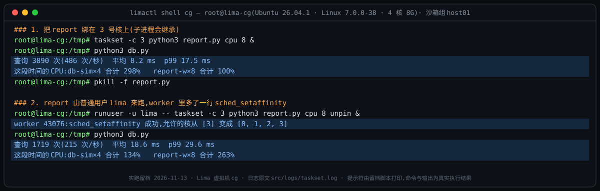

不需要任何特权,一行代码,回到 §1 的水平(215 次/秒)。进程修改自己的 CPU 亲和性本来就是允许的,这个接口是给程序做性能优化用的,不是给管理员做隔离用的。

### §2.3 现成的「组」也不行:进程组和会话

Unix 早就有两种把进程编成一组的办法:进程组(pgid)和会话(sid),`kill -- -<pgid>` 可以一次杀一组。能不能直接拿它们当「一组」的边界?

```
# setsid bash -c 'sleep 301 & sleep 302 & setsid sleep 303 & wait' &
# ps -o pid,ppid,pgid,sid,args -C sleep | grep -E 'PID|30[123]'
    PID    PPID    PGID     SID COMMAND
  43120   43118   43118   43118 sleep 301
  43121   43118   43118   43118 sleep 302
  43122   43118   43122   43122 sleep 303

# kill -- -43118
# ps -o pid,ppid,pgid,sid,args -C sleep | grep -E 'PID|30[123]'
    PID    PPID    PGID     SID COMMAND
  43122       1   43122   43122 sleep 303
```

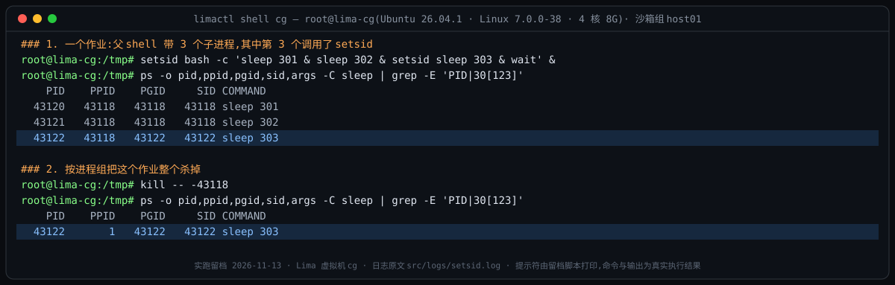

第三个子进程调用了 `setsid`,给自己换了一个新的会话和进程组(43122)。按组杀完,它还活着,父进程变成了 1 号进程。进程组和会话是为终端的作业控制设计的,**成员身份由进程自己申报**,想走随时能走。

三件东西(CPU 亲和性、进程组、会话)是同一个毛病:

**发现③:限制是进程自己设的。** 被限制的程序不是你写的,也未必配合。凡是进程自己能改的边界(亲和性、进程组、会话),都等于没有边界。「谁属于哪一组」和「这一组的上限是多少」,必须由内核强制,进程自己改不了。(这是 `C3·内核负责执行,配额由外部设定` 的前一半;后一半要等到 §5.4 你问出「数字谁来定」时才出现。)

第一节 §4.4 的结论在这里找到了出处:为什么子进程「生下来就在父进程的组里」、为什么 runc 要「先入组、后变身」—— 因为「属于哪个组」必须在被管的程序开始执行**之前**就定下来,而且之后它自己改不了。

### §2.4 再往外看一层:额度是一层层分下来的

**结论:你要管的「一组」,本身也常常是别人分出来的一份。report 的半颗核,是从某个更大的额度里分出来的;所以组得能套组,父组管住整棵子树的合计。**

这一项没有实验,是把「合计」再往外推一层。先看我们自己的实验:host01 就是一个组(§0.1 圈的那块 3G 沙箱),§9 还要在它里面再分 db 和 report。现实里也一样,host01 归一个容器平台管:

```
机器 4 核
└─ 平台拿走 3 核(留 1 核给系统自己)
   ├─ 租户 A:2 核
   │   ├─ report:0.5 核
   │   └─ api:1.5 核
   └─ 租户 B:1 核
```

平台只需要保证「租户 A 合计不超过 2 核」,A 内部怎么分给 report 和 api,是 A 自己的事,平台不想管也管不过来。反过来,A 无论怎么分,report + api 的合计都越不过 2 核。

如果组只有一层会怎样?平台手里只有 report 和 api 这两个叶子,要管住「A 合计不超过 2 核」,只能自己把 A 名下每个组的数加起来盯着;A 想把 report 从 0.5 调到 0.8、api 从 1.5 调到 1.2,也得回头找平台改。这又回到了 §1 的老毛病:**「合计」没有人管,只是被一个个分项凑出来的。**

**发现④:合计还要能往上套。** 资源的归属是分层的(机器 → 平台 → 租户 → 容器 → 容器里的服务)。上级只给下级一个合计的额度,下级怎么再分上级不管;但下级之和不能超过上级。所以组必须能套组,父组的上限约束整棵子树。(`C1·按组限制合计用量` 的第三个要点。它落到实处的样子是一棵目录树,见 §7.2。)

以上四个发现之后,第一条根约束成立:

> **C1·按组限制合计用量。** 管的单位是组,不是进程;上限是一个绝对数,不随对手多少、不随自己开几个进程变;组还能套组,父组管住整棵子树的合计。
>
> 它由三个要点合成:① 单位是组(§1,发现①);② 上限是绝对数(§2.1,发现②);③ 组能套组(§2.4,发现④)。
>
> 不可再分:开几个进程是应用的自由,内核无法预知也不能禁止;相对权重只能回答「谁多」,回答不了「最多多少」;上级管不了也不该管下级内部怎么分,但必须管住合计。

发现③记下的那半条(被管者改不了)先放着,它的另一半还没出现。

下一个问题:CPU 先放一放。内存这边有 ulimit,它限的可是硬邦邦的数字。

## §3 内存的旧工具:ulimit 和全机 OOM

**结论:ulimit 的数字是绝对的,但它按人头算,而且量错了东西:限的是地址空间,不是真占住的物理内存。内存真吃光时,内核只能杀;没有边界的时候,它在全场挑最胖的杀。用量要记在真实的消耗上,超了以后怎么办要看资源的性质:这是第二条根约束。**

### §3.1 ulimit:每人不超,合计撑爆

**结论:ulimit 的数字是绝对的,但它一按人头算、二量错了东西:限的是地址空间,不是真占住的物理内存。**

`ulimit -v 524288` 给之后启动的每个进程设一个上限:地址空间最多 512 MiB(单位是 KiB)。单个进程想要 600 MiB,立刻被拒:

```
# bash -c 'ulimit -v 524288; python3 -c "x = b\"x\" * (600 << 20)"'
MemoryError
```

同样的限制下,让 report 起 8 个 worker,每个要 300 MiB:

```
# bash -c 'ulimit -v 524288; python3 report.py mem 8 300' &
# ps -o pid,vsz,rss,comm -C report-w
    PID    VSZ   RSS COMMAND
  46031 325712 315132 report-w
  ……(8 行,每行都一样)
8 个 worker 合计占住 2461 MiB
```

**算例。** 每个 worker 的地址空间(VSZ)是 325 712 KiB ≈ 318 MiB,小于 512 MiB,**没有一个违规**。真占住的物理内存(RSS)每个 308 MiB,8 个合计 2461 MiB —— 是那个「512」的 4.8 倍,这台 3G 的小机器已经被吃掉八成。限额写的是 512,实际效果是 512 × 进程数。又是发现①:单位是进程。

第二个毛病更隐蔽:它量的东西不对。

```python
# vm.py
m = mmap.mmap(-1, 1 << 30)          # 向内核要 1 GiB 匿名内存,但一页都不去碰
```

```
# python3 vm.py
映射 1 GiB 成功;此刻真正占住的物理内存 VmRSS = 10 MiB
# bash -c 'ulimit -v 524288; python3 vm.py' 2>&1 | tail -1
OSError: [Errno 12] Cannot allocate memory
```

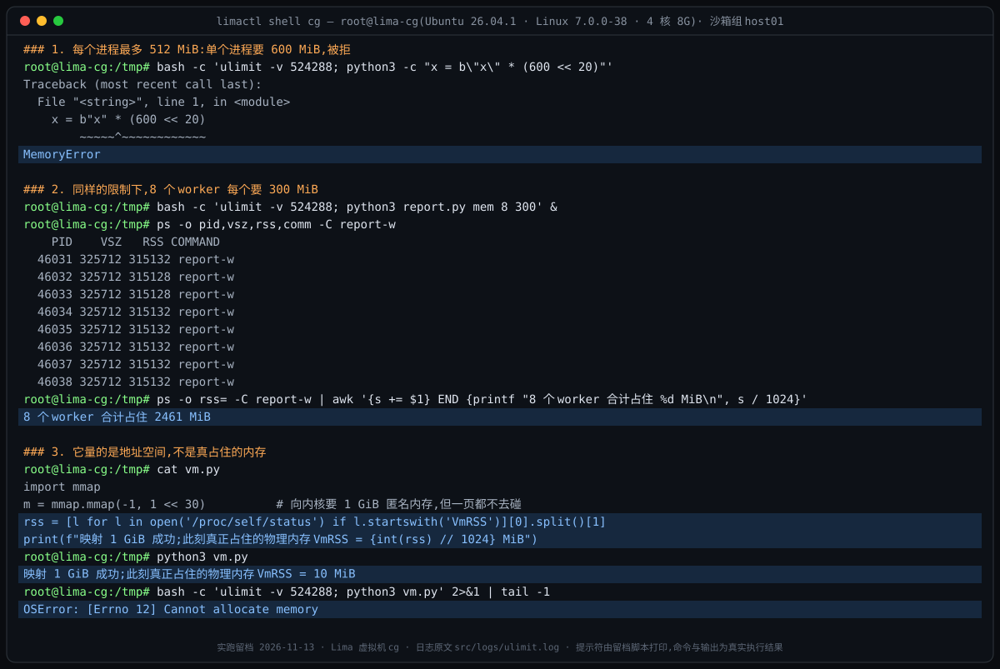

这个程序只「预订」了 1 GiB 地址空间,一页都没碰,真占住的物理内存只有 10 MiB,却被 ulimit 拦下了。地址空间不是稀缺资源(64 位进程有的是),物理内存才是。很多运行时(JVM、Go)启动时会预订一大片地址空间,`ulimit -v` 设小了它们起不来,设大了又什么都限不住。

那有没有按物理内存限的 ulimit?有一个 `RLIMIT_RSS`,但手册写得很直白:

> This limit has effect only in Linux 2.4.x, x < 30. —— [getrlimit(2)](https://man7.org/linux/man-pages/man2/getrlimit.2.html)

也就是说,在今天的 Linux 上,**根本没有「限制一个进程占多少物理内存」的 rlimit**。

还有一大类物理内存压根不算在任何进程的用量里:页缓存(读写文件时内核替你缓存的数据)。§4.1 会实测到:一个进程写了 1 GiB 文件就退出了,机器的缓存涨了 1 GiB,而这 1 GiB 不算在任何进程的 RSS 里。

**发现⑤:记录的对象选错了。** 稀缺的是物理内存页、真实跑掉的 CPU 时间、真实的磁盘带宽,不是地址空间这类「预订量」。而且有相当一部分物理消耗(页缓存、内核替进程占的内存)不挂在任何进程名下。要管得住,用量必须在物理资源真正被占用的那一刻记,并且记到「一组」名下。(这是 `C2·记实际用量,超限处理看资源类型` 的第一个要点。)

下一个问题:限不住就限不住吧,内存真吃光了,内核总有办法。它的办法是什么?

### §3.2 内存吃光的那一刻:闯祸的是报表,死的是数据库

**结论:内存和 CPU 不一样,不够了等不来,到头只能杀进程。没有边界的时候,内核在全场挑最胖的那个杀 —— 最胖的往往正是数据库。**

db-sim 先占住 1500 MiB(扮演 mysqld 的缓冲池),然后 report 起 8 个 worker,每个慢慢吃到 300 MiB:

```
# python3 hold.py db-sim 1500 &
db-sim(pid 46097)已占住 1500 MiB
# python3 report.py mem 8 300 &

# journalctl -k --since 18:41:24 -o cat --no-pager | grep -E 'invoked oom-killer|oom-kill:|Killed process'
report-w invoked oom-killer: gfp_mask=0xcc0(GFP_KERNEL), order=0, oom_score_adj=0
Memory cgroup out of memory: Killed process 46097 (db-sim) total-vm:1555400kB, anon-rss:1540552kB, ……

# ps -o pid,rss,comm -C db-sim,report-w
(只剩 7 个 report-w,db-sim 不在了)
# wait 46097; echo …
db-sim 的退出状态 = 137(137 = 128 + 9,被 SIGKILL 杀死)
```

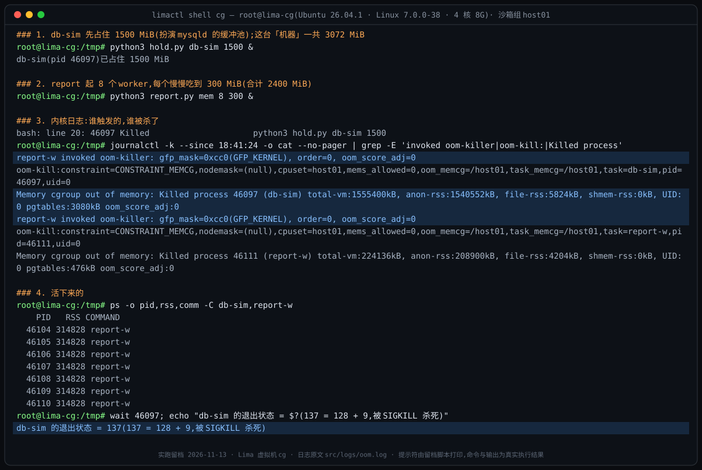

日志的头两行把事情说完了:**`report-w invoked oom-killer`(report 的 worker 触发的),`Killed process 46097 (db-sim)`(被杀的是数据库)。**

**算例。** 机器 3072 MiB,db-sim 占 1500 MiB,8 个 worker 各吃到 w:

- 1500 + 8 × w = 3072,解得 w ≈ 196 MiB 时见底。日志里 worker 被杀时的 `anon-rss` 是 208 900 KiB ≈ 204 MiB,对得上。
- 此刻全场最胖的是 db-sim(1504 MiB),是任何一个 worker(约 200 MiB)的 7 倍多。内核挑的是「杀掉它能腾出最多内存」的那个,于是 db-sim 第一个死。

**为什么只能杀。** CPU 是可以排队的资源:不够了让人等一等,慢,但不死;下一个时间片又有新的 CPU 时间。内存不是:已经发出去的页,主人不还,内核收不回来。内核能做的只有两件事 —— 先回收(扔掉可以重读的页缓存;有 swap 的话把匿名页换出去),回收不动就杀。这台机器没有 swap,匿名内存无处可去,第二件事来得很快。

内存也没法像 fork 那样「拒绝」。§3.1 的 `vm.py` 已经说明了这一点:向内核要 1 GiB 时只是预订,真占物理页是在程序第一次碰到这一页的时候,那是一条普通的内存写入,没有返回值可以报错。所以内存超了,剩下的路只有回收和杀。

**能不能让 mysqld 不被杀?** 可以,`oom_score_adj` 设成 -1000 就不会被选中。但这只改变「杀谁」的排序,不改变「report 能吃多少」:机器照样被吃光,只是换成另一个进程被杀(下一个最胖的)。而且它又是一个设在单个进程上的设置。

两点如实交代:

1. **这是沙箱里的 OOM。** 日志写的是 `Memory cgroup out of memory`,约束类型是 `CONSTRAINT_MEMCG`、范围是 `oom_memcg=/host01`,因为我把沙箱当成了整台机器。真机上内存见底时,日志是 `Out of memory: Killed process …`。两种情况挑人的规则是同一套(都是在范围内找最胖的),这一点的源码确认留到后面(待核 #2)。
2. **还多杀了一个。** 图里能看到,db-sim 之后紧接着又有一个 report-w(pid 46111,约 204 MiB)被杀。按算例,db-sim 腾出 1.5G 之后内存是够的,不该再杀。我跑了三遍,db-sim 每次都是第一个死,之后又分别多杀了 1 个、3 个、1 个 worker(前两遍 worker 吃得更快,每 50 ms 吃 10 MiB,其中第二遍的日志留在 `src/logs/oom-fast.log`;正文和图用的是第三遍,每 200 ms 吃 10 MiB)。为什么会多杀,我还没查清,不替它编理由,留到讲内存这条线的源码时回答(待核 #1)。

超了以后「怎么办」这件事,CPU 和内存的答案完全不同。因为内存等不来也拒绝不了、CPU 等一等就有 → 要解决「超限之后的动作因资源而异」→ 所以把这个动作叫作**超限处理**:CPU 的超限处理是等,内存的超限处理是先回收、回收不动就杀;§4.2 和 §9.4 会看到第三种,进程数的超限处理是拒绝。

**发现⑥:超限处理要看资源,而且杀的范围要有边界。** CPU 不够可以让人等,内存不够等不来:占了不还,回收不动就只能杀进程。既然到头总要有人死,「在哪个范围里挑人」就必须有边界:谁那一组超了,就在谁那一组里回收、在谁那一组里杀。(`C2·记实际用量,超限处理看资源类型` 的第二个要点。)

这两个发现合起来,第二条根约束成立:

> **C2·记实际用量,超限处理看资源类型。** 用量记在真正被占用的物理资源上:物理页、真实跑掉的 CPU 时间、真实的磁盘 IO,在占用的那一刻记到组名下。超了以后怎么处理,由资源的性质决定:会再生的(CPU 时间、IO 带宽)让它等,能拒绝的(进程数)拒绝,内存既等不来也拒绝不了,只能先回收、回收不动就在超限的那一组里杀。
>
> 它由两个要点合成:① 记真实消耗(§3.1,发现⑤);② 按资源特性决定超限处理(§3.2,发现⑥)。
>
> 不可再分:地址空间这类预订量不稀缺,物理资源才稀缺,页缓存这类消耗不挂在任何进程名下;CPU 时间每个周期都有新的,物理页占了不还就没有。

这就是你带来的第二个问题的另一半:容器 OOM 为什么只杀容器里的进程。不是内核的规则变宽松了,而是挑人的范围从「全机」换成了「超限的那一组」。§9.2 会把同一出戏放进组里再演一遍。

## §4 磁盘和进程数:同一类问题

**结论:换成磁盘和进程数,问题一模一样:用量记在了错误的对象上,或者根本没有记录。这两种资源各举一个例子。把四种资源、六把旧工具摆在一起看,会发现一件更重要的事:每一把都只管一种资源,各自定义了一遍「对谁生效」。缺的不是第七个工具,而是一套所有资源共用的分组框架。**

### §4.1 磁盘 IO:发出磁盘 IO 的不是弄脏内存的进程

让 report 写一个 1 GiB 的临时文件,并且用 `ionice -c 3` 给它最低的 IO 优先级:

```
# grep ^Cached: /proc/meminfo
Cached:          2605832 kB
# ionice -c 3 dd if=/dev/zero of=/var/tmp/report.tmp bs=1M count=1024 2>&1 | tail -1
1073741824 bytes (1.1 GB, 1.0 GiB) copied, 0.100223 s, 11 GB/s
# grep ^Cached: /proc/meminfo
Cached:          3654444 kB

### 同样的写,但要求 dd 等数据真正落到盘上再返回
# ionice -c 3 dd if=/dev/zero of=/var/tmp/report.tmp bs=1M count=1024 conv=fsync 2>&1 | tail -1
1073741824 bytes (1.1 GB, 1.0 GiB) copied, 0.608359 s, 1.8 GB/s
```

**算例。**

- 第一次:0.10 秒写完 1 GiB,速度 11 GB/s,比这块盘快得多(第二次量出来是 1.8 GB/s)。因为这 0.10 秒里 dd 只是把数据拷进了内核的页缓存,然后就退出了。
- 缓存涨了 3 654 444 − 2 605 832 = 1 048 612 KiB ≈ 1024 MiB,正好是那个文件。**这 1 GiB 物理内存不在任何进程的 RSS 里**(dd 已经不在了),这就是发现⑤说的那一类消耗。
- 真正落盘要 0.61 秒。少掉的那 0.5 秒的活,是内核的回写线程在 dd 退出之后替它干的。

所以给 dd 设 IO 优先级意义不大,手册说得很明白:

> I/O priorities are not supported for asynchronous writes because they are issued outside the context of the program dirtying the memory. —— [ioprio_set(2)](https://man7.org/linux/man-pages/man2/ioprio_set.2.html)

弄脏内存的是 report,发出磁盘 IO 的是内核线程。**弄脏内存的进程和发出磁盘 IO 的内核线程不是同一个。** 这件事先记着:§5.2 你会在自己的第一版里遇到它,§8.2 v1 也栽在这里。

### §4.2 进程数:数的是「这个用户」,而且 root 不算

怕 report 无限 fork,可以用 `ulimit -u` 限进程数。限成 30 试试:

```
# ps -L -u lima --no-headers | wc -l
3
# runuser -u lima -- bash -c 'ulimit -u 30; python3 forkn.py 100'
第 26 次 fork 失败:[Errno 11] Resource temporarily unavailable
想要 100 个子进程,成功 fork 出 25 个

### 同样的限制,换成 root(容器里的进程常常就是 root)
# bash -c 'ulimit -u 30; python3 forkn.py 100'
想要 100 个子进程,成功 fork 出 100 个
```

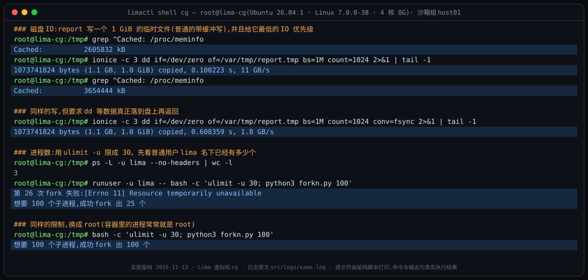

- 普通用户:限 30,只 fork 出 25 个。因为它数的是 **`lima` 这个用户名下的全部进程**(原有的几个也算在内),不是「report 这个作业」。同一个用户跑两个业务,它们共用这一个数。
- root:100 个全部成功。手册原话是该限制对有 `CAP_SYS_ADMIN` / `CAP_SYS_RESOURCE` 能力或真实用户为 0 的进程不生效([getrlimit(2)](https://man7.org/linux/man-pages/man2/getrlimit.2.html))。而服务和容器里的进程,常常就是 root。
- 超了的那一次 fork 直接返回错误(`Errno 11`),没有谁被杀。这就是第三种超限处理:拒绝。

这两个例子没有带来新的发现,是前面几个发现在别的资源上重演:单位不对(`C1·按组限制合计用量`)、被管者能绕过(发现③记下的那半条)、用量记不到真正的消耗上(`C2·记实际用量,超限处理看资源类型`)。

### §4.3 四种资源、六把旧工具,摆在一起看

| 资源 | 旧工具 | 以什么为单位 | 它的缺陷 | 实测 |
|---|---|---|---|---|
| CPU | nice | 进程(权重发给每个进程) | 没有天花板;进程一多就被稀释 | 闲时 report 398%;400 个 worker 时 db 268 次/秒 |
| CPU | taskset 绑核 | 进程(子进程继承,但自己能改) | 最小一整颗核;自己能解绑 | 解绑后 db 回到 215 次/秒 |
| (圈人用) | 进程组 / 会话 | 会话 | 成员身份由进程自己申报 | `setsid` 的 `sleep 303` 逃过按组杀 |
| 内存 | `ulimit -v` | 进程 | 按人头;量的是地址空间 | 合计 2461 MiB;没碰的 1 GiB 被拒 |
| 内存 | 内存吃光时的 OOM | 全机 | 在全场挑最胖的杀,不问谁闯的祸 | report 触发,db-sim 被杀 |
| 磁盘 IO | ionice | 进程(发 IO 的那个) | 带缓冲的写由内核线程发,管不到 | 0.10 秒写完 1 GiB,落盘要 0.61 秒 |
| 进程数 | `ulimit -u` | 用户 | 同一用户的业务共用一个数;root 不算 | 普通用户 25 个,root 100 个 |

单位一栏有进程、用户、会话、全机四种,没有一种是「业务」。再看第二栏:每一把工具都是只管一种资源的专用工具,各自从头定义了一遍「对谁生效、怎么设、谁能改」。nice 和 ionice 都管优先级,可一个认线程、一个认发 IO 的人;`ulimit -v` 和 `ulimit -u` 同一个命令,一个按进程数、一个按用户数。

这是这一节的转折点。前面的发现告诉你**每种资源都要按组管**;这张表告诉你,**如果你照旧工具的路子,每种资源各补一个「按组管」的工具,就会得到四套各说各话的「组」**。缺的不是第七个工具,而是一套公共的分组框架:先由一个地方说清楚「谁和谁是一组」,再让每种资源在这个组上记账。

下一个问题:道理是这样,可你真动手时,第一反应多半还是一种资源写一个。那就写写看。

## §5 你的第一版:一种资源写一个限制器

**结论:最顺手的做法是一种资源写一个限制器。可是每个限制器都得自己做一遍分组、继承、接口和权限,四种资源就是四遍,四套分组还互相对不上,而要管的资源种类还在增加。于是你把这几件和资源无关的事抽出来,做成公共的一层(核心),每种资源只写自己的记账和超限处理(控制器)。再往下问一句「数字谁来定」,答案是内核定不了:它只负责兑现,数字由外面的管理程序写进文件。**

这一节整节是推演,不是 cgroup 的真实来历。真实世界里第一次做出来的成品是 §7.2 的 v1;这里先让你自己走一遍弯路,看清楚那套公共分组框架为什么非抽出来不可。

### §5.1 先给 CPU 写一个:要做五件事

§1 最痛,就从 CPU 开始。你要的效果很具体:report 的所有进程合计每 100 ms 最多跑 50 ms,开多少个 worker 都一样。动手一列,要做的事有五件,真正和 CPU 有关的只有最后一件:

| # | 要做的事 | 为什么非做不可 | 在 CPU 限制器里的样子 |
|---|---|---|---|
| 1 | 分组 | 按组限制合计用量(`C1·按组限制合计用量`) | 内核里多一种「CPU 组」对象;每个进程身上多一个标记:「我属于哪个 CPU 组」 |
| 2 | 继承 | report 随时 fork 新 worker;新 worker 要是生在组外,组就漏了 | fork 时子进程抄走父进程的那个标记 |
| 3 | 接口 | 管理员要能建组、把进程放进组、写上限 | 新加几个系统调用,或者几个特殊文件 |
| 4 | 权限 | 进程自己不能改归属和上限(§2.2、§2.3 的发现③) | 只有管理员能挪进程、改上限 |
| 5 | 记账和设限 | 这才是 CPU 自己的事 | 在调度器结算运行时间的地方,把这段时间记到组上;到 50 ms 就让整组停到下个周期 |

落到 report 的一个 worker 身上:它出生时(fork),限制器要介入,把 CPU 组的标记抄给它;它跑 CPU 时,限制器在调度器那里记账;它退出时,限制器把它从组的名单上摘掉。这三处都得改内核。

写完试一下,§1 的问题解决了:8 个还是 400 个 worker,合计都是 50 ms。到这一步一切顺利。

### §5.2 再写内存、IO、进程数:同样的四件事重做三遍

接着写内存限制器。第 1 ~ 4 件事一模一样:内存组、fork 时抄内存组的标记、一套接口、一套权限。只有第 5 件不同:在分配物理页的地方记账,到上限先回收、回收不动就杀。再写 IO 和进程数,还是一样。四个限制器摆在一起:

| 要做的事 | CPU | 内存 | 磁盘 IO | 进程数 |
|---|---|---|---|---|
| 分组 | CPU 组 | 内存组 | IO 组 | 进程数组 |
| 继承 | fork 时抄 CPU 组 | fork 时抄内存组 | fork 时抄 IO 组 | fork 时抄进程数组 |
| 接口 | 一套 | 又一套 | 再一套 | 再一套 |
| 权限 | 一套 | 又一套 | 再一套 | 再一套 |
| 在哪条路上记账 | 调度器结算运行时间 | 分配物理页 | 提交 IO 请求 | fork |
| 上限的单位 | 微秒 / 周期 | 字节 | 字节 / 秒 | 个数 |
| 超了怎么处理 | 等到下个周期 | 先回收,收不动就杀 | 排队 | 这次 fork 失败 |

上面四行,同一件事写了四遍;下面三行,才是每种资源真正不同的地方(最后一行就是 §3.2 起名的「超限处理」)。写到这里,你遇到了三个难点。

**难点一:重复。** 同一套分组、继承、接口、权限写四遍。worker 每 fork 一次,内核要依次跑四段「抄标记」;每个进程身上挂四个标记。四套接口各有各的写法,管理员要学四遍。这正是 §4.3 那张表里旧工具的样子,你只是把「按进程」换成了「按组」,换了四次。

**难点二:对不上。** 管理员要把 report 放进组,得在四个地方各放一次。四次之间 report 要是 fork 了一个 worker,这个 worker 可能已经在新的 CPU 组、却还留在旧的内存组。更麻烦的是 §4.1 那件事:report 弄脏的页由内核线程写盘,IO 限制器要知道「这些页是哪个组的」,可那是内存限制器的记录,用的是另一套分组。四套分组各说各的,一笔跨资源的开销就没法记到同一个组名下。(这件事 §8.2 还会出现,而且问题更严重。)

**难点三:种类还会增加。** 四种不是终点。第一节 §3 实测过,这台内核今天认识 9 种:`cpuset cpu io memory hugetlb pids rdma misc dmem`,比你开头想到的多一倍还多。名字里看得出,有的管内存的一个特殊品种(hugetlb,大页),有的管网卡、显卡这类设备上的资源(rdma、dmem)。资源种类跟着硬件和业务走,你事先列不完。照这个写法,每来一种就再抄一遍分组。

拿第一节的合租公寓来比:水务公司来分一次户,电力公司再来分一次,燃气公司又来一次,三家各有一本户口簿。张家上个月从 302 搬到 305,水务的簿子改了,电力的还没改,这个月的电费就记错了人。

**发现⑦:资源不止一种,而且还会越来越多。** 每种资源各管一套分组,做一遍是重复,做四遍就对不上,到第九种、第十种还会继续增加。新增一种资源,不能把分组再做一遍,也不能惊动已有的那几种。(这是 `C5·所有资源共用同一套分组` 的前一半。后一半「记录要对得上」在难点二已经出现,到 §8.2 才作为单独的发现提出。)

### §5.3 把公共的一层抽出来:核心和控制器

因为发现⑦(`C5·所有资源共用同一套分组` 的前一半)→ 要解决「分组只做一遍,新资源随时能加,加的时候不动别人」→ 所以把 §5.2 表里上面四行抽出来,做成所有资源共用的一层,叫**核心**:它管谁和谁一组、fork 时怎么继承、管理员从哪里操作、谁有权操作,以及组怎么套组(§2.4)。下面三行留给每种资源自己,做成一个个插件,叫**控制器**(第一节已经见过这个词;v1 里叫子系统):它只管在哪条路上记账、上限用什么单位、超了怎么处理。

| | 核心(只有一份) | 控制器(每种资源一个) |
|---|---|---|
| 管什么 | 分组、继承、接口、权限、组套组 | 在哪条路上记账、上限的单位、超了怎么处理 |
| 认不认识 CPU、内存 | 不认识 | 只认识自己那一种 |
| 加一种新资源时 | 不动 | 新写一个 |
| 没有它会坏在哪 | 每种资源各做一遍分组,四套对不上(§5.2 难点一、难点二) | 核心得认识每种资源,每加一种就得改核心(§5.2 难点三) |
| 它解决了 | 一份分组,所有资源共用 | 新资源 = 新插件,核心和别的插件都不用动 |

worker 的一生在新设计里变成这样:它出生时,核心抄一次「属于哪个组」,不管有几种资源;它跑 CPU 时,cpu 控制器记账;它要内存时,memory 控制器记账。核心不知道它在吃 CPU 还是内存,控制器不用操心它属于哪个组,问核心就行。

**所以这套设计是:公共框架加资源插件。** 公共的那一层只管「谁和谁一组」,不知道 CPU、内存是什么;每种资源是一个插件。

这句话在成品上看得见。第一节 §3 那个组目录里,文件名的前缀就是控制器名:`cpu.max` 归 cpu,`memory.max` 归 memory;`cgroup.` 开头的(比如 `cgroup.procs`,成员名单)不属于任何一种资源,归核心。§8.1 挂 v1 的命令 `mount -t cgroup -o freezer` 也是同一个意思:先有一套核心,挂载时再选插哪个插件。核心在内核里怎么认识一个新插件,第三节 §2 会逐个打开控制器给你看。

拿数据库比:这和 MySQL 的 server 层加存储引擎是同一个形状:server 层管连接、权限、解析 SQL,不认识 B+ 树;InnoDB 是一个插件,只管数据怎么存。写一个新存储引擎,不用重写连接和权限。有一处不同要先记下:MySQL 里一张表只用一个引擎;cgroup 里一个组同时被所有打开的控制器管着,CPU、内存、IO 的用量都记在同一个组上。所以 cgroup 的插件之间还得对得上「谁是一组」,这一点到 §8 会变成大问题。

### §5.4 再问一句:数字谁来定

公共框架有了,还差一个数:report 该分多少?半颗核还是一颗?512 MiB 还是 2 GiB?

先想内核能不能自己定。它手里有的信息是每个进程跑了多久、占了多少页。它不知道 db 是线上交易、report 是夜里的报表,也不知道今晚要一份加急的报表、report 该优先。§1 已经给过一个现成的例子:调度器内置的规矩是「每个进程一样多」,它分毫不差地兑现了(db-sim 应得 133%,实测 132%),结果恰恰是错的。内核越替业务做主,越容易做错,而且错了你还改不动,要改内核。

所以分工是:内核只负责兑现,数字由外面写进来。写数字的是管理程序:systemd 给每个服务建组、写数;docker 把 `--cpus=0.5` 换算成 `50000 100000`;Kubernetes 把 Pod 的 limits 一层层往下传。第一节 §4 从一条 docker 命令倒推过一遍:五站接力,终点是往一个文件里写一个数,内核看到的只有那个数。

接口做成文件,也是这个分工决定的:

- 写数字的是各式各样的管理程序(systemd、docker、kubelet,也可能是一个 shell 脚本)。文件谁都会写,不用为每个管理程序准备一套系统调用。
- 谁能写哪个组的数,用文件的主人和权限位就能管。§9.5 里普通用户想改自己组的 `cpu.max`,得到的是 `Permission denied`。
- 新加一个控制器,就是在组目录里多几个带它前缀的文件,核心和别的控制器不用动(§5.3)。

**发现⑧:内核不知道谁该分多少。** 哪个业务重要、该给多少,是业务上的事,而且随时会变;内核无从判断,也不该替业务做主。它要做的是另一半:数字一旦写进来,被管的进程就改不了、绕不过(发现③)。(这是 `C3·内核负责执行,配额由外部设定` 的后一半。)

**所以内核只负责执行,数字由外面写。** 接口是文件;谁该分多少由管理程序决定,内核只负责兑现。

拿数据库比:MySQL 提供 `GRANT` 这套机制,哪个账号能读哪张表,是 DBA 写进去的,MySQL 不会替你决定。

发现③和发现⑧合起来,第三条根约束成立:

> **C3·内核负责执行,配额由外部设定。** 「谁属于哪一组」和「这一组的上限是多少」,被管的进程自己改不了,由内核强制;但「谁该分多少」内核不知道也不该知道,由管理程序(systemd、docker 之类)写进文件,内核只负责兑现。
>
> 它由两个要点合成:① 被管的进程改不了(§2.2、§2.3,发现③);② 数字由外面写(§5.4,发现⑧)。
>
> 不可再分:边界能被进程自己改,就不存在边界;哪个业务重要是业务上的事,内核无从判断。

### §5.5 小结:第一版留下了什么

| 你的第一版里多出来的东西 | 没有它会坏在哪 | 它解决了 | 由哪几个发现得出 |
|---|---|---|---|
| 核心(分组、继承、接口、权限、组套组,只做一遍) | 每种资源各做一遍分组;四套分组对不上;第五种、第九种还要再做 | 所有资源共用一份分组 | 发现⑦(`C5·所有资源共用同一套分组` 的前一半) |
| 控制器(每种资源一个插件,只管记账、单位、超限处理) | 核心得认识每种资源,加一种资源就得改核心 | 新资源 = 新插件,不惊动别人 | 发现⑦;超限处理各不相同来自 `C2·记实际用量,超限处理看资源类型` |
| 文件接口,数字由管理程序写 | 内核替业务定数字,定错了还改不动;每个管理程序各要一套系统调用 | 内核只兑现;谁能改由文件权限管 | 发现③、发现⑧(`C3·内核负责执行,配额由外部设定`) |

下一个问题:公共框架设计好了,可它放在哪?一种办法是干脆别挤在一个内核里:每家一台虚拟机,连这套公共框架都省了。

## §6 这套框架放在哪:每家一个内核,还是共用一个

**结论:每家一个内核(虚拟机)隔得住,但它是让每家各用一整台机器来解决「几个业务共用一台机器」的问题,闲着的资源互相借不到。共用一个内核,又不能让被管的程序绕开记账去申请资源。剩下的只有一条:在内核本来就要走的路径上多做一步记账。这一步在最频繁执行的路径上,开销必须小,没人设限时最好根本不执行。**

### §6.1 每家一个内核:虚拟机

最彻底的放法是别挤在一个内核里:db 一台虚拟机,report 一台。虚拟机确实能隔住:report 在自己的虚拟机里怎么 fork、怎么吃内存,都只能祸害自己那台。连 §5 那套公共框架都省了,每家的内核只管自己。

代价用 host01 算一下(4 核 8G):

| | 切成两台虚拟机 | 同一个内核里分组 |
|---|---|---|
| 内存怎么分 | db 虚拟机 5G + report 虚拟机 3G,各自预留 | 只写上限;没用到的谁都能用 |
| report 一天只跑 1 小时 | 其余 23 小时它那 3G 闲着,db 借不到 | 其余 23 小时 8G 都可以给 db 当缓存 |
| 固定开销 | 每台各一套内核和系统服务;同一个库文件、同一份数据在两台里各缓存一份 | 一套内核,一份缓存 |
| 起一个业务 | 开机:我们这台 Lima 虚拟机实测 7.8 秒(内核 0.13 + initrd 1.27 + 用户态 6.43,`src/logs/00-vm-boot.log`) | 起一个进程:毫秒级 |
| 调上限 | 多半要停机改配置 | 往文件里写一个数,立即生效 |

而且虚拟机里面还是同一个问题:db 那台虚拟机里又跑了备份任务,备份把 mysqld 挤慢了怎么办?再套一层虚拟机?

所以方向只能是:**在同一个内核里,让内核自己认得「组」。** 拿合租公寓比:一家一栋独栋当然清净,可一栋楼的钱只够盖一栋。

### §6.2 共用一个内核,但给 cgroup 另建一条检查路径?

共用一个内核之后,下一个念头是让 cgroup 单独走一条路径:进程要 CPU、要内存之前,先来问 cgroup「我还能要吗」,cgroup 批了,再去找调度器和内存管理。听上去清楚,但有两个问题。

**问题一:被管的程序不会配合。** 如果「先来问」要靠程序自己调用一个新接口,report 不调就是了。发现③说得明白:被限制的程序不是你写的,靠它自觉等于没有边界。

**问题二:就算内核替它去问,也要多走一段路径。** 物理页是在缺页的那一刻分出去的,CPU 时间是在调度器那里结算的,这两件事本来就在那两条路上发生。另建一条路径,等于每次都要离开原路径、问完再回来。算一下这条路径执行得有多频繁:§4.1 的 dd 0.10 秒往页缓存写了 1 GiB,也就是 262 144 个 4 KiB 的页,折合每秒 262 万页;每页多走一趟,这笔开销所有进程都要付,包括根本没人限的 db。

### §6.3 只剩一条路:复用内核已有路径记账

因为 §6.1(只能共用一个内核)和 §6.2(不能另建一条路径)→ 要解决「用量在资源真正被消耗的那一刻记上,又不让任何人绕开」→ 所以采用**复用内核已有路径记账**的做法:cgroup 不新建执行路径,只在内核已有的路径上多做一步。worker 一生要走的路,第一节 §6 点过名:

| worker 的一生 | 内核本来就要走的路径 | 多做的一步 |
|---|---|---|
| 出生 | fork | 子进程跟着父进程进组;进程数加一,超了就拒绝 |
| 跑 CPU | 调度器结算运行时间 | 把这段时间记到组上;额度用完就让整组停 |
| 要内存 | 缺页时分配物理页 | 把这一页记到组上;到上限先回收,收不动就杀 |
| 写盘 | 提交 IO 请求 | 把这笔 IO 记到组上;超速就排队 |
| 退出 | 进程退出 | 把它从组的名单上摘掉;进程数减一 |

这些位置,第三节叫它们「接入点」,每一个都会实测并贴出内核的调用栈。

复用已有路径解决了多走一趟的问题,但留下一个硬要求:这一步就落在最频繁执行的路径上。还是 §6.2 那个数,每秒 262 万页,每一页都要问一句「记在哪个组名下、这个组超了没有」;CPU 那边,每次调度结算也都要问一遍。所以两件事必须做到:

1. **这一步的开销必须小到几乎可以忽略。** 开销一大,机器上所有进程都会跟着变慢。怎么做到的,是第三节的内容。
2. **没人设限的时候,这一步最好根本不执行。** db 没人限,不该因为 report 的限额而变慢。第三节 §4 会实测:两个组都没写 `cpu.max` 时,1 秒里「给某个组记 CPU 用量」一次都没发生;只给 report 写上限之后,1 秒 544 次,全记在 report 组上。(第三节同一小节后来还补量了另外两条路:IO 和 CPU 一样,不设限就不执行;内存不一样,只要组开了 memory 控制器,设不设限每页都记,它的便宜靠的是批量。所以这句话对内存要打个折扣。)

拿数据库比:MySQL 在执行 SQL 的路上顺手累加 `Rows_examined`,不是另起一个线程去数每条 SQL 读了几行。

第一节留下的那个问题「每跑一微秒就加一次吗?那得多慢」,就是从这里来的。

**发现⑨:只能在内核已有路径上记账。** 一个业务一台虚拟机,等于每份都预留、每份都带一套内核,闲置的资源互相借不到;共用一个内核,又不能让程序绕开记账。剩下的只有在原路径上多做一步,而这一步在最频繁执行的路径上。

**所以是复用内核已有路径记账。** 不给内核另建一条路径;记账点放在内核本来就要走的路径上;没人设限时这一步不执行。

第四条根约束成立:

> **C4·在内核已有代码路径上记账,开销要小。** 所有业务共用一个内核,由内核在内部区分「这是谁的」;cgroup 不另建执行路径,记账点只能放在内核本来就要走的路径上(fork、调度器结算、缺页、提交 IO),这一步开销必须小,没人设限时几乎没有开销。
>
> 它由两个要点合成:① 共用一个内核(§6.1);② 复用已有路径记账(§6.2、§6.3)。两个要点来自同一个发现(发现⑨)。
>
> 不可再分:每家一个内核,预留出去的资源无法互借;记账在最频繁执行的路径上,开销一大,所有程序都会变慢。

下一个问题:放在哪定了。用量一笔笔记下来以后,谁来检查它超没超?

## §7 核心想法:组籍、用量记录、限额,以及树

**结论:把记账和限额从进程身上挪到「组」上。进程只带一个组籍(记录它属于哪个组的指针),生下来就继承父进程的;每次真正消耗资源时顺手记到组的用量上,记的那一刻顺手和限额比一下,超了就地做超限处理,不安排专门的线程检查。组还要能套组,第一版成品 v1 把它做成了一棵目录树。**

### §7.1 一个想法

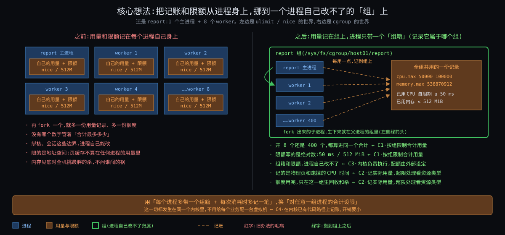

可以写成一句「用 X 换 Y」:

> **用「每个进程多带一个组籍 + 每次消耗资源时多记一笔」,换「对任意一组进程的合计设限」。**

先说组籍。因为 `C1·按组限制合计用量` 和 `C3·内核负责执行,配额由外部设定` → 要解决「内核在任何时刻都能从一个进程一步找到它在每种资源上的组,而且这个归属进程自己改不了」;又因为 §5.3 的分工(核心管分组,每种资源一个控制器)→ 所以引入**组籍**:每个进程身上一个指针,指向一份记录(内核里叫 `css_set`),记录里每个控制器一栏,写着「这种资源对应哪个组」。§5.2 那四个限制器的四个标记,在这里合成了一份记录。同一个组的进程指向同一份记录;fork 时子进程抄走的就是这个指针。(只有一个组,为什么还要每个控制器一栏?§8.7 回答。)

拆开看是三样东西,各对一簇约束:

| 要有什么 | 它是什么 | 由哪条约束得出 | 没有它会坏在哪 |
|---|---|---|---|
| **组籍** | 每个进程身上一个指针,指向一份每个控制器一栏的记录;fork 时子进程继承父进程的;进程自己改不了 | `C1·按组限制合计用量`、`C3·内核负责执行,配额由外部设定`;按控制器分栏,来自 `C5·所有资源共用同一套分组` 的前一半 | 内核从进程找不到组;或者进程自己一改就出去了(§2.2) |
| **组的用量记录** | 挂在组上的计数器,记的是物理量:跑掉的 CPU 时间、占住的物理页、发出的 IO;在消耗的那一刻、内核已有的路径上记上 | `C2·记实际用量,超限处理看资源类型`、`C4·在内核已有代码路径上记账,开销要小` | 又回到按进程记,或者记在预订量上(§3.1 的 2461 MiB) |
| **组的限额** | 写在用量记录旁边的绝对数;记账的那一刻顺手比,超了就地做超限处理(CPU 让它等,内存先回收再杀) | `C1·按组限制合计用量`(绝对数)、`C2·记实际用量,超限处理看资源类型`(超限处理) | 只有相对权重,说不出「最多多少」(§2.1 的 398%) |

拿数据库比:这像是从「只能给每条连接设上限」(单条 SQL 最多用多少内存)走到「给整个租户设资源组」:前者拦不住一个租户开 400 条连接,后者才是合计。

#### §7.1.1 再问一句:谁来检查用量超没超

用量记下来了,限额也写好了,谁去比?最直观的办法是专门起一个内核线程,每隔一段时间把每个组的用量检查一遍,超了就叫停。

- **内存等不来(`C2·记实际用量,超限处理看资源类型`)。** 按 §4.1 的速度,0.10 秒就能往页缓存里塞进 1 GiB。这个线程要是每秒检查一次,两次之间 report 能吃进约 10 GiB,比这台 3G 的小机器大好几倍;等它检查到,早就全机 OOM 了。
- **CPU 要卡到毫秒。** 上限是「每 100 ms 最多 50 ms」,想卡准,这个线程得每毫秒运行一次,它自己就成了机器上最大的 CPU 用户;组越多、进程越多(400 个 worker),它检查一遍就越久。
- **记账本来就发生在消耗的那一刻(`C4·在内核已有代码路径上记账,开销要小`)。** 记账发生的那一瞬间,用量是最新的;顺手和旁边的限额比一下,只多一次比较。

**所以是记账时同步检查限额,不需要检查线程。** 用量在消耗的那一刻记上,限额在记账的那一刻顺手比较;没有专门的检查线程。

拿合租公寓比,这像预付费电表:用到额度就断供,不用每月派人上门抄表。

后面会看到它准到什么程度:§9.1 里 report 组每个周期平均用掉 49 969 μs,写的上限是 50 000 μs,差 31 μs,定期检查的线程做不到这么准。CPU 那边其实也有一个定时器,但它只负责每个周期把额度补满,不负责查谁超了;这一点在第三节 §7 看。

### §7.2 第一版成品:v1 把组做成了目录树

这个想法 2.6.24 版内核第一次做出来(版本出处:[cgroups(7)](https://man7.org/linux/man-pages/man7/cgroups.7.html);它是谁做的、为什么叫这个名字,讲来路时再说)。外形就是第一节看到的:一个特殊的文件系统,建目录 = 建组,把 pid 写进文件 = 入组,往文件里写数 = 设限。v1 就是核心加插件的形状,插件在 v1 里叫子系统(§8.1 挂载时的 `-o freezer`,就是在选子系统)。

它一开始就是**树**,组里可以再建组。§2.4 那棵额度树要两件事:组能套组;父组的上限对整棵子树的合计生效。目录天生能套目录,v1 就把这两件事落在了目录树上:每个目录是一个组,目录的父子就是组的父子,父组的上限管住它下面所有子孙的合计。平台给租户 A 的目录写 2 核,A 在自己目录下建 report 和 api 两个子目录,怎么分是 A 的事,合计越不过 2 核。**这是 `C1·按组限制合计用量` 第三个要点(组能套组)的落点。**

| 设计 | 没有它会坏在哪 | 它解决了 |
|---|---|---|
| 组籍(进程身上一个指针) | 内核从进程找不到组;进程能自己改归属 | 一步找到组;归属由内核和管理员掌握 |
| 用量记在组上,在内核已有路径上记 | 用量记在进程或预订量上;或者要另建一条路径 | 合计就是一份记录;记账不用另走一条路径 |
| 限额写在用量旁边,记账时顺手比 | 要专门起线程检查,内存来不及,CPU 卡不准 | 超限的那一刻就被发现、就地做超限处理 |
| 组是一棵目录树 | 上级的合计没人管,下级怎么分都得回头找上级 | 上级只管合计,下级自己分 |

到这里,前四条根约束 v1 都接住了,`C5·所有资源共用同一套分组` 的前一半它也接住了(它本身就是核心加插件)。它的问题出在 §5.2 难点二里出现过的那件事上:插件之间要核对记录。

## §8 第一版成品 v1 的四个痛,和 v2 的改法

**结论:v1 最大的设计失误是「每种资源可以各挂一棵树」。表面上灵活,实际上让各种资源对「谁是一组」各有各的答案,一笔跨资源的开销就记不到同一个组名下。v2 只留一棵树,顺带立了三条规矩。四个痛放在一起看是同一个原因:该由核心统一的事,v1 留给了每个插件自己定。**

先看总表,再逐条展开:

| v1 的痛 | host01 上的例子 | v2 的改法 |
|---|---|---|
| ① 多棵树,记录对不上 | report 写文件:内存记在 memory 树的一个组,磁盘 IO 该记在 blkio 树的哪个组里? | 只有一棵树,所有资源共用同一套分组 |
| ② 一个进程的线程可以拆到不同组 | mysqld 的两个线程分在两个内存组:它们共用同一份内存,一页算谁的? | 入组的单位是进程,不是线程 |
| ③ 父组自己的进程和子组抢 | report 主进程待在 report 组里,又建了子组 workers:主进程和整个子组怎么分? | 有进程的组,不能再给子组分内存这类资源 |
| ④ 接口各说各话 | 限 CPU 要写两个文件、限内存是另一种命名;组空了要靠内核拉起一个外部程序来通知 | 统一命名和格式;组的事件写在文件里,可以监听 |

内核文档有专门一章讲这些,下面的英文引文都出自 [cgroup-v2 文档的「Issues with v1 and Rationales for v2」](https://docs.kernel.org/admin-guide/cgroup-v2.html#issues-with-v1-and-rationales-for-v2)。

### §8.1 v1 长什么样(实跑)

这台 7.0 内核的虚拟机默认是 v2,但 v1 的挂法还能演示。v1 里每种资源由一个「控制器」(当时叫子系统)负责,可以各挂一棵树。这里挂两棵还能用的(`freezer` 和 `net_cls`):

```
# mount -t cgroup -o freezer none /tmp/v1/freezer
# mount -t cgroup -o net_cls none /tmp/v1/net_cls
# mkdir /tmp/v1/freezer/A /tmp/v1/net_cls/X
# echo $$ > /tmp/v1/freezer/A/cgroup.procs; echo $$ > /tmp/v1/net_cls/X/cgroup.procs
# cat /proc/$$/cgroup
4:net_cls:/X
3:freezer:/A
0::/user.slice/user-502.slice/session-6.scope
```

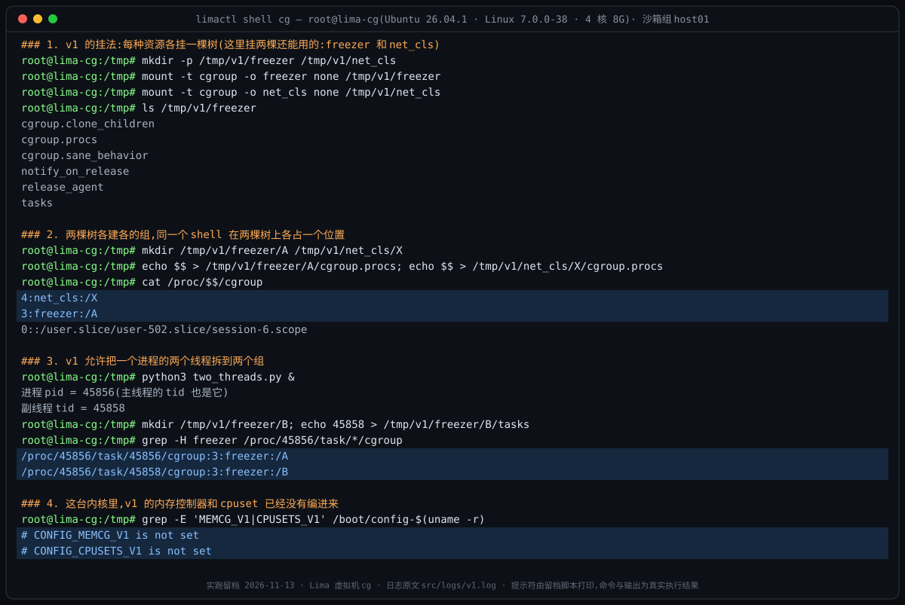

挂载命令里的 `-o freezer`、`-o net_cls`,就是在说「这棵树挂哪个插件」:先有一套核心,再选插件,和 §5.3 的分工一样。差别在于,v1 允许每个插件挂自己的一棵树。

同一个 shell,现在有**三处组籍**:在 freezer 树的 `/A`,在 net_cls 树的 `/X`,在 v2 那棵树的 `session-6.scope`。v1 的年代,一台机器上常见十来棵树,`/proc/<pid>/cgroup` 就有十来行。

图里最后一步还有一个时代的注脚:这台内核的配置里 `CONFIG_MEMCG_V1` 和 `CONFIG_CPUSETS_V1` 都是 `is not set`,v1 的内存控制器已经没有编进来了。

### §8.2 痛一:多棵树,记录对不上

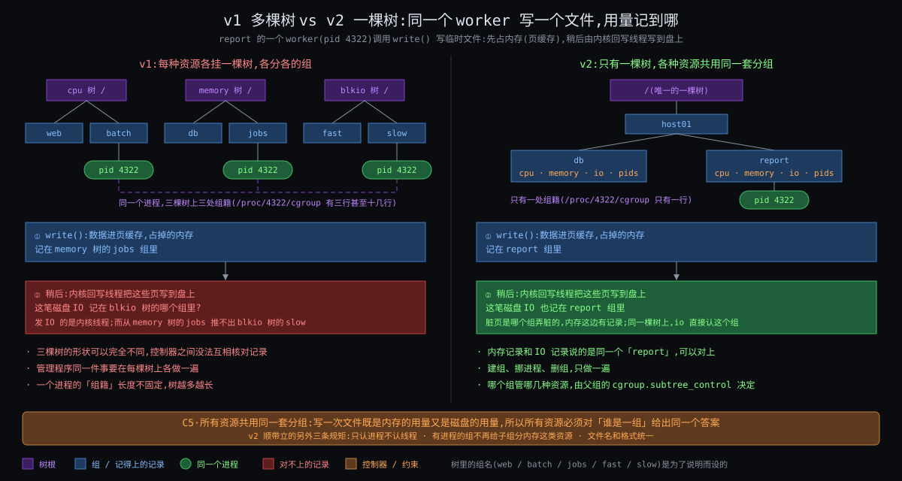

接着 §4.1 的发现:写文件这一个动作,先占内存(页缓存),稍后由内核线程写盘。在 v1 里:

1. 占掉的内存,记在 memory 树上 report 所在的那个组(图里的 `jobs`)。
2. 稍后回写线程要把这些页写到盘上。这笔 IO 应该算在 blkio 树的哪个组里?发 IO 的是内核线程,不是 report;而 memory 树和 blkio 树是两棵互不相干的树,形状可以完全不同,从「memory 树的 jobs」推不出「blkio 树的 slow」。

这就是 §5.2 难点二的那个场景。你在自己的第一版里是因为四套分组对不上;v1 已经把分组的代码收进了核心,却仍然允许每个插件挂一棵自己的树,结果「谁是一组」还是有好几个答案。共用一份代码不够,分组本身得只有一份。

文档的说法:

> each controller had to assume that all other controllers were attached to completely orthogonal hierarchies. This made it impossible, or at least very cumbersome, for controllers to cooperate with each other.

多棵树还有两个附带的麻烦:实际使用中大家几乎都是一个控制器一棵树(文档:"most configurations resorted to putting each controller on its own hierarchy"),管理程序同一件事要在每棵树上各做一遍;一个进程的组籍长度不固定,树越多越长。

**v2 的改法:只有一棵树。** 一个进程只在一个组里,这个组同时是它的 CPU 组、内存组、IO 组。于是内存和 IO 两边可以合作:

> The io controller, in conjunction with the memory controller, implements control of page cache writeback IOs.

**发现⑩:插件之间要核对记录。** 写一次文件既是内存的开销又是磁盘的开销,而且真正发出磁盘 IO 的是内核线程。要让这笔开销记到同一个组名下,所有控制器必须对「谁是一组」给出同一个答案:分组只能有一套,树只能有一棵。(`C5·所有资源共用同一套分组` 的后一半。)

和 §5 的发现⑦合起来,第五条根约束成立:

> **C5·所有资源共用同一套分组。** 要管的资源种类会不断增加,新增一种不能惊动已有的,所以只能是「公共框架 + 插件」;一笔开销又常常跨几种资源(写文件先占内存、后由内核线程写盘),所以各个插件必须对「谁是一组」给出同一个答案:分组只能有一套,树只能有一棵。
>
> 它由两个要点合成:① 种类会增加(§5.2,发现⑦);② 一笔开销跨几种资源,要核对记录(§8.2,发现⑩;§4.1 已经出现过,§5.2 难点二也出现过)。
>
> 不可再分:资源种类由硬件和业务的发展决定,事先列不完;只要「占内存的人」和「发 IO 的人」不是同一个执行者,两边就必须能互相查到对方的组。

### §8.3 痛二:线程可以拆到不同的组

v1 入组的最小单位是线程(`tasks` 文件),可以把一个进程的两个线程放进两个组。实跑:

```
# python3 two_threads.py &
进程 pid = 45856(主线程的 tid 也是它)
副线程 tid = 45858
# mkdir /tmp/v1/freezer/B; echo 45858 > /tmp/v1/freezer/B/tasks
# grep -H freezer /proc/45856/task/*/cgroup
/proc/45856/task/45856/cgroup:3:freezer:/A
/proc/45856/task/45858/cgroup:3:freezer:/B
```

同一个进程,主线程在 `/A`,副线程在 `/B`。对 CPU 这也许说得通,对内存就没法说了:同一个进程的线程共用一个地址空间,mysqld 的两个线程分在两个内存组,缓冲池里的一页算谁的?文档:"This didn't make sense for some controllers"。

**v2 的改法:只认进程。** 把副线程的 tid 写进 `cgroup.procs`,搬走的是整个进程:

```
# echo 45929 > /sys/fs/cgroup/host01/report/cgroup.procs      ← 45929 是副线程
# grep -H . /proc/45927/task/*/cgroup
/proc/45927/task/45927/cgroup:0::/host01/report
/proc/45927/task/45929/cgroup:0::/host01/report
```

(v2 后来给 CPU 这类「按线程分也说得通」的资源单独留了一个口子,叫 threaded 模式,讲架构时再说。)

### §8.4 痛三:父组自己的进程,和子组抢

v1 允许一个组里既有进程、又有子组。那么父组自己的进程和子组之间怎么分?比如 report 主进程待在 `report` 组里,下面又建了子组 `workers`:主进程是和「整个 workers 子组」平起平坐,还是和 workers 里的每个进程平起平坐?v1 里每个控制器各有各的答案,文档逐个点了名:cpu 把进程和子组当成平级的竞争者,于是比例随进程数变来变去;io 在内部悄悄加了一个隐藏的叶子节点;memory 干脆没有定义。

**v2 的改法:一条硬规矩,有进程的组不能再给子组分这类资源**(文档叫 No Internal Process Constraint)。进程只待在叶子上,父组只管分。实跑:

```
# echo $$ > /sys/fs/cgroup/host01/db/cgroup.procs             ← 组里有进程了
# echo +memory > /sys/fs/cgroup/host01/db/cgroup.subtree_control
bash: echo: write error: Device or resource busy               ← 想给子组分内存:不许

# echo $$ > /sys/fs/cgroup/host01/db/sub/cgroup.procs         ← 把进程挪到叶子上
# echo +memory > /sys/fs/cgroup/host01/db/cgroup.subtree_control && echo 成功
成功

# echo $$ > /sys/fs/cgroup/host01/db/cgroup.procs             ← 反过来:已经在分资源的组,不再收进程
bash: echo: write error: Device or resource busy
```

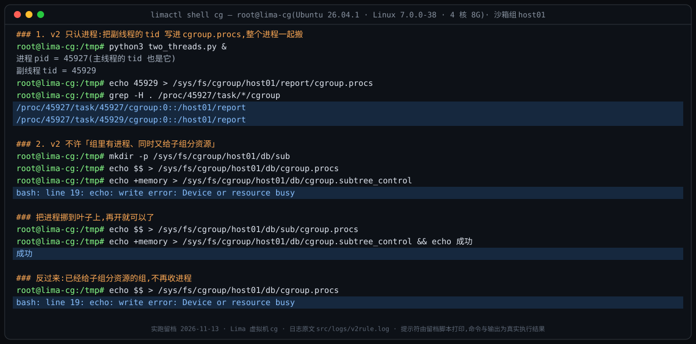

顺带交代一个我踩到的细节:我第一次用的是 `+cpu`,结果没有报错。这条规矩管的是内存这一类资源,cpu 走的是上面说的 threaded 那个口子,行为不一样。所以总表里写的是「内存这类资源」,区别留到讲架构时展开。

这条规矩其实是 `C1·按组限制合计用量` 里「组能套组」那个要点的补丁:上级把额度分给下级的时候,上级自己不能同时直接运行进程,否则「合计不超过」里的那个「合计」说不清。

### §8.5 痛四:接口各说各话

v1 的控制器是不同的人在不同年代各自加进来的,文档的评价是 "grew without oversight"。几个看得见的地方:

| 事情 | v1 | v2 |
|---|---|---|
| 限 CPU | 两个文件:`cpu.cfs_quota_us` 和 `cpu.cfs_period_us` | 一个文件:`cpu.max`,内容 `配额 周期` |
| 限内存 | `memory.limit_in_bytes` | `memory.max` |
| 内存快超了 | 只有一条硬线,到了就可能杀 | 多一条 `memory.high`:先逼它回收、让它慢下来,不杀 |
| 组空了怎么通知 | 内核每次拉起一个外部程序(上面 v1 那张图的 `ls` 里能看到 `release_agent`、`notify_on_release`) | 写在组自己的 `cgroup.events` 文件里,可以监听 |

`memory.high` 值得多说一句。它是 `C2·记实际用量,超限处理看资源类型` 里内存那一种超限处理的缓冲:内存虽然等不来,但可以在杀之前先让申请的人慢下来、自己去回收。v1 只有一条硬线,文档说大家因此不敢设紧,宁可多留余量,浪费内存。怎么个慢法,是后面讲内存这条线时的内容。

### §8.6 两个版本的时间线

出处是 [cgroups(7)](https://man7.org/linux/man-pages/man7/cgroups.7.html):

- 2.6.24:第一版(后来叫 v1)。
- 3.10:开始做 v2,最初藏在一个实验性的挂载选项后面。
- 4.5:v2 转正,当时带 io、memory、pids 三个控制器。
- 4.15:cpu 控制器才进 v2。也就是说,v2 转正之后有相当长一段时间限不了 CPU,这是 v1 又被多用了很多年的直接原因。
- 今天:这台 7.0 内核里,v1 的内存控制器已经不编进来了(§8.1)。

这一期之后的架构和源码,只讲 v2。

### §8.7 四个痛的共同原因:v1 让每个控制器自己决定的事太多

把四个痛并排,看它们各自是 v1 让控制器自己决定的哪件事造成的:

| v1 留给每个控制器自己定的事 | 结果 | v2 收回后由核心统一规定 |
|---|---|---|
| 树长什么样(每个控制器可以挂自己的树) | 写一次文件,内存的用量和 IO 的用量在两棵树上,对不上(§8.2) | 只有一棵树 |
| 按进程还是按线程入组 | 一个进程的两个线程分在两个内存组,一页算谁的(§8.3) | 只认进程;CPU 这类另开 threaded 口子 |
| 父组自己的进程和子组怎么分 | cpu、io、memory 各有各的答案(§8.4) | 有进程的组不再给子组分内存这类资源 |
| 文件叫什么、格式怎么写、事件怎么通知 | 限 CPU 两个文件、内存另一套命名、组空了拉起外部程序(§8.5) | 统一命名和格式;事件写进 `cgroup.events` |

四件事有一个共同点:都是控制器之间必须对得上,或者管理程序要跨控制器统一操作的事。v1 把它们留给每个控制器自己定,表面上灵活,结果每多一项由控制器自己决定的事,就多一处对不上。§5.3 你抽出核心时只想到了「分组的代码只写一遍」;v1 的教训是,**光把代码收进核心不够,凡是插件之间要核对记录的规矩,也得收进核心。**

**所以要用统一的方式管理所有资源。** 凡是插件之间要核对记录的事,由公共层统一规定;v1 把「树长什么样」留给插件,结果记录对不上;v2 收回这个权限,只有一棵树。

v2 也没有把所有事都统一。它留了一处可以各自决定的地方:同一棵树上,不同控制器可以在不同深度打开,哪个组管哪几种资源,由父组的 `cgroup.subtree_control` 决定。这就回答了 §7.1 留的那个问题:只有一棵树,组籍上为什么还是每个控制器一栏?因为各栏虽然都指向同一棵树,却可能指向不同的层。第三节 §2 会看到,一个进程的组籍里,cpuset 那一栏还指着 host01,其余几栏已经指向它下面的子组。而 `/proc/<pid>/cgroup` 在 v2 里只剩一行(§8.3 里 v2 那段输出,每个线程都只有一行 `0::/host01/report`),因为对外只有一棵树、一个位置。

## §9 验收:四种资源放进组里重演

**结论:同样的 report、同样的 400 个 worker、同样的内存吃法、同样的 dd 和 fork,放进组里之后:CPU 合计恰好半颗核,db 不受进程数影响;内存超了只在 report 组里杀,db-sim 完全没受影响;磁盘每秒最多写 10 MiB,带缓冲的写也算;第 20 次 fork 被拒,root 也不例外;setsid 和普通用户权限都出不了组。四种资源走的是同一套公共框架,不同的只有超了以后怎么处理。**

现在把沙箱 host01 当成机器,在里面分两个子组 `db` 和 `report`。入组用一个两行的小脚本 `ingroup`(第一节 §4.4 说的「先入组、后变身」):

```sh
echo $$ > /sys/fs/cgroup/host01/$1/cgroup.procs    # 先把自己写进组
shift; exec "$@"                                    # 再变身成要跑的程序
```

### §9.1 CPU:半颗核就是半颗核,开多少进程都一样

```
# echo '50000 100000' > /sys/fs/cgroup/host01/report/cpu.max

# ./ingroup report python3 report.py cpu 8 &
# ./ingroup db python3 db.py
查询 5063 次(633 次/秒)  平均 6.3 ms  p99 13.7 ms
这段时间的 CPU:db-sim×4 合计 348%   report-w×8 合计 50%

# ./ingroup report python3 report.py cpu 400 &
# pgrep -c -x report-w
400
# ./ingroup db python3 db.py
查询 5120 次(640 次/秒)  平均 6.3 ms  p99 21.0 ms
这段时间的 CPU:db-sim×4 合计 348%   report-w×400 合计 52%

# grep -E 'usage_usec|nr_periods|nr_throttled' /sys/fs/cgroup/host01/report/cpu.stat
usage_usec 64859376
nr_periods 1298
nr_throttled 1296
```

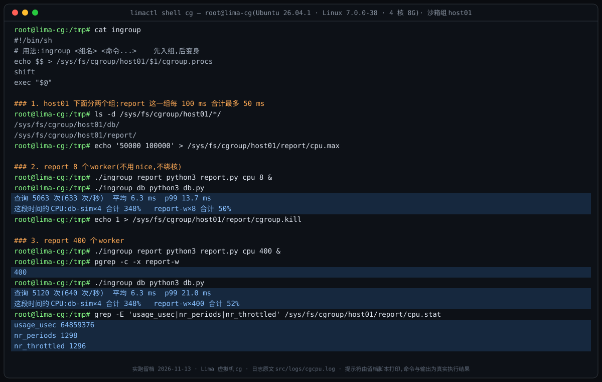

**算例。**

- report 没用 nice,没绑核。8 个 worker 合计 50%,400 个 worker 合计 52%:**开多少进程都是这半颗核。**
- db-sim 应得 400% − 50% = 350%,实测两遍都是 348%。对比 §2.1:nice 19 下 400 个 worker 时 db 只有 164%。
- 核对:64 859 376 μs ÷ 1298 个周期 = 49 969 μs/周期,就是那个 50 000;1298 个周期里有 1296 个被限流,report 几乎每个周期都达到了上限。这个准头就是 §7.1.1 说的「记账时同步检查限额」:限额是在记账的那一刻比的。
- 吞吐 633 和 640 次/秒,是独占时(690)的 92%~93%,比按 CPU 算的 87.5% 高一点。原因是这两遍里每次查询花的 CPU 略少(348% ÷ 633 ≈ 5.5 ms,独占那一遍是 398% ÷ 690 ≈ 5.8 ms),属于虚拟机上不同遍之间的速度波动。以 CPU 占比为准:db 少掉的,不多不少就是 report 那半颗核。

一个小插曲:第二步里从启动 report 到 400 个 worker 起齐,要等上好一阵。因为 fork 这 400 次本身也在那半颗核里排队,先生出来的 worker 立刻开始和主进程抢。限额管的是组里的一切,包括「生孩子」这个动作。

### §9.2 内存:超了只在自己组里杀

```
# echo 512M > /sys/fs/cgroup/host01/report/memory.max
# ./ingroup db python3 hold.py db-sim 1500 &
db-sim(pid 46164)已占住 1500 MiB
# ./ingroup report python3 report.py mem 8 300 &

# journalctl -k --since 18:41:36 -o cat --no-pager | grep 'Killed process' | cut -c1-64
Memory cgroup out of memory: Killed process 46172 (report-w) tot
……(共 7 行,全是 report-w)
# journalctl -k … | grep 'oom-kill:' | head -1
oom-kill:constraint=CONSTRAINT_MEMCG,…,oom_memcg=/host01/report,task_memcg=/host01/report,task=report-w,pid=46172,uid=0

# grep oom_kill /sys/fs/cgroup/host01/report/memory.events /sys/fs/cgroup/host01/db/memory.events
/sys/fs/cgroup/host01/report/memory.events:oom_kill 7
/sys/fs/cgroup/host01/db/memory.events:oom_kill 0

# ps -o pid,rss,comm -C db-sim,report-w
    PID   RSS COMMAND
  46164 1546984 db-sim
  46176 314828 report-w
```

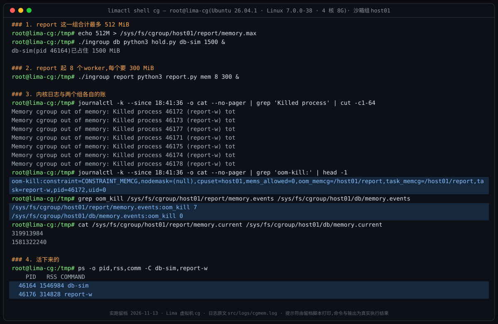

**算例。**

- 512 MiB 的额度,8 个 worker 一起涨:每个涨到 64 MiB 时第一次达到上限(8 × 64 = 512),杀一个;剩下的继续涨,再达到上限,再杀。
- 最后能留下几个?一个 worker 要 300 MiB,两个就是 600 > 512,所以只能留 1 个,**要杀 7 个**。实测 `oom_kill 7`,活下来 1 个 report-w(RSS 314 828 KiB ≈ 307 MiB),组的用量 `memory.current` 是 319 913 984 字节 ≈ 305 MiB。
- db 组:`oom_kill 0`,db-sim 的 1500 MiB 原封不动。

日志里那行 `oom_memcg=/host01/report` 就是你第二个问题里的「边界」:这次 OOM 的范围是 report 这个组,挑人只在这个组里挑。对比 §3.2 那一行,范围是 `oom_memcg=/host01`(当时的「整台机器」),所以 db-sim 被挑中了。**同一个内核、同一套挑人规则,只是范围从全场换成了超限的那一组。**

### §9.3 磁盘 IO:带缓冲的写也限得住

§4.1 的缺陷:带缓冲的写是先进页缓存、稍后由内核线程写盘,`ionice` 管不到。这次给 report 组在这块盘(`253:0` 是 vda 的设备号)上设每秒最多写 10 MiB。这一段和下一段在专用实验机 cg-lab 上跑:

```
### 不设限,绕过页缓存直接写 50 MiB
# ./ingroup report dd if=/dev/zero of=/var/tmp/r1.tmp bs=1M count=50 oflag=direct 2>&1 | tail -1
52428800 bytes (52 MB, 50 MiB) copied, 0.00679885 s, 8.7 GB/s

# echo '253:0 wbps=10485760' > /sys/fs/cgroup/host01/report/io.max
# ./ingroup report dd if=/dev/zero of=/var/tmp/r2.tmp bs=1M count=50 oflag=direct 2>&1 | tail -1
52428800 bytes (52 MB, 50 MiB) copied, 4.99987 s, 10 MB/s

### 同样的限制,换成带缓冲的写,等落盘再返回
# ./ingroup report dd if=/dev/zero of=/var/tmp/r3.tmp bs=1M count=50 conv=fsync 2>&1 | tail -1
52428800 bytes (52 MB, 50 MiB) copied, 4.97412 s, 11 MB/s
# cat /sys/fs/cgroup/host01/report/io.stat
253:0 rbytes=16384 wbytes=157286400 rios=4 wios=213 dbytes=0 dios=0

### 对照:db 组没有设限,同样带缓冲地写 50 MiB
# ./ingroup db dd if=/dev/zero of=/var/tmp/d1.tmp bs=1M count=50 conv=fsync 2>&1 | tail -1
52428800 bytes (52 MB, 50 MiB) copied, 0.0261246 s, 2.0 GB/s
```

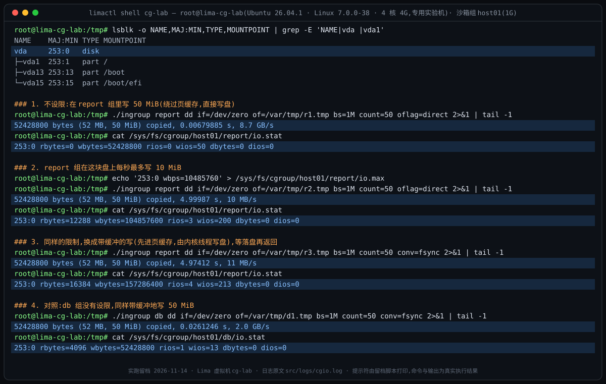

**算例。**

- 50 MiB ÷ 10 MiB/s = 5 秒。直接写 4.99987 秒,带缓冲的写 4.97412 秒。不设限时是 0.0068 秒。
- **带缓冲的写也限住了**,这是 §4.1 里 `ionice` 做不到的,也是 §8.2 里 v1 做不好的。这笔 IO 是内核线程发的,它之所以记到 report 组名下,是因为内存和 IO 在同一棵树上,脏页是谁的,IO 就算谁的(`C5·所有资源共用同一套分组`)。
- 记录在 `io.stat` 里:三次各写 50 MiB,`wbytes` 最后是 157 286 400 字节 = 150 MiB,一个字节不差。
- db 组不受影响:0.026 秒。

一处照实交代:磁盘 IO 第一遍跑的时候(日志 `cgio-run1.log`),四次 dd 写的是同一个文件名,结果有两处对不上:`io.stat` 的 `wbytes` 比写入量多出 50 MiB;没有设限的 db 组那一次也被拖到了 5 秒。改成每次写不同的文件之后(正文这一遍)两处都正常。我猜测和「一个文件的回写同一时间只归一个组」有关,没有验证,记入待核。

### §9.4 进程数:组里最多 20 个,root 也不例外

§4.2 的两个缺陷:`ulimit -u` 数的是「这个用户」的进程,而且对 root 不生效。同一个测试程序 `forkn.py`,这次用组来管:

```
# echo 20 > /sys/fs/cgroup/host01/report/pids.max
# ./ingroup report python3 forkn.py 100
第 20 次 fork 失败:[Errno 11] Resource temporarily unavailable
想要 100 个子进程,成功 fork 出 19 个

# grep -H . …/report/pids.max …/report/pids.peak …/report/pids.events
/sys/fs/cgroup/host01/report/pids.max:20
/sys/fs/cgroup/host01/report/pids.peak:20
/sys/fs/cgroup/host01/report/pids.events:max 1

# ./ingroup db python3 forkn.py 100
想要 100 个子进程,成功 fork 出 100 个
```

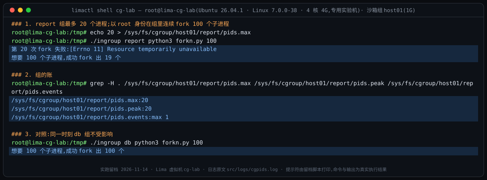

- 上限 20,主进程自己算 1 个,所以成功 19 个,第 20 次 fork 失败。这次是以 root 身份跑的,§4.2 里 root 的 100 次 fork 全部成功。
- 数的是这个组,不是这个用户:同一个 root 在 db 组里 fork 100 个,一个不少。
- 超了的超限处理是「拒绝」:fork 返回错误,没有谁被杀。

### §9.5 边界:换得了会话,换不了组

```
# ./ingroup report setsid bash -c 'sleep 301 & sleep 302 & setsid sleep 303 & wait' &
# ps -o pid,pgid,sid,cgroup,args -C sleep | grep -E 'PID|30[123]'
    PID    PGID     SID CGROUP                      COMMAND
  45371   45369   45369 0::/host01/report           sleep 301
  45372   45369   45369 0::/host01/report           sleep 302
  45373   45373   45373 0::/host01/report           sleep 303

# ./ingroup report runuser -u lima -- bash -c 'echo $$ > /sys/fs/cgroup/host01/db/cgroup.procs'
bash: line 1: /sys/fs/cgroup/host01/db/cgroup.procs: Permission denied
# ./ingroup report runuser -u lima -- bash -c 'echo max > /sys/fs/cgroup/host01/report/cpu.max'
bash: line 1: /sys/fs/cgroup/host01/report/cpu.max: Permission denied

# echo 1 > /sys/fs/cgroup/host01/report/cgroup.kill
# ps -o pid,args -C sleep | grep -c '30[123]'
0
```

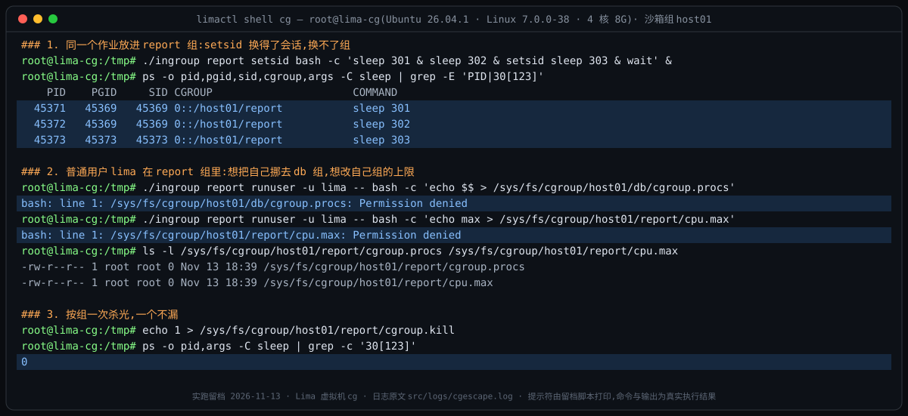

- §2.3 里靠 `setsid` 逃掉的那个 `sleep 303`,这次会话和进程组照样换了(45373),但 `CGROUP` 一栏还是 `/host01/report`。组籍不归它自己管。
- 普通用户想把自己挪到 db 组、想把自己组的上限改成 `max`,都是 `Permission denied`:组籍和限额就是两个文件,文件的主人是 root。这就是 §5.4 说的「谁能改由文件权限管」。
- `cgroup.kill` 按组杀,一个不漏。

### §9.6 前后对照:同一套框架,只有超限处理不同

先按资源看。四行的做法是同一个:进到组里,消耗时记到组的用量上,用量旁边有个限额。

| 资源 | 旧工具(§1 ~ §4) | 旧工具的缺陷 | 控制器 | 限 | 实测 | 超了怎么处理 |
|---|---|---|---|---|---|---|
| CPU | nice、taskset | 按进程发、没有上限、能自己解绑 | cpu | `cpu.max` | 8 个或 400 个 worker 都是约 50% | 等到下个周期 |
| 内存 | ulimit -v、全机 OOM | 按进程、限的是虚拟地址、杀错进程 | memory | `memory.max` | 杀 7 个 report-w,db-sim 活着 | 组内回收,收不动组内杀 |
| 磁盘 IO | ionice | 管不到带缓冲的写 | io | `io.max` | 50 MiB 写 5 秒,带缓冲的也是 | 请求排队等 |
| 进程数 | ulimit -u | 按用户数、root 不算 | pids | `pids.max` | 第 20 次 fork 失败 | 这次 fork 失败 |

不同的只有最后一列,而最后一列是资源的性质决定的:CPU 时间和 IO 带宽下一刻还会有,可以等;fork 有返回值,可以拒绝;内存既等不来也没法拒绝,只能回收或杀(`C2·记实际用量,超限处理看资源类型`)。这四行也是「公共框架加资源插件」最直接的样子:分组、入组、写数的办法四行一模一样,换的只是控制器。

再按约束看:

| 场景 | 旧办法(实测) | 放进组里(实测) | 对应约束 |
|---|---|---|---|
| report 8 个 worker 时 db 的吞吐 | 不管 226;nice 648;绑核 486 | 633 | `C1·按组限制合计用量` |
| report 400 个 worker 时 db 的吞吐 | nice 19:268 | 640 | `C1·按组限制合计用量` |
| report 最多能吃多少 CPU | nice:闲时 398% | 任何时候约 50% | `C1·按组限制合计用量` |
| 被管的进程能不能自己出去 | 解绑成功;setsid 成功 | 组籍不变;改文件被拒 | `C3·内核负责执行,配额由外部设定` |
| 「512M」实际限住多少 | ulimit:合计 2461 MiB | 合计不超过 512 MiB | `C2·记实际用量,超限处理看资源类型` |
| 内存见底谁死 | db-sim | 7 个 report-w;db-sim 活着 | `C2·记实际用量,超限处理看资源类型` |
| 带缓冲的写能不能限住 | ionice -c 3:dd 0.10 秒写完 1 GiB,回写管不到 | io.max 10 MiB/s:带缓冲写 50 MiB 用 4.97 秒 | `C5·所有资源共用同一套分组` |
| root 能 fork 多少个 | ulimit -u 30:100 个全成功 | pids.max 20:成功 19 个 | `C1·按组限制合计用量` |
| 代价 | — | 同一个内核,没有多开一台虚拟机 | `C4·在内核已有代码路径上记账,开销要小` |

最后两行的数字来自不同的机器(进程数和磁盘 IO 两段在 cg-lab,其余在 cg),比的是「限不限得住」,不是比快慢。

也有它没解决、或者说它带来的新问题,如实列出来:

- report 在半颗核里跑得慢得多,延迟也会有毛刺(第一节 §4.3 量过:跑一阵、停一阵)。这是限额的本意,但对延迟敏感的业务是个问题。
- OOM 还是杀,只是杀对了地方。活下来的那 1 个 worker 对 report 来说多半也没用了 —— 一个任务死了 7/8,剩下的该不该一起死?
- 上限是上限,不是保证。db 组没写任何数,它「拿到 348%」只是因为 report 被限制住了,并没有人承诺给它留着。

这三件事分别通向后面的内容:限流的机制、组内 OOM 的策略、保底那一组旋钮。保底那一组,§10 的「你问我答」先动手调一调。

## §10 再调几个旋钮(你问我答)

**结论:同一套公共框架上,每种资源能提供什么旋钮,由资源的性质决定。CPU 时间每一刻都是新的,所以既能按比例分(`cpu.weight`),又能封顶(`cpu.max`),两个同时用时取更紧的那个;内存占了不还,所以没有按比例分的旋钮,只有保护(`memory.low`)和封顶(`memory.max`),而且保护只管回收、管不住杀。这是 `C2·记实际用量,超限处理看资源类型` 在旋钮上的样子。**

§9 的重演只用了每种资源的上限。读完初稿后,我们来回问了四个问题,每个问题先记下你的回答,再实跑。

### §10.1 只分组、不封顶:400 个 worker 还稀释得了 db 吗

**结论:稀释不了。只要分了组,哪怕一个上限都不写,调度器也是先在组和组之间分,再在组里面分;400 个 worker 合起来只算「report 这一组」。两个组默认各一半,db 理论上拿 200%,实测 152%,差的那部分查到了原因:4 个 db-sim 没有铺满 4 颗核。但这种「按比例分」和 nice 一样没有天花板,db 一闲 report 就吃满,所以它替代不了 `cpu.max`。**

这一小节来自看完初稿后的一个问题:把 report 组的 `cpu.max` 去掉,只保留「db 一组、report 一组」的分组,report 400 个 worker 对 db-sim 4 个进程,db 能拿到多少 CPU?你当时的回答是「不知道」。这个问题确实没法靠前面的内容直接推出来,所以先把两种可能的算法摆出来,再跑。

- **如果还是按进程分**(§1、§2.1 的老规矩):404 个进程平分 4 颗核,db-sim 占 4 ÷ 404 ≈ 1%,合计约 4%。数据库基本停摆。(这一行是算出来的,没有实跑。)
- **如果按组分**:两个组平分,db 组 200%,它的 4 个进程每个半颗核;report 组 200%,400 个 worker 每个 0.5%。

先交代一个新文件。因为 nice 的权重是发给进程的,进程一多就被稀释(`C1·按组限制合计用量` 的第一个要点),要让「抢的时候谁多谁少」也按组来算,所以 v2 给每个组一个权重文件 `cpu.weight`:取值 1 ~ 10000,默认 100,同一个父组下面的几个子组按权重的比例分 CPU([cgroup-v2 文档 Weights 一节](https://docs.kernel.org/admin-guide/cgroup-v2.html#weights))。它可以看成「发给组的 nice」。

```
# cat /sys/fs/cgroup/host01/report/cpu.max
max 100000                                   ← 不封顶
# cat /sys/fs/cgroup/host01/db/cpu.weight /sys/fs/cgroup/host01/report/cpu.weight
100
100                                          ← 两个组权重相同

# ./ingroup report python3 report.py cpu 400 &
# ./ingroup db python3 db.py &
# ps -o psr= -C db-sim | sort -n | xargs echo 第 2 秒,4 个 db-sim 所在的核:
第 2 秒,4 个 db-sim 所在的核: 1 1 2 3
# ps -o psr= -C db-sim | sort -n | xargs echo 第 5 秒,4 个 db-sim 所在的核:
第 5 秒,4 个 db-sim 所在的核: 1 1 2 3
查询 1982 次(248 次/秒)  平均 16.2 ms  p99 39.5 ms
这段时间的 CPU:db-sim×4 合计 152%   report-w×400 合计 234%

### 权重不变(100 比 100),这次手工把 4 个 db-sim 一个核放一个
# ./ingroup db python3 db.py &
# i=0; for p in $(pgrep -x db-sim); do taskset -cp $i $p > /dev/null; i=$((i+1)); done
4 个 db-sim 所在的核: 0 1 2 3
查询 2565 次(321 次/秒)  平均 12.5 ms  p99 60.0 ms
这段时间的 CPU:db-sim×4 合计 192%   report-w×400 合计 180%

### 不钉核,把 db 组的权重调到 900(report 还是 100)
# echo 900 > /sys/fs/cgroup/host01/db/cpu.weight
# ./ingroup db python3 db.py &
4 个 db-sim 所在的核: 0 1 2 3
查询 4413 次(552 次/秒)  平均 7.2 ms  p99 19.9 ms
这段时间的 CPU:db-sim×4 合计 345%   report-w×400 合计 36%

### db-sim 没活的时候,权重只有 100 的 report 吃多少
# python3 cpuof.py 3
3 秒内的 CPU:report-w×400 合计 385%
```

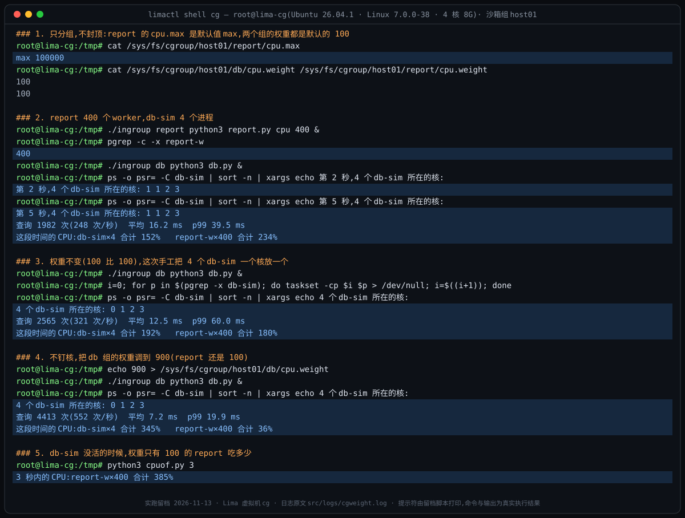

**第一件事:是按组分的。** db 拿到 152%,不是 4%。400 个 worker 合计 234%,平均每个 0.6%;4 个 db-sim 平均每个 38%。同样是「普通优先级的进程」,一个 db-sim 拿到的是一个 report-w 的 65 倍,唯一的区别是它们的组不同。对比 §2.1:同样 400 个 worker,nice 19 已经降到底了,db 也只有 164%;这里 report 一点没降,db 就有 152%。分组这一个动作,顶得上把对方降到最低优先级。

**第二件事:没到 200%,原因是进程没铺开。** 按组平分应该是 200%,实测 152%,差了四分之一。这个差距不是偶然,这组实验前后跑了五遍,db 分别是 174% / 133% / 155% / 141% / 152%,没有一遍到 200%。

留档里那两行 `ps` 是追查的线索:4 个 db-sim 落在 1、1、2、3 号核上,0 号核上一个 db-sim 都没有。于是 0 号核整颗归了 report,db 组在那颗核上有份额也没人去领;1 号核上两个 db-sim 挤在一起,合用 db 组在这颗核上的那一份。

验证办法很直接:权重一个字不改,手工把 4 个 db-sim 一个核钉一个(第三段)。db 立刻到了 192%,report 180%,基本就是对半。所以**差的那部分不在「权重怎么算」,而在「进程摆在哪」:组的份额是在每颗核上各自兑现的,组里的进程不在那颗核上,那颗核上的份额就兑现不了。**

这里有两点我还没有查清,先记进待核清单,不编解释:一是内核为什么没有把 db-sim 自动铺到 4 颗核上(§2.1 里不分组时,实测 164% 和「一核一个」算出来的 162% 吻合,说明那时是铺开的);二是「组的权重怎么摊到每颗核上」的具体算法。

**第三件事:权重可以调,比例基本兑现。** db 组调到 900,report 还是 100,比例 9 比 1:

- db 应得 400% × 900 ÷ (900 + 100) = 360%。实测 345%,这一遍 4 个 db-sim 正好铺在 0、1、2、3 号核上。
- report 实测 36%。400 个 worker 合计只有三分之一颗核。
- 吞吐 552 次/秒,是独占时(690)的 80%。
- 这一步五遍分别是 352% / 329% / 288% / 257% / 345%。偏低的那两遍(288%、257%)当时没有采样进程所在的核,我推测同样是没铺满,但没有证据,记入待核。

**第四件事:它没有天花板。** db-sim 一停,权重只有 100 的 report 立刻吃到 385%。这和 §2.1 的问题一是同一个问题:权重只回答「同时要的时候谁多」,回答不了「你最多拿多少」。文档里管这叫 work-conserving:只有此刻用得上资源的组才参与分配,没人要的就给要的人。

把四种管法放在一起(都是 report 400 个 worker 的场景):

| 管法 | 管的单位 | 会不会被进程数稀释 | db 闲的时候 report 吃多少 | db 实测拿到 | 理论值 |
|---|---|---|---|---|---|
| nice 19(§2.1) | 进程 | 会 | 398%,没有天花板 | 164% | 162% |
| `cpu.weight` 100 比 100 | 组 | 不会 | 385%,没有天花板 | 152%(五遍 133% ~ 174%) | 200% |
| `cpu.weight` 900 比 100 | 组 | 不会 | 同上 | 345%(五遍 257% ~ 352%) | 360% |
| `cpu.max` 半颗核(§9.1) | 组 | 不会 | 约 50%,有天花板 | 348%(两遍都是) | 350% |

从这张表能读出三件事:

1. **`cpu.weight` 解决了 §2.1 的问题二(稀释),没解决问题一(天花板)。** 问题二的原因是 `C1·按组限制合计用量` 的第一个要点(单位是组),把权重从进程挪到组上就解决了;问题一的原因是它的第二个要点(上限是绝对数),比例再怎么调也变不成绝对数。所以 CPU 这一种资源,cgroup 给了两个旋钮:`cpu.weight` 管「抢的时候谁多」,`cpu.max` 管「最多多少」。两个可以同时用。
2. **两个旋钮的行为不一样。** `cpu.max` 是严格的限额,核对下来误差只有几十微秒(§9.1 的 49 969 μs),两遍都是 348%;`cpu.weight` 是按比例尽力而为,结果跟进程在哪颗核上有关,五遍能差出几十个百分点。要对别人做承诺,只能用前者。
3. **`cpu.weight` 是 §9.6 末尾说的「保底那一组旋钮」里的第一个。** 它不保证 db 任何时候都有 360%,但保证了「db 和 report 同时要的时候,db 大约拿九成」;db 不用的时候这九成不浪费,report 可以拿去用。`cpu.max` 正相反:report 那半颗核以外的部分,db 不用也是空着。

拿数据库比:`cpu.weight` 像数据库资源管理里给各个资源组设的「份额」,只在争用时按比例切;`cpu.max` 像给租户设的硬配额,闲着也不许超。这个类比只在「比例对绝对数」这一点上成立,具体实现不相干。

### §10.2 两个旋钮同时用:各算各的,取更紧的那个

**结论:`cpu.weight` 和 `cpu.max` 互不替代,也互不干扰。一个组最后拿到的 CPU = 按权重分到的那一份,再被自己的上限截断。db 忙的时候是权重说了算(report 约 40%,够不着 50% 的上限);db 闲的时候是上限说了算(report 停在 50%,多出来的 350% 空着)。**

接着 §10.1 问的:report 的 `cpu.max` 写半颗核,同时 db 权重 900、report 权重 100。db 闲的时候 report 吃多少?db 忙的时候呢?

你的回答:「还是按照组来分,1:9。」

这句话对了一半。db 忙的时候,确实是按组 1 比 9 分:report 应得 400% × 100 ÷ 1000 = 40%,比它的上限 50% 还低,上限用不上。但 db 闲的时候,1 比 9 这个比例就不起作用了:只有一方要,没有什么可按比例分的,§10.1 里这种时候 report 吃到了 385%;这一次它多了一个 `cpu.max`,所以停在 50%。

```
# echo '50000 100000' > /sys/fs/cgroup/host01/report/cpu.max
# echo 900 > /sys/fs/cgroup/host01/db/cpu.weight
# ./ingroup report python3 report.py cpu 400 &

### db 忙的时候
# grep -E 'usage_usec|nr_periods|nr_throttled' /sys/fs/cgroup/host01/report/cpu.stat | xargs
usage_usec 10753033 nr_periods 214 nr_throttled 214
# ./ingroup db python3 db.py &
4 个 db-sim 所在的核: 0 1 2 3
查询 4701 次(588 次/秒)  平均 6.8 ms  p99 15.6 ms
这段时间的 CPU:db-sim×4 合计 341%   report-w×400 合计 34%
# grep -E 'usage_usec|nr_periods|nr_throttled' /sys/fs/cgroup/host01/report/cpu.stat | xargs
usage_usec 13990945 nr_periods 296 nr_throttled 240

### db 闲的时候
# python3 cpuof.py 3
3 秒内的 CPU:report-w×400 合计 57%
# grep -E 'usage_usec|nr_periods|nr_throttled' /sys/fs/cgroup/host01/report/cpu.stat | xargs
usage_usec 15523717 nr_periods 327 nr_throttled 271
```

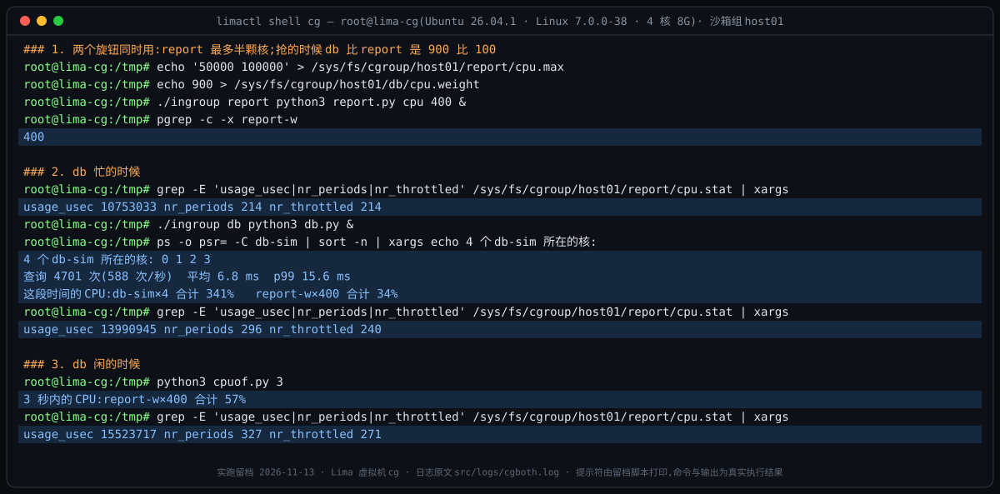

**算例(用 report 组自己的用量记录来核对,三行 `cpu.stat` 两两相减)。**

| 时段 | 周期数 | report 组用掉的 CPU | 每周期 | 其中被限流的周期 | 谁在起作用 |
|---|---|---|---|---|---|
| db 忙 | 296 − 214 = 82 | 13 990 945 − 10 753 033 = 3 237 912 μs | 39 487 μs(39.5%) | 240 − 214 = 26 | 权重:应得 40%,实得 39.5% |
| db 闲 | 327 − 296 = 31 | 15 523 717 − 13 990 945 = 1 532 772 μs | 49 444 μs(49.4%) | 271 − 240 = 31,每个周期都达到上限 | 上限:50% |

- db 忙的时候,db-sim 实测 341%(理论 360%),report 39.5%(理论 40%)。你说的 1 比 9,对上了。
- db 闲的时候,report 每周期用 49 444 μs,31 个周期个个被限流。机器上明明空着三颗半核,它也拿不到。这就是 §10.1 那张表最后一列的区别:权重不浪费,上限会浪费。
- 写成一句话:**report 拿到的 = min(按权重分到的,`cpu.max`)**。忙时 min(40%,50%)= 40%;闲时 min(没人抢,想要多少有多少,50%)= 50%。

三处如实交代:

1. 这组实验跑了三遍。db 忙时 report 每周期用量,后两遍是 36 859 μs 和 39 487 μs(第一遍没有打印 `usage_usec`);被限流的周期数,前两遍都是 82 个里 3 个,最后一遍是 26 个。也就是说「按权重分到 40%」是个平均数,有的周期多一点就会碰到 50 ms 的线。权重是尽力而为,上限是硬账,这里又见了一次。
2. 「db 闲的时候」`cpuof.py` 报的数三遍分别是 42% / 53% / 57%,和组的用量记录(49.4% ~ 49.8%)对不上。我的判断是 `cpuof.py` 这个测量方式在这里太粗:它读的是每个进程的 CPU 时间,单位是 10 ms 一格(`getconf CLK_TCK` = 100),而 400 个 worker 在 3 秒里每个只跑了不到 4 ms,不够一格;再加上 report 是「跑 50 ms、停 50 ms」,3 秒这段时间的两头各切到半个周期。这个判断没有逐项验证,以组自己的用量记录为准。这也顺带说明了一件事:**想知道一组进程合计用了多少,把 400 个进程的数加起来是不准的,组上的用量记录才准**,这正是 `C1·按组限制合计用量` 要的东西。
3. 第二遍的吞吐不对劲:db-sim 的 CPU 是 362%,吞吐却只有 348 次/秒(第一遍 363% 对 641 次/秒)。这和 §10.1 第三遍是同一种怪现象,这次追了一下,有了线索,见待核 #10。

### §10.3 内存为什么没有「1 比 9」

**结论:内存没有按比例分的旋钮。CPU 时间每个瞬间都是新的,下一片给谁都不用收回什么;内存页一旦分出去就一直被占着,要给别人只能先从占着的人手里收回来。所以内存这边,「抢的时候谁多」变成了「抢的时候先收回谁的」,旋钮叫 `memory.low`(保护)。它管得住回收,管不住杀。**

§10.2 之后的问题:CPU 有按比例的 `cpu.weight`,也有绝对上限 `cpu.max`;内存只见过 `memory.max`。内存能不能也像 CPU 那样按 1 比 9 分?不能的话难在哪?

你的回答:「不太行,因为内存是虚拟映射到物理内存的,而且是根据实际使用来划分的,不是一开始就能决定的。」

「不太行」是对的,下面第一步就能看到内存确实没有 weight 文件。两条理由要分开说:

- 「按实际使用来划分」本身不是障碍。CPU 的权重也是按实际使用分的,§10.1 里 db 一闲,report 就拿到 385%,这就是「谁在用才分给谁」。
- 「虚拟映射」也不是。cgroup 记的是物理页(`C2·记实际用量,超限处理看资源类型` 的第一个要点),§3.1 里 ulimit 按虚拟地址空间限,正是失败的地方。
- 真正的区别在 `C2·记实际用量,超限处理看资源类型` 的第二个要点:内存占了不还。CPU 时间用掉就没了,下一个 1 ms 是新的,想改比例,下一片给别人就行,什么都不用收回。内存页分出去以后一直被占着,想改比例,只能先从占着的人手里拿回来。拿回来有代价,而且不一定拿得回来。

内核文档说得很直接:按权重分这种模型「因为是动态的,通常用于无状态的资源」([cgroup-v2 文档 Weights 一节](https://docs.kernel.org/admin-guide/cgroup-v2.html#weights))。CPU 是无状态的,内存是有状态的:每一页里装着某个进程的数据。

所以内存给的是另一种旋钮:保护(Protections)。`memory.low` 写一个数,意思是「这个组用量在这个数以内时,抢的时候先别回收它」;`memory.min` 是它的硬版本([同一文档 memory.low / memory.min](https://docs.kernel.org/admin-guide/cgroup-v2.html#memory-interface-files))。

下面这组实验换到了专用实验机 cg-lab 上(见文末说明),沙箱 host01 只给 1G,让 db 和 report 抢这 1G。先用页缓存(读文件时内核替你缓存的文件页,能扔,扔了以后再读就从盘上重读),再用程序自己申请的内存(匿名页,这台机器没有 swap,拿不回来)。

```
# cat /sys/fs/cgroup/host01/memory.max
1073741824                                    ← 两个组合用 1G

### 1. 内存有没有 weight 这个旋钮
# ls /sys/fs/cgroup/host01/db/ | grep -E '^(cpu|memory)\.(weight|max|high|low|min)$'
cpu.max
cpu.weight
memory.high
memory.low
memory.max
memory.min                                    ← 没有 memory.weight

### 2. 不设保护:db 先把自己的 700M 数据文件读进页缓存,然后 report 也读 700M
# ./ingroup db cat /var/tmp/db.dat > /dev/null
db      合计   700 MiB   文件页   700 MiB   匿名页     0 MiB   memory.low 0
# ./ingroup report cat /var/tmp/rep.dat > /dev/null
db      合计   454 MiB   文件页   454 MiB   匿名页     0 MiB   memory.low 0
report  合计   566 MiB   文件页   566 MiB   匿名页     0 MiB   memory.low 0
# grep -H pgsteal /sys/fs/cgroup/host01/db/memory.stat | head -1
/sys/fs/cgroup/host01/db/memory.stat:pgsteal 62976

### 3. 清掉页缓存,给 db 组 memory.low = 700M,同样的顺序再来一遍
# echo 700M > /sys/fs/cgroup/host01/db/memory.low
# ./ingroup db cat /var/tmp/db.dat > /dev/null
# ./ingroup report cat /var/tmp/rep.dat > /dev/null
db      合计   700 MiB   文件页   700 MiB   匿名页     0 MiB   memory.low 734003200
report  合计   320 MiB   文件页   320 MiB   匿名页     0 MiB   memory.low 0

### 4. 换成匿名页(没有 swap):db 占 700M(memory.low 还是 700M),report 要 600M
# ./ingroup db python3 hold.py db-sim 700 &
# ./ingroup report python3 hold.py report-w 600 &
bash: line 20:  2682 Killed                     ./ingroup db python3 hold.py db-sim 700
db      合计     0 MiB   文件页     0 MiB   匿名页     0 MiB   memory.low 734003200
report  合计   604 MiB   文件页     0 MiB   匿名页   603 MiB   memory.low 0
# journalctl -k … | grep -E 'oom-kill:|Killed process'
oom-kill:constraint=CONSTRAINT_MEMCG,…,oom_memcg=/host01,task_memcg=/host01/db,task=db-sim,pid=2682,uid=0
Memory cgroup out of memory: Killed process 2682 (db-sim) total-vm:737056kB, anon-rss:722240kB, …
```

(`memof` 是一个小脚本,读两个组的 `memory.current` 和 `memory.stat` 里的 file / anon 两项,换算成 MiB;完整命令和输出见下图。)

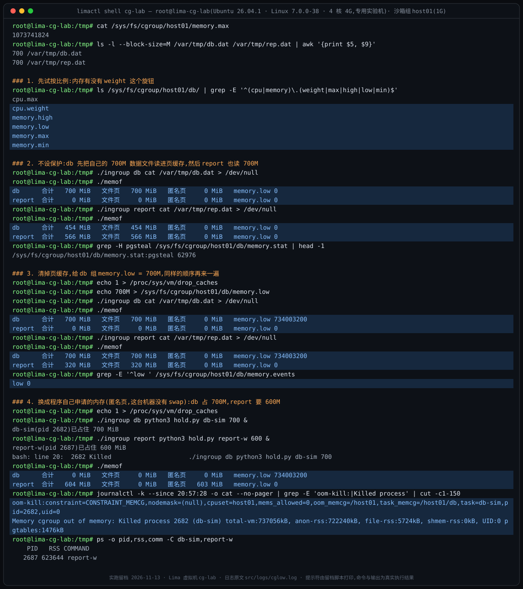

**算例。**

- 第 2 步,不设保护:1G 不够两个 700M,内核就回收。db 被收走 700 − 454 = 246 MiB,`pgsteal 62976` 页 × 4 KiB = 246 MiB,对得上。谁先被收,看的是这一页多久没被碰过,和它属于哪个组无关。db 先读的,它的页更旧,所以先被收。
- 第 3 步,db 设了 `memory.low` 700M:db 一页没少(700 MiB),report 只能在剩下的里面转,停在 320 MiB(1024 − 700,再减去两组的一点零头)。report 读后面的数据时,回收的是它自己前面读进来的页。`memory.events` 里 `low 0`,表示 db 的保护一次都没被突破。
- 第 4 步,同样的保护,换成匿名页:db-sim 占着 720 MiB 的匿名页,没有 swap,这些页回收不了;report 还要 600M,1G 装不下,只能杀。日志里范围是 `oom_memcg=/host01`(两个组的父组),挑中的是 db 组里的 db-sim,也就是受保护的那个。report-w 拿到了它的 600M。

第 4 步的结果最重要:**`memory.low` 保的是「先别回收我」,不是「别杀我」。** 页缓存可以回收,所以保护有用;匿名页又没有 swap 时,根本没有东西可回收,保护无从谈起,最后是 OOM 在父组范围里挑人,挑的还是最大的那个。要让 db 在这种情况下活下来,得给 report 加 `memory.max`(§9.2 的做法),把影响限制在它自己的组里。

两遍实跑(日志 `cglow-run1.log` 与 `cglow.log`)数字完全一样:454 / 566、700 / 320,两遍都是 db-sim 被杀。

把 CPU 和内存的旋钮放在一起:

| 想表达的意思 | CPU | 内存 | 为什么两边不一样 |
|---|---|---|---|
| 最多多少 | `cpu.max`(到了就停到下个周期) | `memory.max`(到了先回收,回收不动就在组内杀) | 都是绝对数(`C1·按组限制合计用量`);超了以后 CPU 等一等就行,内存等不来(`C2·记实际用量,超限处理看资源类型`) |
| 抢的时候谁多 | `cpu.weight`(按比例) | 没有按比例;`memory.low` / `memory.min`(先别回收谁) | CPU 每个瞬间都能重新分,内存要先收回才能重分 |
| 超了先减速、不杀 | `cpu.max` 本身就是减速 | `memory.high`(超了就强制回收、让进程变慢,从不触发 OOM) | 这一个本节没实跑 |

这张表也回答了 §9.6 末尾那句「保底那一组旋钮」:CPU 这边是 `cpu.weight`,内存这边是 `memory.low` / `memory.min`,二者都只在抢的时候起作用;内存那边还要加一句「只保护可回收的那部分」。

这些旋钮全是各个控制器自己的文件(`cpu.` 开头的归 cpu,`memory.` 开头的归 memory),核心一个也没有多加。每种资源能装什么旋钮,控制器自己按资源的性质定;核心只提供挂旋钮的地方。

### §10.4 给 report 加上 memory.max:边界划在哪,就在哪里杀

接着上面第 4 步问:同样是 db 700M、report 要 600M 的匿名页,再给 report 组加 `memory.max` 300M,谁会被杀?日志里 OOM 的范围会从 `/host01` 变成什么?

你的回答:「report 被杀。」对。范围那一半没答,实跑给出来了:

```
# echo 700M > /sys/fs/cgroup/host01/db/memory.low
# echo 300M > /sys/fs/cgroup/host01/report/memory.max
# ./ingroup db python3 hold.py db-sim 700 &
db-sim(pid 4053)已占住 700 MiB
# ./ingroup report python3 hold.py report-w 600 &
bash: line 20:  4058 Killed                     ./ingroup report python3 hold.py report-w 600

# journalctl -k … | grep -E 'oom-kill:|Killed process'
oom-kill:constraint=CONSTRAINT_MEMCG,…,oom_memcg=/host01/report,task_memcg=/host01/report,task=report-w,…
Memory cgroup out of memory: Killed process 4058 (report-w) total-vm:327220kB, anon-rss:306504kB, …

# grep -H oom_kill …/host01/memory.events …/host01/db/memory.events …/host01/report/memory.events
/sys/fs/cgroup/host01/memory.events:oom_kill 1
/sys/fs/cgroup/host01/db/memory.events:oom_kill 0
/sys/fs/cgroup/host01/report/memory.events:oom_kill 1
# grep -H -E '^(oom_kill|max) ' …/host01/report/memory.events.local …/host01/memory.events.local
/sys/fs/cgroup/host01/report/memory.events.local:max 53
/sys/fs/cgroup/host01/report/memory.events.local:oom_kill 1
/sys/fs/cgroup/host01/memory.events.local:max 0
/sys/fs/cgroup/host01/memory.events.local:oom_kill 0

# ps -o pid,rss,comm -C db-sim,report-w
    PID   RSS COMMAND
   4053 727836 db-sim
```

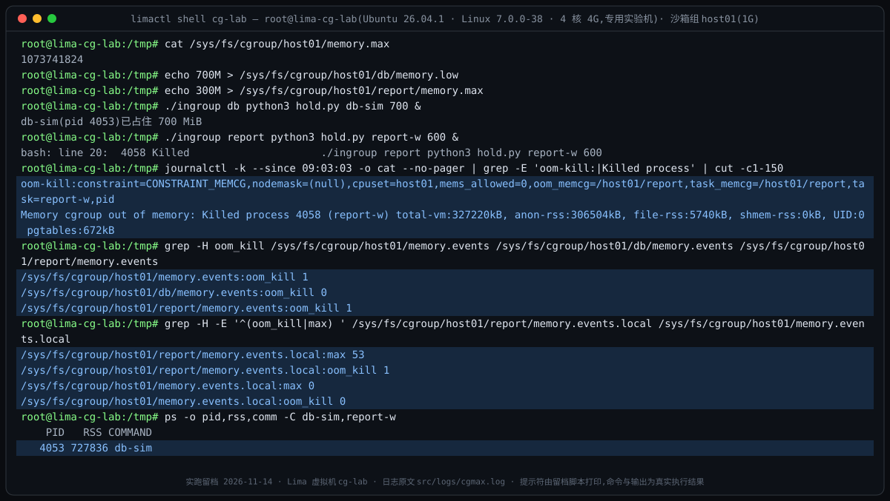

- 范围从 `oom_memcg=/host01` 变成了 `oom_memcg=/host01/report`。哪个组的上限先被达到,OOM 就在哪个组里发生、只在那个组里挑人。report-w 涨到 anon-rss 306 504 kB ≈ 299 MiB 时达到上限(`max 53`:达到上限 53 次,每次先试着回收,收不动),最后被杀。db-sim 的约 711 MiB(RSS 727 836 KiB)原封不动。
- 和上面第 4 步对比:两次 db 都有同样的 `memory.low`,结果一死一活。决定谁死的不是保护,是上限划在哪。这正是你灵魂问题②里「边界谁划的」的答案:**边界就是管理员写进某个组 `memory.max` 的那个数,它决定了 OOM 发生在哪一层、在哪些进程里挑人。** 写这个数的是外面的人,内核只管兑现(`C3·内核负责执行,配额由外部设定`)。
- 一个顺带的细节:父组 host01 的 `memory.events` 也显示 `oom_kill 1`,但 `memory.events.local` 是 0。前者把整棵子树的事件都算上,后者只算自己这一层。这次 OOM 发生在 report,往上汇总到了 host01。这是 `C1·按组限制合计用量` 里「组能套组」那个要点在用量记录上的样子:父组能看到子树里发生的一切,但事情是在子组那一层处理的。
- 两遍实跑(`cgmax-run1.log` 与 `cgmax.log`)结果一致。

## §11 约束清单(C1 ~ C5)

**结论:十个发现合成五条根约束。前两条和第三条的前一半回答「为什么必须有 cgroup」;第三条的后一半和后两条回答「为什么长成这样」。**

| 编号·短名 | 内容 | 要点(由哪几个发现合成) | 不可再分性 |
|---|---|---|---|
| `C1·按组限制合计用量` | 管的单位是组,不是进程;上限是绝对数,不随对手多少、不随自己开几个进程变;组能套组,父组管整棵子树的合计 | ① 单位是组:发现①(§1,690 → 226);② 上限是绝对数:发现②(§2.1,闲时 398%,400 个 worker 时 268);③ 组能套组:发现④(§2.4 推演,§7.2 落到目录树上) | 开几个进程是应用的自由,内核无法预知也不能禁止;相对权重只能回答「谁多」,回答不了「最多多少」;上级管不了下级内部怎么分,但必须管住合计 |
| `C2·记实际用量,超限处理看资源类型` | 用量记物理页、真实 CPU 时间、真实 IO,在占用的那一刻记到组名下;超了以后怎么处理由资源性质决定:会再生的等,能拒绝的拒绝,内存只能先回收、再在超限的组里杀 | ① 记真实消耗:发现⑤(§3.1,合计 2461 MiB;没碰的 1 GiB 被拒);② 按资源特性决定超限处理:发现⑥(§3.2,db-sim 被杀) | 地址空间这类预订量不稀缺,页缓存这类消耗不挂在任何进程名下;CPU 时间每个周期都有新的,物理页占了不还就没有 |
| `C3·内核负责执行,配额由外部设定` | 归属和上限被管的进程自己改不了,由内核强制;「谁该分多少」由管理程序写进文件,内核只负责兑现 | ① 被管的进程改不了:发现③(§2.2、§2.3,解绑后 215;setsid 逃过按组杀);② 数字由外面写:发现⑧(§5.4) | 边界能被进程自己改就不存在边界;哪个业务重要是业务上的事,内核无从判断 |
| `C4·在内核已有代码路径上记账,开销要小` | 所有业务共用一个内核;记账点只能放在内核本来就要走的路径上(fork、调度器结算、缺页、提交 IO),开销必须小,没人设限时几乎没有开销 | ① 共用一个内核、② 复用已有路径记账:都是发现⑨(§6,开机 7.8 秒;每秒 262 万页) | 每家一个内核,预留出去的资源无法互借;记账在最频繁执行的路径上,开销一大,所有程序都会变慢 |
| `C5·所有资源共用同一套分组` | 资源种类会不断增加,新增一种不能惊动已有的,所以是「公共框架 + 插件」;一笔开销跨几种资源,所以分组只能有一套、树只能有一棵 | ① 种类会增加:发现⑦(§5.2,9 个控制器);② 要核对记录:发现⑩(§8.2,v1 多棵树;§4.1 已出现过) | 资源种类由硬件和业务的发展决定,事先列不完;占内存的人和发 IO 的人不是同一个执行者 |

这份清单是从上一版的八条压缩来的。八条里的每一条都还在,只是变成了某条根约束下面的一个要点;新增的两个要点(数字由外面写、复用已有路径记账)和一个要点的扩充(种类会增加)是这次补上的:

| 上一版(按旧稿的发现顺序) | 旧稿里由哪个实验得出 | 现在归到 | 新稿位置 |
|---|---|---|---|
| ① 业务是一组进程 | 什么都不管(690 → 226) | `C1·按组限制合计用量` 的要点① | §1 |
| ② 上限要是绝对数 | nice | `C1·按组限制合计用量` 的要点② | §2.1 |
| ③ 被管者不可信 | taskset、setsid | `C3·内核负责执行,配额由外部设定` 的要点① | §2.2、§2.3 |
| ④ 用量要记在物理消耗上 | ulimit | `C2·记实际用量,超限处理看资源类型` 的要点① | §3.1 |
| ⑤ 内存不可压缩 | 全机 OOM | `C2·记实际用量,超限处理看资源类型` 的要点② | §3.2 |
| ⑥ 共用一个内核 | 虚拟机 | `C4·在内核已有代码路径上记账,开销要小` 的要点① | §6.1 |
| ⑦ 限额要能分层下发 | v1 的树 | `C1·按组限制合计用量` 的要点③ | §2.4 提出,§7.2 落地 |
| ⑧ 一笔开销跨多种资源 | v1 多棵树 | `C5·所有资源共用同一套分组` 的要点② | §8.2 |
| (新)数字由外面写 | — | `C3·内核负责执行,配额由外部设定` 的要点② | §5.4 |
| (新)复用已有路径记账 | — | `C4·在内核已有代码路径上记账,开销要小` 的要点② | §6.2、§6.3 |
| (新)种类会增加 | — | `C5·所有资源共用同一套分组` 的要点① | §5.2 |

## §12 设计怎么接住约束

| 设计 | 接住了 | 代价 / 留下的问题 |
|---|---|---|
| 核心 + 控制器:分组、继承、接口、权限、组套组只做一遍,每种资源一个插件 | `C5·所有资源共用同一套分组`(前一半) | 核心和控制器之间要有一套约定,新插件怎么「报到」(留给第三节) |
| 接口是文件,数字由管理程序写 | `C3·内核负责执行,配额由外部设定` | 内核只兑现,不判断数字合不合理:写错了数也照办 |
| 进程带组籍,fork 继承,自己改不了 | `C1·按组限制合计用量`、`C3·内核负责执行,配额由外部设定` | 每个进程多一份数据;fork 和退出都要多做一点事 |
| 用量记在组上,在消耗发生的路径上记账 | `C2·记实际用量,超限处理看资源类型`、`C4·在内核已有代码路径上记账,开销要小` | 记账落在调度和内存分配的热路径上,必须想办法让开销变小 |
| 限额写在用量旁边,记账时顺手比,满了就地做超限处理 | `C1·按组限制合计用量`、`C2·记实际用量,超限处理看资源类型` | CPU 的超限处理是让整组停到下个周期,带来延迟毛刺;内存的超限处理到头还是杀 |
| 组是一棵树 | `C1·按组限制合计用量`(组能套组) | 每次记账都要顺着树往上记到每一层祖先?(这个问题留给第三节) |
| 只有一棵树(v2),插件之间要核对记录的规矩收归核心 | `C5·所有资源共用同一套分组`(后一半) | 放弃了「不同资源按不同方式分组」的自由 |

最后一行是个真实的取舍:v1 的多棵树不是没有用处,有人确实想让 CPU 按部门分、内存按服务分。v2 的判断是这种自由用处不大,而代价(记录对不上)太大,于是砍掉了,换来的折中是「同一棵树上,不同资源可以分到不同的深度」。

### §12.1 一路上得出的五条设计原则

前面每遇到一个问题,都得出了一条设计上的原则。现在把它们排在一起。注意它们得出的顺序和下表的顺序不同:表是按「从整体到细节」排的。

| 原则 | 说的是什么 | 在哪里得出 | 对应的问题 | 根在哪条约束 | 第三节去哪看实证 |
|---|---|---|---|---|---|
| 公共框架加资源插件 | 公共的那一层只管「谁和谁一组」,不知道 CPU、内存是什么;每种资源是一个插件 | §5.3 | 一种资源一个限制器,分组做四遍、对不上、种类还会增加 | `C5·所有资源共用同一套分组` | §2:逐个打开控制器;每个控制器登记时交给核心的回调函数表(内核里叫 `struct cgroup_subsys`) |
| 复用内核已有路径记账 | 不给内核另建一条路径;记账点放在内核本来就要走的路径上;没人设限时这一步不执行 | §6.3 | 每家一个内核太贵;另建一条路径,程序不配合、所有程序都要多走一趟 | `C4·在内核已有代码路径上记账,开销要小` | §3 ~ §6:每个接入点的调用栈;§4:没人设限时 0 次 |
| 记账时同步检查限额 | 用量是消耗的那一刻顺手记的,限额是记账的那一刻顺手比的;没有专门的检查线程 | §7.1.1 | 检查线程来不及:内存每秒能吃进约 10 GiB,CPU 要卡到毫秒 | `C2·记实际用量,超限处理看资源类型` + `C4·在内核已有代码路径上记账,开销要小` | §4、§5、§7、§8;唯一的定时器只补不查(§7) |
| 内核只负责执行,数字由外面写 | 接口是文件;谁该分多少由管理程序决定,内核只负责兑现 | §5.4 | 内核不知道谁重要;§1 的调度器公平得分毫不差,却是错的 | `C3·内核负责执行,配额由外部设定` | §2:`mkdir` 和 `echo` 就是建组和写数 |
| 用统一的方式管理所有资源 | 凡是插件之间要核对记录的事,由公共层统一规定;v1 把「树长什么样」留给插件,结果记录对不上;v2 收回,只有一棵树 | §8.7 | v1 的四个痛,每一个都是留给插件自己决定的事 | `C5·所有资源共用同一套分组` | §2、§3:组籍每个控制器一栏,`/proc/<pid>/cgroup` 只有一行 |

五条原则各自都能回到一个具体的问题:没有哪一条是先定下来再去找理由的。它们合起来就是灵魂问题③里「设计哲学」那一问在这一节能给的答案。

## §13 这些看着像约束,其实不算

| 常听到的说法 | 为什么不算 |
|---|---|
| 「为了隔离,让进程互相看不见」 | 那是 namespace 的事。cgroup 不管看得见什么,只管用得了多少(第一节 §7) |
| 「为了容器」 | 顺序反了。cgroup 在 2.6.24 就有了,比 docker 早好几年;systemd 给每个服务建组,也和容器无关。是容器用了它,不是它为容器而生 |
| 「为了高性能」 | 这是要求,不是约束。真正的约束是 `C4·在内核已有代码路径上记账,开销要小` 里的那一句:记账在热路径上,所以开销必须小 |
| 「为了公平」 | 调度器本来就公平,§1 的数字分毫不差。缺的不是公平,是公平的单位(`C1·按组限制合计用量`) |
| 「为了保证每个业务拿得到资源」 | `cpu.max` 和 `memory.max` 是上限,不是保底。保底是另一组旋钮(§10.1 的 `cpu.weight`、§10.3 的 `memory.low`),属于「怎么分」,不属于「为什么要有」 |
| 「为了安全」 | cgroup 管用量,不管权限。它让 report 吃不垮机器,但拦不住 report 去读别人的文件 |
| 「做成插件是为了代码好看、好维护」 | 插件化是由需求决定的:资源种类会增加,而且一个组要同时被几种资源管(`C5·所有资源共用同一套分组`)。只为好维护的话,四个专用工具各自写好也说得过去,§5.2 的三个难点才是非抽不可的理由 |

## §14 呼应灵魂问题

| 你的问题 | 这一节拿到的 | 还缺的 |
|---|---|---|
| ① 往 `cpu.max` 写 `50000 100000`,内核怎么让这组进程最多吃半颗核? | 为什么必须是「组 + 绝对数」而不是 nice 或绑核(`C1·按组限制合计用量`);实测它确实做到了:8 个或 400 个 worker 都是约 50%,每周期 49 969 μs;为什么进程自己逃不掉(`C3·内核负责执行,配额由外部设定`);为什么准到微秒:限是在记账的那一刻比的(§7.1.1) | 机制本身:用量记在哪个结构上、谁在加、数满那一刻 400 个进程是怎么同时被限制住的、下个周期谁放它们出来 |
| ② 容器 OOM 只杀容器里的进程,边界谁划的、账怎么记? | 为什么内存超了只能杀(`C2·记实际用量,超限处理看资源类型`);没有边界时杀的是全场最胖的(db-sim);有了组,范围变成 `oom_memcg=/host01/report`,7 个 report-w 死、db-sim 活;边界是管理员写进 `memory.max` 的那个数(§10.4);用量必须按物理页记,包括页缓存 | 一页内存记到组上的那一刻发生了什么;到上限后先回收什么、何时才杀;组里挑谁;为什么 §3.2 多杀了一个 |
| ③ cgroup 通过什么架构实现对各种资源的控制?它怎么融入 Linux 内核?设计哲学是什么? | 架构:一个核心(分组、继承、文件接口、权限、树)加一排控制器(每种资源一个,只管记账和超限处理),是由「一种资源一个限制器」带来的问题得出的(§5,`C5·所有资源共用同一套分组`);融入内核的方式:复用内核已有路径记账,记账点放在 fork、调度器结算、缺页、提交 IO 这些本来就要走的路径上(§6,`C4·在内核已有代码路径上记账,开销要小`);只有一棵树是 v1 翻车之后收回的(§8);设计原则五条,每条都在这一节得出过(§12.1);四种资源在同一套公共框架上实跑通过(§9) | 核心和控制器在内核里各是什么样;控制器怎么向核心报到;每个接入点上核心做什么、控制器做什么;没人设限时这一步为什么真的没有开销 |

粗略估计:①② 两个问题各闭环到三成左右,上一节知道了问题里每个词指什么,这一节知道了为什么非这样设计不可,并且亲眼看到它生效,还不知道的是内核里的每一步是怎么做的;③ 闭环到四成左右,「为什么是这个形状」和「设计哲学从哪来」这一节基本说完了,「它在内核里长什么样、怎么接进去」是第三节的事。

## §15 留下的悬念

**这一节每个结论背后都压着一个「那它是怎么做到的」。两条线各留几个。**

第一条线,一组进程的资源是怎么被管住的:

1. **每秒几百万次,怎么记得起?** §6.2 算过,每秒要给 262 万个页记账,每次调度结算也要记。每一次都去改组上的同一个计数器吗?4 颗核同时改呢?(`C4·在内核已有代码路径上记账,开销要小`)
2. **50 ms 用完的那一刻发生了什么?** 400 个 worker 散在 4 颗核上,是谁、用什么办法把它们同时限制住的?为什么连 fork 都要排队?
3. **树怎么约束?** 子组记一笔用量,父组、祖父组的用量怎么跟着变?每次都要爬一遍树吗?(`C1·按组限制合计用量`)
4. **组内 OOM 的细节。** 先回收什么?挑谁?为什么 §3.2 里 db-sim 死了之后还要多杀一个 worker?
5. **组的份额怎么落到每颗核上?** §10.1 里两个组权重相同,db 却只拿到 152% 而不是 200%,因为 4 个 db-sim 只占了 3 颗核。一个组的权重是怎么摊到 4 颗核上的?内核为什么没把它们铺开?

还有第一节挂着的那个问题:9 个一模一样的死循环都在同一个 0.5 核的组里,为什么有一个拿到 12%、其余只有 4%~6%?

第二条线,这套公共框架。说起来容易,它怎么接进一个已经在跑的内核?

6. **组籍存在哪?** 每个进程「多带一个组籍」,带在什么东西上?那份每个控制器一栏的记录长什么样?fork 的那一刻内核做了什么,让子进程生在父进程的组里?
7. **控制器怎么报到?** 核心不管具体是哪种资源,那新写一个控制器时,它要向核心交出些什么?建组、入组、fork、退出的时候,核心怎么知道该调用谁?
8. **一个接入点上,谁做什么?** worker fork 的那一刻,核心在抄组籍,pids 控制器在数「还能不能生」,这两件事是怎么排在同一条路上的?缺页、调度结算、提交 IO 又各是谁在动手?
9. **没人设限的时候,这一步真的没有开销吗?** db 一个上限都没写,它跑的每一段 CPU、要的每一页内存,还要不要经过记账那一步?

这些都是「它是怎么解决的」那一段的内容。

## 待核清单

| # | 内容 | 状态 |
|---|---|---|
| 1 | §3.2:db-sim 被杀之后为什么还多杀 worker(三遍实跑分别多杀 1 / 3 / 1 个)。原因未查清,留到讲内存 OOM 路径的源码时回答 | 待核 |
| 2 | §3.2 / §9.2:全机 OOM 和组内 OOM 用的是同一套挑人规则(范围内找最胖的,再按 `oom_score_adj` 调整)。目前只有实测与两处日志对照,源码层面未确认 **第四节核实:2008 年合入内存控制器组内 OOM 的提交说明原话是 "chosen using the existing OOM logic",设计上同一套;今天的源码未读。见第四节 §6.1** | 设计出处已核实,源码待核 |
| 3 | §2.1:nice 0 的权重 1024、nice 19 的权重 15。实测比例(97.2% / 40.6%)与之吻合;源码位置与行号进源码时补 | 实测吻合,源码待核 |
| 4 | §8.2:v1 时代带缓冲的写入在 blkio 那边到底限不限得住,需要一条一手出处(目前只引了 v2 文档对「控制器无法合作」的总体说法) **第四节核实:Tejun Heo 2015-01 的补丁说明:块 IO 控制器分不清回写 IO 该算谁,全部记到根组。见第四节 §7.1** | 已核实,销项 |
| 5 | §9.1:吞吐是独占时的 92%~93% 而 CPU 占比是 87%,差的那几个百分点归因于「不同遍之间单次查询的 CPU 开销波动」,未进一步验证(可能与上一节待核 #8 的虚拟机效应有关) | 待核 |
| 6 | §4.1:这台机器上 dd 结束后 `Dirty` 计数几乎不涨、回写启动得很快,和预想的「脏页攒一阵再写」不一样。结论(写盘的是内核线程、页缓存不在进程名下)不受影响,但回写的时序没有深究 | 待核 |
| 7 | §13:「cgroup 比 docker 早好几年」里 docker 的首发年份;§7.2 第一版的作者与合入经过。讲来路时配一手出处(与上一节待核 #3 合并处理) **第四节核实:docker 2013 年 3 月首次公开;cgroup 框架 2007-10-19 合入,早五年多;作者 Paul Menage,经过见第四节 §3** | 已核实,销项 |
| 8 | §10.1:两组权重相同时 db 只有 133% ~ 174%(理论 200%)。已证实的部分:4 个 db-sim 每遍都只落在 2 ~ 3 颗核上,手工一核钉一个之后是 192%。未查清的部分:内核为什么不把它们铺开(§2.1 不分组时是铺开的);组的权重摊到每颗核上的算法。留到讲 CPU 控制器的机制与源码时回答 | 现象已证实,机制待核 |
| 9 | §10.1:权重 900 比 100 的五遍里有两遍偏低(288%、257%,理论 360%),当时没有采样进程所在的核,「同样是没铺满」只是推测 | 待核 |
| 10 | 同样的 CPU 占比,吞吐有时只有一半:§10.1 第三遍(`cgweight-run3.log`,155% 对 142 次/秒)和 §10.2 第二遍(`cgboth-run2.log`,362% 对 348 次/秒),相当于每次查询花的 CPU 时间从 5.8 ms 变成了 10 ms 左右。追查到的线索(`src/logs/hostspeed-diag.log`):虚拟机空闲时单独跑同一段计算,「算一阵、睡半秒」的跑法每次要 9.1 ~ 10.6 ms,连续跑则是 4.6 ms,4 个进程一起连续跑是 5.3 ~ 6.5 ms。也就是说同一段计算在这台虚拟机里花的 CPU 时间能差一倍多,而且虚拟机内部看不出被抢(墙上时间等于 CPU 时间)。宿主机有两档核(5 + 10),我怀疑是虚拟机的 CPU 有时被排到了慢的那一档核上,或者频率没升上去;宿主机一侧没有验证。影响:**不同遍之间的「次/秒」不能直接比,CPU 占比和组的用量记录可以**;正文的结论都落在 CPU 占比上。#5 和上一节待核 #8 很可能是同一个原因 | 有线索,宿主机一侧待核 |
| 11 | §10.3 第 4 步:受 `memory.low` 保护的 db-sim 被父组 OOM 挑中。实测两遍都是如此,和「OOM 挑人时不看 memory.low,只看谁大」一致;源码层面未确认。memory.min 在同样情况下会不会不同,也没有实跑 | 实测两遍一致,源码待核 |
| 12 | §10.3 第 2 步:「谁先被收,看这一页多久没被碰过,和组无关」是按 db 先读、先被收的现象推的,没有单独实验(比如反过来让 report 先读)验证 | 待核 |
| 13 | §9.3:磁盘 IO 第一遍(`cgio-run1.log`,四次 dd 覆盖写同一个文件)里,`io.stat` 的 `wbytes` 是 200 MiB 而不是 150 MiB,且没有设限的 db 组写这个文件也是 5 秒。换成不同文件后正常。猜测与文件回写的归属有关,未验证 **第四节核实:内核文档原话 "Memory is tracked per page while writeback per inode":回写按文件归属于一个组,所以 db 组往归 report 的文件里写,也算 report 的用量、受 report 的限速。按文档解释,未再做实验。见第四节 §12** | 有文档依据,实验未补 |

已核实(出处都在正文链接里):`RLIMIT_AS` 限的是地址空间、`RLIMIT_RSS` 只在 2.4.30 之前有效、`RLIMIT_NPROC` 按真实用户计数且对 root 与两种能力不生效([getrlimit(2)](https://man7.org/linux/man-pages/man2/getrlimit.2.html));异步写不受 IO 优先级影响([ioprio_set(2)](https://man7.org/linux/man-pages/man2/ioprio_set.2.html));2.6.24 / 3.10 / 4.5 / 4.15 四个版本节点([cgroups(7)](https://man7.org/linux/man-pages/man7/cgroups.7.html));v1 的四类问题与 No Internal Process Constraint、Writeback 三处引文([cgroup-v2 文档](https://docs.kernel.org/admin-guide/cgroup-v2.html))。

§9.3 / §9.4 的留档说明:进程数与磁盘 IO 两段在 cg-lab 上跑,日志 `src/logs/cgpids.log`、`cgio.log`(磁盘 IO 的第一遍另存为 `cgio-run1.log`)。

实验机的说明:§9.3、§9.4、§10.3、§10.4 这四段在专用实验机 cg-lab 上跑(和 cg 同一个系统镜像,同样是内核 7.0.0-38;4 核 4G,只跑本文的实验,用完删除),其余实验都在 cg 上。换机器是因为 cg 上跑着别的服务,之前吃满 CPU 的实验已经干扰到它们。

§10.3 的留档说明:§10.3 跑了两遍,数字一致,正文与图用后一遍(`src/logs/cglow.log`),前一遍是 `cglow-run1.log`;§10.4 同样两遍一致(`cgmax.log`、`cgmax-run1.log`)。之前各节的数字都来自 cg,没有重跑。

§10.2 的留档说明:跑了三遍,正文与图用最后一遍(`src/logs/cgboth.log`),前两遍原样保留为 `cgboth-run1.log`、`cgboth-run2.log`。

§10.1 的留档说明:这组实验前后跑了五遍。正文与图用的是最后一遍(`src/logs/cgweight.log`);第二到第四遍的日志原样保留为 `cgweight-run2.log` ~ `cgweight-run4.log`;第一遍(174% / 352%)当时还没加采样核号的命令,日志被后一遍覆盖了,只剩这两个数。另有一遍只用于排查的运行(每半秒采样一次核号,db 138%),没有留日志。

实验环境的一处变化,如实记录:做这一节实验时发现虚拟机里多了 mysqld、clickhouse、redis 三个真服务(当天 17:36 之后装的,不是这一节的实验装的)。因此所有实验都关进了沙箱组,没有做真正的全机 OOM;实验前后这三个服务的进程和内存占用没有变化。


## 修订记录

| 时间 | 修订摘要 | 触发原因 |
|---|---|---|
| 2026-11-13 | 初稿:host01 上逐件试旧工具(不管 / nice / taskset / ulimit / OOM / 虚拟机),IO 与进程数各一例;八刀八条约束;核心想法;v1 的四个痛与 v2 的改法;换成 cgroup 重演一遍并前后对照。13 张终端留档图 + 3 张示意图,全部数字取自同一批留档日志 | 开场对齐后用户「没有了」 |
| 2026-11-13 | 新增 §10.5「只分组、不封顶」:实跑 `cpu.weight`(100 比 100 时 db 152%,一核钉一个时 192%,900 比 100 时 345%,db 闲时 report 385%),四种管法对照表,点明 `cpu.weight` 与 `cpu.max` 各管一个洞;§15 加第 6 条悬念;待核清单加 #8 ~ #10;新增留档图 `02-shot-cgweight.svg` | 用户对反问「去掉 cpu.max 只分组,db 能拿多少」回答「不知道」 |
| 2026-11-13 | 新增 §10.6「两个旋钮同时用」:记录用户的回答「还是按照组来分,1:9」(忙时对,闲时由上限决定);实跑三遍,用组的 `cpu.stat` 对账(忙时每周期 39 487 μs,闲时 49 444 μs 且 31/31 周期被限流);归纳为 min(按权重分到的,`cpu.max`)。待核 #10 补上虚拟机速度浮动的排查线索。新增留档图 `02-shot-cgboth.svg` | 用户回答第 2 个反问 |
| 2026-11-13 | 新增 §10.7「内存为什么没有 1 比 9」:记录用户回答(「不太行」对;「虚拟映射」「按实际使用」不是原因,真正原因是 `C5·内存不可压缩`);在专用实验机 cg-lab 实跑两遍:内存没有 weight,不设保护时 db 页缓存被收 246 MiB,`memory.low` 700M 时 db 不少一页、report 停在 320 MiB,匿名页情况下受保护的 db-sim 反被 OOM 杀;CPU / 内存旋钮对照表;待核 #11、#12;新增图 `02-shot-cglow.svg` | 用户回答第 3 个反问 |
| 2026-11-14 | 新增 §10.7.1「给 report 加上 memory.max」:记录用户回答「report 被杀」(对,范围那一半由实跑补上);cg-lab 实跑两遍:`oom_memcg=/host01/report`,report-w 在约 299 MiB 被杀,db-sim 存活;父组 `memory.events` 与 `memory.events.local` 的区别;新增图 `02-shot-cgmax.svg` | 用户回答第 4 个反问 |
| 2026-11-14 | 补「cgroup 是管各种资源的框架」这条线:新增 §8.3(八条约束分成「与资源无关」和「每种资源各不相同」两堆,所以做成公共骨架 + 控制器;实测 9 个控制器)与 §10.8(进程数:`pids.max` 20,root 的第 20 次 fork 失败;磁盘 IO:`io.max` 每秒 10 MiB,直接写与带缓冲的写 50 MiB 都是 5 秒,db 组 0.026 秒;四种资源对照表);待核 #13;新图 `02-shot-cgpids.svg`、`02-shot-cgio.svg` | 用户新视角:「cgroup 不止能管理 CPU,还能管理内存、IO……是个架构」 |
| 2026-11-15 | 重构叙事,不是加章节:两条主线并行(一组进程的资源怎么被管住;cgroup 这套架构怎么搭、怎么融进内核)从 §0 起贯穿到 §15。八条约束压成五条并重新编号(`C1·管的是一组的合计` ~ `C5·资源不止一种,还要对账`,约束清单表新增「由旧的哪几刀合成」一列)。新增 §5「你的第一版」、§6「骨架放在哪」两段推演。五句设计哲学分别在故事里出生,§12 收拢一次。旧 §8.3、§10.8 拆散,分别融入 §5 和 §9(§9.3 磁盘 IO、§9.4 进程数、§9.6 四种资源对照表)。旧 §10.5 ~ §10.7.1 改为 §10.1 ~ §10.4,旧 §9 改为 §8,旧 §7 改为 §6,旧 §8 改为 §7。重画 `02-overview.svg`(五条约束是怎么一刀刀切出来的),`02-v1-vs-v2.svg` 与 `02-ledger-move.svg` 改约束引用。待核 #1 ~ #13 编号不变,小节号改为新编号;其余旧行原样保留(含旧小节号与旧约束名) | 用户:「你理解错了。你得从根上开始修改。就是重点要放在cgroup的架构,通过什么架构来实现对各种资源的控制的,怎么融入linux内核的,设计哲学是什么。这是本系列的第二条主线。01-what 02-why 03-how都要加上这个线索。而且要融入得自然,不要通过加新的章节来敷衍。要有故事性。」 |
| 2026-11-15 | §6.3 补一句:第三节 §4.5 补量的结果是 CPU、IO 不设限就不搭车,内存设不设限都记 | 第三节补跑实验后回填 |
| 2026-11-15 | 待核 #2 #4 #7 #13 回填第四节的核实结果;另:§7 把多棵树当作 v1 的出厂设置来讲,史实是首发为一棵树、两个月后才加多棵树(第四节 §4),正文未改,以第四节为准 | 第四节查一手资料后回填 |
| 2026-11-17 | 全篇改白话:去掉口号、比喻、拟人(「十刀五条」「撞墙/切一刀」「搭车」「骨架」「监工」「栅栏」「账本/账」「少留自由」「处置」等约 300 处,含 §12.1 五条口号式设计原则改为平述,「刀」改称「发现」,「墙/洞/坑」改称难点/问题/缺陷;§5.3、§5.4、§6、§7 并列的类比各只留一个);3 张手绘图同步改字,02-overview.svg 底部 C4 方框改为两行;约束名已统一换新 | 用户:「都改成白话」 |
| 2026-11-17 | §10.4 更正:db-sim 的 RSS 727 836 KiB 约为 711 MiB,原写 728 MiB 是按 1000 换算的 | 做视频时起草第 2 集的子代理发现 |
| 2026-11-17 | 「巡查(线程)」改为「检查(线程)」,与第三节及视频用词一致 | 做视频审稿时统一用词 |
