# 阶段 3:cgroup 的设计怎么接进内核

第二节结束时,你手里已经有了一套设计:公共的一层(核心)管树、组籍、文件接口和生命周期通知;每种资源一个插件(控制器);再加上一个想法:进程带组籍,消耗资源时记到组的账上,账旁边写着限。第二节最后留下的问题是:这套设计说起来容易,它怎么接进一个已经在跑的内核?

这一节回答它。你还是那个要让 Linux 内核把各种资源统一管起来的开发者,只是现在要动手了。你面前的内核早就有一套成熟的路:fork 造进程,调度器分 CPU,缺页时给内存,块层把数据交给磁盘,exit 收拾退出的进程。`C4·在内核已有代码路径上记账,开销要小` 不许你另修一条路,你只能在这些路上找位置,把记账的那一步加进去。

讲法是跟着一个进程走。主角还是 report 的一个 worker,它的一生是:出生(fork)→ 跑 CPU → 要内存 → 写盘 → 生孩子 → 退出。它每经过一条路,就碰到一个**接入点**。每个接入点讲六件事:内核原本在这条路上做什么;cgroup 在哪一步之后接入(用实测的内核调用栈作证);核心做了什么;哪个控制器做了什么;这笔账为什么记得起;超了怎么处置。

只讲 cgroup v2,不贴内核源码。跟踪输出里出现的内核函数名只用来标明位置,不展开实现。所有终端输出都在专用实验机上实跑过,原样贴出。

## 约束清单速查(C1 ~ C5)

#### C1 — 按组限制合计用量
管的单位是组不是进程;上限是绝对数,不随对手多少、不随自己开几个进程变;组能套组,父组管整棵子树的合计。
**不可再分**:开几个进程是应用的自由;相对权重回答不了「最多多少」;上级管不了下级内部怎么分,但必须管住合计。
**一句话**:账户挂在组上,组按树组织,不是平铺的一排。

#### C2 — 记实际用量,超限处理看资源类型
账记物理页、真实 CPU 时间、真实 IO;超了以后怎么办由资源的性质决定:会再生的(CPU 时间、IO 带宽)等,能拒绝的(进程数)拒绝,内存既等不来也拒绝不了,只能回收或杀。
**不可再分**:预订量(地址空间)不稀缺,物理资源才稀缺;物理页占了不还就没有。
**一句话**:记已经花掉的,不记预订的;CPU 可以等,内存等不来。

#### C3 — 内核负责执行,配额由外部设定
归属和上限被管的进程自己改不了,由内核强制;但「谁该分多少」内核不知道也不该知道,由管理程序(systemd、docker 之类)通过文件写进来。
**不可再分**:限制如果能被进程自己改,就等于没有限制;哪个业务重要是业务上的事,内核无从判断。
**一句话**:内核负责执行限制,限制的数值由外面的人定。

#### C4 — 在内核已有代码路径上记账,开销要小
所有业务共用一个内核;记账点只能挂在内核本来就要走的路上(调度、缺页、提交 IO、fork),必须便宜;没人设限时这一步几乎不花钱。
**不可再分**:每家一个内核(虚拟机)资源无法互借;记账在最热的路径上,开销一大,机器上所有程序都会跟着变慢。
**一句话**:记账的开销不能比干活本身还大。

#### C5 — 所有资源共用同一套分组
要管的资源种类会不断增加,新增一种不能惊动已有的,所以要「公共框架加资源插件」;一笔开销又会跨几种资源(写文件先占内存后写盘),所以分组只能有一套。
**不可再分**:资源种类由硬件和业务的发展决定,事先列不完;占内存的人和发 IO 的人不是同一个执行者。
**一句话**:资源种类可以一种种加,分组只能分一套。

这五条是第二节 §11 由旧的八条合成的。本节引用一律写「编号·短名」。

## §0 从「为什么」走到「怎么做」:三件事记住

第二节 §7.1 的核心想法里有三个名词:组籍、组的账、组的限;§5 和 §8 又把整套设计切成两层:和资源无关的核心,每种资源一个的控制器。这一节要把它们落进内核。落下去之后,worker 一生中碰到的只有三样东西:**组籍、账、接入点**。前两样是「东西」,第三样是「位置」:东西放在哪,在哪一刻被用到。

### §0.1 组籍:进程身上的一个指针(归核心)

因为 `C1·按组限制合计用量`(管的是组,要按组加总)和 `C3·内核负责执行,配额由外部设定`(归属不能由进程自己说了算)→ 要解决「内核在任何时刻都能从一个进程一步找到它的组,而且这个归属进程自己改不了」→ 所以每个进程在内核里的档案上多一个指针,指向一张**组籍**(内核里叫 `css_set`)。组籍上每个控制器一个格子,写着「这种资源的账在哪个组上」。同一个组的进程指向同一张组籍;fork 的时候,子进程抄走的就是这个指针。组籍和具体资源无关,归核心管。

### §0.2 账:每个组、每种资源一本,限写在旁边(归控制器)

因为 `C2·记实际用量,超限处理看资源类型`(记的是花掉的,超了怎么办随资源而定)和 `C5·所有资源共用同一套分组`(每种资源各有各的记法,但分组只有一套)→ 要解决「消耗发生的那一刻就记到组头上,超没超当场知道,而且每种资源可以有自己的记法和处置」→ 所以每个组、每种资源各有**一本账**(一个记录用量的数据结构),挂在同一棵树的节点上;**限就写在账的旁边**,每次记账都是「加上去,看超没超」。CPU 的账是每个周期补满一次的时间额度,内存的账是已用页数,进程数的账是个数,IO 的账是每秒的字节数。这本账长什么样、超了怎么办,由各自的控制器决定。

### §0.3 接入点:记账的那一步加在哪(核心和控制器衔接的地方)

因为 `C4·在内核已有代码路径上记账,开销要小`(所有业务共用一个内核,不能另修一条路,而记账恰好落在最热的路径上)→ 要解决「记账的那一步放在哪,才能不漏记、不另起炉灶,还足够便宜」→ 所以引入**接入点**:在内核本来就要走的路上(fork、调度器结算、缺页、提交 IO、退出)找一个位置,多执行一小步。

同一条约束还逼出一样东西。多颗核同时往一本账上记,就要抢同一把锁,核越多抢得越凶 → 要解决「记得勤,又不互相打扰」→ 所以再引入**每颗核的本地额度**:每颗核先从组的总额度里领一小份,平时只扣自己这一份,用完才去动全组共享的那本账。一份多大,§4、§5 再算。

接入点是核心和控制器碰头的地方。有的接入点由核心参与,挨个通知控制器(fork、退出);有的由控制器自己负责,核心不参与(调度器结算、缺页、提交 IO)。

### §0 结论

| 三件事 | 是什么 | 为什么存在 |
|---|---|---|
| 组籍(核心) | 进程身上的一个指针,指向一张每个控制器一个格子的卡片 | 让内核一步从进程找到组;进程自己改不了(`C1·按组限制合计用量`、`C3·内核负责执行,配额由外部设定`) |
| 账(控制器) | 每个组每种资源一本,挂在树上;限写在旁边 | 消耗发生时当场记、当场比;每种资源记法和处置各不同(`C2·记实际用量,超限处理看资源类型`、`C5·所有资源共用同一套分组`) |
| 接入点(碰头处) | 内核本来就要走的路上多走的那一步;每颗核先领一小份本地额度 | 不另修路,不漏记,开销小(`C4·在内核已有代码路径上记账,开销要小`) |

三者的关系:**进程 →(组籍)→ 账 →(旁边)→ 限**。这条链什么时候被走一遍,由接入点决定:worker 每消耗一点资源,内核在自己本来就要走的那条路上多走一步,顺着组籍找到账,加上去,比一下限。

放回第一节那套合租公寓:组籍是户籍登记,写着你住哪一户;账是每户的水表、电表、燃气表,各管各的,限额写在表旁边;接入点是表装的位置,装在每户的入户管上,不用把全楼的水管重铺一遍。物业(管理程序)只负责往表旁边写限额。

下面按 worker 的一生走:§2 是开场前的准备(核心怎么建树、控制器怎么接入);§3 ~ §6 是四个接入点(fork、调度器结算、缺页、提交 IO);§7 ~ §9 是超了之后;§10 是树和退出;§11 把这一生压成一张表。

## §1 一张全景图

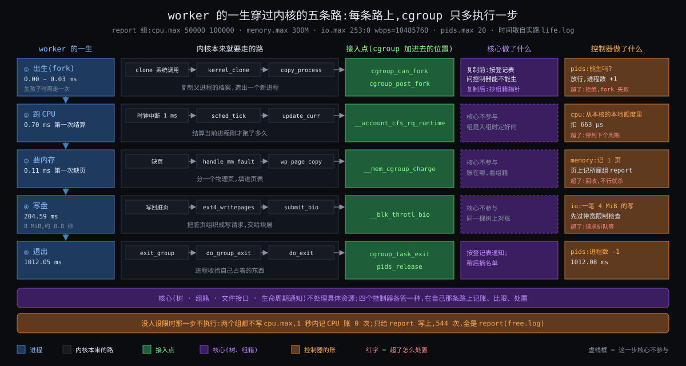

从图上能读出五件事:

1. worker 的一生穿过内核的五条路。每条路上灰色的那一段,是内核本来就要走的,和 cgroup 无关。
2. 每条路的末端多出一个接入点(绿色),cgroup 的记账就加在这里。没有哪一格是 cgroup 自己新修的路。
3. 核心(紫色)只在 fork 和退出两处参与:复制之前问控制器、复制之后抄组籍、退出时摘名单。另外三条路上核心不参与,控制器顺着组籍自己找到账。
4. 四种资源的账和处置各不相同(橙色和红字):CPU 停到下个周期,内存回收或杀,IO 排队,进程数拒绝。
5. 最下面一行:没人设限的组,CPU 那一步干脆不执行(§4.5;IO 也是这样,内存不是,同一小节有对照)。

这张图对应一次实跑。report 组四种资源各写一个上限,然后让 report 生出一个 worker:worker 先烧 0.2 秒 CPU,再要 20 MiB 内存,写 8 MiB 文件并等它落盘,生一个孩子,退出(小程序 `src/prog/life.py`)。跟踪脚本(`src/prog/t7-life.bt`)在每个接入点第一次被碰到时打印一行,时间从 report 生 worker 的那一刻算起:

```
# echo '50000 100000' > /sys/fs/cgroup/host01/report/cpu.max
# echo 300M > /sys/fs/cgroup/host01/report/memory.max
# echo '253:0 wbps=10485760' > /sys/fs/cgroup/host01/report/io.max
# echo 20 > /sys/fs/cgroup/host01/report/pids.max

# bpftrace t7-life.bt 0 > life.out 2>&1 &
# ./ingroup report python3 life.py
# grep -v -e Attached -e '^$' life.out
  0.00 ms  [fork]      pids 控制器被问「能生吗」→ 放行,report 组的进程数 +1
  0.03 ms  [fork]      核心:子进程 9356 抄走父进程的组籍 0xffff0000c5b97400,挂上名单
  0.11 ms  [缺页]      memory 控制器:分到物理页,给 report 组记 1 页
  0.70 ms  [调度结算]  cpu 控制器:刚跑掉 663 微秒,从 report 组在核 3 的零钱里扣
204.59 ms  [提交 IO]   io 控制器:一笔 4194304 字节的写请求,交给磁盘前先过 report 组的带宽闸门
1011.44 ms  [fork]      worker 自己生孩子:pids 控制器又被问一次 → 放行
1012.05 ms  [退出]      核心:把 worker 从组籍的名单上摘掉
1012.08 ms  [退出]      pids 控制器:report 组的进程数 -1
```

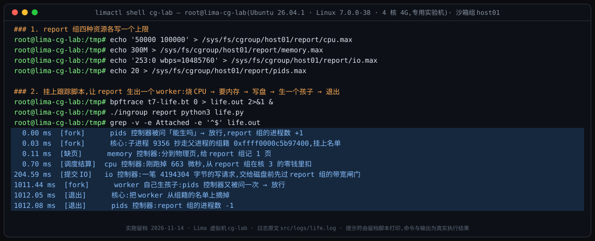

这八行就是这一节的提纲。0.00 和 0.03 ms 两行是出生(§3);0.70 ms 是跑 CPU(§4);0.11 ms 是要内存(§5),它比 CPU 那一行还早,原因在 §5.2;204.59 ms 是写盘(§6),从这一行到下一行隔了约 0.8 秒,8 MiB 按每秒 10 MiB 算正好要这么久,所以我推断这段时间主要花在 io 控制器让写请求排队等待上(没有抓到排队本身,见 §6.5);1011.44 ms 是 worker 自己生孩子,又走一遍 fork;最后两行是退出(§10.3)。每种接入点只打印第一次,后面成千上万次照样发生,只是没有打印。

worker 出生之前,先要把这些准备工作做好。

## §2 准备工作:核心建好树,控制器依次接入

**结论:worker 出生之前,管理员只做了两种动作:`mkdir` 和 `echo`。`mkdir` 让核心在树上多一个节点,核心再按「父组往下开了哪些控制器」挨个通知控制器来建账;`echo` 把数字写进某本账旁边的限。核心本身不处理任何一种具体资源,它只管树上的节点和登记过的控制器;数字是怎么定的,内核也不过问,它只负责执行。**

### §2.1 先建组设限:`mkdir` 和 `echo` 在内核里各做了什么

如果你是内核开发者,第一件要定的事是:管理程序怎么把「report 最多半颗核」告诉内核?第二节 §5 已经定了一半:report 该分多少,内核不知道也不该知道,数字由外面写进来(`C3·内核负责执行,配额由外部设定`)。剩下的是用什么接口。cgroup 选的是文件:建组就是建目录,设限就是往文件里写一行。

§1 那次实跑开场前写的四个上限,加上更早的建组,在内核里对应这些事:

| 管理员做的 | 内核里发生的 | 归谁 |
|---|---|---|
| `mkdir /sys/fs/cgroup/host01/report` | 核心在树上多一个节点 report;父组往下开了哪几种控制器,就通知哪几个控制器给它建一本账 | 核心建节点,控制器建账 |
| `echo '50000 100000' > report/cpu.max` | 把这两个数写进 report 的 CPU 账:每 100 000 μs 一个周期,每周期额度 50 000 μs | cpu 控制器 |
| `echo 300M > report/memory.max` | 把 76 800 页(300 MiB ÷ 4 KiB)写进 report 的内存账,作为上限 | memory 控制器 |
| `echo '253:0 wbps=10485760' > report/io.max` | 在设备 253:0(这台机器的 vda)上,report 每秒最多写 10 485 760 字节,也就是 10 MiB | io 控制器 |
| `echo 20 > report/pids.max` | report 这棵子树里最多 20 个进程 | pids 控制器 |

这几步只改了账,没有动任何进程。此刻 report 组里一个进程都没有。

这些文件的主人是 root,普通进程打不开(第二节 §9.5 试过,`Permission denied`)。这是 `C3·内核负责执行,配额由外部设定` 前一半的落点:账和限放在被管的进程改不到的地方。

后一半落在数字上。`50000 100000` 这两个数,内核不问来由。report 为什么值半颗核、db 为什么不设限,是写这个文件的那一方(管理员、systemd、docker)决定的;第一节 §4 倒推过这几个数是怎么一站站传到这个文件里的。这一点的具体做法是:内核只提供「目录 + 文件 + 写进来就生效」这套机制,数字全由外面写,内核自己一个数也不填。

### §2.2 实验环境、路牌,和怎么读调用栈

这一节的实验都在专用实验机 cg-lab 上跑(Ubuntu 26.04.1,内核 7.0.0-38,4 核 4G,arm64)。抓现行用的是内核跟踪工具 bpftrace:写几行脚本,告诉它「内核执行到某个函数时,把这几个数打印出来」。下面会出现的内核函数和结构(用作定位标记):

| 内核函数 / 结构 | 它是什么 | 在哪一节 |
|---|---|---|
| `css_set` | 组籍 | §3 |
| `<控制器>_css_alloc` | 核心通知某个控制器给新组建一本账 | §2.4 |
| `cgroup_can_fork` / `pids_can_fork` | fork 的半路上,核心问各控制器「能生吗」/ pids 控制器的回答 | §3 |
| `cgroup_post_fork` | fork 快结束时,把新进程挂到组籍上的那一步 | §3 |
| `__account_cfs_rq_runtime` | 某个组在某颗核上刚跑掉一段时间,记一笔 | §4 |
| `sched_cfs_period_timer` | 每个周期触发一次、给组补额度的定时器 | §4、§7 |
| `throttle_cfs_rq` / `unthrottle_cfs_rq` | 在某颗核上给这个组设置 / 清除「限流中」标记 | §7 |
| `throttle_cfs_rq_work` | 某个进程发现标记后停下 | §7 |
| `__mem_cgroup_charge` / `try_charge_memcg` / `page_counter_try_charge` | 给新分到的页记账 / 给组记若干页 / 真正去改组的计数器 | §5 |
| `__blk_throtl_bio` | 写请求交给块层时,io 控制器的带宽限制检查 | §6 |
| `try_to_free_mem_cgroup_pages` | 在某个组的范围内回收内存 | §8 |
| `mem_cgroup_out_of_memory` / `oom_badness` | 组内 OOM / 给一个进程打分 | §8 |
| `cgroup_task_exit` / `pids_release` | 进程退出时核心按登记表通知各控制器 / pids 控制器的进程数减一(从名单上摘掉在更后面,见 §10.3 的更正) | §10.3 |

图是日志的渲染,不是窗口截图;正文代码块是日志的节选(提示符缩写成 `#`),数字和图、日志是同一遍。跟踪脚本和小程序都在 `src/prog/`。

这一节最重要的一类证据是**调用栈**。跟踪工具可以在某个函数被调用的那一刻,把「是谁一路调用到这里的」打印出来,一行一个函数。读法是**从下往上**:最下面一行最先被调用,它调用了上面一行,上面一行再调用更上面一行,最上面一行就是被抓住的那个函数。Java 程序抛异常时打印的栈也是这个顺序,最上面是出事的那一行,越往下越靠近 `main`。

从每个栈里要读出两样东西:**下面那几行是内核本来就要走的路**,一个没有 cgroup 的内核也一样要走;**最上面一到三行是 cgroup 加进去的调用**。这次跟踪每个栈只打 11 层,去掉跟踪工具自己的几层后剩 8 行,更早的调用者被截掉了。五个接入点的栈都画在下面这张图里,先扫一眼;§3 ~ §6 和 §10.3 各读其中一列。

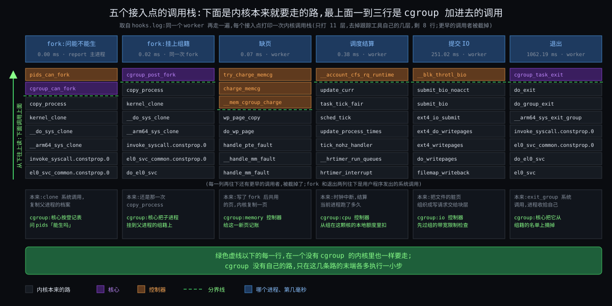

### §2.3 核心的四项功能,和控制器的三个问题

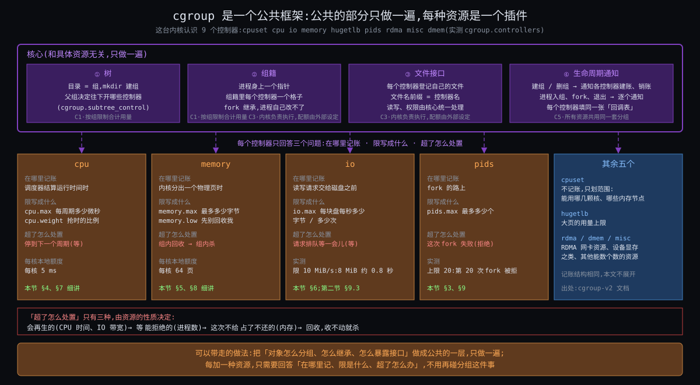

第二节 §5 里,你的第一版是「一种资源写一个限制器」,写到第二个就发现分组、继承、接口、权限要重做一遍,写到第四个,四套分组互相对不上。于是你把和资源无关的那部分抽出来,只做一遍。抽出来的就是**核心**,它不处理任何一种具体资源,只做四件事:

| 核心提供的 | 是什么 | 本节在哪见 |
|---|---|---|
| 树 | 目录就是组;父组决定往下开哪些控制器(`cgroup.subtree_control`) | §2.4、§10.1 |
| 组籍 | 进程身上的指针;一张组籍里每个控制器一个格子;fork 继承 | §2.4、§3 |
| 文件接口 | 每个控制器登记自己的一组文件,文件名前缀就是控制器名;读写和权限由核心统一处理 | §2.1、§2.4 |
| 生命周期通知 | 建组、删组、进程入组、fork、退出时,核心挨个通知控制器 | §2.5、§3、§10.3 |

为什么切在这里:因为 `C1·按组限制合计用量` 和 `C3·内核负责执行,配额由外部设定` 对任何资源都一样,而 `C2·记实际用量,超限处理看资源类型` 说的两件事(记在哪、超了怎么办)每种资源都不同,`C5·所有资源共用同一套分组` 又说种类还会增加 → 要解决「分组只做一遍,新增一种资源不用重做」→ 所以切成两层:核心管所有资源都一样的部分;**控制器**只管自己那种资源的三个问题:

1. **在哪里记账**:把记账的那一步加在这种资源被消耗的那条路上(接入点)。
2. **限写成什么**:暴露哪几个文件,数字是什么含义。
3. **超了怎么处置**:等、拒绝,还是回收和杀。

回头看 §0:组籍属于核心;账和限属于控制器;接入点是两者碰头的地方。

### §2.4 实跑:开启一个控制器,内核里发生了什么

建一个组 host01 和它的子组 demo,先不往下开任何控制器,在 demo 里放一个每半秒 fork 一次的小进程 ticker;然后在 host01 上一个个往下开控制器,看三样东西怎么变:demo 目录里的文件、内核里的建账动作、ticker 的组籍。

```
# cat /sys/fs/cgroup/cgroup.controllers
cpuset cpu io memory hugetlb pids rdma misc dmem
# cat /sys/fs/cgroup/cgroup.subtree_control
cpuset cpu io memory pids

# mkdir -p /sys/fs/cgroup/host01/demo
# ls /sys/fs/cgroup/host01/demo | cut -d. -f1 | sort | uniq -c | xargs
13 cgroup 3 cpu 1 io 1 memory
# bpftrace t5-framework.bt > t5.out 2>&1 &
# ./ingroup demo python3 ticker.py &

# echo '+pids' > /sys/fs/cgroup/host01/cgroup.subtree_control
# ls /sys/fs/cgroup/host01/demo | cut -d. -f1 | sort | uniq -c | xargs
13 cgroup 3 cpu 1 io 1 memory 5 pids

# echo '+cpu +memory +io' > /sys/fs/cgroup/host01/cgroup.subtree_control
# ls /sys/fs/cgroup/host01/demo | cut -d. -f1 | sort | uniq -c | xargs
13 cgroup 10 cpu 5 io 21 memory 5 pids
# ./ingroup demo sleep 30 &

# grep -v -e Attached -e '^$' t5.out
入组  框架询问 pids 控制器:pid 8993 能搬进来吗
入组  框架通知 cpuset 控制器:pid 8993 搬进来了
入组  框架通知 cpu 控制器:pid 8993 搬进来了
入组  框架通知 memory 控制器:pid 8993 搬进来了
组籍  ticker(pid 8993)现在的组籍 0xffff0000cb982c00,五个格子:cpuset → host01   cpu → host01   io → host01   memory → host01   pids → host01
建账  框架请 pids 控制器给 host01 的一个子组建账
组籍  ticker(pid 8993)现在的组籍 0xffff0000cb39b800,五个格子:cpuset → host01   cpu → host01   io → host01   memory → host01   pids → demo
建账  框架请 cpu 控制器给 host01 的一个子组建账
建账  框架请 io 控制器给 host01 的一个子组建账
建账  框架请 memory 控制器给 host01 的一个子组建账
组籍  ticker(pid 8993)现在的组籍 0xffff0000c40f8000,五个格子:cpuset → host01   cpu → demo   io → demo   memory → demo   pids → demo
入组  框架询问 pids 控制器:pid 9042 能搬进来吗
入组  框架通知 cpuset 控制器:pid 9042 搬进来了
入组  框架通知 cpu 控制器:pid 9042 搬进来了
入组  框架通知 memory 控制器:pid 9042 搬进来了
```

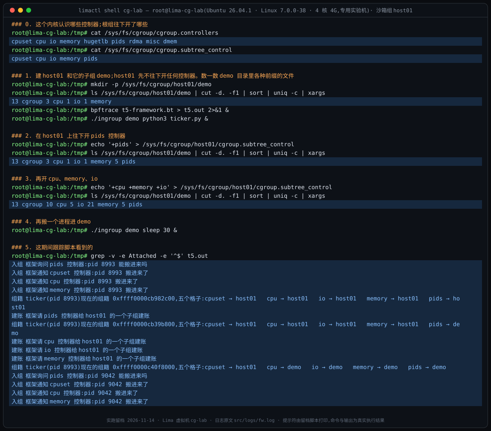

(跟踪输出里的「框架」就是核心,当时脚本里是这么叫的。)

**读数。**

- **这台内核认识 9 个控制器。** 第一行就是清单。根组往下开了其中 5 个。
- **开一个控制器,目录里就多出它的那组文件。** 开 pids,多了 5 个 `pids.*`;再开 cpu、memory、io,`cpu.*` 从 3 个变 10 个,`io.*` 从 1 个变 5 个,`memory.*` 从 1 个变 21 个。(没开时也有的那几个,是每个组都带的统计和压力文件。)13 个 `cgroup.*` 文件始终不变,它们属于核心。
- **开一个控制器,核心就通知它给子组建一本账。** 「建账」那四行,每个控制器被调用的是同一类函数,名字都是 `<控制器>_css_alloc`:`pids_css_alloc`、`cpu_cgroup_css_alloc`、`blkcg_css_alloc`(io)、`mem_cgroup_css_alloc`。四个控制器互不相干,核心按同一种方式挨个调用。
- **组籍是「每个控制器一个格子」。** 一开始五个格子都指向 host01:demo 自己没有任何一本账,它的进程花的资源都记在父组 host01 的账上。开了 pids,pids 那一格改指 demo,其余不动,而且**组籍换了一张**(地址从 `…cb982c00` 变成 `…cb39b800`):格子里的内容变了,就是另一张组籍。全开之后,cpu、io、memory、pids 四格指向 demo,cpuset 没开,仍指向 host01。前后一共三张组籍,三个地址。
- **入组时,核心挨个通知。** 把一个进程搬进 demo,pids、cpuset、cpu、memory 四个控制器各被调用一次,pids 那一次是「询问」:它可以拒绝(组满了就不让进)。

从这几条能直接读出 cgroup 的第一条设计原则:**公共框架加资源插件**。核心不知道 `cpu.max` 是什么意思,只知道 cpu 控制器登记过这么一个文件;它不知道一个组的 CPU 账长什么样,只知道「开了 cpu 就通知 cpu 控制器来建账」。第二节 §5 里推出的那个分层,在这里有了实物。

还有一条容易漏看:组籍上五个格子指向的,都是**同一棵树**上的节点,区别只在深度(demo 或 host01)。第二节 §12 说过,v2 只留一棵树之后的折中是「同一棵树上,不同资源可以分到不同的深度」,这就是它在内核里的样子:一个组没开某个控制器,那种资源的格子就指向最近的、开了这个控制器的祖先。v1 当年允许每个控制器各挂一棵树,v2 把这个自由取消了,**用统一的方式管理所有资源**这条原则,在组籍上的体现就是「五个格子,一棵树」。

### §2.5 登记表:控制器交给核心的一张表

上面的「建账」和「入组」,核心是怎么知道该通知谁、调用它的哪个函数的?

因为 `C5·所有资源共用同一套分组`(控制器会一个个加进来,新加一个不能要求核心改代码)→ 要解决「建组、入组、fork、退出这些时刻,核心怎么知道该通知谁、让它做什么」→ 所以引入**登记表**(内核里叫 `struct cgroup_subsys`,是控制器交给 cgroup 核心的那张回调函数表):每个控制器向核心交一张固定格式的回调表。表上有一排固定的格子(建账、账上线、销账、能不能搬进来、搬进来了、能不能生、生了、退出了、最后释放……),控制器在关心的格子里填上自己的函数,不关心的空着。到了约定的时刻,核心按表挨个调用。

这张表在内核里摸不到,但填进去的函数有名字,而且命名很规矩:`<控制器前缀>_<格子名>`。从内核的函数清单里按名字筛一遍,就能看到每个控制器填了哪些格子:

```
# grep -oE '^(pids|cpu_cgroup|mem_cgroup|blkcg|cpuset)_(css_alloc|css_online|css_free|can_attach|attach|can_fork|fork|exit|release)\b' /sys/kernel/tracing/available_filter_functions | sort | column -c 132 | expand
blkcg_css_alloc         cpu_cgroup_css_alloc    cpuset_css_alloc        mem_cgroup_css_free     pids_css_alloc
blkcg_css_free          cpu_cgroup_css_free     cpuset_css_free         mem_cgroup_css_online   pids_css_free
blkcg_css_online        cpu_cgroup_css_online   cpuset_css_online       mem_cgroup_exit         pids_release
blkcg_exit              cpuset_attach           cpuset_fork             mem_cgroup_fork
cpu_cgroup_attach       cpuset_can_attach       mem_cgroup_attach       pids_can_attach
cpu_cgroup_can_attach   cpuset_can_fork         mem_cgroup_css_alloc    pids_can_fork
```

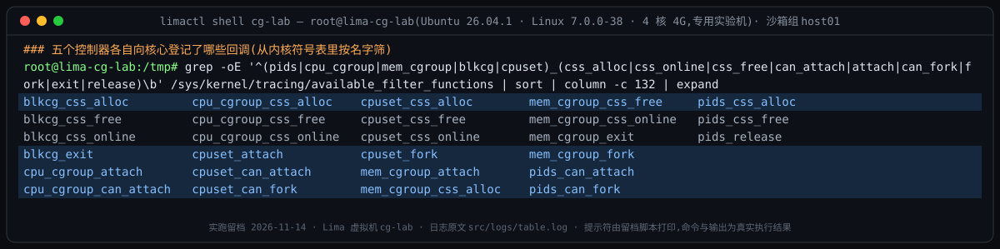

命令拆开看:`/sys/kernel/tracing/available_filter_functions` 是跟踪工具能挂钩的内核函数清单;`grep` 按名字筛,前缀五种(`pids`、`cpu_cgroup` 是 cpu、`mem_cgroup` 是 memory、`blkcg` 是 io,io 控制器在内核里沿用了老名字 block cgroup、`cpuset`),后缀九种;`sort | column` 只是排版,按列从上往下读。

按控制器重新排一遍:

| 格子 | 意思 | pids | cpu | memory | io | cpuset |
|---|---|---|---|---|---|---|
| `css_alloc` | 给新组建账 | ✓ | ✓ | ✓ | ✓ | ✓ |
| `css_online` | 账上线 | | ✓ | ✓ | ✓ | ✓ |
| `css_free` | 销账 | ✓ | ✓ | ✓ | ✓ | ✓ |
| `can_attach` | 进程能搬进来吗 | ✓ | ✓ | | | ✓ |
| `attach` | 进程搬进来了 | | ✓ | ✓ | | ✓ |
| `can_fork` | 能生吗 | ✓ | | | | ✓ |
| `fork` | 生了 | | | ✓ | | ✓ |
| `exit` | 退出了 | | | ✓ | ✓ | |
| `release` | 最后释放 | ✓ | | | | |
| 合计 | | 5 | 5 | 6 | 4 | 7 |

**读数。**

- 五个控制器都填了建账和销账两格。这是「入场」的最低要求。
- pids 填了「能生吗」:§3 会看到,它就是靠这一格在 fork 的路上数进程、满了拒绝。它还填了「最后释放」,§10.3 看到进程数在那一刻减一。
- cpu 一个和 fork、退出有关的格子都没填。CPU 的账不在 fork 时记,在调度器结算时记(§4),那一步由 cpu 控制器自己负责。io 只填了四格,它的账在写请求交给块层时记(§6),也是自己负责。
- 各控制器填的格子不一样多,核心不在乎,它只管在约定的时刻按表调用。
- 表上的格子全是「建组、入组、fork、退出」这类和资源无关的时刻,**没有一格叫「记 CPU 账」或「分一个页」**。核心不处理具体资源,在这张表上看得最清楚:记账的那一步根本不在登记表上,它在内核各条路的接入点里(§3 ~ §6)。所以控制器和内核打交道有两条线:生命周期那条线经过核心,按登记表调用;消耗资源那条线不经过核心,控制器直接在内核各条路径上记账。

两处照实交代。第一,这张表是从符号表里按名字筛出来的,它说明内核里有这些名字的函数,而且和 fw.log 里被调用的函数对得上;但「这些函数都填在登记表上」「表上一共有哪些格子」(这次只按九种名字筛)没有逐个核对,记入待核 #14。第二,fw.log 入组时只看到四个控制器被叫,是因为当时只给这四个函数挂了探针;表里 io 确实没有 `attach` 这一格,两边不矛盾,但 fw.log 本身证明不了 io 没被叫。

### §2.6 再逼问:核心为什么不处理具体资源

如果核心处理具体资源,会出什么问题?核心里就得写着「如果是 CPU 就这样,如果是内存就那样」。加第十种资源要改核心;九种资源的特殊情况全挤在公共代码里,改一处可能碰坏另外八种。`C5·所有资源共用同一套分组` 要的「新增一种不能惊动已有的」就做不到。

| 没有它会坏在哪 | 它解决了 |
|---|---|
| 每种资源自己做一套分组、继承、接口,第二节 §5 那四套分组对不上 | 核心只做一遍,控制器只回答三个问题 |
| 核心里写死每种资源,加一种就要改核心 | 控制器交一张登记表,核心按表调用;实测这台内核接了 9 个控制器 |
| 每个控制器自己定接口格式,管理程序要学 9 种写法 | 文件接口统一,前缀就是控制器名 |
| 数字写死在内核里,或者由内核去猜 | 数字由外面写进文件,内核只兑现(`C3·内核负责执行,配额由外部设定`) |

台搭好了,账也建了。worker 该出生了:一个新进程,是怎么带上这张组籍的?

## §3 接入点一 fork:组籍是怎么带上的

**结论:fork 这条路内核本来就要走:复制父进程的档案,造出一个新进程。cgroup 在复制的过程中加了两次调用:复制之前,核心按登记表问一圈「能生吗」,pids 控制器在这里把进程数加一,满了就拒绝;复制之后,核心把子进程挂到父进程那张组籍上。子进程不需要「加入」组,它一出生就在组里。同一个接入点上,核心管组籍,控制器管账,两者的分工在这里第一次看清。**

### §3.1 如果是你:新进程怎么带上组籍

你已经有了组籍。现在 report 要 fork 一个 worker,worker 得属于 report 组。你会把这件事放在哪?

让 report 生完孩子以后自己去登记「刚生的那个也是我们组的」,不行:`C3·内核负责执行,配额由外部设定` 说归属不能由进程自己说了算,它可能忘了,也可能故意不报。开一个后台线程定期扫描新进程、按父进程补登记,也不行:扫描有间隔,间隔里新进程已经在花资源了,而且这是另修一条路(`C4·在内核已有代码路径上记账,开销要小`)。

剩下的办法是:fork 这条路内核反正要走,就在这条路上把组籍带过去。

**内核原本在这条路上做什么。** 程序调用 fork(在 Linux 上发的是 clone 系统调用),内核进入 `kernel_clone`,再进入 `copy_process`:给子进程建一份新档案,把父进程的内存映射、打开的文件、信号处理方式等一样样复制或共享过去。这条路在不带 cgroup 的内核里也一模一样。

### §3.2 概念:进程、组籍、入组的两条路

每个进程在内核里有一份档案。档案里有一个指针,指向一张组籍。组籍上的内容很少,主要是一排指针:CPU 的账在哪、内存的账在哪、进程数的账在哪……每个控制器一个格子(§2.4 亲眼看到过五个格子)。

入组分两种情况:

- **写 `cgroup.procs`**(把一个已有的进程搬进组):内核给它换一张组籍。只换它自己的,它已经生出来的子进程不动(第一节 §4.4 实测过)。
- **fork**:子进程直接用父进程那一张。

所以开场那个两行的小脚本 `ingroup` 才要「先入组、后变身」:先把自己写进 `cgroup.procs`,换上 report 的组籍,再变身成要跑的程序。此后它 fork 出来的每一个 worker 都带着同一张组籍。

### §3.3 调用栈:cgroup 在 `copy_process` 的中途加了两次调用

同一个 worker 再走一遍,这次每到一个接入点,跟踪脚本把当时的内核调用栈也打印出来(同一个脚本 `t7-life.bt`,参数换成 1)。先看 fork 的两段:

```
# bpftrace t7-life.bt 1 > hooks.out 2>&1 &
# ./ingroup report python3 life.py
# grep -v -e Attached -e bpf_ -e '^$' hooks.out | sed -E 's/^\t[0-9a-f]+ ([^+]+)\+[0-9]+$/             \1/'
  0.00 ms  [fork]      pids 控制器被问「能生吗」→ 放行,report 组的进程数 +1
             pids_can_fork
             cgroup_can_fork
             copy_process
             kernel_clone
             __do_sys_clone
             __arm64_sys_clone
             invoke_syscall.constprop.0
             el0_svc_common.constprop.0
  0.02 ms  [fork]      核心:子进程 9578 抄走父进程的组籍 0xffff0000c40f8400,挂上名单
             cgroup_post_fork
             copy_process
             kernel_clone
             __do_sys_clone
             __arm64_sys_clone
             invoke_syscall.constprop.0
             el0_svc_common.constprop.0
             do_el0_svc
```

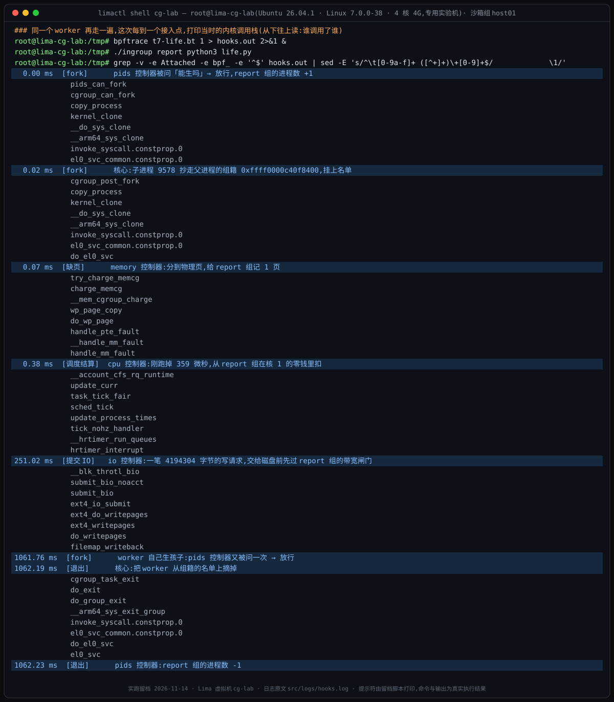

(第三条命令里的 `grep` 去掉跟踪工具自己那几层,`sed` 去掉每行前面的地址和后面的偏移,只留函数名。)

**第一个栈,从下往上读:**

- `el0_svc_common.constprop.0`、`invoke_syscall.constprop.0`:用户程序发起系统调用之后,arm64 处理器进入内核的入口。名字后面的 `.constprop.0` 是编译器优化时加的后缀,不用管。
- `__arm64_sys_clone`、`__do_sys_clone`:clone 系统调用在内核里的入口。python 的 `os.fork()` 最后发的就是它。
- `kernel_clone`:内核里「造一个新进程」的通用入口。
- `copy_process`:真正干活的地方,复制父进程的档案。**到这一行为止,全是内核本来就要走的路。**
- `cgroup_can_fork`:核心加的调用。`copy_process` 复制到一半时调用它,核心按登记表把填了「能生吗」那一格的控制器挨个问一遍。
- `pids_can_fork`:pids 控制器的回答。它在这里给 report 组的进程数加一,超了就拒绝(§3.5)。

**第二个栈**是同一次 fork,0.02 ms 之后。下面七行还是 `copy_process` 和它的调用者;最下面多露出一行 `do_el0_svc`,是因为这个栈顶上少了一层,同样只打 11 层,底下就多露出一层。最上面一行:

- `cgroup_post_fork`:复制基本完成后,核心把子进程挂到父进程的组籍上,加进组籍的名单。日志那一行里的 `0xffff0000c40f8400` 就是这张组籍的地址。

这两次调用都在 `copy_process` 里面。**cgroup 没有给 fork 另修一条路,它只是在 fork 这条路上加了两个调用。** 这是第二节 §6 说的「复用内核已有路径记账」第一次在实测里出现。

先问、后挂的顺序在时间上看得出来:0.00 ms 问 pids,0.02 ms 挂组籍。为什么这么排,一个说得通的理由是:要拒绝,就得在子进程露面之前拒绝;挂组籍则要等子进程差不多造好了才有意义。这是我对顺序的理解,跟踪只看到了先后。

### §3.4 实跑:抓 fork 的那一刻

上面那一遍只打印第一次 fork。再换一个专门的跟踪脚本(`src/prog/t0-fork.bt`),让 report 入组后连续 fork 三个 worker,看组籍上发生了什么。脚本只有两个探针:一个在「进程被搬进组」时打印,一个在 `cgroup_post_fork` 结束时打印父子两个进程的组籍地址。

```
# bpftrace t0-fork.bt > t0.out 2>&1 &
# ./ingroup report python3 report.py 3 0.2 &
# grep -v -e Attached -e '^$' t0.out
入组  pid 7405(ingroup)被搬进 /host01/report
fork  父 7405(report)的组籍 0xffff0000c40f8400   子 7407 的组籍 0xffff0000c40f8400   这张组籍上现在有 2 个进程
      这张组籍里写着:CPU 的账 → 0xffff0000c0dae100(组 report)   内存的账 → 0xffff0000c5794a40(组 report)
fork  父 7405(report)的组籍 0xffff0000c40f8400   子 7408 的组籍 0xffff0000c40f8400   这张组籍上现在有 3 个进程
fork  父 7405(report)的组籍 0xffff0000c40f8400   子 7409 的组籍 0xffff0000c40f8400   这张组籍上现在有 4 个进程

# for p in $(pgrep -x 'report|report-w'); do echo "$p $(cat /proc/$p/cgroup)"; done
7405 0::/host01/report
7407 0::/host01/report
7408 0::/host01/report
7409 0::/host01/report
```

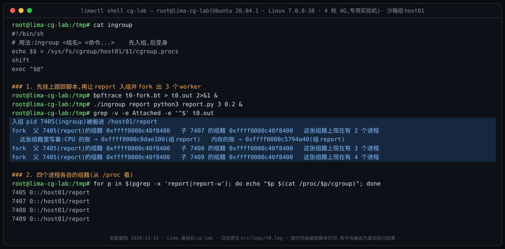

**读数。**

- 第一行:pid 7405 入组时名字还叫 `ingroup`,入组之后才 exec 成 python,再改名叫 report。先入组,后变身。
- 三次 fork,父子的组籍是同一个地址 `0x…c40f8400`。子进程没有得到一张新的组籍,只是多了一个指向旧组籍的指针。
- 组籍上的进程数 2 → 3 → 4:内核在这张组籍上记着「有哪些进程指着我」。第二节 §9.5 的 `cgroup.kill` 能一个不漏,靠的就是这份名单。
- 第三行是组籍的内容:CPU 的账和内存的账是两个不同的地址,但都属于组 report。一张组籍,几个控制器的格子,同一个组。
- `/proc/<pid>/cgroup` 里那一行 `0::/host01/report`,是内核顺着「进程 → 组籍 → 组」现查出来的,不是存在进程身上的一个字符串。它只有一行:v2 只有一棵树,`0::` 就是这棵唯一的树。第二节 §8.1 的实跑里,挂了两棵 v1 树的 shell 这个文件有三行。只有一行,也体现了「用统一的方式管理所有资源」。

§1 那一遍的两行(0.00 ms 问 pids,0.03 ms 子进程 9356 抄走组籍 `0xffff0000c5b97400`)是同一件事,只是另一次运行,地址和进程号不同。

### §3.5 同一个接入点上,pids 控制器被问「能生吗」

fork 这个接入点上,核心抄组籍,控制器记账。记的是哪本账?进程数。pids 是最简单的控制器,正好拿来看控制器在接入点上干活的样子。report 组最多 20 个进程,在组里连续 fork 100 个,跟踪脚本(`src/prog/t6-pids.bt`)盯着 `pids_can_fork`:

```
# echo 20 > /sys/fs/cgroup/host01/report/pids.max
# bpftrace t6-pids.bt > t6.out 2>&1 &
# ./ingroup report python3 forkn.py 100
第 20 次 fork 失败:[Errno 11] Resource temporarily unavailable
想要 100 个子进程,成功 fork 出 19 个
# grep -v -e Attached -e '^$' t6.out
放行  pid 9104 要 fork:report 组的进程数账 → 2(上限 20)   父组 host01 的账 → 2
放行  pid 9104 要 fork:report 组的进程数账 → 3(上限 20)   父组 host01 的账 → 3
放行  pid 9104 要 fork:report 组的进程数账 → 4(上限 20)   父组 host01 的账 → 4
拒绝  pid 9104 要 fork:report 组的进程数账 20,上限 20,再加 1 就超 → fork 失败(返回 -11)
pids 控制器一共被问了 20 次
# grep -H . /sys/fs/cgroup/host01/report/pids.peak /sys/fs/cgroup/host01/report/pids.events
/sys/fs/cgroup/host01/report/pids.peak:20
/sys/fs/cgroup/host01/report/pids.events:max 1
```

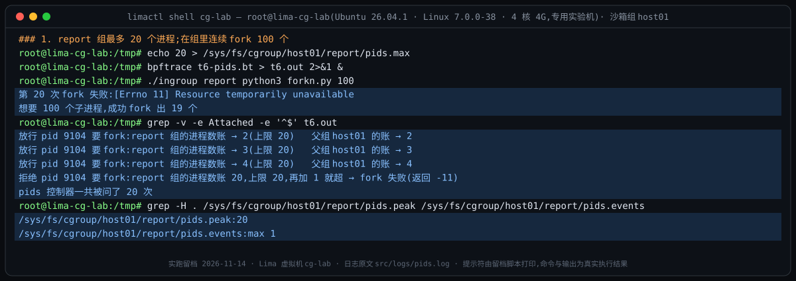

**读数。**

- 每次 fork,pids 控制器都被问一次,一共 20 次:19 次放行,1 次拒绝。
- 账是这样变的:主进程自己算 1 个,第一个孩子 fork 时账变成 2,第二个 3,第三个 4……(只打印了前三次放行)。到第 20 次,账上已经是 20,再加 1 就超过上限 20,拒绝。所以成功 19 个。
- **report 和父组 host01 两本账一起涨。** 子组记一笔,父组也记一笔,父组的上限管整棵子树的合计,这是 `C1·按组限制合计用量` 里「层层转包」那个要点的落点(§10.1 再看树)。
- 拒绝的方式是让这次 fork 返回 -11,也就是 `EAGAIN`,python 报 `Resource temporarily unavailable`。谁也不用死。
- `pids.peak` 是 20(到过的最高值),`pids.events` 的 `max 1` 是「撞线被拒」发生过 1 次。

问「能生吗」的那一刻,账就记上了(加一),限也就比过了(20 + 1 > 20)。**记账和检查限额是同一个动作**,第一次在这里出现;§7、§8 会看到 CPU 和内存也是这样。

为什么进程数能拒绝,而内存只能回收或杀,留到 §9.1 和其他资源一起对照。

### §3.6 再逼问:为什么中间要隔一张组籍

为什么不让进程直接指向组?

- **因为一个进程要找的不是「组」,是「账」。** 调度器只关心 CPU 的账在哪,内存分配只关心内存的账在哪。组籍把这几个答案提前摆好,记账时一步就能拿到,不用先找组、再在组里找账。记账每秒发生几十万次,这一步省得值(`C4·在内核已有代码路径上记账,开销要小`)。
- **因为同组的进程答案完全一样。** 400 个 worker 共用一张组籍,fork 时什么都不用新建(`C1·按组限制合计用量`)。
- **因为归属要内核说了算。** 进程能改的只有自己内存里的东西;这个指针在内核的档案上,只有写 `cgroup.procs`(受文件权限管)和 fork(只能继承)两条路能改它(`C3·内核负责执行,配额由外部设定`)。
- **因为一张组籍要管所有资源。** 每个控制器一个格子,几种资源的账从同一张卡片出发,指向同一棵树上的节点,谁和谁一组只有一个答案(`C5·所有资源共用同一套分组`)。

| 没有它会坏在哪 | 它解决了 |
|---|---|
| 每次记账都要从进程出发重新查「它属于哪个组、那个组的账在哪」 | 一步拿到账 |
| fork 时要为子进程登记归属,多一次分配 | fork 只多一个指针 |
| 归属如果存在进程能改的地方,就等于没有边界 | 指针在内核档案上,进程碰不到 |
| 每种资源各存一份归属,彼此可能对不上 | 一张组籍,每个控制器一个格子 |

worker 生出来了,开始烧 CPU。它每跑 1 毫秒,report 组的账上怎么就多了 1 毫秒?这一次核心不参与,谁来记?

## §4 接入点二 调度器结算:CPU 的账

**结论:调度器本来就要不停地结算「当前进程刚才跑了多久」,这是它排队要用的。cpu 控制器在结算之后多执行一步:把这段时间也从这个组在这颗核上的本地额度里扣掉;本地额度扣完了,才去全组共享的总额度里领下一份,一份 5 ms。实测 2 秒记了 1660 笔账,只有 181 笔动了总额度。没给 `cpu.max` 设限的组,这一步直接跳过:1 秒 0 次。**

### §4.1 内核原本在这条路上做什么

调度器要决定下一个让谁上 CPU,依据之一是每个进程已经跑了多久。所以它要不停地结算当前进程的运行时间:时钟中断来的时候(这台机器每 1 ms 一次,`CONFIG_HZ=1000`)、进程被换下去的时候,都要结算一次。这件事和 cgroup 无关,不分组的内核也要做。

如果是你,CPU 的账记在哪?另起一个定时器、每隔一会儿去看每个进程跑了多少再加到组上,那是另修一条路,还得定期扫一遍所有进程(`C4·在内核已有代码路径上记账,开销要小`)。调度器结算这一步本来就在,而且结算的那一刻正好知道三件事:谁、在哪颗核上、刚跑了多久。账就记在它后面。

### §4.2 调用栈:时钟中断一路调到 cpu 控制器

还是 §3.3 那一遍(hooks.log),调度结算这一段:

```
  0.38 ms  [调度结算]  cpu 控制器:刚跑掉 359 微秒,从 report 组在核 1 的零钱里扣
             __account_cfs_rq_runtime
             update_curr
             task_tick_fair
             sched_tick
             update_process_times
             tick_nohz_handler
             __hrtimer_run_queues
             hrtimer_interrupt
```

**从下往上读:**

- `hrtimer_interrupt`:时钟中断到了。
- `__hrtimer_run_queues`:处理到期的定时器。
- `tick_nohz_handler`:其中一个定时器是「节拍」,每 1 ms 一次的周期性工作从这里开始。(nohz 指 CPU 空闲时可以停掉节拍,这里不用管。)
- `update_process_times`:更新这颗核上当前进程的时间统计。
- `sched_tick`:调度器的节拍处理。
- `task_tick_fair`:当前进程属于普通进程这一类,交给这一类的节拍处理。
- `update_curr`:结算当前进程刚才跑了多久。**到这一行为止,是调度器本来就要做的。**
- `__account_cfs_rq_runtime`:cpu 控制器加的调用。把刚结算出来的那段时间,从这个组在这颗核上的本地额度里扣掉。

只有最上面一行是 cgroup 的。这一次核心没有参与:调度器手里本来就有当前进程,cpu 控制器顺着它找到组的账。cpu 控制器怎么从进程找到组,和组籍有关:进程入组时 cpu 控制器被通知过(§2.4 fw.log 里「框架通知 cpu 控制器」那一行,登记表上它填了「搬进来了」那一格),fork 时子进程跟着父进程走。它被通知之后在调度器里具体改了什么,这一节没有跟,记入待核 #18。

对一下时间。life.log 那一遍,worker 在 0.03 ms 出生,0.70 ms 第一次结算,刚跑掉 663 μs:0.70 − 0.03 = 0.67 ms,差不多就是它出生以来跑的全部时间。hooks.log 那一遍是 0.02 ms 出生,0.38 ms 结算 359 μs,0.38 − 0.02 = 0.36 ms,也对得上。hooks.log 的栈说明,这一次结算是时钟中断触发的。

### §4.3 概念:一个总额度,四份本地额度

report 的 CPU 账由两层组成(图在 §7.1):

- **全组总额度**:全组只有一个。周期定时器每 100 ms 把它补到 50 ms(就是 `cpu.max` 里的两个数)。它被 4 颗核共用,改它要加锁。
- **每颗核一份本地额度**:report 组在核 0、核 1、核 2、核 3 上各有一份。worker 在哪颗核上跑,就花哪颗核上的这一份。这一份只有本核会改,不用锁。

调度器每结算一次,cpu 控制器就从本核的本地额度里扣掉同样多。本地额度扣到零以下,就去总额度领一份。领的时候要加锁,但这种事不常发生。

### §4.4 实跑:数一数记了多少笔

report 组限半颗核,8 个 worker。跟踪脚本(`src/prog/t1-cpuacct.bt`)统计 2 秒。

```
# echo '50000 100000' > /sys/fs/cgroup/host01/report/cpu.max
# ./ingroup report python3 report.py 8 &
# bpftrace t1-cpuacct.bt | grep .
2 秒内,report 组:
  记账 1660 次,合计记下 1000 ms 的 CPU 时间
  其中要去公共额度池领额度的 181 次
  周期定时器响了 20 次
  每次从公共池领到多少(微秒):
[0, 1000)              5 |@                                                   |
[1000, 2000)           3 |                                                    |
[2000, 3000)           6 |@                                                   |
[3000, 4000)           4 |@                                                   |
[4000, 5000)           1 |                                                    |
[5000, 6000)         157 |@@@@@@@@@@@@@@@@@@@@@@@@@@@@@@@@@@@@@@@@@@@@@@@@@@@@|
[6000, ...)            5 |@                                                   |
```

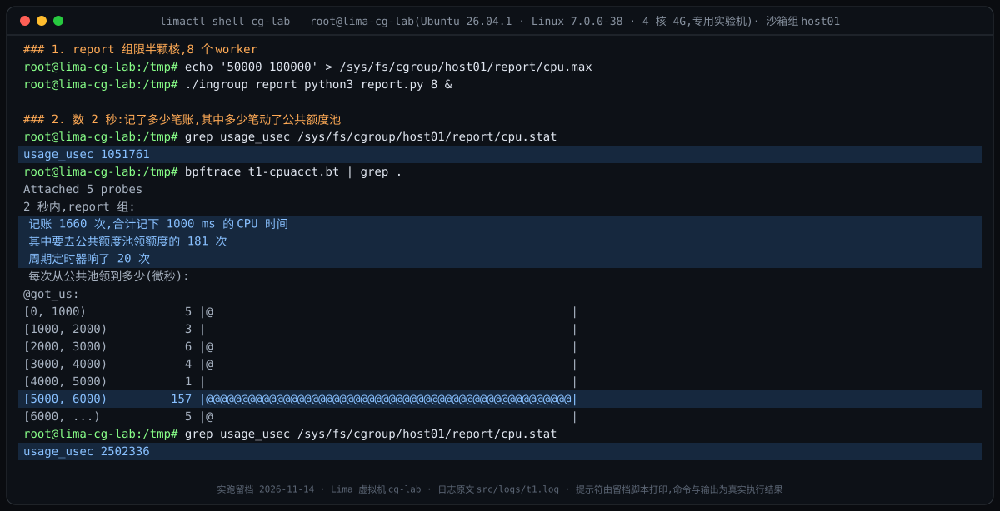

**算例。**

- 2 秒 × 半颗核 = 1000 ms。跟踪脚本把每一笔账的金额加起来,正好 1000 ms。组的 CPU 用量不是事后统计出来的,就是这一笔笔账的和。
- 周期定时器 2 秒响 20 次,每 100 ms 一次。
- 181 次领额度 ÷ 20 个周期 ≈ 每周期 9 次。每周期 50 ms、一份 5 ms,最多领 10 份,量级对得上。
- 181 次里有 157 次领到的是 5 ~ 6 ms。比 5 ms 多出来的部分,是补上一次透支的部分:本地额度可能被扣成负数(时钟中断 1 ms 才来一次,来的时候才发现花超了),下次领的时候先把欠的补上。不足 5 ms 的那十几次,是总额度里剩的不够一整份了,剩多少领多少。
- **1660 笔账里,只有 181 笔(11%)动了全组共享的总额度,其余 89% 只改了本核自己的本地额度。**

留档图里 `cpu.stat` 的 `usage_usec` 前后差 1 450 575 μs,比 1000 ms 多。这不矛盾:这两次读数夹着整条 bpftrace 命令,包括它启动和挂探针的那段时间(将近 1 秒),而脚本只统计挂好之后的 2 秒。

账是消耗的那一刻记上的,没有谁事后去加。这是第二节 §7.1 说的「记账时同步检查限额」的前一半(记账);后一半(检查限额)在 §7。

### §4.5 没人设限时,这一步不执行

记账加在调度器结算后面,而调度器每颗核每毫秒都在结算。机器上大多数组根本没写 `cpu.max`,难道它们也要每毫秒记一笔?`C4·在内核已有代码路径上记账,开销要小` 里说的「开销一大,机器上所有程序都会跟着变慢」,在这里是实际的问题。实测一下:db 和 report 两个组里各放一个死循环(`spin.py`,内容就是 `while True: pass`),跟踪脚本(`src/prog/t8-free.bt`)按组数 1 秒内 `__account_cfs_rq_runtime` 被调用了多少次。

```
### 1. 两个组里各有一个死循环,谁都没写 cpu.max
# cat /sys/fs/cgroup/host01/db/cpu.max /sys/fs/cgroup/host01/report/cpu.max
max 100000
max 100000
# ./ingroup db python3 spin.py &
# ./ingroup report python3 spin.py &
# bpftrace t8-free.bt | grep .
Attached 4 probes
1 秒内「给某个组记 CPU 账」一共发生 0 次,按组分:

### 2. 只给 report 写一个上限,db 不动
# echo '50000 100000' > /sys/fs/cgroup/host01/report/cpu.max
# bpftrace t8-free.bt | grep .
Attached 4 probes
1 秒内「给某个组记 CPU 账」一共发生 544 次,按组分:
@n[report]: 544
```

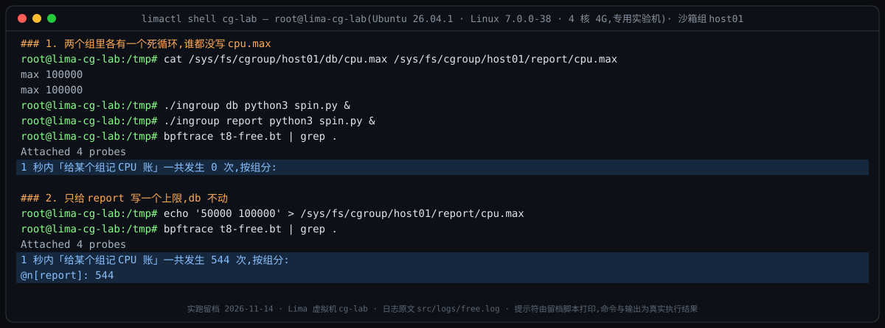

**读数。**

- `max 100000` 的意思是「不设上限,周期 100 000 μs」,这是新建组的默认值。
- 两个死循环都在跑,但「给组记 CPU 账」这一步,1 秒 0 次。
- 只给 report 写上 `cpu.max`,这一步才开始走:1 秒 544 次,全部记在 report 头上。db 还是一次没有:它没设限,就不用记额度账。
- 算例:report 限半颗核,1 秒里大约跑 500 ms;它跑着的时候,时钟中断每 1 ms 来一次,每次结算一笔,约 500 次;多出来的 44 次,应该是它被换下、换上时的结算。这个拆分是推算,没有单独数。

**这是「复用内核已有路径记账」的另一半:只有设了限的组才记账。** 不设限的组,调度器那条路照走,cgroup 那一步不执行。说「几乎」零成本,是因为「要不要走这一步」本身还得判断一下;这一下花多少,没有量。

照实交代三点。第一,内核靠什么做到「没人设限就不执行」,我印象中是两层开关:全机一层(整台机器有没有任何一个组设了 `cpu.max`),每个组在每颗核上一层(这个组设没设)。「只给 report 设限,db 仍是 0 次」和第二层吻合,但两层开关的说法是凭记忆写的,没有实测支撑,记入待核 #15。第二,这里数的只是「按额度记账」这一步;`cpu.stat` 里的用量统计走的是另一条路(§10.2),它在没人设限时花多少,这一节没量。第三,这个结论当时只在 CPU 这条路上量过,不能直接搬到别的接入点:内存的账本身就是 `memory.current` 那个数,只要组开了 memory 控制器,大概每一页都得记,开销小靠的是 §5 的每核本地额度。这在当时是推断,下面的补跑证实了它。

**补跑:三条路一起数,「路」和「车」分开数。** 上面第三点的推断后来补了一个实验验证(2026-11-15,会话 `cost`)。三条路各数两个数:这条路走了多少次(输出里叫「路」),其中 cgroup 的记账那一步执行了多少次(输出里叫「车」)。负载是 `load.sh`:db 组、report 组、根组里各有一个进程吃 40 MiB;db 组和 report 组各直接写 20 MiB 到盘;另外两个组里各有一个死循环。先在两个组都不设任何上限时数 4 秒,再只给 report 写上三个上限数 4 秒。

```
### 1. 两个组什么上限都没写
CPU   路(调度器结算)各组走了多少次:
@road_cpu[report]: 12133
@road_cpu[db]: 12164
CPU   车(给组记 CPU 账)一共 0 次:
内存  路(缺页)各组走了多少次(另有根组里的那个进程 1562 次):
@road_mem[report]: 1562
@road_mem[db]: 1562
内存  车(给组记内存账)一共 3159 次:
@ride_mem[db]: 1579
@ride_mem[report]: 1580
IO    路(提交读写请求)各组走了多少次:
@road_io[report]: 23
@road_io[db]: 23
IO    车(过组的带宽闸门)一共 0 次:

### 2. 只给 report 写上三个上限,db 还是什么都不写
CPU   路(调度器结算)各组走了多少次:
@road_cpu[report]: 6401
@road_cpu[db]: 13411
CPU   车(给组记 CPU 账)一共 2082 次:
@ride_cpu[report]: 2082
内存  路(缺页)各组走了多少次(另有根组里的那个进程 2073 次):
@road_mem[db]: 1562
@road_mem[report]: 2073
内存  车(给组记内存账)一共 3667 次:
@ride_mem[db]: 1579
@ride_mem[report]: 2088
IO    路(提交读写请求)各组走了多少次:
@road_io[report]: 23
@road_io[db]: 23
IO    车(过组的带宽闸门)一共 23 次:
@ride_io[report]: 23
```

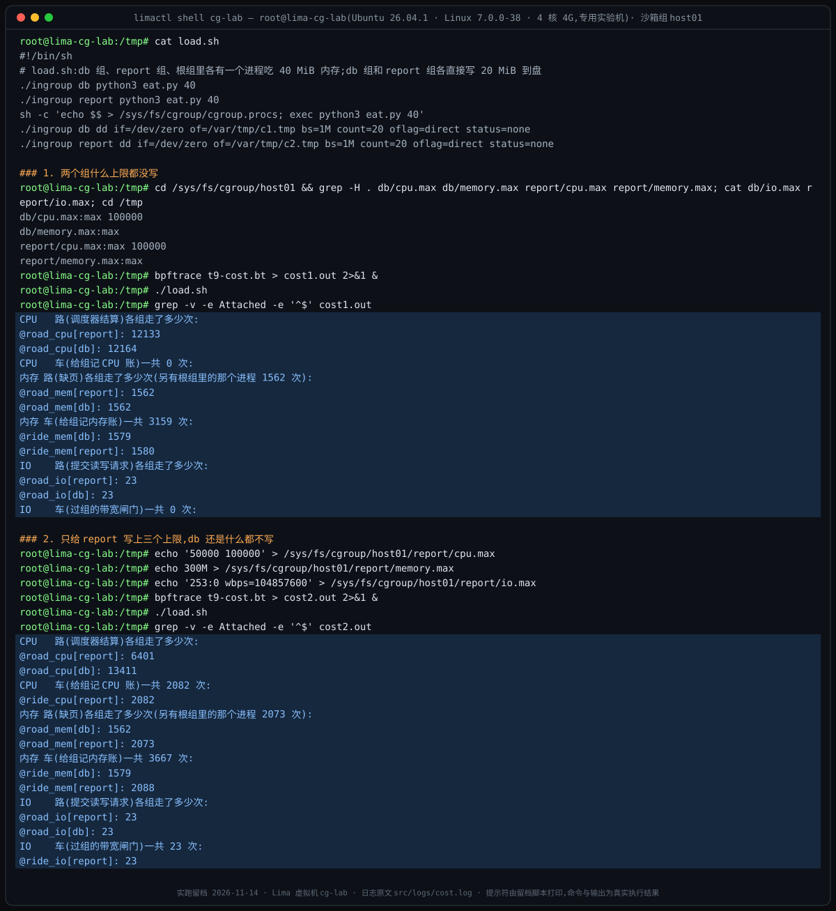

| 接入点 | 路照走吗 | 没人设限时 cgroup 记账吗 | 只给 report 设限后 | 根组里的进程 |
|---|---|---|---|---|
| CPU(调度器结算) | 照走:两个组各一万两千多次 | **不记:0 次** | 只有 report 记(2082 次),db 仍是 0 | 没测 |
| IO(提交读写请求) | 照走:各 23 次 | **不记:0 次** | 只有 report 记(23 次,和它走的路一样多),db 仍是 0 | 没测 |
| 内存(缺页) | 照走:各 1562 次 | **照记:db 1579 次,report 1580 次** | 没有变化:db 1579,report 2088 | 缺页 1562 次,记账 0 次 |

三件事:

- **「路照走,cgroup 不记账」在 CPU 和 IO 两条路上成立。** 没人设限时,调度器照样结算了两万四千多次,块层照样提交了 46 笔请求,cgroup 那一步一次没执行。
- **内存不是这样,上面的推断是对的。** `memory.max` 写不写,每次缺页都给组记账。原因不难想:CPU 和 IO 的这一步是检查限额(查额度),没有额度就没什么可查;内存的这一步是「记账」本身,`memory.current` 那个数任何时候都得是准的,否则哪天写上 `memory.max`,内核不知道这个组已经占了多少。所以内存的开销小不靠「不执行」,靠 §5 的每核本地额度。
- **对内存来说,「不用的人」指的是根组。** 根组里那个进程缺页 1562 次,记账 0 次(`@ride_mem` 里没有它)。一个进程的内存要不要记账,看的是它所在的组有没有开 memory 控制器,不是看写没写上限。

所以「不用的人几乎零成本」这句话要分开说:**CPU 和 IO,不设限就不记账;内存,只要进了一个开了 memory 控制器的组,就每页都记。**

两处照实交代。report 第二段缺页 2073 次、第一段 1562 次,根组那个进程两段也是 1562 和 2073,同样吃 40 MiB 次数却不同;这一段没有关透明大页,我猜是每次能拿到的大页数量不一样,没有验证。「记账」比「缺页」多十几到二十几次(1579 对 1562),按 §5.4 的经验应该是页表页,同样没有核对。

### §4.6 再逼问:为什么每颗核要先领一份本地额度

**如果没有本地额度,每一笔都直接从全组总额度里扣?**

4 颗核每毫秒都要去改同一个数,每次都要抢同一把锁。组里进程越多、核越多,抢得越凶。记账的开销会和干活的开销抢 CPU,这就违反了 `C4·在内核已有代码路径上记账,开销要小`:记账不能比干活还贵。

本地额度的做法是批量领取:一次从总额度里拿 5 ms,拿回来慢慢扣,扣的时候不影响其他核。

**代价是什么?** 不那么准了。总额度用完的时候,别的核手里可能还留着没用完的本地额度;反过来,本地额度也可能被扣成负数。所以第二节 §9.1 量到的每周期用量是 49 969 μs 而不是整 50 000,第二节 §10.2 里「按权重分到 40%」的那一幕也会有些周期碰到 50 ms 的线。

**为什么一份是 5 ms?** 因为份越大越省锁(`C4·在内核已有代码路径上记账,开销要小`),但份越大,分散在各核、暂时没人用的额度就越多,上限就越不准(`C1·按组限制合计用量` 要的是一个说到做到的绝对数)→ 要在两者之间取一个折中 → 所以引入「一份」这个量,默认 5 ms,是 100 ms 周期的二十分之一。这个数可以调(实验机上 `/proc/sys/kernel/sched_cfs_bandwidth_slice_us` 的值是 5000)。更精确的推导留给读源码那一步。

| 没有它会坏在哪 | 它解决了 |
|---|---|
| 每笔账都抢全组的锁,核越多越慢 | 89% 的记账只动本核的数 |
| 记账开销随进程数、核数上涨 | 去总额度领取的次数只和「额度 ÷ 5 ms」有关,每周期 10 次上下 |
| 没设限的组也每毫秒记一笔 | 没设限就不执行这一步(1 秒 0 次) |

同样的做法,能不能用到内存上?内存的「一笔」是什么,它在哪条路上记?

## §5 接入点三 缺页:内存的账

**结论:进程第一次碰一块新内存,或者 fork 之后第一次写一块和父进程共用的内存时,会缺页,内核要给它分一个物理页。memory 控制器在「页分到了」之后执行记账:给这个进程所在的组记 1 页。这 1 页也是先从本核的预付页数里扣;预付的用完了,才去改组的计数器,一次改 64 页,并且顺着树把父组、祖父组的计数器一起改掉。同时,这一页上会记下它属于哪个组。实测吃 100 MiB:缺页 25 610 次,真正改计数器只有 400 次。**

### §5.1 内核原本在这条路上做什么

程序 `malloc` 一块内存,或者 python 建一个大对象时,内核只是答应给它一段地址,并不马上给物理内存。等程序第一次往这段地址里写,处理器发现这个地址还没有对应的物理页,就停下来交给内核处理,这叫**缺页**。内核分一个物理页,填进页表,程序接着跑,毫无察觉。

还有一种缺页和 fork 有关。fork 之后,父子进程先共用同一批物理页,内核把它们都标成只读;谁先往其中一页写,就会缺页,内核给它复制一份自己的。这叫**写时复制**。

这些都是内核本来就要做的。`C2·记实际用量,超限处理看资源类型` 要记的正是「真的分出去的物理页」,不是「答应给的地址」(第二节 §3.1 的 `ulimit -v` 就是按后者限制的,所以不准),所以分页的那一刻就是记账的时机。

### §5.2 调用栈:worker 的第一页,是写时复制

hooks.log 里缺页这一段:

```
  0.07 ms  [缺页]      memory 控制器:分到物理页,给 report 组记 1 页
             try_charge_memcg
             charge_memcg
             __mem_cgroup_charge
             wp_page_copy
             do_wp_page
             handle_pte_fault
             __handle_mm_fault
             handle_mm_fault
```

**从下往上读:**

- `handle_mm_fault`、`__handle_mm_fault`:缺页处理的入口。再往下(被截掉的部分)是处理器报告缺页、陷入内核的那几层。
- `handle_pte_fault`:找到出问题的那一条页表项。
- `do_wp_page`:判断出这是「往一个写保护的页里写」。wp 是 write-protect 的缩写。
- `wp_page_copy`:给写的那一方复制一页新的。**到这一行为止,是内核本来就要做的写时复制。**
- `__mem_cgroup_charge`:memory 控制器加的调用:新页分到了,给它记账。
- `charge_memcg`、`try_charge_memcg`:记账往里走的两层,后者就是 §5.4 里数的「问给 report 组记账」。

这一次 cgroup 加的是最上面三行。

再对时间。life.log 那一遍,worker 的第一次内存记账在 0.11 ms,而它 0.03 ms 才出生,还没开始要那 20 MiB,比第一次 CPU 结算(0.70 ms)还早。hooks.log 的栈说明了这是什么:写时复制。worker 刚从 report 身上 fork 出来,一跑起来就写到了和父进程共用的某一页(多半是 python 解释器自己的数据,没有查是哪一页),内核给它复制一页,这一页记在 worker 所在的 report 组上。

### §5.3 概念:计数器、每核预付页数、页上的所属组记号

内存的账比 CPU 的简单,核心就是一个数:**这个组名下现在有多少页**。旁边写着上限(`memory.max`)。每个组的计数器还带一个指针,指向父组的计数器。

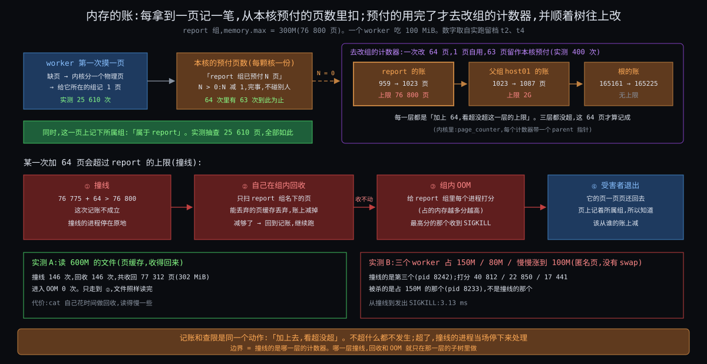

便宜的办法和 CPU 一样:

- 每颗核有一份预付记录,内容是「某个组已经预付了 N 页」。记 1 页时,如果本核有这个组的预付,N 减 1 就完事。
- 预付的用完了,才去改组的计数器:**一次加 64 页**,1 页自用,剩下 63 页留在本核作为预付。(为什么是 64,§5.5 再算。)

还有一件 CPU 没有的事:**这个物理页上要记下「我属于 report 组」。** 原因在 §5.5,用处在 §6。

### §5.4 实跑:吃 100 MiB,数一数

为了让页数好数,实验前关掉了透明大页(否则内核可能一次给 512 页,数字就不整齐了)。report 组内存上限 300M,一个 worker 吃 100 MiB。

```
# echo 300M > /sys/fs/cgroup/host01/report/memory.max
# bpftrace t2-memacct.bt > t2.out 2>&1 &
# ./ingroup report python3 hold.py report-w 100 &
report-w(pid 8124)已占住 100 MiB
# grep -v -e Attached -e '^$' t2.out
第 1 次改账(+64 页):report 959 → 1023 页   父组 host01 1023 → 1087 页   根 165161 → 165225 页
第 2 次改账(+64 页):report 1023 → 1087 页   父组 host01 1087 → 1151 页   根 165225 → 165289 页
第 3 次改账(+64 页):report 1087 → 1151 页   父组 host01 1151 → 1215 页   根 165289 → 165353 页
worker 第一次摸到新内存页(缺页)25610 次
问「给 report 组记账」 25660 次,共 25660 页
真正去改 report 组那本账 400 次,共 25600 页;每次改多少页:
[64, 96)             400 |@@@@@@@@@@@@@@@@@@@@@@@@@@@@@@@@@@@@@@@@@@@@@@@@@@@@|

# cat /sys/fs/cgroup/host01/report/memory.current /sys/fs/cgroup/host01/memory.current
108785664
109047808

# python3 pageowner.py $(pgrep -x report-w) /sys/fs/cgroup/host01/report
/sys/fs/cgroup/host01/report 的编号(inode)= 22007
  虚拟地址 0xedc99eb9b000 → 物理页号 1227989 → 所属组编号 22007
  虚拟地址 0xedc99eb9c000 → 物理页号 1227991 → 所属组编号 22007
  虚拟地址 0xedc99eb9d000 → 物理页号 1227992 → 所属组编号 22007
共查了 25610 个物理页:25610 页记在编号 22007 的组上
```

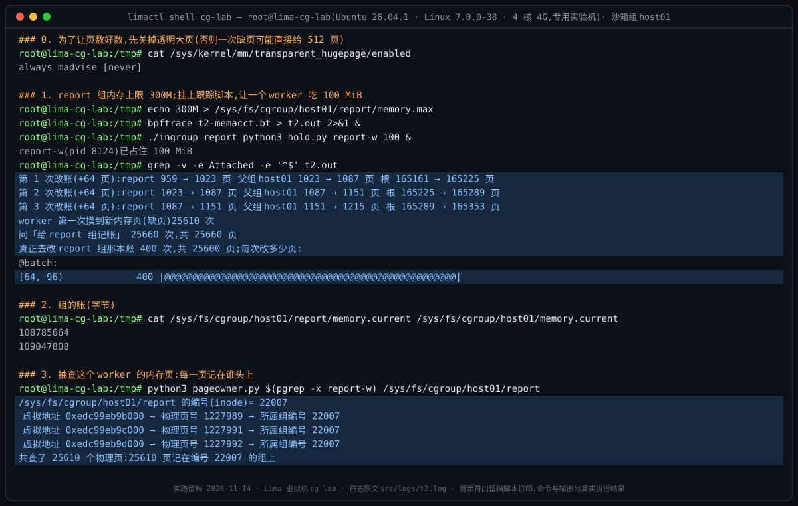

**算例。**

- 100 MiB ÷ 4 KiB = 25 600 页。缺页 25 610 次,多出来的 10 次是 python 自己的零碎内存。
- 问「给 report 组记账」25 660 次,比缺页多 50 次。25 600 页的内存需要 25 600 ÷ 512 = 50 个页表页(一个页表页管 512 页),数字正好对上。我判断这 50 次是页表页:内核替这个进程花的内存也记在组上。没有逐个核对。
- 真正改计数器 400 次,每次 64 页:400 × 64 = 25 600 页。**25 660 次记账里,只有 400 次(1.6%)动了组的计数器,其余 98.4% 只改了本核的预付记录。**
- 每次改账,三个数同时加 64:report、父组 host01、根。`C1·按组限制合计用量` 里「层层转包」那个要点,在这里是字面意思:子组记一笔,每一层祖先都记同样的一笔,每一层都拿自己的上限比一次。
- 账面对得上:report 的 `memory.current` 是 108 785 664 字节,÷ 4096 = 26 559 页,正好是第 1 次改账前的 959 页加上 400 次 × 64 = 25 600 页。父组 host01 是 109 047 808 字节 = 26 623 页,比 report 多 64 页,和第 1 次改账时两边差的 1023 − 959 = 64 页一致(这 64 页是 host01 名下别的东西,没查)。
- `pageowner.py` 用的是内核给的两个文件:`/proc/<pid>/pagemap`(虚拟页 → 物理页号)和 `/proc/kpagecgroup`(物理页号 → 所属组的编号)。抽查这个 worker 的 25 610 个物理页,每一页的所属组编号都是 22007,就是 report 目录的 inode 号。**账不光记在组上,每一页自己身上也记着它属于哪个组。**

### §5.5 再逼问:为什么页上要记所属组

**CPU 的账记完就完了,内存为什么还要在页上留所属组的记号?**

因为 CPU 时间花掉就没了,内存页要还。`C2·记实际用量,超限处理看资源类型` 说物理页占了不还就没有,它的另一面是:一页从分出去到还回来,中间隔着很久,而且还回来的时候,当初要这一页的进程可能早就不在了。

- **页缓存。** worker 读一个文件,文件内容留在页缓存里。worker 退出了,这些页还在,还占着物理内存。第二节说过「页缓存不在任何进程名下」(§3.1 的 ulimit、§4.1 的磁盘 IO),旧工具因此管不了它。现在它记在组名下:账不跟进程走,跟页走。
- **回收和释放。** 这一页被回收或释放时,要从某个组的计数器上减 1。减谁的?看页上记的所属组。
- **回写。** worker 写文件,脏页稍后才写到盘上,写盘的可能是内核线程。这笔磁盘 IO 该记给谁?从页上查到所属组是 report,IO 就记给 report。这正是 `C5·所有资源共用同一套分组` 要的:内存和 IO 对「谁是一组」给出同一个答案,而答案就记在页上。§6 细讲。

**为什么一次改 64 页?** 道理和 5 ms 一样:因为改计数器要顺着树一层层往上改(`C1·按组限制合计用量` 的层层转包),树有几层就要改几个数,所以要尽量少去(`C4·在内核已有代码路径上记账,开销要小`);但预付的页数是「账上已经记了、实际还没用」的页,攒得越多,账面就比实际偏高得越多(`C2·记实际用量,超限处理看资源类型`)→ 要在两者之间折中 → 所以引入一个批量,取 64 页(256 KiB)。4 颗核各留 63 页,最多偏 1 MiB 上下,对 300M 的组可以忽略。更精确的推导留给读源码那一步。

| 没有它会坏在哪 | 它解决了 |
|---|---|
| 每次缺页都改全组共享的计数器,还要爬一遍树 | 98.4% 的记账只动本核的预付记录 |
| 页还回来时不知道该减谁的账 | 页上记着所属组 |
| 页缓存、回写的 IO 不知道算谁的 | 跟着页上记的所属组走 |

页上记了所属组,这件事马上就要派上用场:worker 接下来要写盘。而写盘的那一刻,把数据交给磁盘的未必是 worker 自己。

## §6 接入点四 提交 IO:磁盘的账

**结论:写文件的时候,数据先进页缓存,过一会儿才由内核的回写路径整理成一笔笔写请求,交给块层,块层再交给磁盘。io 控制器在「请求交给块层」这一步之后执行检查:这笔请求先过 report 组的带宽限制检查,通过了才往磁盘走。实测:worker 写 8 MiB,第一笔 4 194 304 字节的写请求在 204.59 ms 到达这个检查,到 1011.44 ms 它去生孩子,中间约 0.8 秒,正是 `io.max` 里写的每秒 10 MiB。带缓冲的写要被限住,检查时得知道这笔 IO 属于哪个组,这个答案来自 §5 记在页上的所属组:memory 和 io 两个控制器对「谁是一组」给出同一个答案。io 控制器在检查里面怎么让请求排队,这次没有抓到实际过程。**

### §6.1 内核原本在这条路上做什么

先看 worker 写文件时内核做了什么。程序调用 `write`,内核把数据拷进页缓存里的几个页,把这些页标成**脏页**,`write` 就返回了。这时数据还在内存里,一个字节也没到磁盘。过一会儿(或者程序主动调 `fsync` 催它),内核的**回写路径**把脏页收集起来,问文件系统「这些页该写到磁盘的哪几个块」,再把它们打包成一笔笔写请求(内核里叫 bio),交给**块层**。块层排好队、合并、交给设备驱动,驱动再交给磁盘。

这条路和 cgroup 没有关系,不分组的内核也要这样走。

如果是你,磁盘的账记在哪?有三个候选位置:

- **记在 `write` 上。** 不行。`write` 返回时数据只进了页缓存,没有占一点磁盘带宽。程序可以写 8 MiB 然后一个小时后才 `fsync`,也可以写完马上删文件,让这些页永远不用写盘。这是第二节 §4.1 那个洞:发 IO 的时刻和花钱的时刻不是一个时刻。`C2·记实际用量,超限处理看资源类型` 要记的是真正交给磁盘的字节。
- **记在最底下的设备驱动里。** 这时候各组的请求已经在块层里合并、混在一起排队,「这一笔是谁的」这条线索很可能已经丢了;而且驱动是各种设备各写各的,要在每一种驱动里都加一份。这是我的设计推演,没有去核对驱动里的实际情况。
- **记在请求刚交给块层的那一刻。** 每一笔请求在这时候是完整的、独立的,字节数一清二楚,而且是真的要去占磁盘了。设备驱动再多也没关系,所有设备共用这一个入口。`C4·在内核已有代码路径上记账,开销要小`:不用另修一条路,在 `submit_bio` 这条必经之路上多执行一步。

内核选的是第三个。

### §6.2 调用栈:`__blk_throtl_bio` 是路上最后加的调用

还是 §3.3 那一遍(hooks.log),提交 IO 那一段:

```
251.02 ms  [提交 IO]   io 控制器:一笔 4194304 字节的写请求,交给磁盘前先过 report 组的带宽闸门
             __blk_throtl_bio
             submit_bio_noacct
             submit_bio
             ext4_io_submit
             ext4_do_writepages
             ext4_writepages
             do_writepages
             filemap_writeback
```

**从下往上读:**

- `filemap_writeback`:把一个文件的脏页写出去的入口。它再往下是谁调用它的,被 11 层的限制截掉了,栈里看不到。
- `do_writepages`:「把这个文件的一批脏页写出去」的通用入口,不管下面是哪种文件系统。
- `ext4_writepages`、`ext4_do_writepages`:这块盘上是 ext4,上面这个通用入口交给 ext4 自己的实现,它负责把页换算成磁盘上的块。
- `ext4_io_submit`:ext4 把攒好的一批页打包,往块层交。
- `submit_bio`、`submit_bio_noacct`:块层的入口。每一笔写请求在这里正式进入块层。**到这一行为止,全是内核本来就要走的路。**
- `__blk_throtl_bio`:io 控制器加的调用。名字里的 throtl 是 throttle(节流)的缩写。这笔请求在 `submit_bio_noacct` 里面被拿出来,先问 report 组「这一秒的额度还够不够」,够了放行,不够就留在这个检查里等待。

最上面只有一行是 cgroup 的。和 §4、§5 一样,核心没有参与。io 控制器怎么从这笔请求找到 report 组的账,栈里看不出来;按我的了解,请求身上带着它属于哪个组的记号,这一点没有实测,见 §6.5。

这一遍的时间戳是 251.02 ms,和 §1 那一遍的 204.59 ms 不一样:两遍是各自独立的运行,这一遍每个接入点都要打印调用栈,慢一些。两遍差了约 46 ms,具体慢在哪没有查,记入待核 #21。

**谁在走这条路,要说清楚。** 这个栈是 worker 自己 `fsync` 的时候走出来的:跟踪脚本给这个接入点加了一个条件「进程号等于 worker 的进程号」(`/pid == @w/`),所以抓到的这一次,是 worker 本人在它自己的上下文里进了回写路径。栈底被截掉了,看不到 `fsync` 的系统调用入口,说它是 `fsync` 引起的,是我根据 `life.py` 里写着 `os.fsync(fd)` 这一行判断的。

如果 worker 不调 `fsync`,通常是内核的回写线程过一会儿来写,那时走进这条路的就不是 worker 了。这一种情况这次没有抓,见 §6.5。

### §6.3 概念:带缓冲的写,到底是谁把数据交给磁盘的

回头看第二节 §4.1 的洞:`ionice` 管不到带缓冲的写,因为发 IO 的不是花钱的人。现在可以把「谁发 IO」摆成三种情况:

| 写法 | 谁走进回写路径、把请求交给块层 | 本次有没有实测 |
|---|---|---|
| 直接写(`O_DIRECT`) | worker 自己,`write` 的时候就交 | 第二节 §9.3 里 `dd oflag=direct` 用过,栈没抓 |
| 带缓冲的写 + `fsync` | worker 自己,在 `fsync` 里 | 本节 hooks.log:栈上是回写路径,条件是 worker 的进程号 |
| 带缓冲的写,不 `fsync` | 内核的回写线程,过一会儿来写 | 没有抓。按我对内核的了解是这样,第二节待核 #6 记过「回写启动得很快」,时序没深究 |

三种写法,请求最后都要经过同一个入口 `submit_bio_noacct`。**这个检查加在这个入口上,不加在 `write` 或 `fsync` 上,所以不管谁走进来、走哪条回写路径,都要经过它。** 这是 `C4·在内核已有代码路径上记账,开销要小` 的一个落点:所有写盘的路在块层汇合,记账只需要加在汇合处。

但第三种情况有个难处:回写线程是内核线程,它自己不在 report 组里。这个检查如果只看「当前是哪个进程」,看到的是内核线程,带缓冲的写就会全部记到根组上,report 的 `io.max` 形同虚设。**这笔 IO 得记到 report 上,需要有地方记着「这几个脏页是 report 的」。** 这正是 §5.5 里说的:

> 回写。worker 写文件,脏页稍后才写到盘上,写盘的可能是内核线程。这笔磁盘 IO 该记给谁?从页上查到所属组是 report,IO 就记给 report。

这里有一个 `C5·所有资源共用同一套分组` 的兑现:内存和 IO 是两种资源,由两个控制器各记各的账,但它们对「这一笔是谁的」必须给出同一个答案。memory 控制器在缺页那一刻把所属组记在页上(§5.4 抽查 25 610 页全归 report);io 控制器在回写时读这个记号。**分组只有一套,所以两边的记录才对得上。** 如果每个控制器自己认一套分组,就是第二节 §8.2 里 v1 那种「多棵树,记录对不上」。

### §6.4 实跑:8 MiB 的写,0.8 秒

测的还是 §1 那一遍(life.log)。report 组写了 `io.max`:

```
# echo '253:0 wbps=10485760' > /sys/fs/cgroup/host01/report/io.max
```

`253:0` 是 vda 的设备号,`wbps=10485760` 是每秒最多写 10 485 760 字节,10 MiB。worker 要内存之后,往 `/var/tmp/worker.dat` 写 8 MiB,再 `fsync` 等它落盘。下面是 life.log 里和它有关的两行(前一行是 io 控制器,后一行是 worker 写完后去生孩子):

```
204.59 ms  [提交 IO]   io 控制器:一笔 4194304 字节的写请求,交给磁盘前先过 report 组的带宽闸门
1011.44 ms  [fork]      worker 自己生孩子:pids 控制器又被问一次 → 放行
```


**算例。**

- 4 194 304 字节 = 4 × 1 048 576,正好 4 MiB。第一笔写请求是 4 MiB。8 MiB 的写大概分成两笔,各 4 MiB。这是推断:脚本只打印每类接入点的第一次,第二笔没有打印。
- 204.59 ms:worker 先用 0.2 秒烧 CPU(`life.py` 里是 `while time.monotonic() - t < 0.2`,按墙上时钟计时,所以 §7 的限流不会把这 0.2 秒拉长),再要 20 MiB 内存,再把 8 MiB 拷进页缓存,最后进 `fsync`。0.2 秒加上要内存、拷页缓存的几毫秒,和 204.59 ms 对得上。这几毫秒没有逐段拆开。
- 到 1011.44 ms:1011.44 − 204.59 = 806.85 ms。
- 理论值:8 MiB ÷ 10 MiB/s = 0.8 秒 = 800 ms。实测 806.85 ms,多出的 6.85 ms 是 `fsync` 返回、关文件、开始 fork 孩子这几步的开销,没有拆开。
- hooks.log 那一遍同样的两个时刻是 251.02 ms 和 1061.76 ms,相差 810.74 ms,也在 0.8 秒上下。

这一段和第二节 §9.3 是同一件事的两个尺寸:那里 50 MiB 的写,不设限时直接写 0.00679885 秒,设限之后直接写 4.99987 秒、带缓冲写 4.97412 秒,50 MiB ÷ 10 MiB/s = 5 秒;这里 8 MiB,0.8 秒。**两个尺寸算出来的都是 10 MiB/s,说明 io 控制器兑现的是 `io.max` 里写的那个数,和写多少、怎么写无关。**第二节 §9.3 里的 `io.stat`(三次各写 50 MiB,`wbytes` 最后是 157 286 400)是账一侧的对照,这里不重复。

这个 0.8 秒要小心读:它是 life.log 里两个时间戳之差,不是看到请求排队的过程。「请求在 io 控制器里等了多久」这个说法是从总时间倒推的,没有抓到。

### §6.5 如实交代:这一节没抓到的

1. **io 控制器里请求怎么排队没抓到。** 跟踪只在入口 `__blk_throtl_bio` 看到一笔请求进去。请求在 io 控制器里怎么排队,按字节还是按次数算,什么时候被谁唤醒放行,都没有抓。「0.8 秒是排队时间」是我从 10 MiB/s 倒推的,记入待核 #19(沿用第二节 §9.3 给的出处:内核文档对 io 控制器的说明,没有读源码)。
2. **带缓冲、不 `fsync` 的写,由内核回写线程来写,这一种当时没抓,后来补上了(见本小节末尾的补跑)。** §6.3 表里第三行写的时候是我的了解,补跑证实了「提交的是内核线程、请求记在 report 上」。「io 控制器是怎么知道这笔属于 report 的」那一步内部怎么查,日志里仍然没有看到。
3. **页上的所属组记号在 io 一侧是按页用还是按文件用,没查。** §5.4 实测的是 memory 一侧:每个物理页上记着它属于哪个组。io 一侧怎么用这个记号,有两种可能:逐页查,或者按文件整体归一个组。第二节 §9.3 的一处照实交代给过线索:第一遍四次 `dd` 覆盖写同一个文件,`io.stat` 的 `wbytes` 多出 50 MiB,当时猜测和「一个文件的回写同一时间只归一个组」有关,没有验证。如果这个猜测对,回写归属就是按文件算的,和「页上记所属组」不是一回事,只是页上的记号决定了文件归谁。这两点记入待核 #20。

**补跑:不 `fsync` 的写,是谁交给 io 控制器检查的。** 上面第 2 点后来补抓到了(2026-11-15,会话 `wb`)。report 组里的一个进程 `bufwrite` 带缓冲地写 30 MiB,不 `fsync`,文件也不关;然后在组外的终端里执行 `sync`,催内核把脏页写到盘上。跟踪脚本这次不限进程,打印是谁走进了 `__blk_throtl_bio`、这笔请求记在哪个组上。

```
# echo '253:0 wbps=10485760' > /sys/fs/cgroup/host01/report/io.max
# ./ingroup report python3 bufwrite.py 30 &
bufwrite(pid 162472)写完 30 MiB,文件没关,也没 fsync
# cat /sys/fs/cgroup/host01/report/io.stat; grep -E '^file_dirty' /sys/fs/cgroup/host01/report/memory.stat
253:0 
file_dirty 31457280

# cat /proc/self/cgroup; time sync
0::/user.slice/user-502.slice/session-6.scope
real	0m3.075s
# cat /sys/fs/cgroup/host01/report/io.stat; grep -E '^file_dirty' /sys/fs/cgroup/host01/report/memory.stat
253:0 rbytes=0 wbytes=31457280 rios=0 wios=8 dbytes=0 dios=0
file_dirty 0

第一笔:提交它的进程是 kworker/u16:4(pid 162205),8388608 字节,这笔请求记在 report 组头上。当时的调用栈:
             __blk_throtl_bio
             submit_bio_noacct
             submit_bio
             ext4_io_submit
             ext4_do_writepages
             ext4_writepages
             do_writepages
             __writeback_single_inode
             writeback_sb_inodes
             wb_writeback
             wb_do_writeback
             wb_workfn
             process_one_work
走进闸门一共 4 次。按「提交的进程, 记在哪个组」分,次数:
@n[kworker/u16:4, report]: 4
字节数:
@bytes[kworker/u16:4, report]: 31457280

### 对照:去掉上限,同样的事再做一遍
# time sync
real	0m0.024s
走进闸门一共 0 次。按「提交的进程, 记在哪个组」分,次数:
```

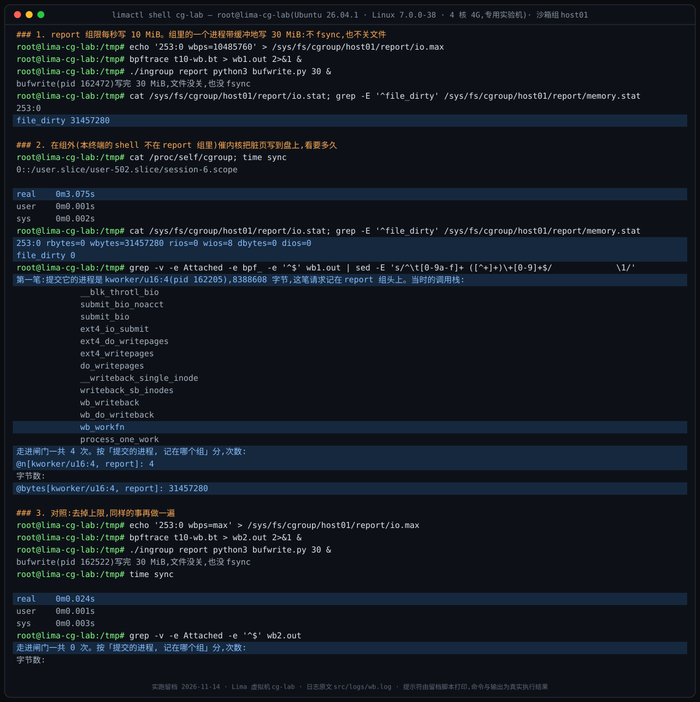

**读数。**

- `bufwrite` 写完的那一刻,report 的 IO 账上什么都没有(`io.stat` 那一行是空的),内存账上有 31 457 280 字节的脏页(`file_dirty`)。**写完了,磁盘一个字节没动,这 30 MiB 先记在 memory 控制器的账上。**
- 把这 30 MiB 交给 io 控制器检查的是 `kworker/u16:4`,一个内核线程,不是 `bufwrite`。栈从下往上读:`process_one_work`、`wb_workfn`、`wb_do_writeback`、`wb_writeback` 是内核回写线程的入口;`writeback_sb_inodes`、`__writeback_single_inode` 是一个文件一个文件地写回;再往上的七行和 §6.2 里 worker 自己 `fsync` 的那个栈一模一样。**两条路在 `do_writepages` 汇合,最后都经过同一个检查。**
- 4 笔请求、31 457 280 字节,全部是「kworker 提交,记在 report 上」。kworker 自己不在 report 组里,它提交的请求却记给了 report。`sync` 之后 `io.stat` 的 `wbytes` 正好是 31 457 280,`file_dirty` 归零:**同一笔 30 MiB,从 memory 的账上转到了 io 的账上,两本账说的是同一个 report。** 这是 `C5·所有资源共用同一套分组` 在实测里的表现。
- `sync` 用了 3.075 秒:30 MiB ÷ 10 MiB/s = 3 秒。去掉上限后,这个检查一次没走(又一次「没人设限就不记账」),`sync` 0.024 秒。

**这次补跑还带出两件事,照实写。**

- **被拖住的可能是组外的人。** 执行 `sync` 的终端不在 report 组里(`/proc/self/cgroup` 那一行),它等了 3 秒,等的是 report 的限速。限的是 report 的写请求,慢下来的却是来催它落盘的那个进程。这是 io 限速的一个实际代价,和 §7.4 说的「在内核里停住会连累别人」是同一类问题。
- **排队的是写请求,不是提交它的进程。** 第一遍补跑用的是 `dd`(日志 `wb-run1.log`):`dd` 0.009 秒就返回了,提交请求的是 `dd` 自己(它关文件时 ext4 顺手把数据推了下去,栈里是 `ext4_release_file → ext4_alloc_da_blocks → filemap_flush`),而随后的 `sync` 同样等了 3.000 秒。也就是说请求进了 io 控制器以后在里面排队,提交的进程不用陪着等。这回答了第 1 点的一部分;按什么规则放行仍然没抓(待核 #19)。

第 3 点(io 一侧是按页还是按文件认所属组)这次没有回答:30 MiB 都是 report 一个组写的,看不出区别。

### §6.6 再逼问:为什么限速检查放在这里

**为什么不放在 `write` 里限速?** 因为 `write` 返回时没有 IO,限它限的是内存拷贝的速度,不是磁盘带宽。程序写完就删文件,根本没用磁盘,却被拖慢了。`C2·记实际用量,超限处理看资源类型`:记的是真花掉的。

**为什么不看「当前进程」就好?** 因为回写常常是内核线程做的,当前进程是内核线程,不是花钱的人。要追到「谁的页」,需要页上记着所属组,这个记号是 memory 控制器在 §5 记下的。**两个控制器共用同一套分组,账才对得上**(`C5·所有资源共用同一套分组`)。

**为什么要让请求排队,不直接拒绝?** 磁盘带宽和 CPU 时间一样,下一秒还会有(`C2·记实际用量,超限处理看资源类型` 的「会再生的等」)。`write` 已经返回了,数据已经在页缓存里,没有一个调用者可以收到「不行」,只能在块层的入口让请求等。这也是 §9 要对照的:能拒绝的拒绝,能等的等。

**为什么 `fsync` 的 worker 看上去「被卡住」?** 它在 `fsync` 里等回写完成,而回写里的请求被 io 控制器留了 0.8 秒,所以 `fsync` 要 0.8 秒才返回。别的组的写请求不受影响:第二节 §9.3 里 db 组同样带缓冲写 50 MiB,只用了 0.0261246 秒。

| 没有它会坏在哪 | 它解决了 |
|---|---|
| 记在 `write` 上:写进页缓存就算,真正占磁盘的时刻没人记,删文件的程序白白被限 | 在 `submit_bio` 那一步记,每一笔都是真的交给磁盘的字节 |
| 只看当前进程:内核线程替 report 回写时,带宽记到根组,`io.max` 被绕开 | 回写时通过页上记的所属组找到 report |
| io 控制器自己另认一套分组,和 memory 的对不上 | 分组只有一套,memory 记的所属组 io 能读 |
| 请求交给块层之后才限,各设备驱动各限一遍 | 检查加在所有设备共用的入口 |

四个接入点走完了:fork、调度结算、缺页、提交 IO。每一处都是内核本来的路,每一处都是账一笔笔记下来、限在账旁边同时比较。但到现在,CPU 的账一直是在额度之内;内存的账也没有撞线。账记到限上了,会怎么样?先看最容易的那种:CPU 用完了。

## §7 超了之后(一):CPU 额度用完,进程是怎么停下来的

**结论:全组总额度用完以后,某颗核再来领额度就领不到。内核在这颗核上给 report 组设一个「限流中」标记,组里的进程各自在下一次要回到用户态时检查到标记,自己停下,进入等候名单。下一个周期定时器一触发,总额度补满,标记清除,名单上的进程放回运行队列。4 颗核一起消耗,50 ms 的额度十来毫秒就用完,剩下八十多毫秒全组都停着。整个过程没有单独的检查线程:账是进程跑的时候记的,限是核领额度的时候检查的,唯一的定时器只补额度、不检查用量。**

这是 `C2·记实际用量,超限处理看资源类型` 里「会再生的等」的实景:CPU 时间下个周期还会有,所以超了不杀不拒绝,停下来等。

### §7.1 实跑:两个周期的时间线

§4 看了没超限的记账,现在看超限的那一刻。这次起 7 个 worker。4 颗核放 7 个进程,必然不均匀:实测是 1 / 1 / 2 / 3。先看 3 秒里每个 worker 拿到多少,再看时间线。

```
# python3 percpu.py 3
  核 0   pid 7538    12.3%
  核 1   pid 7539    12.3%
  核 2   pid 7537     6.0%
  核 2   pid 7541     6.0%
  核 3   pid 7536     4.0%
  核 3   pid 7540     4.0%
  核 3   pid 7542     4.0%
按核合计:核 0:1 个进程共 12.3%   核 1:1 个进程共 12.3%   核 2:2 个进程共 12.0%   核 3:3 个进程共 12.0%   总计 48.6%

# bpftrace t3-throttle.bt | grep .
   0.00 ms  周期定时器响(第 1 个周期开始),公共池补到 50000 微秒
   0.01 ms  核 2:解除限流,等候名单上的进程放回队列
   0.02 ms  核 0:解除限流,等候名单上的进程放回队列
   0.02 ms  核 3:解除限流,等候名单上的进程放回队列
   0.02 ms  核 1:解除限流,等候名单上的进程放回队列
   0.21 ms  核 1 领 5181 微秒,公共池还剩 32984 微秒
   0.21 ms  核 3 领 5183 微秒,公共池还剩 27797 微秒
   0.21 ms  核 0 领 5187 微秒,公共池还剩 27797 微秒
   0.21 ms  核 2 领 5187 微秒,公共池还剩 27797 微秒
   5.21 ms  核 3 领 5000 微秒,公共池还剩 22797 微秒
   5.21 ms  核 2 领 5000 微秒,公共池还剩 17796 微秒
   6.21 ms  核 0 领 5999 微秒,公共池还剩 11797 微秒
   6.21 ms  核 1 领 5931 微秒,公共池还剩  5865 微秒
  10.21 ms  核 2 领 5000 微秒,公共池还剩   864 微秒
  11.21 ms  核 3 领  864 微秒,公共池还剩     0 微秒
  11.21 ms  核 3:公共池空了,report 组在这颗核上被标记为「限流中」
  11.21 ms  核 0:公共池空了,report 组在这颗核上被标记为「限流中」
  11.21 ms  核 0:进程 7538(report-w)在返回用户态的路上被请下场
  11.21 ms  核 3:进程 7542(report-w)在返回用户态的路上被请下场
  11.21 ms  核 3:进程 7536(report-w)在返回用户态的路上被请下场
  11.21 ms  核 3:进程 7540(report-w)在返回用户态的路上被请下场
  12.21 ms  核 1:公共池空了,report 组在这颗核上被标记为「限流中」
  12.22 ms  核 1:进程 7539(report-w)在返回用户态的路上被请下场
  16.21 ms  核 2:公共池空了,report 组在这颗核上被标记为「限流中」
  16.22 ms  核 2:进程 7541(report-w)在返回用户态的路上被请下场
  16.22 ms  核 2:进程 7537(report-w)在返回用户态的路上被请下场
 100.86 ms  周期定时器响(第 2 个周期开始),公共池补到 50000 微秒
 ……(第 2 个周期同样的过程,见图)
```

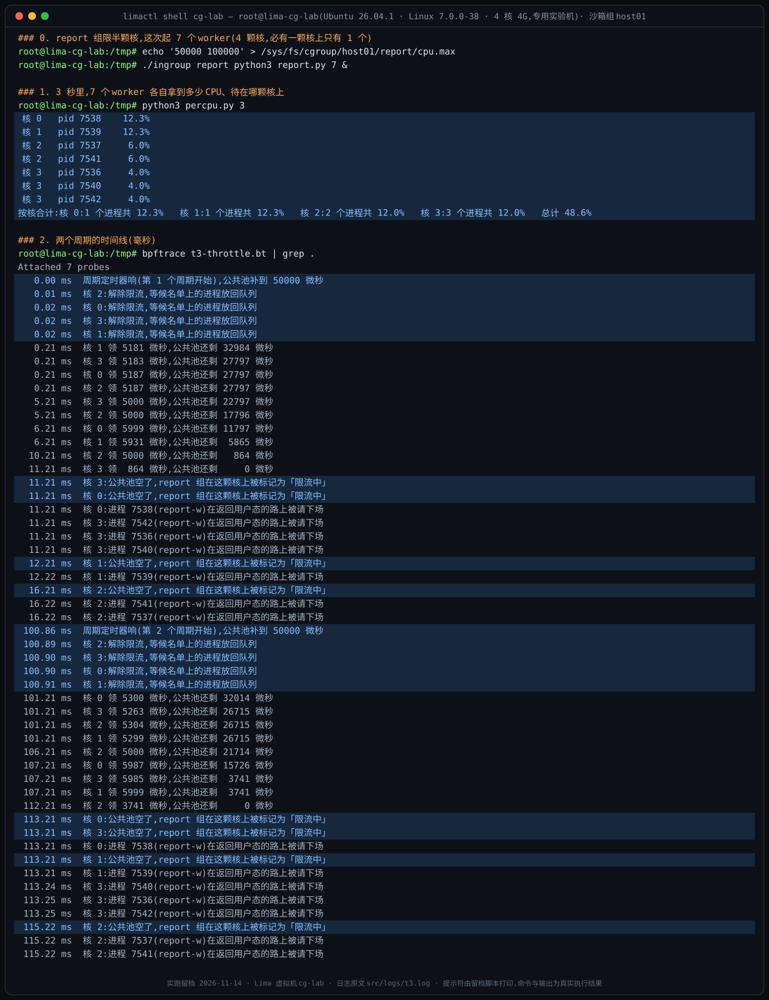

下面这张图把同一件事画成额度的流向:一个全组总额度,四份本地额度,一个周期里四颗核各自跑了多久。

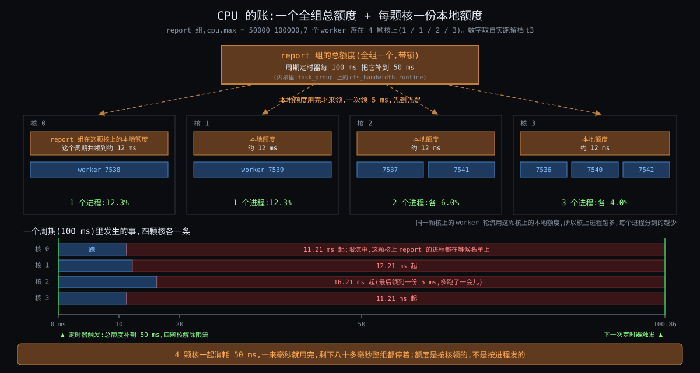

### §7.2 逐行读时间线

- **0.00 ms**:定时器触发,总额度补到 50 000 μs。
- **0.01 ~ 0.02 ms**:四颗核依次清除「限流中」标记,上个周期等在名单上的进程放回队列。
- **0.21 ms**:四颗核各领第一份,约 5.18 ms(5 ms 加上刚跑掉的 0.18 ms)。「公共池还剩」那一栏(日志里的原话)有三行是同一个数,是因为四颗核几乎同时在领,打印时别人已经领完了。
- **5.21 ~ 6.21 ms**:各核第一份花完,领第二份。
- **10.21 ms**:核 2 领第三份(它第一、二份都是整 5 ms,花得快),总额度里只剩 864 μs。
- **11.21 ms**:核 3 把最后的 864 μs 领走,总额度用完。
- **11.21 ms 起**:核 3、核 0 的本地额度用完,来领,领不到 → 设置限流标记。标记设上后的同一个 0.01 ms 里,这两颗核上的 4 个 worker 逐个停下。
- **12.21 ms**:核 1 同样。**16.21 ms**:核 2 手里那份 5 ms 花完,最后一个停下。
- **16.22 ~ 100.86 ms**:84 毫秒,什么都没发生。7 个 worker 全在等候名单上。
- **100.86 ms**:定时器再响,重来一遍。

**算例。** 各核这个周期领到的:核 0 是 5187 + 5999 = 11 186 μs;核 1 是 5181 + 5931 = 11 112;核 2 是 5187 + 5000 + 5000 = 15 187;核 3 是 5183 + 5000 + 864 = 11 047。合计 48 532 μs。离 50 000 差的约 1.5 ms,我的推断是周期开头清除标记时,内核先替各核把上个周期透支的部分补上了,那一笔不经过这个探针。这是推断,没有单独验证,记入待核 #3。

### §7.3 回收一个旧问题:为什么有的 worker 拿 12%,有的只有 4%

第一节留了一个问题:一组一模一样的死循环,都在同一个半颗核的组里,为什么有一个拿到 12%,其余只有 4% ~ 6%?

答案就在上面两段输出里:**额度是按核领的,不是按进程发的。**

- 四颗核各自来总额度领额度,先到先得,每颗核每个周期大致领到 11 ~ 15 ms,3 秒平均下来每颗核都是 12% 左右。
- 这 12% 由这颗核上的 worker 平分。核 0、核 1 上各只有 1 个 worker,独得 12.3%;核 2 上 2 个,各 6.0%;核 3 上 3 个,各 4.0%。
- 规律就是 12.5% ÷ 这颗核上的 worker 数:1 个是 12.5%,2 个是 6.25%,3 个是 4.2%。第一节看到的 12% 和 4% ~ 6% 正是这三档。

`cpu.max` 保证的是组的合计(48.6%,接近 50%),不保证组内每个进程一样多。这和第二节 §10.1 里「组的份额是在每颗核上各自兑现的」是同一件事的两个侧面。这是 `C1·按组限制合计用量` 的另一面:管的是合计,所以合计之内怎么分,内核不替你保证。

### §7.4 400 个进程是怎么「同时」停下来的

第二节 §15 的悬念:400 个 worker 散在 4 颗核上,是谁、用什么办法让它们同时停下的?

```
### 8 个 worker                                    ### 400 个 worker
1 秒内,report 组:                                 1 秒内,report 组:
  周期定时器响 10 次                                 周期定时器响 10 次
  「在某颗核上标记限流」 40 次                       「在某颗核上标记限流」 40 次
  「在某颗核上解除限流」 40 次                       「在某颗核上解除限流」 40 次
  「某个进程被请下场」   80 次,涉及 8 个不同的进程    「某个进程被请下场」   4000 次,涉及 400 个不同的进程
```

(两段输出来自同一份留档 t3n.log,这里并排放,原样见图。)

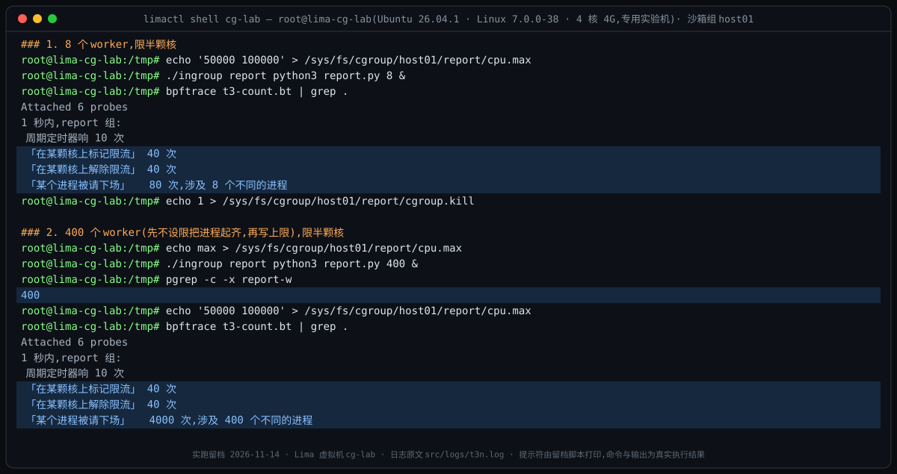

- **设置限流标记的次数和进程数无关。** 8 个也好,400 个也好,都是每秒 40 次:4 颗核 × 10 个周期。内核要做的决定只有「这颗核上这个组没额度了」,一颗核一次。
- **每个进程各自停下。** 80 = 8 × 10,4000 = 400 × 10:每个进程每个周期停下一次(日志里叫「被请下场」)。
- 所以答案是:**没有谁去挨个让 400 个进程停下,也并不是同时。** 内核只设 4 个限流标记;每个进程在自己下一次要从内核回到用户态的那一刻检查到标记,自己退到等候名单上。

**为什么要等到「回用户态的路上」才停下?** 如果在任意位置把进程冻住,它可能正在内核里拿着一把锁,比如正在改某个文件系统的结构。它一停就是八十多毫秒,别的组的进程要用这把锁,也得跟着等。限 report 的额度,结果拖慢了 db,限流就影响到了组外。等进程走到回用户态的那一步,它在内核里的事已经办完,手里什么锁都没有,这时候停下最干净。

据我所知,在这个位置停下进程是比较新的内核才有的做法(印象中是 6.18 前后改的),更早的内核是把这个组在这颗核上的整个队列直接摘下来。这句话是凭记忆写的,记入待核 #1,讲来路时配出处。「在内核里拿着锁时被冻住会连累别的组」是改成这种做法的动机,同样凭记忆,记入待核 #2。

**为什么连 fork 都要排队?** 第二节 §9.1 看到,在半颗核的组里起 400 个 worker 要等很久。fork 是主进程在内核里执行的一段代码,也要花 CPU 时间;主进程自己也在这个组里,也花这个组的额度。总额度一用完,它和 worker 一样停下。限额管的是「这个组的进程占用 CPU 的时间」,不区分这段时间在干什么。

### §7.5 再逼问:定时器会检查用量吗

不会。定时器每 100 ms 触发一次,做的事只有两件:**把总额度补满,把限流标记清除。** 它不检查任何人用了多少。

发现「用完了」的,是来领额度的那颗核自己。整个机制里没有单独的检查线程:账是进程跑的时候记的,限是领额度的时候检查的。这就是第二节 §7.1 说的「记账时同步检查限额」的后一半(前一半是 §4.4 的记账);§3.5 里 pids 问「能生吗」的那一刻,账加一和比限是同一个动作,也是这样。

| 没有它会坏在哪 | 它解决了 |
|---|---|
| 要有人周期性扫描所有组、所有进程的用量,组越多越贵 | 超限在领额度的那一刻被发现,不需要扫描 |
| 要挨个通知 400 个进程停下 | 每颗核设一个标记,进程自己停下 |
| 在内核里冻住进程会连累别的组 | 只在回用户态的路上停下 |

留下的代价前两节都说过:延迟毛刺(第一节量过「跑一阵、停一阵」)。一个请求如果在 16 ms 这个时刻到达 report,要等 84 ms 才有人处理它。

悬念:CPU 超了可以等。内存超了等不来,那一刻又是什么样?

## §8 超了之后(二):内存撞线,先回收再杀

**结论:某一次给计数器加 64 页会超过上限,这次记账就不成立,撞线的进程停在原地。它自己先在本组的范围内回收内存;收够了就继续跑,收不动就进入组内 OOM:给本组的每个进程打分,杀掉分最高的。被杀的是组里最大的,不一定是撞线的那个。边界就是撞线的那一层计数器:哪一层撞线,回收和杀就只在那一层的子树里做。**

CPU 超了可以让进程等,因为下个周期额度还会补满。内存不行:物理页占了不还就没有,等不来(`C2·记实际用量,超限处理看资源类型` 里「内存既等不来也拒绝不了,只能回收或杀」)。流程图在 §5.3 那张图的下半部分,这里再放一次,四步依次对应 §8.1、§8.2:


### §8.1 实跑 A:收得回来

在 300M 的组里用 `cat` 读一个 600M 的文件。文件内容进页缓存,记在 report 名下;页缓存可以丢弃,扔了以后要用再从盘上读。

```
# ./ingroup report cat /var/tmp/rep.dat > /dev/null
# grep -v -e Attached -e '^$' t4a.out
   0.00 ms  撞线:pid 8198(cat)要再记 512 页,report 组的账 76672 页 + 512 > 上限 76800 页
   0.24 ms  回收:pid 8198(cat)自己动手在 report 组里回收,想要 512 页,收回 696 页
   0.33 ms  回收:pid 8198(cat)自己动手在 report 组里回收,想要 512 页,收回 768 页
   0.42 ms  回收:pid 8198(cat)自己动手在 report 组里回收,想要 512 页,收回 776 页
合计:撞线 146 次;组内回收 146 次,共收回 77312 页;进入 OOM 0 次
# grep -E '^(max|oom|oom_kill) ' /sys/fs/cgroup/host01/report/memory.events | xargs
max 146 oom 0 oom_kill 0
```

**读数。**

- 上限 300M = 76 800 页。账上 76 672 页时,`cat` 要再记 512 页(读文件时内核一次读进来一大块),76 672 + 512 > 76 800,撞线。
- **回收的是 `cat` 自己**(pid 8198)。没有后台线程替它做,谁撞线谁自己回收。回收的范围只有 report 组名下的页:内核顺着「页上记的所属组」找,别的组的页它不碰。
- 每次撞线都收回了七百多页,够用,回到记账,继续读。
- 整个文件读下来撞线 146 次,回收 146 次,共收回 77 312 页 = 302 MiB,正好是 600M 的文件减去 300M 的上限。OOM 0 次。`memory.events` 里的 `max 146` 就是这 146 次撞线。第二节 §10.4 看到的 `max 53` 也是这个计数。

文件照样读完了,只是慢一点:`cat` 花了一部分时间替自己腾地方。

### §8.2 实跑 B:收不回来

三个 worker 都用匿名页(程序自己申请的内存,这台机器没有 swap,扔不了):两个先占 150M 和 80M,第三个每 0.1 秒吃 10M,慢慢涨到 100M。150 + 80 + 100 = 330 > 300,第三个涨到 70M 上下时会撞线。

```
# ./ingroup report python3 hold.py report-w 150 &
# ./ingroup report python3 hold.py report-w 80 &
report-w(pid 8237)已占住 80 MiB
report-w(pid 8233)已占住 150 MiB
# ./ingroup report python3 hold.py report-w 100 10 0.1 &
report-w(pid 8242)已占住 100 MiB
# grep -v -e Attached -e '^$' t4b.out
   0.00 ms  撞线:pid 8242(report-w)要再记 64 页,report 组的账 76775 页 + 64 > 上限 76800 页
   0.31 ms  回收:pid 8242(report-w)自己动手在 report 组里回收,想要 1 页,收回 148 页
   0.63 ms  回收:pid 8242(report-w)自己动手在 report 组里回收,想要 1 页,收回 48 页
   0.82 ms  回收:pid 8242(report-w)自己动手在 report 组里回收,想要 1 页,收回 44 页
   2.83 ms  回收不动了,进入 OOM:范围 = report 组,触发的是 pid 8242(report-w)
   2.87 ms    打分:pid 8233(report-w) 40812 分
   2.87 ms    打分:pid 8237(report-w) 22850 分
   2.87 ms    打分:pid 8242(report-w) 17441 分
   3.13 ms    选中:pid 8233(report-w),匿名内存 157056 kB,发 SIGKILL
   3.43 ms    打分:pid 8237(report-w) 22850 分
   3.45 ms    打分:pid 8242(report-w) 17441 分
   3.58 ms    选中:pid 8237(report-w),匿名内存 85376 kB,发 SIGKILL
合计:撞线 560 次;组内回收 63 次,共收回 575 页;进入 OOM 2 次
# ps -o pid,rss,comm -C report-w
    PID   RSS COMMAND
   8242 111776 report-w
# grep -E '^(max|oom|oom_kill) ' /sys/fs/cgroup/host01/report/memory.events | xargs
max 209 oom 2 oom_kill 2
```

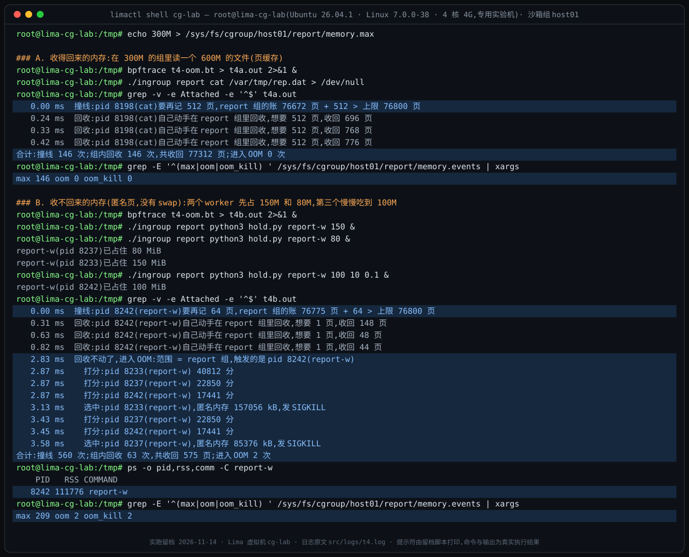

**逐行读。**

- **0.00 ms**:第三个 worker(pid 8242)要再记 64 页,76 775 + 64 > 76 800,撞线。
- **0.31 ~ 0.82 ms**:它自己动手回收,收回了 148、48、44 页。这是组里仅有的一点能丢弃的东西(三个 python 进程读进来的程序文件的页缓存)。合计 63 次回收只收回 575 页,2 MiB 多一点。
- **2.83 ms**:回收不动了,进入 OOM。范围是 report 组。
- **2.87 ms**:给 report 组的三个进程打分:40 812、22 850、17 441。分数基本就是它占的页数:pid 8233 的匿名内存是 157 056 kB ÷ 4 = 39 264 页,加上页表等零头,40 812 分。
- **3.13 ms**:选中分最高的 pid 8233(占 150M 的那个),发 SIGKILL。**从撞线到开杀,3.13 毫秒。**
- **撞线的是 8242,被杀的是 8233。** 8242 活到了最后(`ps` 里只剩它,RSS 111 776 kB)。

**这一遍多杀了一个,照实说明。** 3.43 ms 又进了一次 OOM,这次只给剩下的两个打分,把 80M 的 pid 8237 也杀了。按算例,杀掉 150M 的那个以后,80 + 100 = 180 < 300,不该再杀。

这和第二节 §3.2 记进待核的现象(db-sim 被杀之后还多杀 worker,第二节待核 #1)是同一回事,这次抓到了现场:第一个受害者被选中后 0.3 ms,触发者再次撞线、再次进入 OOM;这时第一个受害者已经不在候选名单里了,但它的内存显然还没有全部还到账上,于是又挑了剩下的里面最大的。

正式留档之前试跑的那一遍(`src/logs/t4b-trial.log`),同样的场景只杀了 1 个:第一个受害者被选中后,触发者又进了 24 次 OOM,每次都没有打分、没有再杀,直到内存还回来。那一遍的合计是撞线 961 次、组内回收 458 次(共收回 575 页)、OOM 25 次,`memory.events` 是 `max 604 oom 25 oom_kill 1`。两遍的差别在时序。内核靠什么判断「已经有人在死了,先等等」,这个条件为什么有时不起作用,要看源码,仍在待核里(#5),但有了明确的线索。

另有一处口径对不上,同样记在待核里(#10):A 段 `memory.events` 的 `max` 等于探针数到的撞线次数(146),B 段是 209,探针数到的是 560。两个数的口径不同,一次记账里可以重试多次,具体口径没有查。

### §8.3 再逼问

**为什么不杀撞线的那个?** 撞线的进程不一定占得多。它可能只占了很少的内存,杀了它腾不出多少,马上又会撞线。杀最大的,一次腾出最多。

**为什么不干脆让这次申请失败,返回一个错误?** 因为大多数时候没有地方可以返回错误。worker 不是在调用一个「申请内存」的函数,它只是往自己已经申请到的地址里写了一个字节,这时才缺页、才真正要物理页。一条赋值语句没有返回值。内核要么给它这一页,要么让它没法继续执行。这是 `C2·记实际用量,超限处理看资源类型` 落到实处的样子:CPU 不够可以让它等,内存不够没法让一条写内存的指令「等一等」。对比 §9.1:fork 是一个有返回值的系统调用,所以进程数可以直接拒绝。

**边界是谁划的?** 你的第二个灵魂问题。从上面的时间线能直接读出来:

1. 撞线撞的是 **report 组的计数器**。如果是 host01 的计数器先超,撞的就是 host01 的线(§5.4 里每次改账三层都要比一次)。
2. 回收只在**撞线的那个组**的范围里做。
3. 打分只给**撞线的那个组**里的进程打。db 组的进程、宿主机上别的进程,根本不在名单上。

所以边界 = 撞线的是哪一层的计数器。哪一层的上限是谁写的,边界就是谁划的。第二节 §10.3 和 §10.4 里同样的进程,一次死 db-sim、一次死 report-w,区别只在于先撞线的是 host01 的计数器还是 report 的计数器。这一点是 `C1·按组限制合计用量` 的落点:账一层层往上加,每一层都拿自己的上限比。

| 没有它会坏在哪 | 它解决了 |
|---|---|
| 内存超了只能等全机见底,由全机 OOM 挑人,可能杀到别的业务 | 在组的计数器上撞线,回收和杀都限在这个组里 |
| 页缓存撑满也要杀进程 | 先回收,能丢弃的先丢弃 |
| 回收的开销摊给全机 | 谁撞线谁自己回收 |

CPU 可以等,内存只能回收或杀。还有两种资源,各是什么处置?

## §9 超了之后(三):进程数拒绝,磁盘排队;三种处置

**结论:CPU 等,内存回收或杀,进程数拒绝,磁盘排队。四个接入点上「怎么发现超限」是同一个动作(加上去,看超没超),只有最后「超了怎么办」不一样,而这一格是资源的性质决定的,不是 cgroup 决定的。cgroup 的核心不知道「超了」该怎么处理,这一格由每个控制器自己决定。九个控制器里,这一节只对其中四个有实测。**

### §9.1 同样的三个问题,换成进程数

§3.5 已经看过 pids 的实跑:report 组最多 20 个进程,连续 fork 100 个,第 20 次被拒绝,成功 19 个,`pids.events` 里 `max 1`。这里不重贴,把它和 §5、§8 的内存线逐项对照:

| 三个问题 | memory(§5、§8) | pids(§3.5) |
|---|---|---|
| 在哪里记账 | 内核分出一个物理页时 | fork 的路上,核心问一句「能生吗」(`pids_can_fork`) |
| 账长什么样 | 已用页数,带父指针 | 已有进程数,带父指针。实测 report 和 host01 两本账一起从 2 加到 4 |
| 限写成什么 | `memory.max` | `pids.max` |
| 怎么发现超限 | 加上去,看超没超 | 一样。20 + 1 > 20 |
| 超了怎么处置 | 回收,收不动就杀 | **拒绝**:这次 fork 返回错误(-11 就是 `EAGAIN`),谁也不用死 |
| 事件记在哪 | `memory.events` 的 `max` | `pids.events` 的 `max 1` |

结构一模一样,只有最后的处置不同,而处置不同是因为资源的性质不同:fork 是一个有返回值的系统调用,可以直接说「不行」;§8.3 说过,往内存里写一个字节没有返回值,所以内存只能回收或杀。

第二节 §4.2 的两个洞也顺带补上了:`ulimit -u` 数的是「这个用户」的进程,而且对 root 不生效;`pids.max` 数的是这个组的,第二节 §9.4 里 fork 的就是 root,同一个 root 在没设限的 db 组里 fork 100 个全部成功。

### §9.2 同样的三个问题,换成磁盘 IO

IO 在 §6 已经走过一遍。和前面几种资源并排:

| 三个问题 | io |
|---|---|
| 在哪里记账 | 写请求交给块层的那一刻(`submit_bio_noacct` 里的 `__blk_throtl_bio`,§6.2) |
| 账长什么样 | 每块盘每个组的字节数和次数,账里带着 `io.max` 写的速率;`io.stat` 里能读到(第二节 §9.3:三次各写 50 MiB,`wbytes` 最后是 157 286 400) |
| 限写成什么 | `io.max`:每块盘每秒多少字节、多少次 |
| 怎么发现超限 | 请求到达检查处,看这一秒的额度够不够 |
| 超了怎么处置 | **等**:请求留在 io 控制器里,到时间才放行。和 CPU 一样,带宽下一秒还会有 |

IO 这一条没有抓到 io 控制器内部的实际过程,上表中「账长什么样」「超了怎么处置」两格出自内核文档对 io 控制器的说明([cgroup-v2 文档 IO 一节](https://docs.kernel.org/admin-guide/cgroup-v2.html#io))和 §6.4 的实测现象(8 MiB 用了约 0.8 秒),内部细节记在待核 #19。

### §9.3 九个控制器,三种处置

| 控制器 | 管什么 | 超了怎么处置 | 本文讲到哪 |
|---|---|---|---|
| cpu | CPU 时间(上限 `cpu.max`,比例 `cpu.weight`) | 等到下个周期 | §4、§7 细讲 |
| memory | 物理内存,含页缓存(上限 `memory.max`,保护 `memory.low`) | 组内回收,收不动就组内杀 | §5、§8 细讲 |
| io | 每块盘的读写带宽和次数(`io.max`、`io.weight`) | 请求排队等 | §6、§9.2 |
| pids | 进程和线程的个数(`pids.max`) | 这次 fork 失败 | §3.5、§9.1 |
| cpuset | 能用哪几颗核、哪些内存节点 | 不记账,只划范围 | 不展开 |
| hugetlb | 大页的用量 | 缺页时拒绝 | 不展开 |
| rdma | RDMA 网卡上的资源 | — | 不展开 |
| dmem | 设备自带的内存区域(如显存) | — | 不展开 |
| misc | 其他只能数个数的资源 | — | 不展开 |

后五行的「管什么」取自 [cgroup-v2 文档](https://docs.kernel.org/admin-guide/cgroup-v2.html#controllers)各控制器的开头一段,没有实跑;rdma、dmem、misc 的处置方式我没有查,留空。这些记入待核 #12。

处置只有三种,由资源的性质决定,不由 cgroup 决定(`C2·记实际用量,超限处理看资源类型`):

- **会再生的资源**(CPU 时间、IO 带宽):等。下一个周期、下一秒还会有。
- **能当场拒绝的资源**(进程数、大页):这次不给,返回错误。
- **占了不还、又没法拒绝的资源**(内存):回收,收不动就杀。

把四个有实测的接入点摆在一起,四种处置的样子是这样的:

| 接入点 | 资源 | 处置 | 本节的实测 |
|---|---|---|---|
| 调度结算(§7) | CPU | 等:设限流标记,下个周期放回 | 11 ~ 16 ms 用完,停 84 ms;设标记每秒 40 次,与进程数无关 |
| 缺页(§8) | 内存 | 回收,收不动就杀 | 页缓存 146 次全靠回收;匿名页 3.13 ms 后开杀 |
| fork(§9.1) | 进程数 | 拒绝 | 第 20 次 fork 失败,返回 -11 |
| 提交 IO(§6) | 磁盘 | 排队等 | 8 MiB 约 0.8 秒,10 MiB/s |

也有不太合身的地方,照实说:cpuset 根本不记账;内存没有按比例的旋钮(第二节 §10.3);v2 里管设备访问的那个控制器干脆没有文件,靠挂在组上的 BPF 程序实现(文档原话:「has no interface files and is implemented on top of cgroup BPF」)。核心只规定公共的部分,不要求每个插件都一样。

回头看 §2.5 的登记表:`pids` 填了「能生吗」,`memory` 填了「退出了」,`cpu` 一个都没填 fork 和退出的格子。登记表上的格子只负责建账、入组、fork、退出这些生命周期的时刻;「超了怎么办」这一步不在表上,它在每个控制器各自负责的那条路里。这又是一次「公共框架加资源插件」的体现。

账都记了,限都比了,处置也各就各位。但账还有一个问题没有回答:它们是挂在一棵树上的。树上的一层动了,别的层怎么跟着动?worker 最后退出的时候,账又怎么收拾?

## §10 把账放回树上;以及退出

**结论:树上每一层都有自己的账和自己的限。内存:子组改计数器时,顺着父指针把每一层祖先都改一遍、比一遍。CPU:每一层都有自己的总额度,进程跑掉的时间每一层都扣,哪一层的总额度用完了,那一层下面的进程全停。worker 退出时,核心把它从组籍的名单上摘掉,pids 控制器在最后释放那一步把进程数减一:生命周期通知的最后一环。**

### §10.1 树上的账:父组是怎么跟着动的

内存这边 §5.4 已经看到了:每次改账,report、host01、根三个数一起加 64。

CPU 这边做一个实验:report 自己的上限是半颗核不动,给它的父组 host01 写一个更紧的上限 0.3 颗核。

```
# echo '50000 100000' > /sys/fs/cgroup/host01/report/cpu.max
# cat /sys/fs/cgroup/host01/cpu.max
max 100000
# ./ingroup report python3 report.py 8 &
# python3 percpu.py 2 | tail -1
按核合计:核 0:1 个进程共 12.5%   核 1:2 个进程共 12.0%   核 2:3 个进程共 13.0%   核 3:2 个进程共 12.5%   总计 49.9%

# echo '30000 100000' > /sys/fs/cgroup/host01/cpu.max
# grep -H nr_throttled /sys/fs/cgroup/host01/cpu.stat /sys/fs/cgroup/host01/report/cpu.stat
/sys/fs/cgroup/host01/cpu.stat:nr_throttled 5
/sys/fs/cgroup/host01/report/cpu.stat:nr_throttled 42
# python3 percpu.py 2 | tail -1
按核合计:核 0:1 个进程共 8.0%   核 1:2 个进程共 8.0%   核 2:3 个进程共 7.5%   核 3:2 个进程共 7.0%   总计 30.4%
# grep -H nr_throttled /sys/fs/cgroup/host01/cpu.stat /sys/fs/cgroup/host01/report/cpu.stat
/sys/fs/cgroup/host01/cpu.stat:nr_throttled 25
/sys/fs/cgroup/host01/report/cpu.stat:nr_throttled 42
```

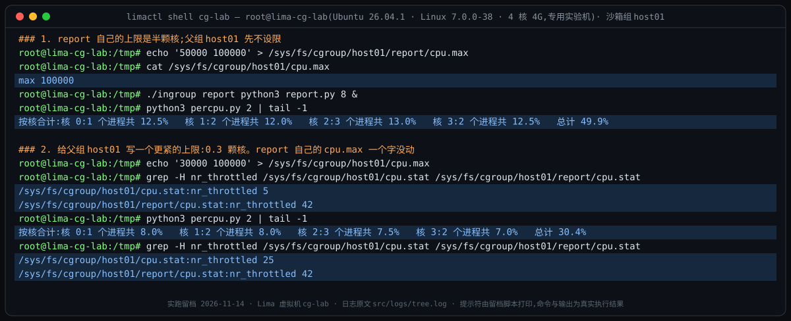

**读数。**

- report 自己的 `cpu.max` 一个字没动,用量从 49.9% 掉到 30.4%。父组的上限管住了整棵子树(`C1·按组限制合计用量` 里「层层转包」那个要点)。
- 这 2 秒里,host01 的 `nr_throttled` 从 5 涨到 25(20 个周期,每个周期都撞线);report 自己的停在 42 不动。**是哪一层限制了进程,账上看得出来:** 现在每个周期先用完的是 host01 的总额度,report 自己的 50 ms 永远用不完。
- 第二节 §10.4 的 `memory.events`(整棵子树的事件)和 `memory.events.local`(只算本层)是同一个道理。

**为什么记得起?** 树有几层,一笔账就要改几个数。所以两边都靠批量:内存 64 页才爬一次树,CPU 5 ms 才去领一次总额度。实际的树一般三到六层(机器 → 平台 → 租户 → 容器),批量摊下来不贵。这也是 `C1·按组限制合计用量` 和 `C4·在内核已有代码路径上记账,开销要小` 碰在一起时的解法。「一般三到六层」是我的印象,没有统计过,记入待核 #23。

### §10.2 没抓到现行的两件事

两件事这一节没有抓到现行,如实列出:

- **统计数字的汇总。** `cpu.stat`、`memory.stat` 里那一大串计数(用了多少 CPU 时间、多少文件页、多少匿名页……)走的是另一条路:每颗核各记各的流水,有人来读文件时才汇总、才顺着树往上加。我给这条路下的探针没有触发,原因没查清。这段描述出自我对内核的了解,没有实测支撑,记入待核 #7。§4.5 里说「`cpu.stat` 里的用量统计走的是另一条路」,指的就是它。
- **权重(`cpu.weight`)在树上怎么算。** 第二节 §10.1 的待核(第二节待核 #8:组的权重怎么摊到每颗核上)属于调度器内部的排队规则,这一节不展开,留给读源码那一步。

### §10.3 退出:核心摘名单,pids 减一

worker 的一生最后一步是退出。同一个 worker 的退出,在 life.log 里是两行:

```
1012.05 ms  [退出]      核心:把 worker 从组籍的名单上摘掉
1012.08 ms  [退出]      pids 控制器:report 组的进程数 -1
```

hooks.log 那一遍给第一行附了调用栈:

```
1062.19 ms  [退出]      核心:把 worker 从组籍的名单上摘掉
             cgroup_task_exit
             do_exit
             do_group_exit
             __arm64_sys_exit_group
             invoke_syscall.constprop.0
             el0_svc_common.constprop.0
             do_el0_svc
             el0_svc
1062.23 ms  [退出]      pids 控制器:report 组的进程数 -1
```

**从下往上读:**

- `el0_svc`、`do_el0_svc`、`el0_svc_common.constprop.0`、`invoke_syscall.constprop.0`:用户程序发起系统调用后,arm64 进入内核的入口。
- `__arm64_sys_exit_group`:`exit_group` 系统调用在内核里的入口。python 的 `os._exit(0)` 最后发的就是它。
- `do_group_exit`、`do_exit`:整个线程组退出、进程退出。**到这一行为止,是内核本来就要走的路。**
- `cgroup_task_exit`:核心加的调用。进程退出时,核心按 §2.5 的登记表,把填了「退出了」那一格的控制器通知一遍。**更正(第五节读源码后)**:它只做通知,不摘名单。把进程从组籍名单上摘掉(§3.4 里那份 2 → 3 → 4 的名单往回走)是在更后面:进程最后一次被换下 CPU 时,`finish_task_switch` 调 `cgroup_task_dead`,由 `do_cgroup_task_dead`(v7.0 `kernel/cgroup/cgroup.c:7072`)摘。这一步的时刻没有抓到。

对一下 §1 的提纲和 §3.4 的名单:进来时,fork 的第二步 `cgroup_post_fork` 把子进程挂上名单;出去时,先由 `cgroup_task_exit` 通知各控制器,最后一次换下 CPU 时再由 `cgroup_task_dead` 摘下名单。一进一出,都由核心负责,控制器的账在中间自己记。

**pids 的那一行没有附栈。** 跟踪脚本只在 `pids_release` 上打印了一行。从登记表看(§2.5),pids 填的是「最后释放」,不是「退出了」。我的理解是:进程退出之后,它的档案还要留到父进程收尸(`wait`)才真正释放,pids 控制器在这最后一步才把进程数减一,所以 §3.5 里的 20 个名额,被没来得及 `wait` 的僵尸进程占着的也算在内。life.log 里两行只差 0.03 ms,和这个理解不矛盾(report 主进程正停在 `os.wait()` 里等它)。这段话写的时候是凭了解,本小节末尾的补跑把它抓实了(待核 #22 销项)。

还有两件事,日志里没有看到:

- 登记表上,memory 和 io 也填了「退出了」(`mem_cgroup_exit`、`blkcg_exit`),这次的探针只挂了 `cgroup_task_exit` 和 `pids_release`,这两个控制器的退出回调有没有被调用、做了什么,没有抓。
- worker 退出时它名下的页(§8 图里的第④步「它的页一页页还回去」)怎么靠页上记的所属组从账上减掉,同样没有在 worker 这一遍里数。

**补跑:退出的全过程,以及僵尸占不占名额。** 上面三处后来补抓了(2026-11-15,会话 `exit`)。report 主进程 fork 一个 worker,worker 占 50 MiB,0.6 秒后退出;主进程故意等 1.6 秒才去 `wait`,中间这 1 秒 worker 是僵尸。

```
### worker 活着(第 0.3 秒)
    PID STAT   RSS COMMAND
 162264 S     9616 report
 162266 S    58768 worker
memory.current:56885248
pids.current:2
### worker 已退出,主进程还没收尸(第 1.1 秒)
    PID STAT   RSS COMMAND
 162264 S     9616 report
 162266 Z        0 worker
memory.current:3846144
pids.current:2
### 主进程收尸之后(第 2.0 秒)
    PID STAT   RSS COMMAND
 162264 S     9680 report
memory.current:3846144
pids.current:1
### 跟踪脚本看到的
  0.00 ms  worker(pid 162266)开始退出
  5.44 ms  这之前,memory 控制器已经从 report 的账上减了 454 次,共 12883 页(最后一次在 5.36 ms)
  5.46 ms  核心:把 worker 从组籍的名单上摘掉(cgroup_task_exit),然后按登记表挨个通知
  (更正:这一行是跟踪脚本当时打印的标签。cgroup_task_exit 只做通知;摘名单在 cgroup_task_dead,见上面 §10.3 的更正)
  5.47 ms    io 控制器被通知「它退出了」(blkcg_exit)
  5.47 ms    memory 控制器被通知「它退出了」(mem_cgroup_exit)
 978.03 ms  核心:worker 被收尸,做最后的释放(cgroup_task_release),由 report(pid 162264)触发
 978.05 ms    pids 控制器:report 组的进程数 -1(pids_release)
```

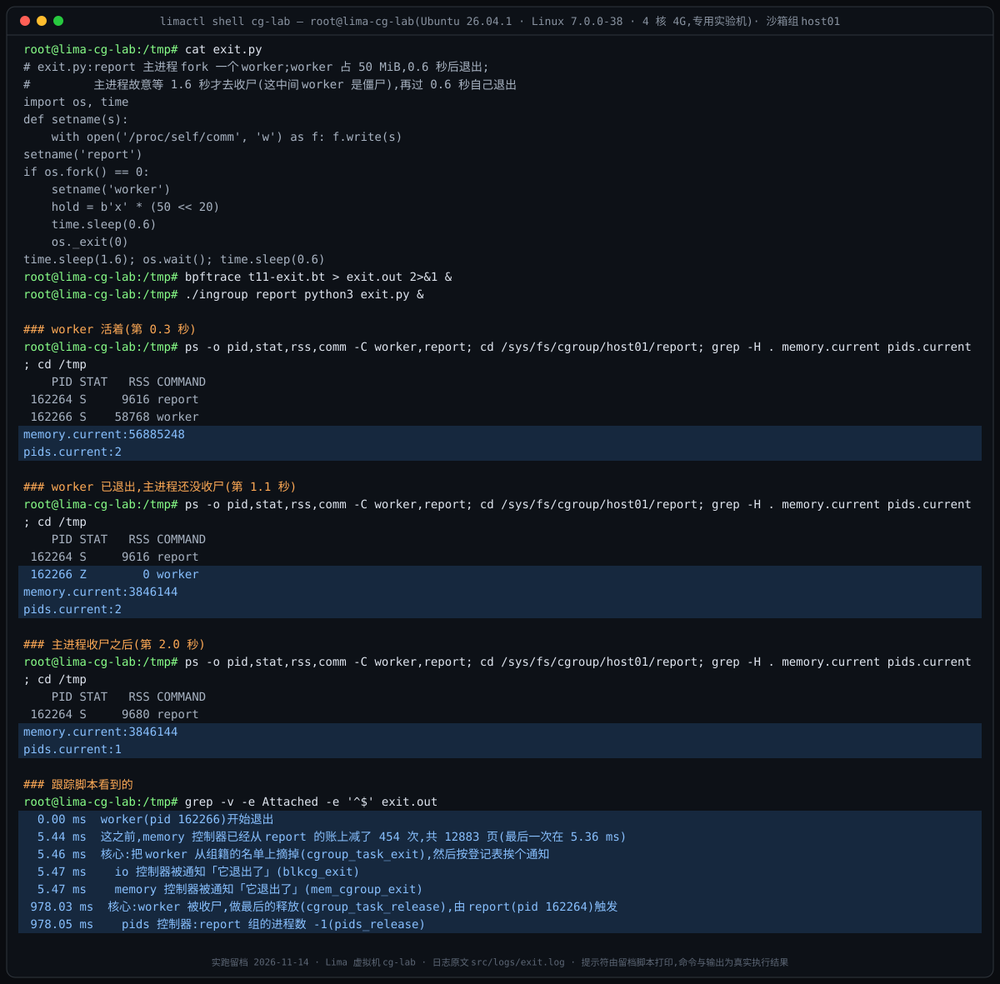

**读数。**

- **内存在退出的头 5 毫秒里就还清了。** worker 开始退出后,它的页一页页还回去,memory 控制器从 report 的账上减了 454 次,共 12 883 页。50 MiB 是 12 800 页,多出的 83 页是 python 自己的零碎和页表。账面上 `memory.current` 从 56 885 248 掉到 3 846 144,少了 53 039 104 字节,12 949 页,和 12 883 页差 66 页,我没有去对这 66 页(探针只数了 worker 自己减的那些)。还钱和记账一样是成批的:454 次减 12 883 页,平均一次 28 页。
- **顺序是:先还内存,再摘名单,再通知控制器。** 5.36 ms 最后一次还页,5.46 ms 核心把它从组籍的名单上摘掉,5.47 ms io 和 memory 两个控制器各被通知一次「它退出了」。上面说「没有抓」的 `mem_cgroup_exit`、`blkcg_exit`,确实都被调用了。它们各自在里面做了什么,没有跟。
- **僵尸占着进程数的名额。** 第 1.1 秒,worker 的状态是 `Z`、RSS 是 0,内存账已经还清,`pids.current` 却还是 2。直到 978.03 ms 主进程 `wait` 收尸,核心做最后的释放,pids 控制器才在 978.05 ms 把进程数减一,`pids.current` 变成 1。上面凭了解写的那段话(pids 填的是「最后释放」而不是「退出了」)这次有了实测。

这给 `pids.max` 带来一个要留意的后果:一个只生不收的程序,就算孩子全死了,名额也照样会被僵尸占满。道理是通的:僵尸还占着一个进程号和一份内核档案,pids 控制器管的正是这个。

再往后是整个组的收尾:空的组被 `rmdir` 之后,核心通知每个控制器销账(登记表里的「销账」那一格,五个控制器都填了,§2.5)。这一步我们没有跑,只有登记表上的格子作证。

| 没有它会坏在哪 | 它解决了 |
|---|---|
| 进程退出了,组籍名单上还留着它,后面的 `cgroup.kill` 会去找一个不存在的进程 | 退出时核心摘名单 |
| 进程数的账只加不减,`pids.max` 满了就永远满 | pids 在最后释放时减一 |
| 控制器各自去发现「进程没了」,各写一套 | 核心在退出的路上按登记表统一通知 |

账放回树上,也收好了。worker 的一生走完了一遍,但每一站都是分开讲的。接下来把它们压在一起,按时间顺序再看一次。

## §11 worker 的一生回放

**结论:把 §1 那八行输出摊开,worker 的一生是:开场前管理员建组设限;出生时核心问一圈、抄组籍;跑 CPU、要内存、写盘,每一站都是内核本来的路,控制器在路上多执行一步;生孩子再走一遍 fork;退出时核心摘名单、pids 减一。核心参与三次(fork 两步、退出一步),四个控制器各负责自己那条路。这一整条链里没有任何一处是 cgroup 自己新修的路。**

先看主证据,life.log 里的八行(§1 已经贴过一遍,这里原样再贴,下面的表逐行展开):

```
  0.00 ms  [fork]      pids 控制器被问「能生吗」→ 放行,report 组的进程数 +1
  0.03 ms  [fork]      核心:子进程 9356 抄走父进程的组籍 0xffff0000c5b97400,挂上名单
  0.11 ms  [缺页]      memory 控制器:分到物理页,给 report 组记 1 页
  0.70 ms  [调度结算]  cpu 控制器:刚跑掉 663 微秒,从 report 组在核 3 的零钱里扣
204.59 ms  [提交 IO]   io 控制器:一笔 4194304 字节的写请求,交给磁盘前先过 report 组的带宽闸门
1011.44 ms  [fork]      worker 自己生孩子:pids 控制器又被问一次 → 放行
1012.05 ms  [退出]      核心:把 worker 从组籍的名单上摘掉
1012.08 ms  [退出]      pids 控制器:report 组的进程数 -1
```

### §11.1 一张表:worker 的一生

| 时刻(life.log) | 接入点 | 内核原本在做什么 | 核心做了什么 | 哪个控制器做了什么 | 实测 | 约束 |
|---|---|---|---|---|---|---|
| 开场前 | (没有进程在走路) | — | 在树上多一个节点 report;通知开了的控制器各建一本账 | 各控制器建账,管理员写进四个限 | §2.4:9 个控制器,逐个打开后文件、建账、组籍都对得上 | `C3·内核负责执行,配额由外部设定`、`C5·所有资源共用同一套分组` |
| 0.00 ms | fork 前半 | `copy_process` 复制父进程的档案 | `cgroup_can_fork`:按登记表问一圈「能生吗」 | pids:report 组进程数 +1,没超,放行(登记表上 cpuset 也填了「能生吗」,这次没打印) | §3.5:20 次询问,19 次放行,第 20 次拒绝(−11) | `C1·按组限制合计用量`、`C3·内核负责执行,配额由外部设定` |
| 0.03 ms | fork 后半 | 子进程基本造好 | `cgroup_post_fork`:子进程抄走父进程的组籍,挂上名单 | 这次没打印控制器(登记表上 memory、cpuset 填了「生了」,§2.5) | §3.4:父子同一个地址,名单 2 → 3 → 4 | `C1·按组限制合计用量`、`C3·内核负责执行,配额由外部设定`、`C5·所有资源共用同一套分组` |
| 0.11 ms | 缺页 | 写时复制:给 worker 复制一页 | 不参与 | memory:给 report 组记 1 页,页上记下所属组 | §5.4:缺页 25 610 次,记账 25 660 次,改计数器 400 次 × 64 页 | `C2·记实际用量,超限处理看资源类型`、`C4·在内核已有代码路径上记账,开销要小`、`C5·所有资源共用同一套分组` |
| 0.70 ms | 调度结算 | `update_curr` 结算刚跑了多久 | 不参与 | cpu:663 μs 从核 3 的本地额度里扣,本地额度用完才动总额度 | §4.4:2 秒 1660 笔,181 笔动了总额度;§4.5:没人设限时 1 秒 0 次 | `C2·记实际用量,超限处理看资源类型`、`C4·在内核已有代码路径上记账,开销要小` |
| 204.59 ms | 提交 IO | 回写路径把脏页打成写请求,交给块层 | 不参与 | io:4 194 304 字节过 report 组的带宽限制检查,8 MiB 约 0.8 秒 | §6.4:806.85 ms,对 8 MiB ÷ 10 MiB/s = 800 ms | `C2·记实际用量,超限处理看资源类型`、`C5·所有资源共用同一套分组` |
| 1011.44 ms | fork(孩子) | 同 0.00 ms | 同 0.00 ms(问一圈) | pids 又被问一次,放行 | life.log 这一行;孩子的组籍没有再打印 | `C1·按组限制合计用量` |
| 1012.05 ms | 退出前半 | `do_exit` | `cgroup_task_exit`:按登记表通知(摘名单在之后的 `cgroup_task_dead`) | 登记表上 memory、io 填了「退出了」,这次没抓 | §10.3:hooks.log 的栈 | `C4·在内核已有代码路径上记账,开销要小` |
| 1012.08 ms | 退出后半 | 档案最后释放 | 不参与 | pids:report 组进程数 −1 | §10.3:life.log 这一行,两行相隔 0.03 ms | `C1·按组限制合计用量` |

「超了怎么办」不在 life.log 这一遍的八行里:worker 一生中没有撞过任何一个限(没打印限流和撞线事件)。下面这几个是另外几遍的实测,各在自己的一节:

| 超限的情形 | 谁处置 | 怎么处置 | 实测 | 约束 |
|---|---|---|---|---|
| CPU 总额度用完(§7) | 来领额度的那颗核,和进程自己 | 设限流标记,进程回用户态时停下,定时器补满后清除标记 | 11 ~ 16 ms 用完,停 84 ms;设标记每秒 40 次,与进程数无关 | `C2·记实际用量,超限处理看资源类型` |
| 内存撞线(§8) | 撞线的进程自己 | 组内回收,收不动就组内打分、杀最大的 | 页缓存 146 次全靠回收;匿名页 3.13 ms 后开杀 | `C2·记实际用量,超限处理看资源类型`、`C1·按组限制合计用量` |
| 进程数满(§3.5、§9.1) | fork 路上的 pids 控制器 | 这次 fork 返回 −11 | 第 20 次 fork 失败 | `C2·记实际用量,超限处理看资源类型` |
| 磁盘带宽超(§6、§9.2) | io 控制器 | 请求排队等 | 8 MiB 约 0.8 秒 | `C2·记实际用量,超限处理看资源类型` |
| 父组撞线(§10.1) | 先用完的那一层的总额度 | 那一层下面的进程全停 | 父组写 0.3 核,report 从 49.9% 掉到 30.4% | `C1·按组限制合计用量` |

### §11.2 对账:时间戳读出来的几件事

- **一生 1012 ms,有 800 ms 在等 IO。** 0.00 到 204.59 ms 是烧 CPU 和要内存(`life.py` 里烧 0.2 秒,按墙上时钟);204.59 到 1011.44 ms 是 io 控制器限速的约 0.8 秒;最后一个孩子和退出不到 1 ms。每个接入点那一步本身花多少,这次没有量(§4.5 也说过),时间轴上看不出它们。
- **缺页(0.11 ms)比第一次 CPU 结算(0.70 ms)早。** 原因在 §5.2:worker 刚 fork 出来,第一件事是写时复制,不是 CPU 结算。CPU 结算是时钟中断触发的(§4.2 的栈),这台机器 1 ms 一次。
- **20 MiB 的内存,在 life.log 里只有一行。** 因为脚本每类只打印第一次。按 §5.4 的比例推算:20 MiB = 5120 页,一次改 64 页,约 80 次去碰组的计数器。这是推算,life.log 没有数。
- **worker 在 0.2 秒里是否被限流,life.log 没有打印。** `cpu.max` 是半颗核,单线程死循环在每个 100 ms 周期里只能跑 50 ms;按这个算法,0.2 秒的死循环大概会被限流两三次。这一遍没有给限流挂探针,不能断言。

### §11.3 这张表的几个读法

1. **按列读「核心做了什么」:** 只有 fork 的两步和退出的一步有内容,其余三行都是「不参与」。核心不处理具体资源,它只在和资源无关的时刻参与(§2.5 登记表上的格子全是生命周期时刻)。
2. **按列读「哪个控制器做了什么」:** 四种资源四个控制器,各占一行,各管各的路。每一行只打印了一个控制器,实际上 fork 和退出两处,登记表上不止一个控制器填了格子(§2.5),这次的脚本只打印了 pids;缺页和提交 IO 两行用页上同一个所属组记号对上了账(§6.3)。
3. **按列读「内核原本在做什么」:** 每一格都是「没有 cgroup 也要做的事」。这就是 `C4·在内核已有代码路径上记账,开销要小` 的全部含义:cgroup 的一生,是在内核的一生上多出来的几个调用。

表读完了。接下来用不到八十行代码,把这套结构写出来。

## §12 最小伪代码

把上面的内容写成不到八十行的伪代码。不是内核源码,变量名是为了好读起的;每个函数对应前面的一个接入点,注释里写着它加在内核哪条本来就有的路上,以及它对应哪条约束。分三块:核心(登记表、组籍、fork、退出),控制器(每个控制器填的格子和负责的路),接入点(记账的那一步)。

```python
# ===== 核心:不处理任何具体资源,只管树、组籍、登记表、生命周期通知 =====
登记表 = {}                                # 控制器名 → 它填的格子           C5·所有资源共用同一套分组
def 登记(名, **格子): 登记表[名] = 格子     # 建账 / 能生吗 / 退出了 / 最后释放 ...(不关心的空着)

def 建组(父, 名):                           # mkdir                            §2.1
    组 = 节点(父, 名)
    for 控制器 in 父.往下开了的控制器:       # cgroup.subtree_control
        组.账[控制器] = 登记表[控制器]["建账"](组)   # 每个控制器建自己那一本

def 写限(组, 名, 数字):                     # echo ... > cpu.max               C3·内核负责执行,配额由外部设定
    组.账[名].限 = 数字                      # 内核一个数也不填,只兑现

class 组籍:                                 # 进程 → 账 的那张卡片,同组共用      §3
    格子: dict                              # 每个控制器一格,指向树上的某个组的账
    进程名单: list

def fork(父进程):                           # 加在 copy_process 上               C4·在内核已有代码路径上记账,开销要小
    for 名, 格子 in 登记表.items():          # 复制之前,按表问一圈
        if "能生吗" in 格子 and not 格子["能生吗"](父进程.组籍): return EAGAIN
    子 = 复制(父进程)
    子.组籍 = 父进程.组籍; 子.组籍.进程名单.append(子)    # 复制之后,只抄一个指针  C1·按组限制合计用量
    return 子

def 退出(进程):                             # 加在 do_exit 上
    进程.组籍.进程名单.remove(进程)
    for 格子 in 登记表.values():
        if "退出了" in 格子: 格子["退出了"](进程)

# ===== 控制器:各填格子,各负责自己那条路 =====
登记("pids", 建账=lambda 组: 数账(上限=∞, 父=组.父.账["pids"]),
             能生吗=lambda 籍: 加一并比较(籍.格子["pids"]))     # 超了:拒绝

class CPU账:                                # 总额度 + 每核本地额度 + 每核一个限流标记
    额度, 周期, 总额度, 本地额度, 限流中, 父 = 50_ms, 100_ms, 0, [0]*4, [False]*4, None
def 周期定时器(账):                         # 每 100 ms 一次,只补额度,不检查用量
    账.总额度 = 账.额度; 账.限流中 = [False]*4; 放回队列(等候名单)

class 内存账:
    已用页, 上限页, 父 = 0, 76_800, None

# ===== 接入点:内核本来就要走的路,多执行一步 =====
def 调度结算(进程, 核, 跑了多久):            # 加在 update_curr 之后              C2·记实际用量,超限处理看资源类型
    账 = 进程.组籍.格子["cpu"]
    if 账 是 None 或 没设限: return          # CPU 没人设限,这一步不执行(IO 同理)   C4·在内核已有代码路径上记账,开销要小
    while 账:                               # 每一层都扣
        账.本地额度[核] -= 跑了多久           # 只动本核的数,不加锁
        if 账.本地额度[核] <= 0:
            领 = min(5_ms, 账.总额度); 账.总额度 -= 领; 账.本地额度[核] += 领
            if 账.本地额度[核] <= 0: 账.限流中[核] = True    # 处置:设限流标记,进程回用户态时自己停下
        账 = 账.父

def 缺页(进程, 核):                          # 加在 wp_page_copy 等分页路径之后
    页 = 分一个物理页()
    账 = 进程.组籍.格子["memory"]
    if 本核预付[核].get(账, 0) == 0:         # 本核预付的用完了,才碰共享的数
        记账(账, 64); 本核预付[核][账] = 64
    本核预付[核][账] -= 1
    页.所属组 = 账                           # 页上记所属组,给回写时对账用          C5·所有资源共用同一套分组

def 记账(账, n):
    while True:
        层, 撞线 = 账, None
        while 层:                            # 每一层都加、都比                   C1·按组限制合计用量
            if 层.已用页 + n > 层.上限页: 撞线 = 层; break
            层.已用页 += n; 层 = 层.父
        if not 撞线: return
        撤销已加的层()
        if 在子树里回收(撞线) > 0: continue   # 处置:谁撞线谁自己回收
        发SIGKILL(max(撞线.子树里的进程, key=占的页数)); return   # 回收不动:杀最大的

def 提交IO(请求):                            # 加在 submit_bio_noacct 之后
    组 = 请求.页.所属组.所在的组             # 不看当前进程,看页上记的所属组(怎么传到请求上,§6.5 没抓到)
    等到(组.账["io"].放行(请求.字节数))       # 处置:排队,下一秒还有带宽
```

读这段代码有三个抓手:

1. **核心那一块没有一个 `if 是CPU`。** 它只处理登记表和格子,新增一个控制器只要多一次 `登记(...)`(`C5·所有资源共用同一套分组`)。
2. **接入点那一块,每个函数都加在一条已有的路上**,注释里写着是哪条;没有一个函数是「定期被唤起」的,唯一定时的是 `周期定时器`,它只补额度、不检查用量(§7.5)。
3. **处置那一格各写各的:** 拒绝、设限流标记、回收再杀、排队。`记账` 里的「加上去,看超没超」几乎一样,这就是第二节 §7.1 说的「记账时同步检查限额」。

这几个函数和旧的做法比起来,差在哪里?§13 把朴素做法一个个摆出来。

## §13 朴素方案对比真实方案

| 问题 | 朴素的做法 | 坏在哪 | 真实的做法 | 约束 |
|---|---|---|---|---|
| 每种资源怎么管 | 每种资源写一个自己的限制器,各自分组、各自继承、各自一套接口(第二节 §5 的第一版) | 分组、继承、权限、接口要重做四遍,四套分组互相对不上;加第五种再重做一遍 | 公共的一层(核心)只做一遍,每种资源是一个控制器,向核心交一张登记表(§2.5) | `C5·所有资源共用同一套分组` |
| 怎么知道进程属于哪个组 | 每个组存一份 pid 名单,要用时去查 | 记账每秒几十万次,每次查名单太慢;名单和进程容易对不上 | 进程身上一个指针,指向组籍(§3) | `C1·按组限制合计用量`、`C4·在内核已有代码路径上记账,开销要小` |
| 怎么知道组用了多少 | 定期把组里每个进程的用量加起来 | 进程退出了数就丢了;页缓存不在任何进程名下;第二节实测 400 个进程加起来还不准 | 消耗发生时直接记在组的账上 | `C2·记实际用量,超限处理看资源类型` |
| 账记在哪 | 全组一个计数器,每次都改它 | 多核抢一把锁,核越多越慢 | 每颗核先领一小份本地额度,批量从共享的账上领(§4、§5) | `C4·在内核已有代码路径上记账,开销要小` |
| 谁来做记账、比限、处置这些事 | 另起一个后台线程,定期扫描每个组的用量、统计、处罚 | 扫描有间隔,间隔里可以超很多;组越多扫得越贵;这个线程自己要占 CPU,还是另修了一条路;它看不到「当下这一笔」,来不及阻止 | 不用后台线程:账是消耗那一刻记的,限是记账那一刻比的(§3.5、§4.4、§7.5) | `C4·在内核已有代码路径上记账,开销要小`、`C2·记实际用量,超限处理看资源类型` |
| 怎么发现超限 | 后台线程定期检查每个组 | 检查有间隔,间隔内可以超很多;组越多越贵 | 记账那一刻同时比较 | `C1·按组限制合计用量` |
| CPU 超了怎么停 | 给组里每个进程发信号让它停 | 400 个进程发 400 次;进程在内核里拿着锁时停下会连累别人 | 每颗核设一个限流标记,进程回用户态时自己停下(§7.4) | `C4·在内核已有代码路径上记账,开销要小` |
| 内存超了怎么办 | 等全机内存见底,全机挑人杀 | 杀到别的业务 | 在组的计数器上撞线,组内回收,组内杀(§8) | `C2·记实际用量,超限处理看资源类型` |
| 带缓冲的写,磁盘账记给谁(推演) | 记给回写时的当前进程 | 回写常是内核线程,带宽全记到根组,`io.max` 被绕开 | 页上记着所属组,回写时对回 report(§6.3);怎么传到请求上这次没抓 | `C5·所有资源共用同一套分组` |
| 父组怎么管子组 | 父组的上限除以子组个数,分给每个子组 | 子组之间不能互借,闲着也是闲着 | 每一层有自己的账,子组记一笔,每层祖先都记一笔(§10.1) | `C1·按组限制合计用量` |

表里「每种资源写一个限制器」和「另起一个后台线程」这两行是整个设计最容易想到、但行不通的两条路:第一条推出「公共框架加登记表」,第二条推出「接入点加每核本地额度」。第二节 §5 和 §6 各讲过一遍它们是怎么推出来的,这一节的实测(fw.log、table.log、四个调用栈)是它们在内核里的样子。

## §14 三个常见误解

**误解一:`cpu.max` 写半颗核,组里每个进程就各限到半颗核,或者至少大家平分。**

都不是。限的是全组合计。合计之内怎么分,看进程落在哪颗核上:§7.1 里 7 个一模一样的 worker,拿到的是 12.3% / 12.3% / 6.0% / 6.0% / 4.0% / 4.0% / 4.0%。额度是各颗核来领的,不是发给进程的(`C1·按组限制合计用量`:管的是合计,不管组内怎么分)。

**误解二:cgroup 是内核里一个独立的大模块,里面有个后台线程,定期检查各个组用了多少,超了就处罚。**

两半都不对。没有独立的大模块:核心只做树、组籍、文件接口、生命周期通知四件事,登记表上没有一格叫「记 CPU 账」或「分一个页」(§2.5);记账和处置散在内核已有的几条路上,控制器各管各的路(§3 ~ §6 的四个调用栈,下面是内核本来的路,最上面一到三行是 cgroup 加进去的调用)。也没有后台检查线程:账是进程自己消耗资源时记的,限是记账那一刻比的。整个机制里唯一的定时器是每 100 ms 触发一次的周期定时器,它只做「补满额度、清除限流标记」,不检查任何人的用量(§7.5)。内存这边连定时器都没有。

**误解三:OOM 杀的是把内存撑爆的那个进程。**

杀的是撞线的那个组里占内存最多的进程。§8.2 里撞线的是 pid 8242,被杀的是 8233 和 8237,8242 活到了最后。「谁触发」只决定了 OOM 发生在哪个组、发生在什么时刻。

## §15 收拢:五条设计原则,和可以带走的做法

**结论:这一节把前面已经出现过的五条设计原则排在一起。它们不是新的发现,每一条都是由某个具体的痛点或某段实测推出来的:公共框架加资源插件;复用内核已有路径记账;记账时同步检查限额;提供机制,策略由需求定制;用统一的方式管理所有资源。把 cgroup 这个名字拿掉,剩下的是一个可以带走的做法:公共的一层只做一遍,每一种要管的东西是插件,只填一张固定的表。**

### §15.1 五条设计原则,和本节哪一段实测支撑它

| 设计原则 | 一句话 | 根在哪条约束 | 在前两节怎么被逼出来 | 本节哪一段实测支撑它 |
|---|---|---|---|---|
| 公共框架加资源插件 | 公共的那一层只管「谁和谁一组」,不处理 CPU、内存这些具体资源;每种资源是一个插件 | `C5·所有资源共用同一套分组` | 第一节 §3 成品目录里文件名前缀就是控制器名;第二节 §5「你的第一版」行不通 | §2.4 fw.log:13 个 `cgroup.*` 文件始终不变,每开一个控制器多出对应前缀的文件,各控制器被通知去建账用的是同一类函数;§2.5 table.log:登记表的格子全是建账、入组、fork、退出这类生命周期时刻,没有一格叫「记 CPU 账」 |
| 复用内核已有路径记账 | 不给内核另修一条路;记账点加在内核本来就要走的路上;没人设限时这一步不执行 | `C4·在内核已有代码路径上记账,开销要小` | 第一节 §6 下面接内核的四条路;第二节 §6「设计放在哪」对照虚拟机 | §3.3、§4.2、§5.2、§6.2、§10.3 五个调用栈:每个栈下面是内核本来就要走的路,最上面一到三行是 cgroup 加进去的调用;§4.5 free.log:两个组都没写 `cpu.max` 时 1 秒 0 次,只给 report 写上后 544 次、全是 report |
| 记账时同步检查限额 | 账是消耗的那一刻记的,限是记账的那一刻比的;没有后台检查线程 | `C2·记实际用量,超限处理看资源类型`、`C4·在内核已有代码路径上记账,开销要小` | 第一节 §1 定义里的「按账设限」;第二节 §7.1 核心想法 | §3.5 pids.log:问「能生吗」那一刻账加一、限也比过了;§4.4 t1.log:1660 笔账合计正好 1000 ms;§7.4 t3n.log:设限流标记每秒 40 次与进程数无关;§7.5:定时器只补额度、不检查用量;§8.1、§8.2 t4.log:谁撞线谁自己回收 |
| 提供机制,策略由需求定制 | 接口是文件;谁该分多少由管理程序决定,内核只负责执行 | `C3·内核负责执行,配额由外部设定` | 第一节 §4 倒推五站接力的终点是写文件;第二节 §5.4「数字谁来定」 | §2.1 `mkdir` 和 `echo`:内核一个数也不填;§6.4 life.log:`io.max` 写 10 485 760,8 MiB 就用了约 0.8 秒,内核只执行;§10.1 tree.log:父组写 0.3 核,report 自己一个字没动,用量从 49.9% 掉到 30.4% |
| 用统一的方式管理所有资源 | 凡是插件之间要对账的事,由公共层统一规定;v1 把「树长什么样」留给插件,结果对不上账;v2 改成只有一棵树 | `C5·所有资源共用同一套分组` | 第一节的 v1 / v2 关键词;第二节 §8 v1 的四个痛与 v2 | §2.4:组籍五个格子指向同一棵树;§3.4:`/proc/<pid>/cgroup` 只有一行 `0::`;§5.4 和 §6.3:memory 在页上记所属组(25 610 页全归 report),io 在回写时读它,两个控制器对「谁是一组」只有一个答案 |

这张表里每一句的「本节哪一段实测」,都是前面各节的数字原样引用,没有新的实验。支撑强弱不一:第二条和第三条最扎实(有栈、有数),第一条靠 fw.log 和 table.log,第四条的 io 一侧(§6.4)是倒推出来的;第五条里「io 在回写时认得出这笔属于 report」这一半,后来由 §6.5 的补跑抓到了(内核线程提交、记在 report 上),但它是按页认还是按文件认仍然待核(#20)。

### §15.2 这个做法可以带走

把 cgroup 这个名字拿掉,剩下的是一种做法:

> **把「对象怎么分组、怎么继承归属、怎么暴露接口、生命周期里什么时候通知谁」做成公共的一层,只做一遍;每一种要管的东西作为插件,只填一张固定的表。**

你在前两期已经见过两次同样的做法:

| 系统 | 公共的一层(只做一遍) | 插件 | 插件填的表 |
|---|---|---|---|
| cgroup | 树、组籍、文件接口、生命周期通知 | cpu、memory、io、pids…… | 建账、入组、fork、退出时的回调 + 一组文件(§2.5 登记表) |
| VFS(文件 IO 那一期) | 路径查找、打开的文件、页缓存 | ext4、xfs、tmpfs…… | 一组文件操作函数 |
| 调度器(调度器那一期) | 核心调度循环、每颗核的运行队列 | 普通任务、实时任务、deadline 任务等调度类 | 入队、出队、挑下一个 |
| MySQL | server 层:连接、解析、优化、执行 | InnoDB 等存储引擎 | 存储引擎接口 |

(后三行是按我对这些系统的了解写的类比,只在「公共层 + 插件填表」这一点上成立。)

从 cgroup 这个例子里能带走三条判断:

1. **什么时候值得做成这样。** 有一件事对所有品类都一样、而且容易做错(这里是分组、继承、权限:`C1·按组限制合计用量`、`C3·内核负责执行,配额由外部设定`);品类会不断增加(cgroup 的控制器从最初的几个长到现在 9 个);新增一个品类不应该惊动已有的(`C5·所有资源共用同一套分组`)。
2. **公共层要管到哪里为止。** v1 也是「核心 + 控制器」,但它把「树长什么样」也交给了控制器,每个控制器可以有自己的树,结果控制器之间对不上账(第二节 §8.2)。v2 取消了这个自由:树只有一棵,所有控制器共用同一套分组。**凡是插件之间需要对账的东西,必须由公共层统一规定,不能留给插件各自决定。** 这是 `C5·所有资源共用同一套分组` 给的教训,也是这个框架最不显眼、最值钱的一条。§6.3 里 memory 和 io 靠页上同一个所属组记号对上账,是这条教训在内核里的体现。
3. **插件之间的差异要留在哪里。** 留在「记账点」和「处置」上。这两样由资源的性质决定,公共层不该替它们做主。cgroup 的核心不知道「超了」该怎么处理(§9.3)。

「cgroup 的控制器从最初的几个长到现在 9 个」里最初有哪几个,我没有查,记入待核 #13。

如果哪天要在自己的系统里做多租户的资源管理,比如给数据库加资源组,可以直接套这张表来问:

- 会话怎么归到组上、新会话怎么继承?(组籍,§3)
- 每种资源在哪条路径上记账、记给谁?(账和接入点,§4 ~ §6)
- 限写成什么,超了是排队、拒绝还是杀掉查询?(处置,§9)
- 哪些事要所有资源共用一个答案?(公共层,尤其是「谁是一组」)
- 没人设限的会话,记账那一步是不是真的不执行?(§4.5)

## §16 约束回扣

| 组件 | 对应约束 | 怎么兑现的 | 在哪一节看到 |
|---|---|---|---|
| 组籍(进程身上的指针,fork 继承) | `C1·按组限制合计用量`、`C3·内核负责执行,配额由外部设定` | 同组进程共用一张;指针在内核档案上,只有写 `cgroup.procs` 和 fork 能改 | §3.4、§3.6 |
| 账挂在组上、在消耗路径里记 | `C2·记实际用量,超限处理看资源类型` | 调度器结算时间时记 CPU;分物理页时记内存;请求交给块层时记 IO | §4、§5、§6 |
| 页上记所属组 | `C2·记实际用量,超限处理看资源类型`、`C5·所有资源共用同一套分组` | 页缓存归组不归进程;回写的 IO 顺着页找到同一个组(io 一侧没抓到现行) | §5.4、§6.3 |
| 接入点(加在内核已有的路上) | `C4·在内核已有代码路径上记账,开销要小` | 四个接入点加退出,每个栈下面是内核原路,最上面一到三行是 cgroup 的 | §3.3、§4.2、§5.2、§6.2、§10.3 |
| 没人设限就不执行这一步 | `C4·在内核已有代码路径上记账,开销要小` | CPU、IO 两侧实测 0 次;内存一侧不成立:设不设限都记,只有根组不记 | §4.5 |
| 每核本地额度(5 ms / 64 页) | `C4·在内核已有代码路径上记账,开销要小` | 89% 的 CPU 记账、98.4% 的内存记账不碰共享的数 | §4.4、§5.4 |
| 限写在账旁边,记账时比较 | `C1·按组限制合计用量` | 不靠后台检查;超限在记账那一刻被发现;上限是绝对数,不随进程数变 | §3.5、§7.5 |
| 周期定时器 + 限流标记 + 进程自己停下 | `C2·记实际用量,超限处理看资源类型`、`C4·在内核已有代码路径上记账,开销要小` | CPU 会再生,所以等;每周期补满;设标记的次数与进程数无关;只在回用户态时停下 | §7.4 |
| 组内回收 → 组内 OOM | `C2·记实际用量,超限处理看资源类型` | 内存等不来也拒绝不了;撞线的进程自己回收;范围 = 撞线的那一层的子树 | §8 |
| pids 的「能生吗」 | `C2·记实际用量,超限处理看资源类型`、`C1·按组限制合计用量` | 进程数能拒绝,所以拒绝;report 和父组两本账一起涨 | §3.5、§9.1 |
| io 的限速检查 | `C2·记实际用量,超限处理看资源类型` | 带宽会再生,所以排队;兑现的是 `io.max` 里写的数 | §6、§9.2 |
| 每层一本账,父指针 | `C1·按组限制合计用量` | 子组记一笔,每层祖先都记、都比;哪层撞线哪层处置 | §5.4、§10.1 |
| 一棵树、一张组籍管所有资源 | `C5·所有资源共用同一套分组` | CPU 的账、内存的账、IO 的账从同一张组籍出发,指向同一棵树上的节点 | §2.4、§3.4、§6.3 |
| 核心 + 控制器 + 登记表 | `C5·所有资源共用同一套分组`、`C3·内核负责执行,配额由外部设定` | 分组、继承、文件接口、生命周期通知只做一遍,归核心;每种资源只回答记账点、限、处置三个问题,归控制器;数字由外面写进文件 | §2.3、§2.5 |

五条约束各自的总账:

| 约束 | 这一节给出的兑现 | 还没闭合的 |
|---|---|---|
| `C1·按组限制合计用量` | 组籍、父指针、每层一本账;父组 0.3 核把 report 从 49.9% 压到 30.4% | 组的权重怎么摊到每颗核(第二节待核 #8) |
| `C2·记实际用量,超限处理看资源类型` | 四个接入点四种处置(§9.3 表) | rdma、dmem、misc 的处置没查 |
| `C3·内核负责执行,配额由外部设定` | 归属进程改不了;数字一个不填,由 `mkdir` 和 `echo` 写进来 | 管理程序怎么算出这些数是第一节 §4 的事,这里没有重跑 |
| `C4·在内核已有代码路径上记账,开销要小` | 五个调用栈;CPU 和 IO 两侧没人设限时 cgroup 记账 0 次(§4.5 补跑) | 内存不是「不设限就不执行」:开了 memory 控制器的组每页都记,开销小靠每核预付页数;只有根组不记(§4.5 补跑) |
| `C5·所有资源共用同一套分组` | fw.log、table.log;组籍五格一棵树;页上记的所属组 | io 一侧怎么读这个记号没抓(§6.5) |

## §17 呼应灵魂问题

| 你的问题 | 这一节拿到的 | 还缺的 |
|---|---|---|
| ① 往 `cpu.max` 写 `50000 100000`,内核怎么让这组进程最多吃半颗核? | 这两个数写进组的 CPU 账(§2.1);定时器每 100 ms 把总额度补到 50 ms;进程每跑一段(调度器结算,§4.2 的栈)就从本核的本地额度里扣,用完去总额度里领 5 ms(§4.4:1660 笔账只有 181 笔动了总额度);总额度用完了,来领的核给这个组设限流标记,进程回用户态时停下,等下个周期(§7)。实测 4 颗核 11 ~ 16 ms 用完,停 84 ms;没人设限时这一步不执行(§4.5) | 源码里这几步分别在哪个函数、哪几行;「一份 5 ms」「周期 100 ms」的由来;权重和上限在调度器内部怎么配合;为什么改成在回用户态时停下 |
| ② 容器 OOM 只杀容器里的进程,边界谁划的、账怎么记? | 每分一个物理页给组记 1 页(先扣本核预付的页数,64 页一批改计数器,父组一起改),页上记所属组(§5);加上去会超就是撞线;撞线的进程自己在组内回收,收不动就给组内进程打分、杀最大的(§8)。边界 = 撞线的是哪一层的计数器,那一层的上限是谁写的,边界就是谁划的 | 回收具体先丢弃什么、丢弃多少;OOM 打分的完整公式;为什么有时会多杀一个(§8.2 抓到现场,两遍结果不同,条件未闭合);页上的所属组记号存在哪个字段、共享的页归谁 |
| ③ cgroup 通过什么架构实现对各种资源的控制?它怎么融入 Linux 内核?设计哲学是什么? | 架构:核心(树、组籍、文件接口、生命周期通知)+ 每种资源一个控制器 + 一张登记表(§2.3、§2.5);核心不处理具体资源。融入:不新修路,在内核本来就要走的五条路上各多执行一步(fork、调度结算、缺页、提交 IO、退出),每条路一个调用栈作证(§3 ~ §6、§10.3);没人设限的组,CPU 和 IO 两侧这一步不执行;内存一侧只要组开了 memory 控制器就每页都记,只有根组不记(§4.5)。三个资源之外,pids 和 io 的记账结构相同,只有处置不同(§9)。设计原则:五条(§15.1),每条有一段实测支撑 | 登记表上完整的格子和核心按表调用的所有时刻(只按九种名字筛过,待核 #14);io 控制器内部怎么排队;九个控制器里五个没有实跑;这套设计怎么从 v1 变成现在的样子(来路,留给后面) |

粗略估计,三个问题各闭环到多少:

- 问题 ① 约七成。「是什么」「为什么」「大致怎么做」都有了,每一步都亲眼看到了;剩下三成是源码层面的精确答案。
- 问题 ② 约六成。边界和记账都闭环了,回收、打分的内部规则和「多杀一个」的原因还没有。
- 问题 ③ 约七成。架构和融入点有实物、有调用栈,五条原则各有数字;剩下的是登记表的完整内容、io 一侧怎么认所属组、以及来路。

这是我的主观估计,不是核对出来的。

## §18 留给下一步的悬念

1. **那些数是怎么定的?** 每颗核一次领 5 ms、一批 64 页、周期 100 ms。这一节只说了它们各自在哪两条约束之间折中,没有说为什么是这个值。
2. **为什么改成「回用户态时停下」?** 老内核怎么做、出过什么问题。
3. **OOM 为什么有时多杀一个?** 这一节抓到了现场,两遍结果不同。判断「已经有人在死了,先等等」的条件是什么?
4. **回收到底先丢弃谁的页?** 第二节 §10.3 不设保护时,先读的 db 先被收。`memory.low` 是怎么插进这个顺序的?
5. **权重在树上怎么兑现?** 第二节 §10.1 里 4 个 db-sim 没铺满 4 颗核,db 只拿到 152%。
6. **统计数字怎么汇总?** `cpu.stat` 里的 `usage_usec` 是谁、在什么时候加起来的?(§10.2)
7. **共享的页归谁?** 两个组的进程读同一个文件,页缓存记在谁名下?
8. **io 控制器内部是什么样?** §6 只看到请求进去,0.8 秒后出来。里面怎么排队、按什么算、谁唤醒?带缓冲、不 `fsync` 的写,回写线程提交请求时,io 控制器是怎么知道这笔属于 report 的?
9. **内存为什么不能「不设限就不记」?** §4.5 的补跑量出来了:CPU 和 IO 不设限就不记账,内存每页都记。这一节给的解释(那个数任何时候都得是准的)是推理,内核里是不是出于这个考虑,要看源码和设计讨论。
10. **这套设计是怎么一步步变成现在这样的?** 为什么 v1 先有、v2 后来取消了插件各自定树的自由,中间是谁、在什么时候、因为什么问题改的?这一节讲的是它现在的样子,不是它的来路。

前九个是源码层面的追问,第十个是下一个话题:来路。

## 已回收的旧问题

| 来自 | 问题 | 回答在 |
|---|---|---|
| 第一节 §9.1 第 6 条 | 同一个半颗核的组里,一模一样的死循环为什么有一个拿到 12%,其余 4% ~ 6% | §7.3:额度按核领,每颗核约 12.5%,由核上的进程平分 |
| 第二节 §15 第 6 条 | 组籍存在哪?fork 那一刻内核做了什么 | §3 |
| 第二节 §15 第 1 条 | 每秒几百万次,怎么记得起 | §4.6、§5.5:每核本地额度 |
| 第二节 §15 第 2 条 | 50 ms 用完的那一刻发生了什么?为什么连 fork 都要排队 | §7.2、§7.4 |
| 第二节 §15 第 3 条 | 子组记一笔,父组的账怎么跟着动 | §5.4、§10.1 |
| 第二节 §15 第 4 条 | 组内 OOM 的细节;为什么多杀一个 | §8.2 讲了流程并抓到多杀的现场;判断条件仍待核 |
| 第二节待核 #1 | OOM 多杀 worker 的原因 | 有线索(§8.2),未闭合 |
| 第二节 §15 第 7 条 | 控制器怎么向核心报到,核心怎么知道该通知谁 | §2.5:登记表(完整格子待核 #14) |
| 第二节 §15 第 8 条 | 一个接入点上谁做什么;缺页、调度结算、提交 IO 各是谁在做 | §3.3 ~ §3.5(fork)、§4(调度结算)、§5(缺页)、§6(提交 IO) |
| 第二节 §15 第 9 条 | 没人设限的时候,这一步真的不花钱吗 | §4.5:CPU 和 IO 不设限就不记账(0 次);内存只要组开了 memory 控制器就每页都记,只有根组不记 |
| 第一节 §9.2 第 7 条 | 四种性质完全不同的资源,凭什么能用同一种写法管 | §2.3、§9.3、§15.2:公共层只管分组,记账点和处置留给控制器 |
| 第一节 §9.2 第 9 条 | 控制器是怎么接进一个已经在跑的内核的 | §3 ~ §6、§10.3:五个接入点,各有调用栈 |
| 旧稿悬念第 8 条 | 控制器向核心登记的那张表长什么样 | §2.5 |

## 待核清单

| # | 内容 | 状态 |
|---|---|---|
| 1 | §7.4:「进程在回用户态的路上停下」是较新的内核才有的做法(印象中 6.18 前后),老内核是把组在这颗核上的整个队列摘下来。凭记忆,未查出处。本文的现象(`throttle_cfs_rq_work` 每个进程每周期触发一次)是在 7.0.0-38 上实测的 **第四节核实:属实,就是 6.18(2025-11-30 发布)。提交 e1fad12d "sched/fair: Switch to task based throttle model",署名 Valentin Schneider(Red Hat),Aaron Lu(字节跳动)接力。见第四节 §5.4** | 已核实,销项 |
| 2 | §7.4:「在内核里拿着锁时被冻住会连累别的组」是改成这种做法的动机,同样凭记忆 **第四节核实:方向对。原文:读写锁的读者被限流,拖住写者,再拖住后续读者,最后任务挂起;实时内核上会循环死锁。见第四节 §5.4** | 已核实,销项 |
| 3 | §7.2:各核一个周期领到的合计 48 532 μs,离 50 000 差约 1.5 ms,推断是周期开头清除限流标记时先补了上个周期的透支,这一笔不经过探针。未验证 | 待核 |
| 4 | §5.4:记账次数比缺页多 50 次,推断是 50 个页表页。数字吻合,未逐个核对 | 待核 |
| 5 | §8.2:多杀一个的原因。线索:第一个受害者被选中后 0.3 ms 再次进入 OOM,此时它已不在候选名单里;试跑那一遍则空转 24 次没有再杀。判断条件待看源码(与第二节待核 #1 合并) | 有线索 |
| 6 | §8.2:OOM 分数「基本等于占的页数」。三个分数与各自内存大小吻合,完整公式(是否含页表、swap、`oom_score_adj`)待看源码(与第二节待核 #2 合并) | 实测吻合,公式待核 |
| 7 | §10.2:统计数字「每核记流水,读时汇总上树」。探针(`css_rstat_updated`)没有触发,原因未查清;描述无实测支撑 | 待核 |
| 8 | §3.4、§3.6:fork 时「只多一个指针、不分配任何东西」。实测到的是父子组籍地址相同、名单计数 +1;「不分配」是据此的推断 | 待核 |
| 9 | §4.6、§5.5:5 ms 与 64 页这两个默认值的来历和推导 **第四节核实:5 ms:合入时是 5,首发与论文里是 10,为什么改没查到;100 ms 没查到来历;64 页:2009 年提交说明写 64 而代码是 32,2022 年才改成 64,理由是 32 成了瓶颈。见第四节 §5.3、§6.2** | 部分核实 |
| 10 | §8.1、§8.2:`memory.events` 的 `max` 计数在 A 段等于撞线次数(146),在 B 段是 209 而探针数到 560 次计数器撞线。两个数的口径不同(一次记账里可以重试多次),具体口径待看源码 | 待核 |
| 11 | §9.2:io 控制器「在请求交给磁盘之前记账、超了让请求排队」没有抓内核现行,出自文档与实测现象(§6 补了入口处的调用栈,io 控制器内部仍没抓,见 #19) | 待核 |
| 12 | §9.3:rdma、dmem、misc 三个控制器超限后的处置方式没有查;后五个控制器都没有实跑 | 待核 |
| 13 | §15.2:VFS、调度类、MySQL 存储引擎三行类比凭了解所写;「cgroup 的控制器从最初的几个长到现在 9 个」里最初有哪几个没有查 **第四节核实:VFS 的类比是 Paul Menage 2007 年论文的原话;调度类与 MySQL 仍是类比;最初的控制器:合入的框架里零个,2.6.24 发布时五个。见第四节 §3.2、§3.3** | 部分核实 |
| 14 | §2.5:登记表是从内核符号表里按名字筛出来的(前缀 5 种 × 后缀 9 种)。「这些函数都填在登记表上」「表上一共有哪些格子」没有逐个核对;fw.log 入组时只给四个函数挂了探针,证明不了 io 没被调用 | 待核 |
| 15 | §4.5:「没人设限就不执行」靠两层开关(全机一层、每个组在每颗核上一层)是凭记忆写的,只有「只给 report 设限、db 仍是 0 次」与第二层吻合 | 待核 |
| 16 | §5.2:worker 的第一次缺页是写时复制,复制的是哪一页(多半是 python 解释器自己的数据)没有查 | 待核 |
| 17 | §5.4:host01 的 `memory.current` 比 report 多 64 页,判断是 host01 名下别的东西,没有查是什么 | 待核 |
| 18 | §4.2:cpu 控制器在进程入组时被通知之后,在调度器里具体改了什么,没有跟 | 待核 |
| 19 | §6.4、§6.5:io 控制器内部怎么排队(按字节还是按次数、谁唤醒、第一笔是否立即放行)没有抓;「0.8 秒是排队时间」是从 806.85 ms 和 10 MiB/s 倒推的 | 待核 |
| 20 | §6.3、§6.5:带缓冲、不 `fsync` 的写由内核回写线程交给块层、请求记在 report 上,已由 §6.5 的补跑(`wb.log`)实测。仍未验证的一半:io 一侧认所属组是按页还是按文件(与第二节待核 #13 同一个线索:「一个文件的回写同一时间只归一个组」) **第四节核实:后一半:按文件。内核文档原话 "Memory is tracked per page while writeback per inode"。见第四节 §12** | 已核实,销项 |
| 21 | §6.2、§6.4:hooks.log 与 life.log 两遍的提交 IO 时刻分别是 251.02 ms 和 204.59 ms,差约 46 ms,原因没查;8 MiB 分成两笔 4 MiB 是推断(脚本只打印第一笔) | 待核 |
| 22 | §10.3:pids 在父进程收尸时才减一、僵尸进程占名额;memory、io 的「退出了」回调都会被调用。已由 §10.3 的补跑(`exit.log`)实测。两个回调各自在里面做了什么没有跟 | 已实测,销项 |
| 23 | §10.1:「实际的树一般三到六层」是印象,没有统计 | 待核 |
| 24 | §11.2:worker 在 `life.py` 的 0.2 秒死循环里是否被 `cpu.max` 限流,life.log 没有打印;「大概会被限流两三次」是按算法推的 | 待核 |
| 25 | §4.5、§15:「没人设限就不执行」。已由 §4.5 的补跑(`cost.log`)实测:CPU、IO 成立(0 次);内存不成立(设不设限都记),只有根组里的进程不记 | 已实测,销项 |
| 26 | §4.5 补跑:同样吃 40 MiB,缺页次数两段分别是 1562 和 2073(report、根组里的进程都是如此),猜是透明大页拿到的数量不同;「记账」比「缺页」多十几到二十几次,猜是页表页。都没有核对 | 待核 |
| 27 | §6.5 补跑:组外执行 `sync` 的进程等了 3 秒。io 限速会拖住组外等待落盘的进程,这个现象是实测的;它在什么条件下出现、有没有办法避免,没有查 | 现象实测,范围待核 |
| 28 | §10.3 补跑:`memory.current` 掉了 12 949 页,探针数到 worker 自己减的是 12 883 页,差 66 页没有对 | 待核 |

已核实:实验机时钟中断频率 `CONFIG_HZ=1000`、`sched_cfs_bandwidth_slice_us` = 5000(都在实验机上直接读到);`/proc/kpagecgroup` 的含义(物理页号 → 所属组的 inode 号,[内核文档 pagemap](https://docs.kernel.org/admin-guide/mm/pagemap.html))。

留档说明:t0 ~ t4、tree、fw、pids 共九段会话,加上这次补的 life、hooks、free、table 四段,共十三段,全部在专用实验机 cg-lab 上跑(Ubuntu 26.04.1,内核 7.0.0-38,4 核 4G,arm64),脚本 `src/03-evidence-sessions.sh`(会话名 `t0 | t1 | t3 | t3n | t2 | t4 | tree | fw | pids | life | hooks | free | table`),跟踪脚本和小程序在 `src/prog/`(新增的有 `t7-life.bt`、`t8-free.bt`、`life.py`),日志 `src/logs/*.log`,渲染脚本 `src/03-render-shots.py`。life 和 hooks 是同一个脚本 `t7-life.bt`(参数 0 / 1)的两次独立运行,每类接入点只打印第一次,所以 hooks 那一遍的时间戳和 life 那一遍不同(见待核 #21)。hooks.log 里去掉了跟踪工具自己的几层并截成 11 层,栈底更早的调用者看不到。§8.2 另有一份试跑记录 `src/logs/t4b-trial.log`(当时的跟踪脚本每次进入 OOM 都打印一行,其中 23 行重复内容从略并已标明)。t2、t4 两段实验期间关掉了透明大页,结束后已恢复。手绘图 `03-overview.svg`、`03-framework.svg`、`03-hook-stacks.svg`、`03-cpu-pool.svg`、`03-mem-charge.svg` 不是日志渲染;其中 `03-hook-stacks.svg` 的函数名取自 hooks.log。

补跑的三段(2026-11-15):会话 `cost`、`wb`、`exit`,日志 `src/logs/cost.log`、`wb.log`、`exit.log`,跟踪脚本 `src/prog/t9-cost.bt`、`t10-wb.bt`、`t11-exit.bt`。`wb` 的第一遍(用 `dd`,提交者是 `dd` 自己)另存为 `wb-run1.log`。`cost` 没有关透明大页;`exit` 关了,结束后已恢复。

## 修订记录

| 时间 | 修订摘要 | 触发原因 |
|---|---|---|
| 2026-11-14 | 初稿:跟着一个 worker 走 t0 ~ t4(fork 带上组籍 → CPU 记账 → 内存记账 → 额度用完被限流 → 撞线后回收与组内 OOM),每步讲「发生了什么 + 为什么记得起」并用 bpftrace 抓现行;三件事(组籍 / 组的账 / 组的限);树上的账;伪代码;朴素方案对照;三个误解。7 张终端留档图 + 3 张示意图。回收第一节挂起的反问与上一节五条悬念 | 开场对齐后用户「ok」 |
| 2026-11-14 | 新增 §9「退一步看:cgroup 是一个框架」:记录用户原话;核心四样(树 / 组籍 / 文件接口 / 生命周期通知)对控制器三问(记账点 / 限 / 处置);实跑逐个打开控制器(文件数 13+3+1+1 → 加 5 个 pids → cpu 10 / io 5 / memory 21;各控制器被请去建账;组籍五个格子从全指 host01 变为指 demo,组籍地址跟着换);pids 控制器抓现行(20 次询问,第 20 次拒绝,report 与 host01 两本账同步);IO 引上一节 §10.8;九个控制器与三种处置;可带走的做法与三条判断。§0 结论、§1、约束回扣、悬念、待核同步;原 §9 ~ §15 顺延为 §10 ~ §16。新图 `03-framework.svg`、`03-shot-fw.svg`、`03-shot-pids.svg` | 用户新视角:「cgroup 不止能管理 CPU……是个架构,这个特点可以借用到很多系统中」 |
| 2026-11-15 | 按第二条主线重构全文:新增 §2.5 登记表(`table.log`)、§3.3 起每个接入点用真实内核调用栈作证(`hooks.log`)、§4.5 没人设限时 0 次(`free.log`)、§6 接入点四 提交 IO(带缓冲的写靠页上的户主对账,8 MiB 约 0.8 秒)、§10.3 退出、§11 用 `life.log` 做主证据回放、§15 收拢五句设计哲学;原 §9「退一步看:cgroup 是一个框架」拆散并入 §2 ~ §3、§6、§9、§15;八条约束压缩重组为五条,所有引用改为「编号·短名」;§0 三件事改为组籍 / 账本 / 接入点;全景图和调用栈图重画;伪代码补登记表和接入点;朴素对比补「每种资源写一个限制器」「另起监工线程」两行;三个误解改成架构层面;悬念与待核同步(新增 #14 ~ #25);待核 #1 ~ #13 编号不变、章节号改新编号;补 `life`、`hooks`、`free`、`table` 四段会话 | 用户:「你理解错了。你得从根上开始修改。就是重点要放在cgroup的架构,通过什么架构来实现对各种资源的控制的,怎么融入linux内核的,设计哲学是什么。这是本系列的第二条主线。01-what 02-why 03-how都要加上这个线索。而且要融入得自然,不要通过加新的章节来敷衍。要有故事性。」 |
| 2026-11-15 | 补跑三处「待补实验」并销掉正文里的标记:§4.5 三条路的「路 / 车」对照(CPU、IO 不设限时搭车 0 次;内存设不设限都记,只有根组不记);§6.5 不 `fsync` 的写由内核线程 kworker 送进闸门、请求记在 report 头上,同一笔 30 MiB 从 memory 的账转到 io 的账,组外的 `sync` 被拖了 3 秒;§10.3 退出全过程(5 毫秒内还清 12 883 页,io 和 memory 被通知,僵尸占着进程数名额直到收尸)。待核 #20 销一半、#22 #25 销项,新增 #26 ~ #28;新图 `03-shot-cost.svg`、`03-shot-wb.svg`、`03-shot-exit.svg` | 用户:「补实验」 |
| 2026-11-15 | 待核 #1 #2 #9 #13 #20 回填第四节的核实结果 | 第四节查一手资料后回填 |
| 2026-11-16 | 更正 `cgroup_task_exit` 的作用:只按登记表通知各控制器,摘名单在 `cgroup_task_dead`(v7.0 `cgroup.c:7072`);§2.2 路牌表、§10.3、§11 表与 exit 留档的说明同步改;日志与留档图里的标签保留原样,在正文注明 | 第五节读 v7.0 源码时发现 |
| 2026-11-17 | 全篇改白话:去掉口号(五句设计哲学改用统一的新名字)、比喻(搭车、零钱、额度池、挂牌子、闸门、户主、骨架、账本、监工等)、拟人(下场、叫人、出面、巡查等),约 300 处,涵盖正文、标题、表格、图注、伪代码的变量名和注释;日志、命令、代码输出、用户原话、已有修订记录行未动;约束名已统一换新 | 用户:「都改成白话」 |
