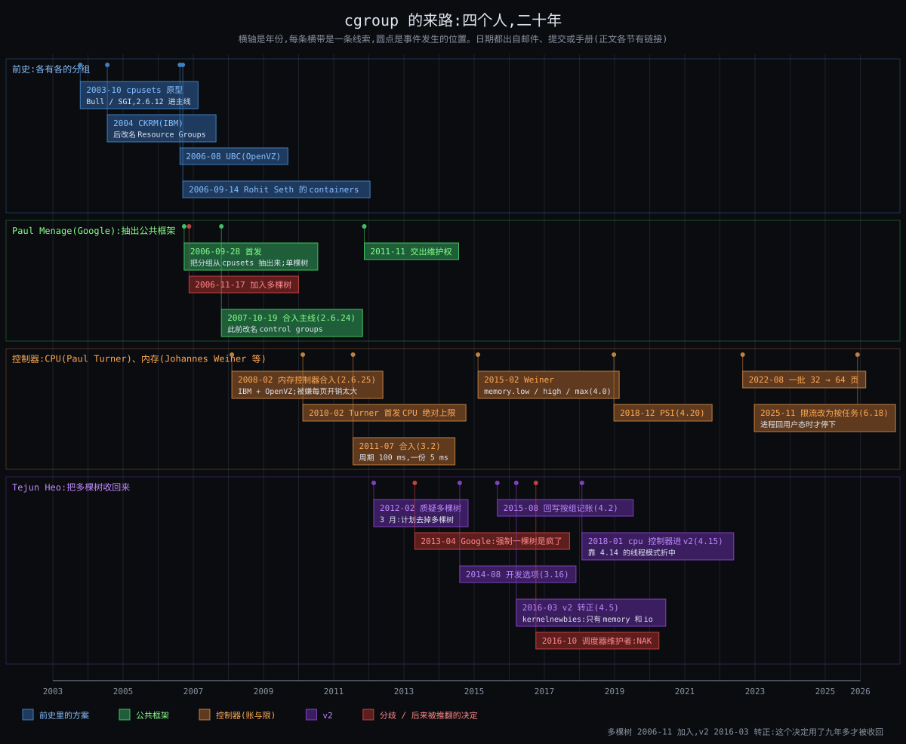

# 阶段 4:cgroup 是怎么来的

前三节有两处是「推演」而不是史实:第二节 §5 让你设想「先给每种资源各写一个限制器,再被逼着抽出公共框架」,§6 让你设想「公共框架只能复用内核已有路径记账」。这一节拿真实的历史去对。

主线是人。两位主角:做出第一版公共框架的 Paul Menage,和推翻重来做 v2 的 Tejun Heo。两位配角:给 CPU 加上绝对上限的 Paul Turner,重做内存控制器的 Johannes Weiner。四个人前后二十年,用一条时间线串起来。

关于资料。这一节的事实都出自这次实际打开读过的一手资料:内核邮件列表的原始邮件、内核提交、作者本人的论文、内核文档,少数地方用了 LWN 当时的报道。引语保留英文原文,后面跟一句中文大意。检索由四个助手分头做,我回原始网页或原文核对了其中 28 处关键引语,全部对得上(有一处我自己转录时写错了半句,核对时改正了);没有逐条复核的,以及查不到的,在文末单独列出。我动笔之前凭记忆列过一些人名和事迹,有几处和查到的不一样,也在文末写明。

## 约束清单速查(C1 ~ C5)

#### C1 — 按组限制合计用量
管的单位是组不是进程;上限是绝对数;组能套组,父组管整棵子树的合计。
**不可再分**:开几个进程是应用的自由;相对权重回答不了「最多多少」。
**口诀**:账记在组上,上限一超就处理。

#### C2 — 记实际用量,超限处理看资源类型
账记物理页、真实 CPU 时间、真实 IO;超了以后能等的等、能拒的拒,内存只能回收或杀。
**不可再分**:稀缺的是物理资源;物理页占了不还就没有。
**口诀**:记实际用掉的;超限怎么处理看资源类型。

#### C3 — 内核负责执行,配额由外部设定
归属和上限被管的进程改不了;谁该分多少内核不知道,由管理程序通过文件写进来。
**不可再分**:边界能被进程自己改就不存在边界;哪个业务重要内核无从判断。
**口诀**:内核负责执行,数字由外面定。

#### C4 — 在内核已有代码路径上记账,开销要小
所有业务共用一个内核;记账点只能挂在内核本来就要走的路上,必须便宜。
**不可再分**:每家一个内核资源无法互借;记账在最热的路上,开销一大,机器上所有程序都会跟着变慢。
**口诀**:在内核已有路径上记账,不另开新路。

#### C5 — 所有资源共用同一套分组
资源种类会不断增加,新增一种不能惊动已有的;一笔开销会跨几种资源,所以分组只能有一套。
**不可再分**:资源种类事先列不完;占内存的人和发 IO 的人不是同一个执行者。
**口诀**:分组只做一遍,账要对得上。

## §0 从「怎么做」走到「怎么来的」:三件事记住

第三节看到的是今天的成品:一个核心、一排控制器、五个接入点。这一节看它是怎么一步步变成这样的。二十年的历史压成三件事。

### §0.1 2006 年:分组被抽了出来,只做一遍

因为 `C5·所有资源共用同一套分组`(当时至少有四拨人在各做各的资源管理,每一拨都自带一套分组)→ 要解决「同一件事被重复做了四遍,而且互不相通」→ 所以 Paul Menage 把分组这件事从已有的 cpusets 里抽出来,做成一个与具体资源无关的公共框架,让各种资源的管理代码都挂在它上面。这就是今天「核心 + 控制器」这种结构的起点。

### §0.2 2006 → 2016 年:多棵树加进去以后,用了九年多才改回一棵

因为不同的人想按不同的方式给不同的资源分组(一个有名有姓的大学服务器例子)→ 要解决「一种分法满足不了所有资源」→ 所以第一版发出两个月后加上了「多棵树」:每种资源可以挂在自己的一棵树上。多棵树后来让控制器之间对不上账(`C5·所有资源共用同一套分组` 的后一半),Tejun Heo 从 2012 年开始要把它去掉,到 2016 年 v2 转正,中间争论了四年;cpu 控制器又因为另一场争论,到 2018 年才进 v2。

### §0.3 2008 → 2025 年:记账的做法一直在返工,为了更便宜、更准

因为 `C4·在内核已有代码路径上记账,开销要小`(记账落在最热的路上)和 `C2·记实际用量,超限处理看资源类型`→ 要解决「第一版的账太贵或者罚得不对」→ 所以每个控制器都被返工过不止一次:内存控制器最初每个物理页要多带五个指针,被发行版嫌贵,十几年里一步步减到一个;CPU 的绝对上限 2011 年才有,它「超了怎么停」的办法到 2025 年又换了一种。第三节里实测到的 5 ms、64 页、「进程回用户态时才停下」,都是这条线上某一次返工的结果。

### §0 结论

| 三件事 | 是什么 | 为什么发生 |
|---|---|---|
| 分组被抽出来(2006) | 把「谁和谁一组」做成公共的一层,与具体资源无关 | 四拨人各做一套分组,互不相通(`C5·所有资源共用同一套分组`) |
| 多棵树加入又去掉(2006 → 2016) | 第一版允许每种资源各挂一棵树;v2 只留一棵 | 当时想要灵活;后来发现控制器之间对不上账(`C5·所有资源共用同一套分组`) |
| 记账方式不断返工(2008 → 2025) | 内存的每页开销、CPU 额度的分配和限流方式,都重做过 | 记账在热路径上,必须便宜(`C4·在内核已有代码路径上记账,开销要小`);罚法要合资源的性质(`C2·记实际用量,超限处理看资源类型`) |

三件事的关系:第一件做出了公共框架;第二件是公共框架自己犯的错和改正;第三件是挂在框架上的各个控制器各自的返工。两位主角各管前两件,两位配角在第三件里。

## §1 一张时间线

从图上能读出五件事:

1. Menage 首发(2006-09-28)之前的两个月里,另外两套方案刚刚发出来(UBC 是 8 月,Rohit Seth 的 containers 是 9 月 14 日)。他是在一堆互不相通的方案中间动手的。
2. 多棵树(红色)是首发之后不到两个月加上的,不是一开始就有。
3. 框架 2007 年 10 月就合入了,但 CPU 的绝对上限要到 2011 年,内存控制器 v2 的接口要到 2015 年。框架先合入,控制器陆续加进来。
4. Tejun Heo 那条线上有两块红色:2013 年 Google 的反对,2016 年调度器维护者的拒绝。v2 不是一次想清楚、顺利落地的设计。
5. 控制器那条线一直延伸到 2025 年。第三节实测到的「进程回用户态时才停下」,在做实验时才合入一年。

## §2 前史:他动手时,桌上已经有什么

**结论:2006 年秋天,Linux 内核里和邮件列表上至少有四套「管一组进程的资源」的方案,出自四拨人。它们管的资源不同,但每一套都自己做了一遍「把进程分成组」。第二节 §5 的推演(一种资源写一个限制器,分组被重复做)和这段历史对得上,只是历史上不是一个人写了四个,而是四拨人各写各的。**

| 方案 | 谁做的 | 管什么 | 怎么给进程分组 | 结局 |
|---|---|---|---|---|
| cpusets | Simon Derr(Bull)2003 年写出原型,Paul Jackson(SGI)2004 年重写 | 进程能用哪几颗 CPU、哪些内存节点(大型 NUMA 机器) | 一个伪文件系统;`mkdir` 建组;把 pid 写进 `tasks` 文件入组;每个任务一个指针;fork 时继承 | 2.6.12 进了主线 |
| CKRM,后改名 Resource Groups | IBM(Shailabh Nagar、Chandra Seetharaman 等) | CPU、内存、IO、socket 等多种 | 「class」;归属由可插拔的分类器决定;界面是一个虚拟文件系统 | 没进主线 |
| UBC / beancounters | OpenVZ / SWsoft(Kirill Korotaev、Pavel Emelianov) | 内核内存、虚拟内存页、网络缓冲、任务数、文件数 | 「beancounter」,一个进程只属于一个,只有一层 | 没有原样进主线 |
| containers | Google 的 Rohit Seth,2006-09-14 | 内存页数、任务数 | 走 configfs,自己一套 | 被下面要讲的方案取代 |

来源:cpusets 的文件头与文档见 [2.6.12-rc2 的 kernel/cpuset.c](https://git.kernel.org/pub/scm/linux/kernel/git/torvalds/linux.git/plain/kernel/cpuset.c?id=1da177e4c3f41524e886b7f1b8a0c1fc7321cac2)、[cpuset(7)](https://man7.org/linux/man-pages/man7/cpuset.7.html);CKRM 见 [LWN 2004 年内核峰会报道](https://lwn.net/Articles/94573)、[2006-04 的改版 RFC](https://lwn.net/Articles/181151/);UBC 见 [2006-08-16 的首发邮件](https://lore.jethome.com/lkml/44E57F15.204@sw.ru/T/);Rohit Seth 见 [LWN 2006-09-19](https://lwn.net/Articles/200073/)。这张表由助手检索,我没有逐条复核。

注意 cpusets 那一行。目录是组、把 pid 写进一个文件就入组、fork 继承:第一节 §3 看到的成品外形,2004 年的 cpusets 里就已经是这样了。它只管一种资源,但它的分组做得最成熟。这一点决定了后面的事。

## §3 Paul Menage:把分组抽出来

**结论:Paul Menage 当时在 Google。他没有再做第五套资源管理方案,而是做了一件别人没做的事:把 cpusets 里已经做好的分组代码抽出来,变成一个与具体资源无关的公共框架,让 cpusets 反过来成为它的第一个客户。他自己把这个框架和「子系统」的关系比作 VFS 和具体文件系统。**

### §3.1 那封邮件

2006 年 9 月 28 日,Menage 往内核邮件列表发了一组四个补丁,标题是 "[RFC][PATCH 0/4] Generic container system"。开头这样写:

> There have recently been various proposals floating around for resource management/accounting subsystems in the kernel, including Res Groups, User BeanCounters and others. These all need the basic abstraction of being able to group together multiple processes in an aggregate, in order to track/limit the resources permitted to those processes, and all implement this grouping in different ways.

大意:最近有好几套资源管理方案在讨论,它们都需要「把多个进程聚成一组」这个基本抽象,又都用各自不同的方式实现了它。

> This patchset extracts the process grouping code from cpusets into a generic container system, and makes the cpusets code a client of the container system.

大意:这组补丁把进程分组的代码从 cpusets 里抽出来,做成一个通用的容器系统,并让 cpusets 成为它的一个客户。

出处:[2006-09-28 的邮件](https://lkml.iu.edu/hypermail/linux/kernel/0609.3/1487.html)(这两段我回原页核对过)。

他给的好处里有一条很实在:各家方案不用再自带分组,代码量小了,进主线的机会反而更大。他还提到,有了公共的分组,可以把 IBM 那套的 CPU 控制器和 OpenVZ 那套的内存控制器放在一起试。这正是 `C5·所有资源共用同一套分组` 的前一半:要管的资源不止一种,做它们的人也不止一拨。

### §3.2 他怎么描述这个框架

2007 年他在 Ottawa Linux Symposium 上发了一篇论文,把设计讲得很清楚。下面五段引语都出自这篇论文([论文 PDF](https://www.cs.ucr.edu/~nael/cs202/containers.pdf),用的是一份课程网站托管的副本,页眉与论文集一致;五段我都在全文里核对过)。

**框架和子系统的关系:**

> The relationship between the container framework and a subsystem is similar to that between the Linux VFS and a specific filesystem—the framework handles many of the common operations, and passes notifications/requests to the subsystem.

大意:框架和子系统的关系,类似 Linux 的 VFS 和具体文件系统的关系:框架处理大量公共操作,再把通知和请求转给子系统。

第三节 §15 里我把 cgroup 和 VFS 排在一张表里,说它们结构相同,当时注明是「凭我的了解写的类比」。现在可以去掉这个保留:这个类比是作者本人给的。

**框架不规定资源长什么样:**

> (Specifically, this framework does not attempt to prescribe any particular resource abstraction.)

大意:这个框架不打算规定任何特定的资源抽象。

这是他和 IBM、OpenVZ 两套方案的分界。那两套都自带一个资源模型,要求每种资源往里套;他在论文里说,cpusets 现有的界面在那两套上面根本实现不出来。五条设计原则里的第一条「公共框架加资源插件」,在这里有了出处。

**为什么界面是文件:**

> A filesystem interface, where each subsystem can register files that the user can write (for configuration) and/or read (for reporting) has the advantages that it can be manipulated by many standard unix tools and library routines, has built-in support for permission delegation, and can provide arbitrary input/output formats and behaviour.

大意:用文件系统做界面,每个子系统登记自己的文件。好处是标准的 unix 工具都能操作它,权限委派是现成的,输入输出格式也自由。

**两条要求,和第二节的约束逐字对得上:**

> Once a process has been assigned to a container, it shouldn't be possible for the process (or any of its children) to move to a different container without action by a privileged (i.e. root) user, or by a user to whom that capability has been delegated

大意:进程一旦被分到某个组,它自己和它的孩子都不该能换组,除非有特权用户或被授权的用户出手。这就是 `C3·内核负责执行,配额由外部设定` 的前一半。

> The container framework should provide minimal additional runtime overhead over a system where individual subsystems are hard-coded into the source at all appropriate points

大意:和把各个子系统直接硬编码进内核相比,框架带来的额外运行时开销应当尽量小。这就是 `C4·在内核已有代码路径上记账,开销要小`。

### §3.3 从首发到合入

- 从 2006 年 9 月到 2007 年 7 月,补丁至少发了 11 版。
- 名字改过。最初叫 containers,但这个词别的项目也在用;2007 年 9 月 17 日他发了 33 个补丁,把名字统一改成 control groups。LWN 当时给的理由是原来的名字太泛:这套代码只是容器方案的一部分([LWN 2007-10-29](https://lwn.net/Articles/256389/))。是谁提议改名的,没有查到。
- 2007 年 10 月 19 日,Linus 把框架合入主线。它随 2.6.24 在 2008 年 1 月 24 日发布。
- 合入的那个框架提交里,一个子系统都没有。到 2.6.24 发布时有五个:cpuset、debug、ns、cpu(按权重的组调度)、cpuacct。内存控制器要到下一个版本 2.6.25。

出处:[合入提交 ddbcc7e8](https://git.kernel.org/pub/scm/linux/kernel/git/torvalds/linux.git/commit/?id=ddbcc7e8e50aefe467c01cac3dec71f118cd8ac2)、[2.6.24 的子系统清单](https://git.kernel.org/pub/scm/linux/kernel/git/torvalds/linux.git/plain/include/linux/cgroup_subsys.h?h=v2.6.24)、[改名补丁的邮件](https://lkml.iu.edu/hypermail/linux/kernel/0709.2/0663.html)。这一小节由助手检索,我没有逐条复核。

「先合入一个空的框架,控制器之后一个个加」这件事本身,就是这个框架想要的效果:新增一种资源,不用惊动已有的。

悬念:框架合入了。但首发两个月后,Menage 往里加了一样东西,后来的人花了九年多才把它拿掉。

## §4 多棵树:一个当时看来合理的决定

**结论:第一版只有一棵树。多棵树是 2006 年 11 月加上的,理由是不同资源想按不同方式分组。Menage 本人当时就看到了它的代价,但选择了保留这份灵活。**

**一句话:因为不同的资源想按不同的标准给同一批进程分组,一棵树只能表达一种分法。**

拿那台大学服务器说:CPU 想按「教授 / 学生」分,网络想按「浏览器 / NFS / 其他」分。这是两种互不相干的分法。只有一棵树,就得把两种分法乘起来建组(教授的浏览器、教授的 NFS、学生的浏览器……),分法一多,组的个数成倍涨;有了多棵树,CPU 一棵、网络一棵,各分各的。

2006 年 9 月的首发版是一棵树、多个子系统。11 月 17 日,他发了新的一版,标题就叫 "Multi-hierarchy Process Containers":

> The major change is support for multiple hierarchies of containers (up to a limit specified at build time).

大意:主要变化是支持多棵容器的树。([邮件](https://lkml.indiana.edu/0611.2/0537.html),助手检索)

为什么加?他在论文里交代,最早做过「所有子系统共用同一种分法」的版本,被人用例子驳倒了:

> However, very plausible scenarios were presented to demonstrate that this was too limiting.

大意:有人给出了很合情理的场景,说明这样限制太死。(论文,我核对过)

那个场景写进了内核文档,出自 IBM 的 Srivatsa Vaddagiri:一台大学的服务器,CPU 想按「教授 / 学生」分,内存和磁盘想按用户类别分,网络想按流量类型分(浏览器 20%、NFS 60%、其他 20%)。只有一棵树的话,每开一个浏览器都得单独建一个组。

所以合入时的文档这样写多棵树的好处:

> having parallel hierarchies allows each hierarchy to be a natural division of tasks, without having to handle complex combinations of tasks that would be present if several unrelated subsystems needed to be forced into the same tree of cgroups.

大意:几棵树并存,每棵树都可以是对任务的一种自然划分;不必把几个不相干的子系统硬塞进同一棵树,去处理各种组合。([合入时的 cgroups.txt](https://git.kernel.org/pub/scm/linux/kernel/git/torvalds/linux.git/plain/Documentation/cgroups.txt?id=ddbcc7e8e50aefe467c01cac3dec71f118cd8ac2),助手检索)

代价他自己说过。2006 年 12 月,cpusets 的作者 Paul Jackson 主张走得更远:每个子系统自成一棵树。Menage 回信不同意,理由有两条:

> you have to manage N hierarchies of containers for N subsystems, rather than just one.

> if a task is forking just as you start moving it from one container to another (in each of the N hierarchies) you could end up with the child in the original container in some hierarchies, and in the new container in others, which isn't ideal.

大意:N 个子系统就得管 N 棵树;而且如果一个任务正好在你搬它的时候 fork,孩子可能在一些树上留在旧组、在另一些树上进了新组。([邮件](https://lists.openwall.net/linux-kernel/2006/12/22/134),助手检索)

第二条说的,就是第二节 §8.2 里「同一个进程在三棵树上有三处组籍」的毛病(组籍是进程身上记录它属于哪个组的那个指针,内核里叫 `css_set`)。它在多棵树加入一个月后就被作者本人指了出来。最后的折中是两头都允许:子系统可以各挂各的树,也可以几个共用一棵。

### §4.1 你的视角:如果是我,不加

读完这一节后的一个问题:多棵树在 2006 年有道理,2012 年被认定是错的。如果你是 2006 年的 Menage,手里只有当时的信息,会不会加?

你的回答:「不会。」

这个答案和历史最后走到的地方一致,而且 2006 年就有支持它的理由:Menage 自己写下了两条代价(要管 N 棵树;fork 时孩子可能落在不一致的组里)。按这两条,不加是站得住的。

但「不会」要回答一个问题:那台大学服务器怎么办?不加多棵树,只剩两条路。

- **把分法乘起来。** 教授的浏览器、教授的 NFS、学生的浏览器……每种组合一个组。两种分法还能忍,三四种就建不过来了。
- **放弃其中一种分法。** 承认「CPU 按身份分、网络按流量类型分」这种互不相干的需求,这套东西不支持。

十年后的 v2 选的就是第二条,只是做了一点弥补:同一棵树上,不同的资源可以开到不同的深度(父组往下开哪些控制器是可以选的)。这能解决「CPU 分得粗、内存分得细」,解决不了「两种分法互不相干」。真正互不相干的分法,v2 就是不支持。

所以「不加」不是没有代价的选择,它等于替一部分用户说「你这个需求我不管」。2006 年很难做出这个取舍,有两个原因,都是当时看不到、后来才看得到的:

- **代价当时还没有出现。** 多棵树最大的毛病是控制器之间对不上账。可 2006 年还没有需要对账的控制器:内存控制器 2008 年才合入,带缓冲的写该记给谁的问题到 2015 年才被解决。`C5·所有资源共用同一套分组` 的后一半,当时还不存在。
- **需求是真的,而且就在眼前。** 例子是 IBM 的人提的;Google 自己后来把多棵树用得很深,2013 年 Tim Hockin 反对收回时说过,拆分层级的能力「救了我们的机群」。Tejun 能提出收回,是因为又过了六年,他能说出「没有人给出足够有力的理由」这句话。

这就是「用统一的方式管理所有资源」这条原则难的地方:**它是在押一个判断:被去掉的那些用法,很少有人真的需要。** 2012 年有六年的使用情况可以参考,2006 年没有。你说「不会」,是在没有这六年证据的情况下做了同样的判断;结果和历史一致,但要认下:那台大学服务器的需求,这个选择就不管了。

2011 年 11 月,Menage 交出了维护权。提交说明只有一句:

> As is probably painfully obvious, I don't have time to be a cgroups maintainer.

大意:大家大概都痛苦地看出来了,我没有时间做 cgroups 的维护者。([邮件](https://lkml.iu.edu/hypermail/linux/kernel/1111.1/03027.html),我核对过)

接手的是 Tejun Heo,和已经在共同维护的 Li Zefan。

悬念:框架和多棵树先放一放。框架合入时,CPU 只能按权重分,没有上限;内存控制器还没进来。第一节那两个灵魂问题问的东西,当时都还不存在。

## §5 配角一 Paul Turner:给 CPU 加上绝对上限

**结论:`cpu.max` 背后的机制叫 CFS bandwidth control,是 Google 的 Paul Turner 做的,2011 年 7 月合入,随 3.2 发布。第三节看到的「组的总额度 + 每颗核各领一小份」是他和前一个方案争出来的结果。那两个数字里,5 ms 最初其实是 10 ms。而「超了以后怎么停」的办法,在 2025 年被换掉了。**

### §5.1 只有权重时缺什么

框架合入的同一天,IBM 的 Srivatsa Vaddagiri 把组调度接到了 cgroup 上:组和组之间可以按权重分 CPU。这就是第二节 §10.1 实测的 `cpu.weight` 的前身。

两年后,Turner 等人在论文里写了只有权重为什么不够:

> The maximum amount of CPU time available to a group is not predictable. While this is closely related to the first point, the distinction is worth noting as this directly affects capacity planning.

大意:一个组最多能拿到多少 CPU 时间是不可预测的,这直接影响容量规划。

> In such systems, customers would object should they receive less and its in the provider's interest that they not provided more.

大意:给多个客户提供服务的系统里,客户拿少了会抗议;而多给,又不符合提供方的利益。

出处:[Paul Turner、Bharata B Rao、Nikhil Rao,"CPU bandwidth control for CFS",OLS 2010](https://www.kernel.org/doc/ols/2010/ols2010-pages-245-254.pdf)(助手检索)。

这和第二节 §2.1 实测到的「洞一:没有天花板」是同一件事。`C1·按组限制合计用量` 里「上限是绝对数」那个要点,在历史上比「单位是组」晚了四年才兑现。

### §5.2 两个方案

最早提出给 CFS 加硬上限的是 IBM 的 Bharata B Rao,2009 年 6 月。他的做法是照搬实时调度已有的带宽控制:每颗 CPU 一份本地额度,不够了互相借。

2010 年 2 月 12 日,Turner 发出了另一种做法,并说明为什么不沿用前者:

> In particular we felt the original approach did not scale well with increasing number-of-cores or small reservations.

大意:我们觉得原来的做法在核数增多、或者额度很小的时候,扩展性不好。([邮件](https://lwn.net/Articles/374237/),助手检索)

论文里把两个极端都否了:每颗核各有一份额度、互相借,是多对多的关系,核一多就不行;只有一份全局额度,所有核都来抢,也不行。于是取中间:

> Our design for the distribution of quota is a hybrid model which attempts to combine both local and global quota tracking.

大意:我们分发额度的设计是一个混合模型,把本地记账和全局记账结合起来。

> Since this lock is already held for existing CFS accounting, this allows the local tracking of quota to be performed with no additional locking.

大意:本地那一份额度的记账,可以在调度器本来就要拿的那把锁的保护下做,不需要额外加锁。

第二句值得多读一遍。它说的就是第三节 §4 的两个发现:89% 的记账只动本核领到的那一小份额度;记账那一步放在调度器本来就要走的 `update_curr` 上。「复用内核已有路径记账」在 CPU 这条线上,是作者写在论文里的设计理由。

Bharata 后来停掉了自己的系列,转而和 Turner 合作。2011 年 7 月 21 日,这组补丁合入,随 3.2 发布。

### §5.3 两个数字

第三节 §4.6 说过,5 ms 和 100 ms 的来历「留给读源码那一步」。这次查到了一半。

- **每次领一份,5 ms。** 合入的代码里确实写着默认 5 毫秒([提交 ec12cb7f](https://github.com/torvalds/linux/commit/ec12cb7f31e28854efae7dd6f9544e0a66379040.patch),我核对过)。但 Turner 2010 年 2 月的首发邮件里写的是 "default currently 10ms"(我核对过),同年的论文里也是 10 ms,并且说把它调小「没有观察到可测的性能影响」。从 10 改成 5 是在哪一版、为什么,没有查到作者的解释。
- **周期 100 ms。** 合入的代码里默认值是 0.1 秒。论文只测了 100、250、500 毫秒三种周期,结论是周期越长偏差越小。为什么默认选 100,同样没有查到解释。

内核文档对每次领多少的取舍只有一句话:份大一些,领取的开销小;份小一些,消耗得更细([sched-bwc 文档](https://docs.kernel.org/scheduler/sched-bwc.html))。这和第三节 §4.6 的推理方向一致,但那两个具体的数为什么是它们,目前只能写成:没有找到出处。

### §5.4 「超了怎么停」在 2025 年被换掉了

2010 年的论文里,限流是这样描述的:

> Since bandwidth is defined on at the group level it should be noted that an individual task entity will never be throttled, only its parent.

大意:额度定义在组这一层,所以单个任务永远不会被限流,被限流的只是它上面的组。

也就是说,原来的做法是把这个组在这颗核上的整个队列从运行队列上摘下来,组里的任务自然就跑不了。

第三节 §7.4 实测到的不是这样:内核只给这个组设一个限流标记,每个进程在自己回用户态的路上检查到标记后停下。当时我写「印象中是 6.18 前后改的」,记进了待核。现在核实了:

- 提交标题是 "sched/fair: Switch to task based throttle model",提交署名是 Red Hat 的 Valentin Schneider,由字节跳动的 Aaron Lu 接力发完整个系列,合入 6.18(2025 年 11 月 30 日发布)。6.17 的源码里没有这套机制,6.18 里有。
- 动机写在提交说明里:

> This has a drawback though: assume a task is a reader of percpu_rwsem and is waiting. When it gets woken, it can not run till its task group's next period comes, which can be a relatively long time. Waiting writer will have to wait longer due to this and it also makes further reader build up and eventually trigger task hung.

大意:旧做法有个缺点。设想一个任务是某把读写锁的读者,正在等。它被唤醒后要等到它那个组的下一个周期才能跑,这可能很久。等着写的人因此要等更久,后面的读者越积越多,最后触发任务挂起。

> In this way, tasks throttled will not hold any kernel resources.

大意:这样一来,被限流的任务不会占着任何内核资源。

出处:[提交 e1fad12d](https://github.com/torvalds/linux/commit/e1fad12dcb66b7f35573c52b665830a1538f9886.patch)(这两段我核对过)。Aaron Lu 在封面信里还说,他们的环境里因为 CPU 限额时不时出现任务挂起;在实时内核上,同样的情形会形成循环死锁。

第三节 §7.4 凭记忆写的动机(「在内核里拿着锁时被冻住会连累别的组」)方向是对的,原文更具体:是一把读写锁上,被限流的读者拖住了写者,写者又拖住了后面所有读者。

这件事对理解第二条主线有分量。**从 2011 年合入到 2025 年改掉,旧的限流办法用了十四年。它出的问题,正是「限一个组的额度,结果拖慢了组外的程序」。** 第三节 §6.5 补跑时看到的「组外的 `sync` 被 report 的 io 限速拖了 3 秒」是同一类问题,只是发生在磁盘那条线上,那一处今天还在。

中间还有两次返工,各记一笔:2019 年 Indeed 的 Dave Chiluk 发现,线程多、用不满额度的程序也会被大量限流,原因是各核领到手但没用完的额度到周期末会作废;修法是把作废机制整个删掉(5.4)。2021 年阿里巴巴的 Huaixin Chang 加了「突发」:平时没用完的额度可以攒一点留给高峰(5.14)。

| 没有它会坏在哪 | 它解决了 |
|---|---|
| 只有权重时,一个组最多能吃多少 CPU 说不出一个数 | 2011 年有了绝对上限 |
| 每颗核各有额度、互相借,核一多就不行;只有全局额度,大家抢锁 | 全局额度 + 每核各领一小份 |
| 整组摘下运行队列,拿着锁的任务被冻住,连累组外 | 2025 年改成任务回用户态时才停下 |

悬念:CPU 的账返工了三四次。内存的账更曲折,它差一点因为太贵而没人用。

## §6 配角二 Johannes Weiner:内存控制器的两个阶段

**结论:内存控制器 2008 年 2 月合入,最初出自 IBM 的 Balbir Singh 和 OpenVZ 的 Pavel Emelianov。它一进来就被嫌贵:每个物理页要多带几个指针。此后十几年,富士通的 KAMEZAWA Hiroyuki 和 Johannes Weiner 等人一步步把这笔开销降下来。Weiner 另一件事是在 v2 里重做了内存的界面:`memory.low`、`memory.high`、`memory.max` 是他 2015 年提交的,提交说明里有他对旧界面的逐条批评。动笔前我说「整组一起杀」也是他做的,这一条错了。**

### §6.1 第一阶段:合入,然后被嫌开销大

2007 年 2 月,Balbir Singh 在 Menage 的框架上发出了第一个内存控制器。当时列的卖点第一条是:

> 1. Zero overhead in struct page (struct page is not expanded)

大意:每个物理页的描述结构(struct page)零开销,不会变大。([邮件](https://lkml.indiana.edu/0702.2/0977.html),助手检索)

这句话没能保持到合入。要按组回收,就得知道每一页属于哪个组、在这个组的回收队列里排在哪。到 2007 年 7 月,LWN 这样描述当时的版本:

> There is, thus, a significant cost associated with the memory controller - the addition of five pointers (one in struct page, four in struct meta_page) and one atomic_t for every active page in the system can only hurt.

大意:内存控制器的代价很可观:系统里每个活跃的页要多五个指针和一个计数,这只会带来损害。([LWN 2007-07-31](https://lwn.net/Articles/243795/),助手检索)

2008 年 2 月 7 日,内存控制器合入,随 2.6.25 发布。这组提交里,Balbir 署名了记账、每组的回收队列和回收,Pavel Emelianov 署名了页的归属和组内 OOM。组内 OOM 的那个提交说明只有两句,第一句就是第三节 §8 看到的行为:

> Out of memory handling for cgroups over their limit. A task from the cgroup over limit is chosen using the existing OOM logic and killed.

大意:处理超限的组的内存耗尽:用已有的 OOM 逻辑,在超限的那个组里挑一个任务杀掉。([提交 c7ba5c9e](https://github.com/torvalds/linux/commit/c7ba5c9e8176704bfac0729875fa62798037584d.patch),助手检索)

「用已有的 OOM 逻辑」这几个字,回答了第二节的待核 #2:组内 OOM 和全机 OOM 用同一套挑人规则,从第一天起就是这么设计的,只是范围不同。

合入之后,开销的问题没有过去。KAMEZAWA 2010 年在邮件里回忆:

> Fedora maintaienr said "we never enable memcg if you contiue to use page->page_cgroup pointer, 8bytes per page costs!".

大意:Fedora 的维护者说:你们要是继续在每页上放那个指针,我们永远不会启用内存控制器,每页 8 字节太贵!([邮件](https://lkml.iu.edu/hypermail/linux/kernel/1004.0/01845.html),原文有拼写错误,照录;这是当事人事后的回忆,Fedora 一方的原始记录没有查到)

这是 `C4·在内核已有代码路径上记账,开销要小` 最直白的一次体现:一个记账机制如果让不用它的人也承担开销,发行版就不开它,它就等于不存在。

#### §6.1.1 你的视角:0.2% 为什么有人在意

KAMEZAWA 算过,48 GB 的机器上每页 8 字节合 96 MB,大约 0.2%。问:听起来不多,发行版为什么这么在意?

你的回答:「Linux 要求极致的性能,所以在意。」

这一半是对的。内核的人对每个物理页的描述结构(struct page)抠得很紧,因为它是全系统份数最多的结构,每 4 KiB 内存就有一份。同一封邮件往来里,IBM 的 Heiko Carstens 说过一句:

> we do everything to not even waste a single bit in struct page and all of a sudden on the enterprise distros we allocate (by default!) 40 additional bytes per page.

大意:我们想尽办法连一个比特都不在 struct page 里浪费,结果企业发行版上突然(默认!)每页多分配 40 字节。([邮件](https://lkml.iu.edu/hypermail/linux/kernel/1004.0/01845.html),助手检索)

但要紧的不只是「追求性能」,还有另一半:**这笔开销由谁承担。**

- 这 0.2% 不是只由用内存控制器的人承担,而是所有人。只要内核编译时带了它,每台机器的每个页都多这几个字节,哪怕这台机器上一个组都没建。
- 发行版只发一个内核,配置是给所有用户的。2008 年用得上按组限内存的用户是少数。为少数人的功能让所有人付 0.2%,发行版的回答就是不开。
- 发行版不开,这个功能对绝大多数用户就等于不存在。

所以这件事的教训比「要快」更具体:**一个机制如果让不用它的人也承担开销,它就进不了默认配置;进不了默认配置,就等于没有。** 这是 `C4·在内核已有代码路径上记账,开销要小` 里「不用的人几乎零成本」那一半的来历,它是发行版用「不启用」这个选择表达出来的。后来的每一步返工(开机时整块预分配、关掉就没有这笔开销;v2 的 socket 记账写明「只在建了非根组并开启记账时才有开销」)都在回答同一句话。

拿数据库比:这就像为了一个只有少数租户才用的功能,给每张表的每一行都加一个隐藏列。功能本身再好,默认打开它的那个版本也很难被接受。

第三节 §4.5 的补跑实验量到的现象(根组里的进程缺页 1562 次,记账 0 次)是这段历史今天的样子:不用的人,这一步不走。

### §6.2 把账做便宜

接下来是一连串返工,都是为了一件事:降低开销。

- **2008 年**,KAMEZAWA 把「每页一个指针」改成开机时整块预分配,关掉内存控制器时可以不付这笔钱。他在提交说明里算过:48 GB 内存的机器省下 96 MB。
- **2009 年底**,KAMEZAWA 引入了每颗 CPU 的批量记账,这就是第三节 §5 里每颗核先领一小份、用完再领的做法。提交说明里的理由和第三节 §5.5 的推理一样:

> The most important point of this patch is that we never touch res_counter in fast path. The res_counter is system-wide shared counter which is modified very frequently. We shouldn't touch it as far as we can for avoiding false sharing.

大意:这个补丁最要紧的一点是,快路径上不再碰那个全系统共享的计数器。它被改得太频繁,能不碰就不碰。([提交 cdec2e42](https://github.com/torvalds/linux/commit/cdec2e4265dfa09490601b00aeabd8a8d4af30f0.patch),助手检索)

- **2014 年**,Weiner 走了回头路,而且有道理:此时每页只剩一个指针了,为了省它而多绕一层的复杂度不值得,他把这个指针直接放回了页的描述结构 struct page 里。第三节 §5.4 用 `/proc/kpagecgroup` 查到的「页上记着它属于哪个组」,就是这个指针。

**「一批 64 页」的来历有个插曲。** 2009 年那个提交,说明里写的是一次预扣 64 页,代码里的常量却是 32 页。这个不一致留了十几年。2022 年 8 月,Google 的 Shakeel Butt 把它改成 64:

> For several years, MEMCG_CHARGE_BATCH was kept at 32 but with bigger machines and the network intensive workloads requiring througput in Gbps, 32 is too small and makes the memcg charging path a bottleneck.

大意:这个批量多年来一直是 32,但机器变大、网络密集型负载要求每秒上吉比特的吞吐之后,32 太小,让内存记账的路径成了瓶颈。([提交 1813e51e](https://github.com/torvalds/linux/commit/1813e51eece0ad6f4aacaeb738e7cced46feb470.patch),我核对过)

他给的数字是:72 核机器上,一个网络测试的吞吐提高了 62.7%。所以第三节 §5.4 实测到的「400 次,每次 64 页」,是 2022 年以后的内核才有的;早四年做同一个实验,会是 800 次,每次 32 页。第三节 §5.5 给 64 的解释(批量越大越省,但账面偏差越大)方向没错,不过历史上推动它从 32 变成 64 的理由更直接:32 已经成了瓶颈。

### §6.3 第二阶段:Weiner 重做界面

Weiner 从 2008 年起做内存管理,2011 年起做 cgroup。2015 年 2 月,他提交了 v2 的内存界面:`memory.low`、`memory.high`、`memory.max`(随 4.0)。提交说明很长,里面有他对旧界面的批评。下面两段都出自 [提交 241994ed](https://github.com/torvalds/linux/commit/241994ed8649f7300667be8b13a9e04ae04e05a1.patch)(我核对过)。

对 v1 的软限制(soft limit):

> First off, the soft limit has no hierarchical meaning. All configured groups are organized in a global rbtree and treated like equal peers, regardless where they are located in the hierarchy. This makes subtree delegation impossible. Second, the soft limit reclaim pass is so aggressive that it not just introduces high allocation latencies into the system, but also impacts system performance due to overreclaim, to the point where the feature becomes self-defeating.

大意:第一,软限制没有层级的含义。所有设了它的组被放进一棵全局的树里当作平级对待,不管它们在层级里的位置,这让子树没法委派。第二,软限制的回收太凶,不仅带来很高的分配延迟,还因为回收过头而影响整机性能,到了适得其反的地步。

第一条批评的是 `C1·按组限制合计用量` 里「组套组」那个要点:一个不讲层级的设置项,在一棵树上是用不了的。新的 `memory.low` 改成了自上而下分配的保留量,第二节 §10.3 实测的就是它。

对硬上限,以及为什么要加一个 `memory.high`:

> Since working set size estimation is hard and error prone, and getting it wrong results in OOM kills, most users tend to err on the side of a looser limit and end up wasting precious resources.

大意:估计一个程序到底需要多少内存很难,也容易错;估错了的后果是被 OOM 杀掉,所以大多数用户宁可把上限设松,结果浪费了宝贵的资源。

> The memory.high boundary on the other hand can be set much more conservatively. When hit, it throttles allocations by forcing them into direct reclaim to work off the excess, but it never invokes the OOM killer.

大意:`memory.high` 可以设得保守得多。撞上它,内核会强制进程自己去回收、把超出的部分消化掉,以此让分配慢下来,但绝不触发 OOM。

第二节 §10.3 的表里有一行「超了先减速、不杀」,当时注明没有实跑。它的来历在这里:内存「等不来」(`C2·记实际用量,超限处理看资源类型`),硬上限的处置只能是杀;Weiner 加的这一档,是想在杀之前给内存也造一个「慢下来」的处置。

**这里要纠正两处我动笔前的说法。**

- 我说 Weiner 做这些时在 Facebook。查到的证据是:2014 年他署名的源文件头写的是 Red Hat,2018 年的提交里才出现 Facebook 的邮箱。2015 年提交 `memory.low / high / max` 时他在哪家公司,没有直接证据;他什么时候换的公司,没有查到。
- 我说「整组一起杀」(`memory.oom.group`)是 Weiner 做的。不是。它是 Facebook 的 Roman Gushchin 做的,2018 年随 4.19。动机是:OOM 只杀组里的一个进程,会把一个由多个进程组成的任务留在不一致的状态。这正是第二节 §9.2 末尾提过的那个问题(「一个任务死了 7/8,剩下的该不该一起死」)。

### §6.4 之后:压力信号

Weiner 在 Facebook 期间做的另一件事是 PSI(pressure stall information,2018 年随 4.20)。它不设限,只量一件事:这个组的进程因为缺资源而干等了多久。他在邮件里讲了来由:

> the OOM killer is triggered by reclaim not being able to free pages, but with fast flash devices there is *always* some clean and uptodate cache to reclaim; the OOM killer never kicks in, even as tasks spend 90% of the time thrashing the cache pages of their own executables.

大意:OOM 是在回收不出页的时候触发的。但有了很快的闪存盘,总有一些干净的缓存可以回收,于是 OOM 永远不来,哪怕任务 90% 的时间都耗在反复换入自己可执行文件的缓存页上。([邮件](https://lwn.net/ml/cgroups/20180712172942.10094-1-hannes@cmpxchg.org/),助手检索)

这段话对着第三节 §8.1 读很有意思。那里实测:页缓存撞线 146 次,全部靠回收解决,一次 OOM 都没有。当时把它当好事讲。Weiner 说的是它的另一面:回收得动不等于活得好,一个组可以一直卡在「回收、再读回来」的循环里,既不死也不干活。内核里「回收不动才杀」的规则管不了这种情况,所以他们在内核外面写了一个盯着压力信号、提前动手的程序。这又是 `C3·内核负责执行,配额由外部设定`:什么时候该杀,是策略,放在外面。

| 没有它会坏在哪 | 它解决了 |
|---|---|
| 每页多带五个指针,不用的人也承担开销,发行版不肯开 | 预分配、批量记账、最后压到一个指针 |
| 软限制不讲层级、回收过头 | `memory.low`:自上而下的保留量 |
| 上限只有「杀」一种处置,用户只好把上限设松 | `memory.high`:先慢下来 |
| OOM 只杀一个进程,留下半死的任务 | `memory.oom.group`(Roman Gushchin) |

悬念:两个控制器各自返工的时候,框架那边的多棵树一直没动。直到换了维护者。

## §7 Tejun Heo:把多棵树收回来

**结论:Tejun Heo 2011 年 11 月接手,三个月后就公开说多棵树是个问题,再过三周说要把它列入要去掉的名单。从这句话到 v2 转正用了四年,中间 Google 的人公开反对;转正时 v2 里连 cpu 控制器都没有,因为调度器的维护者拒绝接受 v2 的规矩,这场争论又拖了两年,以一个折中收场。**

### §7.1 他点了什么名

2012 年 2 月 21 日,Tejun 在邮件列表上发起讨论,标题是 "[RFD] cgroup: about multiple hierarchies"。几句原话:

> The support for multiple process hierarchies always struck me as rather strange.

> A related limitation is that as different subsystems don't know which hierarchies they'll end up on, they can't cooperate.

> It seems to me that cgroup interface is too complicated and inflexible at the same time to be useful in generic manner.

大意:对多棵进程树的支持,我一直觉得很奇怪。一个相关的限制是:各个子系统不知道自己最后会落在哪棵树上,所以没法协作。在我看来,cgroup 的界面既太复杂、又不够灵活,很难被通用地用起来。([邮件](https://lists.openwall.net/linux-kernel/2012/02/21/451),助手检索)

第二句就是第二节 §8.2 的「痛一:多棵树,记录对不上」。那一节用的例子是带缓冲的写:占内存的账在 memory 那棵树上,写盘的 IO 该记在 blkio 那棵树的哪个组的账上?第二节的待核 #4 一直缺一条一手出处,说明 v1 时代带缓冲的写确实限不住。这次找到了,是 Tejun 2015 年 1 月的补丁说明:

> blkcg can't tell which cgroup should be held responsible for a given writeback IO and charges all of them to the root cgroup - all normal write traffic ends up in the root cgroup.

大意:块 IO 的控制器分不清一笔回写 IO 该算在哪个组的账上,于是全部记到根组,所有普通的写流量最后都落在根组。([邮件,LWN 收录](https://lwn.net/Articles/628631/),我核对过)

也就是说,在 v1 里,第二节 §9.3 那个「带缓冲的写也被限住」的实验根本做不出来:那 50 MiB 会全部记在根组的账上,report 的限速对它无效。

2012 年 3 月 12 日,讨论了三周之后,他下了结论:

> At least to me, nobody seems to have strong enough justification for orthogonal multiple hierarchies, so, yeah, unless something else happens, I'm scheduling multiple hierarchy support for the chopping block. This is a long term thing (think years), so no need to panic right now

大意:至少在我看来,没有人给出足够有力的理由来保留互相独立的多棵树。所以,除非出别的事,我打算把多棵树的支持列入要去掉的名单。这是一件长期的事(以年计),现在不用慌。([邮件](https://lkml.iu.edu/hypermail/linux/kernel/1203.1/02252.html),我核对过)

### §7.2 反对的声音

收回一份已经给出去的自由,不会没有人反对。2013 年 4 月 22 日,Google 的 Tim Hockin 回信:

> We absolutely depend on the ability to split cgroup hierarchies.

> A mandated unified hierarchy is madness.

大意:我们绝对依赖把 cgroup 的层级拆开的能力。强制统一成一棵树是疯了。([邮件](https://lkml.rescloud.iu.edu/1304.2/03013.html),我核对过)

这里有一层讽刺:多棵树正是七年前同一家公司的 Menage 加进去的,Google 是把它用得最深的用户之一。

Tejun 的回应里有一句,最接近第二节 §8.7 总结的「用统一的方式管理所有资源」:

> The level of flexibility makes it very difficult to scope the common usage models.

大意:灵活到这种程度,让人很难给常见的用法划出一个范围。([邮件,2013-06-26](https://lkml.iu.edu/hypermail/linux/kernel/1306.3/02520.html),我核对过)

同一封信里他还说,旧界面会继续维护,但新功能只给统一的那一棵树。这是他推进的办法:不删旧的,只让新功能加在新的统一层级上。

要如实说明的是:「把多棵树收回来」是我的概括。Tejun 本人有没有用过这样的字面说法,没有查到;能引的最接近的原话就是上面这一句,以及他说 cgroup 的现状「招来一些相当疯狂的用法,而我们以后没法收回」。

### §7.3 转正,和一个没进来的控制器

- **2014 年 8 月**(3.16),统一层级第一次出现在内核里,但藏在一个名字带 `__DEVEL__` 的开发选项后面,只给明确要用的人。
- **2015 年 8 月**(4.2),Tejun 做的回写归属合入:带缓冲的写,IO 记到弄脏这些页的那个组的账上。这是统一层级带来的第一件 v1 做不到的事。
- **2016 年 3 月**(4.5),开发标志去掉,v2 转正,用新的文件系统类型 `cgroup2` 挂载。

转正时 v2 带了哪些控制器,两个来源说法不同。第二节 §8.6 引的手册 cgroups(7) 列的是 io、memory、pids 三个「自 4.5 起」;kernelnewbies 的 4.5 页面写的是「only memory and io controllers are available at the moment」(我核对过)。两处都照录,以哪个为准我没有再去查提交。可以确定的是:**没有 cpu。**

cpu 控制器进不来,不是技术上做不出,是调度器的维护者 Peter Zijlstra 不接受 v2 的规矩。他要的是按线程分组(同一个进程里的线程可以在不同的组里,有些用户确实这么用),而 v2 只认进程,并且不许有进程的组再往下分资源。2016 年 10 月他在邮件里写:

> My NAK on v2 stands.

大意:我对 v2 的否决不变。([邮件](https://lkml.iu.edu/hypermail/linux/kernel/1610.0/01478.html),我核对过。这封信里他的措辞很重,这里只引这一句)

Tejun 同年 8 月专门写了一份说明,承认僵局:

> Unfortunately, no consensus was reached and cgroup v2 is sorely lacking CPU controller support.

大意:很遗憾,没有达成共识,v2 严重缺少对 CPU 控制器的支持。([邮件](https://lkml.iu.edu/hypermail/linux/kernel/1608.0/04477.html),助手检索)

收场的办法是各让一步。2017 年 9 月(4.14),v2 加了一个「线程模式」:在一棵明确标成线程模式的子树里,允许按线程分组,「只认进程」和「有进程的组不再往下分」这两条规矩在子树里不适用。有了它,2018 年 1 月(4.15)cpu 控制器进了 v2。「折中」是我的概括,原话里没有这个词。

第二节 §8.3 和 §8.4 把「只认进程」和「No Internal Process」讲成 v2 立的两条规矩,第二节 §8.4 里还实测到一个当时没解释的现象:开 `+cpu` 不报错,开 `+memory` 才报错。原因就在这里:cpu 是可以在线程模式下工作的控制器,它不受那条规矩约束。这两条规矩不是一次定下来的,是争论了两年、留了一个例外之后才成立的。

### §7.4 今天

- 发行版陆续把默认切到 v2:Fedora 31(2019 年)较早,之后是 Debian 11、Ubuntu 21.10、RHEL 9。这一条的来源是 Kubernetes 文档的汇总,各发行版自己的发行说明没有查,所以只能说「较早」和「之后」。
- v1 没有被删。2024 年(6.11),Roman Gushchin 把内存控制器里 v1 专用的代码隔离到一个单独的配置项下面,可以不编译进去。第二节 §8.1 做 v1 演示时发现这台内核里 `CONFIG_MEMCG_V1` 没有打开,就是这个改动的结果。
- v1 有没有一份正式的「已废弃」公告,没有查到。

| 没有它会坏在哪 | 它解决了 |
|---|---|
| 每个控制器各在一棵树上,互相不知道对方的分组 | 只有一棵树,控制器共用同一套分组 |
| 带缓冲的写全部记在根组的账上,限不住 | 回写的 IO 记到对应的组的账上(4.2) |
| 线程可以拆到不同的组,父组的进程和子组抢 | 只认进程,有进程的组不再往下分(线程模式除外) |

## §8 拿推演对历史:对上的,和没对上的

第二节 §5 到 §8 是「如果你来设计」的推演。逐条对一遍。

| 第二节的推演 | 历史 | 对上了吗 |
|---|---|---|
| §5:一种资源写一个限制器,每个都要重做分组、继承、接口、权限 | 四拨人各做一套,每套自带分组。Menage 原话:"all implement this grouping in different ways" | 对上。差别是历史上不是一个人写四遍,是四家公司各写一遍,所以「对不上」发生在公司之间 |
| §5:于是抽出公共的一层,即公共框架加资源插件 | Menage 把分组从 cpusets 抽出来;论文原话「不打算规定任何特定的资源抽象」 | 对上。而且历史比推演更省事:不是从零设计框架,是把一个已经成熟的分组实现抽出来 |
| §5.4:数字谁来定 → 界面是文件,策略在外 | Menage 选文件系统界面的理由:标准工具能操作、权限委派现成、格式自由 | 对上一半。他给的理由是工程上的方便和委派;「内核不知道谁重要」这层意思,原文里没有直接说 |
| §6:公共框架只能复用内核已有路径记账,开销要小 | 论文把「额外开销尽量小」列为要求;内存控制器因为每页 8 字节被 Fedora 拒绝;CPU 额度的分配方式是为了不加锁 | 对上,而且历史给了推演没有的教训:贵了的后果不是慢,是发行版不开,等于没有 |
| §7.2:组做成树,父组管子树 | cpusets 2004 年就是带层级的伪文件系统 | 对上。树是从 cpusets 继承来的,不是 cgroup 新想出来的 |
| §8:v1 是多棵树,后来翻车 | 首发是一棵树;两个月后因为大学服务器的例子加了多棵树;作者当时就指出了 fork 时落在不一致的组里的问题 | 没完全对上。推演把多棵树当成 v1 的出厂设置;历史上它是后加的,加的时候利弊都摆在桌上,是一次明知有代价的取舍 |
| §8:v2 立了几条规矩,把多棵树收回 | 争论了四年才转正;转正时没有 cpu;线程模式是给「只认进程」留的例外 | 没完全对上。推演把 v2 讲成一次想清楚的设计;历史上规矩是谈出来的,而且让了步 |
| 第三节 §15:cgroup 和 VFS 是同一个形状 | Menage 论文原话:框架和子系统的关系类似 VFS 和具体文件系统 | 对上。这个类比是作者自己给的 |

三条推演没讲、历史里很要紧的事:

1. **公共框架是抽出来的,不是设计出来的。** 最成熟的那一套分组(cpusets)只管一种资源。Menage 的贡献是看出它的分组部分可以单独拿出来给所有人用。
2. **「上限是绝对数」比「单位是组」晚到四年。** 2007 年合入的 CPU 控制只有权重;绝对上限 2011 年才有。第二节把这两个要点合进同一条 `C1·按组限制合计用量`,它们在历史上是分两次兑现的。
3. **返工从来没有停。** 最近的一次是 2025 年。第三节的实验如果早做一年,限流那一节看到的会是另一种现象。

## §9 遗憾与历史债

站在今天回头看,哪些东西是当年的约束留下的。

- **多棵树。** 加进去用了两个月,拿出来用了九年多,而且没有真的拿掉:v1 还在内核里,只是可以选择不编译。当年要它的理由(不同资源想按不同方式分)今天仍然有人有,v2 的回答是「同一棵树上,不同资源可以开到不同的深度」,这是个折中,不是完全替代。
- **旧的限流办法用了十四年。** 「整组摘下运行队列」在 2010 年的论文里是被当作优点讲的(单个任务不用管)。它的毛病(拿着锁的任务被冻住,连累组外)要在大规模使用之后才显出来。
- **那两个数没有来历。** 5 ms 和 100 ms 写在代码里十五年,第一个还从 10 改成过 5,但没有找到一句解释为什么是它们。它们多半是当年在当时的机器上试出来的值,后来没有人有理由去动。这是我的猜测。
- **内存的软限制。** 做出来,不好用,2015 年有了替代,又过了将近十年才被标成废弃(6.12);2026 年 8 月的一个补丁让那个文件写进去不再有任何效果。
- **io 限速会拖住组外的人。** 第三节 §6.5 实测到的现象。它和旧限流办法的毛病是同一类,CPU 那边 2025 年修了,磁盘这边没有查到类似的改动。
- **文档跟不上代码。** v2 的官方文档里至今留着一句「内存压力的监测机制还没有实现」,而 PSI 2018 年就合入了。这句话从 4.5 的文档一直留到现在。读一手文档也要留个心眼。

## §10 约束回扣:当年的人面对的是哪几条

五条约束不是同时被看见的。把它们放回时间线上。

| 约束 | 历史上什么时候被明确说出来 | 谁,在哪 | 当年没看见的部分 |
|---|---|---|---|
| `C1·按组限制合计用量` | 「单位是组」:2004 年 cpusets 就是按组的;「绝对上限」:2010 年 | Paul Jackson 的 cpusets 文档;Turner 等人的论文(容量规划、按量付费) | 2007 年合入时 CPU 只有权重,没有上限 |
| `C2·记实际用量,超限处理看资源类型` | 内存超了只能杀:2008 年;想给内存造一个「慢下来」:2015 年 | Emelianov 的 OOM 提交;Weiner 的 `memory.high` | 「回收得动不等于活得好」到 2018 年 PSI 才被量出来 |
| `C3·内核负责执行,配额由外部设定` | 「不可逃逸」:2007 年;「什么时候杀是外面的事」:2018 年 | Menage 论文 2.3 节;Weiner 讲 PSI 的邮件 | 界面选文件,当初主要是为了方便和委派 |
| `C4·在内核已有代码路径上记账,开销要小` | 2007 年就是明文要求;2008 ~ 2010 年被发行版用不启用来表态 | Menage 论文 2.8 节;KAMEZAWA 回忆的 Fedora 那句话 | 「限一个组会拖慢组外的程序」到 2025 年才在 CPU 上修掉 |
| `C5·所有资源共用同一套分组` | 前一半(种类多、分组重复):2006 年;后一半(要对账):2012 年 | Menage 的首发邮件;Tejun 的 RFD | 2006 年为了灵活加了多棵树,正好挡住了后一半 |

五条设计原则在历史上的出处:

| 原则 | 最接近的原话 | 谁,哪年 |
|---|---|---|
| 公共框架加资源插件 | "this framework does not attempt to prescribe any particular resource abstraction" | Menage,2007 |
| 复用内核已有路径记账 | "minimal additional runtime overhead";"with no additional locking" | Menage,2007;Turner 等,2010 |
| 记账时同步检查限额 | 没有找到谁把它当作一条原则说出来。它是做法里带的:额度在结算时扣,页在分配时记 | — |
| 提供机制,策略由需求定制 | 文件系统界面那一段;PSI 之后「提前杀」放在内核外面 | Menage,2007;Weiner,2018 |
| 用统一的方式管理所有资源 | "The level of flexibility makes it very difficult to scope the common usage models." | Tejun Heo,2013 |

第三条(记账时同步检查限额)要老实说:五条里只有它,我没有找到任何当事人的表述。它是我从做法里归纳出来的,历史没有给它背书,也没有否定它。

## §11 呼应灵魂问题

| 你的问题 | 从来路上看 |
|---|---|
| ① 往 `cpu.max` 写 `50000 100000`,内核怎么让这组进程最多吃半颗核? | 这个文件背后的机制是 Paul Turner 2010 ~ 2011 年做的。「组的总额度 + 每核各领一小份」是他否掉了「每核各有额度、互相借」和「只有一份全局额度」之后取的中间。周期 100 ms 和每次领一份的 5 ms 写在代码里,没有找到来历。「额度用完了怎么停」在 2025 年换成了今天这种:进程回用户态时自己停下,因为旧办法会把拿着锁的任务冻住 |
| ② 容器 OOM 只杀容器里的进程,边界谁划的、账怎么记? | 「用已有的 OOM 逻辑,在超限的那个组里挑一个」是 2008 年合入时的原话,边界从第一天起就是「超限的那个组」。账是按页记的,每页要多带东西,这笔开销差点让它没人用;「页上记着它属于哪个组」那个指针被拿出去又放回来。一批 64 页是 2022 年才有的,之前是 32 |
| ③ cgroup 通过什么架构实现对各种资源的控制?它怎么融入内核?设计哲学是什么? | 架构:不是从零设计的,是 2006 年 Paul Menage 把 cpusets 里的分组抽出来,做成与具体资源无关的公共层;他自己把它比作 VFS。融入内核:「开销尽量小」是 2007 年论文里的明文要求,内存控制器因为太贵被发行版拒绝过,这条约束是发行版用不启用来表态才变得明确的。设计哲学:五句里四句找得到当事人的原话;「用统一的方式管理所有资源」这一句是用九年多换来的,而且至今没有完全做到 |

粗略估计:① 和 ② 各推进到七成左右(多了来历,机制本身的源码细节没有动);③ 到八成左右。第二条主线在这一节补得最多:架构从哪来、为什么长成这样、哪些是教训,都有了出处。剩下的是源码里这个框架具体怎么写的。

## §12 前三节的待核,这次核实的结果

| 来自 | 原来的说法 | 核实结果 |
|---|---|---|
| 第三节待核 #1 | 「进程回用户态时才停下」印象中是 6.18 前后改的 | 属实,就是 6.18(2025-11-30 发布)。提交 e1fad12d,署名 Valentin Schneider(Red Hat),Aaron Lu(字节跳动)接力。销项 |
| 第三节待核 #2 | 动机是在内核里拿着锁被冻住会连累别人 | 方向对。原文是:读写锁的读者被限流,拖住写者,再拖住后续读者,最后任务挂起;实时内核上会循环死锁。销项 |
| 第三节待核 #9 | 5 ms 与 64 页的来历 | 5 ms:合入时就是 5,但首发和论文里是 10,为什么改没查到。100 ms:没查到。64 页:2009 年说明写 64、代码是 32,2022 年才改成 64,理由是 32 成了瓶颈。销一半 |
| 第三节待核 #13 | VFS、调度类、MySQL 三行类比凭了解所写;控制器最初有哪几个没查 | VFS 的类比是 Menage 论文原话。调度类和 MySQL 仍是我的类比。最初的控制器:合入的框架里零个,2.6.24 发布时五个(cpuset、debug、ns、cpu、cpuacct)。销一半 |
| 第三节待核 #20 | io 一侧确定归属是按页还是按文件 | 按文件。内核文档原话:"Memory is tracked per page while writeback per inode."一个文件的回写归属于一个组;页属于哪个组和文件的回写归属可以不同,内核会持续统计,某个别的组长期占多数时才把文件的归属换过去。销项 |
| 第二节待核 #2 | 全机 OOM 和组内 OOM 用同一套挑人规则,源码层面未确认 | 2008 年合入的提交说明原话:"chosen using the existing OOM logic"。设计上是同一套。今天的源码里是否仍然如此,没有读。销一半 |
| 第二节待核 #4 | v1 时代带缓冲的写限不住,缺一手出处 | Tejun 2015-01 的补丁说明:全部记到根组。销项 |
| 第二节待核 #7、第一节待核 #3 | docker 的年份;v1 的作者与合入经过 | docker 2013 年 3 月首次公开(仓库里 v0.1.0 的标签是 2013-03-24);cgroup 框架 2007-10-19 合入,比它早五年多。作者与经过见 §3。销项 |
| 第二节待核 #13 | 四次 dd 覆盖写同一个文件时,账上多 50 MiB,没设限的 db 组也被拖慢;猜测与文件回写的归属有关 | 猜测有了依据:回写按文件归属(见上面第三节待核 #20 那一行)。那个文件当时归 report,db 组往里写的数据也算在 report 的账上、受 report 的限速。这是按文档的说法解释现象,没有再做实验验证。销一半 |
| 第二节 §8.6 | v2 在 4.5 转正时带 io、memory、pids | 手册 cgroups(7) 这么列;kernelnewbies 说当时只有 memory 和 io。两处并存,没有再查 |

第二节 §8.4 里「开 `+cpu` 不报错、开 `+memory` 才报错」当时只说了 cpu「可以按线程工作」,这次知道了背景:线程模式是 2017 年为了让 cpu 控制器进 v2 而加的例外(§7.3)。

## 一手资料清单

邮件(内核邮件列表及其镜像):

- Paul Menage,"[RFC][PATCH 0/4] Generic container system",2006-09-28。https://lkml.iu.edu/hypermail/linux/kernel/0609.3/1487.html
- Paul Menage,"[PATCH 0/6] Multi-hierarchy Process Containers",2006-11-17。https://lkml.indiana.edu/0611.2/0537.html
- Paul Menage,"containers: Generic Process Containers (V6)",2006-12-22。https://lists.openwall.net/linux-kernel/2006/12/22/134
- Paul Menage,改名为 Control Groups 的补丁,2007-09-17。https://lkml.iu.edu/hypermail/linux/kernel/0709.2/0663.html
- Paul Menage 交出维护权(Li Zefan 的回复里引了原文),2011-11-14。https://lkml.iu.edu/hypermail/linux/kernel/1111.1/03027.html
- Balbir Singh,第一个内存控制器,2007-02-19。https://lkml.indiana.edu/0702.2/0977.html
- KAMEZAWA Hiroyuki 回忆 Fedora 的意见,2010-04-07。https://lkml.iu.edu/hypermail/linux/kernel/1004.0/01845.html
- Paul Turner,"[RFC PATCH v1 0/4] CFS Bandwidth Control",2010-02-12(LWN 收录)。https://lwn.net/Articles/374237/
- Tejun Heo,"[RFD] cgroup: about multiple hierarchies",2012-02-21。https://lists.openwall.net/linux-kernel/2012/02/21/451
- Tejun Heo,计划去掉多棵树,2012-03-12。https://lkml.iu.edu/hypermail/linux/kernel/1203.1/02252.html
- Tim Hockin 的反对,2013-04-22。https://lkml.rescloud.iu.edu/1304.2/03013.html
- Tejun Heo 的回应,2013-06-26。https://lkml.iu.edu/hypermail/linux/kernel/1306.3/02520.html
- Tejun Heo,cgroup writeback 的补丁说明,2015-01-06(LWN 收录)。https://lwn.net/Articles/628631/
- Tejun Heo,"State of CPU controller in cgroup v2",2016-08-05。https://lkml.iu.edu/hypermail/linux/kernel/1608.0/04477.html
- Peter Zijlstra,2016-10-05。https://lkml.iu.edu/hypermail/linux/kernel/1610.0/01478.html
- Johannes Weiner,PSI 补丁说明,2018-07-12。https://lwn.net/ml/cgroups/20180712172942.10094-1-hannes@cmpxchg.org/

内核提交:

- ddbcc7e8,"Task Control Groups: basic task cgroup framework",Paul Menage,2007-10。https://git.kernel.org/pub/scm/linux/kernel/git/torvalds/linux.git/commit/?id=ddbcc7e8e50aefe467c01cac3dec71f118cd8ac2
- c7ba5c9e,内存控制器的组内 OOM,Pavel Emelianov,2008-02。https://github.com/torvalds/linux/commit/c7ba5c9e8176704bfac0729875fa62798037584d.patch
- cdec2e42,每 CPU 批量记账,KAMEZAWA Hiroyuki,2009-12。https://github.com/torvalds/linux/commit/cdec2e4265dfa09490601b00aeabd8a8d4af30f0.patch
- ec12cb7f,CPU 额度每次领的一份(5 ms),Paul Turner,2011-07。https://github.com/torvalds/linux/commit/ec12cb7f31e28854efae7dd6f9544e0a66379040.patch
- 241994ed,`memory.low / high / max`,Johannes Weiner,2015-02。https://github.com/torvalds/linux/commit/241994ed8649f7300667be8b13a9e04ae04e05a1.patch
- 1813e51e,批量 32 改 64,Shakeel Butt,2022-08。https://github.com/torvalds/linux/commit/1813e51eece0ad6f4aacaeb738e7cced46feb470.patch
- e1fad12d,"Switch to task based throttle model",Valentin Schneider / Aaron Lu,2025-08。https://github.com/torvalds/linux/commit/e1fad12dcb66b7f35573c52b665830a1538f9886.patch

论文与文档:

- Paul B. Menage,"Adding Generic Process Containers to the Linux Kernel",Ottawa Linux Symposium 2007。https://www.cs.ucr.edu/~nael/cs202/containers.pdf (课程网站托管的副本)
- Paul Turner、Bharata B Rao、Nikhil Rao,"CPU bandwidth control for CFS",Ottawa Linux Symposium 2010。https://www.kernel.org/doc/ols/2010/ols2010-pages-245-254.pdf
- 内核文档 cgroup-v2。https://docs.kernel.org/admin-guide/cgroup-v2.html
- 内核文档 CFS Bandwidth Control。https://docs.kernel.org/scheduler/sched-bwc.html
- cgroups(7)、cpuset(7) 手册。https://man7.org/linux/man-pages/man7/cgroups.7.html

当时的报道(不算一手,用到时已注明):LWN 2004 年内核峰会、2006-09-19、2007-07-31、2007-10-29 各篇;kernelnewbies 的 4.5 页面;Kubernetes 文档对发行版的汇总。

## 没有一手资料、或者没有查到的

1. Menage 首发之前是否还有更早的版本;改名是谁提议的。
2. IBM 那套(CKRM / Resource Groups)和 OpenVZ 那套(UBC)为什么没进主线,没有找到维护者的明确表态,只有 2004 年 LWN 转述的一句「有人认为它过度设计」。
3. Menage 后来是否离开了 Google。
4. Tejun Heo 2011 年接手时在哪家公司,什么时候去的 Facebook。2013 年的会议页面上 Red Hat 和 Facebook 两种写法并存。
5. Johannes Weiner 什么时候从 Red Hat 去的 Facebook。
6. CPU 的周期为什么默认 100 ms,一份为什么从 10 ms 改成 5 ms。
7. Fedora 一方拒绝默认启用内存控制器的原始记录(只有 KAMEZAWA 的回忆)。
8. 有没有当事人直接说过「所以内存没有按比例的旋钮」。内核文档只有两句分开的话:按权重的模型「通常用于无状态的资源」;内存「是有状态的」。把它们连成因果,是第二节 §10.3 的推理,不是原文。
9. v1 有没有正式的废弃公告。
10. 各发行版默认切到 v2 的官方发行说明。
11. Google 内部当年为什么需要 CPU 绝对上限的具体业务,论文里只有泛化的场景。

## 和我动笔前说的不一样的地方

1. 我说「整组一起杀」是 Johannes Weiner 做的。实际是 Roman Gushchin。
2. 我把 Weiner 做 v2 内存界面的时期说成 Facebook。2015 年提交时没有证据显示他在 Facebook,此前的证据指向 Red Hat。
3. 我在第三节把「回用户态时才停下」的改动只记得一个大概的版本。实际是 6.18,提交署名 Valentin Schneider,Aaron Lu 接力。
4. 我一直以为一份 5 ms 是 Turner 从头就定的。首发和论文里是 10 ms。
5. 我以为「一批 64 页」是很早就有的。代码里长期是 32,2022 年才改。
6. 我在第二节把多棵树当作 v1 的出厂设置来讲。首发是一棵树,多棵树是两个月后加的。
7. 我在第二节 §5 的推演里没有写「公共框架是从 cpusets 抽出来的」。这是历史上最关键的一步。

## 待核清单

| # | 内容 | 状态 |
|---|---|---|
| 1 | 本节引语里,我回原页或原文核对的是 28 处:§3.1 两段、§3.2 五段、§4 的「very plausible scenarios」与交出维护权两段、§5.3 的 5 ms 与 10 ms 两处、§5.4 两段及提交标题、§6.2 批量 32 一段、§6.3 三段、§7.1 的回写与「去掉多棵树」两段、§7.2 三句、§7.3 的 kernelnewbies 与否决两句、§12 里文档「per inode」一句,另有论文里「cpusets 是主线里唯一的同类系统」一句。其余引语和 §2、§3.3、§5.1、§5.2、§6.1、§6.4、§7.4 的事实由助手检索,没有逐条复核 | 待核 |
| 2 | §3.2 用的论文是课程网站托管的副本,没有打开论文集官方站点的原件 | 待核 |
| 3 | §5.4:Chiluk 的修复进 5.4、突发特性进 5.14,这两个版本号是助手用源码比对推断的 | 待核 |
| 4 | §6.2:每 CPU 批量记账进 2.6.33,是按提交日期推断的 | 待核 |
| 5 | §7.3:4.5 转正时带哪些控制器,两个来源不一致,没有查提交 | 待核 |
| 6 | §9:「那两个数多半是当年试出来的」是我的猜测 | 待核 |
| 7 | §12:用「回写按文件归属」解释第二节那次 dd 的异常,没有做实验验证 | 待核 |

## 修订记录

| 时间 | 修订摘要 | 触发原因 |
|---|---|---|
| 2026-11-15 | 初稿:以人物为主线讲 cgroup 的来路。前史四套方案;Paul Menage 把分组从 cpusets 抽出来(首发邮件、论文、合入经过);多棵树的加入与当时就看到的代价;Paul Turner 的 CPU 绝对上限(两个方案、两个数字、2025 年限流方式的更换);内存控制器从被嫌贵到被重做(Balbir Singh、Pavel Emelianov、KAMEZAWA、Johannes Weiner、Shakeel Butt);Tejun Heo 收回多棵树(点名、反对、转正、cpu 控制器的僵局与线程模式);推演与历史逐条对照;遗憾与历史债;五条约束和五句哲学的出处;前三节十处待核的核实结果。一张时间线图。四个助手分头检索,我核对 28 处引语 | 开场对齐后用户「写把」 |
| 2026-11-15 | §4 开头补一句话的解释和一个两种分法相乘的小例子 | 用户追问:「用一句话讲解下 为什么需要多棵树?」 |
| 2026-11-15 | 新增 §4.1《你的视角:如果是我,不加》:记录用户的回答「不会」;认(与历史终点一致,Menage 当时写下的两条代价支持它)、补(不加就得把分法相乘或放弃一种分法;v2 的补偿只解决粗细不同,不解决互不相干;2006 年代价未显形、需求是真的,「少留自由」是个赌注) | 用户回答第 1 个反问 |
| 2026-11-15 | 新增 §6.1.1《你的视角:0.2% 为什么有人在意》:记录用户的回答「Linux 要求极致的性能,所以在意」;认(struct page 是份数最多的结构,内核对它抠得很紧,补 Heiko Carstens 一句原话)、补(更要紧的是这笔钱由不用的人付;发行版只发一个内核;不进默认配置就等于没有) | 用户回答第 2 个反问 |
| 2026-11-17 | 全篇改白话:去掉口号(五句设计哲学的名字统一换新)、比喻(骨架、搭车、零钱、额度池、账本、户主、砧板、加税、赌注、用脚投票、口子等)、拟人(下场、两次生命等)共约 107 处,「组籍」首次出现处补了一句解释;英文引语原文、用户原话、已有修订行未动;约束名已统一换新 | 用户:「都改成白话」 |
