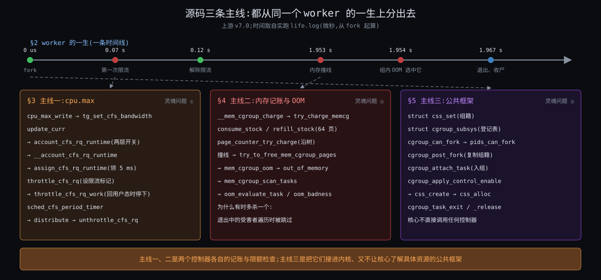
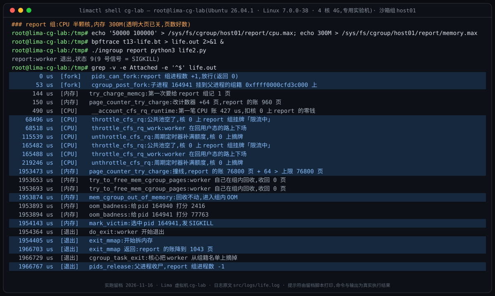
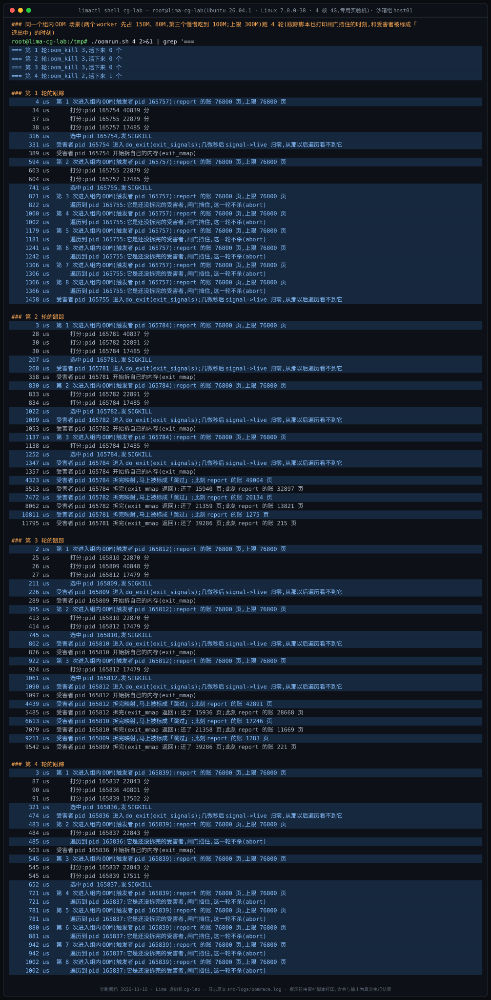

# 阶段 5:cgroup 的源码

前四节讲到了「是什么、为什么、大致怎么做、怎么来的」。这一节进源码:三条主线各对一个灵魂问题,都钉在上游 **v7.0**,和做实验的那台机器的内核版本一致。函数名、行号以 v7.0 为准,源码副本在 `src/linux-v7.0/`。读到的每一段代码,尽量拿前几节在实验机上抓到的数字去对。

这一节要回答前几节留下的问题。前几节记下的「凭记忆」「没查清」,凡是源码能回答的,在这里回答;其中最大的一个是第二节就记下的「组内 OOM 为什么有时多杀一个」,这次在源码里找到了原因,并在实验机上抓到了现场(§4)。

## 约束清单速查(C1 ~ C5)

#### C1 — 按组限制合计用量
管的单位是组不是进程;上限是绝对数;组能套组,父组管整棵子树的合计。
**不可再分**:开几个进程是应用的自由;相对权重回答不了「最多多少」。
**一句话**:记账的单位是组,超过上限就受限制。

#### C2 — 记实际用量,超限处理看资源类型
账记物理页、真实 CPU 时间、真实 IO;超了以后能等的等、能拒的拒,内存只能回收或杀。
**不可再分**:稀缺的是物理资源;物理页占了不还就没有。
**一句话**:记实际用掉的;超限怎么处理,看资源类型。

#### C3 — 内核负责执行,配额由外部设定
归属和上限被管的进程改不了;谁该分多少内核不知道,由管理程序通过文件写进来。
**不可再分**:边界能被进程自己改就不存在边界;哪个业务重要内核无从判断。
**一句话**:内核负责执行,数字由外部设定。

#### C4 — 在内核已有代码路径上记账,开销要小
所有业务共用一个内核;记账点只能挂在内核本来就要走的路上,必须便宜。
**不可再分**:每家一个内核资源无法互借;记账在最热的路上,开销一大,机器上所有程序都会跟着变慢。
**一句话**:不新增代码路径,在内核已有的路径上记账。

#### C5 — 所有资源共用同一套分组
资源种类会不断增加,新增一种不能惊动已有的;一笔开销会跨几种资源,所以分组只能有一套。
**不可再分**:资源种类事先列不完;占内存的人和发 IO 的人不是同一个执行者。
**一句话**:分组的框架只做一套,各种资源的账要能对得上。

## §0 从「怎么来的」走到「源码里怎么写的」:三件事记住

第三节说 cgroup 由三样东西组成:组籍(进程身上记录它属于哪个组的那个指针,内核里叫 `css_set`)、记账用的数据、接入点;第四节说它们是怎么一步步长成今天这样的。这一节把三样东西各自落到 v7.0 的结构和函数上。三条主线就是三件事。

### §0.1 公共额度和回用户态时停下(cpu 控制器的记账与限流)

因为 `C1·按组限制合计用量`(上限是绝对数)和 `C4·在内核已有代码路径上记账,开销要小`(记账在调度器最热的路上)→ 要解决「每 1 毫秒结算一次,却不让四颗核抢同一把锁;额度用完的那一刻,在不冻住内核里拿着锁的任务的前提下让整组停下」→ 所以 v7.0 里是 `struct cfs_bandwidth` 一个公共池(整个组的总额度)、每个 `cfs_rq` 一份本核额度、一个周期定时器,外加 6.18 引入的「进程回用户态时才停下」。

### §0.2 沿树记账和组内 OOM(memory 控制器的记账与超限处理)

因为 `C2·记实际用量,超限处理看资源类型`(内存既等不来也拒绝不了)和 `C1·按组限制合计用量`(父组管子树)→ 要解决「每分一个物理页就记一笔、每一层祖先都要比一次上限;撞线之后只在撞线的那一层里回收和挑人」→ 所以有了 `page_counter` 的父指针链、每核 64 页的预领额度、`try_charge_memcg` 里的重试循环,以及按组遍历的 OOM。

### §0.3 组籍和登记表(cgroup 核心)

因为 `C5·所有资源共用同一套分组` 和 `C3·内核负责执行,配额由外部设定` → 要解决「cgroup 核心不认识任何具体资源,却要在 fork、入组、退出时让每个控制器都知道」→ 所以有了 `struct css_set`(每个控制器一格的组籍)和 `struct cgroup_subsys`(登记表:每个控制器交给核心的一张回调函数表),核心只按表逐个调用。

### §0 结论

| 三件事 | v7.0 里的实物 | 为什么存在 |
|---|---|---|
| 公共额度和回用户态时停下 | `struct cfs_bandwidth`、`cfs_rq->runtime_remaining`、`throttle_cfs_rq_work` | 绝对上限要准,又不能抢锁、不能冻住拿锁的任务(`C1·按组限制合计用量`、`C4·在内核已有代码路径上记账,开销要小`) |
| 沿树记账和组内 OOM | `struct page_counter` 的 `parent`、`memcg_stock_pcp`、`try_charge_memcg`、`mem_cgroup_scan_tasks` | 内存只能回收或杀,且范围只能是撞线的那一层(`C2·记实际用量,超限处理看资源类型`、`C1·按组限制合计用量`) |
| 组籍和登记表 | `struct css_set`、`struct cgroup_subsys` | 新增一种资源不惊动核心,分组只有一套(`C5·所有资源共用同一套分组`、`C3·内核负责执行,配额由外部设定`) |

前两件是两个控制器各自的事,第三件是把它们接进内核的公共框架。主线一、二回答灵魂问题 ① ②,主线三回答 ③。

## §1 一张全景图



从图上能读出四件事:

1. 三条主线是从同一条时间线上分出去的,不是三个互不相干的话题。§2 先把这条时间线走一遍。
2. 主线一的函数全在 `kernel/sched/` 里,主线二的全在 `mm/` 里,主线三的全在 `kernel/cgroup/` 里。三块代码分属内核的三个子系统,彼此只通过登记表接上。
3. 主线一、二都有一个「领预留额度」的函数(`assign_cfs_rq_runtime`、`consume_stock`),都有一个「比上限」的地方,都有一个「超了以后」的分支。第三节说的「记账时同步检查限额」在源码里就是这个形状。
4. 主线三那一栏最后一行:核心不直接调用任何控制器。§5 会用 grep 给出证据。

## §2 端到端时间线:一个 worker 的一生

**结论:report 组限半颗核、300M 内存,让一个 worker 先烧 0.3 秒 CPU、再一点点要内存直到被杀。从 fork 到被收尸一共 1.967 秒,内核里经过的关键函数按时间排开,正好是三条主线的入口。**

实验:report 组 `cpu.max` 为 `50000 100000`、`memory.max` 为 300M(透明大页已关,页数好数)。worker 先在死循环里烧 0.3 秒墙上时间,然后每 50 毫秒要 10 MiB,直到被 OOM 杀掉。跟踪脚本 `src/prog/t13-life.bt`,每类事件只打印前一两次;时间是从 fork 起算的微秒。

```
        0 us  [fork]   pids_can_fork:report 组进程数 +1,放行(返回 0)
       53 us  [fork]   cgroup_post_fork:子进程 164941 挂到父进程的组籍 0xffff0000cfd3c000 上
      144 us  [内存]   try_charge_memcg:第一次要给 report 组记 1 页
      150 us  [内存]   page_counter_try_charge:改计数器 +64 页,report 的账 960 页
      490 us  [CPU]    __account_cfs_rq_runtime:第一笔 CPU 账 427 us,扣核 0 上 report 的零钱
    68496 us  [CPU]    throttle_cfs_rq:公共池空了,核 0 上 report 组挂牌「限流中」
    68518 us  [CPU]    throttle_cfs_rq_work:worker 在回用户态的路上下场
   115539 us  [CPU]    unthrottle_cfs_rq:周期定时器补满额度,核 0 上摘牌
   165482 us  [CPU]    throttle_cfs_rq:公共池空了,核 0 上 report 组挂牌「限流中」
   165488 us  [CPU]    throttle_cfs_rq_work:worker 在回用户态的路上下场
   219246 us  [CPU]    unthrottle_cfs_rq:周期定时器补满额度,核 0 上摘牌
  1953473 us  [内存]   page_counter_try_charge:撞线,report 的账 76800 页 + 64 > 上限 76800 页
  1953653 us  [内存]   try_to_free_mem_cgroup_pages:worker 自己在组内回收,收回 0 页
  1953693 us  [内存]   try_to_free_mem_cgroup_pages:worker 自己在组内回收,收回 0 页
  1953874 us  [内存]   mem_cgroup_out_of_memory:回收不动,进入组内 OOM
  1953893 us  [内存]   oom_badness:给 pid 164940 打分 2416
  1953894 us  [内存]   oom_badness:给 pid 164941 打分 77763
  1954143 us  [内存]   mark_victim:选中 pid 164941,发 SIGKILL
  1954364 us  [退出]   do_exit:worker 开始退出
  1954405 us  [退出]   exit_mmap:开始拆内存
  1966703 us  [退出]   exit_mmap 返回:report 的账降到 1043 页
  1966729 us  [退出]   cgroup_task_exit:核心把 worker 从组籍名单上摘掉
                      (这一行的标签是跟踪脚本里写的;读完源码后更正:cgroup_task_exit 只按登记表通知控制器,摘名单在稍后的 cgroup_task_dead,见 §5.6)
  1966767 us  [退出]   pids_release:父进程收尸,report 组进程数 -1
```



逐段读:

| 时刻 | 发生了什么 | 归哪条主线 |
|---|---|---|
| 0 ~ 53 us | fork 的路上,核心先问 pids 控制器「允许再创建一个进程吗」(`cgroup_can_fork` → `pids_can_fork`),复制完进程再把孩子挂到父进程的组籍上(`cgroup_post_fork`) | §5 |
| 144 ~ 150 us | worker 第一次写内存就要记账。只要 1 页,却一次改了计数器 64 页:多出的 63 页留在本核,留作下次记账用。账上已有 960 页,是 report 主进程 python 自己的内存 | §4 |
| 490 us | 第一次结算 CPU 时间,从 report 组在核 0 上的本核额度里扣 427 us | §3 |
| 68.5 ms、165.5 ms | 公共池空了,核 0 给 report 组设上限流标记;worker 在回用户态的路上停下。两次设标记之间约 97 ms,接近一个 100 ms 周期 | §3 |
| 115.5 ms、219.2 ms | 周期定时器补满额度、清除限流标记。从停下到清除标记分别隔了 47.0 ms 和 53.8 ms,一个周期里跑约一半、停约一半 | §3 |
| 1.953 s | 要内存撞线:76 800 + 64 > 76 800 | §4 |
| 之后 180 ~ 220 us | 两次组内回收都收回 0 页(全是匿名内存,没有 swap,扔不掉) | §4 |
| 之后 0.67 ms | 进 OOM,给组里两个进程打分(主进程 2416,worker 77763),选中 worker | §4 |
| 1.954 ~ 1.967 s | worker 退出:12.3 ms 里拆完内存,账从 76 800 页附近降到 1043 页;然后核心按登记表通知各控制器(`cgroup_task_exit`),父进程收尸时 pids 才减一 | §4、§5 |

**算例。**

- 撞线到选中受害者:1954143 − 1953473 = 670 us。这 0.67 毫秒里做了两次回收、一次全组打分。
- worker 的分数 77 763,比 76 800 页的上限还高。分数不只算内存页,还算页表和交换区(§4 的打分公式)。主进程只有 2416 分,所以挑中的是 worker,虽然撞线的也是它。
- 拆内存用了 1966703 − 1954405 = 12 298 us,还回去约 75 700 页,平均每毫秒六千多页。这 12 毫秒正是 §4 要讲的那段空档:受害者已经开始退出,账还没有清。这一次组里只有它一个能杀,没有造成多杀;组里多几个进程时就会出事。
- 两次限流之间(68.5 ms 到 165.5 ms)隔 97 ms,不是整 100 ms:周期定时器的起点和 worker 开始跑的时刻无关,worker 是在第一个周期进行到一半时开始跑的。这是推断,没有单独验证。

这条时间线上的每一行,下面三条主线都会读到它背后的源码。

## §3 主线一:`cpu.max` 是怎么兑现的

**结论:往 `cpu.max` 写 `50000 100000`,内核只做一件事:把 50 ms 和 100 ms 存进这个组的 `struct cfs_bandwidth`,开一个 100 ms 的定时器,再把这组每颗核上的本核额度清成 1 纳秒。之后没有任何代码去定期检查这个组。记账放在调度器本来就要做的 `update_curr` 后面(`fair.c:1323`),本核额度用完就一份一份从公共池领;领不到,就在下次选进程时给这颗核设上限流标记(`throttle_cfs_rq`),组里每个进程检查到标记,在回用户态的路上自己停下(`throttle_cfs_rq_work`);定时器每 100 ms 只做两件事,补充公共池、清除限流标记。没人设限的组,`fair.c:5740` 那一行 `if` 就让这条记账路径直接跳过。**

源码以上游 v7.0 为准(`stages/05-deep/src/linux-v7.0/kernel/sched/` 下的 `core.c`、`fair.c`、`sched.h`)。实验机是 Ubuntu 7.0.0-38,第三节抓到的函数名在上游都找得到,但补丁差异没有逐行比过(D1)。

### §3.1 写文件那一刻:两个数存进哪

`C3·内核负责执行,配额由外部设定`:谁该分多少,由管理程序往文件里写;内核要做的,是把写进来的数变成自己能强制的状态。所以先看写入口(`core.c:10177`):

```c
// kernel/sched/core.c:10177-10190(节选)
static ssize_t cpu_max_write(struct kernfs_open_file *of,
			     char *buf, size_t nbytes, loff_t off)
{
	struct task_group *tg = css_tg(of_css(of));   /* 这个 cgroup 对应的 cpu 账本 */
	/* ... */
	tg_bandwidth(tg, &period_us, NULL, &burst_us);
	ret = cpu_period_quota_parse(buf, &period_us, &quota_us);  /* "50000 100000" 或 "max" */
	if (!ret)
		ret = tg_set_bandwidth(tg, period_us, quota_us, burst_us);
	return ret ?: nbytes;
}
```

`task_group` 是 cpu 控制器给每个 cgroup 建的数据结构,记着这个组的 CPU 额度(第三节 §2.5 里 `css_alloc` 建出来的就是它)。写入后先到 `tg_set_bandwidth`(`core.c:9775`),它只做合法性检查:根组不能设(`-EINVAL`);额度和周期都不能小于 1 ms(`core.c:9742`),周期不能大于 1 s(`core.c:9741`)。检查过了才进 `tg_set_cfs_bandwidth`(`core.c:9504`,CFS 是普通进程调度类的名字,「CFS 带宽」就是 `cpu.max` 的内核名):

```c
// kernel/sched/core.c:9527-9566(节选)
	ret = __cfs_schedulable(tg, period, quota);        /* 整棵树装不装得下 */
	/* ... */
	if (runtime_enabled && !runtime_was_enabled)
		cfs_bandwidth_usage_inc();                      /* 全局开关 +1,见 §3.2 */

	scoped_guard (raw_spinlock_irq, &cfs_b->lock) {
		cfs_b->period = ns_to_ktime(period);            /* 两个数落地 */
		cfs_b->quota = quota;
		cfs_b->burst = burst;
		__refill_cfs_bandwidth_runtime(cfs_b);          /* 公共池先补一次 */
		if (runtime_enabled)
			start_cfs_bandwidth(cfs_b);                 /* 启动周期定时器 */
	}
	for_each_online_cpu(i) {                            /* 每颗核上这个组的队列 */
		struct cfs_rq *cfs_rq = tg->cfs_rq[i];
		/* ... */
		cfs_rq->runtime_enabled = runtime_enabled;      /* 第二层开关 */
		cfs_rq->runtime_remaining = 1;                  /* 零钱清成 1 ns */
		if (cfs_rq->throttled)
			unthrottle_cfs_rq(cfs_rq);                  /* 正被限着的,先放开 */
	}
```

两个数存进 `struct cfs_bandwidth`(`sched.h:447`):`quota` 是每周期的额度(纳秒),`period` 是周期,`runtime` 是公共池里现在还剩多少,`throttled_cfs_rq` 是被限流的各核队列的名单(`sched.h:462`)。每颗核上这个组的本核额度在 `struct cfs_rq`:`runtime_enabled`(这个组在这颗核上有没有设限)和 `runtime_remaining`(本核额度的余额)(`sched.h:752-753`)。「一个公共池、每核一份本核额度」就是这两个结构的字面样子。

写入时 `runtime_remaining` 被设成 1:余额只够再用一纳秒,下一次结算一扣就变负,迫使这颗核马上去公共池领第一份。`__cfs_schedulable` 我没有细读,从名字和调用位置看是在检查父子组的额度装不装得下(`C1·按组限制合计用量` 里「父组管整棵子树」),记 D2。

| 没有它会坏在哪 | 它解决了 |
|---|---|
| 两个数只存在管理程序那边,内核没法在结算的那一刻查 | 额度、周期落进 `cfs_bandwidth`,公共池和各核的本核额度有了确定的位置 |
| 额度小到几乎为 0,会欠下很大的透支,被限期间退出都排不上队(`core.c:9790` 的注释) | 额度和周期有上下限 |

### §3.2 记账:`update_curr` 后面那一步,和两层开关

内核原本在做什么:每次时钟中断、每次换进程,调度器都要结算「当前进程刚跑了多久」,函数是 `update_curr`(`fair.c:1286`)。这是它排队要用的,与 cgroup 无关。`C4·在内核已有代码路径上记账,开销要小`:cpu 控制器的记账就放在它后面,只多一行(`fair.c:1323`):

```c
// kernel/sched/fair.c:5737-5744 + 5719-5735(节选)
static __always_inline
void account_cfs_rq_runtime(struct cfs_rq *cfs_rq, u64 delta_exec)
{
	if (!cfs_bandwidth_used() || !cfs_rq->runtime_enabled)   /* 5740:两层开关 */
		return;
	__account_cfs_rq_runtime(cfs_rq, delta_exec);
}

static void __account_cfs_rq_runtime(struct cfs_rq *cfs_rq, u64 delta_exec)
{
	cfs_rq->runtime_remaining -= delta_exec;             /* 先扣零钱,只动本核数据 */
	if (likely(cfs_rq->runtime_remaining > 0))
		return;                                          /* 还有钱,结束 */
	if (cfs_rq->throttled)
		return;
	if (!assign_cfs_rq_runtime(cfs_rq) && likely(cfs_rq->curr))
		resched_curr(rq_of(cfs_rq));                     /* 领不到:请调度器重新选一次 */
}
```

这回答了第三节待核 #15。两层开关都在第 5740 行:

- 第一层 `cfs_bandwidth_used()`(`fair.c:5619`)是一个全局的 static key(内核的跳转标签机制:运行时把这条 `if` 直接改写成空操作或跳转)。`cfs_bandwidth_usage_inc()`(`fair.c:5624`)在整台机器上第一个组设上限时加一(上一节 `core.c:9538`),最后一个组取消时减回去。
- 第二层 `cfs_rq->runtime_enabled` 是每个组、每颗核一个,上一节循环里写的。

第三节 §4.5 的两组实测正好卡着这两层:全机没人设限时记账函数 0 次(`cost.log` 第一段),只给 report 设限后 db 仍是 0 次(`cost.log` 第二段、`t8-free` 的 544 对 0)。不过这两组数分不出第一层单独省了多少:`account_cfs_rq_runtime` 是内联的,探针只挂得到里面的 `__account_cfs_rq_runtime`,不管哪层让记账跳过,探针都只看到「没走」。第一层的用意是让没人设限的机器连 `runtime_enabled` 那个字段都不用读,这是读代码得出的设计意图,没有量过(D3)。

本核额度扣到零以下,才进 `assign_cfs_rq_runtime`(`fair.c:5707`),它拿公共池的锁,调 `__assign_cfs_rq_runtime`(`fair.c:5679`):

```c
// kernel/sched/fair.c:5686-5703(节选)
	min_amount = target_runtime - cfs_rq->runtime_remaining;  /* 一份 + 欠的 */
	if (cfs_b->quota == RUNTIME_INF)
		amount = min_amount;
	else {
		start_cfs_bandwidth(cfs_b);                       /* 保证周期定时器在转 */
		if (cfs_b->runtime > 0) {
			amount = min(cfs_b->runtime, min_amount);     /* 池里有多少给多少 */
			cfs_b->runtime -= amount;
		}
	}
	cfs_rq->runtime_remaining += amount;
	return cfs_rq->runtime_remaining > 0;                 /* 补完仍是正的才算领到 */
```

`target_runtime` 传进来的是 `sched_cfs_bandwidth_slice()`(`fair.c:5713`),默认 5000 us(`fair.c:125`,可经 `/proc/sys/kernel/sched_cfs_bandwidth_slice_us` 改,`fair.c:137`)。因为 `C4·在内核已有代码路径上记账,开销要小` 要少抢锁、`C1·按组限制合计用量` 要上限别漂 → 要在两者间折中 → 所以引入「一份」(每次从公共池领的固定量),5 ms 是 100 ms 周期的二十分之一(为什么是 5 不是别的数,第四节 §5.3 没查到出处,本节也没有)。

`min_amount = 一份 − 余额` 解释了第三节 t3.log 里「领 5181」这种数:余额是 −181 us(透支,因为大约 1 ms 才结算一次),所以领 5000 + 181 = 5181。透支不是 bug,是不想在每次结算时都加锁的代价。

| 没有它会坏在哪 | 它解决了 |
|---|---|
| 每次结算都改公共池,4 核抢同一把锁 | 先扣本核额度,余额为负才拿锁(1660 笔里 181 笔) |
| 不设限的组也被每毫秒记一笔 | 两层 `if` 在最前面直接跳过 |
| 领的量固定为 5 ms,透支就永远还不上 | `min_amount` 把欠的一并补上 |

### §3.3 公共池空了:设限流标记,然后每个进程自己停下

领不到,上面的代码只做了一件事:`resched_curr`,让调度器重新选一个进程。真正限流发生在选进程的那一步(`pick_task_fair`,`fair.c:8941`):

```c
// kernel/sched/fair.c:8956-8972 + 6473-6488(节选)
	do {                                         /* 从根往下,逐层选 */
		if (cfs_rq->curr && cfs_rq->curr->on_rq)
			update_curr(cfs_rq);
		throttled |= check_cfs_rq_runtime(cfs_rq);   /* 每一层都问一句:你被限了吗 */
		se = pick_next_entity(rq, cfs_rq);
		/* ... */
	} while (cfs_rq);
	p = task_of(se);
	if (unlikely(throttled))
		task_throttle_setup_work(p);             /* 选中的进程,身上挂一个「回用户态时做」的活 */

static bool check_cfs_rq_runtime(struct cfs_rq *cfs_rq)
{
	if (!cfs_bandwidth_used()) return false;
	if (likely(!cfs_rq->runtime_enabled || cfs_rq->runtime_remaining > 0))
		return false;
	if (cfs_rq_throttled(cfs_rq)) return true;   /* 已经挂过牌了,不重复 */
	return throttle_cfs_rq(cfs_rq);              /* 第一次发现:挂牌 */
}
```

`throttle_cfs_rq`(`fair.c:6001`)先最后试一次(`__assign_cfs_rq_runtime(cfs_b, cfs_rq, 1)`,只要 1 ns,防止刚好有人还了钱),还是没有就把这颗核的队列加进 `cfs_b->throttled_cfs_rq` 名单,用 `walk_tg_tree_from(..., tg_throttle_down, ...)`(`fair.c:6030`)把这个组以及整棵子树的 `throttle_count` 加一(`fair.c:5983`),最后 `cfs_rq->throttled = 1`(`fair.c:6037`)。`C1·按组限制合计用量` 里「父组管整棵子树」就落在这一步:标记设在父组,子孙组靠 `throttle_count` 都知道自己在被限流。注意这一步只设标记,没有把任何进程从队列里摘下来。

把进程摘下来是下一步。`task_throttle_setup_work`(`fair.c:5952`)给选中的进程登记一个任务回调,时机是 `TWA_RESUME`,即这个进程下次从内核回用户态时(`fair.c:5964`);到那时执行 `throttle_cfs_rq_work`(`fair.c:5773`):

```c
// kernel/sched/fair.c:5787-5814(节选)
	if ((p->flags & PF_EXITING))                       /* 正在退出的不用管 */
		return;
	scoped_guard(task_rq_lock, p) {
		se = &p->se;  cfs_rq = cfs_rq_of(se);
		if (!cfs_rq->throttle_count)                   /* 牌已经摘了,算了 */
			return;
		update_rq_clock(rq);
		dequeue_task_fair(rq, p, DEQUEUE_SLEEP | DEQUEUE_THROTTLE);   /* 摘下队列 */
		list_add(&p->throttle_node, &cfs_rq->throttled_limbo_list);   /* 挂上等候名单 */
		p->throttled = true;
		resched_curr(rq);
	}
```

选在「回用户态」这个时刻很关键:这时进程在内核里的事已经做完,手里不会拿着锁(第三节 §7.4 的推理,代码里对应的是它用任务回调而不是在 `throttle_cfs_rq` 里直接摘进程)。

旧做法在这份 v7.0 副本里没有,不能对着代码讲,只能引第四节 §5.4:合入 6.18 之前,`throttle_cfs_rq` 自己把整个组在这颗核上的队列从运行队列摘掉,组里谁都跑不了,哪怕有个读者正拿着 `percpu_rwsem` 读锁等着,也要等到下个周期(提交 e1fad12d 的说明,第四节 §5.4)。我没有下载 6.17 的源码对照(D4)。

| | 6.18 之前(据第四节 §5.4) | v7.0(上面的代码) |
|---|---|---|
| 谁把进程摘下来 | `throttle_cfs_rq` 一次摘整个组 | 每个进程回用户态时自己摘 |
| 内核里拿着锁的进程 | 一并被停住,组外的进程要等它 | 先让它回到用户态,锁已经放了 |
| 代价 | 一个动作 | 每进程每周期一次回调(t3n:400 进程 4000 次) |

### §3.4 周期定时器:补充公共池,清除限流标记,不检查任何进程

`sched_cfs_period_timer`(`fair.c:6501`)每个周期响一次,调 `do_sched_cfs_period_timer`(`fair.c:6253`):

```c
// kernel/sched/fair.c:6253-6300(节选)
	throttled = !list_empty(&cfs_b->throttled_cfs_rq);   /* 有没有被挂牌的核 */
	__refill_cfs_bandwidth_runtime(cfs_b);               /* 池 += quota,上限 quota+burst */
	if (cfs_b->idle && !throttled)
		goto out_deactivate;                             /* 整个周期没人用,定时器停 */
	/* ... */
	while (throttled && cfs_b->runtime > 0) {
		throttled = distribute_cfs_runtime(cfs_b);       /* 给挂牌的核发钱,摘牌 */
	}
```

`__refill_cfs_bandwidth_runtime`(`fair.c:5655`)的第一行就是 `cfs_b->runtime += cfs_b->quota`(`fair.c:5662`),加不是赋:上个周期剩的会累进来,再被 `min(runtime, quota + burst)` 封顶(`fair.c:5669`),`burst` 默认 0,所以封顶就是 `quota`。然后 `distribute_cfs_runtime`(`fair.c:6165`)沿名单,对每个被限流的核:

```c
// kernel/sched/fair.c:6197-6210(节选)
		runtime = -cfs_rq->runtime_remaining + 1;     /* 先还清欠的,再多 1 ns */
		if (runtime > cfs_b->runtime)
			runtime = cfs_b->runtime;
		cfs_b->runtime -= runtime;
		cfs_rq->runtime_remaining += runtime;
		if (cfs_rq->runtime_remaining > 0) {
			if (cpu_of(rq) != this_cpu)
				unthrottle_cfs_rq_async(cfs_rq);      /* 别的核:发一个跨核请求让它自己摘 */
			else
				/* ... 本核:排进 local_unthrottle,稍后 unthrottle_cfs_rq */
		}
```

`unthrottle_cfs_rq`(`fair.c:6042`)把 `throttled` 清掉,从名单上拿下来,再 `walk_tg_tree_from(..., tg_unthrottle_up, ...)`(`fair.c:6073`)——`tg_unthrottle_up` 对 `throttled_limbo_list` 上的每个进程调 `enqueue_task_fair`(`fair.c:5937`),把它们放回队列。

这里没有一行代码去比较「谁用了多少」。定时器知道的只有「哪几个核被限流了」。`C2·记实际用量,超限处理看资源类型` 里「能等的等」在代码里就是这个样子:CPU 时间下个周期还会有,所以只补额度、清除限流标记。

还有一条不在主路径上的路:一颗核的组队列空了,多余的本核额度会还回公共池(`return_cfs_rq_runtime`,`fair.c:5468` 在出队时调,留下 1 ms,`fair.c:6309`),公共池超过一份且有核被限流时,5 ms 后由 slack 定时器再发一次(`fair.c:6339-6353`)。这条路 t3 没有触发,我没有实测它的次数(D5)。

| 没有它会坏在哪 | 它解决了 |
|---|---|
| 要有人周期扫所有组、所有进程 | 定时器只补公共池、清除限流标记,发现额度用完的是领额度的那颗核自己 |
| 组一直没人跑也每 100 ms 响一次 | `cfs_b->idle` 标记,整个周期没人用就让定时器停下(`fair.c:6272`) |

### §3.5 用源码解释第三节的数字

| 日志里的数 | 源码里的原因 |
|---|---|
| `t1.log`:2 秒记账 1660 笔,其中 181 笔动公共池 | 只有余额扣到 ≤ 0 才走到 `assign_cfs_rq_runtime`(`fair.c:5724` 的提前返回)。1000 ms ÷ 181 ≈ 5.5 ms 一份,与直方图里 157 次落在 5 ~ 6 ms 一致 |
| `t1.log`:领到的多是 5 ~ 6 ms | `min_amount = 一份 + 透支`(`fair.c:5687`) |
| `t3.log` 第 1 周期:四核领到的合计 48 532 μs,比 50 000 少 1 468 | `distribute_cfs_runtime` 在清除标记前先替各核还清透支(`fair.c:6197`),这一笔不经过 `__account_cfs_rq_runtime`,探针看不到。这回答了第三节待核 #3。第 2 周期合计 47 878,少 2 122,同方向 |
| `t3.log`:11.21 ms 核 3 领 864 μs 的同一刻就被设了限流标记 | `amount = min(池, min_amount)`(`fair.c:5695`)只给了 864,透支更大时余额仍 ≤ 0,`assign` 返回 0,下一步 `pick_task_fair` 里 `throttle_cfs_rq` 再试公共池,已空,设限流标记。这是对着代码的推断,日志里没有打印余额(D6) |
| `t3.log`:7 个 worker 12.3 / 6.0 / 4.0 % | 额度按核领(`cfs_rq` 每核一个),各核各领 11 ~ 15 ms;核上的 1、2、3 个进程再平分 |
| `t3n.log`:设限流标记 40 次/秒,与 8 或 400 个进程无关 | `throttle_cfs_rq` 每个(组、核)每周期一次,已设标记的 `check_cfs_rq_runtime` 在 `cfs_rq_throttled` 处直接返回(`fair.c:6485`);4 核 × 10 周期 |
| `t3n.log`:清除标记 40 次 | `distribute_cfs_runtime` 遍历名单,每核一次 `unthrottle_cfs_rq` |
| `t3n.log`:停下 80 次(8 进程)和 4000 次(400 进程) | `throttle_cfs_rq_work` 每进程每周期一次;`sched_throttle_work.next` 防止重复挂(`fair.c:5781`、`5822`) |
| `cost.log` 第一段:CPU 路径 12 133 / 12 164 次,记账 0 次 | 「路」指 `update_curr`,「车」指 `__account_cfs_rq_runtime`(`cost.log` 里的叫法);没人设限,第 5740 行让记账直接跳过 |
| `cost.log` 第二段:report 记账 2 082 次,db 0 | 4 秒 × 0.5 核 ≈ 2 000 ms,每毫秒结算一次,与 2 082 吻合;db 的 `runtime_enabled` 是 0 |
| `cost.log` 第二段:report 路径 6 401,约为记账次数的 3 倍 | 我的推断:`update_curr` 沿 report、host01、根三层各调一次,只有 report 那层 `runtime_enabled` 为真。没有分层数过(D7)。这也是 `C1·按组限制合计用量` 的另一面:每层都结算,只有设了限的那层记额度 |

t3 里第一个周期定时器时刻记为 0.00,第二个是 100.86 ms,多出的 0.86 ms 本节没有追查(D8)。

### §3.6 反事实小试:换一种做法行不行

| 候选 | 违反哪条约束 | 代价 | 现实里有人这么做吗 |
|---|---|---|---|
| 每核各有一份额度,不够了互相借 | `C1·按组限制合计用量`:上限变成各核账之和,要精确得靠核间借还 | 借还是多对多,核数多、额度小时开销和误差都涨 | 有:Bharata 2009 年的提案,照搬实时调度带宽(第四节 §5.2);Turner 以「扩展性差」为由另起方案,没有合入 |
| 只有一个全局池,每次结算直接扣 | `C4·在内核已有代码路径上记账,开销要小`:记账比干活还贵 | 4 核每毫秒抢同一把锁;按 t1 的数,锁次数从 181 变成 1660,约 9 倍 | Turner 的论文把它和上一条一起否了(第四节 §5.2),没有实现 |
| 整组一次摘下运行队列(6.18 之前) | `C4·在内核已有代码路径上记账,开销要小`:限的是这一组,代价却落到了组外等那把锁的人头上 | 读者被冻住拖住写者,写者拖住后面所有读者,触发任务挂起 | 有:2011 年到 6.18 一直是这样,2025 年被换掉(第四节 §5.4,提交 e1fad12d) |
| 超限就给每个进程发信号让它停 | `C3·内核负责执行,配额由外部设定`:进程的状态要靠外部程序反复改;还得有人轮询,违反「记账时同步检查限额」 | 400 个进程每周期各发一次信号;发送与记账之间有空隙 | 用户态有工具这么做(据我所知 `cpulimit` 是 SIGSTOP / SIGCONT 轮询,没有查出处,D9) |
| 不设上限,只用权重(`nice` / `cpu.weight`) | `C1·按组限制合计用量` 里「上限是绝对数」 | 机器空闲时一个组能占满所有核,多少说不出一个数 | 有,而且和 `cpu.max` 并存:第二节 §2.1「洞一:没有天花板」;第四节 §5.1 引 Turner 论文说的就是它不够 |
| 一份取 1 ms 或取 50 ms | `C4·在内核已有代码路径上记账,开销要小` 与 `C1·按组限制合计用量` 的折中点被推向一端 | 1 ms:每笔账几乎都要拿锁,约 5 倍;50 ms(整个池):先到的一颗核领走全部,其余核当周期直接被限流 | 有人调:`sched_cfs_bandwidth_slice_us` 就是为此开的(`fair.c:137`);Turner 首发是 10 ms,合入时 5 ms(第四节 §5.3,没有查到原因) |

结论:`cpu.max` 的形状是由两个要求决定的:要精确(一个必须兑现的绝对数)就得有公共池,要开销小(复用内核已有路径记账)就得有各核的本核额度;超限处理选「设限流标记、进程自己停下」,因为 CPU 时间会再生,而且不能拖累组外的进程。

### §3.7 一段可运行演示:看着额度被领光

演示脚本是第三节的 `t3` 会话,不新增文件。在 Mac 上(需要第三节用的 Lima 实验机 `cg-lab`,内核 7.0.0-38,4 核):

```
cd stages/03-how/src
limactl shell cg-lab sudo bash -s -- t3 < 03-evidence-sessions.sh
```

会话里做的事:建 `host01/report` 组,写 `echo '50000 100000' > .../report/cpu.max`,起 7 个死循环 worker(`./ingroup report python3 report.py 7 &`),再跑 `bpftrace t3-throttle.bt | grep .`。预期输出是 `stages/03-how/src/logs/t3.log` 里的样子,摘一段:

```
   0.00 ms  周期定时器响(第 1 个周期开始),公共池补到 50000 微秒
   0.21 ms  核 1 领 5181 微秒,公共池还剩 32984 微秒
  11.21 ms  核 3 领  864 微秒,公共池还剩     0 微秒
  11.21 ms  核 3:公共池空了,report 组在这颗核上被标记为「限流中」
  11.21 ms  核 0:进程 7538(report-w)在返回用户态的路上被请下场
 100.86 ms  周期定时器响(第 2 个周期开始),公共池补到 50000 微秒
```

具体数字每次不同:进程号、各核领的先后和零头会变;不变的是形状(前 16 ms 领光、后 84 ms 全停、每核一次设限流标记)。

探针与源码行的对应(脚本是 `stages/03-how/src/prog/t3-throttle.bt`):

| 探针 | 对应源码 | 打印的那一行 |
|---|---|---|
| `fentry:sched_cfs_period_timer` | `fair.c:6501` | 「周期定时器响」,`$b->quota` 就是 `cfs_b->quota`(`sched.h:451`) |
| `fentry` + `fexit:__account_cfs_rq_runtime` | `fair.c:5719` | 「核 N 领 X 微秒」:进出两次读 `runtime_remaining`,差值加上 `delta_exec`,就是 `fair.c:5701` 加进去的 `amount`;公共池剩余读 `tg->cfs_bandwidth.runtime`(`sched.h:452`) |
| `fexit:throttle_cfs_rq`,`retval` 为真 | `fair.c:6001`,返回 true 在设好限流标记之后 | 「公共池空了……标记为限流中」 |
| `fentry:throttle_cfs_rq_work` | `fair.c:5773` | 「进程 N 在返回用户态的路上被请下场」(日志原文) |
| `fentry:unthrottle_cfs_rq` | `fair.c:6042` | 「解除限流,等候名单上的进程放回队列」 |

### 本小节新增待核

- D1:实验机 Ubuntu 7.0.0-38 与上游 v7.0 的补丁差异没有逐行比对,只确认了文中涉及的函数名都在。
- D2:`__cfs_schedulable`(`core.c:9527`)没有细读,「检查整棵树装得下」是从名字和位置推的。
- D3:全局 static key 那一层省了多少没有量;文中说它「避免读 `runtime_enabled`」是读代码的推断。
- D4:6.18 之前的整组摘队列做法没有读 6.17 源码,只靠第四节 §5.4 引的提交说明。
- D5:slack 定时器和 `return_cfs_rq_runtime` 这条路没有实测。
- D6:`t3.log` 11.21 ms 核 3 的「领 864 后立刻设限流标记」是对着代码的推断,探针没有打印余额。
- D7:`cost.log` report 路径次数是记账次数的约 3 倍,解释为三层层级各结算一次,没有分层数。
- D8:`t3.log` 第二个周期为什么是 100.86 ms 而不是 100.00,没有追查。
- D9:`cpulimit` 靠 SIGSTOP / SIGCONT 的说法凭记忆,没有查出处。
## §4 主线二:内存的账与组内 OOM

**结论:内存的账记在一个叫 `page_counter` 的计数器上,每个组一个,每个计数器带一个指向父组的指针。缺页分到物理页之后,`__mem_cgroup_charge` 先扣本核预先记好的页数;不够,才去改计数器,一次 64 页,从本组一路加到根,每一层拿自己的上限比一次。哪一层先超,`page_counter_try_charge` 就把那一层的指针交出来,回收和杀人的范围就是那一层的子树,这就是第三节 §8.3 说的「边界是谁划的」。回收不动时,`out_of_memory` 在这个子树里按「页数 + 页表 + swap + 调整值」打分,杀分最高的。有时会多杀一个,原因是遍历组内进程的迭代器会跳过「已经开始退出」的进程,而这个进程的内存还没还回去,防止重复挑人的那个检查看不到它。这一条是读源码加实测得出的解释,上游有没有人讨论过、有没有修,没有查。**

### §4.1 记账入口:每核预先记一批页数,一个字节记一个组

内核原本在做什么:缺页处理分到一个物理页之后,要把它挂进页表。memory 控制器就在「页分到了」这一步记账(第三节 §5.2 的调用栈:`__mem_cgroup_charge` ← `wp_page_copy`)。

要解决什么:`C4·在内核已有代码路径上记账,开销要小` 要求这一步便宜。每页都去改组的计数器,就要对树上每一层做一次原子加,所以引入本核预领:每颗核一次预先记一小批页数,之后先用这一批。`C2·记实际用量,超限处理看资源类型` 又要求账面不能偏离实际太多,所以批量要有上限。

调用链很短,`memcontrol.c:4755` 的 `__mem_cgroup_charge`(取出这个进程所在的组)→ `memcontrol.c:4739` 的 `charge_memcg`(记账成功后把所属的组记到页上)→ `memcontrol.c:2355` 的 `try_charge_memcg`(真正的记账逻辑)。先看每核预领的页数:

```c
/* mm/memcontrol.c:1793-1799 */
#define NR_MEMCG_STOCK 7
struct memcg_stock_pcp {
	local_trylock_t lock;
	uint8_t nr_pages[NR_MEMCG_STOCK];
	struct mem_cgroup *cached[NR_MEMCG_STOCK];
	/* ... */
};
/* mm/memcontrol.c:1851-1867,删去锁和变量声明 */
	for (i = 0; i < NR_MEMCG_STOCK; ++i) {
		if (memcg != READ_ONCE(stock->cached[i]))
			continue;
		stock_pages = READ_ONCE(stock->nr_pages[i]);
		if (stock_pages >= nr_pages) {
			WRITE_ONCE(stock->nr_pages[i], stock_pages - nr_pages);
			ret = true;
		}
		break;
	}
```

逐段读:

- `struct memcg_stock_pcp` 是每颗核一份的预领页数记录。`cached[]` 记这颗核替哪几个组预付过(最多 7 个),`nr_pages[]` 是对应的预付页数。用 `uint8_t` 存页数,所以批量必须小于 128:`memcontrol.c:1953` 有一句 `BUILD_BUG_ON(MEMCG_CHARGE_BATCH > S8_MAX)`,批量超过 127 编译就过不了。`include/linux/memcontrol.h:332` 定义 `MEMCG_CHARGE_BATCH 64U`,第四节 §6.2 讲过它 2022 年由 32 改成 64。
- `consume_stock`(`:1841`):在本核找到这个组的那一格,预领的页数够就减掉并返回 `true`,记账到此为止,没碰任何共享的东西。这就是第三节 §5.4 里 25 660 次记账只有 400 次动计数器的原因。请求大于一批、或拿不到本核的锁,返回 `false` 走慢路。
- 补充在 `refill_stock`(`:1939`):整批记成功后,多出的 63 页放回本核;还页时也是先还进本核预领的页数,攒过一批才真还给计数器。

| 没有它会坏在哪 | 它解决了 |
|---|---|
| 每页一次、每层一次原子加,多核抢同一条缓存行 | 本核预领的页数够用就不碰共享计数器 |
| 预领的页数无上限,账面比实际偏高没有边界 | 批量 64 页,字节装得下,4 核最多偏 252 页左右 |

### §4.2 沿树往上记:`page_counter_try_charge`

`page_counter` 是 `mm/page_counter.c` 里的计数器:一个原子的 `usage`,一个 `max`,一个 `parent`。`C1·按组限制合计用量` 说父组管整棵子树的合计,在这里的实现就是:子组加一笔,每个祖先都加同样的一笔。

```c
/* mm/page_counter.c:118-160,删去水位线统计 */
bool page_counter_try_charge(struct page_counter *counter,
			     unsigned long nr_pages,
			     struct page_counter **fail)
{
	/* ... */
	for (c = counter; c; c = c->parent) {
		long new;
		new = atomic_long_add_return(nr_pages, &c->usage);
		if (new > c->max) {
			atomic_long_sub(nr_pages, &c->usage);
			if (track_failcnt)
				data_race(c->failcnt++);
			*fail = c;
			goto failed;
		}
		/* ... */
	}
	return true;

failed:
	for (c = counter; c != *fail; c = c->parent)
		page_counter_cancel(c, nr_pages);
	return false;
}
```

- 先加后比(`add_return` 之后才和 `max` 比),注释写的理由是避免昂贵的 CAS;代价是并发时一个大请求失败,可能让同时到的小请求也被误判撞线,误差不超过两者之差。
- 循环从叶子往根走,所以撞线的永远是**离叶子最近的那一层**。先把这一层自己加的退回去(第 144 行),让 `*fail` 指向它,再由 `failed:` 把下面已加成功的层逐层退掉。账不会留下半笔。
- `try_charge_memcg` 拿到 `*fail` 以后,第 2384 行 `mem_over_limit = mem_cgroup_from_counter(counter, memory)` 把计数器换回它所属的组。后面的回收和 OOM 都以 `mem_over_limit` 为范围。边界由此划定。

对照 `03-how/src/logs/t2.log`:每次改账三层同时加 64 页,例如「第 1 次改账(+64 页):report 959 → 1023 页,父组 host01 1023 → 1087 页,根 165161 → 165225 页」,就是循环走了三圈、每圈 `+64`。根组的 `max` 是 `PAGE_COUNTER_MAX`(`page_counter.h` 里的上限常量),永远比不过。

### §4.3 撞线之后:回收、重试、OOM

`try_charge_memcg` 是一个带 `retry:` 标号的循环(`memcontrol.c:2370`)。要解决的问题:内存「等不来也拒绝不了」(`C2·记实际用量,超限处理看资源类型`),所以撞线以后能做的只有先回收、实在不行再杀。

```c
/* mm/memcontrol.c:2370-2460,只留主干 */
retry:
	if (consume_stock(memcg, nr_pages))
		return 0;
	/* ... 先试一整批(batch),成功则 goto done_restock ... */
		mem_over_limit = mem_cgroup_from_counter(counter, memory);   /* 2384 */
	if (batch > nr_pages) {                                          /* 2390 */
		batch = nr_pages;
		goto retry;                  /* 整批放不下,退回只要自己那几页再试 */
	}
	/* ... */
	if (!gfpflags_allow_blocking(gfp_mask))                          /* 2407 */
		goto nomem;
	__memcg_memory_event(mem_over_limit, MEMCG_MAX, allow_spinning); /* 2410 */
	nr_reclaimed = try_to_free_mem_cgroup_pages(mem_over_limit, nr_pages,
						    gfp_mask, reclaim_options, NULL);
	if (mem_cgroup_margin(mem_over_limit) >= nr_pages)               /* 2418 */
		goto retry;
	if (!drained) {                                                  /* 2421 */
		drain_all_stock(mem_over_limit);
		drained = true;
		goto retry;
	}
	if (nr_retries--)                                                /* 2441 */
		goto retry;
	if (mem_cgroup_oom(mem_over_limit, gfp_mask,
			   get_order(nr_pages * PAGE_SIZE))) {           /* 2456 */
		passed_oom = true;
		nr_retries = MAX_RECLAIM_RETRIES;
		goto retry;
	}
```

逐段读:
- 第 2390 行解释了 t4.log 里的两种「想要」:第一次试一整批,探针看到「要再记 64 页」;放不下就把 `batch` 降到 `nr_pages` 重试,回收时「想要 1 页」。这两次失败探针都会数一次,`memory.events` 的 `max` 却只在第 2410 行、过了降批这一步才加,这很可能是第三节待核 #10 里 560 对 209 的一部分原因,但我没有逐次对账,只是线索(D1)。
- `try_to_free_mem_cgroup_pages`(`mm/vmscan.c`,本节没读)是撞线的进程自己动手回收,范围是 `mem_over_limit` 这棵子树,第三节 §8.1 的「谁撞线谁动手」就是这一行。
- `drain_all_stock`(`memcontrol.c:2036`)把各核预领的页数退回计数器,只做一次(`drained`)。这些页是「账上已记、实际没用」的,回收不动时先把它们还出来,可能就够了。
- 回收、退还预领页数、重试都用完,`nr_retries`(初值 `MAX_RECLAIM_RETRIES`,`mm/internal.h:610` 定义为 16,这个文件是我另外下的,不在本地副本里)减到头,才调 `mem_cgroup_oom`(`memcontrol.c:1706`)。它记一次 `oom` 事件,调 `mem_cgroup_out_of_memory`(`:1673`),后者先拿全局的 `oom_lock`,拿到后再看一眼余量(`:1688`,够了就不杀),最后调 `out_of_memory`(`oom_kill.c:1119`)。
- `mem_cgroup_oom` 返回 `true` 的意思是「有进展」,于是 `nr_retries` 重置、回到 `retry:` 再试一遍记账。这个 `true` 不等于「杀了人」:挑人被防重复检查拦下时也返回 `true`,下一节要用到。

`out_of_memory` 里 memcg 相关的分叉很少:`constrained_alloc`(`oom_kill.c:261`)把 `totalpages` 设成这个组 `memory.max` 的页数;`select_bad_process`(`:365`)在全机 OOM 时 `for_each_process` 遍历所有进程(`:375`),在组内 OOM 时只调 `mem_cgroup_scan_tasks`(`memcontrol.c:1170`)遍历 `memcg` 这棵子树,对每个进程调一次 `oom_evaluate_task`(`oom_kill.c:309`)。挑人规则是同一套,只差遍历范围(第二节待核 #2 的源码确认;第四节 §6.1 的「用已有的 OOM 逻辑」就是这个意思)。

**打分公式(第三节待核 #6)。** `oom_badness`(`oom_kill.c:202`):

```c
/* mm/oom_kill.c:202-240,只留公式 */
	if (adj == OOM_SCORE_ADJ_MIN || mm_flags_test(MMF_OOM_SKIP, p->mm) ||
	    in_vfork(p))
		/* ... return LONG_MIN ... */;
	points = get_mm_rss_sum(p->mm) + get_mm_counter_sum(p->mm, MM_SWAPENTS) +
		mm_pgtables_bytes(p->mm) / PAGE_SIZE;
	adj *= totalpages / 1000;
	points += adj;
```

分数 = 常驻页数(匿名 + 文件映射 + 共享内存)+ 换出到 swap 的页数 + 页表占的页数 + `oom_score_adj × 范围总页数 / 1000`。`oom_score_adj` 是 −1000 到 1000 的调整值,设成 −1000 直接免死,打分时返回 `LONG_MIN`。已经被标成 `MMF_OOM_SKIP` 的也返回 `LONG_MIN`:它的内存已经放掉了,杀它没用。

对 t4.log 的数:pid 8233 匿名内存 157 056 kB = 39 264 页,分数 40 812,多出 1 548 页。这 1 548 页应当是 python 映射的文件页加页表(150 MiB 的页表约 77 页),我没有拆开核对;`oom_score_adj` 一项按默认值 0 算,日志里没打印,没验证(D2)。分数的单位是「页」,和第三节 §8.2 说的「基本等于占的页数」吻合。

选完之后 `oom_kill_process`(`:1024`)发 SIGKILL。`memory.oom.group` 也在这里:`:1056` 调 `mem_cgroup_get_oom_group` 查受害者所在的组有没有设,设了就在 `:1066` 用同一个 `mem_cgroup_scan_tasks` 把整组都杀掉。

| 没有它会坏在哪 | 它解决了 |
|---|---|
| 撞线就杀,页缓存本来能扔 | 先回收、退还预领页数、重试 16 轮,最后才 OOM |
| 范围靠约定,杀到别的组 | 范围就是 `mem_over_limit` 子树,由 `*fail` 决定 |

### §4.4 为什么有时多杀一个

这一节回答两个遗留问题:第二节待核 #1(db-sim 被杀之后还多杀 worker)和第三节待核 #5(第一个受害者被选中 0.3 ms 后再次进入 OOM,它已不在候选名单里)。

内核原本要防什么:一个进程被选中、发了 SIGKILL,它的内存要等它真正退出、拆掉地址空间才还回来,这要几毫秒。这几毫秒里触发者可能再撞线、再进 OOM,如果再挑一个,就多杀了人。所以 `oom_evaluate_task` 里有一个检查(下面日志里叫「闸门」):

```c
/* mm/oom_kill.c:327-331 */
	if (!is_sysrq_oom(oc) && tsk_is_oom_victim(task)) {
		if (mm_flags_test(MMF_OOM_SKIP, task->signal->oom_mm))
			goto next;
		goto abort;
	}
```

- `tsk_is_oom_victim` 在 `include/linux/oom.h:74`(另下的文件),就是看 `task->signal->oom_mm` 非空。这个字段由 `mark_oom_victim` 在选中时填(`oom_kill.c:778`),`__oom_kill_process` 在发完 SIGKILL 后紧接着调它(`:959` 发信号,`:960` 标记)。
- 已经是受害者、而且 `MMF_OOM_SKIP` 还没立:`goto abort`,把 `oc->chosen` 设成 `-1`、返回 1,遍历停止。这一轮不杀任何人。`out_of_memory` 末尾 `return !!oc->chosen`(`:1187`)对 `-1` 也是 `true`,所以 `mem_cgroup_oom` 返回 `true`,触发者回到 `retry:` 再试,不会误以为 OOM 失败。
- `MMF_OOM_SKIP` 由谁立:`exit_mmap`(`mm/mmap.c:1275`)里 `unmap_vmas`(`:1302`)拆完所有映射之后,第 1309 行 `mm_flags_set(MMF_OOM_SKIP, mm)`。也就是说「内存已放掉」这个事实,是拆完映射才宣布的。另一个路径是 OOM reaper 内核线程,`queue_oom_reaper`(`:702`)把它延后 `OOM_REAPER_DELAY`(2 秒,`:701`)才启动,本节日志只有 10 毫秒量级,reaper 没有参与(推断,没有抓它)。

这个检查要在遍历时看到受害者才起作用。看不到它的原因在遍历器里:
```c
/* kernel/cgroup/cgroup.c:5114-5117 */
	/* Hide tasks that are exiting but not yet removed. Keep zombie
	 * leaders with live threads visible. */
	if ((task->flags & PF_EXITING) && !atomic_read(&task->signal->live))
		goto repeat;
```

`mem_cgroup_scan_tasks` 用 `css_task_iter_start(..., CSS_TASK_ITER_PROCS, ...)` 遍历(`memcontrol.c:1182`),每个任务先过 `css_task_iter_advance` 这一关。`PF_EXITING` 置位、`signal->live` 归零的任务被跳过,`oom_evaluate_task` 根本不会对它调用。这个跳过是为 `cgroup.procs` 之类的列表设计的,注释写得很清楚:已经在退出的不要给用户看。

再看进程自己的退出:
```c
/* kernel/exit.c:918-923, 964 */
	exit_signals(tsk);  /* sets PF_EXITING */
	/* ... */
	group_dead = atomic_dec_and_test(&tsk->signal->live);
	/* ... */
	exit_mm();
```

`PF_EXITING` 在 918 行置位,`live` 在 923 行减到 0,从这一刻起遍历器就看不到它了。可是 `exit_mm`(964 行)还没调,地址空间一页没拆,`memory.current` 一点没降。

于是有一段空档:**受害者已经不在遍历器的结果里(防重复检查没有东西可查),内存却还没还回去(账还是满的)。** 触发者此时再进 OOM,看不到它,在剩下的进程里再挑一个。这段空档的长度,就是 `exit.c:923` 到 `exit_mmap` 拆完映射的时间,拆内存要几毫秒。反过来,如果受害者还没被调度到 `do_exit`(刚收到信号,还在运行队列里排队),遍历器仍然能看到它,防重复检查就能拦下。

下面的数字出自第一遍留档 `05-deep/src/logs/oomrace-run1.log`。同一个场景(上限 300M,150M、80M 先占,第三个每 0.1 秒吃 10M)跑 4 轮,杀的个数是 3、2、3、3。逐条对:

| 轮 | 第二次进 OOM 的时刻 | 受害者开始 exit_mmap | 打分名单 | 结果 |
|---|---|---|---|---|
| 1 | 472 us | 165274:337 us | 只有 165275、165277 | 654 us 杀 165275 |
| 3 | 475 us | 165334:351 us | 只有 165335、165337 | 608 us 杀 165335 |
| 4 | 514 us | 165361:396 us | 只有 165362、165364 | 671 us 杀 165362 |
| 2 | 第 3 ~ 6 次:1020 ~ 1306 us | 165303:1743 us(915 us 已选中) | 无打分 | 没有杀人 |

- **第 1 轮是主证据。** 第 1 次进 OOM 时三个都打分(165275 22 843、165274 40 732、165277 17 574),279 us 选中最大的 165274;337 us 它已进 `exit_mmap`,所以 472 us 第 2 次进 OOM 时只给另外两个打分,165274 没有出现(它不在遍历里);654 us 杀 165275。账面一直是 76 800 页,它占的 39 194 页(日志 9223 us 一行)要到 9079 us 才拆完映射、9223 us 才还清。第 3 次进 OOM(784 us)只剩触发者自己,打分只有 165277,1040 us 杀了它。**本该活下来的触发者也被杀。**
- **第 3、4 轮同样,第 4 轮还多一层。** 第二个受害者 165362 在 872 us 才进 `exit_mmap`,之前的第 3、4 次进 OOM(771、840 us)没有打分,防重复检查拦下了;902 us 的第 5 次已在其后,名单里只剩触发者 165364,1021 us 杀了它。**时间线以 `exit_mmap` 的开始时刻为界:之前拦得住,之后拦不住。**
- **第 2 轮是反例。** 第二个受害者 165303 在 915 us 被选中,到 1743 us 才开始拆内存,中间 1020、1090、1235、1306 us 四次进 OOM,没有任何打分、没有杀人,就是防重复检查在起作用。这一轮触发者 165305 活了下来。日志里的名单顺序也对得上:第 2 次进 OOM 的打分顺序是 165303 在前、165305 在后,遍历到 165303 就 abort,165305 根本没轮到打分。
- **第三节 §8.2 的现场(t4.log)是同一回事。** 2.87 ms 三个打分,3.13 ms 杀 8233;3.43 ms 再进 OOM,只给 8237 和 8242 打分,3.58 ms 杀 8237。试跑那遍(`t4b-trial.log`)只杀 1 个,进了 24 次 OOM 都没有打分,是第 2 轮的情形。

第一遍的探针看不到两件事:受害者什么时候进 `do_exit`,防重复检查什么时候拦下。于是又加了两个探针重跑(会话不变,日志 `oomrace.log`;第二遍另存为 `oomrace-run2.log`):`fentry:exit_signals`(只看受害者,`exit.c:918` 的入口)和 `fexit:oom_evaluate_task` 返回 1 的时刻(就是走了 `abort`)。最后这一遍第 1 轮的前半段:

```
       4 us  第 1 次进入组内 OOM(触发者 pid 165757):report 的账 76800 页,上限 76800 页
     316 us      选中 pid 165754,发 SIGKILL
     331 us  受害者 pid 165754 进入 do_exit(exit_signals);几微秒后 signal->live 归零,从那以后遍历看不到它
     594 us  第 2 次进入组内 OOM(触发者 pid 165757):report 的账 76800 页,上限 76800 页
     741 us      选中 pid 165755,发 SIGKILL
     821 us  第 3 次进入组内 OOM(触发者 pid 165757):report 的账 76800 页,上限 76800 页
     822 us      遍历到 pid 165755:它是还没拆完的受害者,闸门挡住,这一轮不杀(abort)
    1000 us  第 4 次进入组内 OOM(触发者 pid 165757):report 的账 76800 页,上限 76800 页
    1002 us      遍历到 pid 165755:它是还没拆完的受害者,闸门挡住,这一轮不杀(abort)
    ……(1179、1241、1306、1366 us 又四次,每次都是 abort)
    1458 us  受害者 pid 165755 进入 do_exit(exit_signals);几微秒后 signal->live 归零,从那以后遍历看不到它
```

(打分行在这里略去,原样见日志和下图。)



两件事在这里同时看见了:

- **防重复检查确实起了作用。** 第二个受害者 165755 在 741 us 被选中,但直到 1458 us 才进 `do_exit`。这中间触发者六次撞线、六次进 OOM,每次遍历到 165755 都走了 `abort`,一个人也没多杀。
- **受害者一进 `do_exit`,检查就看不到它了。** 第一个受害者 165754 在 331 us 进 `do_exit`;594 us 第 2 次进 OOM 时没有任何 abort,直接选中了下一个 165755。

所以界线不是「`exit_mmap` 开始」,而是更早的「进 `do_exit`、`signal->live` 归零」。第二遍(`oomrace-run2.log`)里有一处把这条界线卡得更细:受害者 165586 在 1622 us 进 `exit_signals`,1645 us 第 4 次进 OOM 时检查**还拦下了它**,1680 us 它开始拆内存,1825 us 第 5 次进 OOM 就选中了下一个。也就是说,从 `exit_signals` 入口到 `signal->live` 归零(918 到 923 行)之间还有几十微秒,这段时间它仍然可见。这和源码的顺序一致。

剩下没有直接证据的一处:上游有没有人讨论过这段空档、有没有修,没有查(D5)。

| 没有它会坏在哪 | 它解决了 |
|---|---|
| 受害者拆内存要几毫秒,触发者每次撞线都重新挑人,一次 OOM 杀一串 | `abort` 检查:见到未拆完的受害者就不再挑 |
| 遍历器若给用户看正在退出的进程,`cgroup.procs` 里满是将死的 | 遍历时跳过退出中的进程 |
| (两者合起来的缺口)受害者先被跳过、后还内存 | 没有解决,这就是多杀的来源 |

### §4.5 反事实小试

| 候选 | 违反哪条 | 代价 | 现实里有没有 |
|---|---|---|---|
| 不批量,每页都改计数器 | `C4·在内核已有代码路径上记账,开销要小` | 25 660 次记账变成 25 660 次沿父指针逐层累加;第四节 §6.2 里 Butt 的数字:批量 32 太小时,72 核上网络测试吞吐就差 62.7% | 2009 年之前没有批量,第四节 §6.2 有提交说明 |
| 只记本组,父组的数在需要时现求和 | `C1·按组限制合计用量` | 每次记账省了爬树,但查「父组有没有超」要遍历所有后代,而撞线检查就在每次记账上 | 没查到有人这么做(D5) |
| 超限直接让这次分配失败 | `C2·记实际用量,超限处理看资源类型` | 缺页处理里没有地方返回错误,一条赋值语句没有返回值(第三节 §8.3) | 部分有:`__GFP_NORETRY` 之类的分配走 `nomem` 返回 `-ENOMEM`(`memcontrol.c:2427`、`2470`),缺页走 OOM |
| 全机统一 OOM,不分组 | `C1·按组限制合计用量` | 一个组撑满,全机见底才动手,杀的可能是别的业务;前三节的沙箱实验没法保护宿主 | 有:没设组的机器就是这样,`select_bad_process` 的 `for_each_process` 分支(`oom_kill.c:375`) |
| 杀的时候整组一起杀 | `C3·内核负责执行,配额由外部设定` 的边界:该不该整组死,是策略 | 多杀进程,但不会留下半死的任务;也不依赖「剩下的够不够」 | 有:`memory.oom.group`,Gushchin 2018 年(第四节 §6.3),`oom_kill.c:1056 ~ 1066`;**整组杀也要先过上面那个防重复检查**,检查本身没有变 |
| 假设:受害者开始退出后遍历器仍能看到它,直到内存还完 | 不违反五条;动的是遍历器的语义 | `cgroup.procs` 之类的列表也要显示将死进程,或者给 OOM 单开一个不跳过它的遍历;改动在 `cgroup.c`,波及所有用 `css_task_iter` 的人 | 没有查到。这是我按源码设想的一种修法,没有验证(D5) |

**结论:多杀是两个各自合理的规则(遍历时跳过退出中的进程、拆完映射才宣布放内存)在毫秒级时间上留下的缺口。**

### §4.6 一段可运行演示

脚本:`05-deep/src/prog/oomrun.sh`(同一个场景循环若干轮,每轮读 `memory.events` 的 `oom_kill`)加 `05-deep/src/prog/t12-oomrace.bt`。会话 `oomrace` 在 `05-deep/src/05-evidence-sessions.sh` 里。运行命令(Mac 上,实验机 cg-lab,需要 root):

```
cd /tmp && limactl shell cg-lab sudo bash -s -- oomrace < 05-evidence-sessions.sh > logs/oomrace.log
```

预期输出的头几行(摘自第一遍 `oomrace-run1.log`;杀的个数每遍会变:三遍各 4 轮,分别是 3、2、3、3,3、3、3、3,3、3、3、2;第三节正式留档那遍是 2,试跑那遍是 1):

```
=== 第 1 轮:oom_kill 3,活下来 0 个
       3 us  第 1 次进入组内 OOM(触发者 pid 165277):report 的账 76800 页,上限 76800 页
      31 us      打分:pid 165275 22843 分
     279 us      选中 pid 165274,发 SIGKILL
     337 us  受害者 pid 165274 开始拆自己的内存(exit_mmap)
```

探针和源码的对应:

| 探针(`t12-oomrace.bt`) | 对着的源码 | 打印什么 |
|---|---|---|
| `fentry:mem_cgroup_out_of_memory`(只看 report 组) | `memcontrol.c:1673`,调用者 `mem_cgroup_oom:1706` | 「第 N 次进入组内 OOM」,当时的 `memory.usage` 和 `memory.max` |
| `fexit:oom_badness` | `oom_kill.c:202` | 「打分」,分数是返回值 |
| `tracepoint:oom:mark_victim` | `trace_mark_victim`,`oom_kill.c:790`,在 `mark_oom_victim:767` 里 | 「选中 pid」 |
| `fentry:exit_mmap`(只看受害者) | `mm/mmap.c:1275` | 「开始拆自己的内存」 |
| `fexit:unmap_vmas` | `mmap.c:1302`,紧接着 `:1309` 立 `MMF_OOM_SKIP` | 「拆完映射,马上被标成跳过」,此刻的账 |
| `fentry:page_counter_uncharge` | `page_counter.c:179` | 累计还回的页数,在 `exit_mmap` 返回时打印 |

| `fexit:oom_evaluate_task`,返回值为 1 | `oom_kill.c:330` 的 `goto abort` | 「闸门挡住,这一轮不杀」(日志原文) |
| `fentry:exit_signals`(只看受害者) | `exit.c:918` | 「进入 do_exit」,之后几微秒 `signal->live` 归零(923 行) |

后两个探针是第二遍加的,用来确认防重复检查和这段空档的起点。

### §4.7 如果来修这段空档:三种改法

这一小节来自一个反问:多杀一个的那段空档,如果你来修,改哪一边?你的回答是「不清楚」。这个问题前面确实没有给够材料,下面从问题的来源讲起。以下是我按 v7.0 源码做的设计分析,不是上游的结论;上游有没有人讨论过、怎么修的,没有查(待核)。

**问题来源。** 多杀不是哪一行代码写错了,是两条各自合理的规则在毫秒级的时间上碰到了一起:

1. 遍历器跳过正在退出的进程(`cgroup.c:5114-5117`)。它是核心的公共设施,`cgroup.procs` 的读取、`cgroup.kill`、cpuset 迁移、内存的 OOM 都用它;对大多数用户来说,「将死的进程不要列出来」是对的。
2. 防重复检查靠「遍历时看见受害者」来判断要不要等(`oom_kill.c:327-331`)。受害者只要还在遍历结果里,这个检查就可靠。

这段空档 = 规则 1 先让遍历器跳过受害者,规则 2 就看不见它了,而它的内存还要几毫秒才还。

**能改的地方有三处。**

| | 改法 | 改在哪 | 好处 | 代价 |
|---|---|---|---|---|
| A | OOM 遍历时不跳过正在退出的进程 | 核心:给 `css_task_iter` 加一个新的标志(现有的只有 `CSS_TASK_ITER_PROCS` 和 `CSS_TASK_ITER_THREADED`,`include/linux/cgroup.h:46-47`),`mem_cgroup_scan_tasks` 用它 | 防重复检查原样不动,就能重新看见受害者 | 改的是核心的公共遍历器。在这份只含部分文件的源码副本里就有 11 处调用(cgroup 核心 6 处、cpuset 3 处、调度器 1 处、内存 1 处),完整内核里只会更多;加一个只给 OOM 用的口子,就是让核心为某一个控制器的需要开特例,和 `C5·所有资源共用同一套分组` 要的「核心不为某种资源改」相反。而且看见了还不够:受害者此时可能已经拆完一部分内存,检查要不要拦,还得再判断 |
| B | 不靠遍历判断,在组上记一个标记「这一组已经有受害者在退出」 | 内存控制器自己:选中受害者时在撞线的那个组上做标记,受害者的内存还完时清掉;下一次进 OOM 先看标记 | 改动只在 `mm/memcontrol.c` 和 `mm/oom_kill.c`,核心不动;标记是按组记的,正好就是「撞线的那一层」这个边界 | 要回答「标记什么时候清」。受害者如果卡在内核里迟迟不退出(比如等一个不会来的 IO),标记一直不清,这一组就再也不会进 OOM 挑人,只能一直等。所以还得配一个超时或兜底,这正是现有的 `MMF_OOM_SKIP` 和 2 秒后才启动的 OOM reaper 在解决的问题。也就是说,B 要和那一套机制配合着设计 |
| C | 退出时先拆内存,再让遍历器看不到它 | 进程退出的公共路径 `do_exit`:把 `signal->live` 减到 0(`exit.c:923`)挪到 `exit_mm()`(`:964`)之后 | 这段空档从根上消失 | 风险最大。`signal->live` 归零代表「整个线程组都在死」,`do_exit` 里它之后的许多步骤(计时器、记账、会话、tty 等)都依赖这个先后;而且多线程进程里每个线程各自走 `do_exit`,地址空间只在最后一个用户退出时才拆。为了一个控制器的问题改所有进程的退出顺序,波及面远远超出 cgroup |

**结果:我会选 B。** 理由是前四节反复出现的那条线:cgroup 核心不认识具体资源(公共框架加资源插件),问题出在哪个控制器,就在哪个控制器里修。A 和 C 都是为了内存控制器的一个时序问题去改公共设施(核心的遍历器、所有进程的退出路径);B 把「这组已经有进程在退出」这件事记在内存控制器自己的数据旁边,和 `memory.max`、`memory.events` 放在一起。它的难点(标记什么时候清)是真问题,但它是内存子系统内部本来就在处理的问题。

拿数据库比:这像死锁检测选了一个事务回滚。回滚要花时间,期间它占的锁还没放。如果检测器只看「活跃事务列表」,而回滚中的事务已经不在这张表上,下一轮检测就会以为死锁还在,再选一个牺牲者。合理的修法不是让活跃事务列表也列出回滚中的事务(那张表很多地方在用),而是在锁管理器里记下「这个环已经选过牺牲者,正在回滚」。B 就是这个思路。

| 没有它会坏在哪 | 它解决了 |
|---|---|
| 只靠遍历判断有没有进程在退出,受害者一被跳过就判断错 | 方案 B:判断依据记在组上,和遍历器无关 |
| 为一个控制器的问题改核心或退出路径,波及所有人 | 修在控制器内部,核心不动 |


### 本小节新增待核

| 编号 | 内容 | 状态 |
|---|---|---|
| D1 | §4.3:探针数到的撞线 560 次对 `memory.events` 的 `max` 209 次,线索是降批重试(`:2390`)和 `MEMCG_MAX` 只在 2410 行记,没有逐次对账 | 有线索,未核 |
| D2 | §4.3:pid 8233 分数 40 812 比匿名页数 39 264 多出的 1 548 页没拆开;`oom_score_adj` 按默认 0 算,未打印 | 未核 |
| D3 | §4.4:「不可见」从 `exit.c:923` 开始。第二、三遍加了 `exit_signals` 探针:进入后几十微秒内仍可见,之后不可见,与源码顺序一致 | 已实测,销项 |
| D4 | §4.4:防重复检查的 abort 已由 `oom_evaluate_task` 返回值探针实测(销项);OOM reaper 没参与仍是推断(它延后 2 秒才启动) | 前一半销项,后一半推断 |
| D5 | §4.4、§4.5:上游有没有讨论这段空档、有没有修;「仍可见」的修法只是设想;「只记本组、父组现求和」有没有人做过 | 没有查 |
| D6 | §4.3:`try_to_free_mem_cgroup_pages`、`memcg1_oom_prepare`、`task_in_memcg_oom` 没读;`MAX_RECLAIM_RETRIES` 取自另下的 `mm/internal.h:610`(不在本地副本) | 未读 |
## §5 主线三:公共框架,组籍与登记表

**结论:cgroup 的公共框架只有四样东西:`struct cgroup`(树上的节点)、`struct cgroup_subsys_state`(每个控制器给每个组的一份记账数据)、`struct css_set`(组籍:一排指针,每个控制器一格)、`struct cgroup_subsys`(登记表:一排回调函数,每个控制器填自己需要的格子)。进程身上只有一个指针 `task->cgroups`,指向组籍;核心调用控制器只有两种办法,通过 `ss->xxx()` 回调,或者用 `do_each_subsys_mask` 按位图逐个调用。源码里 `cgroup.c` 有 7534 行,`mem_cgroup`、`memcg`、`cfs_`、`sched_` 一次都没出现。「公共框架加资源插件」「用统一的方式管理所有资源」这两点在代码里都能找到对应。**

这一节回答灵魂问题 ③ 的前两问:架构是什么,怎么融入内核。上游 v7.0。每段代码标「文件:行号」,中间删掉的地方写 `/* ... */`。

### §5.1 四个结构,和一张登记表

因为 `C5·所有资源共用同一套分组`(一笔开销跨几种资源,分组只能有一套)和 `C4·在内核已有代码路径上记账,开销要小`(第三节 §3.6 说记账每秒发生几十万次,要一步拿到账)→ 要解决「进程到它每种资源的账,中间隔几层、谁来存」→ 所以进程只带一个指针指向组籍,组籍里每个控制器一格,格子指向那个控制器的记账数据。

| 结构 | 位置 | 一句话 |
|---|---|---|
| `struct cgroup` | `cgroup-defs.h:472` | 树上的一个节点,对应一个目录。`subsys[]`(544 行)是这个组自己开了的账,`subtree_control`(538 行)是往下开了哪些控制器 |
| `struct cgroup_subsys_state`(css) | `cgroup-defs.h:179` | 一份记账数据的公共头:`cgroup` 指回所属的组,`ss` 指向控制器,`parent`、`children` 串成树 |
| `struct css_set` | `cgroup-defs.h:272` | 组籍。`subsys[CGROUP_SUBSYS_COUNT]` 每个控制器一格,`dfl_cgrp` 是默认那棵树上的组,`nr_tasks` 是指着它的进程数 |
| `struct cgroup_subsys` | `cgroup-defs.h:772` | 登记表。一排回调,加几个开关 |

先看登记表(`include/linux/cgroup-defs.h:772-795`,删掉了统计类的几格):

```c
struct cgroup_subsys {
	struct cgroup_subsys_state *(*css_alloc)(struct cgroup_subsys_state *parent_css);
	int  (*css_online)(struct cgroup_subsys_state *css);
	void (*css_offline)(struct cgroup_subsys_state *css);
	void (*css_free)(struct cgroup_subsys_state *css);
	/* css_released / css_reset / css_killed / css_rstat_flush / css_*_stat_show */
	int  (*can_attach)(struct cgroup_taskset *tset);
	void (*cancel_attach)(struct cgroup_taskset *tset);
	void (*attach)(struct cgroup_taskset *tset);
	int  (*can_fork)(struct task_struct *task, struct css_set *cset);
	void (*cancel_fork)(struct task_struct *task, struct css_set *cset);
	void (*fork)(struct task_struct *task);
	void (*exit)(struct task_struct *task);
	void (*release)(struct task_struct *task);
	void (*bind)(struct cgroup_subsys_state *root_css);
	/* ... early_init, implicit_on_dfl, threaded, id, name, cfts, depends_on ... */
```

这些格子(一共 19 个)按时刻分三类:记账数据的创建和销毁(`css_*`)、进程进出(`can_attach` / `attach` / `can_fork` / `fork` / `exit` / `release`)、统计和接口。没有任何一格叫「记 CPU 账」或「分一个页」,和第三节 §2.5 从符号表里看到的一致。

组籍(`cgroup-defs.h:265-278`、`292`、`295`):

```c
/*
 * A css_set is a structure holding pointers to a set of cgroup_subsys_state objects.
 * This saves space in the task struct object and speeds up fork()/exit(), since a single
 * inc/dec and a list_add()/del() can bump the reference count on the entire cgroup set
 * for a task.
 */
struct css_set {
	struct cgroup_subsys_state *subsys[CGROUP_SUBSYS_COUNT];
	/* ... */
	struct cgroup *dfl_cgrp;	/* the default cgroup associated with this css_set */
	int nr_tasks;			/* internal task count, protected by css_set_lock */
```

注释是作者自己写的理由:省 `task_struct` 的空间,fork 和退出时加减一次引用计数就够。进程这一头,`struct task_struct` 里只有 `struct css_set __rcu *cgroups` 和一个链表节点 `cg_list`(`include/linux/sched.h:1321-1323`,这个文件不在本地副本里,从上游 v7.0 现取)。从进程到账是两步:`task->cgroups->subsys[id]`,`task_css_check` 的定义就是这一行(`include/linux/cgroup.h:436-437`)。

三点要看清:

- **css 是被嵌进去的。** `struct pids_cgroup`(`pids.c:49-50`)、`struct task_group`(`kernel/sched/sched.h:474-475`)、`struct mem_cgroup`(`include/linux/memcontrol.h:190-191`)的第一个成员都是 `struct cgroup_subsys_state css`。核心只认识 css,控制器的 `css_alloc` 返回 `&pids->css`,用的时候 `container_of` 换回来。核心从头到尾不知道控制器的数据结构里有什么。
- **`cgroup->subsys[]` 和 `css_set->subsys[]` 不是一回事。** 前者只放这个组自己开了的账;后者放的是**有效**账,`cgroup_e_css_by_mask`(`cgroup.c:543-556`)往父组一路找,找到最近的、开了这个控制器的祖先。第三节 §2.4 里 demo 组五个格子指向 host01,就是这个函数的结果。
- **格子的个数在编译期定。** `CGROUP_SUBSYS_COUNT` 来自 `cgroup_subsys.h` 里一行一个的 `SUBSYS(x)`(`cgroup-defs.h:41-45`),`cgroup.c:155-158` 用同一份清单生成控制器指针数组 `cgroup_subsys[]`。新增一个控制器要加一行 `SUBSYS`,文件头写着不经维护者同意不许加(`cgroup_subsys.h:5`)。所以「新增一种不惊动已有的」精确地说是:不用改核心的任何逻辑,但要在清单上登一行。

| 没有它会坏在哪 | 它解决了 |
|---|---|
| 进程直接存每种资源的账,fork 要复制 n 个指针、加 n 次引用 | 进程只一个指针,fork 加一次引用(注释原话) |
| 核心要知道每个控制器的账长什么样 | css 是公共头,控制器嵌在自己结构的开头 |
| 几种资源各存一份「我属于哪个组」,可能对不上 | 一张组籍,几个格子,谁和谁一组只有一个答案 |

### §5.2 三个控制器各填了哪些格子(第三节待核 #14)

三个控制器在内核里各有一个 `struct cgroup_subsys` 变量:`cpu_cgrp_subsys`(`kernel/sched/core.c:10244`)、`memory_cgrp_subsys`(`mm/memcontrol.c:4698`)、`pids_cgrp_subsys`(`kernel/cgroup/pids.c:449`)。pids 最短,全文如下:

```c
struct cgroup_subsys pids_cgrp_subsys = {		/* pids.c:449-460 */
	.css_alloc	= pids_css_alloc,
	.css_free	= pids_css_free,
	.can_attach 	= pids_can_attach,
	.cancel_attach 	= pids_cancel_attach,
	.can_fork	= pids_can_fork,
	.cancel_fork	= pids_cancel_fork,
	.release	= pids_release,
	.legacy_cftypes = pids_files_legacy,
	.dfl_cftypes	= pids_files,
	.threaded	= true,
};
```

`dfl_cftypes` 是 v2 下这个控制器登记的一组文件(`pids.max`、`pids.current` 等),核心统一建文件、管权限,这是第三节 §2.3 说的「文件接口」。io 和 cpuset 的表不在本地副本里,我从上游 v7.0 现取读了(`block/blk-cgroup.c:1541`、`kernel/cgroup/cpuset.c:3647`)。五张表合起来:

| 格子 | pids | cpu | memory | io | cpuset |
|---|---|---|---|---|---|
| `css_alloc` / `css_free` | ✓ ✓ | ✓ ✓ | ✓ ✓ | ✓ ✓ | ✓ ✓ |
| `css_online` / `css_offline` | | ✓ ✓ | ✓ ✓ | ✓ ✓ | ✓ ✓ |
| `can_attach` / `cancel_attach` | ✓ ✓ | ✓ ✓ | | | ✓ ✓ |
| `attach` | | ✓ | ✓ | | ✓ |
| `can_fork` / `cancel_fork` | ✓ ✓ | | | | ✓ ✓ |
| `fork` | | | ✓ | | ✓ |
| `exit` | | | ✓ | ✓ | |
| `release` | ✓ | | | | |
| 合计(含上面没列的 `css_released` 等) | 7 | 10 | 10 | 6 | 12 |

对照 table.log(第三节 §2.5,按九个名字从符号表筛出来的):pids 5、cpu 5、memory 6、io 4、cpuset 7,和上表把那九个名字数出来**逐格一致**,例如 pids 的 `css_alloc`、`css_free`、`can_attach`、`can_fork`、`release`,memory 的 `css_alloc`、`css_online`、`css_free`、`attach`、`fork`、`exit`。第三节待核 #14 有两问,现在答一半:表上的格子就是 `cgroup-defs.h:773-795` 这些(第三节只筛了九种,实际有 19 个);table.log 筛出来的函数确实都填在表里。fw.log 里 io 没有入组通知,源码说明它没填 `attach`,两边对上了。没读的是 hugetlb、rdma、misc、dmem 四个控制器的表(D3)。

三个细节顺手回答前几节留下的问题:

- **`.threaded = true`**:cpu 和 pids 有,memory 没有(`core.c:10258`、`pids.c:459`)。`cgroup-defs.h:813-822` 的注释说,线程子树里「进程粒度」和「不许有进程的组往下分」两条规矩不适用,所以得控制器自己能承受。这就是第四节 §7.3 那个现象的源码出处:开 `+cpu` 不报错,开 `+memory` 才报错。
- **io 填了 `.depends_on = 1 << memory_cgrp_id`**(`blk-cgroup.c:1557`)。注释写的是为了在回写时能从页上找到它所属的组,所以 io 一开,memory 跟着自动开。第三节 §6.5 实测到的「回写记在 report 组名下」,先决条件在这一行。
- **cpu 的 `css_extra_stat_show` 不在核心里**:核心只有 `cpu_stat_show`(`cgroup.c:3950-3957`),把 cpu 的额外统计转给控制器,见 §5.7。

### §5.3 fork:`cgroup_can_fork` 和 `cgroup_post_fork`

内核原本在做:`copy_process` 复制父进程的信息。cgroup 在这个过程里插入两处调用。因为 `C3·内核负责执行,配额由外部设定`(归属不能由进程自己报)和 `C1·按组限制合计用量`(要在子进程露面前就能拒绝)→ 要解决「新进程怎么在出生那一刻就带上组籍,而且超限能拦」→ 所以拆成「先询问(`can_fork`)、后挂入(`post_fork`)」两步。

```c
int cgroup_can_fork(struct task_struct *child, struct kernel_clone_args *kargs)   /* cgroup.c:6905-6920 */
{
	ret = cgroup_css_set_fork(kargs);		/* 取父进程的组籍,引用计数 +1(6783-6792) */
	if (ret)
		return ret;
	do_each_subsys_mask(ss, i, have_canfork_callback) {
		ret = ss->can_fork(child, kargs->cset);	/* 只点名填了 can_fork 的控制器 */
		if (ret)
			goto out_revert;		/* 某个控制器说不行:前面问过的要撤销 */
	} while_each_subsys_mask();
	return 0;
	/* ... out_revert: 对前面已经答应过的调 cancel_fork ... */

void cgroup_post_fork(struct task_struct *child, struct kernel_clone_args *kargs) /* 6965 起 */
{
	/* ... */
		cset->nr_tasks++;			/* 6992 */
		css_set_move_task(child, NULL, cset, false);	/* 6993:挂进这张组籍的名单 */
	/* ... */
	do_each_subsys_mask(ss, i, have_fork_callback) {	/* 7034-7036 */
		ss->fork(child);			/* 注释:必须在挂上名单之后 */
	} while_each_subsys_mask();
```

`have_canfork_callback`、`have_fork_callback` 是两个 `u32` 位图。控制器注册时,`cgroup_init_subsys` 看它填没填这一格,填了就把自己的位置 1(`cgroup.c:6368-6371`)。之后每次 fork,`do_each_subsys_mask` 只对置位的控制器调用。cpu 一个 fork 格子都没填,它在这个循环里一次也不被叫到,fork 路径上的代价是零。这是 `C4·在内核已有代码路径上记账,开销要小` 里「不用某个控制器的进程几乎没有开销」的具体做法。

pids 填的 `can_fork`(`pids.c:273-283`、`166-195`):

```c
static int pids_can_fork(struct task_struct *task, struct css_set *cset)
{
	pids = css_pids(cset->subsys[pids_cgrp_id]);	/* 从组籍的 pids 那一格拿到账 */
	err = pids_try_charge(pids, 1, &pids_over_limit);
	if (err)
		pids_event(pids, pids_over_limit);	/* pids.events 的 max 计数 */
	return err;
}
static int pids_try_charge(struct pids_cgroup *pids, int num, struct pids_cgroup **fail)
{
	for (p = pids; parent_pids(p); p = parent_pids(p)) {	/* 沿父指针往上,到根为止 */
		int64_t new = atomic64_add_return(num, &p->counter);
		int64_t limit = atomic64_read(&p->limit);
		if (new > limit) { *fail = p; goto revert; }	/* 先加再比;撞线的那一层记下来 */
		pids_update_watermark(p, new);
	}
	return 0;
revert:	/* 已经加过的各层减回去,返回 -EAGAIN */
```

**记账和限额检查是同一个动作**:先加一,再和上限比,超了就减回去、返回 `-EAGAIN`。循环条件是 `parent_pids(p)`,根组没有父,所以根组不记;`css` 是 `pids_cgroup` 的第一个成员,`css_pids(NULL)` 仍是 NULL,这是我读代码的推断,没有实测根组(D8)。

对照日志:

- hooks.log:`0.00 ms` `pids_can_fork` → `cgroup_can_fork` → `copy_process`,`0.02 ms` `cgroup_post_fork`。先询问后挂入,和上面的顺序一致。
- t0.log:三次 fork,父子的组籍地址同为 `0xffff0000c40f8400`,`nr_tasks` 2 → 3 → 4。这就是 `cset->nr_tasks++`(6992)。子进程没得到新组籍,因为 `cgroup_css_set_fork` 默认直接取父进程当前的那一张(6783-6792)。
- pids.log:`pids.max` 20,成功 19 个,第 20 次被拒,返回 -11(`EAGAIN`);`pids.peak` 20,`pids.events` 里 `max 1`;放行时 report 和 host01 的账同涨(2、3、4),对应 `for` 循环每层一加。

### §5.4 入组:写 `cgroup.procs`

fork 是继承,把一个已有的进程搬进另一个组走另一条路。因为 `C3·内核负责执行,配额由外部设定`(搬家要受文件权限管)→ 要解决「把进程换到另一张组籍,而且几个控制器要先同意再通知」→ 所以引入 `can_attach`(问)和 `attach`(通知)两个时刻,中间夹一个不能失败的提交点。

调用链(`cgroup.c`):`cgroup_procs_write`(5411)→ `__cgroup_procs_write`(5366)→ `cgroup_attach_task`(3020)→ `cgroup_migrate`(2990)→ `cgroup_migrate_execute`(2693)。最后这个函数是整条路的核心:

```c
static int cgroup_migrate_execute(struct cgroup_mgctx *mgctx)	/* cgroup.c:2693-2753 */
{
	/* check that we can legitimately attach to the cgroup */
	do_each_subsys_mask(ss, ssid, mgctx->ss_mask) {
		if (ss->can_attach) {
			ret = ss->can_attach(tset);
			if (ret) { failed_ssid = ssid; goto out_cancel_attach; }
		}
	} while_each_subsys_mask();

	/* ... there are no failure cases after here, so this is the commit point. */
	spin_lock_irq(&css_set_lock);
	/* ... 对每个任务: */
			get_css_set(to_cset);
			to_cset->nr_tasks++;
			css_set_move_task(task, from_cset, to_cset, true);	/* 2728 */
			from_cset->nr_tasks--;
			put_css_set_locked(from_cset);
	spin_unlock_irq(&css_set_lock);

	/* Migration is committed ... Notify controllers that migration is complete. */
	do_each_subsys_mask(ss, ssid, mgctx->ss_mask) {
		if (ss->attach) ss->attach(tset);
	} while_each_subsys_mask();
```

`to_cset` 从哪来?`cgroup_migrate_prepare_dst` 调 `find_css_set`(`cgroup.c:1220`)。这个函数先在一张 128 桶的哈希表 `css_set_table`(959-960)里找:`find_existing_css_set` 照目标组算出一排新的有效账作模板,用 `css_set_hash`(模板里每格指针相加后折叠)定位,`compare_css_sets` 用一句 `memcmp(template, cset->subsys, ...)`(1035)比对。找到就复用,找不到才 `kzalloc` 一张新的(1244)再 `hash_add`(1287)。**组籍是按内容共享的**:几个 worker 只要五个格子完全相同,就共用一张,这是 t0.log 里同一个地址出现在三个进程身上的原因。

对照 fw.log:顺序是 pids(`can_attach`)→ cpuset → cpu → memory(`attach`)。`do_each_subsys_mask` 按 `ssid` 从小到大走,`cgroup_subsys.h` 里 cpuset、cpu、io、memory、pids 就是这个顺序;`can_attach` 阶段 pids 在表里有,所以先被询问;`attach` 阶段 io 没填,不出现。这回答了第三节 §2.4 里入组时四个控制器的先后。

### §5.5 开控制器:写 `cgroup.subtree_control`

因为 `C5·所有资源共用同一套分组`(要让「开不开某种资源」按组、按子树选择)→ 要解决「往下开一种资源时,每个子组立刻要有账,正在跑的进程的组籍也要跟着换」→ 所以开控制器分两步:先建账,再把子树里所有进程的组籍整体迁一遍。

`cgroup_subtree_control_write`(3542)改 `cgrp->subtree_control` 之后调 `cgroup_apply_control`(3466):

```c
static int cgroup_apply_control(struct cgroup *cgrp)		/* cgroup.c:3466-3481 */
{
	cgroup_propagate_control(cgrp);
	ret = cgroup_apply_control_enable(cgrp);	/* 3472:缺账的子组建账 */
	if (ret)
		return ret;
	/* ... cgroup_e_css_by_mask() results reflect the new csses ... */
	return cgroup_update_dfl_csses(cgrp);		/* 3481:子树里的进程改认新账 */
}
```

`cgroup_apply_control_enable`(3375)对子树里每个组的每个控制器,没有 css 就 `css_create`(5792);`css_create` 第一件事就是请控制器出面(`cgroup.c:5802`、`5808`、`5827`):

```c
	css = ss->css_alloc(parent_css);	/* 控制器分配自己的账,pids_css_alloc / mem_cgroup_css_alloc ... */
	init_and_link_css(css, ss, cgrp);	/* 核心把公共头接好:css->cgroup、css->ss、父子关系 */
	/* ... percpu_ref、idr、css_rstat_init ... */
	err = online_css(css);			/* 调 css_online,账本上线 */
```

第二步 `cgroup_update_dfl_csses`(3179)对子树里每个组算新模板,迁进程用的就是上一节的 `cgroup_migrate_prepare_dst` 和 `cgroup_migrate_execute`。所以「开控制器」在内核里就是一次批量入组,对应 fw.log:四行「建账」(`pids_css_alloc`、`cpu_cgroup_css_alloc`、`blkcg_css_alloc`、`mem_cgroup_css_alloc`),紧跟着 ticker 的组籍地址换了三次(`…cb982c00` → `…cb39b800` → `…c40f8000`)。换地址的原因在 1035 行的 `memcmp`:格子里的指针变了,内容就不同,`find_css_set` 找不到现成的,只好新建。三张组籍,三个地址。(跟踪脚本只在 ticker 的 fork 之后读组籍,所以地址是下一次 fork 才打出来。)

这里 cpuset 保持指向 host01,因为 host01 的 `subtree_control` 没往下开 cpuset(`cgroup_e_css_by_mask` 沿父往上找,找到的就是 host01)。

### §5.6 退出:`cgroup_task_exit` 和 `cgroup_task_release`

`do_exit` 的顺序(`kernel/exit.c`):`exit_mm()` 在 964 行,拆内存、还页;`cgroup_task_exit(tsk)` 在 980 行,再往后才是别的收尾。`cgroup_task_exit` 的全部内容(`cgroup.c:7061-7070`)是逐个调用 `ss->exit`。pids 不填 `exit`,它填 `release`,调用在 `cgroup_task_release`(7155-7163),由 `release_task` 调(`exit.c:258`),也就是父进程 `wait` 收尸的那一刻:

```c
void cgroup_task_exit(struct task_struct *tsk)			/* cgroup.c:7061 */
{	do_each_subsys_mask(ss, i, have_exit_callback) { ss->exit(tsk); } while_each_subsys_mask(); }

void cgroup_task_release(struct task_struct *task)		/* cgroup.c:7155 */
{	do_each_subsys_mask(ss, ssid, have_release_callback) { ss->release(task); } while_each_subsys_mask(); }

static void pids_release(struct task_struct *task)		/* pids.c:294-299 */
{	pids = css_pids(task_css(task, pids_cgrp_id));  pids_uncharge(pids, 1);  }
```

对照日志:exit.log 里,`5.36 ms` 最后一次还页,`5.46 ms` `cgroup_task_exit`,`5.47 ms` `blkcg_exit`、`mem_cgroup_exit` 各一次;僵尸期 `pids.current` 一直是 2,`978.03 ms` 收尸做最后释放,`978.05 ms` `pids_release`,`pids.current` 变 1。顺序和 `exit.c` 的行号一致,僵尸占名额也有了出处:`pids_uncharge` 在 `release` 里,而不在 `exit` 里。05 节的 life.log 同一个顺序:`exit_mmap` 返回 `1966703 us`,`cgroup_task_exit` `1966729 us`,`pids_release` `1966767 us`。

**这里要更正第三节 §10.3。** 那一节和 exit.log、life.log 的脚本标签都写「`cgroup_task_exit`:核心把 worker 从组籍的名单上摘掉」。v7.0 的 `cgroup_task_exit` 只调 `ss->exit`,不碰名单。摘名单在 `do_cgroup_task_dead`(`cgroup.c:7072-7083`:`css_set_move_task(tsk, cset, NULL, false)`、`cset->nr_tasks--`),它由 `cgroup_task_dead` 调,而后者在 `finish_task_switch` 里、任务最后一次切走时才跑(`kernel/sched/core.c:5193`)。日志里没有给 `cgroup_task_dead` 挂探针,这一步的时点没实测,只有源码(D2)。`proc_cgroup_show` 的注释(`cgroup.c:6664-6672`)也说僵尸不出现在 `cgroup.procs` 里,但 `/proc/PID/cgroup` 仍显示它退出前的组,和「名单早已摘掉、`task->cgroups` 还在」吻合。

| 没有它会坏在哪 | 它解决了 |
|---|---|
| 退出时不调用 `ss->exit`,memory、io 不知道进程走了 | `cgroup_task_exit` 按位图逐个调用 |
| 进程数在退出时就减,僵尸不占名额,fork 炸弹的僵尸不受限 | pids 把减一放在 `release`,收尸才还名额 |
| 名单上留着死进程,`cgroup.kill` 找不到人 | `do_cgroup_task_dead` 在最后一次切走时摘掉 |

### §5.7 「公共框架加资源插件」的源码证据,和「用统一的方式管理所有资源」

**第一条:数一数。** 对本地 `kernel/cgroup/cgroup.c`(7534 行)用 `grep -c`:`mem_cgroup` 0 次,`memcg` 0 次,`cfs_` 0 次,`sched_` 0 次,`memory_cgrp_id`、`pids_cgrp_id`、`io_cgrp_id` 各 0 次。通过回调调用控制器的 `ss->xxx(` 调用点有 18 种(`css_alloc`、`css_online`、`can_attach`、`attach`、`can_fork`、`fork`、`exit`、`release` 等),每种基本只有一两处。

**不是零,要如实列。** 有三类直接用到控制器名字的地方:

- `cpu_cgrp_id` 出现 2 次(`cgroup.c:3956`、`3967`):`cpu.stat` 是核心文件,但它要把 cpu 控制器的额外统计拼进来,所以直接用了 cpu 的编号;也只用了编号,没调 cpu 的函数。
- `cpuset` 出现 28 次:多数是为兼容旧用户态保留的 `cpuset` 文件系统类型和 `cpuset_v2_mode` 挂载选项(`cgroup.c:2410-2477`,`6523` 注册),少数是注释。cpuset 是核心的出身(第四节 §3:框架从 cpusets 里抽出来),留了历史包袱。这些是在核心里提到某个控制器的名字,但没有调用它的函数。
- `pids_` 出现 5 次,全是挂载选项 `pids_localevents`(1991-2091),不是调用。

**第二条:`cgroup_subsys.h` 就是登记。** 控制器的名字只在一处进入核心,就是 `SUBSYS(x)` 清单(§5.1)。

**「用统一的方式管理所有资源」的证据**:

- v2 下 `/proc/<pid>/cgroup` 只有一行。`proc_cgroup_show`(`cgroup.c:6626`)对 `for_each_root`(6641)每棵树打一行,v2 只有一棵(`cgrp_dfl_root`),所以只有 `0::/host01/report`(t0.log 四个进程都是这样)。同一个函数里为 v1 保留着逐控制器打印的分支(6655-6659)。
- `css_set` 里 `subsys[]` 每个控制器一格,`dfl_cgrp` 只有**一个**默认层级指针(`cgroup-defs.h:292`)。进程在 v2 下只有一个位置,几种资源只是在这棵树上取不同的深度。
- v7.0 仍保留着 v1 的多棵树路径:`find_existing_css_set` 里 `root->subsys_mask & (1UL << i)` 那个分支,对不在当前树里的控制器保留旧格子(`cgroup.c:1117-1128`)。第四节 §7.2 说的收回自由,不是删掉 v1 的代码,而是不再让新功能走那条路。

### §5.8 反事实小试

1. **进程直接指向 cgroup,没有 css_set。** 违反 `C4·在内核已有代码路径上记账,开销要小`:每次记账要先到 cgroup,再按控制器编号找账;没开的控制器还要沿父指针找。fork 和退出也要为每个进程各做一遍引用计数和名单操作,而 `css_set` 让「几百个进程共用一张」。代价是热路径多一跳。现实:没有查到这样做的内核;能引的是 `cgroup-defs.h:265-271` 的注释,作者自己的理由。
2. **每个控制器在 `task_struct` 里各放一个指针。** 违反 `C5·所有资源共用同一套分组`:新增一种资源就要改 `task_struct`,而且指针各自维护,谁和谁一组可能不一致。fork 要加 n 次引用。现实:没有查到。v1 的多棵树在效果上就是这样(进程在每棵树上各一个位置),只是当时也经由 `css_set` 汇总;第四节 §4 记了它带来的对不上账。
3. **控制器自己维护进程名单。** 违反 `C5·所有资源共用同一套分组` 和 `C3·内核负责执行,配额由外部设定`:几份名单会漂移,`cgroup.kill` 要问所有控制器才能找全。现实:Menage 2006 年的邮件说各家方案都以「不同的方式」各自实现分组(第四节 §3.1),整套框架就是为了结束这种状态。
4. **核心直接调用各控制器的函数,不用回调表。** 违反 `C5·所有资源共用同一套分组`:加一个控制器就要改核心,核心里积累所有资源的特殊情况。代价是核心不可能「合入时一个控制器都没有」,而 2.6.24 的框架正是这样合入的(第四节 §3.3)。现实里登记表也不是零成本:登记还要在 `cgroup_subsys.h` 加一行(§5.1)。
5. **多棵树(v1)。** 违反 `C5·所有资源共用同一套分组`(分组不止一套,记录对不上)和「用统一的方式管理所有资源」。代价是 N 棵树、fork 与搬家时孩子落在不一致的组里(第四节 §4,Menage 本人 2006 年 12 月的回信)。现实:v1 就是这样,2006 到 2016 年;v7.0 代码里还保留着(§5.7 的最后一条)。
6. **fork 时不继承,由管理程序逐个指派。** 违反 `C3·内核负责执行,配额由外部设定` 的另一面和 `C1·按组限制合计用量`:子进程出生到被指派之间有一段空窗,它在花资源却不在任何限制里;管理程序要追着 fork 跑。现实:`clone3` 的 `CLONE_INTO_CGROUP` 是折中,让子进程**出生时**就落进指定的组,不经父组(`cgroup_css_set_fork`,`cgroup.c:6754-6798`;注释把它写成 `openat` + `write(cgroup.procs)` 的原子版本),默认的继承仍是主路。它是哪个版本引进的,我没有查(D5)。

结论一句话:这五个结构不是随便切的。组籍把「几种资源的账」绑在同一张组籍里(`C5·所有资源共用同一套分组`),登记表把「谁来管什么」留给控制器(`C5·所有资源共用同一套分组`、`C3·内核负责执行,配额由外部设定`),回调只挂在内核本来就要走的地方(`C4·在内核已有代码路径上记账,开销要小`),任何一样拿掉,新增一种资源时核心就得去了解这种资源的细节。

### §5.9 一段可运行演示

两个会话沿用第三节的脚本和跟踪程序:

```
cd /tmp && limactl shell cg-lab sudo bash -s -- t0 < 03-how/src/03-evidence-sessions.sh > logs/t0.log
cd /tmp && limactl shell cg-lab sudo bash -s -- fw < 03-how/src/03-evidence-sessions.sh > logs/fw.log
```

预期输出就是 `03-how/src/logs/t0.log` 和 `fw.log` 里的那两段,地址和 pid 每次不同,个数和顺序不变:

- `t0`:`入组` 一行,`fork` 三行,`nr_tasks` 2、3、4,父子组籍地址相同;`/proc/<pid>/cgroup` 四行都是 `0::/host01/report`。
- `fw`:`cgroup.controllers` 一行九个名字;`ls | cut` 在 `+pids` 后 `pids` 前缀 0 → 5 个,`+cpu +memory +io` 后 `cpu` 3 → 10、`io` 1 → 5、`memory` 1 → 21;跟踪输出四行「建账」、三个不同的组籍地址、一次入组的「询问 + 三次通知」。

探针和源码行对应(脚本 `03-how/src/prog/t0-fork.bt`、`t5-framework.bt`):

| 探针 | 对应源码 |
|---|---|
| `tracepoint:cgroup:cgroup_attach_task`(t0) | `cgroup_attach_task` 末尾的 `TRACE_CGROUP_PATH`(`cgroup.c:3045`) |
| `fexit:cgroup_post_fork` 读 `args.child->cgroups`、`nr_tasks`(t0、fw) | 6992-6993 行 `nr_tasks++` 和挂名单之后 |
| `fentry:pids_css_alloc` 等四个(fw) | `css_create` 里的 `ss->css_alloc`(5802) |
| `fentry:pids_can_attach`(fw) | `cgroup_migrate_execute` 的 `can_attach` 循环(2704-2706) |
| `fentry:cpu_cgroup_attach` 等三个(fw) | 同一个函数的 `attach` 循环(2751-2753) |

跟踪脚本只对 `comm == "ingroup"` 打印入组,所以开控制器引发的批量迁移(由 bash 写 `subtree_control` 触发)不出现在「入组」行里,只表现为组籍地址的变化。这一点是我对照脚本和源码看出来的,没有另外抓包验证(D4)。

### 本小节新增待核

- D1:`css_set_move_task` 里调用的 `cgroup_move_task(task, to_cset)`(`cgroup.c:948`)的定义,我在本地副本和上游 v7.0 的 `cgroup-internal.h`、`rstat.c`、`cgroup-v1.c`、`cgroup.h` 里都没找到。猜它是改 `task->cgroups` 的那一步,没有验证。
- D2:第三节 §10.3 和 exit.log、life.log 脚本标签的「`cgroup_task_exit` 摘名单」不准确;v7.0 里摘名单在 `do_cgroup_task_dead`,时点没有实测(需要对 `cgroup_task_dead` 加探针)。
- D3:io、cpuset 的表是从上游 v7.0 现取读的(`block/blk-cgroup.c:1541`、`cpuset.c:3647`),不在本地副本;hugetlb、rdma、misc、dmem 四个表没读。
- D4:各控制器回调的函数体(`cpu_cgroup_attach`、`mem_cgroup_attach`、`mem_cgroup_fork` 等)只读到登记,没读它们做了什么;开控制器时 cgroup_migrate_execute 里的 `attach` 回调有没有被调用,没有挂探针抓。
- D5:`CLONE_INTO_CGROUP` 是哪个版本引进的,没查。
- D6:实验机是 Ubuntu 7.0.0-38,表格对照上游 v7.0;table.log 和上游填表逐格一致,可以认为两边没有影响这张表的补丁,但没有比对二进制。
- D7:`css_set_table` 128 桶对应机器上实际有多少张 `css_set`,没有数。
- D8:`pids_try_charge` 的循环不含根组,是读代码推出来的,日志里只有 report 和 host01 两层,没有看根组的计数。

## §6 约束回扣

三条主线读下来,五条约束各自落在哪几行代码上。

| 机制 | v7.0 里的位置 | 对应约束 | 代价 |
|---|---|---|---|
| 公共池 + 每核本核额度(5 ms) | `struct cfs_bandwidth`;`__assign_cfs_rq_runtime`(fair.c:5679) | `C1·按组限制合计用量`、`C4·在内核已有代码路径上记账,开销要小` | 额度分散在各核,上限不再每个周期精确(§3) |
| 两层开关 | `account_cfs_rq_runtime`(fair.c:5740) | `C4·在内核已有代码路径上记账,开销要小` | 只有设了限的组才有记账开销;内存那边没有这种开关 |
| 回用户态时停下 | `throttle_cfs_rq_work`(fair.c:5773)、`throttled_limbo_list` | `C4·在内核已有代码路径上记账,开销要小`:限的是这一组,代价不能落到组外 | 一个组可以「部分限流」:还在内核里跑的任务先跑完 |
| 定时器只补额度,不检查进程 | `sched_cfs_period_timer`(fair.c:6501)→ `distribute_cfs_runtime` | `C1·按组限制合计用量`(上限每周期兑现) | 周期 100 ms 决定了最坏要等多久 |
| 沿树记账 | `page_counter_try_charge`(page_counter.c:118) | `C1·按组限制合计用量`(父组管子树) | 树有几层,一次改账就改几个数;靠批量摊薄 |
| 每核预领 64 页 | `consume_stock` / `refill_stock`(memcontrol.c:1841 / 1939) | `C4·在内核已有代码路径上记账,开销要小` | 账面比实际最多偏几百页 |
| 撞线先回收、后组内 OOM | `try_charge_memcg` 的 `retry:` 循环(memcontrol.c:2370 起) | `C2·记实际用量,超限处理看资源类型` | 回收由撞线的进程自己做,它变慢 |
| 组内遍历挑人 | `mem_cgroup_scan_tasks`(memcontrol.c:1170) | `C1·按组限制合计用量`(边界 = 撞线的那一层) | 和「遍历时跳过退出中的进程」拼在一起,会多杀(§4.4) |
| 组籍,每个控制器一格 | `struct css_set`(cgroup-defs.h:272) | `C5·所有资源共用同一套分组`、`C3·内核负责执行,配额由外部设定` | fork 只抄一个指针;换组要换一张组籍 |
| 登记表 | `struct cgroup_subsys`(cgroup-defs.h:772) | `C5·所有资源共用同一套分组` | 核心只能在表上有的时刻调用控制器;表外的事(记账)由控制器自己在内核已有的路径上做 |

## §7 呼应灵魂问题

| 你的问题 | 这一节给的答案 |
|---|---|
| ① 往 `cpu.max` 写 `50000 100000`,内核怎么让这组进程最多吃半颗核? | 写文件时两个数进了 `struct cfs_bandwidth`(§3.1)。之后,调度器每次结算运行时间(`update_curr`),只要这台机器上有人设过限、这个组设了限(两层开关),就从这个组在本核的额度里扣;本核额度不够,去公共池领一份 5 ms(§3.2)。公共池空了,下一次挑任务时给这一核设限流标记,组里的任务在回用户态时自己停下,移到等候名单上(§3.3)。周期定时器每 100 ms 把公共池补满、替各核还清透支、清除限流标记、把名单上的任务放回去(§3.4)。第三节量到的 1660 笔账、181 次领钱、每秒 40 次设限流标记,都能在这几段代码里数出来(§3.5) |
| ② 容器 OOM 只杀容器里的进程,边界谁划的、账怎么记? | 账:每分一个物理页,`try_charge_memcg` 先扣本核预领的页数,不够就一次改 64 页,`page_counter_try_charge` 沿着父指针一层层加、一层层比(§4.1、§4.2)。边界:哪一层比输了,`mem_over_limit` 就是那一层;回收、OOM 打分、挑人全在那一层的子树里做(§4.3)。打分公式是常驻内存 + 交换区 + 页表,再按 `oom_score_adj` 调整。这一节还查清了一个前几节一直没解释的现象:受害者一进 `do_exit` 就从遍历结果里消失,内存却要几毫秒后才还,这段时间里再撞线就会多杀一个(§4.4) |
| ③ cgroup 通过什么架构实现对各种资源的控制?它怎么融入内核?设计哲学是什么? | 架构:`struct css_set` 每个控制器一格,`struct cgroup_subsys` 是每个控制器交给核心的一张回调表;fork、入组、开控制器、退出时,核心用 `do_each_subsys_mask` 按表逐个调用控制器(§5.1 ~ §5.6)。融入:核心只在这几个时刻调用控制器;记账不在表上,由各控制器自己在内核本来就要走的路径上做(调度器结算、缺页、提交 IO),§2 的时间线把这些位置排在了一起。设计哲学:「公共框架加资源插件」在 `cgroup.c` 里有 grep 证据(§5.7);「复用内核已有路径记账」对应两层开关和每核预领的额度;「记账时同步检查限额」对应 `__account_cfs_rq_runtime` 和 `page_counter_try_charge` 里记完紧接着就比;「用统一的方式管理所有资源」对应 `css_set` 里只有一个默认层级 |

粗略估计:三个问题到这里都闭合到九成左右。剩下的一成是这一节明确没读的部分:回收具体扔哪些页、io 控制器怎么限速排队、统计数字怎么沿树汇总,以及几处只有推断没有实测的细节(见待核清单)。

## 前几节待核,这一节的结果

| 来自 | 原来的问题 | 结果 |
|---|---|---|
| 第二节 #1、第三节 #5 | 组内 OOM 为什么有时多杀一个 | **查清,销项。** 防重复检查(`oom_kill.c:327-331`)只拦得住遍历得到的受害者;遍历器(`cgroup.c:5114-5117`)跳过 `PF_EXITING` 且 `signal->live` 归零的进程;`do_exit` 先减 `live`(`exit.c:923`)、后拆内存(`:964`)。三遍 12 轮实测,每一次多杀都落在这段时间里;检查拦下的那几次也抓到了(§4.4) |
| 第二节 #2 | 全机 OOM 与组内 OOM 是不是同一套挑人规则 | **销项。** 都走 `out_of_memory` → `select_bad_process` → `oom_evaluate_task` → `oom_badness`,区别只在遍历的范围:组内用 `mem_cgroup_scan_tasks`,全机用 `for_each_process`(§4.3) |
| 第三节 #3 | 各核领到的合计比 50 ms 少约 1.5 ms | **机制销项。** `distribute_cfs_runtime` 清除限流标记前先替各核还清上个周期的透支(§3.4);金额没有直接量 |
| 第三节 #6 | OOM 打分公式 | **销项。** `oom_badness`(`oom_kill.c:202`):常驻页 + 交换区页 + 页表页,再加 `oom_score_adj` × 总页数 / 1000(§4.3) |
| 第三节 #10 | `memory.events` 的 `max` 计数口径 | **有线索。** 降批重试(先试 64 页、失败再按实际页数试)和 `MEMCG_MAX` 只在一处记,所以和探针数到的撞线次数不同;没有逐次对账(§4.3,D 项) |
| 第三节 #14 | 登记表的完整格子 | **销项。** `struct cgroup_subsys` 的回调成员与五个控制器各自填的格子,见 §5.2 |
| 第三节 #15 | 「没人设限就不走」靠两层开关 | **销项。** `account_cfs_rq_runtime`(fair.c:5740):全局 static key `cfs_bandwidth_used()` + 本 `cfs_rq` 的 `runtime_enabled`(§3.2) |
| 第三节 #22 | 退出时谁做什么 | **更正。** `cgroup_task_exit` 只按登记表通知各控制器;从组籍名单上摘掉在 `cgroup_task_dead`(`cgroup.c:7072` 的 `do_cgroup_task_dead`)。第三节 §10.3 已同步改,日志里的旧标签保留原样并注明(§5.6) |
| 第三节 #7 | `cpu.stat` 这类统计怎么汇总 | **未做。** 这一节没有读 rstat |

## 待核清单

三条主线各自列了新增待核(D 编号),合稿时统一编号如下。

| # | 来自 | 内容 | 状态 |
|---|---|---|---|
| 1 | 全节 | 实验机是 Ubuntu 7.0.0-38,源码对照上游 v7.0;文中涉及的函数名都在两边,登记表(`table.log`)与上游逐格一致,但没有逐行比对补丁差异 | 待核 |
| 2 | §2 | 两次设限流标记之间隔 97 ms 而不是 100 ms,推断是 worker 在第一个周期进行到一半时才开始跑;没有单独验证 | 推断 |
| 3 | §3 | `__cfs_schedulable`(core.c:9527)没有细读,「检查整棵树装得下」从名字和位置推的 | 待核 |
| 4 | §3 | 全局 static key 那一层省了多少没有量 | 待核 |
| 5 | §3 | 6.18 之前的整组摘队列做法没有读 6.17 源码,只靠第四节 §5.4 引的提交说明 | 待核 |
| 6 | §3 | slack 定时器与 `return_cfs_rq_runtime` 那条路没有实测 | 待核 |
| 7 | §3 | `t3.log` 里核 3 领 864 us 后立刻被设限流标记,是对着代码推的,探针没打印余额 | 推断 |
| 8 | §3 | `cost.log` 里 report 的「路」约为「车」的 3 倍,解释为三层层级各结算一次,没有分层数 | 推断 |
| 9 | §3 | `t3.log` 第二个周期为什么是 100.86 ms | 未查 |
| 10 | §3 | 反事实里「`cpulimit` 靠 SIGSTOP / SIGCONT」凭记忆 | 待核 |
| 11 | §4 | 撞线次数与 `memory.events` 的 `max` 计数不一致,线索是降批重试,没有逐次对账 | 有线索 |
| 12 | §4 | 分数比匿名页多出的部分(页表、文件页)没有拆开;`oom_score_adj` 按默认 0 算 | 待核 |
| 13 | §4 | OOM reaper 没参与多杀,依据是它延后 2 秒才启动,日志只有 10 毫秒量级;没有抓 | 推断 |
| 14 | §4 | 上游有没有人讨论过「受害者先被遍历器跳过、后还内存」这段空档、有没有修;§4.7 三种改法的分析是我按源码做的,没有对照上游的讨论;「只记本组、父组现求和」有没有人做过 | 未查 |
| 15 | §4 | `try_to_free_mem_cgroup_pages`、`memcg1_oom_prepare`、`task_in_memcg_oom` 没有读;`MAX_RECLAIM_RETRIES`(16,`mm/internal.h:610`,已补进本地副本) | 未读 |
| 16 | §5 | `css_set_move_task` 里调用的 `cgroup_move_task` 的定义没找到,猜是改 `task->cgroups` 的那一步 | 待核 |
| 17 | §5 | 摘名单的 `cgroup_task_dead` 时刻没有实测 | 待补实验 |
| 18 | §5 | io、cpuset 的登记表(`block/blk-cgroup.c:1541`、`kernel/cgroup/cpuset.c:3647`)已补进本地副本;hugetlb、rdma、misc、dmem 四张表没读 | 待核 |
| 19 | §5 | 各控制器回调的函数体(`cpu_cgroup_attach`、`mem_cgroup_attach`、`mem_cgroup_fork` 等)只读到登记,没读内容 | 未读 |
| 20 | §5 | `CLONE_INTO_CGROUP` 是哪个版本引进的 | 未查 |
| 21 | §5 | `css_set_table` 128 个桶对应机器上实际有多少张 `css_set`,没有数 | 未查 |
| 22 | §5 | `pids_try_charge` 的循环不含根组,读代码推的,日志里只有两层 | 推断 |

留档说明:这一节的实验在专用实验机 cg-lab 上跑,脚本 `src/05-evidence-sessions.sh`(会话 `life`、`oomrace`),跟踪脚本和小程序在 `src/prog/`,日志在 `src/logs/`。`oomrace` 跑了三遍:第一遍 `oomrace-run1.log`(§4.4 的表格用它),第二遍加了防重复检查和 `exit_signals` 两个探针 `oomrace-run2.log`,第三遍改了一处探针的说明文字,即 `oomrace.log`(§4.4 的代码块和留档图用它)。源码副本 `src/linux-v7.0/` 是从上游 v7.0 标签逐个下载的文件(合稿时补了 `mm/internal.h`、`include/linux/oom.h`、`include/linux/sched.h`、`kernel/cgroup/cpuset.c`、`block/blk-cgroup.c` 五个,正文引用的行都核对过),不是完整树。代码摘录合稿时逐行比对过源码:183 行里 176 行与源码原样一致,另 7 行是把源码里折成两三行的语句合成一行、或保留了源码自带的行尾注释,内容没有改动。

## 修订记录

| 时间 | 修订摘要 | 触发原因 |
|---|---|---|
| 2026-11-16 | 初稿:钉上游 v7.0;§2 一个 worker 一生的微秒时间线(新实验 life);§3 `cpu.max`(写文件、两层开关、领零钱、挂牌、回用户态下场、定时器还透支与摘牌,6 个反事实);§4 内存的账与组内 OOM(每核 64 页、沿树记账、重试循环、打分公式、**多杀一个的原因**与三遍实测,6 个反事实);§5 骨架(四个结构、登记表与五个控制器的格子、fork / 入组 / 开控制器 / 退出、核心不认识资源的 grep 证据,6 个反事实);前几节 9 条待核的结果;更正第三节 `cgroup_task_exit` 的说法 | 开场对齐后用户「没有了」 |
| 2026-11-16 | 新增 §4.7《如果来修这个窗口:三种改法》:问题来源(两条各自合理的规则)→ 分岔(改遍历器 / 在组上记标记 / 改退出顺序)→ 结果(选在组上记标记,修在控制器内部,核心不动);附数据库死锁回滚的类比 | 用户对反问「多杀的窗口改哪一边」答「不清楚」,按从头解析处理 |
| 2026-11-17 | 全篇改白话:去掉口号、比喻、拟人(口诀改一句话、零钱改本核额度/预领页数、挂牌下场改限流标记/停下、闸门窗口改防重复检查/空档、骨架改公共框架等,约 180 处);约束名已统一换新 | 用户:「都改成白话」 |
