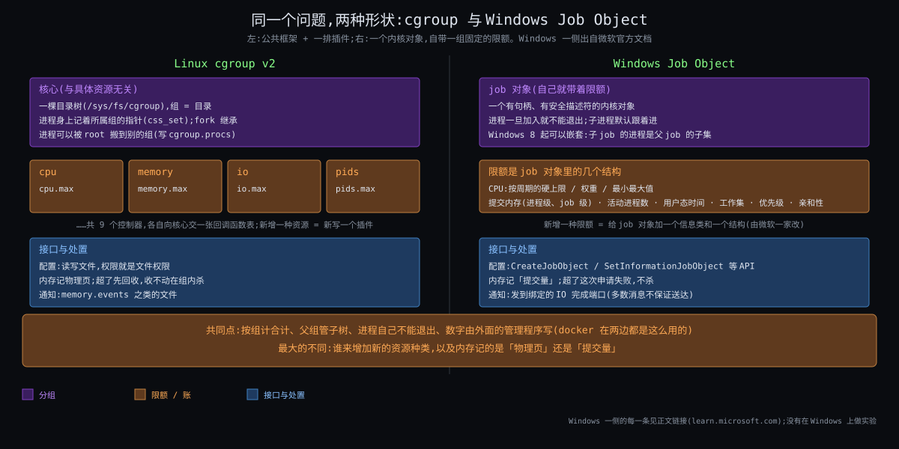

# 阶段 6:cgroup 与 Windows Job Object

Windows 也要回答「怎么给一组进程设资源上限」这个问题,它的答案叫 Job Object。拿它来比,是因为它和 Linux 来历完全不同:一家公司设计、闭源、没有经历过「四拨人各做一套」的前史。看两边哪里一样、哪里不一样,就能分清 cgroup 的设计里哪些是这个问题本身逼出来的,哪些是 Linux 这条路特有的选择。

只比架构这一层:怎么分组、账记在哪、超了怎么办、数字谁来写、新增一种资源要动哪里。Windows 一侧全部出自微软官方文档(链接附在正文),没有读 Windows 的代码,手边也没有 Windows 机器,所以这一节**没有实验**。

## 约束清单速查(C1 ~ C5)

#### C1 — 按组限制合计用量
管的单位是组不是进程;上限是绝对数;组能套组,父组管整棵子树的合计。
**不可再分**:开几个进程是应用的自由;相对权重回答不了「最多多少」。
**口诀**:账记在组上,上限一超就处理。

#### C2 — 记实际用量,超限处理看资源类型
账记物理页、真实 CPU 时间、真实 IO;超了以后能等的等、能拒的拒,内存只能回收或杀。
**不可再分**:稀缺的是物理资源;物理页占了不还就没有。
**口诀**:记实际用掉的;超限怎么处理看资源类型。

#### C3 — 内核负责执行,配额由外部设定
归属和上限被管的进程改不了;谁该分多少内核不知道,由管理程序通过文件写进来。
**不可再分**:边界能被进程自己改就不存在边界;哪个业务重要内核无从判断。
**口诀**:内核负责执行,数字由外面定。

#### C4 — 在内核已有代码路径上记账,开销要小
所有业务共用一个内核;记账点只能挂在内核本来就要走的路上,必须便宜。
**不可再分**:每家一个内核资源无法互借;记账在最热的路上,开销一大,机器上所有程序都会跟着变慢。
**口诀**:在内核已有路径上记账,不另开新路。

#### C5 — 所有资源共用同一套分组
资源种类会不断增加,新增一种不能惊动已有的;一笔开销会跨几种资源,所以分组只能有一套。
**不可再分**:资源种类事先列不完;占内存的人和发 IO 的人不是同一个执行者。
**口诀**:分组只做一遍,账要对得上。

## §0 三件事记住

### §0.1 一样的地方:问题本身逼出来的

因为 `C1·按组限制合计用量` 和 `C3·内核负责执行,配额由外部设定` 对任何操作系统都成立 → 两边都要解决「按组算合计、组能套组、进程自己不能退出这个组、数字由外面定」→ 所以 Job Object 和 cgroup 在这几点上几乎一样:按组记账,嵌套时子组的上限不能比父组松,父组的账包含子组,子进程默认继承,配置由 docker 这类管理程序来写。

### §0.2 不一样的地方之一:谁来增加新的资源种类

因为 `C5·所有资源共用同一套分组` 的前一半(资源种类会增加)在两边的处境不同:Linux 上是很多家公司各自加,Windows 上是微软一家加 → 要解决的问题不同 → 所以 cgroup 长成「公共框架加插件」,Job Object 长成「一个对象自带一组固定的限额结构」。

### §0.3 不一样的地方之二:内存记的是什么

因为 `C2·记实际用量,超限处理看资源类型` 里的「处置」取决于这笔账能不能当场拒绝 → Windows 的内存模型是申请时就记「提交量」,这一刻有返回值可以拒绝;Linux 允许先答应、用到时才给物理页,用到的那一刻没有返回值 → 所以 Job Object 超了内存是「这次申请失败」,cgroup 超了内存是「回收,收不动就杀」。

### §0 结论

| 三件事 | 是什么 | 为什么 |
|---|---|---|
| 一样的部分 | 按组合计、父管子树、进程不能自己退出、数字由外面写 | 问题本身(`C1·按组限制合计用量`、`C3·内核负责执行,配额由外部设定`) |
| 公共框架不同 | 插件式 vs 固定结构 | 谁来加新资源(`C5·所有资源共用同一套分组`) |
| 内存处置不同 | 杀 vs 拒绝 | 记物理页还是记提交量(`C2·记实际用量,超限处理看资源类型`) |

## §1 一张图

## §2 逐条对照

| 维度 | Linux cgroup v2 | Windows Job Object | 一样吗 |
|---|---|---|---|
| 组是什么 | 一个目录 | 一个内核对象,有句柄、有名字、有安全描述符([Job Objects](https://learn.microsoft.com/en-us/windows/win32/procthread/job-objects)) | 形式不同,作用相同 |
| 子进程 | fork 时继承组籍(进程身上记录它属于哪个组的那个指针,内核里叫 `css_set`),没有例外 | 默认跟着进;job 可以允许「脱离」(`JOB_OBJECT_LIMIT_BREAKAWAY_OK`,子进程创建时带 `CREATE_BREAKAWAY_FROM_JOB`)(同上) | **不同**:Windows 留了一个例外,但开不开由设 job 的人决定 |
| 能不能换组 | root 可以把进程写到别的组的 `cgroup.procs` | 「进程一旦加入 job,就不能解除」(原文 "the association cannot be broken");只能再加入一个嵌套在里面的 job(同上) | **不同**:Windows 只进不出 |
| 嵌套 | 一开始就是一棵树 | Windows 8 起才支持;子 job 的进程必须是父 job 的子集,否则加入失败([Nested Jobs](https://learn.microsoft.com/en-us/windows/win32/procthread/nested-jobs)) | 一样(Windows 晚了十几年) |
| 父管子树 | 父组的上限约束整棵子树 | 子 job 的有效限额「可以比父 job 更严,不能更松」,对提交内存、优先级、亲和性等生效(同上) | 一样 |
| 账向上汇总 | 父组的统计包含子组 | 「每个 job 的账包含它自己的进程和下面所有子 job 的进程」(同上) | 一样 |
| CPU 上限 | `cpu.max`:每周期最多多少微秒 | `CpuRate`:每个调度间隔里每 10 000 个周期最多用多少个,设 20% 就写 2000;硬上限模式下「用完之后,这个 job 的线程在下一个间隔之前都不会运行」([CPU 速率控制](https://learn.microsoft.com/en-us/windows/win32/api/winnt/ns-winnt-jobobject_cpu_rate_control_information)) | 几乎一样:都是「本周期额度用完就停到下个周期」 |
| CPU 按比例 | `cpu.weight` | `Weight` 模式;另有最小 / 最大值模式(同上) | 一样,Windows 还多一个「保底」 |
| 内存记什么 | 物理页(含页缓存) | 提交的虚拟内存(commit),进程级和 job 级两个上限([扩展限额](https://learn.microsoft.com/en-us/windows/win32/api/winnt/ns-winnt-jobobject_extended_limit_information)) | **不同**,见 §3 |
| 内存超了 | 组内回收,收不动在组内杀 | 「进程想提交的内存会超过 job 级上限时,这次提交失败」,并往完成端口发一条消息([基本限额](https://learn.microsoft.com/en-us/windows/win32/api/winnt/ns-winnt-jobobject_basic_limit_information)) | **不同**,见 §3 |
| 进程数 | `pids.max`,超了 fork 失败 | `ActiveProcessLimit`:同时活着的进程数上限(同上) | 一样(超限后的具体行为我没有查到原文) |
| 磁盘 IO | `io.max` | 曾有 `JOBOBJECT_IO_RATE_CONTROL_INFORMATION`,文档注明「Windows 10 1607 及以后不再支持」([IO 速率控制](https://learn.microsoft.com/en-us/windows/win32/api/jobapi2/ns-jobapi2-jobobject_io_rate_control_information)) | **不同**:Windows 上这条路收回了,原因文档没写 |
| 时间上限 | 没有 | 累计用户态时间上限,「系统定期检查」,超了终止进程(基本限额) | **不同**:这一项是系统定期检查的,不是记账时同步比较 |
| 配置方式 | 读写文件,权限就是文件权限 | `CreateJobObject`、`SetInformationJobObject` 等 API;把进程加入 job 需要 job 句柄上的 `JOB_OBJECT_ASSIGN_PROCESS` 权限和进程句柄上的 `PROCESS_SET_QUOTA`、`PROCESS_TERMINATE` 权限([AssignProcessToJobObject](https://learn.microsoft.com/en-us/windows/win32/api/jobapi2/nf-jobapi2-assignprocesstojobobject)) | 形式不同,作用相同(`C3·内核负责执行,配额由外部设定`) |
| 通知 | `memory.events` 等文件,可以监听变化 | 发到绑定的 IO 完成端口;除「通知限额」这一类外,「消息不保证送达」(Job Objects) | **不同**:cgroup 的计数在文件里,不会丢 |
| 容器 | docker 写 cgroup 文件 | 「Windows 容器用 job object 给每个容器的进程分组和记账,资源控制设在容器对应的 job 上」([Windows 容器资源控制](https://learn.microsoft.com/en-us/virtualization/windowscontainers/manage-containers/resource-controls)) | 一样:容器在两边都只是「被写了数的组」 |

## §3 最有意思的一处不同:超了内存,一个杀、一个拒

第三节 §8.3 讲过,Linux 超了内存只能杀,因为「往内存里写一个字节没有返回值」:程序申请内存时内核先答应(只分了地址),真正用到那一页时才去要物理页,这时已经没有地方返回错误了。

Windows 的做法不一样。它记的是「提交量」:程序申请内存时,系统就要保证将来有地方放这些页(物理内存加页面文件),这个保证当场就记到账上。Job Object 的内存上限管的就是这笔提交量。所以超限发生在申请的那一刻,那一刻是一次有返回值的调用,系统可以直接说「不行」。文档原文:「When a process attempts to commit memory that would exceed the job-wide limit, it fails.」

放回约束里看,两边都遵守 `C2·记实际用量,超限处理看资源类型`:处置方式由「这笔账在哪一刻记」决定。在申请时记,就能拒绝;在用到时记,就只能回收或杀。差别不在 cgroup 和 Job Object,而在 Linux 和 Windows 两套内存管理的底子。

代价也不一样。Windows 的提交量是「预订」,一个程序申请了 1 GB 但只用了 10 MB,也按 1 GB 算,上限会更早撞到;第二节 §3.1 里 `ulimit -v` 限地址空间被认为「记错了东西」,Windows 的提交量处在两者之间:它比地址空间准(只算真正承诺了的),但比物理页松(承诺了不一定用)。Linux 记物理页更贴近真实消耗,代价是只能事后处置。这一段是我按两边的内存模型做的对照,不是微软文档的原话。

## §4 另一处不同:为什么 Windows 不需要「公共框架加插件」

cgroup 的公共框架是 2006 年为了一个具体的麻烦抽出来的:四拨人各做一套资源管理,每套自带分组(第四节 §2)。Job Object 没有这段前史。它的限额是 job 对象里的几个结构,要加一种新限额,就是由微软给 job 对象加一个信息类和一个结构,例如 Windows 8 加了 CPU 速率控制;IO 速率控制加了又在 Windows 10 1607 起不再支持。

这说明「公共框架加插件」不是这个问题的唯一解,而是 `C5·所有资源共用同一套分组` 在一个特定处境下的解:**加新资源的人很多、彼此独立、谁也不能等谁。** Linux 是这个处境,所以要一个与具体资源无关的核心,让每家只写自己的插件;Windows 由一家维护,加一种限额就是改一处代码,一个固定结构的对象就够用,还更简单。这个判断是我的解读,微软的文档里没有讨论为什么这样设计。

反过来,Windows 这条路也有代价,从文档里能看到两处:

- **时间限额是定期检查的。** 「系统定期检查每个进程累计的用户态时间,超了就终止。」cgroup 的 CPU 上限是在结算时间那一刻同步比较的(第五节 §3),没有定期检查。不过 Windows 的 CPU 速率硬上限(每个间隔用完就停)和 cgroup 是同一种做法,定期检查只在「累计时间」这一项上。
- **通知会丢。** 完成端口上的消息除一类外不保证送达。cgroup 把事件计数写在文件里(`memory.events`),读多少次都在。

## §5 约束回扣

| 约束 | cgroup | Job Object | 结论 |
|---|---|---|---|
| `C1·按组限制合计用量` | 组、树、父管子树 | job、嵌套 job、有效限额只能更严 | 两边一样,问题本身逼出来的 |
| `C2·记实际用量,超限处理看资源类型` | 记物理页,超了回收或杀 | 记提交量,超了拒绝 | 规则一样,记账时刻不同导致处置不同 |
| `C3·内核负责执行,配额由外部设定` | 文件权限;root 能搬进程;数字由 docker 写 | 句柄权限;进程只进不出;数字由 docker 写 | 一样,Windows 更严(不能退出 job) |
| `C4·在内核已有代码路径上记账,开销要小` | CPU、IO 不设限时不走记账这一步 | 文档没有讲开销,不知道 | 无法比较 |
| `C5·所有资源共用同一套分组` | 公共框架加插件;只有一棵树 | 一个对象自带固定结构;一个进程只在一条 job 链上 | 后一半(分组只有一套)两边一样;前一半(怎么加新资源)因处境不同而不同 |

## §6 呼应灵魂问题

| 你的问题 | 这一节的补充 |
|---|---|
| ① `cpu.max` 怎么兑现半颗核 | Windows 的硬上限是同一种做法:每个调度间隔的额度用完,这个 job 的线程停到下个间隔。两个独立设计的系统走到了一起,说明「按周期给额度」是这个问题很自然的解 |
| ② 容器 OOM 的边界谁划的、账怎么记 | 边界两边一样:组的上限由管理程序写;Windows 容器同样用 job 划边界。账记什么不一样:Linux 记物理页所以只能杀,Windows 记提交量所以可以拒 |
| ③ 架构、怎么融入内核、设计哲学 | 「核心 + 插件」是为「很多家各加各的资源」这个处境选的形状,不是唯一答案;Windows 一家维护,用一个固定结构的对象就够了。五条设计原则里,「提供机制,策略由需求定制」和「用统一的方式管理所有资源」(只进不出、只有一条 job 链)两边都有;「公共框架加资源插件」是 Linux 特有的 |

## 待核清单

| # | 内容 | 状态 |
|---|---|---|
| 1 | 全节:没有在 Windows 上做实验,全部出自微软官方文档;文档没有写的(内部实现、开销)一律没有比较 | 说明 |
| 2 | §2:`ActiveProcessLimit` 超限后具体是新进程创建失败还是被终止,没有查到原文 | 未查 |
| 3 | §2:IO 速率控制为什么从 Windows 10 1607 起不再支持,文档没写 | 未查 |
| 4 | §3:「提交量比地址空间准、比物理页松」是我按两边的内存模型做的对照 | 解读 |
| 5 | §4:「Windows 不需要插件式公共框架是因为一家维护」是我的解读,微软文档没有讨论设计动机 | 解读 |
| 6 | §2:Windows 容器隔离命名空间用的「server silo」没有查,这一节只比资源控制 | 未查 |

## 修订记录

| 时间 | 修订摘要 | 触发原因 |
|---|---|---|
| 2026-11-16 | 初稿:和 Windows Job Object 按架构层对照(分组、继承、换组、嵌套、父管子树、CPU、内存、进程数、IO、配置、通知、容器);两处重点:超了内存一个杀一个拒(记物理页 vs 记提交量),以及为什么 Windows 不需要「骨架 + 插件」;一张对照图;Windows 一侧全部出自微软官方文档,无实验 | 开场对齐后用户「开始写」 |
| 2026-11-17 | 全篇改白话:去掉口号和比喻(「骨架」「逃生口」「逃不掉」「巡查」「搭车」「核心不认识资源」「少留自由」等五句哲学的名字统一换新)共约 25 处,「组籍」首次出现处补了一句解释;约束名已统一换新 | 用户:「都改成白话」 |
