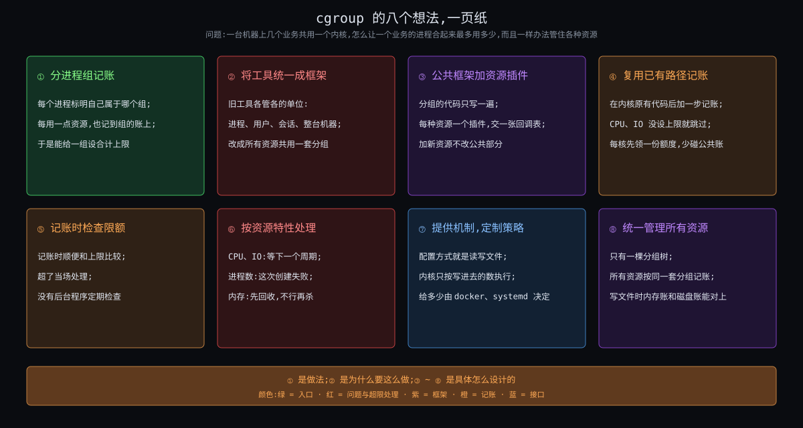
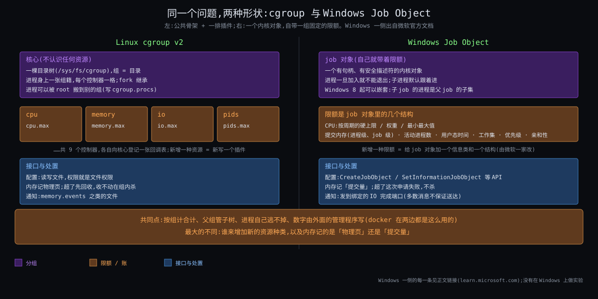
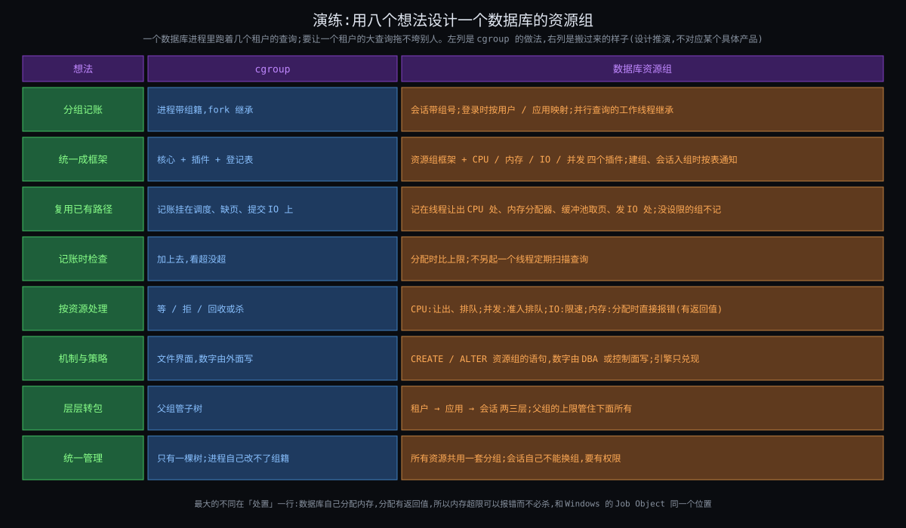

# cgroup:Linux 怎么把各种资源统一管起来

*这是「cgroup 核心原理」系列的总结篇,写给会写程序、没读过内核的读者。文中的数字都来自前六节在一台 4 核 Linux 虚拟机(内核 7.0)上的实测,源码对照上游 v7.0;每一处都注明了出自哪一节,想看实验过程可以回去翻。*

## 先说问题

一台 4 核 8G 的机器上跑着一个数据库。同事加了一个每晚跑的报表任务,为了快,它起了 8 个进程并行算。

第一晚,数据库的查询从每秒 690 次掉到了 226 次(第二节 §1)。报表并没有做错什么,8 个进程加上数据库的 4 个连接,一共 12 个进程平分 4 颗核,数据库正好只剩三分之一。

接下来你会一件件去找工具:

- 把报表的优先级调到最低(`nice 19`)。数据库回到了每秒 648 次。但数据库一闲下来,最低优先级的报表照样吃满 4 颗核(398%);报表改成 400 个进程,数据库又掉回 268 次(第二节 §2.1)。
- 把报表绑在一颗核上(`taskset`)。数据库到了 486 次。可是报表的进程用普通用户的身份调一行系统调用,就把自己解绑了,数据库又回到 215 次(第二节 §2.2)。
- 给报表每个进程限 512M 内存(`ulimit -v`)。8 个进程每个都没超,合起来占住了 2461 MiB(第二节 §3.1)。
- 内存真的用光那一刻,内核挑了全机最胖的进程杀掉。闯祸的是报表,被杀的是数据库(第二节 §3.2)。

磁盘和进程数也一样:每种资源有自己的工具,每种工具都有管不住的情况。

这些工具的毛病是同一个:**它们各有各的单位。** `nice` 和 `taskset` 管单个进程,`ulimit -u` 管一个用户,进程组和会话管一次登录,内存见底时的 OOM 管整台机器。没有一把工具认得「报表这一摊」。

这个系列要回答的大问题是:**Linux 内核怎么把各种资源统一管起来?** 答案是 cgroup。把同样的报表放进一个 cgroup,给它写「每 100 毫秒最多用 50 毫秒 CPU」,8 个进程也好、400 个进程也好,数据库都稳在 348% 的 CPU(每秒 633 和 640 次);给它写「最多 512M 内存」,超了的时候被杀的是 7 个报表进程,数据库一页内存都没少(第二节 §9.1、§9.2)。

下面用八个想法讲清楚它是怎么做到的、为什么长成这样。



## 本文用到的五条约束

前几节从「为什么」里切出了五条约束,下面八个想法都在回答它们。

#### C1 — 按组限制合计用量
管的单位是组不是进程;上限是绝对数;组能套组,父组管整棵子树的合计。

#### C2 — 记实际用量,超限处理看资源类型
记物理页、真实 CPU 时间、真实 IO;超了以后能等的等、能拒的拒,内存只能回收或杀。

#### C3 — 内核负责执行,配额由外部设定
归属和上限被管的进程改不了;谁该分多少内核不知道,由管理程序写进来。

#### C4 — 在内核已有代码路径上记账,开销要小
所有业务共用一个内核;记账点只能挂在内核本来就要走的路上,必须便宜。

#### C5 — 所有资源共用同一套分组
资源种类会不断增加,新增一种不能惊动已有的;一笔开销会跨几种资源,所以分组只能有一套。

## 想法一:分进程组记账

**cgroup 做的事:给每个进程标明它属于哪个组;进程每消耗一次资源,内核除了原来的记账,还往这个组的账上记一笔。有了组的账,就能对一组进程的合计设上限。**

拆开是三样东西:

- **组籍**:每个进程在内核里有一份档案,cgroup 在上面加了一个指针,指向一张卡片。卡片上写着「这个进程的 CPU 账在哪个组、内存账在哪个组……」。同一组的进程共用一张卡片。fork 出来的子进程直接抄父进程的指针,所以一生下来就在组里(第三节 §3,实测父子两个进程的卡片是同一个地址)。
- **账**:每个组、每种资源一本账,挂在组上,不挂在进程上。进程开 8 个还是 400 个,都记在同一本账上。
- **限**:写在账旁边的一个数。

这三样合起来,就是 `C1·按组限制合计用量` 的答案:账户从进程身上搬到了组上。

它是怎么让「半颗核」兑现的?报表组的账上写着「每 100 毫秒最多 50 毫秒」。调度器每结算一次「这个进程刚跑了多久」,就从组的账上扣掉同样多;扣完了,这一组的进程都停下,等下一个 100 毫秒开始,账上补满,再放它们出来(第三节 §7)。不管组里有几个进程,它们花的是同一个 50 毫秒。

| 没有组籍会坏在哪 | 它解决了 |
|---|---|
| 内核只认识单个进程,看不见「一摊」 | 组成了记账的单位 |
| 进程越多,分走的越多 | 进程数变成组内部的事,合计不变 |

## 想法二:将工具统一成框架

**前面那些工具不是不够好,是它们各自用自己的方式给进程分组。缺的是一套所有资源共用的分组办法。**

这不是事后的总结,是历史。2006 年秋天,Linux 内核和它的邮件列表上至少已经有四套「管一组进程的资源」的方案,出自四拨人:SGI 和 Bull 的 cpusets(管进程能用哪几颗 CPU)、IBM 的 CKRM、OpenVZ 的 beancounters、Google 的 Rohit Seth 的 containers(第四节 §2)。每一套都自己做了一遍「把进程分成组」。

Google 的 Paul Menage 在 2006 年 9 月 28 日发到邮件列表的补丁里这样说(第四节 §3.1):

> These all need the basic abstraction of being able to group together multiple processes in an aggregate, in order to track/limit the resources permitted to those processes, and all implement this grouping in different ways.

大意:它们都需要「把多个进程聚成一组」这个基本抽象,又都用各自不同的方式实现了它。

他没有再做第五套资源管理方案,而是把 cpusets 里已经做好的分组代码抽了出来,做成一个通用的框架,再让 cpusets 反过来成为它的第一个用户。这就是 cgroup 的起点。

| 没有统一框架会出什么问题 | 统一之后 |
|---|---|
| 每种资源各做一套分组,互不相通,管理员要维护四套 | 分组只做一遍 |
| CPU 按一种分法、内存按另一种分法,同一个业务在两边对不上 | 所有资源共用同一套组 |

## 想法三:公共框架加资源插件

**cgroup 分成两半:一个「核心」,只管谁和谁一组;一排「控制器」,每种资源一个。核心不知道 CPU、内存是什么,它只按每个控制器交上来的一张表,在固定的时刻调用它。**

在一台 7.0 内核的机器上问一句「这个内核认识哪些控制器」:

```
cpuset cpu io memory hugetlb pids rdma misc dmem
```

9 个(第一节 §3.2)。一个组的目录里,`cpu.max` 归 cpu 控制器,`memory.max` 归 memory 控制器,以 `cgroup.` 开头的那几个文件归核心。

控制器交给核心的那张表,内核里叫 `struct cgroup_subsys`。表上的格子是一组生命周期时刻:建组时给它建一本账、进程入组时通知它、fork 时问它「能不能生」、进程退出时通知它……(第五节 §5.1、§5.2)。新加一种资源,就是新写一个控制器,填一张表,核心一行不用改。

核心是真的不认识资源,源码里看得见:在 cgroup 核心的主文件里搜内存控制器和 CPU 调度器的函数名,一次都没有出现(第五节 §5.7)。

Menage 在 2007 年的论文里给了一个类比(第四节 §3.2):

> The relationship between the container framework and a subsystem is similar to that between the Linux VFS and a specific filesystem

大意:框架和子系统的关系,类似 Linux 的 VFS 和具体文件系统的关系。

VFS 不认识 ext4 和 xfs,只定义「打开、读、写」这些动作,每个文件系统填一张函数表。cgroup 的核心不认识 CPU 和内存,只定义「建组、入组、fork、退出」这些时刻,每个控制器填一张回调表。这就是 `C5·所有资源共用同一套分组` 的前一半:资源种类会增加,新增一种不能惊动已有的。

| 没有这条分界会坏在哪 | 它解决了 |
|---|---|
| 每加一种资源,都要改分组的代码 | 加资源只写插件 |
| 各家做资源管理的人互相等 | 各写各的控制器,互不干扰 |

## 想法四:复用内核已有路径记账

**cgroup 不给内核另修一条路。记账的那一步,挂在内核本来就要走的路上:调度器结算运行时间的地方、给进程分物理页的地方、把读写请求交给磁盘的地方。而且没人设限的时候,这一步尽量不走。**

在内核里抓「记账那一刻」的调用栈,读法是从下往上:下面几行是内核本来就在做的事,最上面一两行才是 cgroup 加的。比如 CPU 这一条:时钟中断 → 调度器的周期处理 → 结算当前进程跑了多久(`update_curr`)→ cgroup 记一笔(第三节 §4.2)。内存那一条:缺页 → 分一个物理页 → cgroup 给组记一页(第三节 §5.2)。

为什么必须这样?因为所有业务共用一个内核(`C4·在内核已有代码路径上记账,开销要小`)。如果每个业务一台虚拟机,资源能隔开,但闲着的资源借不出去,开一台还要几秒(第二节 §6)。共用一个内核,记账就落在最热的路上:调度器每毫秒结算一次,内存每分一页就要记一笔。这一步的开销一大,机器上所有程序都会跟着变慢。

所以有两个省钱的办法。

**不用的人不付钱。** 实测:两个组各跑一个死循环,都没写 CPU 上限,1 秒里「给组记 CPU 账」这一步一次都没发生;只给其中一个组写上上限,这一步才开始走,而且全部记在那个组头上。磁盘 IO 一样。内存不一样:只要开了内存控制器,设不设上限都要每页记账,因为「这个组现在占了多少内存」这个数任何时候都得准(第三节 §4.5)。CPU 那边靠的是两层开关:整台机器有没有人设过限、这一组有没有设限,两个都是「否」就直接返回(第五节 §3.2)。

**每颗核先领一小份额度。** 每颗核先从组的总额度里领一小份,花的时候只扣自己领到的这份。实测 2 秒里记了 1660 笔 CPU 账,只有 181 笔动了全组共用的总额度;吃 100 MiB 内存记了 25 660 次账,真正改组的计数器只有 400 次(第三节 §4.4、§5.4)。

这条约束的分量,历史上有一个直白的例子。2008 年内存控制器刚合入时,每个物理页要多带几个字节,不用它的机器也一样要付。Fedora 的维护者说,只要这个指针还在,他们就永远不会默认打开它(第四节 §6.1)。一个让不用的人也付钱的机制,进不了默认配置,就等于不存在。

| 没有它会坏在哪 | 它解决了 |
|---|---|
| 另起一套专门的记账流程,程序要配合,所有程序都多一层开销 | 记账加在内核原有的代码路径上 |
| 每笔账都抢全组的锁,核越多越慢 | 每颗核预领一小份额度,大多数记账不碰共享的数 |
| 没用 cgroup 的程序也要承担开销 | CPU、IO 没设上限时跳过记账 |

## 想法五:记账时同步检查限额

**cgroup 里没有一个后台程序定期去查各组用了多少。消耗资源的那一刻记账,记账的同时和上限比较:加上去之后超没超,超了当场处理。**

CPU:每颗核会先从组的总额度里领一小份,用完再领。某颗核去领时发现总额度已经用完,就在这颗核上给这个组设一个「限流中」的标记;组里的进程下一次从内核返回用户程序时检查到这个标记,就停下来(第三节 §7)。整个机制里只有一个定时器,每 100 毫秒触发一次,只做两件事:把总额度补满,清掉标记。它不检查任何进程用了多少(第三节 §7.5)。

内存:给组记账时发现加上这一笔会超过上限,这次记账就不成立,触发超限的进程当场停下来处理:先在组里回收内存,收不回来再挑一个进程杀掉(第三节 §8)。

所以 400 个进程是怎么停下来的?不是内核逐个去停它们。实测:报表组 8 个进程也好、400 个也好,内核设「限流中」标记的次数都是每秒 40 次(4 颗核 × 10 个周期),和进程数无关;每个进程是自己检查到标记后停下的(第三节 §7.4)。

| 没有它会坏在哪 | 它解决了 |
|---|---|
| 定期检查有间隔,间隔里可能超出很多;组越多检查越慢 | 超限在记账那一刻就被发现 |
| 要逐个通知 400 个进程停下 | 每颗核设一个标记,进程自己检查后停下 |

## 想法六:按资源特性决定超限处理

**超了以后怎么办,不由 cgroup 决定,由资源的性质决定。只有三种:会再生的资源让你等,能当场拒绝的资源直接拒,占了不还又没法拒的资源只能回收或杀。**

| 资源 | 超了怎么办 | 为什么 |
|---|---|---|
| CPU 时间 | 停到下一个周期 | 下一个 100 毫秒还会有 |
| 磁盘带宽 | 读写请求排队 | 下一秒还会有 |
| 进程数 | 这次 fork 失败 | fork 是一次有返回值的调用,可以直接说「不行」 |
| 内存 | 先回收,收不回来就杀 | 等不来,又拒绝不了 |

内存为什么拒绝不了?因为 Linux 给程序内存是「先答应、后兑现」:程序申请时内核只给了地址,真正往里写第一个字节时才去要物理页。这时候程序在执行一条普通的赋值语句,没有返回值,没法告诉它「失败了」(第三节 §8.3)。这就是 `C2·记实际用量,超限处理看资源类型`:账记在真正花掉物理页的那一刻,这一刻就只剩回收或杀。

拿 Windows 一比就看清了。Windows 给一组进程设限用的是 Job Object,它的内存上限管的是「提交量」:程序申请内存的那一刻,系统就要保证将来有地方放,并当场记账。所以超了上限是「这次申请失败」,不用杀(第六节 §3)。两边都是按资源特性决定超限处理,差别只在什么时候记账。

杀的范围也是有边界的:哪个组的计数器先碰到上限,回收和挑人就只在那个组里做。报表组的用量碰到它自己的 512M 上限,被杀的只会是报表组里的进程,数据库在另一个组,不在名单上(第三节 §8.3)。容器 OOM「只杀容器里的进程」,边界就是这么划的。



## 想法七:提供机制,策略由需求定制

**内核不知道报表该给多少 CPU、数据库该给多少内存,也不该知道。它只负责「写多少就兑现多少」。数字由 docker、systemd、Kubernetes 这类管理程序写进来,写的方式就是写文件。**

你在命令行敲 `docker run --cpus=0.5 -m 512m ...`,这两个数要经过好几站才到内核:docker 交给 containerd,再交给 runc,runc 在 `/sys/fs/cgroup` 下面建一个目录,往 `cpu.max` 里写 `50000 100000`,往 `memory.max` 里写 `536870912`(第一节 §4)。内核看到的只有这两个文件里的数。

为什么界面是文件?Menage 在 2007 年的论文里给了三个理由(第四节 §3.2):标准的 Unix 工具都能操作它,权限委派是现成的(文件权限),输入输出的格式也自由。权限这一条正好是 `C3·内核负责执行,配额由外部设定` 的前一半:这些文件的主人是 root,被管的进程打不开,它想把自己挪出报表组、想把自己的上限改成无限,都会得到「Permission denied」(第二节 §9.5)。

| 没有它会坏在哪 | 它解决了 |
|---|---|
| 内核要判断哪个业务重要,它没法知道 | 策略留给管理程序 |
| 被管的程序能改自己的上限,边界就不存在 | 文件权限挡住了它 |

## 想法八:用统一的方式管理所有资源

**cgroup 第一版给了一份很大的自由:每种资源可以挂在自己的一棵树上,按自己的方式分组。这份自由让控制器之间对不上账,花了九年多才收回来。今天的 cgroup v2 只有一棵树,所有资源共用一套分组。**

当年加这份自由是有道理的。一个来自 IBM 的例子:一台大学的服务器,CPU 想按「教授 / 学生」分,网络想按「浏览器 / NFS / 其他」分。两种分法互不相干,只有一棵树的话,就得把它们乘起来建组(第四节 §4)。

它的代价是后来才显形的。写一个文件时,数据先进内存,稍后由内核的回写线程写到盘上。占内存的账记在 memory 那棵树的某个组上,写盘的 IO 该记在磁盘那棵树的谁头上?两棵树的分法不一样,对不上。Tejun Heo 2015 年在补丁说明里写道:块 IO 控制器分不清一笔回写该算谁,于是全部记到根组(第四节 §7.1)。也就是说,在多棵树的年代,带缓冲的写根本限不住。

2012 年,接手维护的 Tejun Heo 说要把多棵树「送上砧板」(第四节 §7.1):

> I'm scheduling multiple hierarchy support for the chopping block. This is a long term thing (think years)

Google 的人回信:「A mandated unified hierarchy is madness.」(强制统一成一棵树是疯了)。v2 在 2016 年才正式可用,CPU 控制器又因为另一场争论拖到 2018 年才进来(第四节 §7.2、§7.3)。

只有一棵树之后,这件事就能做了:同一笔写,先记在报表组的内存账上,落盘时 IO 也记在报表组头上。实测带缓冲地写 30 MiB 时,把数据交给磁盘的是内核线程,不是报表的进程,可这笔 IO 照样记在了报表组头上,报表的限速对它生效(第三节 §6.5)。这是 `C5·所有资源共用同一套分组` 的后一半:一笔开销跨几种资源,分组就只能有一套。

这个取舍是有代价的:总有人确实需要被去掉的那种用法。那台大学服务器的需求,v2 就是不支持。Tejun 能下这个决心,是因为有六年的使用经验可以说「没有人给出足够有力的理由保留它」;2006 年的 Menage 没有这六年(第四节 §4.1)。收回这份灵活,前提是判断被去掉的用法很少有人真的需要。

| 没有它会坏在哪 | 它解决了 |
|---|---|
| 每种资源一棵树,控制器之间对不上账 | 一棵树,所有资源共用一套分组 |
| 带缓冲的写全部记到根组,限不住 | 回写的 IO 记到对应的组 |

## 把这套做法搬到别处:给数据库设计资源组

八个想法不只属于操作系统。拿一个数据库工程师熟悉的问题来试:**一个数据库进程里跑着几个租户的查询,怎么让一个租户的大查询拖不垮别人?**

这是一个设计推演,不对应某个具体产品。现实里的数据库(MySQL、Oracle 等)的资源组具体管了哪些资源,这篇没有查,不作对照。



逐条过一遍。

1. **分进程组记账。** 会话带一个组号。登录时按用户或应用映射到组;一个查询派生出的并行工作线程继承发起会话的组号,就像 fork 继承组籍。
2. **将工具统一成框架。** 不要给每个功能各加一个开关(单条查询超时、每用户连接数、全局并发线程数……那是本文开头那些各有各单位的旧工具)。做一个资源组框架,把 CPU、内存、IO、并发数做成四个插件,建组、会话入组时按表通知它们。
3. **公共框架加资源插件。** 框架只管「这个会话属于哪个组、组怎么嵌套」。以后要加「每组的临时表空间上限」,就是加第五个插件。
4. **复用已有路径记账。** 记账挂在数据库本来就要走的路上:执行线程让出 CPU 的地方、内存分配器、缓冲池取页、发 IO 的地方。没设限的组不记。每个线程先领一小份额度,用完再去组上领,不要每一笔都碰组的共享计数器。
5. **记账时同步检查限额。** 分配内存时就比上限,不要另起一个后台线程定期扫描「谁超了」。
6. **按资源特性决定超限处理。** CPU 超了:让出,排到下一个时间片。并发超了:新查询在门口排队。IO 超了:限速。内存超了:这里和 Linux 不一样,和 Windows 一样。数据库的内存是自己的分配器分的,每次分配都有返回值,所以可以让这条查询报错退出,而不必杀掉别人。缓冲池里的页像操作系统的页缓存,可以先淘汰。
7. **提供机制,策略由需求定制。** 组和上限用 SQL 语句定义,数字由 DBA 或上层的控制面写;引擎只负责兑现。
8. **用统一的方式管理所有资源。** 所有资源共用一套分组,不要让 CPU 按租户分、内存按应用分。会话自己不能换组,要有权限才行。

做完会发现,最难的那一条和 cgroup 一样是第四条。数据库的执行器也是一条热路径,每处理一行都可能要记账;记账贵了,资源组本身就成了瓶颈。

## 附:设计决策总表

把前六节的主要设计决策收成一张表,给想按图索骥的读者。

| 设计决策 | 约束 | 代价 | 还能怎么做(反事实) | 现实里谁这么做 |
|---|---|---|---|---|
| 进程带组籍,fork 继承 | `C1·按组限制合计用量`、`C3·内核负责执行,配额由外部设定` | 每个进程多一个指针;换组要换一张组籍 | 由管理程序逐个指派新进程 | Windows Job Object 也是默认继承,但允许设置「可以脱离」(第六节 §2) |
| 核心 + 控制器 + 登记表 | `C5·所有资源共用同一套分组` | 核心只能在表上列出的时刻调用控制器 | 一个对象自带固定的几种限额 | Windows Job Object,由微软一家加新限额(第六节 §4) |
| 记账挂在已有的路上 | `C4·在内核已有代码路径上记账,开销要小` | 记账在热路径上,必须做便宜 | 每个业务一台虚拟机 | KVM 等虚拟化,闲置资源不能互借(第二节 §6) |
| 每颗核预领一小份额度(CPU 5 ms、内存 64 页) | `C4·在内核已有代码路径上记账,开销要小` | 上限不再每个周期精确 | 每笔都改共享计数器 | 2009 年以前的内存控制器就是这样(第四节 §6.2) |
| 记账时同步比较上限 | `C2·记实际用量,超限处理看资源类型` | 超限只能在记账点被发现 | 后台线程定期检查 | Windows 的累计用户态时间限额是定期检查的(第六节 §4) |
| 内存记物理页,超了回收或杀 | `C2·记实际用量,超限处理看资源类型` | 会杀进程;回收拖慢正在申请内存的进程 | 记提交量,超了拒绝 | Windows Job Object(第六节 §3) |
| 界面是文件 | `C3·内核负责执行,配额由外部设定` | 管理程序要自己维护一棵目录树 | 专用系统调用或 API | Windows 用 API 和句柄权限(第六节 §2) |
| 只有一棵树 | `C5·所有资源共用同一套分组` | 不支持「不同资源按不同方式分组」 | 每种资源一棵树 | cgroup v1(2007 ~ 2016,第四节 §4) |
| 限流时进程回到用户态再停下 | `C4·在内核已有代码路径上记账,开销要小` | 一个组可能「部分限流」 | 整组从运行队列上摘下 | Linux 6.17 及以前,会把拿着锁的进程冻住(第四节 §5.4) |

## 这套做法的边界

最后照实说几件它没解决、或者说它带来的问题,都是前几节量到或查到的:

- **限流有毛刺。** 半颗核的意思是「跑一阵、停一阵」,一个请求如果在停的那一段到达,要等几十毫秒才有人处理(第三节 §7)。
- **组内 OOM 有时会多杀。** 被选中的进程一开始退出,内核挑下一个要杀的进程时就看不到它了,可它的内存要几毫秒后才还回去;这几毫秒里组的用量再碰到上限,就会多杀一个(第五节 §4.4)。
- **IO 限速会拖住组外的人。** 在组外执行 `sync` 催报表的数据落盘,等的是报表的限速(第三节 §6.5)。
- **上限不是保底。** `cpu.max` 和 `memory.max` 只管「最多」,不管「至少」;保底要用另一组旋钮(`cpu.weight`、`memory.low`),而内存的「保底」只保得住可以回收的那部分(第二节 §10)。

这些不是 cgroup 做错了,是同一套取舍的另一面:复用已有路径记账、记账时同步检查、按资源特性处理超限,就会有这些边角。

## 修订记录

| 时间 | 修订摘要 | 触发原因 |
|---|---|---|
| 2026-11-17 | 初稿:公开博文。用户挑选的八个想法为骨干(组籍与多记一笔 / 缺的是骨架 / 核心不认识资源 / 只搭车不改道 / 记账即执法 / 处置随资源 / 机制在内数字在外 / 少留自由);结尾用八个想法设计数据库资源组(用户更正后的选择);附设计决策总表与边界;三张图(一页纸、Linux 与 Windows、数据库资源组) | 开场对齐后用户「写吧」「继续」 |
| 2026-11-17 | 八个想法改名(用户逐条定):分进程组记账 / 将工具统一成框架 / 公共框架加资源插件 / 复用内核已有路径记账 / 记账时同步检查限额 / 按资源特性决定超限处理 / 提供机制,策略由需求定制 / 用统一的方式管理所有资源;正文、演练、边界与两张图同步改 | 用户:「感觉每个点都太AI了,要改一下……我来决定改成什么」 |
| 2026-11-17 | 正文里的比喻改成白话:「搭车」「监工」「骨架」「赌注」「挂牌子 / 下场」「加税」「绕路费」「顺手」等;约束名(如 `C4·只能搭车,不能改道`)是全系列统一的编号名,这次没有改 | 用户:「一并改成白话」 |
| 2026-11-17 | 导出前补改白话 11 处:「看起来解决了」「各有各的洞」「叫人」「记零钱 / 每核零钱」「撞线」「下场」「隐身」「窗口」等;约束名已在全系列统一换新 | 用户:「都改成白话」;合成全文前核对 |
| 2026-11-17 | 07-db-resource-group.svg 重画:八行按博文的八个想法排(补上「公共框架加资源插件」一行,去掉「层层转包」一行,名字用全称),脚注「处置」改为「第 6 行」 | 做视频时起草第 7 集的子代理发现图文不一致 |
| 2026-11-17 | 「巡查(线程)」改为「检查(线程)」,与第三节及视频用词一致 | 做视频审稿时统一用词 |
