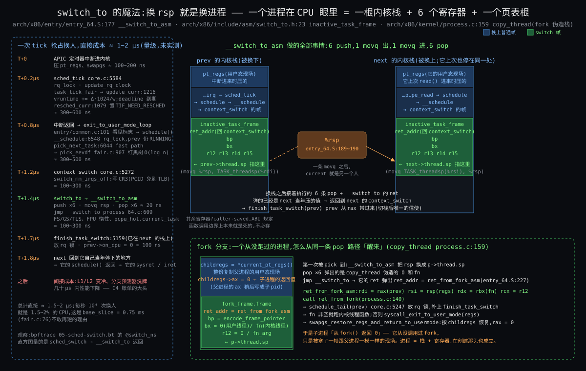

# Linux 的进程调度器 | atlas 综合长文

> 一份以 Linux 6.12 为样本、以「谁先上 / 跑多久 / 放哪个核」三问为主轴,从零讲到源码的调度器笔记 —— 三问一条线 / 八条约束 / 1991 ~ 2024 五个人 / 三条主线源码(换人全路径、cgroup 跨层记账、sched_ext 挂载与回退)/ 对照 Windows NT / 决策表 14 行 + 五步法 + Kubernetes 调度器演练

---

## 导读地图

本文是一轮苏格拉底式问答的**最终融合产物**:一问一答走了七个话题,每个话题写成一篇,中间的追问、猜错、纠正都留在了正文里。目标是让没进过内核的人也能把调度器从「它在替系统做什么」一路看到 6.12 的源码行号,最后带走一套离开内核也能用的推导方法。

### 灵魂问题(贯穿全文)

> **「从调度器在 Linux 内核中的作用说起:它到底在替系统做什么、怎么做,要让一个 Linux 小白也能靠这份资料入门调度器;在此基础上,讲清 cgroup(组调度 / CPU 控制器)和 sched_ext(eBPF 自定义调度器)在原生调度器之上增强了什么、为什么需要增强。」**

走完全文,你会从七个角度回答它:它是什么(What)、为什么非得存在(Why)、三问各怎么答(How)、谁在什么约束下这样答的(Origin)、6.12 源码里到底怎么走(Deep)、换一套血统会长成什么样(Comparison)、这套推导怎么带走(Synthesis)。

### 覆盖的 7 篇

| 篇 | 它讲什么 | 篇幅 |
|---|---|---|
| **What** | 它是什么:一句话定义、厨房类比(一个厨子四道工序)、4 核笔记本的某一毫秒、三问骨架、几个悬念 | ~191 行 |
| **Why** | 为什么必须存在:从「一次只跑一个程序」起六刀,一刀一条,切出 C1 ~ C6 | ~231 行 |
| **How** | 大致怎么工作:账本与树(谁先上)、三扇门与换人(跑多久)、调度类链、多核(放哪个核)、cgroup(追加 C7)、sched_ext(追加 C8)、一次 tick 到换人的伪代码 | ~510 行 |
| **Origin** | 是怎么来的:0.01 的 for 循环 → O(1) → 2007 年公平之争(CFS 对 SD)→ 2023 年 EEVDF → 可插拔二十年两个答案,关键处引原话附链接 | ~554 行 |
| **Deep** | 源码里到底怎么走:三条主线钉到 6.12 行号 —— 一次换人的全路径(含 fork 分支和纳秒账单)、cgroup 账本跨层与带宽控制、sched_ext 的挂载 / 回调 / 看门狗回退 | ~914 行 |
| **Comparison** | 对照 Windows NT:32 级优先级加提升、量子、理想核、同构的换人代码;SQL Server 为什么在上面再盖一层调度器 | ~448 行 |
| **Synthesis** | ★ 按公开博文口径重讲并提炼,可单独读:决策表 14 行、逐条拿掉约束的检验、两个同构系统、五步法 + Kubernetes 调度器演练 + 查询优化器 | ~729 行 |

### 阅读路径建议

- **第一次接触调度器** → 顺读(What → Why → How → Origin → Deep → Comparison → Synthesis)
- **只有一小时** → 直接读 [第七篇](#stage-synthesis)。它是按一篇独立博文写的,会把前六篇的要点重讲一遍,所以和前面有意重复
- **想快速建立心智** → [What](#stage-what) + [Why](#stage-why)(约 30 分钟)
- **想看源码怎么走** → [Deep](#stage-deep) §2「一次换人的全路径」,行号全对 `v6.12`
- **只关心 cgroup** → [How](#stage-how) §6 → [Deep](#stage-deep) §3 → [Synthesis](#stage-synthesis) §6
- **只关心 sched_ext** → [How](#stage-how) §7 → [Origin](#stage-origin) §5 → [Deep](#stage-deep) §4 → [Synthesis](#stage-synthesis) §7
- **想横向对比** → [Comparison](#stage-comparison)(约 40 分钟)
- **想拿走方法** → [Synthesis](#stage-synthesis) §9 决策表、§12 五步法与 Kubernetes 演练

**全长**约 3883 行、中文约 7.6 万字;深读约 6 小时,跳读约 1.5 小时。

### 全文导览

七篇按顺序展开,每两篇之间有一段过渡,提示读法要换档。每篇末尾有「约束回扣」和「呼应灵魂问题」两节,把该篇内容钉回约束清单和开头的问题;正文里的《你的视角》和「反问」小节,记的是对话中提出的猜想和回答,认对的部分、纠偏的部分都写明了。

两点口径:

- cgroup 和 sched_ext 两条线,本文讲到「为什么需要、增强了什么、骨架怎么搭」,源码级只给结论;逐行的版本留给各自单独一轮(见文末延伸阅读)。
- 数字和年份后面括号里的「已核 / 部分已核 / 更正 / 推算 / 示意 / 未核实 + 编号」,对应文末[《收尾核实》](#verify)表里的同一条。各篇自己的修订记录保留在 `stages/0X-*/0X-*.md` 里,这里不重复。

---

## 约束清单速查(C1 ~ C8)

> 后文所有 `Cn·短名` 引用都对应下面 8 条,**各篇不再重复列**。C1 ~ C6 在第二篇里一刀一刀切出来;C7、C8 在第三篇讲 cgroup 和 sched_ext 时追加。它们不是「目标」,是改不了的事实。读到一半忘了某条,搜 `C3` 就能跳回这里。

#### C1 — CPU快IO慢
核比它要等的东西(磁盘、网络、键盘)快一万倍到一千万倍,等待是常态。
**不可再分**:物理事实。
**口诀**:等的时候换别人上。

#### C2 — 程序不让台
程序不会主动让出 CPU,内核也猜不到它还要跑多久。
**不可再分**:程序不可信 + 未来不可知。
**口诀**:时钟来敲门,到点就换人。

#### C3 — 凭账不凭嘴
内核看不见未来,任务自己报的「我很急」也不可信,只能凭已经发生的事做决定。
**不可再分**:信息论事实。
**口诀**:记过去,不猜未来。

#### C4 — 调度不免费
换一次人直接花 1 ~ 2 微秒,之后缓存变冷还要再慢几十微秒(工作集大时可到上千微秒);选人的代价不能随任务数增长。
**不可再分**:CPU 微架构 + 没有一颗专门管调度的核。
**口诀**:换得少、选得快。

#### C5 — 核间不通气
核与核之间没有共用的桌面:跨核读写同一份数据慢几十倍,打断另一颗核慢上千倍。
**不可再分**:缓存一致性协议 + 核间中断的代价。
**口诀**:各管各的队,偶尔对账。

#### C6 — 有人等不起
份额和时限是两回事:有一类任务要的是「某个时刻之前一定拿到 CPU」,公平记账只保证份额。
**不可再分**:时限来自物理世界(声卡缓冲、控制周期)。
**口诀**:公平之外另开一条道。

#### C7 — 同机多租户
一台机器上住着多个互不相让的租户,它们在乎的公平单位是「我这一摊」,而租户可以随意多开线程。
**不可再分**:应用和部署的现实。
**口诀**:先分组,组内再分。

#### C8 — 一算法不配万场景
不同负载对「谁先上、跑多久、放哪个核」的最优答案不同,而且变化比内核发布快;策略必须能换,换错了还不能伤到内核。
**不可再分**:应用多样性 + 社区流程。
**口诀**:策略可换,内核不倒。

---

<a id="stage-what" name="stage-what"></a>

# 📍 第一篇:What — 它是什么

> 这份资料的读者是「Linux 小白」:会用终端、听说过进程,但没进过内核。读完这一节,你应该能用一句话跟别人说清楚调度器是什么,并且脑子里有三个问题挥之不去。

## §0 开场:你面前只有一颗 CPU

先忘掉 Linux。假设你是第一个要写调度器的人,手上只有一台机器,机器里一颗 CPU。

这颗 CPU 一辈子只会做一件事:

```
取出 PC 指着的那条指令 → 执行 → PC 指向下一条 → 再取 → 再执行 → ……
```

PC(程序计数器)是它身上唯一的「注意力」,一次只能指一个地方。它不知道什么叫「程序」,更不知道哪个程序重要、哪个在等人。你给它一条 `while (1) {}`,它会用每秒 30 亿条指令的速度,忠诚地空转到断电。

现在你想让四个程序「同时」在这颗 CPU 上跑:一个在编译代码,一个在放视频,一个数据库在等查询,一个终端在等你敲键盘。

可 PC 只有一个。「同时」是做不到的。你能做的只有一件事:**轮流,并且轮得快到人感觉不出来**。

你写了第一版:A 跑 10 毫秒,换 B,B 跑 10 毫秒,换 C……看起来能用。然后第一个麻烦来了:A 是编译器,正跑得欢;B 是数据库,刚上来就要读一次磁盘,这一读要等 10 毫秒。这 10 毫秒里 CPU 能执行三千万条指令,而 B 的 PC 只是停在原地等。你让 CPU 陪它一起等了。

你意识到:**等待的时候应该让别人上**。可一旦这样做,下一个问题立刻冒出来:让谁上?让他上多久?如果机器有两颗 CPU,放哪颗上?

这三个问题,就是调度器要回答的全部问题。后面整份资料,都在回答这三个问题。

## §1 一句话定义

**调度器:内核里决定每颗 CPU 下一刻跑哪条流、跑多久、放哪颗核的那段代码。**

(28 字。读完这一节你应该能复述出来。)

三个动词对应三问:

| 问题 | 一句话 |
|---|---|
| ① 谁先上 | 就绪的任务排成队,下一个让谁上核 |
| ② 跑多久 | 上了核的任务什么时候该下来换人 |
| ③ 放哪个核 | 多颗核时,每个任务该在哪颗核上跑、要不要搬 |

## §2 厨房类比:一个厨子,四道工序

想象一个只有一个厨子的小厨房。今晚要出的菜,拆成四道工序:洗菜、切菜、烧汤、炒菜。

笨办法是按顺序做:洗完菜、切完菜、把汤烧上、傻等二十分钟汤好、再炒菜。聪明一点的厨子会先把汤坐上火,趁汤在煮的二十分钟去洗菜切菜,汤好了正好开炒。这就是华罗庚讲的统筹方法:**凡是「等」的时间,都拿去干别的**。

把厨房和机器对上:

| 厨房 | 机器 | 调度器里的名字 |
|---|---|---|
| 厨子 | 一颗 CPU 核 | CPU |
| 一道工序 | 一个进程或线程 | 任务(task) |
| 砧板上正在切的菜 | 核上正在跑的任务 | RUNNING |
| 汤在火上煮,不占厨子 | 任务在等磁盘 / 网络 / 键盘 | SLEEPING(睡眠) |
| 洗好等切的菜 | 随时能跑、就等核空出来的任务 | READY,排在就绪队列里 |
| 厨房里的定时器每隔几分钟响一下 | 时钟中断 | tick |
| 厨师长喊「放下,先做这个」 | 强行把正在跑的任务换下来 | 抢占 |
| 第二个厨子、第二个灶 | 第二颗核 | 多核 |
| 两个厨子匀活 | 把任务从忙的核搬到闲的核 | 迁移 / 负载均衡 |

三问在厨房里是这么长出来的:

- **① 谁先上**:砧板空出来了,是先切催得急的那桌的菜,还是每桌轮着来?前者叫优先级,后者叫公平。
- **② 做多久换**:切到一半汤扑锅了,要不要放下刀去关火?放下刀、洗手、再拿刀是有代价的,换得太勤整晚都在洗手。这就是时间片和抢占之间的拉扯。
- **③ 两个厨子怎么分**:一道菜最好从头到尾一个厨子做,他手熟、料就在手边(这叫缓存热);但一个厨子排了八道菜、另一个闲着,就得匀一匀。

类比里还能自己推出一条:**厨子自己不会出菜**。调度器不干活,它只决定谁干活。它每多花一秒做决定,就少一秒真正的工作。所以调度器必须快,快到决定本身几乎不占时间。

## §3 一张全景图:一台 4 核笔记本的某一毫秒

把场景落到一台真实的机器上:4 核笔记本,你同时开着

- 终端里 `make -j8`,8 个编译器进程 `cc1` 全是纯算,有核就想跑;
- Chrome 在放视频,渲染线程每 16 毫秒必须画完一帧,否则你看到卡顿;
- 后台一个 `mysqld`,16 个工作线程,大部分时间睡着等请求,来一条 SQL 要算一小会儿再读盘;
- 一个 ssh 会话,`bash` 几乎永远在等你敲下一个键。


从图上能读出五件事:

1. **每颗核在任一时刻只跑一个任务**(蓝框),其它都在排队(紫框里)或睡觉(红区)。「同时跑 30 个程序」是四颗核轮流制造的错觉。
2. **就绪队列是每颗核一条,不是全机一条**。核 0 排了 3 个 `cc1`,核 2 快空了,所以有一条虚线把任务从核 0 搬去核 2:这就是问题 ③。
3. **睡眠区不在任何队列里**。`bash` 在等键盘、`make` 在等 8 个儿子结束,它们不占核也不排队。事件来了才被唤醒,回到某条就绪队列,重新回答一次「谁先上」。
4. **时钟中断是一把总闸**(顶上橙条):每隔几毫秒把每颗核强拉回内核一次。没有它,核 0 上那个 `cc1` 会一直跑下去,后面排队的三个永远上不了台。这是问题 ②。
5. **Chrome 的渲染线程刚被唤醒,就把核 1 上的 `cc1` 挤了下去**(核 1 队列里那个「被抢」)。谁能挤谁、凭什么,是问题 ① 里最有味道的部分。

### §3.1 你的视角:换人发生在哪一刻,凭什么换

读到第 5 条你的第一反应是:「从时钟中断陷入内核,或者系统调用陷入内核,然后顺便判断是否用尽了时间片、是否该选下一个进程上 CPU。」

这句话对了一大半,拧紧两处:

- **认**:换人的决定只能在任务「陷入内核」的瞬间做。CPU 在用户态跑 `cc1` 时,内核根本不在场;时钟中断和系统调用是把 CPU 拉回内核的两扇门,内核就在门口顺便问一句「该换人了吗」。这正是问题 ② 的机制。
- **补一扇门**:图里 Chrome 挤掉 `cc1` 的起点不是 tick,是**唤醒**。显卡说「下一帧可以画了」,内核把 Chrome 渲染线程从睡眠区捞出来的那一刻,就会拿它和核 1 上正在跑的 `cc1` 比一比;比赢了就给核 1 打个「需要重调度」的标记,等核 1 下次经过任何一扇门(tick、系统调用返回、中断返回)时真的换。所以门有三扇:时钟中断、系统调用、唤醒。
- **纠**:你答的是「什么时候换」,问题问的是「凭什么判断 Chrome 更该上」。答案是内核**不看任务说什么,只看它做过什么**:Chrome 渲染线程每画完一帧就睡,一秒里真正占核的时间很少;`cc1` 从不睡,占了多少算多少。内核记着每个任务「跑了多少」,**谁跑得少谁先上**。睡得多的任务天然跑得少,醒来就排在前面。Chrome 不用告诉内核自己急,它的睡眠记录替它说了话。

一句话:**时机看三扇门,资格看历史账**。「历史账」怎么记、为什么这样记才算公平,留给后面。

### §3.2 你的视角:主动让出

第二个拷问:核 3 上的 `mysqld` 工作线程算了 0.2 ms 就发了一个 `read`,时间片明明没用完,内核会让它继续占着核等磁盘吗?你的回答:「换人。读盘是慢操作,所以必须换。它的 task_struct 放进磁盘读写完成的唤醒队列里,读完后会尝试唤醒它。」

全对,再补两笔让它成形:

- **这是下核的第三种方式**。一个任务离开核只有三条路:时间片到了(问题 ②)、被更该上的人挤下去(§3.1 的唤醒抢占)、**自己说「我要等」**。第三条最常见也最便宜:没人打断它,它在 `read` 里面自己走到调度器门口,把自己标成 SLEEPING,挂到那次磁盘请求的等待队列上,然后请调度器从核 3 的就绪队列里再挑一个。这一步叫主动让出,是厨子「汤坐上火就走开」的那一下。
- **它去了哪儿**:睡着的时候它**不在任何就绪队列里**,只在那条等待队列上。磁盘读完,硬件发中断,中断处理把它从等待队列摘下来、标回 READY、放回某条就绪队列。放回哪条?通常是它睡前所在的核 3(它的数据还在核 3 的缓存里,手熟);但如果核 3 正忙、旁边有核空着,内核可能把它放到空核上。这一下就是问题 ③ 在唤醒时刻的一次小决定。

一句话:**慢操作一来就让,让的时候不排队;醒来重新排队,排哪条队是问题 ③ 说了算**。

## §4 骨架:三问贯穿到底

这份资料的骨架只有三个问题。后面每一节、每一个内核里的名词,都能挂到其中一问之下。

| 三问 | 内核里对应的一簇东西(只报名字,后面才展开) | 厨房里的样子 |
|---|---|---|
| ① 谁先上 | 优先级、公平、调度类(普通 / 实时 / 期限) | 先做哪道菜 |
| ② 跑多久 | 时间片、时钟中断、抢占、主动让出 | 做多久换下一道 |
| ③ 放哪个核 | 每核就绪队列、迁移、负载均衡、亲和性 | 几个厨子怎么分活 |

你灵魂问题里的两个「增强」,在这个骨架上各占一格,这里只露个脸:

- **cgroup(控制组)**:把「谁先上」里的「谁」从单个任务换成一组任务。之前是 8 个 `cc1` 和 1 个 Chrome 线程一人一票,`cc1` 人多势众;分了组以后是「编译组」和「浏览器组」各一票。它没有换掉调度器,只是让三问以组为单位再问一遍。
- **sched_ext(可扩展调度类)**:把三问的回答权交给你自己写的程序。内核留出一个插座,你用 eBPF 写一段「谁先上 / 跑多久 / 放哪核」的逻辑插进去,不重新编译内核、不重启机器。它也没有换掉调度器,只是把答题人换成了你。

## §5 关键词速查表

后面会反复出现的词,每个一句话,这里不展开。

| 术语 | 一句话 |
|---|---|
| 任务(task) | 调度器眼里的最小单位;进程和线程在它眼里没区别,都是「一条可以被暂停再续上的指令流」 |
| 三种状态 | RUNNING 在核上;READY 随时能跑在排队;SLEEPING 在等某个事件,不排队 |
| 时钟中断(tick) | 硬件定时器每隔几毫秒打断 CPU 一次,内核借这个机会检查「该换人了吗」 |
| 时间片 | 一个任务上核后允许连续跑的时长,到点就得让 |
| 抢占 | 任务没跑完时间片、也没主动睡,被内核强行换下来 |
| 就绪队列(runqueue) | 每颗核一条,装着这颗核上所有 READY 的任务 |
| 上下文切换 | 把当前任务的现场(寄存器、栈)存起来,把下一个任务的现场装回去 |
| 调度类 | 回答「谁先上」的不同规则族:普通任务一套、实时任务一套、期限任务一套,还有 sched_ext 这个可插拔的一套 |
| 迁移 / 负载均衡 | 把任务从一条就绪队列搬到另一条,让各核忙闲均匀 |
| cgroup | 把任务分组、按组分配 CPU 时间的机制 |

## §6 它在系统里的位置

```
   用户程序:make / chrome / mysqld / bash          ← 它们只管跑,不知道自己被换过
   ───────────────────────────────────────────────
   cgroup CPU 控制器(按组分配,可选旋钮)
   ───────────────────────────────────────────────
   调度器(内核)   ① 谁先上  ② 跑多久  ③ 放哪个核
                   调度类:普通 / 实时 / 期限 / sched_ext(eBPF 插座)
   ───────────────────────────────────────────────
   它依赖的底座:时钟中断 · 上下文切换 · 每核就绪队列 · 唤醒(事件到了叫人)
   ───────────────────────────────────────────────
   硬件:CPU 核 × N · 定时器 · 缓存
```

邻居和边界,也就是「它不是什么」:

| 容易混淆的东西 | 它排的是什么 | 跟进程调度器的关系 |
|---|---|---|
| IO 调度器(块层的 mq-deadline / BFQ) | 排的是磁盘请求的先后 | 同名不同物;进程调度器排的是 CPU |
| Go runtime 的 goroutine 调度、协程库 | 在一个进程内部,把很多协程摆到少数几个线程上 | 跑在用户态,在内核调度器之上;内核只看见那几个线程 |
| 虚拟机的 vCPU 调度(KVM) | 客户机的虚拟 CPU 该在哪颗物理核跑 | 在 Linux 上每个 vCPU 就是一个线程,由同一个进程调度器排 |
| 中断处理 | 硬件事件来了谁先处理 | 不经过调度器,硬件直接打断;但它常常是「唤醒」的起点 |
| 内存管理、文件系统 | 内存页、磁盘块 | 平行的内核子系统;调度器只管 CPU 时间这一种资源 |

一句话:**调度器只分配一种资源,CPU 时间。**内存、磁盘、网络各有各的管家,它一概不管。

## §7 留下的悬念

每一节末尾留一个问题,后面的节来揭。这一节留下五个,第一个和第五个是你自己提的。

1. **调度器自己也是程序,也要占 CPU。它在谁的 CPU 时间里跑?** 换人的那一瞬间,旧任务已经停了、新任务还没醒,这几行代码站在谁的脚下?(揭晓在「它怎么工作」)
2. **「轮流」听起来已经公平了,为什么内核不满足于轮流,非要发明「公平」这个词的精确定义?** 8 个 `cc1` 和 1 个 Chrome 线程一人一票,到底公不公平?(揭晓在「它为什么必须存在」)
3. **视频为什么会卡?** 编译明明在别的核上跑,Chrome 那一帧到底被谁抢走了什么?(揭晓在「它为什么必须存在」)
4. **为什么要分组?** 单个任务一人一票的世界哪里不够用,逼出了 cgroup?(揭晓在「它怎么工作」末尾)
5. **一个算法能覆盖所有场景吗?内核为什么肯把三问的回答权交出去?**(你追加的)调度器说到底是一个算法。可游戏机要的是「这一帧别掉」,数据库服务器要的是「每秒多扛几条查询」,编译集群要的是「把核全喂饱」。三种场景对三问的答案根本不一样。那能不能像策略设计模式那样,内核留一个接口,不同场景插不同的策略,而且在线换?一个本该最保守的内核子系统,怎么会在 2024 年开出一个 eBPF 插座?

   先给两个真实案例当钩子,答案后面揭:

   - **2007 年**,社区为「桌面为什么卡」吵了一整年,有人提议做可插拔调度器(plugsched),让用户自己选算法。Linus 和当时的调度器维护者明确拒绝:一个内核只该有一个调度器,把选择权交给用户等于承认自己没设计好。(已核 What-5:原话出处)
   - **2024 年底**,同一个内核合入了 sched_ext:用户用 eBPF 写一个调度策略,`insmod` 都不用,加载进去就生效,出 bug 内核自动切回默认调度器。Valve 的 Steam Deck 掌机用它跑一个专为游戏帧率设计的策略 scx_lavd,Meta 在生产服务器上跑自己写的 scx_layered。(部分已核 What-6:SteamOS 版本与 Meta 公开材料)

   17 年里内核的立场翻了个面。其实在 sched_ext 之前,内核里早就藏着一个「策略模式」:普通任务、实时任务、期限任务各走一套规则,这几套规则在源码里就是一张函数指针表。它和真正的「可插拔」差在哪、为什么 2007 年不行 2024 年行,是整份资料最后要回答的问题。(揭晓在「它怎么工作」末尾 + 「它怎么来的」)

## §8 呼应灵魂问题

你的问题是:从调度器在内核里的作用说起,让一个小白能入门;再讲清 cgroup 和 sched_ext 增强了什么。

这一节把「作用」压成了一句话和三个问题:调度器是内核里反复回答「谁先上 / 跑多久 / 放哪个核」的那段代码,它只分配 CPU 时间这一种资源。cgroup 和 sched_ext 已经在骨架上各占了一格:前者把三问的主语换成「组」,后者把三问的答题人换成「你」。

现在你能指着那张 4 核笔记本的图说出哪里是核、哪里是队列、哪里是睡眠区,也知道了三问从哪里来。还不知道的是:为什么这三问必须由内核来答、答错会坏在哪、内核是怎么答的。下一节就从「如果没有调度器,这台笔记本会怎样」开始。

---

> **🔄 心智切换:讲解员 → 论证者(共情模式)**
>
> 上面用一个厨子四道工序的类比和一台 4 核笔记本的某一毫秒,立起了调度器的骨架:它没有自己的进程,只在三个问题上做决定 —— 谁先上、跑多久、放哪个核。但只看地图不知道它为什么非得长成这样。下一篇把调度器整个拆掉,从「一次只跑一个程序」的机器开始,一刀一刀把它长回来:每一刀先看坏在哪,再看补什么,最后浮现一条约束。六刀切完,手里是 C1 ~ C6,后面每个机制都要回到这张清单上找出处。

---

<a id="stage-why" name="stage-why"></a>

# 📍 第二篇:Why — 为什么必须存在

> 上一节你已经能指着那台 4 核笔记本说出哪里是核、哪里是队列、哪里是睡眠区,也记住了三问:谁先上 / 跑多久 / 放哪个核。这一节把调度器拆掉,从「一次只跑一个程序」开始,一刀一刀把它长回来。每一刀先看坏在哪,再看补什么,最后浮现一条约束。六刀切完,约束清单就是后面每个机制的出处。

## §0 起点:你的机器一次只跑一个程序

还是那台 4 核笔记本,但先把三颗核拔掉,只剩一颗。你是第一个写系统的人,最省事的做法是:**一次只装一个程序进内存,跑完再装下一个**。这不是假想,1970 年代以前的批处理机器和早期的个人电脑就是这样,DOS 时代你开着编译器就不能开别的。

你敲 `make`,cc1 开始跑。你想顺手 `ls` 看一眼目录,敲了没反应,因为机器上只有 cc1 一条流,PC 在它那儿,你的 `ls` 连内存都没进。等编译跑完,`ls` 才轮到。

这台机器没坏,它只是蠢。接下来每一刀,都是你受不了它的某一种蠢。

## §1 六刀:每刀一个痛、一个补、一条约束


### §1.1 第一刀:CPU 在陪外设干等

**痛**。cc1 编译到一半要读一个头文件,发了 `read`。机械硬盘找到那一块要 10 毫秒;这台机器的核每秒执行 30 亿条指令,10 毫秒就是三千万条。这三千万条指令的空档里,PC 停在 `read` 后面那条指令上一动不动,核在等磁盘。换成 SSD,等 100 微秒,也是三十万条指令。换成等你敲键盘,人类按一个键的间隔是 100 毫秒以上,三亿条。

把核和它要等的东西放一起看:

| 核要等的东西 | 一次要等 | 等价于多少条指令 |
|---|---|---|
| 内存里的数据(缓存没命中) | ~100 ns | ~300 |
| NVMe SSD 读一块 | ~100 μs | ~3 × 10⁵ |
| 机械硬盘读一块 | ~10 ms | ~3 × 10⁷ |
| 一个网络来回 | ~1 ms 到几十 ms | 10⁶ ~ 10⁸ |
| 你敲下一个键 | ≥ 100 ms | ≥ 3 × 10⁸ |

(示意 Why-1:各量级取 2020 年代消费级硬件典型值。)

你的机器大部分时间在等,真正算的时间是零头。

**补**。既然 cc1 在等,就让别人上:cc1 发了 `read` 的那一刻把它标成「睡眠」,把 `ls` 装进来跑;磁盘读完了发个中断,把 cc1 标回「就绪」。于是任务有了三种状态:正在核上跑(RUNNING)、随时能跑等核空(READY)、在等某件事(SLEEPING)。这就是上一节厨房里「汤坐上火就走开」那一下。

**浮现的约束**:

#### C1 — CPU快IO慢
核比它要等的任何东西都快 10⁴ ~ 10⁷ 倍,**等待是常态,计算是零头**。
**不可再分**:物理事实。电子在硅片里跑,磁头和网络包在物理世界里跑,差距不会因为软件写得好而消失。
**口诀**:等的时候让别人上。

### §1.2 第二刀:换人靠自觉,自觉靠不住

**痛**。第一刀的换人有个前提:cc1 得先发 `read`、先睡着,别人才有机会。可编译器不总读盘。cc1 把头文件读完以后,接下来几秒钟是纯算:语法分析、优化、生成代码,一个 `read` 都没有。这几秒钟它一次都不睡,`ls` 一次都上不了核。你又回到了起点:整机被一个程序霸住。

你可以求它:「每算一会儿主动让一下」。1990 年代的 Windows 3.x 和 Mac OS 9 就是这么干的,叫协作式多任务。结果是一个程序死循环,整机跟着死。而且就算程序愿意让,**让多久一次才合适,它自己也不知道**:它不知道旁边还有多少人在等。

更根本的是:内核也不知道 cc1 这一轮要算多久。它可能 1 毫秒后就读盘,也可能 10 秒不读。内核看不见它的未来。

**补**。不求它,抢它。给机器接一个硬件定时器,每隔 4 毫秒打断核一次,PC 被硬件强行拉回内核(已核 Why-2:tick 频率取内核默认配置 CONFIG_HZ=250,每 4 ms 一次;发行版可以改成 1000,即每 1 ms 一次)。内核在这个打断点上问一句:cc1 跑够一个时间片了吗?够了就换。这叫抢占,时钟中断是抢占的钟。cc1 对此一无所知:从它的视角看,它只是某条指令和下一条指令之间「恍惚」了一下。

**浮现的约束**:

#### C2 — 程序不让台
程序不会主动让出 CPU,**内核也猜不到它还要算多久**。
**不可再分**:程序是别人写的,内核不能假设它善良或聪明;而「它接下来要算多久」取决于它还没执行的代码和还没到的输入,原理上不可知。
**口诀**:不求让,定时抢。

### §1.3 第三刀:轮流不等于公平,视频卡了

**痛**。有了时钟中断,你写了最直觉的算法:所有就绪任务排成一圈,每人跑 10 毫秒,到点换下一个。编译器、Chrome、mysqld、bash 一视同仁。

把上一节的全景图再拿出来:`make -j8` 的 8 个 cc1 永远就绪,加上 Chrome 的几个线程、mysqld 偶尔醒来的工作线程、系统自己的几十个后台任务,排队的常年有 30 个。一圈 30 × 10 ms = 300 毫秒。Chrome 的渲染线程画完一帧睡过去,显卡 16 毫秒后说「下一帧」,它醒来排到队尾,等 290 毫秒才轮到。它每秒本该画 60 帧,现在画 3 帧。**视频成了幻灯片**,这就是上一节悬念 3 的答案:不是编译抢了 Chrome 的核,是「轮流」让一个睡得多的任务每次醒来都排在 29 个从不睡的任务后面。

这里也揭了悬念 2。轮流看起来公平,每人 10 毫秒,童叟无欺。可算一下一秒钟的账:cc1 从不睡,30 轮里它每轮都在,拿到 1000 / 300 × 10 ≈ 33 毫秒;Chrome 渲染线程一秒里只需要 3 到 5 毫秒的核就能画满 60 帧,它拿到的却是 3 次 × 不到 1 毫秒,然后剩下时间全在排队。**它要得少,得到的更少**。轮流公平的是「上场次数」,不公平的是「实际拿到的 CPU」。

**补**。不按圈排,按账排。给每个任务记一本「已经用了多少 CPU」的账,核空出来时,**谁用得最少谁先上**。cc1 一秒用了 33 毫秒,Chrome 渲染线程一秒只用了 3 毫秒,它一醒来账面远远落后,直接插到队首,16 毫秒内一定轮到。它不用告诉内核自己在放视频;它的睡眠记录替它说了。

这一刀的关键选择:内核**不问任务「你急不急」**,因为任务可能不知道、可能撒谎(谁都会说自己急)、而且「急」没法量化;内核只看**已经发生的事**。

**浮现的约束**:

#### C3 — 凭账不凭嘴
内核看不见任务的未来,任务不自报需求,自报了也不可信;**内核能依据的只有已经发生的事:它跑了多久、睡了多久、醒了几次**。
**不可再分**:「需要多少 CPU 才够」取决于未来的输入;而让任务自报等于把分配权交给最会喊的那个。
**口诀**:不猜未来,记过去;谁欠得多谁先上。

#### §1.3.1 你的视角:nice 和实时优先级算不算「自报」

拷问:C3 说任务自报不可信,可 nice 值、实时优先级不就是任务自己报的吗?你的判断:「不矛盾。」对,理由补三条:

- **报的是权重,不是需求**。nice 不让任务绕过账本,只改账本涨的速度:nice 高的任务每跑 1 ms 记 1.5 ms 的账,于是更早被换下去;nice 低的反之。内核依旧只看历史,只是给历史加了倍率。(已核 Why-6:nice 相邻一级约 1.25 倍权重,nice 0 → 1024。)
- **报的方向受限**。普通用户只能把自己的 nice 调高(让自己吃亏);调低、或设实时优先级,需要特权(CAP_SYS_NICE)。让自己吃亏的自报不需要信任;让自己占便宜的自报,内核要求先有 root。
- **即便有特权也只信一半**。实时任务默认每秒最多拿 950 ms,留 50 ms 给普通任务,防止一个失控的实时任务锁死整机。(已核 Why-7:sched_rt_runtime_us 默认 950000。)

一句话:C3 禁的是「任务说自己急」,允许的是「有权限的人给它定倍率」,倍率只作用在账上。

### §1.4 第四刀:调度器自己的开销,换人贵、选人慢

这一刀有两张面孔,根是同一个:**调度器的每一微秒都从任务的时间里扣**。它是厨师长,厨师长洗手、开会的时间,厨子都在等。

**痛一:换得太勤,整晚都在洗手**。第三刀让你尝到甜头,你想把「公平」做到极致:每 100 微秒重算一次账,谁落后就立刻换谁上。结果整机变慢了 20%(示意 Why-3:示意数字,按下面的代价估算)。换人不是免费的,分两笔账:

| 代价 | 量级 | 是什么 |
|---|---|---|
| 直接代价 | 1 ~ 2 μs | 存旧任务的寄存器和栈指针,装新任务的;切页表 |
| 间接代价 | 几十 μs 起 | 新任务的数据不在缓存里,头几十微秒每次访问都要去内存拿;TLB 也得重新填 |

(已核 Why-4:直接切换 1 ~ 2 μs、缓存变冷几十 μs 的量级,沿用上一期「Linux进程全链路」的核实结果。)

每 100 微秒换一次,每次赔几十微秒,赔掉的就是两三成。

**痛二:选人本身比干活还慢**。第三刀的「谁用得最少谁先上」,你最初的实现是每次选人把就绪队列从头扫到尾。30 个任务,扫一遍几十纳秒,没感觉。换成一台跑着 3 万个线程的数据库服务器:每次选人扫 3 万个,几十微秒;每颗核每秒做上千次选人(tick、唤醒、睡眠各触发一次),光选人就吃掉核的几个百分点;唤醒再频繁一点,选人比干活还慢。上一节悬念 1 埋的那个事实在这里露出约束面:**调度器自己也是代码,也在这颗核上跑**。

**补**。对痛一:给「公平」加一个下限,任务一旦上核至少跑够一个最小粒度(毫秒级),账面再落后也等它跑完这一阵再换;公平按一个周期(几十毫秒)摊平,不追求每一微秒都公平。对痛二:就绪队列按账面排好序存放,选人只看头部,插入删除都是对数时间;任务数翻一千倍,选人只多几步。

**浮现的约束**:

#### C4 — 调度不免费
调度器没有自己的 CPU,换人和选人都从任务的时间里扣:**换一次直接 1 ~ 2 μs 加缓存变冷几十 μs,换得越勤浪费越高;选人的代价必须与任务数无关或近乎无关**。
**不可再分**:硬件只有一套寄存器、缓存只认最近用过的地址;机器上没有「专管调度的核」,即便有也得跨核通知,更贵(见下一刀)。
**口诀**:公平摊着算、别瞬时算;选人看队头、别扫全表。

### §1.5 第五刀:第二颗核来了,核与核之间没有共用的桌面

**先说硬件事实**。把拔掉的三颗核装回去。每颗核有自己的缓存,核与核之间**没有「共用的桌面」**:

| 一颗核要做的事 | 代价 | 慢多少 |
|---|---|---|
| 读自己缓存里的数据 | ~1 ns | 基准 |
| 读另一颗核刚写过的数据(硬件把那行缓存从对方搬过来) | 40 ~ 100 ns | 几十倍 |
| 打断另一颗核(核间中断,让它停下来处理一件事) | μs 级 | 上千倍 |

(未核实 Why-5:跨核缓存行传输与核间中断的量级。)

厨房里就是:两个厨子各有各的灶台和调料架。共用一个调料架,两人得排队伸手;一道菜做到一半换厨子,新厨子得重新熟悉这道菜放了什么。

**痛**。最直觉的做法:全机一条就绪队列,四颗核都从这条队列里拿任务。两个问题立刻出现。

第一,这条队列是所有核都要写的共享结构。四颗核同时去拿,得加一把锁;每次有核选人,锁和队列的那几行数据就在核之间来回搬。4 核还好,一台 64 核的服务器上,64 个核排队抢同一把锁,这把锁本身成了整机的瓶颈。

第二,任务 A 这一轮在核 0 跑,下一轮被核 2 拿走。核 0 的缓存里有它的数据,核 2 的没有;它在核 2 上头几十微秒全在从内存重新拿,跟第四刀的换人间接代价一样,只是这次是换核不是换人。

**补**。每颗核一条自己的就绪队列、一本自己的账,平时各管各的,锁只锁自己这条。任务尽量留在上次跑的核上(缓存还热)。隔一阵(毫秒级)对一次账:核 0 排 3 个、核 2 快空了,就搬一个过去。搬是例外,不搬是常态。

这一刀揭了问题 ③ 的来路:「放哪个核」不是因为多核天然需要分配,而是因为**跨核的任何共享和打断都贵**,贵到不敢随便动,所以默认不共享,偶尔同步。

**浮现的约束**:

#### C5 — 核间不通气
每颗核有自己的缓存和时钟,核与核之间没有共用的桌面;**跨核共享一行数据慢几十倍,打断另一颗核慢上千倍**。
**不可再分**:缓存一致性协议和核间中断的硬件代价,软件绕不过去。
**口诀**:各算各的账,偶尔对账。

### §1.6 第六刀:份额给够了,还是爆音

**痛**。你的机器现在公平、省切换、多核均衡。前五刀讲的都是一件事:**每个任务拿到多少 CPU**。公平记账保证一秒里你拿到你那一份。

你开了个音乐播放器。播放线程一秒只需要 20 毫秒 CPU,按份额它要得极少,公平算法一定给得够。可声卡的缓冲只装得下 5 毫秒的声音,播放线程**必须每 5 毫秒填一次**。公平算法说「这一秒的 20 毫秒我一定给你」,但它完全可以安排成「前 300 毫秒一口气给完,后 700 毫秒别人上」:份额一点没少,中间每 5 毫秒的期限全错过,音箱「啪啪」爆音。

为什么公平算法保证不了?因为它只比「谁欠得多」。播放线程醒来时账面确实落后,排在前面;可核上那个 cc1 还在跑第四刀保证的最小粒度,播放线程得等它跑完这几毫秒。等 1 毫秒没事,等 6 毫秒就爆音。公平算法保证的是**长期平均拿到应得的份额**,保证不了**某个时刻之前一定上核**。

工业控制、机器人、车载系统更极端:一个控制循环晚 20 毫秒,不是卡顿,是撞车。

**补**。承认有两类任务。一类只要长期份额够就行,按账排;另一类带着期限,**它来了就得立刻上,不跟任何人讲公平**。内核先问「有没有带期限的任务在等」,有就先满足它,没有才轮到公平那一套。这就是上一节速查表里「调度类」分家的原因:普通一套、实时一套、期限一套,各自回答三问,按优先级串起来。

**浮现的约束**:

#### C6 — 有人等不起
份额和时限是两回事:有一类任务要的不是「一秒拿到多少」,而是「某个时刻之前一定拿到」;**公平记账只能保证份额,保证不了时限**。
**不可再分**:时限来自物理世界(声卡缓冲长度、控制周期、刹车距离),软件改不了。
**口诀**:先问有没有人等不起,再谈公平。

## §2 约束清单(C1 ~ C6)

| # | 短名 | 约束 | 来源 | 逼出的东西(How 再讲) |
|---|---|---|---|---|
| C1 | CPU快IO慢 | 核比它要等的东西快 10⁴ ~ 10⁷ 倍,等待是常态 | 物理 | 任务三态、等待时换人、唤醒 |
| C2 | 程序不让台 | 程序不会主动让,内核也猜不到它还要多久 | 程序不可信 + 未来不可知 | 时钟中断、时间片、抢占 |
| C3 | 凭账不凭嘴 | 看不见未来,任务不自报也不可信,只能凭已发生的事 | 信息论上的事实 | 按已用 CPU 记账、谁欠得多谁先上、睡眠补偿 |
| C4 | 调度不免费 | 换人直接 1 ~ 2 μs + 缓存冷几十 μs;选人代价须与任务数无关 | CPU 微架构 + 没有专管调度的核 | 最小运行粒度、公平按周期摊、有序就绪队列、O(log n) 选人 |
| C5 | 核间不通气 | 跨核共享 / 打断贵一到两个数量级 | 缓存一致性 + 核间中断的硬件代价 | 每核一条队列、亲和、定期均衡 |
| C6 | 有人等不起 | 份额 ≠ 时限:有一类任务要「某时刻前一定拿到」,公平记账只保份额 | 物理世界的期限 | 调度类分家、实时 / 期限优先于普通 |

引用约定:后面一律写「编号·短名」,如 `C3·凭账不凭嘴`,不写裸编号。

### §2.1 你的视角:哪条约束最软

拷问:七条里哪条最可能随硬件演进变弱?你选了当时的 `C4·切换不免费`(现已并入 `C4·调度不免费` 的换人那一面)。对一半:

- **直接代价那半是软的**。存取现场的 1 ~ 2 μs 是指令序列,硬件可以做快;但它不总往软的方向走:2018 年 Meltdown 之后,内核在用户态 / 内核态之间多切一次页表(KPTI),这笔账反而翻倍。(已核 Why-8:KPTI 对切换开销的量级影响。)
- **间接代价那半是硬的**。缓存比内存快、比内存小,这两条只要成立,换一个工作集就必然挤掉上一个的热行。工艺进步不改变这个结构。

所以 C4 换人那一面以后要写成「直接代价越来越小,间接代价不变」,它不会变成零。

真正最可能变形的是 `C1·CPU快IO慢` 的**下半截**:持久内存、CXL 把「等存储」从毫秒拉到百纳秒级,接近一次缓存未命中。这时「换人」(赔 C4)反而不如「原地等」划算,内核在这类设备上已经用轮询代替睡眠(未核实 Why-9:NVMe / io_uring 的轮询模式、DAX 路径)。但 C1 的**上半截**不会动:网络来回、人敲键盘,永远比核慢 10⁶ 倍以上。

反过来有一条在**变硬**:`C5·核间不通气`。核数从 4 到 128、chiplet 把一颗芯片切成几个硅片、NUMA 让内存也分远近,跨核代价在涨。后面讲负载均衡时,这条是加厚的理由。

## §3 核心 insight:两句话

**第一句:不猜未来,记过去。** 内核不可能知道谁接下来需要多少 CPU(`C2·程序不让台` + `C3·凭账不凭嘴`),所以它干脆不猜,给每个任务记一本「已经用了多少」的账,谁用得少谁先上。「公平」从一个形容词变成一个可以比较的数字。睡得多的任务自动欠得多、自动排前面,交互性不用猜,是记账的副产品。

**第二句:默认不共享,偶尔同步。** 因为跨核贵(`C5·核间不通气`)、换人和选人都贵(`C4·调度不免费`),调度器把「全机一本账、每时每刻精确公平」改成「每核一本账、按周期摊平、隔一阵对一次」。三种贵都用「少做」来省。

这两句话配上 `C2·程序不让台` 逼出的时钟中断,和 `C6·有人等不起` 逼出的「先问期限再谈公平」,就是调度器的全部骨架。

## §4 insight 对着约束看

| 约束 | 第一句「记账」怎么化解 | 第二句「少同步」怎么化解 |
|---|---|---|
| C1·CPU快IO慢 | 睡着的任务不记账,醒来账面落后,天然补偿等待 | — |
| C2·程序不让台 | 账由内核记,不由任务报 | 时钟中断是「同步」的最低频率 |
| C3·凭账不凭嘴 | 账就是历史,正面回答 | — |
| C4·调度不免费 | 账可排序,选人只看头 | 最小粒度:账落后也等一阵再换;每核自己的账,无全局锁 |
| C5·核间不通气 | — | 每核一本账,隔一阵对账,搬是例外 |
| C6·有人等不起 | 记账不管期限 | 期限任务绕过记账,直接插队 |

C6 是唯一一条「记账」化解不了的,所以它逼出了一套独立的调度类。这是后面讲机制时第一个要分家的地方。

## §5 这些不算约束

写清单时容易混进来的几样,它们不是约束,是目标、是手段、或是别人的约束:

| 看起来像约束 | 为什么不算 |
|---|---|
| 「调度器要高性能」 | 目标,不是约束;约束是 C4、C5 这种「什么东西贵」 |
| 「要公平」 | 一个设计选择,不是不可再分的事实;第六刀已经证明它不是唯一选择 |
| 「任务太多」 | 数量本身不是约束;C4 说的是「选人代价不能随数量涨」 |
| 「内存不够」 | 内存管理的约束,调度器不分配内存 |
| 「用户态 / 内核态隔离」 | 它是调度器能「抢」的前提,但约束在上一期进程主题里(互不信任),这里当已知条件 |
| 「多租户、容器之间要隔离 CPU」 | 真约束,但属于 cgroup 那一刀,讲到时往清单末尾追加 C7 |
| 「一个算法覆盖不了所有场景」 | 真约束,属于 sched_ext 那一刀,讲到时追加 C8 |

## §6 呼应灵魂问题

你的问题是从「调度器的作用」入门,再讲 cgroup 和 sched_ext 增强了什么。

这一节回答了「作用」的另一半:它不只是「回答三问的代码」,它是六刀逼出来的形状。拿掉任何一条约束,调度器都会长成另一个样子:没有 C1 就不需要换人,没有 C2 就不需要时钟中断,没有 C3 就可以让任务自报优先级,没有 C5 就一条全局队列够用。小白读到这里应该能说出:**调度器之所以长这样,是因为核快外设慢、程序不让台、内核凭账不凭嘴、换人和跨核都贵、还有人等不起**。

上一节的五个悬念,这一节揭了 2 和 3(轮流不等于公平、视频为什么卡),都落在 `C3·凭账不凭嘴` 上。悬念 1(调度器在谁的时间里跑)在这节露了半面,`C4·调度不免费` 的选人那一面就是它的约束面,机制面留给下一节。悬念 4 和 5 对应的约束被明确留在 §5 的末尾两行,等讲到 cgroup 和 sched_ext 时追加成 C7、C8。

---

> **🔄 心智切换:论证者 → 实操员(实践模式)**
>
> 六条约束说的是「不得不」,还没说「怎么做」。下一篇正面回答三问:内核用一本什么样的账记「谁跑了多少」,用什么结构在一堆任务里立刻找出该上的那个,时钟到点以后在哪一刻、用哪几条指令把人换下来,多颗核之间怎么各管各的又偶尔对账。末尾把 cgroup 和 sched_ext 各讲到骨架,清单从六条长到八条(C7·同机多租户、C8·一算法不配万场景)。这一篇只到骨架,数字为什么是这个数留给第五篇。

---

<a id="stage-how" name="stage-how"></a>

# 📍 第三篇:How — 大致怎么工作

> 上一节六刀切出六条约束。这一节正面回答三问:内核怎么记账、怎么选人、怎么换人、怎么换核;末尾把 cgroup 和 sched_ext 各讲到骨架,追加 C7、C8。源码钉在 Linux 6.12,x86-64 为主,只到「骨架」为止:为什么时间片是这个数、权重表怎么来的,留给后面钻源码。

## §0 从 Why 走到 How:三件事记住

上一节的六条约束,这一节精确化成三个组件:一个是数据(账本和树),一个是控制(三扇门和换人的几行),一个是策略(调度类链)。后面所有细节都挂在这三件下面。

### §0.1 每核一本账 + 一棵有序树:数据

因为 `C3·凭账不凭嘴`(只能凭已用 CPU 排序)+ `C4·调度不免费`(选人不能扫全表)+ `C5·核间不通气`(账不能全机共享)→ 要解决「每颗核在对数时间内找出本核欠得最多的任务」→ 所以引入 **每核一个就绪队列(runqueue),里面按每个任务的 vruntime(加权已用时间)排成一棵红黑树,队头就是账面最小的**。

### §0.2 三扇门 + 换人的几行:控制

因为 `C2·程序不让台`(内核只能在任务进内核的瞬间介入)+ `C4·调度不免费`(不能每次进内核都换人)→ 要解决「在哪些时刻检查、在哪个时刻真换」→ 所以引入 **三扇门(时钟中断、系统调用 / 主动睡、唤醒)只打一个「需要重调度」的标记,出口处的 `schedule()` 统一看标记、挑人、`context_switch` 换栈**。调度器没有自己的进程,这几行借当前任务的内核栈跑。

### §0.3 调度类链:策略

因为 `C6·有人等不起`(有人不能按账排)+ `C3·凭账不凭嘴`(多数人要按账排)→ 要解决「同一颗核上既有按期限的、又有按账的,谁先问」→ 所以引入 **调度类(sched_class)链:stop → 期限 → 实时 → 普通 → ext → idle,每类各自回答三问,`schedule()` 从高到低问「你有人要上吗」,谁先答有谁上**。这张链在源码里就是一排函数指针表,是 sched_ext 插座的前身。

### §0.4 三件事对照

| 三件事 | 是什么 | 为什么存在 |
|---|---|---|
| 账本 + 树 | 每核一条 runqueue,任务按 vruntime 排红黑树 | C3 要按账排、C4 要 O(log n)、C5 要每核各记 |
| 三扇门 + 换人 | tick / 系统调用 / 唤醒打标记,出口 schedule() 换栈 | C2 只能在进内核时介入、C4 检查和换人分开 |
| 调度类链 | 六类按优先级串起来,各自答三问 | C6 期限优先于公平,且策略要可替换 |

三件事的嵌套:**调度类链**是最外层的分发,每一类内部都有自己的**账本 + 树**(普通类是红黑树,实时类是按优先级的位图队列,期限类是按期限的红黑树);**三扇门 + 换人**是贯穿所有类的控制流,不管哪一类选出了人,换人的代码都是同一段。

## §1 一张极简概览图


从图上读五件事:

1. **三扇门不换人,只打标记**(橙到紫)。时钟中断、系统调用、唤醒进内核时,内核只做「记账 + 判断 + 置 NEED_RESCHED」;真正换人在出口。这是 C4 的要求:检查便宜、换人贵,所以分开。
2. **`schedule()` 是唯一的出口**(绿)。不管哪扇门,最后都走到同一个函数;它借当前任务的内核栈跑。
3. **调度类链从高到低问**(红到蓝到紫到灰)。stop 和期限、实时在前,普通在中,ext 和 idle 在后;普通类的任务永远排在任何一个就绪的实时任务后面。
4. **普通类的树按账排**(蓝)。chrome 线程 v=3.97 s 比正在跑的 cc1 v=4.1 s 小,所以它一醒来就抢。
5. **别的核各有各的树**(右下)。本核选人不碰别的核;只有唤醒时选核、以及隔一阵的对账(虚线)才跨核。这是 C5 逼出的「默认不共享」。

## §2 账本与树:问题 ① 谁先上

### §2.1 先说结论

- 每个任务身上记一个数 **vruntime**(虚拟运行时间):它每在核上跑 1 纳秒,vruntime 按权重折算后涨一点。权重高的涨得慢,权重低的涨得快。
- 每颗核的普通类就绪队列是一棵按 vruntime 排序的**红黑树**;选人就是取最左节点(账最小 = 欠得最多),O(1) 取、O(log n) 插删。
- **nice 值只决定权重**,权重只决定 vruntime 涨的速度。
- 睡醒的任务不是从零开始记账,而是被**放回本核当前水位附近**,带着它睡前的欠或超。
- 6.6 起账本上多了「期限」一栏(EEVDF):选人不只看谁欠得多,还看谁的虚拟期限最早。这一节只讲账本的骨架,期限那栏钻源码时再展开。

### §2.2 vruntime:把「公平」变成一个可以比的数

`C3·凭账不凭嘴` 说只能凭已发生的事。最直接的账是「实际跑了多少纳秒」(sum_exec_runtime),内核确实记着它。但光有它不够:nice 高低的任务应该拿到的份额不同,如果直接比实际时间,nice 没法起作用。

于是账本记的是**折算后的时间**:

```
vruntime += 实际跑的纳秒 × (1024 / 本任务权重)
```

nice 0 的权重是 1024,折算系数正好 1,账和实际时间一样涨。nice -5 的权重约 3121,跑 1 ms 账只涨 0.33 ms;nice +5 的权重约 335,跑 1 ms 账涨 3 ms(已核 How-1:nice 权重表,相邻一级约 1.25 倍)。

这样「所有任务 vruntime 齐头并进」就等价于「每个任务拿到的实际时间和它的权重成正比」。公平从一个形容词变成了「让树里所有节点的 vruntime 尽量一样大」这个可执行的目标。

### §2.3 算例:cc1 和 chrome 渲染线程一秒的账

核 1 上只有两个任务,都是 nice 0,权重 1024:cc1 #4 从不睡;chrome 渲染线程每 16.7 ms 醒一次,画一帧要 2 ms,然后睡。

| 时刻 | 发生什么 | cc1 的 vruntime | chrome 的 vruntime | 谁在核上 |
|---|---|---|---|---|
| 0 ms | 两个都就绪,账都是 0 | 0 | 0 | 并列,假设 cc1 先 |
| 0 ~ 2 ms | cc1 跑 2 ms | 2 ms | 0 | cc1 |
| 2 ms | tick 发现 chrome 账更小,换 | 2 | 0 | chrome |
| 2 ~ 4 ms | chrome 画完一帧,睡 | 2 | 2 | chrome → 睡 |
| 4 ~ 16.7 ms | 只剩 cc1,一直跑 | 14.7 | 2(睡着不涨) | cc1 |
| 16.7 ms | 显卡中断,chrome 醒,账 2 ≪ 14.7,立刻抢 | 14.7 | 2 | chrome |
| 16.7 ~ 18.7 ms | chrome 画一帧,睡 | 14.7 | 4 | chrome → 睡 |
| … | 每一帧都是「醒来立刻上」 | | | |
| 1000 ms | 一秒结束 | ≈ 880 ms | ≈ 120 ms | |

(示意 How-2:示意算例,忽略了唤醒放置的水位修正和最小粒度;真实数值见 Deep。)

读出两件事:chrome 一秒只要 120 ms,它每次醒来账都远远落后,所以**每一帧都是醒来立刻上核**,没有排队,这就是「视频不卡」的机制面;cc1 拿走剩下的 880 ms,**一点没浪费**。「睡得多」不需要被识别,它自动等于「账面落后」。

### §2.4 睡醒的任务放在哪:水位

上面的算例有个漏洞。如果 chrome 睡了 10 秒(用户切去别的窗口),它的账停在 4 ms,cc1 的账已经到了 10 s。chrome 醒来后账面落后 10 秒,按「欠得多先上」它可以**连续霸占核 10 秒**,cc1 一点都拿不到。这又违反了公平。

所以内核不让账落后太多。每颗核维护一个 **min_vruntime(本核水位)**:树里最小的账,只涨不跌。任务睡醒入队时,它的 vruntime 被**拉到水位附近**:睡前比水位落后多少、超前多少(叫 lag),醒来后保留这个差,但不让它超过一个上限。

效果:睡 10 秒的 chrome 醒来后账 ≈ 水位减一小截,它仍然排前面(保证交互性),但只领先一小截,跑几毫秒账就追平,又轮到 cc1。**既补偿了等待,又不让补偿变成霸占**。(已核 How-3:6.12 的 place_entity 用 lag 保留 + PLACE_LAG 特性;老 CFS 用 sched_latency/2 的固定折扣。)

### §2.5 为什么是红黑树

`C4·调度不免费` 说选人不能扫全表。账本要支持三种操作:取最小、插入、删除,而且任务数从 3 到 3 万都要稳。

| 结构 | 取最小 | 插入 | 删除 | 问题 |
|---|---|---|---|---|
| 无序链表 | O(n) | O(1) | O(n) | 3 万任务时取最小要扫 3 万 |
| 有序链表 | O(1) | O(n) | O(1) | 插入要找位置 |
| 堆 | O(1) | O(log n) | O(log n) 但要知道位置 | 删除任意节点麻烦 |
| 红黑树 | O(1)(缓存最左) | O(log n) | O(log n) | 够用,内核已有现成实现 |

内核选红黑树,并把最左节点缓存起来,取最小是 O(1)。3 万任务时插入约 15 层,几百纳秒。这就是 C4 选人那一面的化解。

### §2.6 实时类和期限类的「账本」

普通类按账排;`C6·有人等不起` 逼出的两类不按账:

- **实时类(SCHED_FIFO / SCHED_RR)**:100 个优先级,每个优先级一条队列,外加一张位图标记哪些优先级非空。选人 = 找位图里最高的非空位,O(1)。同优先级 FIFO 先来先跑到让出,RR 轮转。
- **期限类(SCHED_DEADLINE)**:每个任务申报「每周期 P 内要 Q 的运行时间,期限 D」,内核按**最早期限优先**排一棵红黑树,并在准入时检查总量不超过核数,保证只要准入就按时。

这两类的账本不是「欠多少」,是「谁最急」。它们和普通类谁先问,由 §4 的链决定。

## §3 三扇门与换人:问题 ② 跑多久

### §3.1 先说结论

- 内核只能在任务进内核的三种时刻介入:**时钟中断、系统调用(含主动睡)、唤醒**。这三扇门都只做两件事:记账、判断要不要换;然后打一个标记 `NEED_RESCHED`。
- 真正换人只在**出口**:从内核回用户态的路口、中断返回的路口、或任务自己调 `schedule()` 的地方。
- 换人 = `schedule()` 挑人 + `context_switch()` 换页表 + `switch_to()` 换栈。调度器没有自己的进程,**前半在旧任务的栈上跑,后半在新任务的栈上醒**。

### §3.2 门 1:时钟中断

每 4 ms(CONFIG_HZ=250,已核 How-4)硬件定时器打断本核,进入 `sched_tick()`(6.10 之前叫 `scheduler_tick()`):

1. 给当前任务**记账**:这 4 ms 加到它的 sum_exec_runtime,按权重折进 vruntime。
2. 问当前任务所属的调度类:**它该下了吗?** 普通类看它这次上核已经跑了多久、是否超过它的时间片(6.12 里叫 slice,由权重和树里任务数算出,基准约 3 ms,已核 How-5);或者树里有没有人账面比它小太多。
3. 该下就 `resched_curr()`:给当前任务打 `NEED_RESCHED` 标记。**不在这里换人**。
4. 顺手做一点多核的事:看本核是不是该跟别的核对账了(§5)。

中断返回用户态的路口看见标记,才调 `schedule()`。所以 cc1 的「时间片到了」不是立刻被踢,而是「下一次经过出口时被踢」。两者差不了几微秒。

### §3.3 门 2:系统调用与主动睡

任务调 `read()`,磁盘要等。内核在 `read` 的实现里把任务标成 TASK_INTERRUPTIBLE(可被信号打断的睡眠),挂到那次磁盘请求的等待队列,然后**自己调 `schedule()`**。这是唯一一扇「任务自己走进调度器」的门,不用标记。

`schedule()` 看到当前任务已经不是 RUNNING,把它从树里摘掉(dequeue),然后挑下一个。它什么时候回来?等磁盘读完,中断处理把它从等待队列摘下来,走门 3。

系统调用返回用户态的路口也会看标记。所以一个系统调用哪怕不睡,也可能在返回时被换掉(因为 tick 或唤醒在它执行期间打了标记)。

### §3.4 门 3:唤醒

磁盘读完、键盘按下、显卡说下一帧:硬件中断,中断处理调 `try_to_wake_up(p)`:

1. 把 p 标回 TASK_RUNNING。
2. **选核**(§5.2):p 睡前在核 3,核 3 现在忙不忙?旁边有没有空核?
3. 把 p 入队到选中的核的树里,账按 §2.4 的水位放置。
4. **比一比**:p 的账比那颗核上正在跑的任务小得多吗(或者 p 是更高的调度类)?是就给那颗核的当前任务打 `NEED_RESCHED`。如果那颗核不是本核,还要发一个核间中断把它叫醒去看标记(贵,C5)。

唤醒抢占的「比一比」是 chrome 能挤掉 cc1 的机制;实时类任务被唤醒时不用比,直接抢。

### §3.5 出口:`schedule()` 做什么

三扇门汇到同一个函数。它的骨架(6.12 `kernel/sched/core.c` 的 `__schedule()`):

1. 关本核抢占,锁本核的 runqueue。
2. 如果当前任务要睡,把它摘出树。
3. **`pick_next_task()`**:顺着调度类链从高到低问(§4),拿到 next。
4. 如果 next 就是当前任务(没人更该上),解锁返回。
5. 否则清掉 `NEED_RESCHED`,调 **`context_switch(prev, next)`**。

### §3.6 换人:悬念 1 揭晓


上一节问:调度器自己也是程序,它在谁的 CPU 时间里跑?答案:**在被换下去的那个任务的时间里跑,换完之后,在被换上来的那个任务的时间里收尾。**

`context_switch()` 做两件事:

1. **换地址空间**(如果 prev 和 next 属于不同进程):写一次页表寄存器 CR3。同进程的两个线程之间切换不用换。
2. **换栈**:`switch_to(prev, next)`。x86-64 上它是几行汇编(`__switch_to_asm`):把 prev 的被调用者保存寄存器压到 prev 的内核栈上,把 prev 的栈指针存进 `prev->thread.sp`;把 `next->thread.sp` 装进栈指针寄存器;从 next 的栈上弹出 next 上次压的寄存器;`ret`。

**那条「装栈指针」的指令就是换人的一瞬间。** 它之前 CPU 跑在 prev 的栈上、「是」prev;它之后 CPU 跑在 next 的栈上、「是」next。next 从哪里醒来?从它上次被换下去时停在的同一行,也就是 `switch_to` 的后半。每个曾被换下去的任务都冻在这一行,每个任务醒来的第一行也是这一行。

所以调度器**不需要自己的栈,也就不需要自己的进程**。它是一段所有任务共用的内核代码,谁被换下去谁就「顺手」替下一个人跑一遍挑人和换栈。这是对 `C4·调度不免费` 最彻底的回答:连一个独立线程的切换代价都省了。

唯一的例外是每核一个的 **idle 任务**(swapper):树里没人时 `pick_next_task` 挑它,它循环执行让核休眠的指令,直到下一次中断。它是机器上唯一「永远就绪、永远在最后」的任务。

(已核 How-6:x86-64 `__switch_to_asm` 保存的寄存器集:rbp, rbx, r12 ~ r15;`__switch_to` 再处理 FPU、TLS、栈顶指针等。)

#### §3.6.1 你的视角:从没上过核的新任务从哪儿醒

拷问:刚 fork 出来、从没上过核的任务,栈上没有「上次停的那一行」,`switch_to` 换到它时它从哪儿醒?你的回答:「fork 的时候会伪造一段栈,然后从 switch_to 的汇编中醒来,回到用户态的 fork 调用点。」对,补三个细节:

- **伪造的是一个帧**。`copy_thread()` 在子任务的内核栈上压一个假帧:被调用者保存寄存器的位置填好(大多为 0),返回地址填成 `ret_from_fork`;再把 `child->thread.sp` 指到这个帧。于是子任务看起来「上次就停在 switch_to 后半」。
- **醒的第一行是专门的入口**。`switch_to` 后半那条 `ret` 弹出的地址就是 `ret_from_fork`。它先补做 `schedule_tail()`(= 新任务版的 `finish_task_switch`:解 runqueue 的锁、给上一个任务善后),再顺着系统调用返回路径回用户态,返回值寄存器填 0,这就是子进程里 `fork()` 返回 0 的来源;父进程那边是正常从 `fork` 系统调用返回,拿到子 pid。
- **内核线程走同一个入口**。`ret_from_fork` 看到这是内核线程(没有用户态可回),不回用户态,直接调它的线程函数。

一句话:新任务不是「从上次停的那行醒」,而是「从一段事先伪造好的上次醒」。(已核 How-15:x86-64 `ret_from_fork` / `ret_from_fork_asm` 与 `schedule_tail` 的 6.12 形态。)

### §3.7 算例:chrome 渲染线程从显卡中断到上核

核 1 上 cc1 #4 在跑。显卡画完上一帧,发中断。微秒级时间线(示意 How-7:各步量级为典型值,不是实测):

| 时间 | 在哪个栈上 | 发生什么 |
|---|---|---|
| 0 | cc1 用户态 | 显卡中断到达,CPU 切到内核态,压现场到 cc1 的内核栈 |
| +0.5 μs | cc1 内核栈 | 中断处理 → 显卡驱动 → `try_to_wake_up(chrome)` |
| +1 μs | cc1 内核栈 | 选核:chrome 睡前在核 1,核 1 不空但缓存热 → 留核 1;入队,账放到水位附近 |
| +1.2 μs | cc1 内核栈 | 比账:chrome ≪ cc1 → `resched_curr`,给 cc1 打标记 |
| +1.5 μs | cc1 内核栈 | 中断返回路口看见标记 → `schedule()` → `pick_next_task` 问链:期限类没人、实时类没人、普通类队头 = chrome |
| +2 μs | cc1 内核栈 | `context_switch`:两者不同进程 → 写 CR3;`switch_to` 前半存 cc1 的栈指针 |
| +2.1 μs | **chrome 内核栈** | `switch_to` 后半:chrome 从上次睡着的那一行醒来,`finish_task_switch` 收尾 |
| +2.5 μs | chrome 内核栈 | 顺着它上次睡觉的调用链一路返回,回到用户态 |
| +3 μs | chrome 用户态 | 开始画这一帧 |
| 之后几十 μs | chrome 用户态 | 缓存和 TLB 在暖,比稳态慢(C4 间接代价) |

从中断到 chrome 的第一条用户态指令,约 3 μs;16.7 ms 的一帧,调度延迟占不到千分之二。cc1 的账在这 3 μs 里继续涨(它名义上还在核上),这就是「调度器在被换下去的人的时间里跑」的字面意思。

## §4 调度类链:策略怎么串

### §4.1 先说结论

- 6.12 的链:**stop → dl(期限) → rt(实时) → fair(普通) → ext(sched_ext) → idle**。
- 每一类是一张函数指针表 `struct sched_class`,表里有 `enqueue_task / dequeue_task / pick_next_task / task_tick / select_task_rq / …` 等十几个槽位,各自回答三问。
- `pick_next_task()` 从高到低问,谁先答有谁上。普通类任务永远排在任何就绪的实时任务后面;实时任务默认每秒最多 950 ms,留 50 ms 给下面的类。
- 这张表就是编译期的策略模式:链的顺序固定,但每格的实现可换。sched_ext 把其中一格做成运行时可换。

### §4.2 六类各答三问

| 类 | 谁先上 | 跑多久 | 放哪个核 | 典型任务 |
|---|---|---|---|---|
| stop | 永远第一,每核一个 | 做完即走 | 固定本核 | 迁移、热插拔这种「全核停一下」的内核活 |
| dl 期限 | 最早期限 | 申报的 runtime 用完即停 | 看哪个核期限最松 | 工业控制、带周期的音视频 |
| rt 实时 | 最高优先级;同级 FIFO 或 RR | FIFO 直到让出;RR 一个时间片(默认 100 ms,已核 How-8) | 优先级最低的那颗核 | 音频服务、PREEMPT_RT 的驱动线程 |
| fair 普通 | 账最小(+ 期限最早) | 到 slice 或被更小的账抢 | 睡前的核优先,空核次之 | 几乎所有东西 |
| ext | 由 eBPF 程序决定 | 由 eBPF 程序决定 | 由 eBPF 程序决定 | 加载了 scx 程序时的普通任务 |
| idle | 没人时 | 直到下一次中断 | 本核 | 每核一个 swapper |

### §4.3 实时的 950 ms 兜底

`C3·凭账不凭嘴` 在 §1.3.1 说过:即便有特权也只信一半。实时类有一个带宽控制:每 1 秒周期内实时任务合计最多跑 950 ms(`sched_rt_runtime_us=950000`,已核 How-9),超了整类被挂起到下个周期,普通类在那 50 ms 里至少能动一动。这是「实时任务死循环把整机锁死、连 ssh 都登不上去」的保险丝。

### §4.4 这张表为什么说是策略模式

`schedule()` 从不关心「怎么选」,它只调 `class->pick_next_task(rq)`。选谁、按什么排、什么时候下,全在每个类自己的表里。换一种算法 = 换一张表的实现,`schedule()` 一行不改。

但它只是**编译期**的策略模式:六张表在编译内核时就定死了,顺序也定死了。想试一个新算法,要改内核源码、重编、重启。2007 年 Linus 拒绝的 plugsched,想做的是把这张表做成运行时可换;2024 年的 sched_ext 用另一种方式做到了(§7)。

## §5 多核:问题 ③ 放哪个核

### §5.1 先说结论

- 每核一条 runqueue、一本账、一把锁,平时互不碰(`C5·核间不通气`)。
- 任务换核只在两个时刻:**唤醒时选核**、**周期性对账搬人**。前者便宜(顺手),后者贵(要跨核拿锁),所以后者频率低。
- 核有远近:同一物理核的两个超线程最近,同一颗芯片的核次之,不同芯片(NUMA)最远。对账的频率和「允许搬多少」按远近分层(调度域)。

### §5.2 唤醒时选核

`try_to_wake_up` 里的 `select_task_rq()`,普通类的逻辑(`select_task_rq_fair`,骨架):

1. 任务睡前在核 3。**核 3 现在空吗?** 空就回核 3(缓存热,最便宜)。
2. 不空:**唤醒它的那颗核(本核)空吗?** 空就放本核(数据刚被本核碰过,也热)。
3. 都不空:在核 3 所在的那一层调度域里**找一颗空核**(先找超线程兄弟,再找同芯片的)。
4. 都不空:回核 3 排队。

默认是「粘」:能不动就不动。这正是 C5 的化解。

### §5.3 周期性对账

每颗核在 tick 里隔一阵(毫秒级,按调度域层级不同)检查一次:我和同域的核相比,是不是明显闲?闲就从最忙的核拉几个任务过来(`sched_balance_rq`,6.10 之前叫 `load_balance`,已核 How-10)。拉人要拿对方的锁、跨核改对方的树,所以:

- 频率低:同芯片内几毫秒一次,跨芯片几十毫秒一次。
- 门槛高:忙闲差超过一定比例才搬。
- 挑软柿子:优先搬缓存已经冷了的(睡了很久的)任务,不搬正在跑的。

### §5.4 算例:核 0 排 3 个,核 2 空了

核 0 树里 cc1 #1、#2、#7,核 2 空转。核 2 的 tick 到了,它检查同芯片域:平均负载 1,自己 0,核 0 是 3。差距够大,核 2 拿核 0 的锁,从核 0 的树里摘出一个最久没跑的 cc1(#7),插进自己的树,解锁。整个过程几微秒,cc1 #7 在核 2 上头几十微秒缓存冷。之后核 0 排 2 个、核 2 跑 1 个,下一轮对账再看。

搬完以后 cc1 #7 的账怎么算?它的 vruntime 换到核 2 时按两核的水位差调整,不然核 0 水位 10 s、核 2 水位 2 s,它一过去不是永远排最后就是永远排最前。(已核 How-11:迁移时的 vruntime 归一化。)

### §5.5 核的远近:调度域

一台 2 路、每路 32 核、每核 2 超线程的服务器,共 128 个逻辑核。内核开机时按硬件拓扑建一棵「调度域」树:

| 层 | 范围 | 搬人的代价 | 对账频率 |
|---|---|---|---|
| SMT | 同一物理核的 2 个超线程 | 几乎免费,共用 L1/L2 | 最高 |
| MC | 同一芯片的 32 核 | 丢 L1/L2,保 L3 | 中 |
| NUMA | 跨芯片 | 连内存都远了 | 最低 |

4 核笔记本只有一层 MC。这里只到骨架,层内怎么算「忙闲差」留给钻源码。

## §6 cgroup:三问的主语从任务换成组

### §6.1 先说结论

- 没有分组时公平的单位是任务:谁线程多谁赢。cgroup 的 CPU 控制器把公平的单位改成**组**:组与组之间按权重分,组内再按任务分。
- 实现上,每个组在每颗核上有一个**组实体**和一棵**子树**,组实体挂在父树里当一个「任务」参与排序;选人先在根树比组,再进赢家的子树比任务。账从一本变一棵树。
- 两个旋钮:**cpu.weight**(组实体的权重,默认 100,范围 1 ~ 10000)决定份额;**cpu.max**(每周期配额)给组加硬上限。
- 追加约束 **C7·同机多租户**。

### §6.2 痛:线程多的赢

回到上一节的画面:`make -j8` 的 8 个 cc1 和 chrome 的 1 个渲染线程在核 1 的树里一人一票,权重都是 1024。公平记账给每人 1/9,编译拿 89%,浏览器拿 11%。chrome 每帧 2 ms,一秒 120 ms,11% 的核只有 110 ms,**帧率开始掉**。

用户的直觉是「编译和浏览器一人一半」,但内核眼里没有「编译」和「浏览器」这两个东西,只有 9 个任务。多开线程就多拿份额,这在一台多用户、多容器的机器上是灾难:谁开的线程多谁赢。

#### C7 — 同机多租户
一台机器同时住着互不相让的多个租户(用户、容器、服务),**它们在乎的公平单位是「我这一摊」,不是「我的某个线程」;而租户可以随意多开线程**。
**不可再分**:线程数由租户自己决定,内核管不了;份额按任务分就必然被线程数劫持。
**口诀**:公平的单位必须可以是组。

### §6.3 补:账变成树


因为 `C7·同机多租户`(公平的单位要能是组)+ `C3·凭账不凭嘴`(组之间也只能按账排)+ `C5·核间不通气`(组的账也得每核各记)→ 要解决「组与组按账公平,组内再按账公平,还不打破每核一本账」→ 所以引入 **组实体(group sched_entity):每个 cgroup 在每颗核上有一个组实体和一棵子 runqueue(cfs_rq);组实体挂在父级的树里像任务一样记账、排序;选人时从根树一路往下挑最左节点,直到挑到一个真任务**。

图右边:根树里只有两个组实体,各 1024 权重,各拿 50%;编译组的子树里 8 个 cc1 分那 50%,浏览器组的子树里 chrome 独占 50%。chrome 从 11% 变成 50%,帧率稳了。

组实体的账怎么涨?组内任意任务跑了 1 ns,组实体的 vruntime 也按组权重折算涨一点。所以根树看到的是「这组用了多少」。嵌套可以多层(systemd 默认就有 system.slice / user.slice / 容器各自的 slice),每一层各自公平。

### §6.4 两个旋钮

| 旋钮 | 文件 | 改什么 | 效果 |
|---|---|---|---|
| 份额 | `cpu.weight`(1 ~ 10000,默认 100) | 组实体在父树里的权重 | 相对的:只在争抢时起作用,没人争时可以用满 |
| 上限 | `cpu.max`(`配额 周期`,默认 `max 100000`) | 每周期最多跑多少 μs | 绝对的:哪怕核空着也不许超;超了整组挂起到下个周期 |

cpu.max 的实现叫带宽控制:每周期(默认 100 ms)给组发一笔配额,组内任务跑掉多少扣多少,扣完整组从树里摘掉(throttle),周期一到再放回去。容器限 CPU(`docker --cpus=2`)就是这个旋钮:配额 200 ms / 周期 100 ms。(已核 How-12:cgroup v2 的 cpu.weight 默认值与范围、cpu.max 默认周期。)

### §6.5 cgroup 没改什么

- 没改三扇门和换人:组只影响「选谁」,不影响「什么时候检查」和「怎么换」。
- 没改每核一本账:组实体在每颗核上各有一份,跨核仍然只在唤醒选核和对账时碰。
- 没改调度类链:组调度只在普通类里(实时类有自己的组带宽,但不按权重分)。

所以 cgroup 是「以组为单位再答三问」,不是另一个调度器。

## §7 sched_ext:三问的答题人换成你

### §7.1 先说结论

- §4 的调度类链是编译期策略模式;sched_ext(6.12 合入)在链上加了一格 **ext 类**,这一格的实现**由一段运行时加载的 eBPF 程序提供**。
- 内核定义了一张回调表 `struct sched_ext_ops`:`select_cpu / enqueue / dispatch / running / stopping / …`,分别对应三问和账本的操作。你写的 eBPF 程序填这张表,通过 BPF 的 struct_ops 机制加载;加载后 SCHED_NORMAL 任务转由 ext 类管。
- 兜底:eBPF 验证器保证程序不会崩内核;一个看门狗保证任务不会被饿死(默认 30 秒没被调度到就判程序失职);任何错误或看门狗触发,内核**自动卸载程序,所有任务切回普通类**,机器照常跑。
- 追加约束 **C8·一算法不配万场景**。

### §7.2 痛:一个算法三种要求

游戏机要「这一帧别掉」:谁最近醒得勤谁先上,哪怕不公平。数据库服务器要「每秒多扛几条查询」:让同一个连接的线程粘在同一颗核上,别为公平来回搬。编译集群要「把 128 个核全喂饱」:公平和延迟都不重要,只要没空核。

普通类的账本对三者一视同仁,它是三者的折中,对谁都不是最优。改普通类?一改影响所有人,要经过内核社区几个月到几年的争论,还要等发行版更新内核。Meta 和 Google 这样的公司有几十种负载,每种想要不同的三问答案,等不起。

#### C8 — 一算法不配万场景
不同负载对三问的最优答案不同,**而且负载变化的速度远快于内核发布的速度**;策略必须能在不改内核、不重启的前提下替换和试错,**并且错了不能伤及内核**。
**不可再分**:负载多样性来自应用,内核发布节奏来自社区流程,两者都不由调度器决定。
**口诀**:策略可插拔,错了能兜底。

### §7.3 补:把一格做成运行时可换

因为 `C8·一算法不配万场景`(策略要可换且安全)+ `C4·调度不免费`(换上来的策略不能比原来慢太多)+ `C6·有人等不起`(期限 / 实时类不能被替换掉)→ 要解决「让用户态写的策略安全地接管普通任务的三问,又不碰实时类和换人机制」→ 所以引入 **ext 调度类 + eBPF 回调表 + 派发队列(DSQ)+ 看门狗**。

骨架:

| 内核留的插口 | 对应哪一问 | 你的 eBPF 程序填什么 |
|---|---|---|
| `select_cpu(p, prev_cpu)` | ③ 放哪个核 | 唤醒时返回一个核号 |
| `enqueue(p)` | ① 谁先上(入队) | 把 p 放进某条派发队列(DSQ),可以带一个你自己算的优先级 |
| `dispatch(cpu)` | ① 谁先上(出队) | 某颗核空了,从你的 DSQ 里挑一个给它 |
| `running / stopping(p)` | ② 跑多久(记账) | 任务上核 / 下核时回调,你自己记账 |
| `tick(p)` | ② 跑多久 | 每 tick 一次,你决定要不要让它下 |
| `init / exit` | — | 加载 / 卸载时的准备和清理 |

派发队列(DSQ)是内核替你维护的队列结构:每核一条本地 DSQ、一条全局 DSQ,外加你自己建的任意条。你的程序只管「把谁放进哪条、从哪条拿」,入队出队的锁和跨核的事内核做(C5 的苦活内核扛)。

不变的部分:三扇门、`schedule()`、`context_switch`、实时类和期限类,**一行都不碰**。ext 类排在 fair 之后、idle 之前,实时任务照样优先于它。

### §7.4 兜底:错了怎么办

| 风险 | 兜底 |
|---|---|
| 程序有野指针、死循环 | eBPF 验证器在加载前拒绝:只允许有界循环、受控内存访问 |
| 程序逻辑错,某个任务永远不被派发 | 看门狗:任务在 DSQ 里超过 `timeout_ms`(默认 30 s,已核 How-13)没被调度到,内核判程序失职 |
| 程序调用内核函数出错 | 内核记录错误原因,触发卸载 |
| 卸载时任务怎么办 | 全部任务原地切回普通类,普通类的树和账本一直在,照常跑;dmesg 留一条「scx 被禁用,原因 X」 |
| 紧急情况 | sysrq-S 强制卸载 |

所以「把答题权交出去」的代价被压到了「最坏情况退回普通类」。这是 2007 年做不到、2024 年做到的那一步:**不是内核变得愿意信任用户,是 eBPF 让内核可以不信任用户也不出事。**

### §7.5 悬念 5 的机制面

What 一节的悬念 5 问:一个算法能覆盖所有场景吗、内核为什么肯交权。机制面的答案:不能,所以链上留了一格;肯交权是因为验证器 + 看门狗 + 自动回退让交权不再危险。历史面(2007 到 2024 中间发生了什么、谁推的)留给下一节讲来路。

## §8 最小伪代码 demo:一次 tick 到换人

六十行伪代码,只为手感。每行右侧标它对应三件事里的哪一件、哪条约束。

```c
/* ---------- 门 1:时钟中断 ---------- */
void sched_tick(void) {                           /* 控制:门 1,C2 */
    rq = this_cpu_rq();                           /* 数据:每核一本账,C5 */
    curr = rq->curr;
    curr->sum_exec += 4ms;                        /* 记实际账,C3 */
    curr->vruntime += 4ms * 1024 / curr->weight;  /* 记折算账,C3 */
    curr->sched_class->task_tick(rq, curr);       /* 策略:问它的类,C6 */
    maybe_trigger_balance(rq);                    /* 多核:隔一阵对账,C5 */
}

void fair_task_tick(rq, curr) {                   /* 策略:普通类的「跑多久」 */
    if (curr->ran_this_turn >= curr->slice        /* 到 slice 了,C4 最小粒度 */
        || leftmost(rq->tree)->vruntime + TH < curr->vruntime)  /* 有人欠得多得多 */
        set_flag(curr, NEED_RESCHED);             /* 只打标记,不换人,C4 */
}

/* ---------- 门 3:唤醒 ---------- */
void try_to_wake_up(p) {                          /* 控制:门 3,C1 */
    p->state = RUNNING;
    cpu = p->sched_class->select_task_rq(p);      /* 策略 + 多核:③ 放哪个核,C5 */
    rq = cpu_rq(cpu);
    p->vruntime = max(p->vruntime, rq->min_vruntime - lag(p));  /* 水位放置,C3 */
    p->sched_class->enqueue_task(rq, p);          /* 数据:插进树,O(log n),C4 */
    if (p->sched_class > rq->curr->sched_class    /* 更高的类直接抢,C6 */
        || should_preempt(rq->curr, p))           /* 账小得多就抢,C3 */
        set_flag(rq->curr, NEED_RESCHED);         /* 还是只打标记 */
    if (cpu != this_cpu()) send_ipi(cpu);         /* 跨核要打断对方,贵,C5 */
}

/* ---------- 出口:schedule ---------- */
void schedule(void) {                             /* 控制:唯一出口 */
    rq = this_cpu_rq(); lock(rq);
    prev = rq->curr;
    if (prev->state != RUNNING)                   /* 门 2:它自己要睡 */
        prev->sched_class->dequeue_task(rq, prev);/* 数据:摘出树 */
    for (class = stop; class; class = class->next) {  /* 策略:链从高到低问,C6 */
        next = class->pick_next_task(rq);         /* 普通类 = 最左节点,O(1),C4 */
        if (next) break;
    }                                             /* 最后一定是 idle */
    clear_flag(prev, NEED_RESCHED);
    if (next != prev) context_switch(rq, prev, next);
    unlock(rq);
}

/* ---------- 换人 ---------- */
void context_switch(rq, prev, next) {             /* 控制:换人,C4 */
    if (next->mm != prev->mm) load_cr3(next->mm); /* 不同进程才换页表 */
    switch_to(prev, next);                        /* ↓ 前半在 prev 的栈上 */
    /* ---- 从这里开始,已经站在 next 的栈上了 ---- */
    finish_task_switch(prev);                     /* ↑ 后半在 next 的栈上,悬念 1 */
}

switch_to(prev, next):                            /* 几行汇编 */
    push callee_saved_regs                        /* 存到 prev 的栈 */
    prev->thread.sp = rsp                         /* 记下 prev 停在哪 */
    rsp = next->thread.sp                         /* ← 换人的一瞬间 */
    pop  callee_saved_regs                        /* 从 next 的栈取回 */
    ret                                           /* 回到 next 上次停的那一行 */
```

## §9 朴素方案 vs 真实方案

| 维度 | 朴素方案(Why 里每刀之前) | 真实方案(6.12) | 对应约束 |
|---|---|---|---|
| 谁先上 | 排成一圈轮流 | 按加权已用时间排红黑树,取最左 | C3、C4 |
| 睡醒的人 | 排到队尾 | 放到本核水位附近,带着睡前的欠 | C3、C1 |
| 什么时候换 | 固定 10 ms 一换 | 三扇门打标记,出口换;slice 按权重和人数算 | C2、C4 |
| 换人代价 | 一个调度进程来回切 | 借被换者的栈跑,只换一个栈指针 | C4 |
| 急的任务 | 加大权重 | 单独的实时 / 期限类,链上排在前面,带 950 ms 保险丝 | C6 |
| 多核 | 一条全局队列 | 每核一条,唤醒时选核,周期对账,按远近分层 | C5 |
| 多租户 | 多开线程多拿 | 组实体 + 子树,cpu.weight / cpu.max | C7 |
| 换算法 | 改内核重编重启 | ext 类 + eBPF 回调表,错了自动退回 | C8 |

## §10 三个常见误解

### §10.1 「调度器是一个一直在后台跑的内核线程」

你可能以为有一个「调度进程」每隔几毫秒醒来看看该换谁。其实没有。调度器是一段所有任务共用的代码,谁进内核谁顺手跑它;换人的那几行,前半在旧任务的栈上、后半在新任务的栈上。机器上唯一永远在的只有每核一个的 idle 任务,它是「没人时的占位」,不是调度器。`ps` 里你找不到调度器。

### §10.2 「时间片是固定的,到点就换」

你可能以为每个任务固定 10 ms 一换。其实 slice 由权重和树里的人数算出来(人多就短,人少就长),而且 tick 只是打标记,真正换在出口;更常见的换人根本不是「到点」,而是「有人醒了且账更小」或「它自己要睡」。一台桌面机上绝大多数切换是后两种。

### §10.3 「nice -20 能独占 CPU;SCHED_FIFO 就是硬实时」

nice -20 的权重约 88761,nice 0 是 1024,两者 87 : 1,**不是无限**:nice 0 的任务仍能拿到 1% 以上。SCHED_FIFO 在普通内核上只是「比普通类先问」,中断、自旋锁、不可抢占的内核段都能让它晚几十微秒到几毫秒;硬实时要 PREEMPT_RT 内核加整套工程(已核 How-14:PREEMPT_RT 于 6.12 合入主线)。而且它受 950 ms 保险丝约束。

## §11 约束回扣

| 组件 | 对应约束 | 精确化解方式 |
|---|---|---|
| 任务三态 + 等待队列 | C1·CPU快IO慢 | 要等就标 SLEEPING 挂等待队列,核让给别人 |
| 时钟中断 + NEED_RESCHED | C2·程序不让台 | 每 4 ms 硬件强拉回内核,内核在出口统一换 |
| vruntime + 权重 | C3·凭账不凭嘴 | 账由内核记,nice 只改涨速 |
| 水位放置(min_vruntime + lag) | C3·凭账不凭嘴 + C1 | 补偿等待但封顶,不让睡久的霸占 |
| 红黑树 + 缓存最左 | C4·调度不免费 | 选人 O(1),插删 O(log n) |
| slice / 最小粒度 | C4·调度不免费 | 上了核至少跑一阵,公平按周期摊 |
| 借栈换人(switch_to) | C4·调度不免费 | 连调度线程的切换都省掉 |
| 每核 runqueue + 粘核选核 + 周期对账 | C5·核间不通气 | 默认不共享,跨核只在唤醒和对账 |
| 调度域分层 | C5·核间不通气 | 越远的核对账越少、门槛越高 |
| 调度类链 + dl / rt | C6·有人等不起 | 期限和优先级类排在普通类前面 |
| rt 带宽 950 ms | C6 + C3 | 等不起的也只信一半 |
| 组实体 + 子树 + cpu.weight / cpu.max | C7·同机多租户 | 公平单位升到组,份额 + 上限两个旋钮 |
| ext 类 + eBPF 回调表 + DSQ + 看门狗 | C8·一算法不配万场景 | 一格运行时可换,错了自动退回普通类 |

## §12 呼应灵魂问题

你的问题:调度器的作用,让小白入门;cgroup 和 sched_ext 增强了什么。

到这一节,三问都有了机制面的答案:

- ① 谁先上:每核一棵按加权已用时间排的树,取最左;急的人走单独的类排在前面。
- ② 跑多久:三扇门打标记、出口换人;slice 按权重和人数算;换人借栈跑,没有调度进程。
- ③ 放哪个核:睡前的核优先,唤醒时顺手选,隔一阵按远近对账。

两个增强也落了位:cgroup 把树套成树,公平的单位升到组(C7);sched_ext 把链上的一格做成运行时可换,用验证器和看门狗换来交权的安全(C8)。

悬念 1 和 4 在这节揭了,悬念 5 揭了机制面。灵魂问题闭环约 70%:作用、三问机制、两个增强的「是什么」都有了。剩下 30% 留给后面:为什么 2007 年不行 2024 年行(来路),slice、权重表、EEVDF 期限那一栏的具体数字和源码(钻源码),以及跟别的内核比(对照)。

---

> **🔄 心智切换:实操员 → 讲故事的人(沉浸模式)**
>
> 到这里你已经知道今天的调度器长什么样。但它不是一次设计出来的:1991 年它只是一个 for 循环,2002 年、2007 年、2023 年各推倒重来一次,2024 年又把二十年前亲口否决的「可插拔」请了回来。下一篇把前面的「你」换成真名 —— Linus、Ingo Molnar、Con Kolivas、Peter Zijlstra、Tejun Heo —— 看同一张约束清单在不同年份、不同硬件上各长出了什么。关键的否决和决定都引原话、附链接。

---

<a id="stage-origin" name="stage-origin"></a>

# 📍 第四篇:Origin — 是怎么来的

> 前三节里,「你」是那个要写第一个调度器的人。这一节把「你」换成真名:Linus、Ingo Molnar、Con Kolivas、Peter Zijlstra、Tejun Heo。他们面对的 CPU 和你一样只认下一条指令,但每个人手里的约束组合不一样 —— 这一节讲的就是:同一张约束清单,在 1991、2002、2007、2023、2024 年各长出了什么,以及一个被否决过的问题是怎么在二十年后翻案的。
>
> 资料口径:以 LWN 综述和内核邮件列表存档为主,关键否决 / 决定处引原话并附链接;年份、版本号后面括号里的「已核 / 部分已核 / 未核实 + 编号」,对应全文末尾《收尾核实》表里的同一条。

---

## §0 从 How 走到 Origin:三件事记住

How 那一节把今天的调度器拆成三件东西:账本与树、三扇门与换人、调度类链。它们看起来像是一次设计出来的,其实不是。每一件都是某一年某个人被某条约束逼到墙角才长出来的,而且长出来之前都走过死胡同。

这一节只要记住三个转折,每个转折对应一条(或一簇)约束第一次「变硬」的时刻:

**第一件:2002 年,数据结构换代 —— 因为 C4·调度不免费 + C5·核间不通气 变硬了**
1991 年的 schedule() 是一个 for 循环扫全部任务,单核几十个进程时谁也不在乎。到 2001 年,Linux 已经跑在几十核的 SMP 机器上、跑着上千线程的 Java 应用,「扫一遍」和「一把大锁」同时成了瓶颈。要解决「选人代价与任务数无关 + 每核各管各的」,所以引入 **O(1) 调度器**:每核一条队列、140 级优先级位图、active / expired 两个数组。这是 How §5「每核一条队列」的出生证明。

**第二件:2007 年,记账哲学换代 —— 因为 C3·凭账不凭嘴 被真正当真了**
O(1) 调度器为了桌面体验堆了一套「交互性启发式」:猜哪个任务是交互式的,猜对了给奖励。猜,就是 C3 的反面。Con Kolivas 用 staircase / RSDL 证明「不猜、只按份额记账」桌面反而更顺;Ingo Molnar 用 62 小时写出 CFS,把记账搬到红黑树上。要解决「不猜未来也能公平」,所以引入 **vruntime 账本 + 时间有序的红黑树** —— 也就是 How §2 的账本与树。同一场争论里,「可插拔调度器」被 Linus 和 Ingo 明确否决。

**第三件:2023 ~ 2024 年,两次翻案 —— 因为 C6·有人等不起 和 C8·一算法不配万场景 各自变硬**
CFS 跑了 16 年,积累的又是一堆启发式(睡眠奖励、唤醒抢占的各种补丁)。Peter Zijlstra 用一篇 1995 年的论文(EEVDF)把「份额」和「时限」统一进一张账本,删掉启发式。一年后,Tejun Heo 的 sched_ext 把 2007 年被否决的「策略可换」重新端上来,这次 Linus 点头了。要解决「份额之外还要时限」和「策略变化快于内核发布」,所以引入 **EEVDF 的 lag / 虚拟期限** 和 **ext 调度类 + eBPF 回调表**。

| 转折 | 是什么 | 为什么存在(哪条约束变硬) |
|---|---|---|
| 2002 O(1) | 每核队列 + 位图,选人 O(1) | C4·调度不免费 + C5·核间不通气:SMP 和千线程让「扫一遍 + 大锁」撑不住 |
| 2007 CFS | vruntime 账本 + 红黑树,不猜交互性 | C3·凭账不凭嘴:启发式猜错的代价已经大过它带来的好处 |
| 2023 EEVDF / 2024 sched_ext | 账本上加期限列;策略交给 eBPF | C6·有人等不起:份额不够用;C8·一算法不配万场景:Meta / Valve 的负载等不起内核发布周期 |

三件事之间的关系:O(1) 留下了「每核队列」这个骨架,CFS 换掉了队列里的排序规则但保留骨架,EEVDF 只改账本的列、不动树,sched_ext 则在调度类链上多挂一节、不动前面任何一件。**每一代都只换约束变硬的那一块**,这是 Linux 调度器 33 年还能认出血缘的原因。

---

## §1 一张极简概览图


从图上能读出五件事:

1. 主线(蓝)只有两次真正的算法换代:2007 年换记账哲学,2023 年换账本列。2002 年换的是数据结构,2024 年换的是「谁来写策略」。
2. 可插拔谱系(紫 / 红 / 橙)是同一个问题问了二十年:2004 年提出,2007 年否决,2021 年换成 BPF 钩子再提,2024 年合入。否决和合入的理由都在本节 §5 引原话。
3. 民间线(红)是一个人的故事:Con Kolivas 从 2004 到 2021 维护自己的桌面调度器,从未进主线,但 2007 年主线换代的思想火种是他点的。
4. 实时线(绿)是 C6·有人等不起 的二十年:2004 年 PREEMPT_RT 补丁集诞生,2014 年 SCHED_DEADLINE 进主线,2024 年 PREEMPT_RT 本体才合入,与 sched_ext 同一个版本。
5. 组调度(橙)离 CFS 只差一个版本:CFS 进 2.6.23,组实体进 2.6.24,限额在 3.2。C7·同机多租户 几乎是和公平记账同时变硬的。

---

## §2 序章:1991 ~ 2002,从一个 for 循环到 O(1)

### §2.1 节首结论

- 1991 年的调度器是 30 行 C:扫一遍所有任务,挑 counter 最大的,全为零就重算。它解决了 C1·CPU快IO慢 和 C2·程序不让台,其余约束当时都不存在。
- 2002 年的 O(1) 调度器解决了 C4·调度不免费 和 C5·核间不通气:每核一条队列、位图找最高优先级、两个数组轮换。它留下的「每核队列」骨架活到今天。
- O(1) 为桌面体验加的「交互性启发式」,是下一个转折的病根。

### §2.2 1991:Linus 的 schedule()

Linux 0.01(1991 年 9 月,已核 #1)的 kernel/sched.c 里,调度器长这样(节选自源码镜像,[mariuz/linux-0.01 kernel/sched.c](https://github.com/mariuz/linux-0.01/blob/master/kernel/sched.c)):

```c
/* this is the scheduler proper: */
	while (1) {
		c = -1;
		next = 0;
		i = NR_TASKS;
		p = &task[NR_TASKS];
		while (--i) {
			if (!*--p)
				continue;
			if ((*p)->state == TASK_RUNNING && (*p)->counter > c)
				c = (*p)->counter, next = i;
		}
		if (c) break;
		for(p = &LAST_TASK ; p > &FIRST_TASK ; --p)
			if (*p)
				(*p)->counter = ((*p)->counter >> 1) +
						(*p)->priority;
	}
	switch_to(next);
```

而时钟中断处理函数 do_timer 里只有一行和调度有关:`if ((--current->counter)>0) return;` —— 每个 tick 把当前任务的 counter 减一,减到零就调 schedule()。

把它对回前三节的三问:

| 三问 | 0.01 的答案 | 对应约束 |
|---|---|---|
| 谁先上 | 扫全表,counter 最大的 | C3·凭账不凭嘴 的雏形:counter 就是「还剩多少额度」,不问任务自己 |
| 跑多久 | counter 个 tick;到零换人 | C2·程序不让台:时钟敲门 |
| 放哪个核 | 没有这一问 | 单核,C5·核间不通气 不存在 |

有意思的是那行重算:`counter = counter/2 + priority`。睡着的任务 counter 没被扣,重算时还能继承一半,等于「睡得多的任务醒来优先」—— 这是最早的、无意的「交互性奖励」。它在 0.01 里无害,到 2002 年会被做成一套复杂的启发式,到 2007 年会被整个推翻。

你在 What §0 里替第一个写调度器的人猜的三个问题,Linus 在 1991 年只回答了两个。第三问要等十年,等 C5 变硬。

### §2.3 2002:Ingo 的 O(1),为什么要 O(1)

到 2001 年,Linux 2.4 跑在 8 核、16 核的 SMP 服务器上,跑着成百上千线程的 Java 应用。0.01 那个 for 循环的两个假设同时崩了:

- **扫一遍太贵**(C4·调度不免费 的「选人代价须与任务数无关」):上千个任务,每次换人扫上千次。
- **一把大锁太贵**(C5·核间不通气):2.4 全局一条就绪队列、一把 runqueue_lock,16 个核抢同一把锁。
- **重算一遍更贵**:counter 全为零时要遍历全部任务重算,Ingo 的原话是「你是否受够了重算循环时不时把 L1 缓存吹飞?」

Ingo Molnar 2002 年 1 月 4 日发到 LKML 的 O(1) 调度器设计文档(后来收进内核 Documentation/sched-design.txt,[存档](https://courses.cs.tau.ac.il/os/orish/src/Documentation/sched-design.txt))列的目标是:

> fully O(1) scheduling. Are you tired of the recalculation loop blowing the L1 cache away every now and then?
> 'perfect' SMP scalability. ... no 'big' runqueue_lock anymore - it's all per-CPU runqueues and locks
> there is no recalculation loop. There is no goodness loop either.

要解决上面三个「太贵」,O(1) 引入三样东西:

| 引入 | 解决 | 活到今天了吗 |
|---|---|---|
| 每核一条就绪队列 + 每核一把锁 | C5·核间不通气:核与核不抢锁 | 活着,How §5 的 per-CPU rq 就是它 |
| 140 级优先级数组 + 64 位位图 | C4:找最高优先级 = 找位图最低置位,一条指令 | 死了,2007 年换成红黑树 |
| active / expired 两个数组轮换 | 去掉重算循环:用完时间片的搬去 expired,active 空了两数组交换指针 | 死了,2007 年换成 vruntime 水位 |

O(1) 进了 2.5.2 开发版(2002 年 1 月,未核实 #2),随 2.6.0 稳定版(2003 年 12 月)普及。

### §2.4 病根:交互性启发式

O(1) 有一个 Ingo 自己也承认难搞的部分:怎么让桌面顺滑。它的办法是**猜**:记录每个任务的平均睡眠时间,睡得多的判为「交互式」,给它动态优先级加成,时间片用完也不搬去 expired 数组而是重新插回 active。

这是 C3·凭账不凭嘴 的反面:账本里记的不是「用了多少 CPU」,而是「我猜你是不是交互式」。猜错的代价很具体:一个会睡一会儿的 CPU 密集任务(比如编译时等磁盘)会被误判为交互式,反过来抢真正的桌面进程。2002 ~ 2007 年 LKML 上关于「调度器又卡了」的邮件,绝大多数是在修这套猜法的某个角。

**悬念留到下一节**:有没有办法不猜?

---

## §3 2007:公平之争,CFS 怎么赢的

### §3.1 节首结论

- 一个墨尔本的麻醉医生 Con Kolivas 用三年、三个调度器(staircase → RSDL → SD)证明:不猜交互性,纯按份额记账,桌面反而更顺。这是 C3·凭账不凭嘴 第一次被当真。
- Ingo Molnar 看懂了这个结论,用 62 小时写出 CFS:同样不猜,但把记账换到红黑树上,并把调度器核心做成「调度类」可以挂不同策略。CFS 进 2.6.23(2007 年 10 月)。
- Con 退出内核开发。Linus 的解释是:SD 没有一个「愿意处理别人机器上的问题」的维护者。
- 同一场争论里,「可插拔调度器」被 Linus 和 Ingo 明确否决,理由留到 §5。

### §3.2 起:一个麻醉医生的三个调度器

Con Kolivas 白天在墨尔本一家医院做麻醉医生,业余维护一套面向桌面的内核补丁集 -ck([维基百科 Con Kolivas](https://en.wikipedia.org/wiki/Con_Kolivas))。他的烦躁很具体:内核调度器为服务器负载调优,桌面上鼠标会卡、音乐会断。

他的三次尝试:

| 年份 | 调度器 | 思路 | 结局 |
|---|---|---|---|
| 2004 | staircase | 还在启发式框架内,但简化「交互性」判定 | 没进主线 |
| 2007 年 3 月 | RSDL(Rotating Staircase Deadline) | **彻底不猜**:每个优先级一个固定配额,用完往下掉一级,任何人都饿不死 | Ingo 回复「cool!我比两年前的 staircase 更喜欢它,放进 -mm 看看什么会坏」([LKML 2007-03-08](https://lkml.indiana.edu/0703.1/0053.html)),Andrew Morton 收进 -mm |
| 2007 年 4 月 | SD(Staircase Deadline,RSDL 改名) | 同上 | 被 CFS 盖过,Con 撤回 |

RSDL 发布时 LWN 的判断是「大概率会在 2.6.22 进主线」([LWN 2007-03](https://lwn.net/Articles/230247/))。所有人都以为公平之争已经分出胜负。

### §3.3 承:死胡同 —— 两条被放弃的路

**死胡同一:继续修启发式。** 2002 ~ 2007 年主线的做法。每修一个场景,另一个场景出问题。Ingo 后来在解释 CFS 起源时说,CFS 本来是为了清理 Mike Galbraith 寄给他的「又一个桌面调度补丁」的副作用才动手的([Ingo,LKML 2007-07-29](https://lists.openwall.net/linux-kernel/2007/07/29/293))。连作者自己都已经在清理启发式的副作用,这条路走到头了。

**死胡同二:可插拔调度器(plugsched)。** 既然桌面和服务器要的不一样,为什么不让用户选?2004 年前后,Con Kolivas 基于 William Lee Irwin III 的代码做了 plugsched 补丁集,让多个调度器可以编译进内核、启动时选。Ingo 当时就拒绝,2007 年 4 月再次重申理由(Matt Mackall 在反驳邮件里引述 Ingo 的原话,[LKML 2007-04-15](https://lists.openwall.net/linux-kernel/2007/04/15/135)):

> i didnt want to see the Linux scheduler landscape balkanized and i saw no technological reasons for the complication that external modularization brings.

Linus 的态度更直接。2007 年 3 月 RSDL 讨论串里,William Lee Irwin III 转述 Linus 的话([LKML 2007-03-09](https://lkml.iu.edu/hypermail/linux/kernel/0703.1/0982.html)):

> And hey, you can try to prove me wrong. Code talks. So far, nobody has really ever come close. So go and code it up, and show the end result. So far, nobody who actually *does* CPU schedulers have really wanted to do it, because they all want to muck around with their own private versions of the data structures.

这条路的完整来龙去脉在 §5 单独讲。这里只记一点:**2007 年的内核选择了「一个调度器做到最好」,而不是「几个调度器让用户挑」**。

### §3.4 转:62 小时的顿悟

Ingo 的顿悟不是「公平」—— 那是 Con 证明的。他自己说得很清楚,在 CFS 发布邮件里([LKML 2007-04-13](https://lwn.net/Articles/230501/)):

> he has proven via RSDL/SD that 'fair scheduling' is possible and that it results in better desktop scheduling.

Ingo 的顿悟是**数据结构**。他在三个月后的复盘里说([LKML 2007-07-29](https://lists.openwall.net/linux-kernel/2007/07/29/293)):

> During that cleanup work did i realize how a policy-modularized scheduler would allow the bridging of the seemingly unreconcilable friction between the O(1) data structures that things like RT scheduling needs and the binary tree that "fair share scheduling" concepts dictate. (most of the complexity in kernel code like the scheduler derives from complexity in data structures, so you start writing code by thinking about your data structures.)

翻成前三节的话:实时任务(C6·有人等不起)需要 O(1) 的优先级数组,公平任务(C3·凭账不凭嘴)需要按时间排序的二叉树,两者在一个数据结构里打架。解法是**调度类**:核心不假设数据结构,每个类自带自己的队列。这就是 How §4 调度类链的出生证明。

CFS 的三样东西,每一样都对应 How 里的一个机制:

| CFS 引入 | 解决的约束 | How 里的位置 |
|---|---|---|
| 不用优先级数组,用时间有序的红黑树,最左节点最该跑 | C3·凭账不凭嘴 + C4·调度不免费(选人 O(log n),插入 O(log n)) | §2 账本与树 |
| 不猜交互性,只记每个任务「欠多少」 | C3·凭账不凭嘴 | §2.2 vruntime |
| 调度类:extensible hierarchy of scheduler modules,rt 类排在 fair 前 | C6·有人等不起 | §4 调度类链 |

Ingo 的原话里有两句值得记:「CFS does not use runqueues, it uses a time-ordered rbtree to build a 'timeline' of future task execution」,以及只有一个可调参数 sched_granularity_ns,从「桌面(低延迟)」到「服务器(好批处理)」一个旋钮拧到底。

从「这个 fair-share 的东西表现不错」到发到 LKML,Ingo 说「是几小时而不是几天的量级」;整个 CFS 从动手到发布约 62 小时。CFS 进了 2.6.23,2007 年 10 月 9 日发布([kernelnewbies 2.6.23](https://kernelnewbies.org/Linux_2_6_23))。

### §3.5 合:成型与遗憾

**成型**:CFS 的三样东西到今天一样没少。2023 年换 EEVDF 时,红黑树和调度类原封不动,只改了账本的列。

**遗憾一:Con 走了。** 2007 年 7 月,Con 宣布退出内核开发。APC 杂志的访谈标题是「我为什么退出」([APC Magazine 2007-07-24,存档](https://web.archive.org/web/20110707151924/http://apcmag.com/why_i_quit_kernel_developer_con_kolivas.htm)),文章导语是:「Linux 背着一身企业级的包袱,让它在桌面上跑得很差。」Con 自己后来在评论区补了一句:「我从来没说 Linux 在桌面上失败了,我说的是 Linux 内核及其开发过程怎么对待桌面。」维基百科对访谈的概括是:主线开发不够重视桌面交互性,而且这项业余工作已经拖累他的健康、本职工作和家庭。

Linus 对「为什么选 CFS 不选 SD」的解释,是这段历史里最值得读的一封信([LKML 2007-07-27](https://lists.openwall.net/linux-kernel/2007/07/28/29)):

> People who think SD was "perfect" were simply ignoring reality. Sadly, that seemed to include Con too, which was one of the main reasons that I never ended entertaining the notion of merging SD for very long at all: Con ended up arguing against people who reported problems, rather than trying to work with them.
> ...
> That was where the SD patches fell down. They didn't have a maintainer that I could trust to actually care about any other issues than his own.
> ...
> As a long-term maintainer, trust me, I know what matters. And a person who can actually be bothered to follow up on problem reports is a *hell* of a lot more important than one who just argues with reporters.

Linus 还提到有一个大学团队对旧调度器、SD、CFS 做过双盲测试,结论是 SD 和 CFS 都比旧的好,两者之间没有显著差异(未核实 #3,Linus 转述)。也就是说,**CFS 赢的不是算法,是维护者**。这是 Origin 这一节最重要的一句话:内核选的不是最好的代码,是「错了之后谁来修」。

**遗憾二:CFS 自己也开始堆启发式。** 没有了交互性猜测,CFS 还是得处理「刚醒来的任务该放在树的哪里」「谁可以抢占谁」。16 年里这些地方长出了一堆特性开关(GENTLE_FAIR_SLEEPERS、WAKEUP_PREEMPTION 之类),Peter Zijlstra 2023 年称之为「icky heuristics」。这是 §4 的起点。

**遗憾三:plugsched 被否的那句话,17 年后被 Linus 自己收回。** 留到 §5。

---

## §4 2023:EEVDF 换掉 CFS,CFS 哪里不够

### §4.1 节首结论

- CFS 只保份额不保时限(C6·有人等不起 的「软」版本:不是实时任务,但希望「快点轮到我」)。nice 值调的是份额,不是延迟;实时类又太特权。
- Peter Zijlstra 用 1995 年 Stoica 与 Abdel-Wahab 的 EEVDF 算法替换 CFS 的排序规则:账本上加「lag」和「虚拟期限」两列,eligible 的任务里期限最早的先跑。短 slice = 早期限 = 更快轮到,不需要启发式。
- 2023 年 3 月发出第一版,8 月底合入 6.6(2023 年 10 月发布),Linus 没有异议。红黑树和调度类不变。

### §4.2 烦躁:latency-nice 的死胡同

2020 年前后,有一批补丁想给 CFS 加一个 latency-nice 参数:让任务声明「我在乎延迟」。LWN 的概括是([LWN 2023-03-09](https://lwn.net/Articles/925371/)):CFS 自 2007 年起把 CPU 分配做得很好,但「它没有办法让进程表达延迟需求。nice 值调整的是一个进程拿多少 CPU 时间,不是它多快拿到」。实时类能服务延迟敏感任务,但它们是特权类,会扰乱系统其余部分。

latency-nice 的问题是:它又是一个启发式旋钮,挂在 CFS 已经很复杂的唤醒抢占逻辑上。Peter Zijlstra 看完这批补丁后的反应([LKML 2023-03-06](https://lkml.indiana.edu/2303.0/05235.html)):

> I've wondered if EEVDF would not make more sense ... if we can pull this off we can delete a whole much of icky heuristics code.

### §4.3 顿悟:一篇 1995 年的论文

EEVDF(Earliest Eligible Virtual Deadline First)来自 Ion Stoica 和 Hussein Abdel-Wahab 1995 年的技术报告(Old Dominion University TR-95-22,已核 #4)。它的三个概念,How §2.4 已经讲过机制,这里只说它们为什么把 C3 和 C6 统一了:

| 概念 | 定义 | 解决什么 |
|---|---|---|
| lag | 应得时间 − 实得时间 | C3·凭账不凭嘴:还是只记过去,lag 就是「欠你多少」 |
| eligible | lag ≥ 0 才有资格被选 | 防止「刚才多吃的人」继续吃 |
| 虚拟期限 | eligible 时刻 + 本任务的 slice | C6·有人等不起 的软版本:slice 短的任务期限早,自然先轮到,不用猜它是不是交互式 |

关键是最后一行:**「想快点轮到」不再是一种需要猜的身份,而是账本上一个可以算出来的期限。** 延迟敏感 = 短 slice = 早期限。CFS 用启发式猜的东西,EEVDF 用一列数字算出来。

Peter 的第一版基准结果是「一堆赢一堆输,但没有任何迹象是彻底失败」;5 月的版本「延迟更好、方差更小」。2023 年 8 月 28 日 Linus 合入 6.6,没有异议(已核 #5,Phoronix 报道)。

### §4.4 遗憾

EEVDF 合入后,唤醒时「把新醒来的任务放在哪」(placement)又成了争论点,Peter 在 2023 年 10 月的邮件里把一个候选方案称为「complete write-off」,另一个 PLACE_SLEEPER 是「目前最理智但也不漂亮的选项」。也就是说:**换算法能删掉大部分启发式,但「睡醒的人该排哪」这个问题本身删不掉**。How §2.4 讲的 lag 置位规则,就是这场争论的现状。

### §4.5 你的视角:BFS 2009 年就用了虚拟期限,主线为什么等了 14 年

> 反问:BFS 2009 年就用了虚拟期限,主线 2023 年才用,这 14 年是没看见,还是看见了但有东西拦着?
> 你的回答:看见了,有东西拦着不让用。

**认大半。** 主线确实看见了:BFS 发布一周后,Ingo 就在自己的 8 核机器上跑了一整套对比基准发到 LKML(2009-09-06,未核实 #20),结论是 CFS 在多数负载上更好;Con 的回应是 BFS 本来就只面向 16 核以下的桌面,这台机器测错了对象。但「拦着」的不是一堵墙,是三样东西叠在一起,少一样都可能提前:

| 拦着的东西 | 它怎么拦 | 对应约束 |
|---|---|---|
| **捆绑** | BFS 的虚拟期限和「单条全局队列 + O(n) 扫描」是一个包裹。主线评审的是包裹,包裹在 C5 上不及格,期限这个想法跟着一起被退回。没有人把它拆出来单独评 | C5·核间不通气 |
| **没痛** | CFS 对「跑多久」的回答是 sched_latency / min_granularity + 一套唤醒抢占启发式,在 C6 还软的年代够用。直到 2019 ~ 2022 年 Android / ChromeOS 一批人反复提 latency-nice 还提不进去,才证明旋钮已经打满、启发式补不动了。没有痛,没人肯重写核心账本 | C6·有人等不起 |
| **没人** | Con 从一开始就声明 BFS 不进主线;树内没有人认领「期限」这个想法。2023 年 Peter 动手时引的是 1995 年的论文,不是 BFS —— 想法是同一个,但他走的是自己的路 | (非技术,和 §3.5 同一个病) |

**纠一点。** 「有东西拦着不让用」容易听成「有人反对」。事实上没有人反对过虚拟期限本身,2023 年 EEVDF 合入时没有异议。拦住它的是**缺少理由 + 缺少人**:一个想法进主线需要有人证明它能单独成立(拆开 C5 的捆绑)、有一个 CFS 补不了的痛(C6 变硬)、有一个愿意扛的人。2009 年三样都没有,2023 年三样齐了。这跟 §5.4 可插拔谱系是同一条规律:**主线不是在选最好的算法,是在等约束变硬到旧答案补不动的那一刻。**

顺便回答一个你可能接着问的:实时线早在 2014 年就把真正的期限调度(SCHED_DEADLINE)合进了主线(§6.2)。为什么那边不用等?因为那边 C6 是硬的,从一开始就有痛;而 fair 类的 C6 是软的,痛来得晚,期限也就来得晚。同一个想法,在两条线上按各自约束变硬的时间先后进门。

---

## §5 可插拔谱系:同一个问题,二十年两个答案

这一节单独成节,因为它闭合 What §7 留的悬念 5:一个算法能覆盖所有场景吗?内核为什么肯交权?

### §5.1 节首结论

- 问题从 2004 年问到 2024 年,内核给了两个相反的答案:2007 年「不行,一个好调度器胜过三个平庸的」;2024 年「行,留在树外才是病」。
- 两次答案都不是技术判断,是**社区判断**:2007 年怕分裂、怕用户手动选调度器;2024 年怕人进不来、怕最好的调度器实验都发生在树外。
- 中间变的是三件事:eBPF 让「策略错了不伤内核」成为可能(C8 的后半句);Meta / Valve / Google 的负载差异大到一个默认调度器确实覆盖不了(C8 的前半句);以及,内核内部早已是一张函数指针表(调度类),「可插拔」从「替换整个调度器」变成了「多挂一个类」。

### §5.2 2004 ~ 2007:为什么不行

**2004 年**,Con Kolivas 基于 William Lee Irwin III 的代码整理出 plugsched,目标是替换整个调度器。Ingo 当时就拒绝(他 2007 年说是「2-3 年前」,Con 的说法也是;未核实 #6)。

**2007 年 4 月**,CFS 发布,自带一个「模块化调度器核心」。Con 的第一反应是质问:既然你自己做了模块化,为什么 plugsched 不行?([Con,LKML 2007-04-16](https://lists.openwall.net/linux-kernel/2007/04/16/41))Con 说 plugsched 是「被 Linus 和 Ingo 永久否决的」,而且他自己其实从没想要 plugsched,他要的是「一个能处理所有情况的调度策略」。

Ingo 的区分很清楚:CFS 的模块化是**策略分类**(实时一类、公平一类,按优先级串成链),不是让用户在几个完整调度器里挑。他在 7 月那封长信里把理由说到底([Ingo,LKML 2007-07-31](https://lists.openwall.net/linux-kernel/2007/07/31/376)):

> To recap: we dont have a pluggable TCP/IP core either. Nor do we have a pluggable MM. ... _in a kernel, some things should not be pluggable_
>
> Had we not rejected PlugSched 4 years ago CFS could easily never have happened. We'd have 2-3 mediocre schedulers, instead of one good scheduler and _users_ would resist the removal of any of those schedulers, so no clear winner could ever gain enough momentum and Linux would forever be stuck with a stupid and inferior "you have to tweak the scheduler selection manually to your workload to get the max out of the system" handicap.

Matt Mackall 当时的反驳,放到 2024 年看几乎句句应验([LKML 2007-04-15](https://lists.openwall.net/linux-kernel/2007/04/15/135)):

> But "balkanization" is a good thing. "Monoculture" is a bad thing. Look at what happened with I/O scheduling. ... Look at what's happening right now with TCP congestion algorithms. ... If we'd opened up mainline to a variety of schedulers _3 years ago_, we'd probably have gotten to where we are today much sooner.

2007 年的内核站在 Ingo 这边。而且 Ingo 的赌赢了:CFS 确实成了「一个好调度器」,16 年没人能替换它。

### §5.3 2021 ~ 2024:为什么又行了

**2021 年 10 月**,Roman Gushchin(Facebook)发出第一个「用 BPF 钩子影响调度决策」的提案([LWN 2021](https://lwn.net/Articles/873244/)),范围很小:几个钩子让 BPF 程序调整唤醒和抢占决策。当时就有人(Qais Yousef)提出:加载了外部策略的内核,bug 报告还能信吗?

**2022 年 11 月**,Tejun Heo(Meta)和 David Vernet 发出 sched_ext 第一版:不是钩子,是一整个调度类 SCHED_EXT,策略由 BPF 程序通过 select_cpu / enqueue / dispatch 等回调提供。动机原话([LWN 2023-02-10](https://lwn.net/Articles/922405/)引 cover letter):

> The BPF scheduling class allows that experimentation in a safe manner without even needing to reboot the test machine.

调度器维护者 Peter Zijlstra 对第一版的回复是:

> I hate all of this. Linus NAK'ed loadable schedulers a number of times in the past ...

但 LWN 注意到,他接着逐个 review 了补丁。这是 2007 年没有发生过的事。

**2024 年 6 月 11 日**,Linus 拍板([Linus,LKML 2024-06-11](https://lkml.iu.edu/hypermail/linux/kernel/2406.1/03724.html)):

> I honestly see no reason to delay this any more. This whole patchset was the major (private) discussion at last year's kernel maintainer summit, and I don't find any value in having the same discussion ... one year later, so to make any kind of sane progress, my current plan is to merge this for 6.11.
>
> I've never been a huge believer in trying to make everybody happy with code that is out of tree - we're better off working together on it in-tree.
>
> I'm also not a believer in the argument that has been used (multiple times) that the BPF scheduler would keep people from participating in scheduler development. I personally think the main thing that keeps people from participating is too high barriers to participation.

Thomas Gleixner 6 月 19 日请求缓三个月做「干净的集成」([LKML 2024-06-19](https://lkml.iu.edu/hypermail/linux/kernel/2406.2/05614.html))。他顺手引了一句旧话:「I absolutely *detest* pluggable schedulers. —— 猜猜哪位著名程序员说的。」Linus 第二天的回答([LKML 2024-06-20](https://lkml.iu.edu/hypermail/linux/kernel/2406.2/07255.html)):

> And the "I detest pluggable schedulers" has been long superseded by "I detest people who complain about our one scheduler because they have special loads that only they care about"
>
> This whole "keep things out until they are perfect" is a DISEASE.

6.11 窗口没合入 —— Qais Yousef 在 pull request 下提出 review 不足、schedutil 不该被改、以及「加载外部调度器后 bug 报告不可信,应该 taint 内核」([LKML 2024-07-25](https://lists.openwall.net/linux-kernel/2024/07/25/30));Tejun 回应 taint 不适用,因为 SCX 调度器卸载后不留持久影响([LKML 2024-07-30](https://lists.openwall.net/linux-kernel/2024/07/31/36))。9 月 12 日 Tejun 发出 6.12 的 pull request,改动列表第一条是「Improve integration with sched core」,cgroup 支持单独过 review 后合入([Tejun,LKML 2024-09-12](https://lists.openwall.net/linux-kernel/2024/09/13/45));9 月 21 日 Linus 合入(已核 #7)。6.12 于 2024 年 11 月 17 日发布(已核 #8)。

### §5.4 两个答案之间变了什么

| 维度 | 2007 年否决时 | 2024 年合入时 | 对应约束 |
|---|---|---|---|
| 「错了伤不伤内核」 | plugsched 是编译进内核的 C 代码,错了就是内核 bug | eBPF 验证器 + 看门狗 + 自动回退 fair 类(How §7 兜底表) | C8 后半句:错了不伤内核 |
| 「一个算法够不够」 | 桌面 vs 服务器,Ingo 赌一个好调度器能两头兼顾,赌赢了 | Meta 的 scx_layered 部署在超过一百万台机器(LWN LPC 2024);Valve 的 scx_lavd 面向 Steam Deck 游戏;Google 从 2019 年起在内部做可插拔调度 | C8 前半句:负载对三问的最优答案不同 |
| 「变化快不快」 | 内核发布周期 ≈ 负载变化周期 | 游戏、AI 训练、超大规模部署的负载变化以周计,内核以季度计 | C8:变化快于内核发布 |
| 「可插拔」的粒度 | 替换整个调度器 | 调度类链上多挂一节,排在 fair 之后 idle 之前;前面的类一行不改 | How §4 调度类链本身已经是策略模式 |
| 社区的恐惧 | 分裂、用户手动选调度器 | 人进不来、实验都在树外 | 非技术 |

Ingo 2007 年那句「要是 4 年前没拒绝 PlugSched,CFS 就不会诞生」,和 Linus 2024 年那句「把东西留在树外直到完美是一种病」,**两句都对**。区别在于 2007 年内核需要先选出一个好默认值,2024 年它已经有了好默认值(EEVDF),可以开始允许例外。可插拔的前提是有一个值得作默认的「不可插拔」。

### §5.5 案例:两个真的在用的

**Valve / Steam Deck —— scx_lavd**。Igalia 的 Changwoo Min 为 SteamOS 写的 LAVD(Latency-criticality Aware Virtual Deadline),目标是游戏时的交互性和减少卡顿,主要面向单插槽机器;LWN 在 2024 年 9 月 LPC 报道中说它「正走向在 Steam Deck 上出货」([LWN 2024-09-26](https://lwn.net/Articles/991205/),未核实 #9 具体 SteamOS 版本)。它的做法是三问里「谁先上」用自己算的延迟敏感度 + 虚拟期限,而不是 EEVDF 的通用期限。

**Meta —— scx_layered**。按服务把任务分层,每层给不同的 CPU 分配策略;LWN 同一篇报道说 scx_layered 已部署在超过一百万台机器上。2025 年 12 月 Meta 的工程师在 LPC 上讲「怎么让 Steam Deck 的调度器在大型服务器上工作」:scx_lavd 已经跑在 Meta 的一部分生产服务器上,并被当作整个机队默认调度器的候选(部分已核 #10,Phoronix / Tom's Hardware 对 LPC 2025 演讲的报道;「已是默认」还是「候选」各家说法不一)。一个为掌机游戏写的调度器跑进了数据中心 —— 这正是 C8 的「负载对三问的最优答案不同」的反例:有时候不同负载的答案又是一样的,但你要先能换才知道。

---

### §5.6 你的视角:Linus 这次点的是 eBPF 这项技术,不是人

> 反问:2007 年 Linus 选 CFS 不选 SD,给的理由是维护者不是算法。这个理由放到 2024 年 sched_ext 身上还成立吗?
> 你的回答:点的是 eBPF 这项技术。

**认一半。** 2007 年 Linus 的原话是:SD 没有一个「愿意处理别人机器上问题」的维护者。这句话的要害不是「人」,是「别人机器上的问题最后落在谁头上」。plugsched 时代的答案是:落在内核树头上 —— 可插拔调度器是编译进内核的 C 代码,它崩了就是内核 bug,bug 报告寄给 LKML。eBPF 把这个答案改掉了:验证器保证程序不会越界、死循环;看门狗发现调度器超时就把它踢下去,所有任务回退到 fair 类(How §7 兜底表);调度器卸载后内核里不留痕迹(Tejun 回 Qais 时正是用这一点拒绝 taint)。于是「别人机器上的问题」有了新归宿:谁加载谁负责,Meta 的 scx_layered 崩了是 Meta 的事,内核只保证兜底。**2007 年的维护者难题不是被回答了,是被 eBPF 这项技术搬出了内核树。** 这一点上你是对的:Linus 2024-06-11 那封信里一个字没提 Tejun,提的是「树外没法让所有人满意,进树一起做」。

**纠一半。** Linus 点头之后的三个月,拦住 sched_ext 的恰恰不是技术问题,是维护问题:Gleixner 要的是「与调度核心的干净集成」,Qais 要的是 review 和「别动 schedutil」,6.12 pull request 的第一条就是「Improve integration with sched core」。换句话说,eBPF 解决了「策略错了谁负责」,没解决「钩子本身谁维护」—— 那几百行插进 pick_next_task 和调度类链的 C 代码仍然在树内,仍然需要一个愿意处理别人机器上问题的人。这个人是 Tejun:他已经维护 cgroup 和 workqueue 十几年,Peter Zijlstra「I hate all of this」之后还是逐条 review 了补丁,正是因为对面坐的是一个会把 review 意见全部吃掉的维护者。Con Kolivas 2007 年缺的就是这个位置。

所以更准确的说法是:**eBPF 把需要维护者的那块缩小到了钩子;而钩子的维护者,Linus 事先已经认识。** 2007 年 Linus 要的是一个人扛整个调度器,2024 年他只需要一个人扛一个调度类 —— 技术把「人」的需求缩小了,但没缩到零。这也是 §5.4 表里「可插拔的粒度」那一行的另一面:粒度小到一个调度类,维护者的门槛才低到有人愿意站上去。

### §5.7 你的视角:看门狗能踢人、任务能回退,2004 年缺的是即时编译?

> 反问:看门狗把超时的 BPF 调度器踢下去、任务回退 fair 类,这一招为什么 2004 年的 plugsched 做不到?
> 你的回答:缺了即时编译技术的进步。

**认一小半。** 即时编译确实在链条上:BPF 的 x86 JIT 是 2011 年(3.0)才有的(已核 #16),没有它,每次 pick_next_task 都跑解释器,调度器热路径会慢到没人敢用。LLVM 的 BPF 后端(2015)、BTF(2018)和 CO-RE(2019)则让「用 C 写一个完整调度器、编译成 BPF」从玩具变成工程(更正 #17)。所以 JIT 决定了 sched_ext **快不快**。

**纠大半:** 但「能不能踢、能不能回退」跟快慢无关,2004 年缺的是另外三样东西,而且一样比一样根本。

| 缺的东西 | 何时出现 | 它让哪件事成为可能 |
|---|---|---|
| **验证器** —— 加载前静态证明程序不越界、不死循环、只碰内核允许的内存 | eBPF 2014(3.18,Alexei Starovoitov);有界循环 2019(5.3)(部分已核 #18) | 「踢下去」的前提是它没把内核搞坏。plugsched 的调度器是原生 C,和内核共用一个地址空间,崩了可能已经踩烂了 runqueue,**踢也来不及** |
| **struct_ops** —— 让一个 BPF 程序实现一张内核 ops 表(先给了 TCP 拥塞控制用) | 2020(5.6,Martin KaFai Lau)(已核 #19) | sched_ext 的 select_cpu / enqueue / dispatch 回调就是一张 struct_ops 表;内核握着表的所有权,**随时可以把表换掉** |
| **调度类链** —— 调度器不是一个整体,是一串按优先级排列的类 | 2007 CFS 同期引入(How §4) | 这是最根本的一条。**plugsched 换的是整个调度器,踢掉它之后没有东西可以回退**;sched_ext 只是链上多挂一节,踢掉它,任务移回 fair 类,fair 类的 sched_entity 一直还在 task_struct 里 |

注意第三条的时间:调度类链是 2007 年 CFS 带进来的,也就是说 **plugsched 被否决和「回退能力」的诞生是同一年**。Ingo 否决 plugsched 时说的「一个好的胜过三个平庸的」,顺手把 fair 类做成了日后所有例外的兜底。这也是为什么 How §7 的兜底表读起来像是为 sched_ext 量身定做的:它确实是,只是早了 17 年。

一句话:即时编译让它快,验证器让它安全,struct_ops 让它可换,调度类链让它有退路。2004 年四样一样没有;你说的那一样,恰好是四样里最不关键的。

## §6 主线旁的三条支线(压短)

### §6.1 民间线:一个人的调度器,2004 ~ 2021(以及 2026)

Con 退出主线后两年,2009 年 8 月 31 日发布 BFS(Brain Fuck Scheduler),明确不打算进主线:单条全局队列、不做任何交互性估计、优先级只看 nice,「我不相信一刀切的调度器」([LWN 2017-04-20](https://lwn.net/Articles/720227/))。值得一记的是:**BFS 用的就是 EEVDF 的虚拟期限思路**(每个任务进队列拿一个 slice 和一个 deadline,期限早的先跑),比主线早了 14 年(为什么隔了 14 年,见 §4.5)。2016 年 10 月 BFS 升级为 MuQSS(每核一条跳表队列,解决多核扩展性)。2021 年 8 月 Con 停止更新 -ck 和 MuQSS,最后一版对应 5.12(部分已核 #11);2026 年 8 月又有报道称他恢复了 -ck 发布,仍不打算进主线(部分已核 #12)。

民间线对主线的贡献是两次「证明可行」:2007 年证明不猜也能顺,2009 年证明期限排序能用。主线两次都是别人拿去重写。

### §6.2 实时线:C6·有人等不起 的二十年

- 2004 年,Ingo Molnar 和 Thomas Gleixner 开始维护 PREEMPT_RT 补丁集,让内核几乎处处可抢占(未核实 #13)。
- 2014 年,SCHED_DEADLINE 进 3.14:How §2.6 讲的 dl 类,任务声明 runtime / deadline / period,内核做准入控制([LKML 3.14 pull](https://lkml.indiana.edu/1401.2/01843.html))。
- 2024 年 9 月,PREEMPT_RT 本体合入 6.12,与 sched_ext 同一个版本(已核 #14)。

实时线的二十年说明:C6 从来不是靠「公平调度器调一调」解决的,它需要另一条调度类(2007 年 Ingo 做调度类的直接动机之一)加上整个内核的可抢占化。

### §6.3 组调度:C7·同机多租户 几乎与 CFS 同时

CFS 进 2.6.23 的同一个月,Srivatsa Vaddagiri(IBM)的「group-aware CFS」已经在 -mm 里:把 CFS 的红黑树和纳秒记账「重复一层」,用户级 / 容器级实体各自一棵树([Vaddagiri,LKML 2007-06-23](https://lwn.net/Articles/239619/))。它没赶上 2.6.23 是因为 cgroup 本身没准备好,2.6.24 一起合入(已核 #15)。2011 年 Paul Turner(Google)的 CFS bandwidth control 加上 cpu.cfs_quota_us / cpu.cfs_period_us,进 3.2 —— 就是 How §6 的 cpu.max([LWN 2011-02](https://lwn.net/Articles/428230/))。

组调度是三条支线里最「顺」的一条:因为它不换算法,只是把同一个算法再套一层。这呼应 §0 的结论:每一代只换约束变硬的那一块。

---

## §7 约束回扣:当年的约束组合 ≠ 今天的

| 年份 / 人 | 当时已变硬的约束 | 当时不存在或还软的 | 留下的「历史债」 |
|---|---|---|---|
| 1991 Linus | C1·CPU快IO慢、C2·程序不让台 | C4 ~ C8 全部不存在(单核、个位数进程) | counter/2 + priority 的「睡得多优先」,无意间开了交互性启发式的头 |
| 2002 Ingo | C4·调度不免费、C5·核间不通气 | C3 没被当真(用猜的);C6 只有粗糙的 rt 类 | 每核队列骨架是资产;交互性启发式是负债 |
| 2007 Con / Ingo / Linus | C3·凭账不凭嘴 | C8 被明确否决;C7 同年立刻变硬(2.6.24 组调度) | 红黑树 + 调度类是资产;「睡醒的人排哪」的启发式是新负债 |
| 2014 | C6·有人等不起(硬版本) | | dl 类单独一条,不与 fair 共享账本 |
| 2023 Peter | C6·有人等不起(软版本:份额外要时限) | | placement 争论未完 |
| 2024 Tejun / Linus | C8·一算法不配万场景 | | taint / bug 报告可信度问题被搁置;cgroup 与 sched_ext 的交互仍在演进 |

两个观察:

1. **约束变硬的顺序和 Why 那一节六刀的顺序几乎一致**:先是等待(C1)和不让台(C2),再是代价(C4)和多核(C5),然后才是记账哲学(C3)和期限(C6)。Why 是按逻辑切的,历史是按年代长的,两者吻合说明那六刀切在了真实的关节上。
2. **每次换代都是「约束变硬 + 有人证明可行 + 有人愿意维护」三者同时满足**。2007 年 Con 满足前两条不满足第三条,所以赢的是 Ingo;2021 年 Gushchin 的提案满足第一条不满足第二条,所以要等 Tejun 用一整个调度类 + Meta 的百万台机器来证明。

### §7.1 你的视角:每一代都有代价 —— 七种调度器的优缺点总表

> 你的话:「所以 O(1) 其实是用空间换时间,还是有代价的。要把每种调度器的优缺点说清楚。」

**认一半。** O(1) 确实是空间换时间:每核两个数组 × 140 个链表头 + 两张 140 位的位图,换来「选人 = 找位图最低置位」一条指令。但空间本身很便宜(每核几 KB,2002 年的服务器不在乎),**O(1) 真正付出的是精度**:它把「每个任务应得多少」这个连续量压进 140 个格子,格子之间只能靠时间片长短和启发式去凑 —— §2.4 的病根不是附带的,是空间换时间这笔交易的真实账单。

**纠一半。** CFS 不是空间换时间,它走的是反方向:把数组和位图全扔了,换成一棵红黑树,选人靠缓存的最左节点仍是 O(1),但插入 / 删除退到 O(log n),每个 tick 还要更新 vruntime 和 min_vruntime。它付的是**时间换精度**:纳秒级账本,不再猜。Ingo 当年的辩护是 n 通常很小、log n 可以忽略,真正的代价在缓存 —— 树节点散在内存里,不如数组连续。所以 O(1) 和 CFS 是两笔方向相反的交易,不能合在一起说。

下面把每一代摊开,**优点 / 代价 / 交易的本质 / 哪条约束逼的**四列对齐。「代价」一列是这一代被换掉或被绕开的原因,也是下一代的起点。

| 调度器 | 优点 | 代价(缺点) | 交易的本质 | 逼它出现的约束 |
|---|---|---|---|---|
| **1991 for 循环**(0.01) | 30 行,零数据结构;counter 累积让睡得多的任务自动优先,桌面顺手 | 每次换人扫全表 O(n);全局一把锁;counter 全零时重算一遍把 L1 吹飞 | 时间换简单 | C1·CPU快IO慢、C2·程序不让台(单核个位数进程够用) |
| **2002 O(1)** | 选人一条指令;每核队列不抢锁;没有重算循环 | 140 格精度;交互性靠猜睡眠时间,猜错反噬;搬进 expired 数组的任务要等 active 清空才能再跑,CPU 密集任务延迟没上限 | 空间 + 精度换时间 | C4·调度不免费、C5·核间不通气 |
| **2007 CFS** | 不猜,纳秒账本;份额精确到 nice 权重;调度类链让 rt / fair / idle 分层;组调度可以嵌套 | 插入 / 删除 O(log n);每 tick 记账;红黑树缓存不友好;「睡醒的人排哪」仍是启发式;延迟需求没法表达(nice 只管多少,不管多快) | 时间换精度 | C3·凭账不凭嘴 |
| **2023 EEVDF** | 份额和时限进一张账本;slice 短 = 期限早,延迟可表达;删掉大部分唤醒启发式 | 结构代价与 CFS 相同;placement 争论没完;Peter 自述基准「一堆赢一堆输」,吞吐型负载有回退报告(未核实 #21) | 同 CFS,多付一个期限维度的记账 | C6·有人等不起(软版本) |
| **2009 BFS / 2016 MuQSS**(树外) | 简单;桌面延迟低;2009 年就用了虚拟期限 | 单条全局队列 O(n),16 核以上不扩展(MuQSS 改每核跳表才缓解);没有 cgroup;树外无人维护 | 扩展性换简单与低延迟 | 只认 C3 + C6,放弃 C5、C7 |
| **2014 SCHED_DEADLINE** | 真正的硬期限;准入控制保证总量不超;任务可以精确声明 runtime / period / deadline | 必须自己声明三个参数;特权类,一旦占满 fair 类没得跑;与 fair 不共享账本,两套逻辑 | 易用性换确定性 | C6·有人等不起(硬版本) |
| **2024 sched_ext** | 策略可换,不重启;错了看门狗回退 fair;负载各写各的 | 每次决策跨一次 BPF 边界(验证器 + JIT 之后仍有调用开销);验证器限制表达力(有界循环、无递归);加载后 bug 报告可信度存疑;与 cgroup 的交互仍在演进 | 开销 + 复杂度换灵活性 | C8·一算法不配万场景 |

从表里读三件事:

1. **没有一代是免费的,每一代的「代价」列正好是下一代的「逼它出现的约束」**。O(1) 付精度 → CFS 来还;CFS 付延迟表达 → EEVDF 来还;EEVDF 仍是一个算法 → sched_ext 来还。换代不是进化,是换一笔交易。
2. **树外线和主线的区别在于肯不肯付 C5 和 C7**。BFS 把扩展性和 cgroup 两笔账直接不付,所以简单;主线必须付,所以复杂。这不是谁对谁错,是面向的机器不同。
3. **sched_ext 没有废掉任何一笔旧交易**。EEVDF 的账本还在(兜底),dl 类还在(硬期限),它只是允许在这些之上再加一笔。所以它的代价是叠加的,不是替换的 —— 这也是 Gleixner 要「干净集成」的原因:新交易不能把旧账本弄脏。

#### §7.1.1 「每次决策跨一次 BPF 边界」是什么意思

> 你问:这句话是什么意思?

先看 fair 类怎么做决策。核心代码要选下一个任务时,调用 pick_next_task_fair(),这是内核里一个普通的 C 函数:同一份代码、同一块内存,它直接伸手进红黑树取最左节点,编译器能内联,CPU 的分支预测认得它。**决策和执行决策的人在同一个房间里。**

sched_ext 把决策搬到了房间外。调度策略是一段 BPF 程序,它和内核之间隔着一条线:

| 线的这边(内核 C 代码) | 线的那边(BPF 程序) |
|---|---|
| 持有 runqueue、task_struct、所有真实状态 | 只能看到内核通过参数递过来的东西 |
| 想要一个决策时,通过 struct_ops 表里的函数指针调过去:select_cpu(p, prev_cpu, flags) / enqueue(p, flags) / dispatch(cpu, prev) | 算完以后,不能直接改内核的队列,只能调用内核预先批准的几个 kfunc(如 scx_bpf_dsq_insert)把任务放进一条**内核拥有**的派发队列 DSQ |
| 每次调过去之前要检查:调度器还活着吗?记一下时间戳给看门狗 | 每条指令都经过验证器,只能用有界循环,不能递归 |

「跨一次边界」就是一次这样的往返:内核 → 函数指针 → BPF 蹦床 → JIT 出来的机器码 → kfunc 回内核 → 返回。跟一次直接的 C 函数调用比,多出来的是:

1. **间接调用**:函数指针调用不能内联,在开了 Spectre 缓解的 x86 上还要走 retpoline / IBT(未核实 #23 具体开销);
2. **数据不在手边**:BPF 程序看不到红黑树,只能操作自己的 map 和内核递过来的 DSQ,一个任务从入队到被选中至少走 enqueue 和 dispatch 两次回调,中间还要经过一条内核拥有的队列,而 fair 类只是一次 rb_insert;
3. **每次都要验明正身**:看门狗时间戳、「调度器是否已被踢」的检查,这是 §5.6 讲的「错了不伤内核」的运行时账单。

所以这句话的意思是:**sched_ext 用「每个决策都要出一次房间」换「房间外的人随时可以换」。** 出一次门的开销是几十到几百纳秒量级(未核实 #23),fair 类的 pick 本身也在这个量级,也就是说热路径的成本大约翻倍。

Tejun 的缓解办法正好回答了前面那个反问(开销落在三问的哪一问上最贵):

| 三问 | 多久跨一次边界 | sched_ext 的省法 |
|---|---|---|
| 谁先上 | 每次换人 —— 最热 | 每个 CPU 有一条本地 DSQ,本地 DSQ 不空时内核直接弹出,**不叫 BPF**;dispatch 回调一次可以批量派发多个任务 |
| 跑多久 | 每个 tick | slice 由 BPF 在入队时设一次,之后内核自己递减,**不叫 BPF**;tick 回调可以不实现 |
| 放哪个核 | 每次唤醒 | select_cpu 可以不实现,退回内核默认的 idle 核选择 |

答案:**最贵的是「谁先上」,因为它每次换人都要问;sched_ext 的整个数据结构设计(本地 DSQ + 批量派发)就是为了让这一问尽量不出门。** How §7 的 DSQ 机制,从这个角度看就是一道减少跨界次数的缓存。

### §7.2 你的视角:推动换代的是工业,不只是内核里的人

> 你的话:「调度器的迭代应该也是计算机工业发展的要求:多核多进程、CPU 的不断加强、IT 行业的发展、大规模并发任务的互联网应用的爆炸式增长,推动了技术的革新。」

**认。** 这一节前面一直在讲「约束变硬」,但约束不会自己变硬 —— 把它拧硬的是机器和负载。把每次换代背后的工业推力摊开,三列:硬件变了什么、负载变了什么、机器归谁管。

| 换代 | 硬件 | 负载 | 机器归谁管 | 被拧硬的约束 |
|---|---|---|---|---|
| 1991 for 循环 | 一颗 386,单核 | 一个人的几个终端和编译 | 爱好者自己 | C1·CPU快IO慢、C2·程序不让台 |
| 2002 O(1) | 8 ~ 16 核 SMP 服务器 | 互联网第一波:Java 应用服务器、成百上千线程 | 企业机房(IBM 等厂商 2000 年前后押注 Linux) | C4·调度不免费、C5·核间不通气 |
| 2007 CFS + 组调度 | 单核频率停涨,桌面也开始双核(2006 Core 2 Duo) | 桌面 Linux 普及(Ubuntu 2004 起)带来音频 / 视频用户,Con 代表的就是他们;同时 Google 把「容器」概念送进内核(cgroup 前身 process containers,已核 #22) | 桌面个人 + 第一批超大规模数据中心 | C3·凭账不凭嘴、C7·同机多租户 |
| 2014 SCHED_DEADLINE | 嵌入式与工控多核化 | 汽车、工业控制、音频工作站 | 设备厂商 | C6·有人等不起(硬) |
| 2023 EEVDF | 手机 big.LITTLE 异构核普及 | Android / ChromeOS 的触控延迟、游戏帧时间 | 手机与浏览器厂商 | C6·有人等不起(软) |
| 2024 sched_ext | 单机上百核、NUMA、异构 | 超大规模部署(Meta 一百万台以上同构机器)、游戏主机(Steam Deck)、AI 训练;负载以周为单位换 | 少数几家拥有百万台机器的公司 | C8·一算法不配万场景 |

**一处精修。** 「CPU 的不断加强」要拆开看:2005 年前后单核频率停止增长,CPU 的「加强」从此几乎全部变成「加核」和「加异构」。这件事对调度器的意义比任何一次算力提升都大 —— 它把 C5 从「服务器才有的问题」变成「每台机器都有的问题」,又在十年后把「放哪个核」从对称选择变成异构选择。换句话说,推动调度器的不是 CPU 变快,是 CPU 变宽。

**一处补充。** 工业推力是必要条件,不是充分条件。§4.5 讲的 14 年空档、§3.5 讲的维护者问题都说明:负载早就把约束拧硬了,主线仍然要等到「有人证明 + 有人维护」。所以本节的公式应该是:**工业把约束拧硬 → 有人证明新答案可行 → 有人愿意扛 → 换代**。前一个是你说的推力,后两个是人的变量,缺一个都会拖年。

---

## §8 呼应灵魂问题

灵魂问题的前半截(调度器替系统做什么、怎么做)在 How 已经闭环到约 70%;这一节补上「它为什么长成这样」:每一个机制都有一个被约束逼到墙角的年份和一个人。

后半截(cgroup / sched_ext 增强了什么、为什么需要)在这一节闭环到约 85%:

- cgroup 的「为什么」:2007 年公平记账一落地,「以组为单位公平」的需求就跟着来了(C7·同机多租户),解法是把同一套账本再套一层,所以它顺。
- sched_ext 的「为什么」:2007 年被否决的问题在 2024 年翻案,不是因为谁说服了谁,而是 eBPF 让「错了不伤内核」成立、超大规模部署让「一个算法不够」成立、调度类链让「可插拔」只需多挂一节(C8·一算法不配万场景 的三个条件同时满足)。
- 还剩 15% 留给 Deep:sched_ext 的回调在 6.12 源码里具体怎么挂进 pick_next_task,看门狗怎么踢人回 fair 类,以及 cgroup 子树的 vruntime 怎么跨层折算。

What §7 的五个悬念,到这一节的状态:

| 悬念 | 状态 |
|---|---|
| 1 调度器在谁的时间里跑 | How §3.6 已揭 |
| 2 轮流为何不够公平 | How §2 揭机制,本节 §3 揭历史(2007 年公平之争) |
| 3 视频为何卡 | How §4 揭机制,本节 §4 揭历史(份额 ≠ 时限,EEVDF) |
| 4 为何要分组 | How §6 揭机制,本节 §6.3 揭历史 |
| 5 一个算法能覆盖所有场景吗 / 内核为何肯交权 | 本节 §5 闭合:两个答案,二十年,三个条件 |

---

## 一手资料引用列表

| 年份 | 来源 | 链接 |
|---|---|---|
| 1991 | Linux 0.01 kernel/sched.c(源码镜像) | https://github.com/mariuz/linux-0.01/blob/master/kernel/sched.c |
| 2002-01 | Ingo Molnar,O(1) scheduler 设计文档(sched-design.txt 存档) | https://courses.cs.tau.ac.il/os/orish/src/Documentation/sched-design.txt |
| 2007-03-08 | Ingo Molnar 回复 RSDL 发布 | https://lkml.indiana.edu/0703.1/0053.html |
| 2007-03-09 | William Lee Irwin III 转述 Linus 对可插拔调度器的回应 | https://lkml.iu.edu/hypermail/linux/kernel/0703.1/0982.html |
| 2007-03 | LWN,RSDL 报道 | https://lwn.net/Articles/230247/ |
| 2007-04-13 | Ingo Molnar,CFS 发布邮件(LWN 转载) | https://lwn.net/Articles/230501/ |
| 2007-04-15 | Matt Mackall 反驳 Ingo(内引 Ingo 否决 plugsched 原话) | https://lists.openwall.net/linux-kernel/2007/04/15/135 |
| 2007-04-16 | Con Kolivas 回复 CFS 发布 | https://lists.openwall.net/linux-kernel/2007/04/16/41 |
| 2007-04-17 | LWN,Schedulers: the plot thickens | https://lwn.net/Articles/230574/ |
| 2007-06-23 | Srivatsa Vaddagiri,Add group awareness to CFS v2 | https://lwn.net/Articles/239619/ |
| 2007-07-24 | APC Magazine,Why I quit: kernel developer Con Kolivas(存档) | https://web.archive.org/web/20110707151924/http://apcmag.com/why_i_quit_kernel_developer_con_kolivas.htm |
| 2007-07-27 | Linus Torvalds,为什么不合 SD | https://lists.openwall.net/linux-kernel/2007/07/28/29 |
| 2007-07-29 | Ingo Molnar,CFS 起源与 62 小时 | https://lists.openwall.net/linux-kernel/2007/07/29/293 |
| 2007-07-31 | Ingo Molnar,为什么内核不该有可插拔调度器 | https://lists.openwall.net/linux-kernel/2007/07/31/376 |
| 2007-10-09 | kernelnewbies,Linux 2.6.23 | https://kernelnewbies.org/Linux_2_6_23 |
| 2011-02 | LWN,CFS bandwidth control | https://lwn.net/Articles/428230/ |
| 2014-01 | LKML,scheduler changes for v3.14(含 SCHED_DEADLINE) | https://lkml.indiana.edu/1401.2/01843.html |
| 2017-04-20 | LWN,The MuQSS CPU scheduler(含 BFS 设计) | https://lwn.net/Articles/720227/ |
| 2021-10 | LWN,Roman Gushchin 的 BPF 调度钩子提案 | https://lwn.net/Articles/873244/ |
| 2023-02-10 | LWN,The extensible scheduler class | https://lwn.net/Articles/922405/ |
| 2023-03-06 | Peter Zijlstra,EEVDF using latency-nice(cover letter) | https://lkml.indiana.edu/2303.0/05235.html |
| 2023-03-09 | LWN,An EEVDF CPU scheduler for Linux | https://lwn.net/Articles/925371/ |
| 2024-06-11 | Linus Torvalds,决定合入 sched_ext | https://lkml.iu.edu/hypermail/linux/kernel/2406.1/03724.html |
| 2024-06-19 | Thomas Gleixner,请求缓三个月 | https://lkml.iu.edu/hypermail/linux/kernel/2406.2/05614.html |
| 2024-06-20 | Linus Torvalds,「detest」已被取代 | https://lkml.iu.edu/hypermail/linux/kernel/2406.2/07255.html |
| 2024-07-25 | Qais Yousef,对 6.11 pull request 的反对 | https://lists.openwall.net/linux-kernel/2024/07/25/30 |
| 2024-07-30 | Tejun Heo 回复 taint 问题 | https://lists.openwall.net/linux-kernel/2024/07/31/36 |
| 2024-09-12 | Tejun Heo,sched_ext 6.12 pull request | https://lists.openwall.net/linux-kernel/2024/09/13/45 |
| 2024-09-26 | LWN,Sched_ext at LPC 2024 | https://lwn.net/Articles/991205/ |
| — | 维基百科 Con Kolivas(传记与访谈概括) | https://en.wikipedia.org/wiki/Con_Kolivas |

## 无一手资料或仅有二手转述的部分

- Con Kolivas 2007 年访谈正文:存档页只保留了导语和评论区,正文未取到;本节引用的是导语、Con 本人在评论区的补充、以及维基百科对访谈的概括。
- Linus 2007 年 3 月关于可插拔调度器的原话,取自 William Lee Irwin III 的转引,未取到 Linus 原帖。
- 「大学团队双盲测试 SD vs CFS」只有 Linus 的转述,未找到测试本身。
- Meta 2025 年改用 scx_lavd 的说法来自科技媒体对 LPC 2025 演讲的报道,未取到演讲材料。
- plugsched 首次被拒的年份:Ingo 2007 年 7 月说「4 年前」,同年 4 月的说法是「2-3 年前」,本节写 2004 年前后。

---

> **🔄 心智切换:讲故事的人 → 工程师(工程师模式)**
>
> 历史讲的是「为什么是它」,下面要看「它到底怎么走」。下一篇把源码钉在 Linux 6.12,追三条主线:一次换人从时钟中断到新任务跑起来的全路径(含刚 fork 出来、从没跑过的任务从哪儿醒);cgroup 的账怎么一层层往上记、配额用完怎么整组停下;sched_ext 怎么挂进调度类链、出了错怎么被看门狗踢下去。行号形如 `core.c:6548`,贴出的原文逐句注释;中间夹着几轮反问,记的是对话里猜错又拧回来的地方。这是全文最长、最硬的一篇,可以只挑一条主线读。

---

<a id="stage-deep" name="stage-deep"></a>

# 📍 第五篇:Deep — 源码里到底怎么走

> 源码一律钉在 **Linux 6.12**(2024-11-17 发布,sched_ext 首次合入的版本)。行号形如 `core.c:6548` 指 `kernel/sched/core.c` 第 6548 行;`fair.c` = `kernel/sched/fair.c`,`ext.c` = `kernel/sched/ext.c`,`entry_64.S` = `arch/x86/entry/entry_64.S`。贴出的原文只挑关键段,逐句注释。
>
> 三条主线(对齐时选定):**一次换人的全路径**(含 fork 分支,配纳秒时间线)、**cgroup 账本跨层 + 带宽**、**sched_ext 挂载 / 回调 / 看门狗回退**。其余机制 §5 只给结论。每条主线配伪代码 + 可运行脚本(`stages/05-deep/src/`),每个核心机制后做一次反事实(4 候选)。
>
> 叙事主角换回「内核」和「你」:How 里的「你」是写第一个调度器的人,这一节的「你」是拿着 6.12 源码对照着读的人。

## §0 从 Origin 走到 Deep:三件事记住

Origin 把每个机制钉到了一个年份和一个人,但留下了三个「具体怎么做到的」:switch_to 到底换了什么、cgroup 的账怎么跨层、sched_ext 的回调怎么插进 pick_next_task 又怎么被踢出去。这一节只做这三件事,每件事都从一次真实事件出发,顺着函数链钉到行号。

**第一件:换人 = 换一根内核栈。** 因为 C1·CPU快IO慢(等的时候要换人)+ C2·程序不让台(到点要强换)→ 要解决「一个正在内核里跑到一半的任务,怎么冻结、以后怎么原样解冻」→ 所以每个任务有自己的内核栈,换人就是 `__switch_to_asm` 里的一条 `movq TASK_threadsp(%rsi), %rsp`;寄存器只存 6 个 callee-saved,其余按 ABI 本来就是死的。C4·调度不免费 规定了这一步必须便宜:直接成本 1~2 μs,其中换栈本身只占约 20 ns。

**第二件:跨层 = 同一段时间在每一层各记一次账。** 因为 C7·同机多租户(公平单位是组)+ C3·凭账不凭嘴(组也只能凭账)→ 要解决「一个任务跑了 Δt,它所在的组、组的组,各自的 vruntime 该怎么动」→ 所以 `for_each_sched_entity(se)` 自下而上走一遍,每层用该层实体的权重把同一个 Δt 折成该层的虚拟时间;选人时 `pick_task_fair` 自上而下在每层各做一次 EEVDF。带宽控制是同一条链上的附加项:每层 `account_cfs_rq_runtime`,池空就整组出队。

**第三件:可换 = 在类链上多挂一节,并且随时能摘。** 因为 C8·一算法不配万场景(策略要能换,错了不伤内核)+ C4(热路径不能慢太多)→ 要解决「BPF 程序怎么接到 pick_next_task,又怎么在它出错时把所有任务安全送回 fair」→ 所以 ext 类被链接脚本钉在 fair 之后、idle 之前;决策通过 `SCX_CALL_OP` 跨一次边界;看门狗按 `runnable_at` 查饥饿,超时就走 `scx_ops_disable_workfn`:先 bypass 保证前进,再逐个改 `p->sched_class`(为什么必须先 bypass,见 §4.4.3)。

| 三件事 | 是什么 | 为什么存在 |
|---|---|---|
| 换栈即换人 | `__switch_to_asm`:6 push、换 rsp、6 pop;`inactive_task_frame` 是冻结格式 | C1 + C2 要求任意点可冻结;C4 要求便宜 |
| 账本跨层 | `for_each_sched_entity` 上行记账 + `pick_task_fair` 下行选人;`cfs_bandwidth` 池 + 5 ms 领取 | C7 要组级公平;C3 要组也凭账 |
| 类链可换 | 链接脚本定序;`balance_scx → SCX_CALL_OP(dispatch)`;看门狗 → bypass → 改类 | C8 要可换且不伤内核;C4 要本地 DSQ 挡掉多数跨界 |

三者嵌套:第三件事里被踢回 fair 的任务,落回第二件事的树里;第二件事选出的任务,最终由第一件事换上核。

---

## §1 一张极简概览图


从图上能读出五件事:

1. 三条主线共享一个入口 `__schedule()`(core.c:6548),区别只在 `pick_next_task` 里走哪条路、以及 `context_switch` 之前谁动了账本。
2. 主线一是一条直线:tick → 置标志 → 出口检查点看见标志 → 选人 → 换栈。没有任何一步是「后台线程」做的,全部借用被打断的那个任务的内核栈(How §3.6 悬念 1 的源码版)。
3. 主线二的两个箭头方向相反:记账自下而上(任务 → 组 → 根),选人自上而下(根 → 组 → 任务)。带宽池挂在组上,不挂在任务上。
4. 主线三里,BPF 程序只出现在一个绿框里;它左右两侧的 `balance_one` 和 `pick_task_scx` 都是内核 C 代码,而且本地 DSQ 有人时根本不进绿框。
5. 红框是唯一一条「向后」的路:看门狗发现有任务超时没跑,就把所有任务送回主线二的树里。整个系统没有第二个兜底。

---

## §2 主线一:一次换人的全路径

### §2.1 节首结论

- 换人分三段:**决定要换**(tick 里的 `update_curr` 发现 deadline 到期,置一个标志位)、**选出换谁**(出口检查点看见标志,进 `__schedule`,红黑树里找 eligible 且 deadline 最早的)、**真的换**(`context_switch`:先换页表根,再换栈,再换 6 个寄存器)。
- 第三段是全部魔法所在:`__switch_to_asm` 一共 14 条指令,**换 rsp 的那一条执行完,`current` 就已经是另一个人**;随后的 pop 弹出的是新任务当年压进去的值,`__switch_to` 的 ret 回到的是新任务当年调用 `context_switch` 的地方。
- 一个被换下的任务,留下的全部痕迹 = 它的内核栈 + 栈顶 `inactive_task_frame` 里 6 个寄存器 + `mm->pgd`。task_struct 是账本,不是身份。
- fork 不走捷径:`copy_thread` 伪造一帧 `inactive_task_frame`,把返回地址写成 `ret_from_fork_asm`,所以新进程第一次被选中时走的是**和老任务完全一样的 pop 路径**,只是弹出来的是伪造值。
- 直接成本 1.5~2 μs(未核实 #24),换栈本身约 20 ns;大头在 tick 记账、锁、CR3、段寄存器和 FPU;间接成本(缓存变冷)更大。这是 `sysctl_sched_base_slice = 750000` ns(fair.c:76)不敢再短的理由(C4·调度不免费)。

### §2.2 操作层:从用户态能看到什么

用户态看不到换人,只看得到它的账:

| 观察点 | 含义 | 对应内核计数 |
|---|---|---|
| `getrusage().ru_nvcsw` / `/proc/<pid>/status` 的 `voluntary_ctxt_switches` | 自己睡过去的次数(门 2:读管道、等锁) | `__schedule` 里 `switch_count = &prev->nvcsw`(core.c:6644) |
| `ru_nivcsw` / `nonvoluntary_ctxt_switches` | 被抢的次数(门 1 tick、门 3 唤醒抢占) | `switch_count = &prev->nivcsw`(core.c:6600) |
| `/proc/schedstat` 第 2 列 | 该 CPU 上 `rq->nr_switches` | core.c:6655 `rq->nr_switches++` |
| `perf stat -e context-switches` | 同上,按进程 | tracepoint `sched:sched_switch`(core.c:6700) |

`stages/05-deep/src/05-switch-demo.c` 用三个场景分别逼出三种账:两个忙循环压同一个核只能靠 tick 抢(nivcsw 涨),两个线程用管道乒乓每拍都睡(nvcsw 涨约 2000),最后 fork 一次看子进程「从没调过 fork 却从 fork 返回 0」。

### §2.3 函数逻辑层:三段各在哪一行

#### §2.3.1 决定要换:tick 里的 20 行

`sched_tick()`(core.c:5584)每 1~4 ms 在**被打断的任务自己的内核栈上**跑一次,关键一行是 `curr->sched_class->task_tick(rq, curr, 0)`,fair 类落到 `task_tick_fair`(fair.c:13049):

```c
/* fair.c:13049 */
static void task_tick_fair(struct rq *rq, struct task_struct *curr, int queued)
{
	struct sched_entity *se = &curr->se;
	for_each_sched_entity(se) {          /* 自下而上:任务 → 它的组 → 组的组 …(§3 再讲) */
		cfs_rq = cfs_rq_of(se);
		entity_tick(cfs_rq, se, queued); /* → update_curr(cfs_rq) */
	}
	...
}

/* fair.c:1216 */
static void update_curr(struct cfs_rq *cfs_rq)
{
	delta_exec = update_curr_se(rq, curr);              /* 这次 tick 距上次记账,实际跑了多少 ns */
	curr->vruntime += calc_delta_fair(delta_exec, curr);/* 折成虚拟时间:Δ × 1024 / weight(fair.c:289) */
	resched = update_deadline(cfs_rq, curr);            /* vruntime 追上 deadline 了吗 */
	update_min_vruntime(cfs_rq);
	...
	account_cfs_rq_runtime(cfs_rq, delta_exec);        /* 带宽记账(§3.4) */
	if (cfs_rq->nr_running == 1) return;                /* 只有一个人,换给谁 */
	if (resched || did_preempt_short(cfs_rq, curr)) {
		resched_curr(rq);                               /* 置标志,不换人 */
		clear_buddies(cfs_rq, curr);
	}
}

/* fair.c:1007 */
static bool update_deadline(struct cfs_rq *cfs_rq, struct sched_entity *se)
{
	if ((s64)(se->vruntime - se->deadline) < 0) return false; /* 还没到期 */
	if (!se->custom_slice) se->slice = sysctl_sched_base_slice;   /* 0.75 ms */
	se->deadline = se->vruntime + calc_delta_fair(se->slice, se); /* EEVDF:vd = ve + r/w */
	return true;                                                   /* 吃完一片,该让了 */
}
```

`resched_curr`(core.c:1079)只做两件事:`set_tsk_need_resched(curr)` 置 `TIF_NEED_RESCHED`,`set_preempt_need_resched()` 把 per-CPU 的 `preempt_count` 最高位清零(让后面 `need_resched()` 一次比较就能判)。**tick 到这里就结束了,没有换人。** 这正是 How §3.2 「门 1 只敲门」的源码依据:中断处理函数里不能当场换人,原因不是「中断要短」,是「此刻不在一个能被冻住的位置」,见下面 §2.3.1.1。

**§2.3.1.1 反问:已经知道该换了,为什么不在中断里当场 schedule**

> 你的答:「中断处理函数要求尽快结束,所以采用标签后处理方式。」

**认一小半,纠大半。** 「中断里的活要短」是内核的通则,没错;但它解释不了这里。看 §2.3.2 就知道:标志置上之后,`schedule()` 就在**同一次中断的返回路上**被调用(`irqentry_exit_to_user_mode → exit_to_user_mode_loop`,common.c:228 → :101),中间只隔几十纳秒,整个换人照样在回用户态之前做完。它不是软中断那种「先返回、以后再说」的延后,而是**挪了个位置**:从处理函数里面,挪到处理函数已经完全退出之后。所以真正的问题是:为什么处理函数里面那个位置不行?

答案接着 §2.5 的结论走:**换人 = 把 prev 此刻的栈原样冻住,不知多久以后再解冻**。那么换人的位置必须满足「此刻栈上的一切都经得起冻」。中断处理函数中间不满足,有三样东西冻不得:

| 冻不得的东西 | 具体是什么 | 当场换会怎样 |
|---|---|---|
| ① 中断自己的半截现场 | `sched_tick` 正持着 `rq_lock(rq)`(core.c:5584 起第 15 行拿、第 31 行放),`task_tick` 就在锁里面跑;硬中断计数还没减(`irq_exit_rcu` 没走),软中断、RCU 的收尾都排在后面 | `__schedule` 第一件事也是拿这把 rq 锁 → 自己等自己。就算先放锁,硬中断计数非零时调度,`schedule_debug` 直接报 `BUG: scheduling while atomic`(core.c:5864 / :5903) |
| ② 可能不在任务自己的栈上 | 中断如果打断的是内核态代码,x86-64 会切到**每 CPU 一根的中断栈**上跑处理函数(irq_stack.h:132~151;打断用户态时不切,因为任务内核栈是空的) | 换人只换 `thread.sp`,冻住的那几帧却躺在 CPU 公用的中断栈上;下一次中断一来就被覆盖,prev 再也回不来。**只有站在任务自己的栈上才能换** |
| ③ 被打断的代码手里可能有锁 | tick 不知道自己打断了谁:可能是用户态代码,也可能是一段正持着自旋锁、关了抢占的内核代码 | 把一个持自旋锁的任务换下去,其他核上等这把锁的人就一直空转到它再被调度 —— 可能永远 |

所以内核把「发现该换」和「真的换」拆成两步,第二步只在**出口检查点**做,这些点的共同性质是「栈上没有冻不得的东西」:

- **回用户态之前**(`exit_to_user_mode_loop`,common.c:101):处理函数已经退完,回到了任务自己的内核栈,栈上只剩一份 `pt_regs`,不可能持有任何内核锁。永远安全。
- **中断返回内核态之前**(`raw_irqentry_exit_cond_resched`,common.c:303):先看 `preempt_count() == 0`(被打断的代码没持锁、没关抢占),是才 `preempt_schedule_irq()`(core.c:7003)。这是可抢占内核才有的检查点。
- **`preempt_enable()` 把计数减到 0 的那一刻**:第 ③ 条里那段持锁代码放完锁,自己检查标志,补上刚才欠的那次换人。

`TIF_NEED_RESCHED` 这个标志位就是为了跨过这段「知道该换但位置不对」的距离存在的:因为 C2·程序不让台(必须能强行换)+ 换人要冻栈(只能在安全点换)→ 要解决「发现的时刻和能换的时刻不是同一个时刻」→ 所以引入一个挂在任务上的标志,由发现者置、由最近的安全点读。

你那句话在另一个地方是对的:中断里做**唤醒**(网卡中断唤醒等数据的进程)时,`try_to_wake_up` 可能发现被唤醒者该抢占当前任务,同样只置标志就走。那里「尽快结束」确实是考虑之一;但根上还是同一条:中断处理函数中间不是能冻的位置。

#### §2.3.2 选出换谁:出口检查点到红黑树

中断返回前,`exit_to_user_mode_loop`(kernel/entry/common.c:90)检查标志:

```c
/* kernel/entry/common.c:101 */
while (ti_work & EXIT_TO_USER_MODE_WORK) {
	local_irq_enable_exit_to_user(ti_work);
	if (ti_work & _TIF_NEED_RESCHED)
		schedule();                      /* 门口。此时在进程上下文,可以换人了 */
	...
}
```

如果中断打断的是内核态(抢占式内核),走的是 `raw_irqentry_exit_cond_resched`(common.c:303)→ `preempt_schedule_irq`。两条路都进 `__schedule()`(core.c:6548):

```c
/* core.c:6548,删去注释 */
static void __sched notrace __schedule(int sched_mode)
{
	cpu = smp_processor_id(); rq = cpu_rq(cpu); prev = rq->curr;
	local_irq_disable();
	rq_lock(rq, &rf);                                   /* 每核一把锁(C5):只锁自己的队 */
	update_rq_clock(rq);
	switch_count = &prev->nivcsw;                       /* 默认按「被抢」记 */
	prev_state = READ_ONCE(prev->__state);
	if (sched_mode == SM_IDLE) { ... }
	else if (!preempt && prev_state) {                  /* prev 自己把状态改成了 SLEEP(门 2) */
		if (signal_pending_state(prev_state, prev)) WRITE_ONCE(prev->__state, TASK_RUNNING);
		else { block_task(rq, prev, flags); block = true; }  /* 出队:睡的人不留在树里 */
		switch_count = &prev->nvcsw;                    /* 改按「自愿」记 */
	}
	next = pick_next_task(rq, prev, &rf);               /* ← 选人 */
picked:
	clear_tsk_need_resched(prev);
	clear_preempt_need_resched();
	if (likely(prev != next)) {
		rq->nr_switches++;
		RCU_INIT_POINTER(rq->curr, next);
		++*switch_count;
		trace_sched_switch(preempt, prev, next, prev_state);   /* bpftrace 钩的就是这里 */
		rq = context_switch(rq, prev, next, &rf);       /* ← 真的换;顺手放锁 */
	} else { ... raw_spin_rq_unlock_irq(rq); }
}
```

`pick_next_task`(core.c:6044)在没开 core scheduling 时就是 `__pick_next_task`(core.c:5952):

```c
/* core.c:5952 */
if (scx_enabled()) goto restart;                         /* 装了 BPF 调度器就不走快路(§4) */
if (likely(!sched_class_above(prev->sched_class, &fair_sched_class) &&
	   rq->nr_running == rq->cfs.h_nr_running)) {        /* 全是 fair 任务:99% 的情况 */
	p = pick_next_task_fair(rq, prev, rf);
	if (unlikely(p == RETRY_TASK)) goto restart;
	if (!p) { p = pick_task_idle(rq); put_prev_set_next_task(rq, prev, p); }
	return p;
}
restart:
	prev_balance(rq, prev, rf);
	for_each_active_class(class) {                       /* 按链接脚本的顺序:stop dl rt fair ext idle */
		if (class->pick_next_task) { p = class->pick_next_task(rq, prev); if (p) return p; }
		else { p = class->pick_task(rq); if (p) { put_prev_set_next_task(rq, prev, p); return p; } }
	}
	BUG();                                               /* idle 类永远有人,走不到 */
```

fair 的选人最终落到 `pick_eevdf`(fair.c:907):先看最左节点是否 eligible(`vruntime ≤ 平均 vruntime`),是就直接要;否则沿树下行,利用每个子树缓存的 `min_vruntime` 剪枝,找 eligible 里 deadline 最早的。How §2.4 讲的「水位」在这里是 `entity_eligible`,`sched_feat(RUN_TO_PARITY)` 则保证选中的人至少把这一片跑完再换(减少换人次数,C4)。

#### §2.3.3 真的换:context_switch 的三步

```c
/* core.c:5272,删注释 */
context_switch(struct rq *rq, struct task_struct *prev, struct task_struct *next, struct rq_flags *rf)
{
	prepare_task_switch(rq, prev, next);
	arch_start_context_switch(prev);
	if (!next->mm) {                               /* 换到内核线程:借用 prev 的地址空间,不换 CR3 */
		enter_lazy_tlb(prev->active_mm, next);
		next->active_mm = prev->active_mm;
		if (prev->mm) mmgrab_lazy_tlb(prev->active_mm); else prev->active_mm = NULL;
	} else {                                       /* 换到用户进程 */
		membarrier_switch_mm(rq, prev->active_mm, next->mm);
		switch_mm_irqs_off(prev->active_mm, next->mm, next);   /* ① 换页表根 CR3 */
		lru_gen_use_mm(next->mm);
		if (!prev->mm) { rq->prev_mm = prev->active_mm; prev->active_mm = NULL; }
	}
	switch_mm_cid(rq, prev, next);
	prepare_lock_switch(rq, next, rf);
	switch_to(prev, next, prev);                   /* ② 换栈 + ③ 换寄存器;这一行「返回」时已是 next 在跑 */
	barrier();
	return finish_task_switch(prev);               /* 在 next 的栈上收尾:放锁、prev->on_cpu = 0 */
}
```

`switch_to` 宏(switch_to.h:49)只是 `last = __switch_to_asm(prev, next)`。汇编全文(entry_64.S:177,删注释与安全缓解):

```asm
SYM_FUNC_START(__switch_to_asm)
	pushq	%rbp              /* 顺序必须和 inactive_task_frame 一致(switch_to.h:23) */
	pushq	%rbx
	pushq	%r12
	pushq	%r13
	pushq	%r14
	pushq	%r15
	movq	%rsp, TASK_threadsp(%rdi)   /* prev->thread.sp = 当前栈顶:prev 被冻结在这里 */
	movq	TASK_threadsp(%rsi), %rsp   /* rsp = next->thread.sp:从此刻起,我们站在 next 的栈上 */
	popq	%r15              /* 弹出的是 next 上次被冻结时压的值 */
	popq	%r14
	popq	%r13
	popq	%r12
	popq	%rbx
	popq	%rbp
	jmp	__switch_to       /* C 收尾:段寄存器、TLS、FPU、pcpu_hot.current_task(process_64.c:609) */
SYM_FUNC_END(__switch_to_asm)
```

`__switch_to`(process_64.c:609)做的是「寄存器里装不下、又必须跟着任务走」的东西:`save_fsgs` / `load_TLS` / `x86_fsgsbase_load`(线程局部存储基址)、`switch_fpu_prepare / finish`(惰性 FPU)、`raw_cpu_write(pcpu_hot.current_task, next_p)`(这一行之后 `current` 宏才指向 next)、`update_task_stack`(内核入口栈指针 sp0)。它的 `ret` 弹出的返回地址是 next 当年调 `__switch_to_asm` 时压的,于是执行流回到 **next 的** `context_switch` 第 5331 行,接着 `finish_task_switch(prev)`。prev 这个指针是怎么跨过换栈传过来的?`__switch_to` 的返回值,在 rax 里。这就是 `switch_to(prev, next, last)` 第三个参数 `last` 的全部意义:切栈之后,寄存器是两个世界之间唯一的信使。

### §2.4 底层原理层:为什么是「栈 + 6 个寄存器 + 页表根」



**为什么只存 6 个寄存器?** 因为 `__switch_to_asm` 是一个普通函数调用。x86-64 SysV ABI 规定 rbx、rbp、r12~r15 是 callee-saved,其余(rax、rcx、rdx、rsi、rdi、r8~r11)在任何函数调用边界上都视为已毁。prev 调用 `switch_to` 时,编译器已经把它还需要的 caller-saved 值压到 prev 自己的栈帧里了。所以**换栈这个动作借用了 C 函数调用的约定,把「保存现场」的大部分工作免费交给了编译器**。用户态的全部寄存器呢?在中断 / 系统调用进内核时就压成 `pt_regs` 躺在栈底了,返回用户态时统一恢复。

**为什么页表根单独换?** CR3 不是寄存器文件的一部分,它是 MMU 的配置;而且同一进程的多个线程共享一份,换线程时不用换。所以它跟着 `mm` 走(`switch_mm_irqs_off`),不跟着 `thread` 走。现代 x86 有 PCID,换 CR3 不必刷 TLB,这一步从「几 μs」降到了「几百 ns」。

**为什么是每任务一根内核栈,而不是每 CPU 一根?** 因为 Linux 允许内核代码在**任何地方**睡:`pipe_read` 在第 3 层调用深处发现没数据,直接 `schedule()`。要在任意深度冻结并原样解冻,唯一通用办法就是把整根栈留着。每 CPU 一根栈的设计(某些微内核、早期 Mach 的 continuation)要求每个可能睡的点都显式保存状态,内核代码写法完全不同。这是 C1·CPU快IO慢 在内核内部的体现:内核自己也要「等的时候换别人上」。

**纳秒账单**(图左栏;数字是典型现代 x86 服务器量级,未核实 #24,可用 `stages/05-deep/src/05-sched-switch.bt` 的 `@switch_ns` 直方图实测):

| 段 | 做什么 | 量级 |
|---|---|---|
| 中断进入 | 压 pt_regs、swapgs、换到中断栈 | 100~200 ns |
| sched_tick → update_curr → resched_curr | rq 锁、读时钟、乘除折算、置标志 | 300~600 ns |
| exit_to_user_mode_loop → __schedule → pick_eevdf | 再拿 rq 锁、红黑树 O(log n) | 300~500 ns |
| switch_mm_irqs_off | 写 CR3(PCID) | 100~300 ns |
| __switch_to_asm | 6 push、2 movq、6 pop | ≈ 20 ns |
| __switch_to | FS/GS/TLS、FPU、per-CPU current | 100~300 ns |
| finish_task_switch | 放锁、prev->on_cpu = 0 | ≈ 100 ns |
| **直接合计** | | **≈ 1.5~2 μs** |
| 间接 | L1/L2 变冷、分支预测器洗牌 | 之后几十 μs 内变慢 |

每秒一万次换人就是 1.5~2% 的 CPU 直接开销,外加更大的间接开销。`sysctl_sched_base_slice` 默认 0.75 ms、`RUN_TO_PARITY` 保证跑完一片,都是在这张账单上做的取舍(C4·调度不免费)。

### §2.5 你的视角:进程 = 栈 + 寄存器

> 你的话:「switch_to 的魔法,通过切换内核栈来切换不同的进程,其实标志一个进程的所有信息就是栈与寄存器;这里揭示了一个本质。」

**认。** 在 `__switch_to_asm` 那 14 条指令的尺度上,这句话是精确的:换 rsp 之前是 prev,换 rsp 之后是 next,中间没有任何其他状态被触碰。CPU 不认识 task_struct,它只认识 rsp 指向哪里、下一条指令在哪里;而「下一条指令在哪里」本身就存在栈上(ret_addr)。所以**进程对 CPU 而言就是一根栈,寄存器是栈的工作副本**。

**纠一小处,补两点。**

1. 严格说是三样:栈、寄存器、页表根。CR3 决定「栈上那些地址指向哪块物理内存」,没有它,同一个 rsp 在两个进程里指的是两个世界。但它跟着 mm 走而不是跟着线程走,所以线程切换确实只有前两样。
2. task_struct 是账本不是身份:vruntime、deadline、nice、cgroup 归属都在里面,调度器用它决定**换给谁**;但**换这个动作**不读它,只读 `thread.sp`。这也是为什么 sched_ext 换掉整个决策层却完全不碰 `context_switch`(§4):身份和账本是分开的。
3. 这个本质在创建那头也成立,见 §2.6:fork 不是「复制一个进程」,是「伪造一根栈,让它看起来像刚被换下去」。

#### §2.5.1 反问:另外 10 个通用寄存器去哪了

> 问:x86-64 有 16 个通用寄存器,`__switch_to_asm` 只 push 了 rbp、rbx、r12~r15 六个。rax、rcx、rdx、rsi、rdi、r8~r11 这 10 个换人时没存,被换下去的任务换回来后为什么不会算错?
> 你的答:「这些由 CPU 来保存恢复。」

**纠大半,认一小角。** 在 `switch_to` 这条路径上,CPU 一个寄存器都没替内核存;那 10 个是**编译器**存的,而且存在 `__switch_to_asm` 被调用之前。

**为什么是编译器**。`switch_to` 对编译器来说就是一次普通的函数调用:`__schedule → context_switch → switch_to(prev, next, prev) → __switch_to_asm`。System V x86-64 调用约定把 16 个通用寄存器分成两类(entry_64.S:78 的注释原话:"r12-r15, rbp, rbx are callee-preserved in C ABI"):

| 类别 | 寄存器 | 约定 | 换人时谁负责 |
|---|---|---|---|
| callee-saved(被调用方保存) | rbx、rbp、r12~r15 | 被调用的函数如果要用,必须自己存、返回前恢复;调用方默认它们不变 | `__switch_to_asm` 的 6 push / 6 pop。**这是唯一需要汇编手工做的部分** |
| caller-saved(调用方保存) | rax、rcx、rdx、rsi、rdi、r8~r11 | 调用方默认它们会被调用的函数糟蹋掉;如果调用之后还要用,调用前自己压栈 | 编译 `context_switch` / `__schedule` 时,gcc 已经在 `call __switch_to_asm` 之前把还要用的值 spill 到了 prev 的内核栈上,调用返回后再从栈上读回。换人代码对此**一无所知,也不需要知道** |

所以那 10 个寄存器不是没存,是**在 rsp 还指着 prev 的栈时,被 prev 自己的编译结果存进了 prev 的栈**;几毫秒后 prev 被换回来,`__switch_to_asm` 的 `ret` 回到 `context_switch` 里 `call` 的下一条指令,编译器生成的代码从栈上把它们读回。它们跟着栈走了一圈。

这反过来加强了 §2.5 的结论:寄存器里真正「不在栈上」的只有 6 个 callee-saved 加 rsp 本身,其余全部已经是栈的一部分。**进程 ≈ 栈,外加 7 个寄存器的零头**。

**认的那一小角:CPU 确实替内核存过东西,但不在这里**。一个任务从用户态进内核有两条门:

- 中断 / 异常:CPU 硬件自动往内核栈压 5 个字(ss、rsp、rflags、cs、rip),然后由入口汇编 `PUSH_AND_CLEAR_REGS`(entry_64.S:848 / 870)把 15 个通用寄存器压成 `pt_regs`。
- `syscall` 指令:CPU 只把 rip 存进 rcx、rflags 存进 r11,其余全部由软件压(entry_64.S:101~109)。

这些是**用户态的寄存器现场**,在任务进内核的那一刻就已经在内核栈底的 `pt_regs` 里躺好了,比 `switch_to` 早得多,而且 CPU 只负责最多 5 个字,大头仍是软件。换人时它们原封不动留在 prev 的栈底,prev 将来 `sysret` / `iret` 回用户态时再由软件弹回。

**还有一类谁都没提的:浮点 / 向量寄存器**(xmm、ymm、zmm,最多 2 KB 多)。它们既不是 callee-saved 也不在 `pt_regs` 里,由 `__switch_to` 的 `switch_fpu_prepare`(process_64.c:620)用 XSAVES 存到 task_struct 尾部的 `fpu` 区,恢复延迟到下次回用户态(`switch_fpu_finish`,:674,只置 TIF_NEED_FPU_LOAD 标志)。这是 §2.4 时间线里「FPU」那一项的几十到几百纳秒的来源 —— 也是整个换人里**唯一真正按「寄存器」而非「栈」保存的大块状态**,但它是软件 XSAVES,仍然不是 CPU 自动。

**小结**:换人路径上,寄存器分四层去处 —— 6 个 callee-saved 由 `__switch_to_asm` 手工 push;10 个 caller-saved 由编译器提前 spill 进栈;用户态现场早在进内核时就进了 `pt_regs`(CPU 自动压的只有中断那 5 个字);FPU 状态由 `__switch_to` 用 XSAVES 存进 task_struct。「CPU 来保存」这个直觉对应的是 1980 年代 x86 TSS 硬件任务切换的做法(§2.7 候选 A),Linux 2.x 就放弃了它,原因正是 C4·调度不免费:硬件存全部寄存器比软件只存 6 个慢,而且存了一堆编译器早就放进栈里的东西。

#### §2.5.2 反问:A 醒来后怎么知道是 C 把 CPU 让给它的

> 问:A 换给 B 时,A 栈上的局部变量 `prev` 记的是 A 自己。很久以后 C 换回 A。A 的栈原封不动冻着,`prev` 还是 A;可 A 醒来要给「刚才让出 CPU 的人」收尾(`finish_task_switch(prev)`),那个人是 C。A 怎么知道?
> 你的答:「switch_to 会修改这个 prev 的栈上的值到 C。」

**认。结果就是这样:A 的 `prev` 被改写成了 C。** 补的是「谁改的、值怎么过来的」,因为这里有个容易想岔的地方:C 那一侧**没有任何代码伸手去写 A 的栈**。改写发生在换栈之后,是 A 自己的代码写的,值是坐寄存器过来的。

`context_switch` 里那一行有三个参数(core.c:5328),宏只有一句(switch_to.h:49):

```c
switch_to(prev, next, prev);
#define switch_to(prev, next, last)  ((last) = __switch_to_asm((prev), (next)))
```

把 C 换给 A 的那一次,按指令摆开:

| 时刻 | 跑在谁的栈上 | 发生了什么 |
|---|---|---|
| ① | C | C 的 `context_switch` 调 `__switch_to_asm(prev = C, next = A)`:rdi = C,rsi = A |
| ② | C → A | 6 push、换 rsp、6 pop。**此刻栈已经是 A 的,但 rdi / rsi 还是 C 那边放进去的值**(caller-saved,没人动它们) |
| ③ | A | `jmp __switch_to(rdi = C, rsi = A)`,函数末尾 `return prev_p;`(process_64.c:712)—— 返回值 rax = C |
| ④ | A | `ret` 弹出的返回地址是 A 当年压的,回到 **A 的** `context_switch`,执行宏的后半句 `last = rax`,也就是 A 的 `prev = C` |
| ⑤ | A | `finish_task_switch(prev)`(core.c:5331)拿到的是 C:清 `C->on_cpu`、放 rq 锁;如果 C 已经死了(TASK_DEAD),顺手释放它的 task_struct |

所以信使是 **rax**。§2.5.1 说过寄存器里「不在栈上」的只剩一个零头,这里正好用上了这个零头的另一面:**换栈会把栈上的一切都换掉,只有寄存器原样穿过去**。内核想从「上一个世界」带一句话到「下一个世界」,只能放在寄存器里。`switch_to` 的第三个参数 `last` 就是为这一句话存在的。

两处细节:

- 你说的「栈上的值」,实际可能在栈上,也可能被编译器放在某个 callee-saved 寄存器(比如 rbx)里。两种情况一样:那 6 个寄存器在 ② 里被 pop 回了 A 当年的旧值(A 自己),随后同样被 `last = rax` 覆盖。
- 为什么收尾必须由 A 来做、不能让 C 走之前自己做?因为 C 在 ② 换掉 rsp 之后就不再执行任何指令了,而「清 `on_cpu`」「放 rq 锁」必须在**确实已经离开 C 的栈之后**做,否则别的核可能看到 `C->on_cpu == 0` 就把 C 拉过去跑,而 C 的栈这边还有人在用。一个任务没法给自己收尾,只能由接班的人代劳。

fork 分支是同一个信使的另一个用法:新进程没有 `context_switch` 的栈帧,更没有 `prev` 这个局部变量可改,所以 `ret_from_fork_asm` 第一条有效指令就是 `movq %rax, %rdi  /* prev */`(entry_64.S:240),把 rax 直接当参数传给 `schedule_tail(prev)`(§2.6 第 3、4 步)。

### §2.6 fork 分支:一个从没跑过的进程怎么从 switch_to 醒来

`copy_thread`(arch/x86/kernel/process.c:159)为子进程准备的东西:

```c
/* process.c:159,删注释,只留用户线程路径 */
childregs = task_pt_regs(p);                                /* 子进程内核栈顶端预留的 pt_regs 位置 */
fork_frame = container_of(childregs, struct fork_frame, regs);
frame = &fork_frame->frame;                                 /* 紧贴在 pt_regs 下面的 inactive_task_frame */
frame->bp = encode_frame_pointer(childregs);
frame->ret_addr = (unsigned long) ret_from_fork_asm;        /* ★ 伪造的「返回地址」 */
p->thread.sp = (unsigned long) fork_frame;                  /* ★ 下次 __switch_to_asm 会把 rsp 换成这里 */
...
frame->bx = 0;                                              /* 用户线程:bx = 0 表示没有内核函数要跑 */
*childregs = *current_pt_regs();                            /* ★ 整份复制父进程的用户态现场 */
childregs->ax = 0;                                          /* ★ 子进程看到的 fork() 返回值 */
if (sp) childregs->sp = sp;                                 /* clone 指定了用户栈就换 */
```

`struct fork_frame`(switch_to.h:44)就是 `inactive_task_frame` 紧跟一份 `pt_regs`:子进程的栈从一开始就长得**和一个刚被 tick 换下的老任务一模一样**。于是第一次被 `pick_next_task` 选中时:

1. `__switch_to_asm` 把 rsp 换成 `p->thread.sp`,6 条 pop 弹出伪造的 0;
2. `jmp __switch_to`,它的 `ret` 弹出 `ret_addr = ret_from_fork_asm`(entry_64.S:227);
3. `ret_from_fork_asm` 把 rax(prev)、rsp(regs)、rbx(fn)、r12(fn_arg)搬进参数寄存器,`call ret_from_fork`(process.c:140);
4. `ret_from_fork` 先 `schedule_tail(prev)`(core.c:5247)—— 替老任务路径里本该由 `context_switch` 返回后调用的 `finish_task_switch` 补课:放 rq 锁、`prev->on_cpu = 0`;
5. fn 为空,直接 `syscall_exit_to_user_mode(regs)` → `swapgs_restore_regs_and_return_to_usermode`,按 childregs 恢复全部用户态寄存器,rax = 0,sysret。

子进程「从 fork() 返回了 0」,但它从没执行过 fork 系统调用的任何一行。它只是被塞了一帧和父进程一模一样的现场,然后被当作一个普通的、曾经被换下去的任务换了上来。内核线程走同一条路,区别只是 bx = 函数指针、r12 = 参数,`ret_from_fork` 看到 fn 非空就直接调用。

`stages/05-deep/src/05-switch-demo.c` 第三段、`stages/05-deep/src/05-sched-switch.bt` 的 `kprobe:schedule_tail` 能看到这一步。

#### §2.6.1 反问:子进程的 pt_regs 是哪来的、rax 为什么是 0

> 问:prev 的用户态现场是进内核那一刻压在栈底 `pt_regs` 里的;fork 出来的子进程从没进过内核,它栈底那份 `pt_regs` 哪来的?rax 为什么是 0?
> 你的答:「在 fork 的时候强行给成了 0。」

**认一半,补一半。** rax 那一半对:`childregs->ax = 0`(process.c:232)就是一行赋值,没有任何「返回」发生,子进程将来 `sysret` 时从这个格子里弹出 0,用户态 C 库再把 rax 当作 `fork()` 的返回值。父进程的 rax 则是 `kernel_clone` 正常返回时写进父进程自己 `pt_regs` 的子 PID。两个进程「从同一个 fork() 返回了不同的值」,其实是两份 `pt_regs` 里 ax 格子被写了不同的数。

补的那一半是「哪来的」:**整份抄父进程的**。`*childregs = *current_pt_regs()`(process.c:231)把父进程进内核时压下的那 21 个字 —— 包括用户态 rip、rsp、rflags、全部通用寄存器 —— 原样复制到子进程栈底。这解释了三件读者通常不问但其实奇怪的事:

| 现象 | 来源 |
|---|---|
| 子进程醒来后执行的第一条用户指令,恰好是父进程 `syscall` 的下一条 | `childregs->ip` 抄的是父进程的 ip |
| 子进程的局部变量、调用栈、所有寄存器和父进程一模一样 | 通用寄存器抄自 `pt_regs`;用户栈内容则靠 mm 复制(COW) |
| `fork()` 不换用户栈,`clone(CLONE_VM)` 建线程才换 | `if (sp) childregs->sp = sp`(:234):只有调用者给了新栈才改,`fork` 传 0 |

所以 fork 的「复制一个进程」在调度器这一层只是三步:抄一份 `pt_regs`、改一个格子(ax)、在它下面伪造一帧 `inactive_task_frame`。剩下的「复制」全是 mm 子系统的事(页表、COW),和换人无关。这也是 §2.5 第 1 点说「页表根跟着 mm 走」的另一面:fork 后父子的 `pt_regs->sp` 数值相同,之所以不互相踩,是因为 CR3 不同,同一个数值落在两个地址空间里。

#### §2.6.2 反问:父子用户态 rsp 数值相同,为什么不互相踩

> 问:fork 后父子的 `pt_regs->sp` 是同一个数,子进程醒来就往那里压栈,父进程也还在用。为什么不踩?
> 你的答:「因为 COW。」

**认大半,往下垫一层。** COW 是让它们分开的那个动作;但它能成立,靠的是更前面的一步:**fork 给了子进程一份自己的页表**。COW 回答的是「这份页表怎么便宜地建」,不是「为什么不踩」。就算没有 COW、fork 时老老实实把内存整份抄一遍,也不会踩,只是慢。

三步,按时间:

1. **fork 时:抄页表,不抄页。** `copy_process` 在 `copy_thread` 之前先 `copy_mm`(fork.c:2374 → :1697)。没带 `CLONE_VM` 就 `dup_mm`(:1724)→ `dup_mmap` → `copy_page_range`(fork.c:746 → memory.c:1356)。走到每个页表项时(`__copy_present_ptes`,memory.c:949):

   ```c
   /* If it's a COW mapping, write protect it both processes. */
   if (is_cow_mapping(src_vma->vm_flags) && pte_write(pte)) {
   	wrprotect_ptes(src_mm, addr, src_pte, nr);   /* 父进程的页表项:去掉写位 */
   	pte = pte_wrprotect(pte);                    /* 要写给子进程的那份:也去掉写位 */
   }
   set_ptes(dst_vma->vm_mm, addr, dst_pte, pte, nr);
   ```

   结果:两份页表(两个 CR3),指向**同一批物理页**,两边都只读。此刻父子确实共用同一块栈内存,但谁都写不了。
2. **子进程第一次写栈:缺页,复制一页。** 子进程被换上来、`sysret` 回用户态,第一个 `push` 就写栈页 → CPU 发现页表项没有写位 → 缺页异常 → `handle_pte_fault` 看到「写操作 + 页表项不可写」→ `do_wp_page`(memory.c:5782 → :3655)→ `wp_page_copy`(:3331):分配一张新页、拷 4 KB、把**子进程自己的**页表项改指新页并恢复写位。从这一刻起,同一个 rsp 数值在父子两边落到两张不同的物理页上。
3. **父进程后来再写同一页:缺页,但不用复制。** 父进程的页表项也被去了写位,它写时同样缺页;但 `do_wp_page` 发现这张页现在只剩自己一个使用者(`wp_can_reuse_anon_folio`,memory.c:3724),直接恢复写位(`wp_page_reuse`,:3731),不复制。

**COW 为什么存在**:因为 fork 之后多半立刻 `exec`(shell 起命令就是这样),整份抄完马上扔掉 → 要解决「复制地址空间太贵且多半白抄」→ 所以把复制推迟到第一次写、按页进行。这是 mm 子系统的约束,不在本主题的 C1~C8 里;跟调度器沾边的只有一点:**子进程第一次上 CPU 做的第一件事,往往就是一次写保护缺页**,这笔钱不在 §2.4 的换人账单里。

**把这一问和 §2.5 合起来,得到一张判别表**。两个执行流要同时跑而不互相踩,「用户栈位置」和「页表」至少得有一样不同:

| 创建方式 | 用户 rsp 数值 | 页表(CR3) | 为什么不踩 | 源码 |
|---|---|---|---|---|
| `fork()` 的父子 | 相同 | **不同**(`dup_mm`) | 同一个数落在两个地址空间;COW 把真正的复制推迟到第一次写 | fork.c:1724 |
| `clone(CLONE_VM)` 建线程 | **不同**(调用者给新栈) | 相同(`mmget` 共享) | 同一个地址空间里各占一段 | fork.c:1720;process.c:234 `childregs->sp = sp` |
| `vfork()` | 相同 | 相同 | **会踩** —— 所以内核干脆不让它们同时跑:父进程睡到子进程 `exec` 或退出为止 | fork.c:2887 `CLONE_VFORK \| CLONE_VM`;:2824 `wait_for_vfork_done` |

第三行是这张表的反证:两样都相同时,唯一的办法是让调度器保证它们不同时运行。这也把 §2.5 的那句话补全了:**线程 = 换栈不换页表;进程 = 栈的数值可以相同,但页表不同**。

### §2.7 反事实:换人为什么是「换内核栈」

| 候选 | 做法 | 违反的约束 / 代价 | 现实里谁这么做 |
|---|---|---|---|
| A 硬件任务切换 | x86 TSS + 远跳转,CPU 自己存取全部寄存器 | C4:几百周期,存了大量用不着的寄存器;不可移植;Linux 早期用过,2.x 改为软件切换(未核实 #25) | 几乎无人再用;x86-64 长模式已不支持 |
| B 存全部寄存器 | 不信任 ABI,16 个通用寄存器全压 | C4:多 10 条 push/pop,且毫无必要 —— 调用边界上 caller-saved 已死 | 某些手写汇编的 RTOS |
| C 每 CPU 一根内核栈 + continuation | 睡眠点显式保存状态,换人不换栈 | 违反「内核任意点可睡」的编程模型;驱动、文件系统全部改写法;C1 在内核内部的代价转嫁给所有开发者 | Mach 的 continuations、部分微内核、seL4(内核不可抢占) |
| D 用户态切换(绿色线程) | 进程内 swapcontext,内核看不见 | 一个阻塞系统调用卡死全部协程(C1);一个进程无法用多核(C5) | Go runtime、Java 虚拟线程 —— 但都是在内核线程**之上**叠一层,不是替代 |

**结论**:在「内核代码可以在任意深度阻塞」这个 Linux 的基本编程模型下,每任务一根内核栈 + callee-saved 最小帧是 C1 + C4 联合下的局部最优。候选 D 之所以能和它共存,正是因为它解决的是另一层的问题。

---

## §3 主线二:cgroup 账本跨层 + 带宽控制

### §3.0 零基础垫脚:cgroup 是什么、调度器看到的它长什么样

> 你的反馈:「我对 sched_ext 与 cgroup cset 都不熟悉。」这一小节和 §4.0 是两块垫脚砖,先把「它是什么」立住,再往下看源码。How §6 讲过「三问的主语从任务换成组」,这里只补最底层的用户视角。

**用户看到的 cgroup**:就是 `/sys/fs/cgroup/` 下的一棵目录树。每个目录是一个「组」,把一个进程的 PID 写进该目录的 `cgroup.procs`,这个进程(和它以后 fork 出来的子孙)就属于这个组。目录里的其他文件是旋钮:`cpu.weight`、`cpu.max`、`memory.max`、`io.max`……每种资源一套,叫一个「控制器」。这一篇只碰 CPU 控制器的两个旋钮。

```
/sys/fs/cgroup/                    ← 根组 = 整台机器
├── atlas-A/                       ← 一个组
│   ├── cgroup.procs               ← 写 PID 进来 = 把进程放进组
│   ├── cpu.weight  (= 100)        ← 跟兄弟组比,CPU 该分多少(相对份额)
│   └── cpu.max     (= max 100000) ← 每 period 最多跑多少(硬上限;max = 不限)
└── atlas-B/
    ├── cgroup.procs
    ├── cpu.weight  (= 300)
    └── cpu.max     (= 50000 100000) ← 每 100 ms 最多 50 ms
```

**为什么要有它**(C7·同机多租户):没有组之前,调度器眼里只有一个个任务,谁开的线程多谁拿的 CPU 多。一台机器上跑两个租户,A 开 30 个线程、B 开 1 个,B 几乎拿不到 CPU。要解决「先在租户之间分,再在租户内部分」,所以引入组:**调度器先把组当成一个「假任务」在上一层分 CPU,分到的那份再在组内部的成员之间分**。类比公司预算:先在部门之间按人头权重切总预算,再在部门内部按人切。

**调度器看到的 cgroup**:每个组在每个 CPU 上有自己的一棵小红黑树(`cfs_rq`),组本身在父级那棵树里占一个节点(组实体 `sched_entity`)。树套树。任务永远在叶子那棵树里;选人的时候从根那棵树一层层往下挑,记账的时候从叶子一层层往上记。这就是 §3.3 要讲的「上行记账、下行选人」。

**你提到的 cset**:内核里有个 `css_set` 结构,记的是「某个任务属于哪几个控制器的哪个组」,是 cgroup 子系统内部的会员名册,调度器不直接碰它;调度器只认 `task_group`(`p->sched_task_group`),每个 cgroup 目录对应一个。这一篇用不到 `css_set`,知道它是名册就够。

### §3.1 节首结论

- 组调度**没有新算法**。它把 How §2 的「每核一本账 + 一棵树」在每个 cgroup 里**再复制一份**:每个 task_group 在每个 CPU 上有一个 `cfs_rq`(自己的红黑树)和一个代表自己的 `sched_entity`(挂在父组的树里)。
- 跨层折算 = **同一段 Δt 在每一层各记一次账**:`for_each_sched_entity(se)` 从任务向上走到根,每层调 `update_curr`,用该层实体自己的权重把 Δt 折成该层的 vruntime。任务权重来自 nice,组实体权重来自 `calc_group_shares`(fair.c:4015):`cpu.weight × 本 CPU 上这组的负载 / 这组全部 CPU 的负载`。
- 选人反向:`pick_task_fair`(fair.c:8848)从根开始,每层做一次 `pick_eevdf`,选中组实体就下钻到它的 cfs_rq,直到选到一个真任务。深度 = cgroup 层数,每层 O(log n)。
- 带宽控制挂在同一条链上:`update_curr → account_cfs_rq_runtime`,每核从组的全局池按 5 ms 一片领额度;领不到就 `resched_curr`,随后 `throttle_cfs_rq` 把**整个组实体**从父树摘下;hrtimer 每个 period 补池并 `unthrottle`。
- 代价:tick 和 enqueue 都要走一遍层级链(C4);换来的是 C7·同机多租户 的公平单位可以是「我这一摊」而不是线程数。

### §3.2 操作层:两个文件、一个算例

cgroup v2 的 CPU 控制器只有两个旋钮(How §6.4):

| 文件 | 写入 | 内核入口 | 落到 |
|---|---|---|---|
| `cpu.weight` | 1~10000,默认 100 | core.c:9797 `cpu_weight_write_u64` → `sched_group_set_shares` | `tg->shares`,再由 `calc_group_shares` 分到每个 CPU 的组实体 |
| `cpu.max` | `quota period`(μs),如 `50000 100000` | core.c:9894 `cpu_max_write` → `tg_set_cfs_bandwidth`(:9298) | `cfs_b->quota / period`;period 限 1 ms ~ 1 s(core.c:9291) |

**算例**(`stages/05-deep/src/05-cgroup-demo.sh` 实验 1):CPU0 上,组 A(weight 100)有 3 个忙循环 t1 t2 t3,组 B(weight 300)有 1 个忙循环 t4。

- 没有 cgroup:`rq->cfs` 树里 4 个任务,nice 0 权重各 1024,每人 25%。B 的租户抱怨:「我只开了一个线程就该被三倍稀释?」(C7 的痛,How §6.2)
- 有 cgroup:`rq->cfs` 树里只有两个**组实体** se_A、se_B。单 CPU 情况下 `calc_group_shares` 的「本 CPU 负载 / 全部负载」= 1,所以 se_A 权重 ∝ 100、se_B ∝ 300:B 拿 75%,A 拿 25%。A 的 cfs_rq 里 t1 t2 t3 再均分那 25%,各 8.3%。
- 实验 2 再给 B 加 `cpu.max = 50000 100000`:B 每 100 ms 只能跑 50 ms。B 掉到 50%,被 throttle 的那 50 ms 里 A 独占,A 的三个各升到 16.7%;`B/cpu.stat` 的 `nr_throttled` 每 100 ms 加 1。

### §3.3 函数逻辑层:上行记账、下行选人

#### §3.3.1 数据:三样东西怎么连

```c
/* fair.c:306,CONFIG_FAIR_GROUP_SCHED */
#define for_each_sched_entity(se) \
		for (; se; se = se->parent)          /* 任务 se → 组实体 → 父组实体 → … → NULL(根) */
```

- `task_struct.se.parent` 指向「我所在组在**我这个 CPU** 上的组实体」;组实体的 `parent` 再往上;根组的实体 parent 为 NULL。
- 每个组实体 `se->my_q`(`group_cfs_rq(se)`)指向该组在该 CPU 上的 cfs_rq,也就是它名下任务的红黑树。
- 所以每个 CPU 上是一棵**树的树**:`rq->cfs` 的红黑树节点有的是任务、有的是组实体;组实体下面还有一棵红黑树。

#### §3.3.2 上行:同一段 Δt 记 N 次

`task_tick_fair`(§2.3.1 已贴)的 `for_each_sched_entity` 循环,每层调 `entity_tick → update_curr(cfs_rq)`。注意 `update_curr` 用的是 `cfs_rq->curr`,也就是**该层当前正在跑的实体**:在任务层是 t1,在根层是 se_A。`update_curr_se` 算出的 Δt 是同一个物理时间段,但:

```
任务层:t1.vruntime += Δt × 1024 / w(t1)     w 来自 nice,1024
根  层:se_A.vruntime += Δt × 1024 / w(se_A)  w 来自 calc_group_shares ≈ 100 × 1024/100 … 按 cpu.weight 比例
```

`calc_group_shares`(fair.c:4015)的核心三行:

```c
load = max(scale_load_down(cfs_rq->load.weight), cfs_rq->avg.load_avg); /* 这组在本 CPU 上的负载 */
tg_weight = atomic_long_read(&tg->load_avg) - cfs_rq->tg_load_avg_contrib + load; /* 这组全部 CPU 的负载 */
shares = tg_shares * load / tg_weight;                                   /* cpu.weight 按本 CPU 占比切一份 */
return clamp_t(long, shares, MIN_SHARES, tg_shares);
```

这就是「跨层折算」的全部:**权重在每层各自定义,Δt 不变,vruntime 的增量随层变**。组实体的权重还会随「这组的任务分布在几个 CPU 上」动态变化,所以 `entity_tick` 每次都调 `update_cfs_group(curr)`(fair.c:4054)重算。

#### §3.3.3 下行:每层一次 EEVDF

```c
/* fair.c:8848 */
static struct task_struct *pick_task_fair(struct rq *rq)
{
again:
	cfs_rq = &rq->cfs;                         /* 从根开始 */
	if (!cfs_rq->nr_running) return NULL;
	do {
		if (cfs_rq->curr && cfs_rq->curr->on_rq) update_curr(cfs_rq);  /* 先把这层的账记到当下 */
		if (unlikely(check_cfs_rq_runtime(cfs_rq))) goto again;        /* 这层带宽用完了?整层 throttle,重来 */
		se = pick_next_entity(rq, cfs_rq);     /* → pick_eevdf(cfs_rq):这层 eligible 里 deadline 最早的 */
		if (!se) goto again;
		cfs_rq = group_cfs_rq(se);             /* 选中的是组实体?下钻到它的树;是任务?NULL,退出 */
	} while (cfs_rq);
	return task_of(se);
}
```

同一个 `pick_eevdf` 在每一层各跑一次;选人成本 = 层数 × O(log n)。这是组调度在 C4 上的账单,也是 cgroup 层级不宜过深的源码原因。

#### §3.3.4 入队也要走链

`enqueue_task_fair`(fair.c:6955)有两个 `for_each_sched_entity` 循环:第一个自下而上把任务和「还没在父树里的」组实体依次 `enqueue_entity`(一个组实体只有当它名下第一个任务醒来时才需要挂进父树,`if (se->on_rq) break` 就是这个判断);第二个继续向上给已在树里的祖先更新负载和 `h_nr_running`。6.12 还在这里把组实体的 slice 设成子树里最小的 slice(`cfs_rq_min_slice`),保证组里有短 slice 任务时组实体自己的 deadline 也早 —— 这是 EEVDF 跨层时对 C6 的一点照顾。

### §3.4 带宽:池、片、闸

**数据**:每个 task_group 一个 `cfs_bandwidth`(全局池:`quota`、`period`、`runtime` 剩余、hrtimer `period_timer`、`throttled_cfs_rq` 链表);每个 CPU 上的 cfs_rq 一个 `runtime_remaining`(本地额度)。

**领**(fair.c:5812):

```c
static void __account_cfs_rq_runtime(struct cfs_rq *cfs_rq, u64 delta_exec)
{
	cfs_rq->runtime_remaining -= delta_exec;        /* 本地额度扣 Δt */
	if (likely(cfs_rq->runtime_remaining > 0)) return;
	if (cfs_rq->throttled) return;
	if (!assign_cfs_rq_runtime(cfs_rq) && likely(cfs_rq->curr))   /* 去全局池领一片(5 ms,fair.c:124) */
		resched_curr(rq_of(cfs_rq));                /* 领不到:置标志,让 pick 路径来处理 */
}
```

为什么每次领 5 ms 而不是精确到纳秒?因为全局池有一把锁(`cfs_b->lock`),所有 CPU 都来抢,C5·核间不通气 要求少去;5 ms 一片是「去得少」和「不浪费额度」之间的折中(`sysctl_sched_cfs_bandwidth_slice`)。

**闸**(fair.c:5915):`check_cfs_rq_runtime` 在 put_prev / pick 路径上发现 `runtime_remaining ≤ 0` 且领不到,调 `throttle_cfs_rq`:把这个 cfs_rq 挂进 `cfs_b->throttled_cfs_rq`,然后 `for_each_sched_entity(se)` 自下而上把**组实体**从父树 `dequeue_entity`,并把 `h_nr_running` 减掉整组的任务数。组里的任务一个都没动 —— 它们还在组的 cfs_rq 里,只是这棵子树整个从父树上摘了下来,`pick_task_fair` 走不到它们。

**开**(fair.c:6518 / 6279 / 6018):hrtimer `sched_cfs_period_timer` 每个 period 到期,`do_sched_cfs_period_timer` 先 `__refill_cfs_bandwidth_runtime` 把池补满(`runtime = quota`),再 `distribute_cfs_runtime` 给 `throttled_cfs_rq` 链表上的每个 cfs_rq 发额度并 `unthrottle_cfs_rq`:自下而上把组实体重新 `enqueue_entity` 回父树。如果 timer 连续 4 次都跑不完(period 太短),内核会把 period 和 quota 同时翻倍并打印 `cfs_period_timer: period too short`(fair.c:6550)。

### §3.5 反事实:组级公平为什么是「树的树」

| 候选 | 做法 | 违反的约束 / 代价 | 现实 |
|---|---|---|---|
| A 扁平化权重 | 不建层级,把组权重除以组内任务数,直接写进每个任务 | 任务睡醒、迁核时 n 变,全组任务要重算权重 O(n);无法表达「组在不同 CPU 上的占比」;C4、C5 都伤 | 早期一些「按用户公平」补丁 |
| B 只有配额、没有权重 | 只做 cpu.max,不做 cpu.weight | 空闲时无法「尽量多用」,有竞争时无法按比例分;C7 只解决一半 | 严格 VM 配额(某些 hypervisor 模式) |
| C 两级时间片 | 外层按组切大时间片,组内再跑一个独立调度器 | 组切换粒度粗,组内延迟敏感任务等整个外层片(C6);两套账本 | Xen credit、早期容器方案 |
| D 彩票 / 步幅调度带组票 | 每组一叠票,按票随机抽 | 随机性带来方差;层级要嵌套抽签;不凭账(C3 弱) | Waldspurger 1994 论文,未进主线 |

**结论**:把同一套 cfs_rq + sched_entity 在每层复制一份,是「不加新算法」前提下满足 C7 + C3 的局部最优;付的是 C4 上的层数倍数。Origin §6.3 说的「组调度之所以顺,是因为账本本身可以套娃」,源码上就是 `for_each_sched_entity` 这一个宏。

---

## §4 主线三:sched_ext 的挂载、回调与看门狗回退

### §4.0 零基础垫脚:sched_ext 是什么、eBPF 在这里扮演什么

> 同样先立「它是什么」,再看源码。How §7 讲过「三问的答题人换成你」,Origin §7.1.1 讲过「跨一次 BPF 边界」。

**原来的情形**:调度器的三个决定(谁先上、跑多久、放哪个核)全部写死在内核的 `fair.c` 里。想换一种排法,只能改内核源码、重新编译、重启机器 —— 还要说服内核维护者收下你的改动(Origin §5)。

**eBPF 是什么**:内核里一台小型的、安全的虚拟机。你用 C 写一个小程序,编译成 BPF 字节码,在运行时装进内核;装进去之前内核的**验证器**逐条检查:不会死循环、不会越界访问内存、只调用内核允许的函数(kfunc)。检查过关后,内核在特定的「钩子」上调用你这段程序。它原本用来做网络包过滤和性能追踪,sched_ext 把它用到了调度器上。

**sched_ext 是什么**(C8·一算法不配万场景):它在内核里加了一个新的调度类 ext,排在 fair 后面。这个类自己不做任何决定,它把三个决定变成三个**回调**(`select_cpu` 放哪核 / `enqueue` 谁先上 / `dispatch` 什么时候上),你用 BPF 程序把它们填上。装载方式是一个普通的用户态程序(比如内核树自带的 `scx_simple`),它把编好的 BPF 程序通过 `bpf()` 系统调用注册进去;从那一刻起,所有普通任务改由你的程序决定顺序。`Ctrl-C` 杀掉那个用户态程序,一切回到 fair。

```
            ┌──────────── 用户态 ──────────────┐        ┌───────────── 内核 ──────────────┐
            │  scx_simple(普通程序)          │        │  调度类链:stop → dl → rt → fair → ext → idle │
            │   ├─ scx_simple.bpf.c 编成 BPF  │ bpf() │                                   │  │
            │   └─ 装载 ───────────────────────┼───────▶│  验证器检查 → 挂到 ext 类的回调上 ─┘  │
            └──────────────────────────────────┘        │  每次要选人:ext 类调你的回调         │
                                                        │  看门狗:有任务 30 s 没上 → 踢掉,回 fair│
                                                        └──────────────────────────────────┘
```

**几个词**:DSQ(dispatch queue)= 候客区,一个 CPU 一个本地 DSQ,另有全局共享的;你的 `enqueue` 把任务放进某个 DSQ,`dispatch` 负责把人从共享 DSQ 搬到某个 CPU 的本地 DSQ,内核从本地 DSQ 取人上 CPU。slice = 这次上去最多跑多久,你派发时给一个数,内核自己扣。

**类比**:餐厅排号。原来叫号规则是餐厅定死的;sched_ext 允许你带一份自己的叫号规则来,餐厅先检查这份规则不会出事(验证器),然后照你的规则叫号;一旦发现有人等了 30 分钟还没被叫到(看门狗),餐厅收回规则,自己叫号(回退到 fair)。

**为什么要它**:Origin §4~§6 的二十年故事。一句话:不同机器、不同负载要不同的排法(C8),但 fair 只能有一个;以前的答案是「别想换」,sched_ext 的答案是「可以换,出错有兜底」。

### §4.1 节首结论

- **挂在哪**:链接脚本 `vmlinux.lds.h:131` 把六个 `sched_class` 结构体按 stop → dl → rt → fair → ext → idle 的顺序排成一段连续内存,`for_each_active_class` 就是指针递增。ext 在 fair 之后:**没切到 ext 的任务(如 root 的系统进程)永远比 BPF 调度器管的任务优先**;`switched_all` 模式下循环直接跳过 fair(sched.h:2535)。
- **怎么接**:`__pick_next_task` 一看 `scx_enabled()` 就放弃 fair 快路径,进类链循环;到 ext 这一节先 `balance_scx → balance_one`(ext.c:2629):本地 DSQ 有人就不叫 BPF;没人才 `SCX_CALL_OP(dispatch)` 跨一次边界;然后 `pick_task_scx` 弹本地 DSQ 队首。入队侧 `enqueue_task_scx → do_enqueue_task → SCX_CALL_OP_TASK(enqueue)`。
- **怎么踢**:每个 scx 任务记 `runnable_at`;看门狗 `scx_watchdog_workfn`(ext.c:3340)每 timeout/2 扫所有 CPU 的 `runnable_list`,有任务 runnable 却超过 timeout(默认 30 s,BPF 可设短)没跑,就 `scx_ops_error_kind(SCX_EXIT_ERROR_STALL)`。tick 里的 `scx_tick` 还反过来盯着看门狗本身有没有按时打卡。
- **怎么退**:`scx_ops_disable_workfn`(ext.c:4445)三步:`scx_ops_bypass(true)` 让所有 scx 任务走内核内置的全局 FIFO、不再调用任何 BPF 回调(保证前进);遍历所有任务 `p->sched_class = __setscheduler_class(policy, prio)` 送回 fair;关掉 `__scx_ops_enabled` 静态分支,调 `ops.exit` 通知用户态。整个过程不重启,`context_switch` 一行没改。
- 代价:每次决策多一次间接调用 + 本地 DSQ 不空才省;`scx_enabled()` 让所有换人都走慢路径(类链循环)而不是 fair 快路径。

### §4.2 操作层:一个最小 BPF 调度器长什么样

`tools/sched_ext/scx_simple.bpf.c`(156 行,内核树自带)实现了一个「全局一条按 vtime 排序的队列」:

```c
/* scx_simple.bpf.c:60 唤醒时选核:交给内核默认算法,选到空闲核就直接派到那个核的本地 DSQ */
s32 BPF_STRUCT_OPS(simple_select_cpu, struct task_struct *p, s32 prev_cpu, u64 wake_flags)
{
	cpu = scx_bpf_select_cpu_dfl(p, prev_cpu, wake_flags, &is_idle);
	if (is_idle) scx_bpf_dispatch(p, SCX_DSQ_LOCAL, SCX_SLICE_DFL, 0);  /* kfunc:放进本地 DSQ */
	return cpu;
}
/* :74 入队:按 vtime 放进共享 DSQ;睡太久的最多只能攒一片的「欠账」 */
void BPF_STRUCT_OPS(simple_enqueue, struct task_struct *p, u64 enq_flags)
{
	u64 vtime = p->scx.dsq_vtime;
	if (vtime_before(vtime, vtime_now - SCX_SLICE_DFL)) vtime = vtime_now - SCX_SLICE_DFL;
	scx_bpf_dispatch_vtime(p, SHARED_DSQ, SCX_SLICE_DFL, vtime, enq_flags);
}
/* :95 派发:某个 CPU 本地没人了,从共享 DSQ 搬一个过来 */
void BPF_STRUCT_OPS(simple_dispatch, s32 cpu, struct task_struct *prev) { scx_bpf_consume(SHARED_DSQ); }
/* :115 停下时记账:跑了多少,按权重倒数折成 vtime —— 这就是 CFS 的 vruntime,30 行写完 */
void BPF_STRUCT_OPS(simple_stopping, struct task_struct *p, bool runnable)
{ p->scx.dsq_vtime += (SCX_SLICE_DFL - p->scx.slice) * 100 / p->scx.weight; }

SCX_OPS_DEFINE(simple_ops, .select_cpu = …, .enqueue = …, .dispatch = …, .running = …,
	       .stopping = …, .enable = …, .init = …, .exit = …, .name = "simple");
```

三问各对应一个回调:谁先上 = `enqueue` 里的 vtime 排序 + `dispatch`;跑多久 = `scx_bpf_dispatch` 时给的 `SCX_SLICE_DFL`(20 ms),之后**内核自己扣**;放哪个核 = `select_cpu`。`SCX_OPS_DEFINE` 生成的就是一张 `struct sched_ext_ops`,通过 `bpf(BPF_LINK_CREATE)` 以 struct_ops 方式注册(ext.c:5618 `bpf_sched_ext_ops`,`.reg = bpf_scx_reg → scx_ops_enable`)。

用户态只看三个文件:`/sys/kernel/sched_ext/state`(enabled / disabled)、`root/ops`(调度器名)、`switch_all`。`stages/05-deep/src/05-scx-demo.sh` 装载、观察、卸载、再用 `scx_qmap -t` 故意制造饥饿触发看门狗。

### §4.3 函数逻辑层:钩子在哪、边界在哪

#### §4.3.1 挂载点:链接脚本 + 两个 goto

```
/* include/asm-generic/vmlinux.lds.h:129 */
#define SCHED_DATA
	__sched_class_highest = .;
	*(__stop_sched_class)
	*(__dl_sched_class)
	*(__rt_sched_class)
	*(__fair_sched_class)
	*(__ext_sched_class)       ← 6.12 新增的一行;fair 之后、idle 之前
	*(__idle_sched_class)
	__sched_class_lowest = .;
```

`DEFINE_SCHED_CLASS(ext)`(ext.c:3966)把 ext 的 `sched_class` 放进 `__ext_sched_class` 段;`for_class_range` 就是从 `__sched_class_highest` 到 `__sched_class_lowest` 的指针步进。**类的优先级不是运行时数据,是链接时的内存地址**,所以 `sched_class_above(a, b)` 就是 `a < b`(sched.h:2555)。

`__pick_next_task` 里两处改动(§2.3.2 已贴):`if (scx_enabled()) goto restart` 放弃 fair 快路径;`for_each_active_class` 在 `switched_all` 时跳过 fair:

```c
/* sched.h:2531 */
static inline const struct sched_class *next_active_class(const struct sched_class *class)
{
	class++;
	if (scx_switched_all() && class == &fair_sched_class) class++;   /* 全切模式:fair 树是空的,不看 */
	return class;
}
```

`scx_enabled()` 是一个 static key(`__scx_ops_enabled`,ext.c:862):没装调度器时这个 `if` 被编译成 nop,**fair 用户不为 sched_ext 的存在付任何代价**。这是 Gleixner「干净集成」要求在源码上的体现(Origin §5.3)。

#### §4.3.2 热路径:balance_one 的三道闸

```c
/* ext.c:2629,删注释 */
static int balance_one(struct rq *rq, struct task_struct *prev)
{
	if (prev_on_scx) {
		update_curr_scx(rq);                                   /* 扣 prev 的 slice */
		if ((prev->scx.flags & SCX_TASK_QUEUED) && prev->scx.slice && !scx_rq_bypassing(rq)) {
			rq->scx.flags |= SCX_RQ_BAL_KEEP; goto has_tasks; /* 闸 1:prev 还有片,继续跑它,不叫 BPF */
		}
	}
	if (rq->scx.local_dsq.nr) goto has_tasks;                  /* 闸 2:本地 DSQ 有人,不叫 BPF */
	if (consume_global_dsq(rq)) goto has_tasks;                /* 闸 3:内核内置全局 DSQ 有人,不叫 BPF */
	if (!SCX_HAS_OP(dispatch) || scx_rq_bypassing(rq) || !scx_rq_online(rq)) goto no_tasks;
	dspc->rq = rq;
	do {                                                       /* 三道闸都空,才跨边界 */
		dspc->nr_tasks = 0;
		SCX_CALL_OP(SCX_KF_DISPATCH, dispatch, cpu_of(rq), prev_on_scx ? prev : NULL);
		flush_dispatch_buf(rq);                                /* BPF 里 scx_bpf_dispatch 的结果先攒在 per-CPU 缓冲,这里一次落队 */
		if (rq->scx.local_dsq.nr) goto has_tasks;
		if (consume_global_dsq(rq)) goto has_tasks;
		if (unlikely(!--nr_loops)) { scx_bpf_kick_cpu(cpu_of(rq), 0); break; }  /* 最多 32 轮,防 BPF 死循环派不出人 */
	} while (dspc->nr_tasks);
	...
}
```

`SCX_CALL_OP`(ext.c:1084)展开就是 `scx_kf_allow(mask); scx_ops.dispatch(args); scx_kf_disallow(mask);` —— `scx_ops` 是内核持有的那份 `sched_ext_ops` 副本,`.dispatch` 是 struct_ops 注册时填进去的 BPF 蹦床地址。**这就是 Origin §7.1.1 说的「跨一次边界」在源码里的位置**:一个函数指针调用,前后各一次 kfunc 许可位的开关。`SCX_HAS_OP(op)` 也是 static key:BPF 调度器没实现的回调,连这个 `if` 都不花钱。

`pick_task_scx`(ext.c:2947)随后要么按 `SCX_RQ_BAL_KEEP` 继续跑 prev(slice 用完就补一片 `SCX_SLICE_DFL`),要么 `first_local_task(rq)` 弹本地 DSQ 队首。跑多久由 `update_curr_scx`(ext.c:1638)在 tick 里从 `p->scx.slice` 扣,扣到 0 → `task_tick_scx` 置 resched —— **BPF 只在派发时给一个数字,倒计时是内核做的**,所以「跑多久」这一问不跨边界(Origin §7.1.1 表)。

#### §4.3.3 入队侧:直派、本地、全局、还是问 BPF

`do_enqueue_task`(ext.c:1973)是一串 goto:CPU 下线中 → `local`(本地 DSQ,不问);`scx_rq_bypassing` → `global`(内核全局 FIFO,不问);BPF 在 `select_cpu` 里已经 `scx_bpf_dispatch` 过 → `direct`(不再问);没实现 `enqueue` → `global`;否则 `SCX_CALL_OP_TASK(SCX_KF_ENQUEUE, enqueue, p, enq_flags)` 跨边界问一次。任务进 `rq->scx.runnable_list` 时记 `runnable_at = jiffies`(`set_task_runnable`,ext.c:2057)—— 这个时间戳是看门狗的全部依据。

### §4.4 底层原理层:看门狗与回退

#### §4.4.1 两层看门狗

```c
/* ext.c:3313 */
static bool check_rq_for_timeouts(struct rq *rq)
{
	list_for_each_entry(p, &rq->scx.runnable_list, scx.runnable_node) {
		if (unlikely(time_after(jiffies, p->scx.runnable_at + scx_watchdog_timeout))) {
			scx_ops_error_kind(SCX_EXIT_ERROR_STALL, "%s[%d] failed to run for %u.%03us", ...);
			return true;              /* 有一个 runnable 却久等不上的任务,就判 BPF 调度器失职 */
		}
	}
}
/* ext.c:3340:工作队列项,每 timeout/2 跑一次,扫完所有在线 CPU 再把自己排回去 */
static void scx_watchdog_workfn(struct work_struct *work)
{
	WRITE_ONCE(scx_watchdog_timestamp, jiffies);                 /* 打卡 */
	for_each_online_cpu(cpu) if (check_rq_for_timeouts(cpu_rq(cpu))) break;
	queue_delayed_work(system_unbound_wq, to_delayed_work(work), scx_watchdog_timeout / 2);
}
/* ext.c:3356:tick 里反盯看门狗 —— 万一 BPF 调度器把跑看门狗的 kworker 也饿死了呢 */
void scx_tick(struct rq *rq)
{
	if (unlikely(time_after(jiffies, READ_ONCE(scx_watchdog_timestamp) + scx_watchdog_timeout)))
		scx_ops_error_kind(SCX_EXIT_ERROR_STALL, "watchdog failed to check in for %u.%03us", ...);
}
```

第二层很关键:看门狗自己是一个 kworker,也是一个被调度的任务;一个坏的 BPF 调度器完全可能把它也饿死。所以 `sched_tick → scx_tick` 这条**不经过任何调度决策的中断路径**反过来检查看门狗有没有按时打卡。超时默认 `SCX_WATCHDOG_MAX_TIMEOUT = 30 × HZ`(ext.c:14),BPF 调度器可以用 `ops.timeout_ms` 设更短但不能更长(ext.c:5120)。

#### §4.4.2 回退三步

`scx_ops_error_kind` 只是记下退出原因并 `irq_work_queue`;真正的拆除在一个专用 kthread 上跑 `scx_ops_disable_workfn`(ext.c:4445):

```c
scx_ops_bypass(true);              /* ① 所有 CPU:scx 任务改走内核内置全局 FIFO(do_enqueue_task 的 global 分支),
                                    *    balance_one 不再 SCX_CALL_OP。从这一刻起不依赖 BPF 也能前进 */
mutex_lock(&scx_ops_enable_mutex);
static_branch_disable(&__scx_switched_all);
scx_cgroup_exit();
percpu_down_write(&scx_fork_rwsem);                        /* 禁 fork,免得有任务在迁移中间出生 */
scx_task_iter_start(&sti);
while ((p = scx_task_iter_next_locked(&sti))) {            /* ② 逐个任务 */
	new_class = __setscheduler_class(p->policy, p->prio);   /*    按它本来的 policy 算回 fair / rt / dl */
	sched_deq_and_put_task(p, DEQUEUE_SAVE | DEQUEUE_MOVE, &ctx);
	p->sched_class = new_class;                             /*    改类 */
	sched_enq_and_set_task(&ctx);                           /*    重新入队:现在它在 fair 的红黑树里了 */
	scx_ops_exit_task(p);
}
static_branch_disable(&__scx_ops_enabled);                 /* ③ 关总闸:__pick_next_task 回到 fair 快路径 */
for (i = SCX_OPI_BEGIN; i < SCX_OPI_END; i++) static_branch_disable(&scx_has_op[i]);
synchronize_rcu();
pr_err("sched_ext: BPF scheduler \"%s\" disabled (%s)\n", scx_ops.name, ei->reason);
if (scx_ops.exit) SCX_CALL_OP(SCX_KF_UNLOCKED, exit, ei);  /* 最后通知 BPF 一声,带上原因和 dump */
```

第 ① 步是整个设计的要害:**先切到一个不需要 BPF 的最低限度策略,再慢慢拆**。拆的过程要拿锁、要遍历所有任务、可能睡,如果这期间还得靠 BPF 调度器派发,就可能永远拆不完。bypass 模式下的全局 FIFO 很不公平,但它只需要维持几毫秒。

回退之所以能成立,靠的是 §2.5 说的「身份和账本分开」:每个任务的 `se`(fair 的账本)从来没被删,切到 ext 时只是没人读它;`p->sched_class = &fair_sched_class` 之后 `enqueue_task_fair` 直接把它放回树里。Origin §5.7 说的「调度类链让它有退路」,源码上就是 task_struct 里同时躺着 `se` 和 `scx` 两本账。

#### §4.4.3 反问:为什么不直接改类,要先 bypass

> 你的回答:「不清楚,是稳定性的考虑?还是性能的考虑?」

**结论先说**:两个都不是主因。性能完全不是 —— bypass 态的全局 FIFO 比直接改回 fair 更慢更不公平;「稳定性」沾一点边但不准,准确的词是**活性(forward progress)+ 锁序**:改类这件事要拿睡眠锁,而看门狗被触发的那一刻,恰恰没人能保证持锁的任务还在跑。

源码自己把理由写在了 `scx_ops_bypass` 的函数注释里(ext.c:4289~4294):

```c
/*
 * Bypassing guarantees that all runnable tasks make forward progress without
 * trusting the BPF scheduler. We can't grab any mutexes or rwsems as they might
 * be held by tasks that the BPF scheduler is forgetting to run, which
 * unfortunately also excludes toggling the static branches.
 */
```

拆成三条,每条对着 §4.4.2 那段代码看:

| # | 直接改类会撞上什么 | bypass 为什么躲得开 |
|---|---|---|
| ① 锁被「忘记跑」的任务拿着 | 改类前要 `mutex_lock(&scx_ops_enable_mutex)`、`percpu_down_write(&scx_fork_rwsem)`,遍历用的 `scx_task_iter` 也可能睡。看门狗之所以触发,就是因为 BPF 调度器把某些任务晾了 30 s;这些任务里可能正有一个在 fork 中途持着 `scx_fork_rwsem` 读端。拆除线程去拿写端,就等一个永远排不上 CPU 的人放锁 —— 死锁 | bypass 只拿 `raw_spinlock` 和每个 CPU 的 `rq_lock`(ext.c:4323 / 4350),都是不睡的锁;连 `cpus_read_lock()` 都不敢用,改走 `for_each_possible_cpu`(注释 ext.c:4343~4344) |
| ② 连 static key 都翻不了 | 直觉是「先关 `__scx_ops_enabled` 总闸不就行了」。不行:`static_branch_disable` 要改代码段,内部拿 `jump_label_mutex` + `cpus_read_lock`,同样是睡眠锁。所以注释特意加一句 "also excludes toggling the static branches" —— 第 ③ 步只能放在最后 | bypass 不动任何代码,只在每个 `rq->scx.flags` 上置一个 `SCX_RQ_BYPASSING` 位,热路径用 `scx_rq_bypassing(rq)` 读这个位决定「不问 BPF」(§4.3.2 三道闸、§4.3.3 的 `global` 分支里都有这个判断) |
| ③ 拆除线程自己会不会排不上 CPU | 不会,但要看清它是靠什么不会的。`scx_ops_disable_workfn` 跑在专门的内核线程 `sched_ext_ops_helper` 上,这个线程创建时就被设成 `SCHED_FIFO`(ext.c:4948 ~ 4956 `scx_create_rt_helper` 里的 `sched_set_fifo`),属于实时类,在调度类链上排在 ext 之前,坏掉的 BPF 调度器饿不到它。它能上核,却可能卡在第 ① 条上:它要拿的睡眠锁正被一个排不上核的 ext 任务拿着 | bypass 后 `do_enqueue_task` 一律走 `global`、`balance_one` 一律不 `SCX_CALL_OP`,所有 ext 任务由内核内置 FIFO 轮着跑;tick 一到就把当前任务转到队尾(`SCX_RQ_BAL_KEEP` 不再设),slice 也不信了。持锁的那个任务于是能跑到放锁,拆除线程才等得到 |

还有一条量级上的区别:bypass 是 **O(CPU 数)**,每个 CPU 拿一次 rq 锁、把 `runnable_list` 上的任务 deq/enq 一遍(ext.c:4376~4383),几十微秒内全机一致进入「不信 BPF」状态;改类是 **O(任务数)**,逐个做、中间可以睡,第一个和最后一个任务之间必然有一段「一半在 fair、一半还在 ext」的混合态。如果这段混合态里 ext 那一半仍由坏掉的 BPF 派发,那「先改类」等于让坏调度器一直工作到最后一个任务。先 bypass,混合态就无害了。

**所以回到你的两个候选**:

- 性能:否。bypass 态的 FIFO 没有 vruntime、没有 cgroup 权重、每 tick 轮转,是三条主线里最差的策略;它的价值只在「不需要 BPF 也能跑」。
- 稳定性:沾边。少调一次坏掉的 BPF 回调,确实少一分出错机会。但这不是设计它的理由 —— 真正逼出它的是 C8·一算法不配万场景的后半句「错了不伤内核」:要能在调度器已经坏掉、任何任务都可能卡住的前提下,仍然安全地拿锁、遍历、翻代码段。这件事只能靠一个**自身不依赖任何睡眠锁、也不依赖 BPF** 的最低限度策略来兜底。

一个旁证:bypass 不只在拆除时用。装载时(ext.c:5133~5135)先开 bypass,等所有任务都切到 ext 再关;系统休眠/挂起(ext.c:5826~5838)也先开 bypass。三处的共同点是「BPF 调度器此刻不可信」—— 装载时它还没看到全部任务,挂起时用户态调度器可能已被冻结。bypass 是 sched_ext 的「安全模式」,不是拆除流程的专属步骤。

#### §4.4.4 反问:调度器刚装上、还没坏,为什么也要先 bypass

> 你的回答:「不清楚。」

注释点名的那一类是**用户态调度器**(ext.c:5130~5133:"some BPF schedulers (e.g. userspace scheduling) may not function correctly before all tasks are switched")。`scx_userland` / `scx_rustland` 这类调度器,BPF 部分只做转发:`ops.enqueue` 把任务塞进 ring buffer,真正「谁先上」由一个用户态守护进程决定,再写回来派发。

卡在哪,把装载路径(`scx_ops_enable`,ext.c:4991 起)按时间摆开就看见了:

```
用户态守护进程 ──bpf(BPF_LINK_CREATE, struct_ops)──▶ 内核 scx_ops_enable()   ← 守护进程的主线程此刻在内核里
   ①  static_branch_enable(&__scx_ops_enabled)            ext.c:5219      ← 从这一行起,任何任务都可能落到 ext 类
   ②  for 每个任务: p->sched_class = ext ...              ext.c:5228~5242 ← 逐个切,O(任务数),中间会睡
   ③  scx_ops_bypass(false)                               ext.c:5250
   ④  返回用户态,守护进程这才开始跑它的调度循环
```

鸡生蛋的点在 ①→④ 之间:**决策者还没开始工作,被它管的人已经开始排队了**。第 ② 步切过去的第一个任务一入队,`ops.enqueue` 就把它推给用户态;用户态的调度循环要到第 ④ 步才启动,所以这个任务在那之前谁也不会派发它。更要命的是注释前半句「`%current` 随时可能被切到 SCX」:做第 ② 步的线程自己就在任务表里,轮到它时它也被切成 ext 类;它接下来任何一次睡眠再醒来(迭代器里的 `cond_resched`、等 `scx_tasks_lock`)都要有人把它选上 CPU,而能选它的,是它自己还没启动的那个循环。它在等自己 —— 这就是「stall」。

纯 BPF 的 `scx_simple` 不会卡,因为它的 `enqueue` / `dispatch` 在内核里就地算完,不需要任何任务「醒着」才能做决定。用户态调度器把「做决定」这件事本身变成了一个需要被调度的任务,于是装载过程就有了和拆除过程一模一样的结构:**执行切换的人自己也是被切换的对象**。

bypass 怎么解:①~③ 之间所有 ext 任务都走内核内置 FIFO,不问 BPF 也不问用户态;第 ② 步做完、所有任务都切过去了,第 ③ 步关 bypass,第 ④ 步守护进程回到用户态开始接活。此时它面对的是「全部任务已就位」的稳定状态,不会再撞上一半 fair 一半 ext 的混合态。

跟 §4.4.3 合起来看,bypass 的三处用法其实是同一句话:**只要「做决定的人」可能排不上 CPU,就先让内核自己兜底**。拆除时是 BPF 坏了;装载时是决策者还没启动;挂起时是用户态进程被冻结。这是 C8·一算法不配万场景「错了不伤内核」在三个时间点上的同一个答案。

### §4.5 反事实:可插拔为什么长成「fair 之后的一节 + 看门狗」

| 候选 | 做法 | 违反的约束 / 代价 | 现实 |
|---|---|---|---|
| A 编译期替换整个调度器 | plugsched(2004):`CONFIG_SCHED_X` 选一个 | 没有兜底,错了就是内核崩;每个调度器都是内核 C 代码,维护者问题(Origin §5.2) | 被否决 |
| B 决策放用户态 | ghOSt(Google 2021):内核通过共享内存把事件发给用户态 agent,agent 回消息 | 每次决策跨进程边界,延迟 μs 级(C4 更重);agent 挂了要另一套回退;但不受验证器限制 | Google 内部,未进主线 |
| C 只给钩子不给类 | Gushchin 2021:在 fair 的唤醒 / 抢占决策点加 BPF 钩子微调 | 只能微调 fair,不能表达「全局一条队列」「按 cgroup 分层」这类整体策略;C8 只解决一半 | 2021 提案,被 sched_ext 取代 |
| D 把 ext 排在 fair 之前 | 让 BPF 调度器管的任务优先于未切换的 fair 任务 | 一个坏的 BPF 策略能饿死没切过去的系统进程(含看门狗 kworker);违反 C8 的「错了不伤内核」 | 无 |

**结论**:在 C8(策略可换 + 不伤内核)和 C4(热路径不能明显变慢)之下,「一个排在 fair 之后的调度类 + 本地 DSQ 挡掉多数跨界 + 以 runnable_at 为依据的两层看门狗 + bypass 后逐任务改类」是局部最优。候选 B 不是劣解,是另一个点:它用更高的每次决策成本换掉了验证器的表达力限制;Meta 选了 BPF,Google 选了用户态,对应的是两家机器上 C4 和 C8 的相对权重不同。

---

## §5 其余机制:只给结论

| 机制 | 一句话结论 | 源码入口(6.12) | 对应 How |
|---|---|---|---|
| 唤醒选核 | `select_task_rq_fair` 先看 `wake_affine`(跟唤醒者同簇),再 `select_idle_sibling` 在同 LLC 里找空闲核;找不到才算负载 | fair.c `select_task_rq_fair` | §5.2 |
| 周期性负载均衡 | 每个调度域一个周期,`sched_balance_domains` 找最忙组、`detach_tasks` 搬任务;只在 `sched_tick` 末尾 `sched_balance_trigger` 置软中断 | fair.c `sched_balance_domains`;core.c:5634 | §5.3 |
| 唤醒抢占 | `wakeup_preempt → check_preempt_wakeup_fair`:新醒的任务 deadline 比 curr 早且 eligible 就 `resched_curr`;6.12 加了 `PREEMPT_SHORT`:slice 更短的可以抢 | fair.c `check_preempt_wakeup_fair` | §3.4 |
| rt 类 | 100 级位图 + 每级 FIFO,`pick_next_task_rt` 找最低置位;`sched_rt_runtime_us = 950000` 兜底由 `sched_rt_period_timer` 执行 | kernel/sched/rt.c | §4.3 |
| dl 类 | EDF + CBS:`pick_next_task_dl` 取红黑树最左(deadline 最早);`dl_server` 在 6.12 还被用来给 fair 任务兜底 | kernel/sched/deadline.c | §2.6 |
| 延迟出队 | 6.12 新特性 `DELAY_DEQUEUE`:睡的任务 lag 为负时不立刻出队,先留在树里把欠账跑平,避免「睡一下就洗白」 | fair.c `dequeue_entity` / `sched_delayed` | §2.4 补 |

---

## §6 约束回扣

| 机制(源码) | 对应约束 | 精确化解方式 | 付出的代价 |
|---|---|---|---|
| `__switch_to_asm` 换 rsp + 6 个 callee-saved(entry_64.S:177) | C1·CPU快IO慢、C2·程序不让台 | 任意深度冻结 / 解冻;借 ABI 省掉一半保存工作 | 每任务一根 16 KB 内核栈 |
| `update_deadline` + `resched_curr`(fair.c:1007 / core.c:1079) | C2、C4·调度不免费 | tick 只置标志,出口检查点才换人;base_slice 0.75 ms | 最坏 1 个 tick 的响应延迟 |
| `pick_eevdf`(fair.c:907) | C3·凭账不凭嘴、C6·有人等不起 | eligible 保份额,deadline 保时限,一棵树两问 | O(log n) + 子树 min_vruntime 维护 |
| `rq_lock` 每核一把(core.c:6592) | C5·核间不通气 | 选人只锁自己的队 | 需要另一条对账机制(负载均衡) |
| `for_each_sched_entity` 上行 + `pick_task_fair` 下行(fair.c:306 / 8848) | C7·同机多租户、C3 | 同一 Δt 每层各记一次,权重按 cpu.weight 与 CPU 占比折算 | tick / enqueue / pick 成本 × 层数 |
| `cfs_bandwidth` 池 + 5 ms 片 + throttle(fair.c:5812 / 5915) | C7、C5 | 组级硬上限;整组实体出队而非逐任务 | 全局池一把锁;被 throttle 的组内任务延迟最长一个 period |
| 链接脚本定序 + `scx_enabled()` static key(vmlinux.lds.h:131 / ext.c:862) | C8·一算法不配万场景、C4 | 可换一节;没装时零成本 | 装了之后所有换人走类链慢路径 |
| `balance_one` 三道闸 + `SCX_CALL_OP`(ext.c:2629 / 1084) | C8、C4 | 本地 DSQ 有人不跨界;一次函数指针调用 | 跨界时几十到几百 ns(未核实 #23) |
| 两层看门狗 + `scx_ops_disable_workfn`(ext.c:3313 / 3356 / 4445) | C8 后半句 | bypass 保前进 → 逐任务改回 fair → 关 static key | 默认 30 s 内可能有任务饿着;bypass 期间不公平 |

两个观察:

1. **三条主线各自只碰一张表**:主线一只读 `thread.sp`,主线二只读 `se`,主线三只读 `scx`。task_struct 里三本账并列,这是回退能成立的结构性原因。
2. **C4 出现在每一行的「代价」列里**。调度器的每一处设计都在和自己的开销讨价还价;6.12 里最新的两样东西(EEVDF 的 `RUN_TO_PARITY`、sched_ext 的本地 DSQ)都是为了少换人、少跨界。

---

## §7 呼应灵魂问题

灵魂问题的前半截「调度器替系统做什么、怎么做」,What 立了三问,How 给了机制,Origin 给了来路,这一节把「怎么做」钉到了行号:换人是 `__switch_to_asm` 的一条 movq,到点是 `update_deadline` 的一次比较,选人是 `pick_eevdf` 的一次树下行。**前半截闭环到 95%**,剩下的 5% 是负载均衡的细节(§5 只给了入口),留给有兴趣的读者。

后半截「cgroup 和 sched_ext 增强了什么、为什么需要」,Origin 留下的 15% 在这一节全部钉死:

| Origin 留下的 | 本节答案 |
|---|---|
| sched_ext 的回调怎么挂进 pick_next_task | 不是挂进去,是**排在后面**:链接脚本把 ext 放在 fair 之后;`__pick_next_task` 因 `scx_enabled()` 放弃快路径走类链;到 ext 那一节 `balance_one` 三道闸都空了才 `SCX_CALL_OP(dispatch)`(§4.3) |
| 看门狗怎么踢人回 fair | `runnable_at` 超时 → `SCX_EXIT_ERROR_STALL` → `scx_ops_disable_workfn`:bypass → 逐任务 `p->sched_class = fair` 并重新入队 → 关 static key;tick 反盯看门狗本身(§4.4) |
| cgroup 子树的 vruntime 怎么跨层折算 | 不折算 vruntime,折算 **Δt**:`for_each_sched_entity` 每层调 `update_curr`,用该层实体的权重(任务用 nice,组用 `calc_group_shares`)把同一段 Δt 折成该层的 vruntime 增量(§3.3.2) |

**后半截在源码层面钉到了 100%,但在「读者消化」层面只到垫脚**:2026-11-11 你明确表示对 cgroup 和 sched_ext 两块都不熟,决定这两条线在本次只保留 §3.0 / §4.0 的零基础垫脚 + 源码结论,不再往下追问,**以后各自单独开一轮 atlas**(cgroup CPU 控制器一轮,sched_ext 一轮)。本次剩余的对话精力回到换人主线(§2)。

还有一件事没做:横向对照。Windows NT 的调度器是另一套血统(多级反馈队列 + 优先级提升),FreeBSD 的 ULE 是第三套;它们怎么回答三问、有没有 cgroup 和 sched_ext 的等价物,是下一步可以选的方向。

---

> **🔄 心智切换:工程师 → 评论家(比较模式)**
>
> 源码读到行号,容易把 Linux 的做法当成唯一的做法。下一篇拿一个血统完全不同的系统照一下:Windows NT。同样八条约束,它在「谁先上」上选了 32 级优先级加临时提升,而不是记账;量子比 Linux 的片长一个数量级;换人那十几条汇编却几乎一模一样。哪些差异是约束逼出来的,哪些只是历史和调用约定不同,对照完就分得清。末尾顺带回答一个做数据库的人会关心的问题:SQL Server 为什么要在 Windows 调度器上面自己再盖一层。

---

<a id="stage-comparison" name="stage-comparison"></a>

# 📍 第六篇:Comparison — 对照 Windows NT

> 对照对象只选一家:**Windows NT**(对齐时选定,一家比到底)。压在四层:谁先上、跑多久、放哪个核、换人;cgroup 和 sched_ext 的对应物只给一段(§7)。
>
> **出处口径**:Windows 内核不开源,这一侧不能像 Linux 6.12 那样钉行号。依据分三档,正文里逐条标明:
> - 【文档】微软官方文档(learn.microsoft.com 的 Win32 / WDK / C++ ABI 文档),已逐条核对原文;
> - 【WI】《Windows Internals》第 7 版 Part 1 第 4 章(Russinovich 等),凭记忆引用的数字都带编号,核实结果见全文末尾《收尾核实》;
> - 【ReactOS】ReactOS 的 amd64 内核源码。它是 NT 的净室重实现,函数名与微软公开符号一致,行为瞄准 NT 5.2(Server 2003),**不是微软源码**,现代 Windows 有出入。只用它看「形状」,不用它证明数字。
>
> Linux 一侧沿用上一节:源码钉 6.12,行号形如 `core.c:5328`。

## §0 从 Deep 走到 Comparison:三件事记住

前五节一直在 Linux 自己的院子里:三问怎么答(What / How)、怎么一步步变成今天这样(Origin)、换人那 14 条指令(Deep)。只看一家,容易把每个选择都当成必然。这一节拿一个血统完全不同的系统照一下 —— Windows NT 出自 DEC VMS 那一支(部分已核 #35),和 Unix 没有共同祖先 —— 看 C1 ~ C8 这八条约束在另一家手里被答成了什么样。

**第一件:策略层分岔 —— 账本对等级。** 因为 C3·凭账不凭嘴(调度器看不见未来)+ C6·有人等不起(交互任务不能排队)→ 要解决「凭什么判断谁更该先上」→ Linux 的答案是记一本连续的账(vruntime,谁欠得多谁先上);Windows 的答案是排 32 个等级,再让**发生的事件**临时改等级(等完键盘升 6 级,跑满一片降 1 级)。Windows 敢这么做,是因为它手里有一张 Linux 没有的牌:窗口系统和设备驱动都在内核里,「谁在前台、谁刚收到按键」是内核亲眼看见的事实,不是任务自报。

**第二件:机制层同构 —— 换人被硬件和 ABI 压成同一个形状。** 因为 C2·程序不让台(必须能强行换)+ C4·调度不免费(换得越少越省)→ 要解决「怎么把一个执行流冻住、换另一个上来」→ 两家都是:压被调用方保存的寄存器、两条指令换栈指针、弹寄存器;被换下去的人由接班者收尾;新线程靠一帧伪造的栈「假装被换下去过」;到点只置标志,等到安全点才真换。寄存器存几个不由内核定,由各自的 ABI 定。上一节你那句「进程 = 栈 + 寄存器」,在另一家**逐条成立**。

**第三件:「可调」放在了不同的地方。** 因为 C7·同机多租户 + C8·一算法不配万场景 → 要解决「一套默认策略不够用时怎么办」→ Linux 把策略本身做成可换的零件(调度类链、cgroup 树、sched_ext);Windows 把策略固定住,在外面给旋钮(进程优先级类、全机量子长短、Job 对象限 CPU),再允许应用在用户态自己调度自己(fiber、已下线的 UMS)。

| 三件事 | 是什么 | 为什么存在 |
|---|---|---|
| 账本对等级 | Linux:vruntime + 虚拟期限;Windows:32 级 + 事件提升 + 逐片衰减 | C3 + C6:看不见未来时凭什么排序。Windows 有内核内的窗口系统作「可信的嘴」,Linux 没有,只能记账 |
| 换人同构 | 压 nonvolatile 寄存器 → 换 rsp → 弹;接班者收尾;伪造初始帧;延迟到安全点 | C2 + C4:硬件只认栈指针,ABI 规定哪些寄存器归被调用方 —— 两家没有选择余地 |
| 可调的位置 | Linux:换策略(类 / 组 / BPF);Windows:调旋钮(类 / 量子 / Job)+ 应用自调度 | C7 + C8:开源社区能合入新策略,闭源内核只能预留参数 |

三件事的关系:第二件是地基(两家一样),第一件盖在上面(两家不一样),第三件决定以后还能不能改(两家改的地方不一样)。**越靠近硬件越像,越靠近人越不像。**

---

## §1 一张极简概览图


从图上能读出的五件事:

1. 四层自上而下,相似度从「分岔」到「同构」单调变化:谁先上最不像,换人逐条对得上。
2. 谁先上那一层,同一个「差一级」含义完全不同:Linux 的 nice 差 1 是 55.5% 对 44.5%;Windows 的等级差 1 是「高的不让,低的就不跑」。
3. 跑多久那一层,Linux 每个任务有自己的一片(毫秒级),Windows 全机一个量子(几十到上百毫秒)。Windows 的量子敢这么长,是因为交互线程不靠轮到,靠升级插队。
4. 放哪个核那一层,两家都是每核一队(C5·核间不通气 逼的),但守的不变量不同:Linux 守「各核负载相等」,Windows 守「等级最高的在跑」。
5. 换人那一层,左右两栏几乎可以逐词替换:rax ↔ rdx、on_cpu ↔ SwapBusy、fork_frame ↔ 初始帧、NEED_RESCHED ↔ DISPATCH 软中断。

---

## §2 设计动机简表:Windows NT 调度器为什么长这样

**初衷。** 1988 年微软请来 DEC 的 Dave Cutler 团队做一个新内核,团队把 VMS 的调度模型带了过来:32 个优先级,低 16 级分时、高 16 级实时,等待结束时临时提升(部分已核 #35)。它要解决的是 1990 年代初微软面对的具体问题:同一个内核既要跑图形桌面(用户敲键盘必须立刻有反应),又要跑文件和数据库服务器(吞吐优先),而且**窗口系统是它自己的**。所以它没有去追求「公平」这个抽象目标,而是直接问:此刻发生的这件事(按键、磁盘完成、窗口切到前台)说明谁更急?

**擅长。**
- 前台交互:按键、鼠标、音频这类「事件驱动、处理极短」的线程,靠提升立刻抢到 CPU,不受后台计算拖累。
- 明确的重要性分层:管理员或应用把进程标成 High / Realtime,就真的压过所有低等级线程,语义简单、可预期。
- 选人极快:每核 32 条队列加一个 32 位位图,一条「找最高位」指令就选出下一个(C4·调度不免费)。

**不擅长。**
- 份额控制:等级是绝对序,没法表达「A 拿 60%、B 拿 40%」;同级之间只有轮转。要份额得另外套 Job 对象(§7)。
- 低等级饥饿:一个不睡觉的高等级线程会让所有低等级线程停摆,只能靠每秒一次的扫描兜底(§3.4)。
- 启发式的边界:提升值是按设备类型写死的常量,负载不像 1990 年代设想的那样时(比如后台服务大量做网络 IO)会提升错对象,所以后来不断打补丁:MMCSS、AutoBoost、异构核策略。

**典型应用场景。**
- Windows 10 / 11 桌面和笔记本:前台窗口响应。
- Windows Server:IIS、Active Directory、文件服务;服务器版默认用长量子(§4)。
- SQL Server:它在 Windows 调度器之上又放了一层自己的协作式调度器 SQLOS(已核 #39)—— 这本身就是对「不擅长」的一个注脚,§7 再说。
- Windows 容器:进程隔离模式靠 Job 对象的 CPU 速率控制分 CPU(未核实 #38)。

---

## §3 对照一:谁先上

### §3.1 节首结论

- Linux 的 fair 类回答「谁欠得最多」;Windows 回答「谁等级最高」。前者是比例,后者是绝对序。
- Windows 的 1 ~ 15 级不是 Linux fair 类的对应物。**它更像 2003 ~ 2007 年 Linux 自己的 O(1) 调度器**:优先级数组 + 位图 + 按行为加减分。Linux 在 2007 年离开了这个设计点(Origin §2.4 病根、§3 公平之争),Windows 留了下来。
- Windows 能留下来,是因为它的加减分依据比 Linux 当年的硬:不是「睡了多久」这种泛泛的统计,而是「哪种设备的 IO 完成了」「哪个窗口在前台」。

### §3.2 两家的数据结构

| | Linux 6.12(fair 类) | Windows NT |
|---|---|---|
| 调度单位 | `task_struct`(线程就是共享 mm 的任务) | `KTHREAD`;进程 `KPROCESS` 只是容器,给线程提供基础等级 |
| 排序依据 | `vruntime`(已跑时间按权重折算)+ 虚拟期限 `deadline` | 动态优先级 0 ~ 31;0 只给清零页线程,1 ~ 15 可变,16 ~ 31 实时【文档 Scheduling Priorities】 |
| 用户旋钮 | nice −20 ~ 19 → 权重表,相邻约 1.25 倍 | 进程优先级类(Idle 4 / Normal 8 / High 13 / Realtime 24 …)× 线程相对等级(±2、Idle、Time critical)→ 基础等级【文档】 |
| 就绪队列 | 每核一棵红黑树,按 `deadline` 排,节点带 `min_vruntime` 增广 | 每核 32 条 FIFO 链表 `DispatcherReadyListHead[32]` + 32 位位图 `ReadySummary`【ReactOS `KiSelectReadyThread`】 |
| 选人 | `pick_eevdf`:树上找「有资格(lag ≥ 0)且期限最早」,O(log n) | 位图找最高位(`BitScanReverse`)→ 取该级队首,O(1) |
| 临时调整 | 无显式提升;睡眠者醒来保留 lag,自然排前 | 等待结束时按事件提升;每用完一个量子降 1 级,降到基础等级为止【文档 Priority Boosts】 |
| 不饿死的保证 | 结构性的:账总会追平 | 兜底性的:后台线程每秒扫一次就绪队列(§3.4) |

Windows 的选人代码短到可以整段贴(ReactOS,`ntoskrnl/include/internal/ke_x.h`):

```c
PrioritySet = Prcb->ReadySummary >> Priority;          /* 32 位位图:第 n 位 = 第 n 级队列非空 */
if (!PrioritySet) goto Quickie;
BitScanReverse((PULONG)&HighPriority, PrioritySet);   /* 一条指令找最高非空等级 */
HighPriority += Priority;
ListEntry = Prcb->DispatcherReadyListHead[HighPriority].Flink;    /* 取该级队首 */
Thread = CONTAINING_RECORD(ListEntry, KTHREAD, WaitListEntry);
if (RemoveEntryList(&Thread->WaitListEntry))
    Prcb->ReadySummary ^= PRIORITY_MASK(HighPriority);            /* 这一级空了,清位 */
```

读过 Origin §2.3 的话会觉得眼熟:这就是 Ingo Molnár 2002 年的 O(1) 调度器(140 级数组 + 位图 + `sched_find_first_bit`)。两家在同一个时期各自到达了同一个设计点,因为 C4·调度不免费 对「选人要 O(1)」的压力是一样的。

### §3.3 动态提升:Windows 怎么回答 C6·有人等不起

**概念引入**:因为 C6·有人等不起(敲键盘的人不能等后台算完)+ 等级是绝对序(同级只能轮转,交互线程和计算线程默认同为 8 级)→ 要解决「不改基础等级,却能让刚等到事件的线程立刻上」→ 所以引入**动态优先级**:每个线程除了基础等级,还有一个调度器实际使用的当前等级;事件发生时把当前等级临时抬高,之后逐片降回去。

提升的来源【文档 Priority Boosts + WDK 头文件常量】:

| 事件 | 提升 | 依据 |
|---|---|---|
| 等待的 IO 完成 | 驱动在完成 IO 时给出增量:磁盘 / 光驱 / 显卡 +1,网络 / 串口 / 管道 +2,键盘 / 鼠标 +6,声卡 +8 | `IO_DISK_INCREMENT 1`、`IO_NETWORK_INCREMENT 2`、`IO_KEYBOARD_INCREMENT 6`、`IO_SOUND_INCREMENT 8`(WDK 公开常量;ReactOS `iotypes.h` 同值) |
| 等待的事件 / 信号量被置位 | +1 | `EVENT_INCREMENT 1`、`SEMAPHORE_INCREMENT 1` |
| 所属进程在前台 | 上述提升之外再加最多 2 | 【ReactOS `KiDeferredReadyThread`:`OldPriority += PsPrioritySeparation`】;文档只说「前台进程的优先级类被抬到不低于后台」(部分已核 #33) |
| 窗口收到输入(定时器 / 鼠标 / 键盘消息) | 提升拥有该窗口的线程 | 【文档】 |
| 持锁者挡住了高等级等待者 | 把持锁者抬到等待者的等级,直到放锁(AutoBoost) | 【文档 Priority Inversion】 |

三条硬规则【文档】:提升只作用于基础等级 0 ~ 15 的线程,16 ~ 31 的实时线程从不提升;提升后**每用完一个时间片降 1 级**,降到基础等级为止;动态等级永不低于基础等级。


**算例 1(交互)**:单核。A 是编译器,一直算,基础等级 8。B 是编辑器线程,基础等级 8,平时在等键盘。

- Windows:你按下一个键 → 键盘驱动完成 IO,带增量 6 → B 的当前等级变成 8 + 6 = 14(在前台再加,封顶 15)→ 14 > 8,**立刻抢占** A → B 用不到 1 ms 处理完按键,回去等 → A 继续。B 的量子没用完,下次按键又从 8 + 6 算起,不累加。如果 B 这次不回去等、开始长时间计算,它会 14 → 13 → … → 8 逐片降,6 个量子之后和 A 平起平坐(图右半)。
- Linux:你按下一个键 → B 被唤醒,`place_entity` 让它保留睡前的 lag,落在平均水位略后面 → 它有资格,且虚拟期限比 A 早 → `wakeup_preempt` 给 A 置 NEED_RESCHED → 下一个检查点换上 B。

两家都在一次换人的时间内响应了按键。**理由不同**:Windows 是「因为刚才发生的是键盘事件」,Linux 是「因为 B 一直没用掉自己的份额」。

**算例 2(看出分岔)**:单核,两个都一直算的线程。Linux 上 X 是 nice −1,Y 是 nice 0;Windows 上 X 是 9 级,Y 是 8 级。都是「差一档」。

| | X | Y | 为什么 |
|---|---|---|---|
| Linux | 55.5% | 44.5% | 权重 1277 : 1024,vruntime 按权重倒数增长,两人轮流到期 |
| Windows | ≈ 100% | 千分之几(推算 #41) | 9 > 8,X 永远在最高非空队列;Y 只在每隔几秒被防饥饿扫描抬到 15 时跑一个短量子(§3.4) |

想在 Linux 上得到 Windows 这种结果,得把 X 放进 rt 类(`SCHED_FIFO`)。也就是说:**Windows 的整个 1 ~ 15 级,行为上是一个「带衰减的软实时类」;Linux 把这种严格优先语义单独关在 rt 类里,默认的 fair 类则是 Windows 默认没有的东西** —— 比例份额。

### §3.4 不饿死靠什么

**概念引入**:因为等级是绝对序(算例 2 里 Y 会停摆)+ C2·程序不让台(X 不会主动让)→ 要解决「低等级线程永远排不上」→ 所以引入一个每秒醒一次的系统线程(平衡集管理器)扫描就绪队列:等得太久的线程直接抬到 15 级,给一个短量子,跑完立刻落回原等级(已核 #32)。

ReactOS 的 `KiScanReadyQueues`(`ntoskrnl/ke/balmgr.c`)把这几个数写在了明面上:

```c
ULONG Count = 10, Number = 16;                       /* 每趟最多抬 10 个、最多看 16 个 */
ULONG WaitLimit = KeTickCount.LowPart - 300;         /* 等了 300 个时钟滴答以上才算饿 */
...
if (WaitLimit >= Thread->WaitTime) {
    Thread->PriorityDecrement += (THREAD_BOOST_PRIORITY - Thread->Priority);
    Thread->Priority = THREAD_BOOST_PRIORITY;        /* 抬到 15 */
    Thread->Quantum = WAIT_QUANTUM_DECREMENT * 4;    /* 只给一个很短的量子 */
    KiInsertDeferredReadyList(Thread);
```

对照 Linux:EEVDF 不需要这个扫描。Y 的 vruntime 涨得比 X 慢是不可能的 —— 谁跑谁涨 —— 所以 Y 的 lag 只会越攒越多,必然轮到它。**饥饿在 Linux fair 类里是结构上不存在的;在 Windows 里是结构上存在、靠巡逻兜住的。** 这是 C3·凭账不凭嘴 两种答法的直接后果:记了账,公平是账本的性质;不记账,公平要另派人查。

### §3.5 为什么 Windows 这么选(解读,非出处)

Origin §2.4 讲过,Linux 的 O(1) 调度器也有一套「交互性启发式」:按睡眠时间占比(`sleep_avg`)给任务加减几级动态优先级(未核实 #44)。它在 2007 年被整体放弃(Origin §3),原因是这个启发式会判错、会被骗:一个故意小睡的计算任务能骗到加分,一个偶尔算一阵的交互任务会被扣分。那场争论的结论是 C3:**调度器看不见任务的意图,泛泛的行为统计不可信,只能记账。**

Windows 面对同一条 C3,却没有走到记账,因为它的约束组合里多一项 Linux 没有的:

| | Linux | Windows |
|---|---|---|
| 窗口系统在哪 | 用户态(X / Wayland),内核不知道哪个窗口在前台 | 内核态(win32k),内核知道前台窗口和输入焦点 |
| 「谁是交互的」的信号 | 只能从睡眠 / 运行比例**猜** | 由驱动和窗口系统**告知**:这是键盘 IO、这是前台进程 |
| 信号能不能被应用伪造 | 能(小睡即可) | 难(应用没法让键盘驱动替它完成一次 IO) |
| 所以 | 启发式不可信 → 改为记账(CFS / EEVDF) | 启发式有可信来源 → 留在等级 + 提升 |

换句话说,C3 说的是「不能凭任务的嘴」。Windows 没有违反它,它凭的是**内核自己的另一只眼睛**。代价是这只眼睛只认识 1990 年代的设备分类;后来出现的负载(多媒体、大小核、容器)每来一种就得再补一条规则。

---

## §4 对照二:跑多久

### §4.1 节首结论

- 两家都靠时钟中断敲门(C2·程序不让台),都按「换人有成本」来定片长(C4·调度不免费)。
- 差别在片长归谁:Linux 每个任务一片,毫秒级;Windows 全机一个量子,桌面约 31 ms、服务器约 187 ms(已核 #30)。
- Windows 的量子敢长一个数量级,是 §3 的直接推论:交互线程靠升级插队,不靠轮到,量子只在**同级线程之间**起作用。

### §4.2 逐项

| | Linux 6.12 | Windows NT |
|---|---|---|
| 片长默认值 | `sysctl_sched_base_slice` 0.75 ms(fair.c:76),启动时乘以 `1 + ilog2(min(核数, 8))`(fair.c:191 ~ 205),8 核以上即 3 ms | 量子 = 桌面版 2 个时钟间隔、服务器版 12 个;时钟间隔在 x64 多核上约 15.6 ms(【WI】已核 #30) |
| 记在哪 | 每个任务自己的 `se->slice`;6.12 起可用 `sched_setattr` 给单个任务设片长 | 线程的 `Quantum`,初值来自进程的 `QuantumReset`;全机一个注册表值决定长短和是否给前台加长(部分已核 #33) |
| 计量单位 | 纳秒(rq clock),`update_curr` 每次记账 | 内部以 1/3 时钟间隔为单位(【ReactOS】`CLOCK_QUANTUM_DECREMENT 3`、`WAIT_QUANTUM_DECREMENT 1`);Vista 起改按 CPU 周期数,被中断占去的时间不算在线程头上(【WI】已核 #31) |
| 到期怎么判 | `update_deadline`:`vruntime ≥ deadline` 即吃完一片(fair.c:1007) | 时钟中断里 `Quantum -= 3`,≤ 0 即到期(【ReactOS `KeUpdateRunTime`】) |
| 到期之后 | 期限后推一片,`resched_curr` 置标志;下次选人按期限重排 | 当前等级降 1(不低于基础等级),量子重置,排到**同级队尾**;若同级和更高级都没人,原线程接着跑(【ReactOS `KiQuantumEnd`】) |
| 主动等待 | 剩余的片作废;醒来按 lag 重新定位 | 剩余量子作废【文档 Context Switches:"relinquishes the remainder of its time slice"】 |

**算例**:8 核以上的机器,某个核上有 3 个一直算的同级线程。

| | 每人一次跑多久 | 轮一圈 | 每秒换人 |
|---|---|---|---|
| Linux(nice 0 × 3) | 约 3 ms | 约 9 ms | 约 330 次 |
| Windows 桌面(8 级 × 3) | 约 31 ms | 约 94 ms | 约 32 次 |
| Windows 服务器 | 约 187 ms | 约 560 ms | 约 5 次 |

Linux 多换了十倍的人。这不是谁更会算账,而是两家用片长在解不同的问题:

- 在 Linux,一个刚醒的任务最坏要等当前任务把片跑完(`RUN_TO_PARITY`),所以**片长就是延迟上界**,必须短。
- 在 Windows,刚醒的交互线程靠提升直接抢占,根本不等量子;量子只决定同级的计算线程多久换一次班,那当然越长越省(C4)。服务器版干脆拉到 12 个间隔,因为服务器上没有「前台」。

所以「跑多久」不是一个独立的问题。**它的答案被「谁先上」的答法决定**:用抢占保延迟的系统可以长片,用轮转保延迟的系统必须短片。

---

## §5 对照三:放哪个核

### §5.1 节首结论

- C5·核间不通气 在两家逼出了同一个骨架:每核一套就绪队列,线程尽量留在上次跑过的核。Windows 在 Server 2003 才从全局队列改成每核队列(部分已核 #34),和 Linux 2.6 的 O(1) 是同一个年代。
- 守的不变量不同:Linux 守「各核负载大致相等」,Windows 守「尽量让等级最高的线程在跑」。前者要周期性对账,后者只在线程就绪和核空闲这两个时刻做决定。

### §5.2 逐项

| | Linux 6.12 | Windows NT |
|---|---|---|
| 队列 | 每核一个 `rq`,里面每个调度类一套结构 | 每核一个 `KPRCB`,里面 32 条就绪队列 + 位图(部分已核 #34:Windows 8 起部分系统几个核共享一组队列) |
| 线程的「家」 | 无固定的家;`prev_cpu`(上次的核)是强提示 | **理想核**:创建时按进程内轮转分配,可用 `SetThreadIdealProcessor` 改;另记「上次的核」【文档 Multiple Processors】 |
| 硬约束 | `sched_setaffinity` 亲和掩码;cpuset cgroup | 亲和掩码;CPU Sets 是「软」亲和,与电源管理兼容【文档 CPU Sets】 |
| 就绪时选核 | `select_task_rq_fair`:先看能否贴着唤醒者(`wake_affine`),再在同一个末级缓存簇里找空闲核(`select_idle_sibling`) | 有空闲核就用空闲核,其中优先理想核;没有空闲核就看理想核上正在跑的线程:等级比它低就抢占,否则排进理想核的队列(【ReactOS `KiSelectNextProcessor` / `KiDeferredReadyThread`】;【WI】真实顺序更细:理想核 → 上次核 → 同 NUMA 节点,部分已核 #36) |
| 平时对账 | tick 里周期性 `sched_balance_rq`:按调度域层级比负载,从最忙的核拉任务;核变空闲时也拉 | 没有周期性的负载均衡;核变空闲时去别的核的队列里找能跑的线程(部分已核 #36) |
| 衡量什么 | 负载 = 权重 × 最近利用率(PELT),连续值 | 等级,离散值;队列长短不直接参与 |
| 拓扑意识 | 调度域:SMT → 核 → LLC → NUMA,逐层放宽 | NUMA 节点优先、处理器组(超过 64 核)、核心休眠、大小核策略【文档 Processor Groups;异构调度未核实 #40】 |

**算例**:4 核,线程 T 的理想核是 2 号,T 等的 IO 完成了。此刻 0、1 号核空闲,2 号核正在跑一个 8 级线程,T 提升后是 10 级。

- Windows(按 ReactOS 的逻辑):空闲集合非空 → 只在空闲核里选 → 理想核 2 号不空闲 → 落到 0 号。**有空闲核就不抢人**,哪怕 T 的等级更高、哪怕要离开理想核。
- Linux:`select_idle_sibling` 先看 `prev_cpu` 空不空,不空就在同簇里扫空闲核 → 同样落到某个空闲核。

两家结论一样。分岔出现在**没有空闲核**的时候:

- Windows 只跟理想核上的那一个线程比等级。比得过就抢;比不过就排在理想核的队列里等。这时别的核上可能正跑着等级比 T 还低的线程 —— Windows 不保证全局最高的 N 个线程一定在跑,它只做到「大致」。
- Linux 把 T 放进选中的 rq,由那个核的 EEVDF 决定何时上;以后周期均衡发现这个核负载偏高,再把人拉走。

两种做法是 C5 的两种折中:Windows 少做跨核动作(只在就绪和空闲两个时刻看别人),代价是全局优先序只能近似;Linux 定期对账,代价是对账本身要拿别人的锁、跨核搬任务。

---

## §6 对照四:换人 —— 检验「进程 = 栈 + 寄存器」

### §6.1 节首结论

上一节 §2.5 的结论是:换人就是换栈指针;寄存器里只有被调用方保存的那几个需要手工存,其余的早就在栈上;接班者替前任收尾;新任务靠伪造的栈帧启动;到点只置标志,到安全点才换。

拿 Windows 逐条检验,**五条全部成立**,只有名字和寄存器清单不同。清单不同的原因不在内核,在 ABI。

### §6.2 核心指令并排看

Linux(entry_64.S:177,上一节 §2.3.3):

```asm
__switch_to_asm:
	pushq %rbp ; pushq %rbx ; pushq %r12 ; pushq %r13 ; pushq %r14 ; pushq %r15
	movq  %rsp, TASK_threadsp(%rdi)        /* 存 prev 的栈指针 */
	movq  TASK_threadsp(%rsi), %rsp        /* 取 next 的栈指针 —— 这一条之后就是另一个人 */
	popq  %r15 ; popq %r14 ; popq %r13 ; popq %r12 ; popq %rbx ; popq %rbp
	jmp   __switch_to
```

Windows(ReactOS `ntoskrnl/ke/amd64/ctxswitch.S`,删注释):

```asm
KiSwapContext:
	GENERATE_EXCEPTION_FRAME               /* 压 rbp rbx rdi rsi r12~r15 + xmm6~xmm15 */
	mov  r8, gs:[PcCurrentThread]          /* r8 = 新线程 */
	call KiSwapContextInternal
	RESTORE_EXCEPTION_STATE                /* 弹回来 —— 弹的是新线程当年压的 */
	ret

KiSwapContextInternal:                     /* rdx = 旧线程,r8 = 新线程 */
	...
	mov  [rdx + KTHREAD_KernelStack], rsp  /* 存旧线程的栈指针 */
	mov  rsp, [r8 + KTHREAD_KernelStack]   /* 取新线程的栈指针 —— 这一条之后就是另一个人 */
	call KiSwapContextResume               /* C 函数:换 CR3、存取浮点状态、清 SwapBusy … */
	...
	ret
```

中间那两条 `mov`,两家一个字都不用改。

### §6.3 逐条对照

| 上一节的结论 | Linux 6.12 | Windows(ReactOS amd64) | 成立吗 |
|---|---|---|---|
| ① 换人 = 换栈指针 | `movq %rsp, TASK_threadsp(%rdi)` / `movq TASK_threadsp(%rsi), %rsp`;存在 `task->thread.sp` | `mov [rdx+KTHREAD_KernelStack], rsp` / `mov rsp, [r8+KTHREAD_KernelStack]`;存在 `KTHREAD.KernelStack` | 成立,连指令条数都一样 |
| ② 手工只存被调用方保存的寄存器(§2.5.1) | 6 个:rbx rbp r12 ~ r15(System V ABI) | 8 个通用 + 10 个向量:rbx rbp **rdi rsi** r12 ~ r15 + **xmm6 ~ xmm15**(微软 x64 ABI 的 nonvolatile 集合【文档 x64 calling convention】) | 成立。**清单不同是因为 ABI 不同,不是内核的选择** |
| ②' 其余通用寄存器 | 编译器在 `call` 之前压进 prev 的栈 | 同:rax rcx rdx r8 ~ r11 + xmm0 ~ xmm5 是 volatile,由调用方负责【文档】 | 成立 |
| ②'' 用户态现场 | 进内核时压成栈底的 `pt_regs` | 进内核时压成栈上的 `KTRAP_FRAME` | 成立 |
| ②''' 浮点 / 向量大状态 | `__switch_to` 里 `switch_fpu_prepare`,XSAVES 存进 task_struct | `KiSwapContextResume` 里 `KiSaveXState` / `KiRestoreXState`,存进线程的 `StateSaveArea` | 成立 |
| ③ 接班者替前任收尾(§2.5.2) | prev 坐 rax 过来(`last`);`finish_task_switch(prev)` 清 `prev->on_cpu` | 旧线程坐 rdx 过来(换栈前后都在 rdx);`KiSwapContextResume` 里 `OldThread->SwapBusy = FALSE` | 成立。信使都是寄存器;标志位一个叫 `on_cpu` 一个叫 `SwapBusy`,用途相同:别的核看到它为真就得等 |
| ③' 别的核怎么等 | `try_to_wake_up` 里 `smp_cond_load_acquire(&p->on_cpu, !VAL)`(core.c:4318) | `KiSwapContextInternal` 开头 `cmp byte ptr [r8+ThSwapBusy], 0` 不为 0 就 `pause` 自旋 | 成立 |
| ④ 新任务靠伪造栈帧启动(§2.6) | `copy_thread` 造 `fork_frame`:`ret_addr = ret_from_fork_asm`,上面是一份 `pt_regs` | `KiInitializeContextThread` 造初始帧:切换帧 + 启动帧(返回地址 `KiThreadStartup`,再返回到 `KiUserThreadStartupExit` → `KiServiceExit3`)+ 异常帧 + `KTRAP_FRAME` | 成立,而且都是**一串链起来的假返回地址** |
| ④' 新任务的用户态现场从哪来 | 整份抄父进程的 `pt_regs`,只改 `ax = 0`(§2.6.1) | 由创建者提供的一份 `CONTEXT` 填进 `KTRAP_FRAME`(`TrapFrame->Rip = Context->Rip` …) | **这里不同**,见 §6.4 |
| ⑤ 到点只置标志,到安全点才换(§2.3.1.1) | tick 里 `resched_curr` 置 `TIF_NEED_RESCHED`;抢占计数为 0 的出口检查点才 `schedule()` | 时钟中断里 `Prcb->QuantumEnd = 1` + `HalRequestSoftwareInterrupt(DISPATCH_LEVEL)`;IRQL 降到 DISPATCH_LEVEL 以下,软中断才送达、才进 `KiQuantumEnd` | 成立。「抢占计数」在 Windows 叫 IRQL |
| ⑤' 在不该换的位置换了 | `BUG: scheduling while atomic`(core.c:5864) | 蓝屏 `ATTEMPTED_SWITCH_FROM_DPC`(【ReactOS `KiSwapContextResume`】未核实 #42) | 成立,连「发现了就让机器停下」都一样 |
| 换地址空间 | `switch_mm_irqs_off` 写 CR3,在换栈**之前**(core.c:5312) | `__writecr3(NewProcess->DirectoryTableBase[0])`,在换栈**之后**,且只在进程不同才写 | 顺序相反,都对:内核栈在所有地址空间里映射相同,先换后换都踩不空 |

**IRQL 是什么**(概念引入):因为 C2·程序不让台 要求能强行换人 + 换人要冻栈、只能在安全点做(上一节 §2.3.1.1)→ 要解决「此刻能不能换」的判断 → Linux 给每个任务一个抢占计数,持自旋锁就加一;Windows 给每个核一个中断请求级别(IRQL),0 是普通线程代码,1 是 APC,2 是 DISPATCH,更高是各设备中断。拿自旋锁就把 IRQL 抬到 2,而线程调度本身是第 2 级的软中断,所以**IRQL ≥ 2 时调度器被自己的级别挡在门外**。两家用不同的数字表达了同一件事:栈上有冻不得的东西时不许换。

### §6.4 唯一真不同的地方:Windows 没有 fork

第 ④' 行是这张表里唯一一处实质差异,而它不是调度器的差异。

Linux 的新任务来自 fork:复制父进程。所以子进程的用户态现场是「抄一份父亲的 `pt_regs`,改一个格子」,地址空间靠 COW 推迟复制(上一节 §2.6.1 / §2.6.2)。

Windows 没有 fork。新进程从一个可执行映像建一个全新的地址空间,新线程的起点由创建者显式给出(起始地址 + 参数),内核把它们填进一份 `CONTEXT`,再由 `KiInitializeContextThread` 抄进新线程栈上的陷阱帧。没有「父子从同一条指令醒来」这回事,自然也没有「rax = 0」的把戏,没有 fork 时的写保护和 COW。

但请注意这只改了**伪造的那帧里填什么**,没改**要不要伪造**:两家的新线程第一次上 CPU,走的都是和老线程完全一样的「换栈、弹寄存器、ret」,只是弹出来的是创建者事先摆好的值。「新任务 = 一根看起来像刚被换下去的栈」这个结论,在没有 fork 的系统里照样成立。

### §6.5 这一层为什么会同构

三样东西两家都没得选:

1. **CPU 只认栈指针和指令指针**。要让一个核转去执行另一段冻住的代码,唯一的办法是换 rsp,让 `ret` 从新栈上弹出别人的返回地址。
2. **ABI 规定了哪些寄存器归被调用方**。换人在编译器眼里是一次函数调用,编译器已经替调用方存好了它那一半;内核只需补上另一半。System V 那一半是 6 个,微软那一半是 8 + 10 个。
3. **多核下「它还在不在那个核上」必须有人说了算**。被换下的线程自己说不了(它已经停了),只能接班者说,于是都有一个 `on_cpu` / `SwapBusy`。

这三样分别来自硬件、工具链、并发的基本事实,和「Unix 还是 VMS 血统」无关。所以这一层是上一节那句话最硬的证据:**「进程 = 栈 + 寄存器」不是 Linux 的实现细节,是这类机器上换人的唯一做法。**

---

## §7 cgroup 和 sched_ext 在 Windows 的对应物(只给一段)

这两块你打算以后各自单独做,这里只留路标。

**C7·同机多租户 → Job 对象。** Windows 的分组单位是 Job:把若干进程放进一个 Job,对整个 Job 设限。CPU 这一项叫 CPU 速率控制【文档 `JOBOBJECT_CPU_RATE_CONTROL_INFORMATION`】,有三种互斥的模式:按权重(1 ~ 9,默认 5,对应 `cpu.weight`)、硬上限(每个调度间隔最多用万分之几的周期,到了就整组停到下个间隔,对应 `cpu.max`)、最小 / 最大保证。Windows 容器的进程隔离模式靠它分 CPU(未核实 #38)。和 cgroup 的差别:Job 的速率控制是**叠在**优先级调度器外面的一层节流,不像 Linux 把组做成调度树里的一个实体、让组间公平和组内公平用同一套算法递归(上一节 §3)。

**C8·一算法不配万场景 → 没有对应物,只有绕行。** Windows 内核里没有可插拔的调度策略,闭源也意味着没有「合入一个新调度类」这条路。它给的是两样别的东西。一是旋钮:进程优先级类、全机量子策略、MMCSS(多媒体线程登记后由系统服务代为调高等级【文档】)、CPU Sets。二是让应用**在用户态自己调度自己**:fiber(协作式,应用自己切栈)和 UMS(Windows 7 引入,内核在线程阻塞时把控制权还给应用的调度器;Windows 11 起不再支持,所有调用返回 `ERROR_NOT_SUPPORTED`【文档 User-Mode Scheduling】)。最有名的用户是 SQL Server:它的 SQLOS 在 Windows 线程之上做了一层协作式调度,每个逻辑 CPU 一个调度器,工作线程跑一小段就主动让出(已核 #39)。

把两家放一起看:面对「默认策略不合我的负载」,Linux 的回答是**把策略请进内核、出错有看门狗兜底**(sched_ext);Windows 的回答是**内核策略不动,应用在上面再盖一层自己的**。前者改的是「谁先上」的定义,后者改不了定义,只能在内核分给自己的时间里再分一次。

### §7.1 追问:SQL Server 为什么非要自己再盖一层

**结论先行**:Windows 回答「谁先上、跑多久、何时换」凭的三样东西,数据库一样都用不上;Windows 又不让人改它的答法。SQL Server 的办法是让 Windows 在每个核上**没得选**,自己在上面把这三问重答一遍。它换掉的只是策略,换人这个动作仍然是 §6 那段 Windows 内核代码在做。

**事实**【文档 SQL Server Thread and task architecture guide,已核原文】:每个逻辑 CPU 对应一个调度器;一个工作线程最多连续跑 4 ms(文档叫 quantum),到点主动让出,排进一个先进先出的可运行队列;文档自己把这叫协作式调度(cooperative scheduling),也叫非抢占式调度;SQL Server 实例的线程默认都在 Windows 的等级 7。

**从前面三张对照表推出的三条理由**(推导是我的;微软自己陈述的历史动机见未核实 #46):

| Windows 的答法 | 数据库里的情况 | 后果 |
|---|---|---|
| 谁先上:等级 + 事件提升(§3) | 所有工作线程同在等级 7;没有前台窗口、没有键盘;IO 完成带来的提升和「这条查询重不重要」无关 | §3.5 那张「可信的嘴」在这里是哑的,Windows 分不出谁该先上。这正是 C8·一算法不配万场景 |
| 跑多久:服务器版量子约 187 ms(§4,已核 #30) | 一条点查只要几十微秒到几毫秒 | 同等级轮一圈太久。SQLOS 自己定成 4 ms,和 Linux 默认的 3 ms 落在同一个量级 |
| 何时换:量子到点或更高等级就绪就换,不看被换的人手里拿着什么(§6) | 工作线程经常拿着闩锁(latch,保护缓冲页的短锁)或自旋锁,正常只拿 1 微秒上下 | 拿着锁被换下,要这把锁的人全部白等 |

**第三条的算例**:4 核机器,核 0 上有 A、B、C 三个同等级的工作线程。A 拿着一把自旋锁(正常持有约 1 微秒)时量子到点。

- 交给 Windows 直接管:A 被换下,B、C 各自可以跑满一个量子,A 最坏要等 2 × 187 ms ≈ 374 ms 才回来放锁。这段时间里核 1 ~ 3 上凡是要这把锁的线程都拿不到。持锁时间从 1 微秒放大到 374 ms,约 37 万倍。(这是最坏量级。真实实现里等锁的人会退避、睡眠,但那又是额外的换人,回到 C4·调度不免费。)
- 交给 SQLOS:A 只在自己选的让出点让出,让出点不落在持锁区间里,自己人之间不会出现这种放大。(别的进程里等级更高的线程照样能抢 A,这一条只消除了 SQL Server 自己人之间的互抢。)

这和 Deep §2.3.1.1 是同一个原则往上搬了一层。内核「到点只置标志、到安全点才换」,安全点是内核自己知道的:不在中断里、没拿自旋锁。数据库的安全点是「手里没闩」,只有数据库自己知道,内核看不见。协作式调度就是让知道安全点的人来决定何时换。

**怎么让 Windows 没得选**(未核实 #45):每个调度器名下,任一时刻只让一个工作线程在 Windows 眼里是「能跑的」,其余工作线程都阻塞在各自的事件对象上。Windows 在这个核上只看见一个候选人,等级、提升、量子全都无从发挥。让出 = 叫醒队头那个人的事件 + 自己回去等自己的事件。

**旁证:主要矛盾在策略,不在换人的开销**【同一篇文档,已核】。SQL Server 另有一个 fiber 模式(`lightweight pooling`),连换人也搬到用户态。文档对它的评价是:切换线程上下文的开销可能并不大,大多数实例开不开这个选项没有性能差别;从 SQL Server 2025 起该模式标为弃用。换人本身(§6)两家同构、也都够便宜,值得另盖一层的是上面的策略。

**代价:C2·程序不让台 又回来了。** 协作式的前提是每段代码都自觉让出。SQL Server 敢这么做,靠两条:

- 跑在工作线程上的几乎全是它自己的代码。一旦要跑管不住的外部代码(扩展存储过程、链接服务器查询、调 Windows API),就把这个线程从「非抢占模式(SQL Server 调度)」切到「抢占模式(操作系统调度)」,交还给 Windows 管【文档 `sys.dm_os_wait_stats`,`PREEMPTIVE_*` 等待类型,已核】。
- 自己的代码真不让出时,它手里没有时钟中断,不能强行把人换下,只能事后报「调度器不让出」的错误(未核实 #45)。

对比 sched_ext(Deep §4):BPF 调度器把任务饿住,看门狗超时后把整个策略踢掉,退回内核自带的公平调度器,因为内核始终握着时钟中断和最后的抢占权。同样是回应 C8·一算法不配万场景,**盖在内核上面的那一层靠「自己的代码都自觉」担保,请进内核的那一层由内核保留抢占权担保**。

**反问 2:某个工作线程在两个让出点之间死循环,Windows 照常在量子到点时把它换下,同一个调度器名下的其他工作线程能跑吗**

用户的猜测:「应该可以跑吧,不然调度器的作用不是没有了」。

答案是跑不了。但后半句的直觉是对的:**这个核上那层协作式调度器的作用,确实就这样没了**。这正是 C2·程序不让台 的原样重现,也是操作系统内核当年放弃协作式调度的原因。要分清的是这里有两个调度器,失效的是上面那个:

| 层 | 它从哪里挑人 | 死循环时它看见什么 | 还在不在工作 |
|---|---|---|---|
| Windows 内核调度器 | 就绪队列 `DispatcherReadyListHead`(§3.2),只装「就绪」状态的线程 | 这个核上 SQL Server 的线程只有 W1 一个是就绪的;W2、W3 在「等待」状态,不在队列里 | 在。时钟中断照来,量子照到,别的进程、别的核上的调度器都不受影响 |
| SQLOS 调度器 | 自己的可运行队列(先进先出) | W2、W3 排在队里等着 | 不在。它没有自己的时钟中断,只在有人走到让出点时才运转,而 W1 永远走不到 |

**时间线算例**(量子取 187 ms,已核 #30):

- 0 ms:W1 进入死循环。W2、W3 各自阻塞在自己的事件对象上。
- 187 ms:时钟中断,W1 量子到点。Windows 去就绪队列找同等级的人,没有(W2、W3 不在就绪队列里),于是给 W1 续一个量子接着跑。就算中间插进来别的进程的线程,跑完回来的还是 W1。
- 374 ms、561 ms……:同上。

W2 要回到就绪队列,唯一的途径是有人对它的事件做一次「置位」,而这个动作写在让出点的代码里。W1 不到让出点,就永远没人做。

用 Linux 的话说是同一件事:睡在等待队列上的任务不在运行队列里,`pick_next_task` 看不见它,CPU 再空也轮不到它,只有一次 `wake_up` 能把它放回去。

所以**抢占只保证「把人换下」,不保证「换谁上」**。换谁上要求候选人先在就绪队列里;SQLOS 恰恰是靠「不让别人进就绪队列」才让 Windows 没得选的。它的好处和它的风险是同一个机关。受损范围是这一个调度器名下的任务,其他核上的调度器照常(细节未核实 #45)。

**反问 3:起一个监视线程,发现 W1 超时不让出就替它叫醒 W2,这样修会破坏什么**

用户的回答:「W1 自己也是通过内核调度的,所以会出现不能稳定替换的场景。」

这句话抓住了前一半:**叫醒 W2 不等于换下 W1**。监视线程能做的只是往 Windows 的就绪队列里多放一个人;W1 并没有停,它和 W2 现在同时是就绪的,谁上、上多久重新归 Windows 说了算。SQL Server 做不到「稳定地把 W1 换成 W2」。

要补的后一半是:这一下破坏的正是 §7.1 的地基。

- 「每核只有一个能跑的」不成立了 → Windows 重新有得选 → 它按量子在 W1、W2 之间轮换,不看谁手里拿着什么 → 第三条理由(拿着闩被换下)原样回来。
- 监视线程在外面,不知道 W1 此刻手里有没有闩。它叫醒 W2 的那一刻,可能正好是 W1 的持锁区间。
- 想真正「换下」W1,只能把它强行挂起。挂在任意一条指令上,若它正拿着闩,要这把闩的人全部死等。

**合法的版本其实存在,就是前面说的「抢占模式」**:W1 要去跑外部代码之前,自己先把调度器让给下一个人,然后继续在 Windows 的调度下跑。此时同样是 W1、W2 同时就绪,但这是 W1 **自己在安全点上**做的决定,它知道手里没闩。同一个动作,由知道安全点的人做是安全的,由外面的监视者做就不安全。

这也反过来解释了内核为什么**能**做强制抢占。时钟中断就是那个「外面的监视者」,它之所以敢换人,是因为内核里每拿一把自旋锁都会记进 `preempt_count`(Deep §2.3.1.1):监视者换人之前查一眼这本账,不为 0 就只置标志、等它归零。SQL Server 的监视线程手里没有这本账,也没有「在用户态打断另一个线程、到它的安全点再换」的手段,所以现实里它只报错、不动手(未核实 #45)。

三次反问收成一句:**强制换人 = 外部的时钟 + 一本「现在能不能换」的账**。内核两样都有;SQLOS 两样都没有,于是只能协作;sched_ext 把策略放进内核,借用的正是内核这两样东西。

这个做法不是 Windows 独有。Linux 上也有人在线程之上自己再调度一层(Go 运行时的协程调度、ScyllaDB 每核一线程的协作式调度,未核实 #46),理由主要是第三条:应用知道的安全点,内核看不见。

---

## §8 约束回扣

| 约束 | Linux 6.12 的答法 | Windows NT 的答法 | 分岔的根源 |
|---|---|---|---|
| C1·CPU快IO慢 | 等待即出队,醒来保留 lag | 等待即出队,醒来按事件提升 | 无分岔;提升值恰好按「等的是什么设备」分档 |
| C2·程序不让台 | tick → NEED_RESCHED → 出口检查点 | 时钟中断 → DISPATCH 软中断 → IRQL 降下时 | 无分岔,同构(§6.3 ⑤) |
| C3·凭账不凭嘴 | 记账:vruntime,不信任何行为统计 | 不记账:信内核自己看见的事件(哪种 IO、哪个窗口) | 窗口系统在不在内核里(§3.5) |
| C4·调度不免费 | 红黑树 O(log n) 选人,短片;换人 6 push | 位图 O(1) 选人,长量子;换人 8 + 10 压栈 | 片长取决于延迟靠什么保(§4.2);寄存器数取决于 ABI |
| C5·核间不通气 | 每核一 rq,周期按负载对账 | 每核一组队列,只在就绪和空闲时看别的核 | 守的不变量不同:负载相等 对 高等级在跑(§5) |
| C6·有人等不起 | fair 之外另开 rt / dl 类;fair 内靠 lag 和短片 | 16 ~ 31 实时区;1 ~ 15 内靠提升 + MMCSS + AutoBoost | Linux 分类隔离,Windows 同一把尺子上分区 |
| C7·同机多租户 | cgroup:组是调度树里的实体,递归同一算法 | Job 对象速率控制:叠在调度器外的一层节流 | 公平是不是调度器的原生概念 |
| C8·一算法不配万场景 | 调度类链 + sched_ext:策略可换,看门狗兜底 | 旋钮 + 用户态自调度(fiber / UMS / SQLOS) | 开源可合入新策略 对 闭源只能预留参数 |

八条约束,两条的答法同构(C1、C2),一条只差参数(C4),五条分岔。分岔的五条全部集中在「信息从哪来」和「改动从哪进」这两件事上,**没有一条是因为硬件不同**。

---

## §9 呼应灵魂问题

灵魂问题的前半截是「调度器替系统做什么、怎么做」。前五节给的是 Linux 的答案;这一节让它多了一个参照,于是可以把答案分成两层:

- **不得不这样的部分**:每核一队、时钟敲门、到点只置标志、换人就是换栈、接班者收尾、新任务靠假栈帧。两个没有共同祖先的内核在这些地方逐条重合,说明它们是 C2、C4、C5 加上这类硬件逼出来的,换谁来写都一样。入门时这部分值得当成「机器的性质」来记。
- **可以不这样的部分**:凭账还是凭等级、片长几毫秒还是几十毫秒、按负载均衡还是按等级抢占。这部分是约束权重不同时的不同落点,Linux 的 EEVDF 只是其中一个。读 Linux 源码时这部分值得带着「它也可以是另一个样子」去读。

后半截是「cgroup 和 sched_ext 增强了什么、为什么需要」。对照给了一个从外面看的回答:它们增强的恰好是 Windows 的调度器**结构上给不了**的两样东西 —— 把「份额」做成调度器的原生概念并能分层(Windows 只能在外面套一层 Job 节流),以及把「谁先上」的定义本身交给使用者而内核不倒(Windows 只能让应用在上面再盖一层)。这两样之所以在 Linux 上做得成,前提正是 fair 类本来就在记账(份额才有意义)、调度类链本来就把策略和换人分开了(策略才换得动)。

到这里,「是什么、为什么、怎么做、怎么来的、源码长什么样、别家怎么做」都有了。剩下的是把这一路用过的方法本身拎出来。

---

## 出处(已核对原文)

2026-11-11 抓取 Markdown 源逐条核对:

- Scheduling Priorities / Priority Boosts / Context Switches / Priority Inversion / Multiple Processors / CPU Sets / User-Mode Scheduling / Multimedia Class Scheduler Service:`learn.microsoft.com/windows/win32/procthread/<页名>`
- `JOBOBJECT_CPU_RATE_CONTROL_INFORMATION`:`learn.microsoft.com/windows/win32/api/winnt/ns-winnt-jobobject_cpu_rate_control_information`
- x64 调用约定(volatile / nonvolatile 寄存器):`learn.microsoft.com/cpp/build/x64-calling-convention`
- SQL Server:Thread and task architecture guide(`learn.microsoft.com/sql/relational-databases/thread-and-task-architecture-guide`)、`sys.dm_os_wait_stats`(`learn.microsoft.com/sql/relational-databases/system-dynamic-management-views/sys-dm-os-wait-stats-transact-sql`)
- ReactOS:`github.com/reactos/reactos` 下 `ntoskrnl/ke/amd64/ctxswitch.S`、`ntoskrnl/ke/amd64/thrdini.c`、`ntoskrnl/ke/thrdschd.c`、`ntoskrnl/ke/dpc.c`、`ntoskrnl/ke/time.c`、`ntoskrnl/ke/balmgr.c`、`ntoskrnl/include/internal/ke_x.h`、`sdk/include/xdk/iotypes.h`、`sdk/include/ndk/ketypes.h`

---

> **🔄 心智切换:评论家 → 哲学家(反思模式)**
>
> 前六篇是一步一步走过来的过程。最后一篇换一种写法:按一篇可以单独发出去的博文来写,读者设定为会写程序、没读过内核的人,所以它会把前面的要点重讲一遍,再往上提一层 —— 14 个决策排成一张表,每个决策对着约束、代价、被否掉的候选;逐条拿掉约束,看设计会不会变;最后把这套推导压成五步,拿 Kubernetes 调度器和数据库的查询优化器各试一次。读过前六篇的人可以从 §9 读起。

---

<a id="stage-synthesis" name="stage-synthesis"></a>

# 📍 第七篇:Synthesis — 设计哲学与方法(可单独读)

> **写给谁**:会写程序、用过 Linux 命令行、没读过内核的人。进程、线程你听说过;中断、内核栈、运行队列这些词,本文第一次用到时会现讲。
> **版本**:源码一律钉在 Linux 6.12(2024-11 发布)。历史部分的引文附原始链接,文末有出处列表。
> **怎么读**:§2 ~ §8 是内容,§9 ~ §12 是提炼。只想拿走方法的人可以先看 §1 的图,再跳到 §9。
> **口径**:数字后面括号里的「已核 / 部分已核 / 推算 / 示意 / 未核实 + 编号」,对应全文末尾《收尾核实》表里的同一条。

---

## §0 从全程走到收束:三件事记住

整篇文章压到最后,只剩三件事。

**第一件:问题是固定的,答案是被约束逼出来的。** 因为 `C1·CPU快IO慢`(等的时候必须换人)+ `C2·程序不让台`(到点必须强换)→ 要解决「一颗核怎么轮流跑很多条流」→ 所以任何调度器都只在回答**三个问题:谁先上、跑多久、放哪个核**。Linux 今天给出的每一个答案(记账、红黑树、每核一条队列、调度类)都能追到 C1 ~ C8 里的某一条。

**第二件:换人和选人是两层,换人几十年不变,选人换了五代。** 因为 `C4·调度不免费`(换人这条路每秒走上万次,必须短、必须只有一条)→ 要解决「不管策略怎么变,换人的代码都不用动」→ 所以内核把**机制(换人 = 换一根栈 + 几个寄存器)和策略(选谁)彻底分开**。这句话的另一种说法是:对 CPU 来说,进程 = 栈 + 寄存器;task_struct 里那些账只用来决定换给谁。

**第三件:每个决策都是一笔交易,换一组约束就换一个最优解。** 因为 `C7·同机多租户` 和 `C8·一算法不配万场景` 是后来才变硬的约束 → 要解决「不推翻已有答案,只补新约束」→ 所以 **cgroup 没改算法,只把三问的主语从任务换成组;sched_ext 也没改算法,只把答题人从内核换成你**。没有哪一代调度器是免费的,上一代付的代价就是下一代出现的理由。

| 三件事 | 是什么 | 为什么存在 |
|---|---|---|
| 三问 + 八条约束 | 谁先上 / 跑多久 / 放哪个核,每个答案对应一条约束 | C1·CPU快IO慢、C2·程序不让台 让「轮流」不可避免,其余六条决定怎么轮 |
| 机制与策略分层 | 换人只换栈和寄存器;选谁由调度类决定 | C4·调度不免费 要求热路径只有一条;C6·有人等不起、C8·一算法不配万场景 要求策略能分家、能替换 |
| 决策即交易 | 每代调度器都付了代价;cgroup 换主语,sched_ext 换答题人 | C7·同机多租户、C8·一算法不配万场景 后来才变硬,只能在旧答案上叠加 |

---

## §1 一张极简概览图


读图的三个要点:

1. **横着读**是一条完整的推理:被哪条约束逼 → 做了什么决策 → 为此付了什么。§9 的决策表是这张图的展开版。
2. **前三行是三问,第四行是底座**。不管三问怎么答,最后都落到同一段换人的代码上。
3. **后两行不是新算法**。cgroup 和 sched_ext 各自只动了一个地方:一个换了「谁在分」,一个换了「谁来答」。

---

## §2 调度器在做什么:三个问题,没有后台进程

### §2.1 节首结论

- 一颗 CPU 核同一时刻只能执行一条指令流。「同时跑很多程序」是轮流,而且轮得快到人感觉不出来。
- 调度器是内核里决定**每颗核下一刻跑谁、跑多久、放在哪颗核上**的那段代码。
- 它**不是**一个一直在后台运行的进程。你在 `ps` 里找不到它。

### §2.2 一个厨子的厨房

CPU 只会做一件事:取出一条指令,执行,再取下一条。它不知道什么叫程序,更不知道哪个程序重要。你给它一个死循环,它会忠诚地空转到断电。

想象一个只有一个厨子的小厨房,今晚要洗菜、切菜、烧汤、炒菜。笨办法是按顺序做,汤烧上以后傻等二十分钟。聪明的厨子把汤坐上火,趁它煮着去洗菜切菜。凡是「等」的时间,都拿去干别的。

| 厨房 | 机器 | 内核里的叫法 |
|---|---|---|
| 厨子 | 一颗 CPU 核 | CPU |
| 一道工序 | 一个进程或线程 | 任务(task) |
| 砧板上正在切的菜 | 核上正在跑的任务 | 运行(RUNNING) |
| 汤在火上煮,不占厨子 | 任务在等磁盘、网络、键盘 | 睡眠(SLEEPING) |
| 洗好等切的菜 | 随时能跑、只等核空出来 | 就绪,排在就绪队列里 |
| 定时器每隔几分钟响一次 | 时钟中断 | tick |
| 第二个厨子 | 第二颗核 | 多核 |

**中断**这个词要先讲清:它是硬件打断 CPU 的唯一办法。CPU 正执行着某个程序,一根信号线拉高,CPU 就放下手里的指令,跳去执行内核里事先登记好的一段处理代码,做完再回来。时钟芯片每隔几毫秒发一次中断,这就是厨房里那个定时器。

三个问题从厨房里自己长出来:

| 问题 | 厨房里 | 机器里 |
|---|---|---|
| ① 谁先上 | 砧板空了,先切哪桌的菜 | 就绪队列里下一个让谁上核 |
| ② 跑多久 | 切到一半汤扑锅了,要不要放下刀 | 上了核的任务什么时候该下来 |
| ③ 放哪个核 | 两个厨子怎么分活 | 任务该在哪颗核上跑,要不要搬 |

后面所有内容都是这三个问题的答案。

### §2.3 调度器没有自己的进程

你可能以为有一个「调度进程」每隔几毫秒醒来看看该换谁。假如真是这样,每次换人要切两次:先从任务 A 切到调度进程,再从调度进程切到任务 B。`C4·调度不免费` 不允许这么浪费。

因为 `C4·调度不免费`(换人这条路要尽量短)→ 要解决「做调度决定的代码在谁的地盘上跑」→ 所以 Linux 的做法是**调度器借当前任务的内核栈跑**。任务 A 因为系统调用或中断进了内核,内核顺手检查「该不该换人」。要换,就在 A 的栈上选出 B,然后把栈换成 B 的。换人那几行代码,前半段站在 A 的栈上,后半段站在 B 的栈上,中间没有第三者。

**内核栈**是什么:每个任务除了自己在用户态用的那根栈,在内核里还有一根专属的栈(x86-64 上 16 KB,已核 #52)。任务进内核以后,内核替它干活时的函数调用、局部变量都压在这根栈上。

机器上唯一「永远在」的只有每颗核一个的 idle 任务,它是没人可跑时的占位,不是调度器。

---

## §3 八条约束:一刀一条

### §3.1 节首结论

- 八条约束不是一次列出来的。从「一次只跑一个程序」的最朴素机器出发,每撞一次墙多一条。
- 其中两条最容易被低估:`C3·凭账不凭嘴` 决定了「谁先上」只能靠记账;`C6·有人等不起` 说明记账也有管不了的事。

### §3.2 从最朴素的机器出发,撞八次墙

| 刀 | 撞到的墙(痛) | 浮现的约束 | 逼出的机制 |
|---|---|---|---|
| 1 | 程序读一次磁盘要等 10 毫秒,CPU 陪它干等,这段时间本可以执行三千万条指令 | C1·CPU快IO慢 | 任务分运行 / 就绪 / 睡眠三态,等的时候换人,等到了再唤醒 |
| 2 | 让程序自觉让出?一个死循环就卡死全机 | C2·程序不让台 | 时钟中断定期把控制权夺回内核,强行换人(抢占) |
| 3 | 排成一圈轮流,视频还是卡:它要得少,却和编译器排一样的队 | C3·凭账不凭嘴 | 记下每个任务已经用了多少 CPU,用得少的先上 |
| 4 | 换得太勤,CPU 全花在换人上;任务一多,挑人本身变慢 | C4·调度不免费 | 最小运行粒度;有序的就绪队列,挑人只看队头 |
| 5 | 第二颗核来了,两颗核抢同一条队列、同一把锁 | C5·核间不通气 | 每核一条队列,醒来时选核,隔一阵对一次账 |
| 6 | 份额给够了,音箱还是爆音 | C6·有人等不起 | 调度类分家:带期限的先问,公平的后问 |
| 7 | 编译开 8 个线程,浏览器只有 1 个,浏览器只拿到九分之一 | C7·同机多租户 | 公平的单位从任务换成组(cgroup) |
| 8 | 游戏掌机、数据中心、手机想要的调度策略各不相同,等不起内核一年几版的节奏 | C8·一算法不配万场景 | 策略做成可以运行时更换(sched_ext) |

这八刀的顺序和 Linux 三十多年里约束变硬的历史顺序几乎一致(§8),说明刀切在了真实的关节上。

### §3.3 凭账不凭嘴:为什么只能记账

内核要决定谁先上,理想情况是知道「谁接下来最需要 CPU」。这件事做不到,原因有两层:

- **未来看不见**。一个任务接下来是算一毫秒就去睡,还是要算十分钟,连它自己都未必知道。
- **自述不可信**。假如内核提供一个接口让任务声明「我很急」,所有程序都会声明自己很急。说这句话不用付任何代价。

因为 `C3·凭账不凭嘴`(只能凭已发生的事)+ `C4·调度不免费`(挑人不能扫全表)→ 要解决「怎么把公平变成一个能比较的数,而且一眼看出谁最小」→ 所以引入 **vruntime(虚拟运行时间)账本 + 红黑树**。

规则只有一行:

```
vruntime += 实际跑的纳秒 × (1024 ÷ 本任务的权重)
```

每个任务身上记一个 vruntime。它在核上每跑一纳秒,账就涨一点。**谁的账最小,谁就是欠得最多的人,下一个让他上。** 所有就绪任务按 vruntime 排成一棵红黑树(一种自平衡的有序树),账最小的永远在最左边,取它是 O(1),插入删除是 O(log n)。

**算例**:一颗核上两个任务,编译器 cc1 从不睡;浏览器的渲染线程每 16.7 毫秒醒一次,画一帧用 2 毫秒,然后睡。

| 时刻 | 发生什么 | cc1 的账 | 渲染线程的账 | 谁在核上 |
|---|---|---|---|---|
| 0 ~ 2 ms | cc1 先跑 | 2 | 0 | cc1 |
| 2 ~ 4 ms | 渲染线程账更小,换上来画完一帧,去睡 | 2 | 2 | 渲染线程 |
| 4 ~ 16.7 ms | 只剩 cc1 | 14.7 | 2(睡着不涨) | cc1 |
| 16.7 ms | 显卡中断把渲染线程叫醒,它的账 2 远小于 14.7,立刻上核 | 14.7 | 2 | 渲染线程 |
| …… | 每一帧都是「醒来立刻上」 | | | |
| 1000 ms | 一秒结束 | ≈ 880 | ≈ 120 | |

(示意算例,忽略了唤醒时的水位修正和最小运行粒度。)

读出两件事。渲染线程一秒只用 120 毫秒,它每次醒来账都远远落后,所以每一帧都不用排队,这就是「视频不卡」的原因。cc1 拿走剩下的 880 毫秒,一点没浪费。**「它是交互式任务」这件事不需要被识别,睡得多自动等于账面落后。**

那 `nice` 值算不算「凭嘴」?不算。nice 只改公式里的权重,权重只改账涨得快慢:nice 0 的权重是 1024,nice −1 是 1277。两个这样的任务抢一颗核,分到的时间是 1277 : 1024,约 55.5% 对 44.5%。它是用户给的**份额比例**,不是任务对自己未来的预言;而且调高优先级(nice 调成负数)需要特权。

### §3.4 份额不等于时限:记账管不了的事

公平记账保证的是「一秒里你拿到你那一份」。有一类任务要的不是这个。

**算例**:音乐播放线程一秒只需要 20 毫秒 CPU,按份额它要得极少,记账一定给得够。可是声卡缓冲只装得下 5 毫秒的声音,播放线程必须每 5 毫秒填一次。记账算法完全可以把这 20 毫秒安排在一秒的前 300 毫秒里一口气给完:份额一点没少,中间每 5 毫秒的期限全部错过,音箱「啪啪」爆音。

问题出在哪?播放线程醒来时账面确实落后,排在最前;但核上那个任务还在跑它的最小运行粒度(`C4·调度不免费` 要求的),播放线程得等它跑完。等 1 毫秒没事,等 6 毫秒就爆音。

因为 `C6·有人等不起`(时限来自物理世界,软件改不了)+ `C3·凭账不凭嘴`(多数任务仍然只能按账排)→ 要解决「同一颗核上既有按期限的、又有按账的,先问谁」→ 所以引入 **调度类(sched_class)链**:

```
stop → 期限类(deadline) → 实时类(rt) → 普通类(fair) → ext → idle
```

每一类各自回答三问。内核每次选人都从左往右问「你有人要上吗」,谁先答有谁上。带期限的任务排在普通任务前面,不跟任何人讲公平。

代价也在这里:高类能把低类饿死。所以实时类带一根保险丝,默认每秒最多用 950 毫秒,剩下 50 毫秒留给普通任务,免得一个失控的实时程序让你连终端都登不上去。

为什么期限类反而可以「凭嘴」?因为它的声明有代价:任务必须说清每个周期要多少时间,内核先做准入检查(总量超了就拒绝),运行时再强制执行(超了就停)。**`C3·凭账不凭嘴` 的准确含义是「不信没有代价的声明」。** 这一点在 §12 的 Kubernetes 里会再出现一次。

---

## §4 三问今天的答案:一页速览

细节在前面几个话题的文档里,这里只留骨架。左列是最朴素的做法,右列是 Linux 6.12 的做法。

| 问题 | 朴素做法 | Linux 6.12 的做法 | 被谁逼的 |
|---|---|---|---|
| 谁先上 | 排成一圈轮流 | 按 vruntime 排红黑树取最左;6.6 起账本上多一列「虚拟期限」(EEVDF 算法),片短的任务期限早,可以更快上 | C3·凭账不凭嘴、C4·调度不免费 |
| 睡醒的人排哪 | 排到队尾 | 放回本核当前水位附近,带着睡前欠的或超的 | C1·CPU快IO慢、C3·凭账不凭嘴 |
| 什么时候换 | 固定 10 毫秒一换 | 三个时机(时钟中断、系统调用或主动睡、有人被唤醒)只打一个「需要换人」的标记,在安全点统一换 | C2·程序不让台、C4·调度不免费 |
| 一片多长 | 固定 | 基准 0.75 毫秒,按核数放大,8 核及以上是 3 毫秒 | C4·调度不免费 |
| 急的任务 | 加大权重 | 独立的期限类 / 实时类,在调度类链上排前面 | C6·有人等不起 |
| 多核 | 全机一条队列 | 每核一条队列;唤醒时选核;隔一阵对账,闲的核从忙的核拉任务 | C5·核间不通气 |
| 多租户 | 谁线程多谁赢 | 组实体 + 子树(§6) | C7·同机多租户 |
| 换算法 | 改内核、重编、重启 | ext 调度类 + eBPF 程序(§7) | C8·一算法不配万场景 |

**一片为什么是 3 毫秒这个量级**:因为 `C4·调度不免费`,一次换人直接花 1.5 ~ 2 微秒(未核实 #24),缓存变冷的间接损失更大。每秒换一万次,光直接开销就是 1.5% ~ 2% 的 CPU。片再短,响应更快,但 CPU 更多地花在换人上;片再长,吞吐更好,但别人等得更久。3 毫秒是每秒最多换三百多次,开销压在千分之一以内,人又感觉不到等待。

三个常见误解,顺手戳破:

| 误解 | 实际 |
|---|---|
| 时间片固定,到点就换 | 时钟中断只打标记;更常见的换人是「有人醒了且账更小」或「它自己要去睡」 |
| nice −20 能独占 CPU | nice −20 对 nice 0 的权重比约 87 : 1,不是无限,后者仍能拿到 1% 以上 |
| 实时调度策略就是硬实时 | 普通内核上它只是「比普通类先问」,不可抢占的内核代码段仍会让它晚几十微秒到几毫秒 |

---

## §5 换人:机制层的三件事

### §5.1 节首结论

- 时钟中断发现「该换了」并不当场换,只打一个标记,**到安全点才换**。原因不是「中断处理要短」,是「此刻不在一个能被冻住的位置」。
- 换人那一刻,内核只做一件事:**把栈指针从旧任务的内核栈换到新任务的内核栈**,外加 6 个寄存器。对 CPU 来说,进程 = 栈 + 寄存器。
- 一个从没跑过的新进程,靠**一根伪造的栈**混进同一条换人路径。`fork()` 在子进程里返回 0,只是一行赋值。

### §5.2 到点只打标记,到安全点才换

换人的本质是:把旧任务此刻的内核栈原样冻住,不知多久以后再原样解冻。所以换人的位置必须满足「此刻栈上的一切都经得起冻」。中断处理函数的中间不满足,有三样东西冻不得:

| 冻不得的东西 | 当场换会怎样 |
|---|---|
| 中断自己做到一半的现场:时钟中断的处理函数正拿着本核就绪队列的锁 | 换人的代码第一件事也是拿这把锁,自己等自己 |
| 可能不在任务自己的栈上:中断如果打断的是内核代码,内核会切到每核一根的公用中断栈上跑处理函数 | 冻住的那几帧躺在公用栈上,下一次中断一来就被覆盖,旧任务再也回不来 |
| 被打断的代码手里可能有锁:时钟中断不知道自己打断了谁,可能是一段正拿着自旋锁的内核代码 | 把拿着锁的任务换下去,其他核上等这把锁的人一直空转 |

**自旋锁**是内核里最短的一种锁:拿不到就原地空转着等,所以拿着它的人必须很快放手,更不能被换下去。

因为 `C2·程序不让台`(必须能强换)+ `C4·调度不免费`(不能每次进内核都换)→ 要解决「在哪一刻换才不会把半截现场冻进去」→ 所以内核把**「发现该换」和「真的换」拆成两步**。第一步在三个时机发生,只置一个标志位(`TIF_NEED_RESCHED`)。第二步只在**出口检查点**做,最典型的是「从内核回用户态之前」:这时处理函数已经完全退出,人站回了任务自己的内核栈,手里不可能有任何内核锁。

内核还为此记一本账,叫 `preempt_count`:每拿一把自旋锁、每进一层中断,计数加一;计数不为零就不许换人。「现在能不能换」不靠猜,查账。

这两步之间只隔几十纳秒,换人照样在回用户态之前做完。它不是「以后再说」,是**挪了个位置**。

### §5.3 进程 = 栈 + 寄存器

真正换人的代码在 `arch/x86/entry/entry_64.S`,叫 `__switch_to_asm`。去掉注释和两段跟编译配置有关的代码(更新栈保护用的金丝雀值、回填返回地址预测缓冲),是 6 条压栈、2 条换栈指针、6 条出栈,共 14 条指令,外加最后一条跳转:

```asm
__switch_to_asm:                      # rdi = 旧任务 prev,rsi = 新任务 next
    pushq %rbp                        # 把 6 个寄存器压到 prev 的内核栈上
    pushq %rbx
    pushq %r12
    pushq %r13
    pushq %r14
    pushq %r15
    movq  %rsp, TASK_threadsp(%rdi)   # 记下 prev 的栈顶:prev 就冻结在这里
    movq  TASK_threadsp(%rsi), %rsp   # 栈指针换成 next 的:从这一条起,站在 next 的栈上
    popq  %r15                        # 弹出来的是 next 上次被冻结时压进去的值
    popq  %r14
    popq  %r13
    popq  %r12
    popq  %rbx
    popq  %rbp
    jmp   __switch_to                 # 收尾:线程局部存储、浮点状态等
```

**栈指针**(rsp)是 CPU 里指着「当前这根栈用到哪儿了」的寄存器。中间那两条 `movq` 执行完,CPU 脚下的栈就从 A 的变成了 B 的。随后弹出的 6 个值是 B 上次被换下时压进去的,最后返回的地址是 B 当年调用换人函数的地方。于是 B 从它上次停下的那一行接着往下跑,仿佛什么都没发生过。

CPU 不认识「进程」,它只认识栈指针指向哪里、下一条指令在哪里,而「下一条指令在哪里」本身就存在栈上。所以对 CPU 而言,**进程就是一根栈,寄存器是这根栈的工作副本**。

x86-64 有 16 个通用寄存器,这里只存了 6 个。另外 10 个去哪了?答案是它们早就被别人存好了。

| 哪些寄存器 | 谁负责保存 | 存在哪 | 什么时候存的 |
|---|---|---|---|
| rbx、rbp、r12 ~ r15(6 个) | `__switch_to_asm` 的 6 条 push | 被换下任务的内核栈顶 | 换人那一刻 |
| 其余 10 个通用寄存器(内核态的值) | 编译器 | 调用者自己的栈帧里 | 调用换人函数之前 |
| 用户态的全部通用寄存器 | 中断 / 系统调用的入口代码(其中 CPU 自动压 5 个字) | 内核栈底部一个叫 `pt_regs` 的结构 | 从用户态进内核的那一刻 |
| 浮点和向量寄存器 | `__switch_to` 里的浮点状态保存 | 任务结构体里的专用区域 | 换人时存,回用户态前才恢复 |

第二行是关键。C 语言的调用约定把寄存器分成两类:一类规定「被调用的函数用完必须恢复原样」(就是那 6 个),另一类规定「调用者如果还要用,自己先存好」。换人函数对编译器来说只是一次普通的函数调用,编译器在调用之前已经把还要用的值压进了栈帧。**换栈这个动作借用了函数调用的约定,把大部分保存工作交给了编译器。**

两处要说准:

- 严格说是三样:栈、寄存器、**页表根**(CR3 寄存器,决定「这些地址指向哪块物理内存」)。页表根跟着地址空间走,同一进程的线程之间切换不用换它,所以在线程这一层确实只有前两样。
- `task_struct`(内核里描述一个任务的结构体)是账本,不是身份。vruntime、nice、属于哪个组都在里面,调度器用它决定**换给谁**;而**换这个动作**只读其中一个字段:栈顶在哪。正因为身份和账本分开,sched_ext 才能换掉整个决策层而完全不碰换人的代码。

**纳秒账单**(现代 x86 服务器的典型量级,未核实 #24):

| 段 | 做什么 | 量级 |
|---|---|---|
| 中断进入 | 保存用户态现场 | 100 ~ 200 ns |
| 记账、置标记 | 拿锁、读时钟、更新 vruntime | 300 ~ 600 ns |
| 出口检查、选人 | 红黑树里找下一个 | 300 ~ 500 ns |
| 换页表根 | 写 CR3 | 100 ~ 300 ns |
| **换栈** | 上面那 14 条指令 | **≈ 20 ns** |
| 收尾 | 线程局部存储、浮点、放锁 | 200 ~ 400 ns |
| 直接合计 | | ≈ 1.5 ~ 2 μs |

「换栈」这一步本身只占百分之一。贵的是它前后的记账、拿锁和之后的缓存变冷。

### §5.4 新进程:一根伪造的栈

换人的代码假设新任务的栈顶上躺着「上次被换下时压进去的 6 个寄存器和一个返回地址」。可是一个刚被 `fork()` 创建、从没跑过的进程,哪来的「上次」?

因为 `C4·调度不免费`(换人这条路只能有一条,不能为新进程另开分支)→ 要解决「没跑过的任务怎么走进同一条换人路径」→ 所以 `fork` 时内核**在子进程的内核栈上伪造一帧**(`copy_thread`,arch/x86/kernel/process.c),让它看起来和一个刚被换下的老任务一模一样:

```c
frame->ret_addr = (unsigned long) ret_from_fork_asm;  /* 伪造的「返回地址」 */
p->thread.sp    = (unsigned long) fork_frame;         /* 伪造的「栈顶」 */
*childregs      = *current_pt_regs();                 /* 整份抄下父进程的用户态现场 */
childregs->ax   = 0;                                  /* 子进程看到的 fork() 返回值 */
```

子进程第一次被选中时,那 14 条指令照常执行,6 条 pop 弹出的是伪造值,最后跳到伪造的返回地址,从那里一路回到用户态。

顺带解释了两件事:

- **`fork()` 为什么在子进程里返回 0**。子进程的用户态现场是从父进程整份抄来的,所以它醒来的位置和父进程是同一行代码。唯一的区别是上面代码的最后一行:保存返回值的那个寄存器(rax)被改成了 0。
- **父子的栈指针数值相同,为什么不互相踩**。数值相同,但它们各有各的页表,同一个地址翻译到不同的物理内存。内核为了省事,fork 时并不真的复制内存,而是让父子先共享同一批物理页,并把这些页标成只读。谁先写,谁触发一次缺页异常,内核这时才给它复制一份。这叫**写时复制**(COW)。独立的页表是根因,写时复制是省钱的建法。

还有一个收尾细节:A 被换下去以后,有些善后工作(比如标记「A 已经完全离开这颗核」)不能由 A 自己做,因为做这件事时 A 已经不在核上了。所以它由接班的 B 来做。换人函数通过返回值寄存器把「我接的是谁的班」带到 B 这边,B 醒来第一件事就是替前任收尾。

---

## §6 cgroup:账变成树套树

### §6.1 节首结论

- cgroup 的 CPU 控制器**没有引入新算法**。它把公平的单位从「任务」换成「组」:组与组之间按权重分,组内再按任务分,两层用的是同一套 vruntime 规则。
- 用户能摸到的只有两个文件:`cpu.weight` 管份额,`cpu.max` 管上限。

### §6.2 痛:线程多的赢

你在一台机器上同时开着 `make -j8` 和浏览器。8 个编译进程和 1 个渲染线程在内核眼里是 9 个任务,一人一票,各拿九分之一。编译拿走 89%,浏览器只剩 11%。渲染线程一秒要 120 毫秒,11% 的一颗核只有 110 毫秒,帧率开始掉。

你的直觉是「编译和浏览器一人一半」。但内核眼里没有「编译」和「浏览器」,只有 9 个任务。多开线程就多拿份额。在多用户、多容器的机器上,这等于谁脸皮厚谁赢。

### §6.3 补:让组也排进树里

**cgroup**(control group)是内核提供的分组机制:它在 `/sys/fs/cgroup/` 下表现为一棵目录树,每个目录是一个组,把进程号写进组目录下的文件,进程就进了这个组。容器、systemd 的服务都是靠它圈起来的。

因为 `C7·同机多租户`(公平的单位要能是组)+ `C3·凭账不凭嘴`(组之间也只能按账排)+ `C5·核间不通气`(组的账也得每核各记)→ 要解决「组与组公平、组内再公平,又不另写一套算法」→ 所以引入 **组实体**:每个组在每颗核上有一个「替身」和一棵自己的子树。替身挂在上一层的树里,像一个普通任务那样记 vruntime、参与排序。

选人变成一路往下走:先在根树里取最左,取到的如果是一个组的替身,就进这个组的子树再取最左,直到取到一个真任务。组里任何任务跑了 1 纳秒,组替身的账也跟着涨。

**算例**(接上面):把编译放进一个组,浏览器放进另一个组,两组权重相同。

| | 不分组 | 分两组 |
|---|---|---|
| 根树里排队的 | 9 个任务 | 2 个组替身 |
| 编译拿到 | 8/9 ≈ 89% | 50%,组内 8 个进程各分 6.25% |
| 浏览器拿到 | 1/9 ≈ 11% | 50% |
| 渲染线程够不够用 | 不够,掉帧 | 够 |

「树套树」的好处是不用发明新东西:每一层都是同一棵红黑树、同一个记账公式。代价是 `C4·调度不免费` 上多付一笔:组套几层,每次记账和选人就多走几层。

### §6.4 两个旋钮

| 旋钮 | 文件 | 管什么 | 性质 |
|---|---|---|---|
| 份额 | `cpu.weight`(1 ~ 10000,默认 100) | 组替身在上一层树里的权重 | 相对的:只在有人争的时候起作用,没人争可以用满 |
| 上限 | `cpu.max`(写成「配额 周期」,默认不限) | 每个周期最多跑多少微秒 | 绝对的:哪怕核空着也不许超,超了整组停到下个周期 |

(默认值与范围已核 How-12。)

`docker run --cpus=2` 背后就是第二个旋钮:每 100 毫秒的周期里最多跑 200 毫秒。它的代价是突发停顿:一个平时很闲的服务突然来一波请求,配额在周期的前半段用完,后半段整组被冻住,请求延迟凭空多出几十毫秒。

cgroup 没有改的东西同样重要:什么时候检查、怎么换人、每核一条队列、调度类链,一样没动。它是「以组为单位再答一遍三问」,不是另一个调度器。

---

## §7 可插拔:同一个问题,二十年两个答案

### §7.1 节首结论

- 「调度算法能不能像插件一样换」这个问题,Linux 内核给过两个相反的答案:2007 年说不行,2024 年说行。
- 两次都有道理。中间变的不是人的想法,是一项技术(eBPF)让「策略写错了不伤内核」第一次成为可能。
- 技术把「需要一个人为整个调度器负责」缩小成「需要一个人为一个接口负责」,但没有缩到零。

### §7.2 先讲清 sched_ext 是什么

**eBPF** 是内核里的一个小型虚拟机。你用受限的 C 写一段程序,加载时内核里的**验证器**先逐条检查它:不会越界访问内存、不会死循环、只调用允许的函数。通过检查后程序被编译成机器码,挂到内核的某个钩子上运行。它的意义是:让外人写的代码在内核里跑,而内核不必信任写代码的人。

因为 `C8·一算法不配万场景`(策略要能换,而且换错了不能伤内核)+ `C4·调度不免费`(换了以后热路径不能明显变慢)→ 要解决「让用户提供三问的答案,又保证答错了系统不死」→ 所以引入 **sched_ext**:

- 调度类链上多挂一节 `ext`,排在普通类之后;
- 这一类的三问不由内核 C 代码回答,而是调用你用 eBPF 写的几个回调函数(选哪个核、任务入队、轮到这颗核时派谁上);
- 一个**看门狗**盯着:任何就绪任务超过时限(默认 30 秒,已核 How-13)没被调度到,内核就判定你的调度器失职,把它卸掉,所有任务退回内核自带的公平调度器。

代价:每次决策都要从内核 C 代码跳到 eBPF 程序再跳回来,比内核自己直接决定多一道边界;验证器的限制也让有些策略写不出来。

### §7.3 2007 年:为什么不行

2004 年前后,Con Kolivas(一位业余写内核的麻醉医生)整理出一套叫 plugsched 的补丁,让内核在编译时可以从几个完整的调度器里选一个。它被拒绝了。2007 年这场争论再起,当时的调度器维护者 Ingo Molnar 把理由说到了底([LKML 2007-07-31](https://lists.openwall.net/linux-kernel/2007/07/31/376)):

> Had we not rejected PlugSched 4 years ago CFS could easily never have happened. We'd have 2-3 mediocre schedulers, instead of one good scheduler …

意思是:要是允许插拔,大家各用各的,就不会有人被逼着做出一个对所有人都好的调度器,Linux 会永远停在「你得手动为你的负载挑调度器」的状态。

当时就有人反驳。Matt Mackall 指出块设备的 IO 调度器和 TCP 拥塞控制算法都是可插拔的,多样性是好事([LKML 2007-04-15](https://lists.openwall.net/linux-kernel/2007/04/15/135))。2007 年的内核站在 Ingo 一边,而且 Ingo 赌赢了:他写的 CFS 确实成了「一个好调度器」,用了 16 年。

### §7.4 2024 年:为什么又行了

2022 年,Meta 的 Tejun Heo 发出 sched_ext。调度器维护者 Peter Zijlstra 的第一反应是「I hate all of this」。两年后 Linus Torvalds 拍板合入([LKML 2024-06-11](https://lkml.iu.edu/hypermail/linux/kernel/2406.1/03724.html)):

> I've never been a huge believer in trying to make everybody happy with code that is out of tree - we're better off working together on it in-tree.

有人翻出他当年说过的「我厌恶可插拔调度器」。他的回答([LKML 2024-06-20](https://lkml.iu.edu/hypermail/linux/kernel/2406.2/07255.html)):

> And the "I detest pluggable schedulers" has been long superseded by "I detest people who complain about our one scheduler because they have special loads that only they care about"

sched_ext 随 Linux 6.12 发布(2024-11)。

### §7.5 两个答案之间变了什么

| 维度 | 2007 年 | 2024 年 |
|---|---|---|
| 策略写错了会怎样 | plugsched 是编译进内核的 C 代码,错了就是内核崩溃 | 验证器挡住越界和死循环,看门狗发现失职就卸载并退回默认调度器 |
| 一个算法够不够 | 桌面和服务器,一个好调度器能兼顾 | Meta 的调度器跑在一百多万台机器上,Valve 为游戏掌机另写一个,各自的最优答案不同 |
| 负载变得多快 | 和内核发布节奏差不多 | 以周计,内核以季度计 |
| 「可插拔」的粒度 | 替换整个调度器 | 调度类链上多挂一节,前面的类一行不改 |
| 出了问题找谁 | 找内核社区 | 谁加载谁负责,内核只保证兜底 |

2004 年缺的不是某一样技术,是四样:即时编译让 eBPF 程序够快,验证器让它安全,一种叫 struct_ops 的机制让「内核里的一张函数表」可以由 eBPF 程序来实现并且随时换掉,调度类链让被踢下来的任务有地方可退。四样里最关键的是后三样。

所以 Linus 这次点头,点的是这项技术,不是某个人。2007 年他拒绝另一个调度器的理由是「没有一个愿意处理别人机器上问题的维护者」。eBPF 把「别人机器上的问题」搬出了内核:你加载的调度器出了问题是你的事。

但只说对了一半。合入前拖了三个月,拦住它的恰恰不是技术问题,是「这几百行接进调度核心的钩子代码谁来维护、集成得干不干净」。**技术把需要维护者的范围从整个调度器缩小到了一个接口,门槛低到有人愿意站上去,但没有缩到零。**

Ingo 和 Linus 两句话都对。2007 年内核需要先选出一个好的默认值;2024 年它已经有了,才可以开始允许例外。**可插拔的前提是有一个值得作默认的「不可插拔」。**

---

## §8 每一代的代价,和推着它换代的力

### §8.1 节首结论

- Linux 调度器换过五代,**没有一代是免费的**。每一代付出的代价,正好是下一代出现的理由。
- 约束不会自己变硬。把它拧硬的是机器和负载:多核、CPU 变宽、互联网并发。但工业推力只是必要条件。

### §8.2 七种调度器的优缺点

| 调度器 | 优点 | 代价 | 这笔交易的本质 | 被哪条约束逼出来 |
|---|---|---|---|---|
| 1991 for 循环(0.01 版) | 30 行,没有数据结构 | 每次换人扫一遍全部任务;全机一把锁 | 时间换简单 | C1·CPU快IO慢、C2·程序不让台 |
| 2002 O(1) | 选人只要一条指令;每核一条队列 | 优先级只有 140 格;交互性靠猜睡眠时间,猜错反噬 | 空间和精度换时间 | C4·调度不免费、C5·核间不通气 |
| 2007 CFS | 不猜,纳秒级账本;调度类分层;支持分组 | 插入删除 O(log n);每个 tick 记账;表达不了「我要快」 | 时间换精度 | C3·凭账不凭嘴 |
| 2023 EEVDF | 份额和时限进同一本账 | 结构代价同 CFS;部分吞吐型负载有回退(未核实 #21) | 多记一列期限 | C6·有人等不起(软版本) |
| 2009 BFS(未进主线) | 简单,桌面延迟低 | 全机一条队列,16 核以上不扩展;不支持分组 | 扩展性换简单 | 只认 C3·凭账不凭嘴、C6·有人等不起,放弃 C5·核间不通气、C7·同机多租户 |
| 2014 期限类 | 真正的硬期限;准入控制 | 任务必须自己声明参数;与普通类两套账本 | 易用性换确定性 | C6·有人等不起(硬版本) |
| 2024 sched_ext | 策略可换,不用重启;错了自动回退 | 每次决策多一道边界;验证器限制表达力 | 开销换灵活 | C8·一算法不配万场景 |

O(1) 调度器常被说成「空间换时间」。这只对一半:空间很便宜(每核几 KB),它真正付出的是**精度**。把「每个任务应得多少」这个连续量压进 140 个格子,格子之间只能靠启发式去凑。CFS 走的是反方向:扔掉数组,换成一棵树和纳秒账本,用时间换回精度。两笔交易方向相反。

顺着「代价」一列往下读:O(1) 付精度,CFS 来还;CFS 付「表达不了快」,EEVDF 来还;EEVDF 仍然只是一个算法,sched_ext 来还。**换代不是进化,是换一笔交易。**

### §8.3 推力:机器和负载

| 换代 | 硬件 | 负载 | 被拧硬的约束 |
|---|---|---|---|
| 1991 | 一颗 386 | 一个人的几个终端 | C1·CPU快IO慢、C2·程序不让台 |
| 2002 O(1) | 8 ~ 16 核服务器 | 互联网第一波:Java 应用服务器,成百上千线程 | C4·调度不免费、C5·核间不通气 |
| 2007 CFS + 分组 | 单核频率停涨,桌面开始双核 | 桌面 Linux 的音视频用户;数据中心开始把多个服务塞进一台机器 | C3·凭账不凭嘴、C7·同机多租户 |
| 2014 期限类 | 嵌入式与工控多核化 | 汽车、工业控制、音频工作站 | C6·有人等不起(硬) |
| 2023 EEVDF | 手机大小核普及 | 触控延迟、游戏帧时间 | C6·有人等不起(软) |
| 2024 sched_ext | 单机上百核、异构 | 百万台规模的部署、游戏掌机、AI 训练 | C8·一算法不配万场景 |

一处要说准:「CPU 不断加强」要拆开看。2005 年前后单核频率停止增长,此后 CPU 的加强几乎全部变成「加核」和「加异构」。这件事对调度器的意义比任何一次算力提升都大:它把 `C5·核间不通气` 从服务器才有的问题变成每台机器都有的问题。**推动调度器的不是 CPU 变快,是 CPU 变宽。**

工业推力是必要条件,不是充分条件。BFS 在 2009 年就用了虚拟期限,主线到 2023 年才用上,中间隔了 14 年。完整的公式是:

```
工业把约束拧硬 → 有人证明新答案可行 → 有人愿意长期维护 → 换代
```

第一步是机器和负载的事,后两步是人的事,缺一步都会拖上好多年。

---

## §9 决策表:14 个决策,五列对齐

前面八节的内容压成一张表。五列分别是:做了什么决策、被哪条约束逼的、为此付了什么、如果不这么做还能怎么做、现实里谁真的那么做了。最后一列是天然的对照实验。

| # | 设计决策 | 解决的约束 | 付出的代价 | 反事实候选 | 现实对照 |
|---|---|---|---|---|---|
| 1 | 任务分三态,等待时换人、等到了唤醒 | C1·CPU快IO慢 | 每次阻塞至少一次换人;「醒来的人排哪」成了新难题 | 原地忙等(轮询) | 设备足够快时轮询反而赢:NVMe 轮询模式、DPDK(未核实 Why-9) |
| 2 | 时钟中断强制抢占 | C2·程序不让台 | 每秒几百次中断;任务可能在任意位置被打断,内核到处要上锁 | 协作式:靠程序自觉让出 | Windows 3.1、经典 Mac OS:一个死循环卡死全机(已核 #51) |
| 3 | 到点只打标记,出口安全点才换 | C2·程序不让台 + C4·调度不免费 | 从「该换」到「真换」有延迟,内核里不可抢占的代码段有多长,延迟就有多长 | 在中断处理函数里当场换 | Windows 同样做法:量子到点只请求一个软件中断,降到安全级别才换 |
| 4 | 按加权已用时间记账(vruntime) | C3·凭账不凭嘴 | 每个 tick 都要记账;表达不了「我要快」 | 猜谁是交互式任务;让任务自报 | Linux 自己 2002 ~ 2007 的 O(1) 猜睡眠时间,被骗;Windows 排 32 个等级 + 输入事件临时提升,它敢这样是因为窗口系统在内核里,事件是内核亲眼看见的 |
| 5 | 就绪队列用红黑树,取最左 | C4·调度不免费 | 插入删除 O(log n);树节点散在内存里,缓存不友好 | 扫全表 O(n);优先级位图数组 O(1) | Linux 0.01 扫全表;O(1) 调度器和 Windows 用位图,快但精度只到格子 |
| 6 | 账本加一列虚拟期限(EEVDF) | C6·有人等不起(软)+ C3·凭账不凭嘴 | 部分吞吐型负载回退;睡醒放置的规则仍有争议 | 继续堆唤醒启发式;另加一个「延迟 nice」旋钮 | BFS 2009 年已用虚拟期限,但放弃了多核扩展和分组 |
| 7 | 片长由权重和人数算,基准约 3 毫秒 | C4·调度不免费 | 响应延迟的下限停在毫秒级 | 固定的长时间片 | Windows 桌面量子约 31 毫秒、服务器约 187 毫秒(已核 #30),交互靠提升等级插队而不靠轮到 |
| 8 | 调度类链:期限 → 实时 → 普通 → ext | C6·有人等不起 | 高类能饿死低类,要加 950 毫秒保险丝;多套账本 | 只有一本账,急的任务加大权重 | nice −20 也只有 87 : 1,保不了时限;Windows 的 16 ~ 31 级同样是「不讲公平的一段」 |
| 9 | 每核一条队列 + 唤醒选核 + 定期对账 | C5·核间不通气 | 短时间内可能一核排队、一核空闲;搬过去的任务缓存是冷的 | 全机一条队列 | Linux 2.4 一把大锁;BFS 全局队列 16 核以上不扩展;Windows 也是每核队列 |
| 10 | 换人 = 换内核栈 + 6 个寄存器 | C4·调度不免费 + C1·CPU快IO慢 | 每个任务一根 16 KB 内核栈;页表根和浮点状态另算 | 让 CPU 硬件做任务切换;存全部寄存器;每核一根栈 | Windows 的换人代码同构,存的寄存器清单不同只因为两家调用约定不同;硬件任务切换在 64 位下已被取消 |
| 11 | 调度器没有自己的进程,借当前任务的栈跑 | C4·调度不免费 | 调度代码不能睡、必须极短;被换下的人要由接班者收尾 | 一个独立的调度进程 | Google 的 ghOSt 把决策放到用户态进程,每次决策到微秒级(未核实 #48) |
| 12 | 新任务 = 一根伪造的栈;fork 抄现场、改一个返回值、写时复制 | C4·调度不免费(换人只留一条路) | fork 要复制页表;第一次写时触发缺页 | 为新任务另写一条启动路径;创建时全量复制内存 | Windows 没有 fork,但新线程同样靠一帧伪造的初始栈启动 |
| 13 | 组实体 + 子树;`cpu.weight` / `cpu.max` | C7·同机多租户 | 每多一层多记一次账;限流带来突发停顿 | 把组权重摊到每个任务;只有上限没有权重;两级时间片 | Xen 的 credit 调度器是两级;Windows 的 Job 对象把限速叠在调度器外面;Kubernetes 用这两个旋钮落实 requests 和 limits |
| 14 | ext 调度类 + eBPF 回调 + 看门狗 | C8·一算法不配万场景 | 每次决策多跨一道边界;验证器限制表达力;加载后 bug 报告的可信度有争议 | 编译时选调度器;决策放用户态;只开几个微调钩子 | plugsched 2007 被否;ghOSt 留在 Google 内部;Windows 内核没有可插拔策略;Steam Deck 和 Meta 在用 |

读表三条:

1. **「代价」一列没有一格是空的。** 哪个决策看起来没有代价,多半是代价被挪到了别处。第 10 行的换栈只要 20 纳秒,代价挪到了「每个任务都得有一根自己的内核栈」上。
2. **「现实对照」一列里的每个名字,都是换了一组约束。** 第 1 行的轮询在设备变快以后重新赢了;第 4 行 Windows 敢凭事件提升,是因为它的「嘴」不一样。没有谁蠢,只有约束不同。
3. **第 10、11、12 行是一组。** 它们都在保护同一件事:换人这条路又短又只有一条。上面的策略(第 4 ~ 9、13、14 行)换了又换,这一组三十年没动过。

---

## §10 局部最优论证

给定约束 {C1, …, C8},Linux 6.12 的调度器不是某种意义上「最好的」设计,而是**同时过得了这八条筛子的设计**。检验办法是每次拿掉一条,看是否立刻有更简单的设计胜出,以及现实里有没有人真的那么做。

| 拿掉哪条 | 什么设计胜出 | 现实里谁这么做 |
|---|---|---|
| C1·CPU快IO慢:设备和 CPU 一样快 | 不睡不换,原地轮询 | NVMe 轮询、用户态网络栈 |
| C2·程序不让台:跑的全是自己信得过的代码 | 协作式调度,不要时钟抢占,也不用到处上锁 | 各种协程运行时在一个进程内部这么做 |
| C3·凭账不凭嘴:声明有代价且被强制执行 | 直接按声明分配 | 期限类的准入控制;Kubernetes 的 requests(§12) |
| C4·调度不免费:换人零成本 | 每微秒轮一次,不需要片长 | 没有人做得到,这一条是硬件决定的 |
| C5·核间不通气:只有一两颗核 | 全机一条队列,更简单、延迟更低 | BFS |
| C6·有人等不起:没有带期限的任务 | 一本账到底,不需要调度类链 | 纯批处理系统 |
| C7·同机多租户:整机只有一个租户 | 不需要组层级,少一层记账 | 单用途设备;BFS 干脆不支持分组 |
| C8·一算法不配万场景:负载单一 | 不需要可插拔 | 2007 年的 Linux 就是这么判断的 |

每拿掉一条都有更简单的设计胜出,而且现实里都有人在那个位置上。这说明 Linux 调度器的复杂度不是随意长出来的,每一块对应一条拿不掉的约束。

反过来的推论同样有用:**如果你的场景里某条约束不成立,通用调度器就不是你的最优解。** 这正是 `C8·一算法不配万场景` 本身,也是 sched_ext 存在的理由。

---

## §11 同构系统:这套设计哲学在哪里又出现过

「多个使用者分一份稀缺资源,决策者看不见未来」这个问题不只出现在 CPU 上。下面两个系统和调度器是同一个骨架。(2007 年反驳 Ingo 的那封邮件举的正是这两个例子。)

### §11.1 块设备的 IO 调度器

多个进程的读写请求排队下发给一块磁盘:谁的请求先发?

| 调度器里的概念 | IO 调度器里的对应 |
|---|---|
| C6·有人等不起 → 期限类 | `mq-deadline`:每个请求带一个到期时间,快到期的先发 |
| C3·凭账不凭嘴 + C7·同机多租户 → 记账 + 分组 | `bfq`:给每个进程记「已经用了多少预算」,支持按 cgroup 权重分 |
| C4·调度不免费 → 决策本身不能太贵 | `none`:设备足够快时,调度的开销已经不值,干脆不排 |
| C8·一算法不配万场景 → 可插拔 | 往 `/sys/block/<设备>/queue/scheduler` 写一个名字就能换,不用重启 |

(各调度器的定位已核 #49。)

注意最后一行:IO 调度器很早就是可插拔的。它敢,是因为换错了最多是慢,不会让系统失去响应。

### §11.2 TCP 拥塞控制

多条连接分一条链路的带宽:每条连接该发多快?

| 调度器里的概念 | 拥塞控制里的对应 |
|---|---|
| C3·凭账不凭嘴 | 发送方看不见网络的未来,只能凭已经发生的确认、丢包和延迟来调整 |
| 公平 | 多条连接各自「加法增、乘法减」,长期收敛到差不多的份额 |
| C6·有人等不起 | 只追吞吐的算法会把排队延迟撑高,另一类算法专门压延迟 |
| C8·一算法不配万场景 | 内核里拥塞算法是一张可替换的函数表;2020 年起这张表可以用 eBPF 程序来实现 |

最后一行不只是相似。让 eBPF 程序实现「内核里的一张函数表」的机制(struct_ops)最初就是为 TCP 拥塞控制做的(已核 #19),sched_ext 四年后直接沿用了它。两个领域先后撞上 `C8·一算法不配万场景`,用了同一把钥匙。

---

## §12 把方法带走:五步法,拿 Kubernetes 调度器走一遍

### §12.1 五步法

1. **识别约束**:找出不可再分的事实。检验标准是「它改不了」,而不是「我们希望如此」。「要高性能」「要公平」是目标,不是约束。
2. **列举候选**:抛开现有实现,想出所有可能的做法,包括最朴素的那个。
3. **代价分析**:每个候选违反哪条约束、付出什么。写不出代价,说明还没看懂。
4. **现实对照**:历史上和工业界谁选了哪个候选。这是不用自己做的对照实验。
5. **局部最优证明**:为什么是这一个。检验办法是逐条拿掉约束,看是否有别的候选胜出(§10 的做法)。

### §12.2 第一步:Kubernetes 调度器面对的约束

**Kubernetes** 管理一个由很多台机器(节点)组成的集群。用户提交一个 **Pod**(一组容器),调度器 kube-scheduler 决定它放到哪个节点上跑。名字里都有「调度器」,它和内核调度器是不是一回事?用五步法走一遍。

约束换了一组(记作 K1 ~ K5,以免和 C 系列混淆):

| 约束 | 内容 | 和内核调度器的对比 |
|---|---|---|
| K1 一次决定管很久,反悔极贵 | Pod 落到节点后一跑几分钟到几个月;搬走的唯一办法是杀掉重建,内存状态、缓存、连接全丢 | 内核一次决定只管约 3 毫秒,反悔的代价是几十微秒的冷缓存 |
| K2 有的资源不能压缩 | CPU 不够可以变慢,内存不够只能杀进程 | CPU 时间可以无限细分,所以内核能事后摊平 |
| K3 看不见节点里面的实时状态 | 调度器只有一份经由控制面汇报上来的、带延迟的节点信息 | `C5·核间不通气` 的放大版 |
| K4 硬性摆放规则很多 | 某些 Pod 只能去带 GPU 的节点、不能和同类挤在一个机房、数据卷在哪个区就得去哪个区 | 内核只有很弱的对应物(CPU 亲和性) |
| K5 多租户,且负载多样 | 等同于 C7·同机多租户 + C8·一算法不配万场景 | 相同 |

约束一换,三问的轻重立刻变了:

| 三问 | 在内核里 | 在 Kubernetes 里 |
|---|---|---|
| 放哪个 | 三问之一 | **被放大成几乎全部工作**(K1 让这个决定极重) |
| 谁先上 | 核心问题 | 退化成「待调度的 Pod 按优先级排个队」 |
| 跑多久 | 核心问题 | **调度器不管**。Pod 跑到自己结束 |

「跑多久」并没有消失,它被下放了:每个节点上真正分 CPU 时间的,还是那台机器上的 Linux 调度器。Kubernetes 把用户写的 `requests` 和 `limits` 翻译成 §6 那两个旋钮交给内核:CPU request 变成权重,CPU limit 变成上限并由内核限流强制执行【Kubernetes 文档 Resource Management for Pods and Containers,已核原文】。**两个调度器是上下两层,不是替代关系。**

### §12.3 第二、三步:候选和代价

| 决策 | 约束 | 代价 | 反事实候选 |
|---|---|---|---|
| 按**声明的** requests 放,不看节点实际用了多少 | K2 + K3 | 声明虚高,资源闲置;节点实际很闲,调度器照样可能拒绝放入 | 按实测用量放 |
| 先**过滤**出放得下的节点,再给它们**打分**,取最高分 | K4 | 每个 Pod 的决策要扫很多节点 | 随机挑一个放得下的 |
| 大集群里**只看一部分节点**就打分 | 决策开销(对应 C4·调度不免费) | 可能错过最优节点 | 每次全量打分 |
| **一次放定**,不做周期性再均衡 | K1 | 集群跑久了会慢慢不均衡 | 像内核那样定期对账、迁移 |
| **优先级 + 抢占**:高优先级 Pod 放不下时,驱逐低优先级的 | 对应 C6·有人等不起 | 被驱逐的 Pod 丢掉手头的工作 | 排队等 |
| **调度框架**:十几个扩展点,策略写成插件 | K5 | 插件要编译进调度器,换策略得重新部署调度器 | 写死一种策略 |

【以上各条出自 Kubernetes 文档 Kubernetes Scheduler / Scheduling Framework / Scheduler Performance Tuning / Pod Priority and Preemption,已核原文。「不做周期性再均衡」为已核 #47。】

三处值得停下来看。

**第一处:Kubernetes 凭嘴。** 它按用户声明的 requests 来放,这和 `C3·凭账不凭嘴` 正好相反。它敢,是因为这张嘴有代价:声明多少,就占掉多少配额;声明的上限由内核的 cgroup 强制执行,CPU 超了被限流,内存超了被杀。这和 §3.4 里期限类的情况一样。所以 `C3·凭账不凭嘴` 的准确说法是:**不信没有代价的声明。** 内核面对的普通进程说「我很急」不用付任何东西,所以不能信;Kubernetes 和期限类把声明变成了要兑现的合同,所以能信。

**第二处:只看一部分节点。** 文档给的默认规则是:100 个节点的集群看 50%,5000 个节点的集群看 10%,下限 5%。集群越大,看的比例越低。这和内核「选人的代价不能随任务数增长」是同一条 `C4·调度不免费`。差别只在预算:内核一次决定管 3 毫秒,只肯花 1 微秒去做;Kubernetes 一次决定管几个小时,花几毫秒到几十毫秒也值。**一个决定可以多贵,取决于它管多久。**

**第三处:插件为什么不需要看门狗。** sched_ext 为了「策略可换」配了验证器、看门狗、自动回退一整套保险。Kubernetes 的调度框架什么保险都没有,插件就是普通的 Go 代码。因为 kube-scheduler 本身只是一个普通进程:它崩了,已经在跑的 Pod 一个都不受影响,只是新 Pod 暂时放不出去。内核调度器崩了,整台机器没了。**可插拔需要多重的保险,取决于策略出错的爆炸半径。**

### §12.4 第四步:现实对照

| 系统 | 和 Kubernetes 的差别 | 换掉了哪条约束 |
|---|---|---|
| 高性能计算的作业调度器(如 Slurm) | 作业有始有终、排着队等机器,「谁先上」重新变成核心问题 | K1 减弱:作业是批处理,排队是常态 |
| 虚拟机集群的自动均衡(如 VMware DRS) | 定期把虚拟机在主机之间热迁移 | K1 被拿掉:热迁移不丢状态,反悔变便宜了 |
| 两级调度(如 Mesos) | 集群只把资源「报价」给上层框架,由框架自己决定用不用 | K5 加重:把策略整个交给租户 |

(三行均凭记忆,未核实 #48。)

中间那一行最能说明问题。虚拟机可以热迁移,所以它的集群调度器就像内核那样定期对账、搬来搬去。**对账的频率由搬家的成本决定**:内核搬一个任务冷几十微秒的缓存,所以每隔几毫秒对一次;虚拟机搬一次几秒到几十秒,所以每隔几分钟对一次;Pod 搬不了,所以不对。

### §12.5 第五步:局部最优,以及带走的三句话

给定 K1 ~ K5,「凭声明、先过滤再打分、一次放定」是局部最优。拿掉 K1(搬家变便宜),周期均衡胜出,现实里虚拟机集群正是这么做的。拿掉 K2(所有资源都可压缩),可以像内核那样先放进去再事后摊平,不需要准入检查。

走完这一遍,从调度器带到别的系统去的是三句话:

1. **三问一直都在,轻重由「一次决定管多久、反悔多贵」决定。** 内核三问并重;Kubernetes 只剩「放哪个」;作业调度器只剩「谁先上」。
2. **不信没有代价的声明。** 能让声明变可信的只有两件事:声明要占配额,声明会被强制执行。
3. **可插拔需要的保险重量,等于策略出错的爆炸半径。** 半径是一个进程,不需要保险;半径是整台机器,需要验证器加看门狗。

同一套五步法还可以拿去看别的成对系统:数据库的两种并发控制(加锁和多版本)、两种共识协议、TCP 和 QUIC。先问约束是什么,再问谁选了什么、付了什么。

### §12.6 再验一次第一句话:数据库的查询优化器

数据库收到一条 SQL,优化器要在很多种执行方式里挑一个执行计划(先读哪张表、用不用索引、怎么连接)。它常常肯为这一次挑选花几毫秒甚至几十毫秒,比内核调度器的一次决定贵一万倍。凭什么?

还是那句话:**一个决定可以多贵,取决于它管多久。** 让一个决定「管得久」有两条路,优化器两条都占:

| 让决定管得久的办法 | 查询优化器 | 内核调度器里的对应 |
|---|---|---|
| **复用**:算一次,后面反复用 | 执行计划可以缓存。同一条语句后面成千上万次执行都用这一份,优化的开销被摊薄到几乎为零 | 唤醒时优先放回上次跑的那颗核,等于复用上一次「放哪个核」的决定;红黑树只在任务进出时调整,选人只是读一下最左节点 |
| **它管的那件事本身就长** | 一条分析型查询要跑十分钟,花 50 毫秒挑计划连万分之一都不到,不缓存也值 | 没有对应:一次决定只管约 3 毫秒 |

反过来也成立。一条只跑 0.1 毫秒的点查,如果每次都重新优化 5 毫秒,开销是正事的五十倍。所以这类语句必须走缓存,否则就是 `C4·调度不免费` 的数据库版本。

右列第一格值得注意:内核的决定并不是每次都从零算。能复用的它都在复用,只是可复用的东西很少,因为就绪队列每时每刻都在变。「必须快」不是因为它不想缓存,是因为它面对的状态变得太快,缓存来不及用就过期了。

缓存的代价和 Kubernetes「一次放定」的代价是同一种:**旧决定会过期**。数据分布变了,当初的好计划变成坏计划;集群跑久了,当初均衡的摆放变得不均衡。两边都要回答「多久重新决定一次」。

答案不是一个固定的间隔。重新决定有两种触发方式,**反悔越贵,越倾向第二种**:

| 触发方式 | 内核调度器 | 数据库的执行计划 | Kubernetes |
|---|---|---|---|
| 定时:隔一阵就对一次账 | 每隔几毫秒检查各核是否均衡 | 一般不这么做 | 不做 |
| 按证据:看到旧决定在造成损失才动 | 某颗核空了,立刻去别的核拉任务 | 统计信息变化超过阈值就让计划失效;慢查询变多,说明旧计划出了问题 | 节点坏了、Pod 被驱逐才重新摆放 |

内核搬一个任务只冷几十微秒的缓存,所以两种都用、而且对得很勤。数据库重新优化要花编译时间,还要冒「新计划比旧的更差」的风险,所以可以很久不动,等慢查询这样的证据出现再说。这其实又是 `C3·凭账不凭嘴`:不猜旧决定什么时候会过期,看已经发生的损失。

有些数据库还多走一步:发现换了新计划反而变慢,就退回上一个好计划(SQL Server 2017 起的「自动计划更正」就是这样做的,已核 #55)。这和 sched_ext 的看门狗是同一个思路:**新答案出错,退回上一个已知能用的答案**。

---

## §13 约束回扣

本文保留的十二条结论,各自落在哪条约束上、在哪一节:

| 结论 | 落在哪条约束 | 所在章节 |
|---|---|---|
| 调度器只答三问;cgroup 换主语,sched_ext 换答题人 | C1·CPU快IO慢、C2·程序不让台 逼出轮流;C7·同机多租户、C8·一算法不配万场景 逼出两个扩展 | §0、§2 |
| 调度器不是后台进程,借当前任务的栈跑 | C4·调度不免费 | §2.3 |
| 八条约束一刀一条 | C1 ~ C8 | §3.2 |
| 凭账不凭嘴;nice 是权重不是需求 | C3·凭账不凭嘴 | §3.3 |
| 份额不等于时限,调度类要分家 | C6·有人等不起 | §3.4 |
| 到点只打标记,到安全点才换 | C2·程序不让台 + C4·调度不免费 | §5.2 |
| 进程 = 栈 + 寄存器 | C4·调度不免费 + C1·CPU快IO慢 | §5.3 |
| 新进程靠伪造的栈;fork 返回 0;写时复制 | C4·调度不免费 | §5.4 |
| 每一代都有代价;O(1) 换掉的是精度 | C3·凭账不凭嘴、C4·调度不免费、C5·核间不通气、C6·有人等不起、C8·一算法不配万场景 各逼出一代 | §8.2 |
| 推动换代的是工业,CPU 变宽 | 约束被机器和负载拧硬 | §8.3 |
| 可插拔二十年两个答案 | C8·一算法不配万场景 | §7 |
| cgroup 没改算法,账变成树套树 | C7·同机多租户 | §6 |

八条约束每一条都至少被引用一次,没有悬空的。

---

## §14 呼应灵魂问题

最初的问题是:

> 调度器到底在替系统做什么、怎么做,让一个 Linux 小白也能入门;再讲清 cgroup 和 sched_ext 在原生调度器之上增强了什么、为什么需要增强。

**它在做什么**:一颗核一次只能跑一条指令流,调度器替系统决定每颗核下一刻跑谁、跑多久、放在哪颗核上(§2)。

**它怎么做**:凭已用掉的 CPU 记账,账最小的先上(§3.3);带期限的任务走另一条道(§3.4);时钟中断只打标记,到安全点才换(§5.2);换人只换一根栈和 6 个寄存器(§5.3);每颗核各管各的队列,隔一阵对一次账(§4)。

**cgroup 增强了什么**:什么算法都没加,只把公平的单位从任务换成组。需要它,是因为一台机器上住进了多个租户,而按任务分的公平会被线程数劫持(§6)。

**sched_ext 增强了什么**:什么算法都没加,只把回答三问的人从内核换成你写的 eBPF 程序,并且配了答错就回退的保险。需要它,是因为没有哪一个算法能同时适合掌机、手机和百万台服务器(§7)。

**完成度**:约九成闭合。留在后面的一成有两块:cgroup 的 CPU 控制器在源码里怎么逐层记账和限流,sched_ext 的回调怎么挂载、看门狗怎么回退。这两块各自值得单独写一篇,本文只讲到「是什么、为什么、付了什么」为止。

---

## 出处列表

**内核源码**(Linux v6.12):

- `kernel/sched/core.c`(主调度函数、时钟中断处理、换人前后的收尾)
- `kernel/sched/fair.c`(vruntime 记账、EEVDF 选人、片长)
- `kernel/sched/ext.c`(sched_ext)
- `arch/x86/entry/entry_64.S`(`__switch_to_asm`)
- `arch/x86/kernel/process.c`、`process_64.c`(`copy_thread`、`__switch_to`)
- `kernel/fork.c`、`mm/memory.c`(fork 与写时复制)
- `kernel/entry/common.c`(出口检查点)

**历史**(原始邮件与报道):

| 年份 | 来源 | 链接 |
|---|---|---|
| 1991 | Linux 0.01 的 `kernel/sched.c` | https://github.com/mariuz/linux-0.01/blob/master/kernel/sched.c |
| 2002 | Ingo Molnar,O(1) 调度器设计文档 | https://courses.cs.tau.ac.il/os/orish/src/Documentation/sched-design.txt |
| 2007-04-13 | Ingo Molnar,CFS 发布邮件(LWN 转载) | https://lwn.net/Articles/230501/ |
| 2007-04-15 | Matt Mackall,反驳「不该可插拔」 | https://lists.openwall.net/linux-kernel/2007/04/15/135 |
| 2007-07-27 | Linus Torvalds,为什么不合入 SD 调度器 | https://lists.openwall.net/linux-kernel/2007/07/28/29 |
| 2007-07-31 | Ingo Molnar,为什么内核不该有可插拔调度器 | https://lists.openwall.net/linux-kernel/2007/07/31/376 |
| 2017-04 | LWN,The MuQSS CPU scheduler(含 BFS 设计) | https://lwn.net/Articles/720227/ |
| 2023-02 | LWN,The extensible scheduler class | https://lwn.net/Articles/922405/ |
| 2023-03 | LWN,An EEVDF CPU scheduler for Linux | https://lwn.net/Articles/925371/ |
| 2024-06-11 | Linus Torvalds,决定合入 sched_ext | https://lkml.iu.edu/hypermail/linux/kernel/2406.1/03724.html |
| 2024-06-20 | Linus Torvalds,「detest」已被取代 | https://lkml.iu.edu/hypermail/linux/kernel/2406.2/07255.html |
| 2024-09 | LWN,Sched_ext at LPC 2024 | https://lwn.net/Articles/991205/ |

(历史部分完整的引用列表见第四篇末尾。)

**Windows 一侧**(只用于决策表「现实对照」一列):

- 微软官方文档 Scheduling Priorities / Priority Boosts / Context Switches:`learn.microsoft.com/windows/win32/procthread/`
- ReactOS 源码(NT 的开源重实现,不是微软源码,只用来看换人代码的形状):`github.com/reactos/reactos`

**Kubernetes**(2026-11-11 抓取文档源文件核对):

- Kubernetes Scheduler:`kubernetes.io/docs/concepts/scheduling-eviction/kube-scheduler/`
- Scheduling Framework:`kubernetes.io/docs/concepts/scheduling-eviction/scheduling-framework/`
- Scheduler Performance Tuning:`kubernetes.io/docs/concepts/scheduling-eviction/scheduler-perf-tuning/`
- Pod Priority and Preemption:`kubernetes.io/docs/concepts/scheduling-eviction/pod-priority-preemption/`
- Resource Management for Pods and Containers:`kubernetes.io/docs/concepts/configuration/manage-resources-containers/`

---

<a id="verify" name="verify"></a>

## ✅ 收尾核实:81 条待核逐条结果

写作过程中,凡是凭记忆写下、当时没对过原文的数字和年份,都在正文里挂了编号。导出前(2026-11-12)统一过了一遍,正文里的编号现在直接带着结论:「已核 How-12」「未核实 #9」这样。前三篇各自从 1 编号,这里加上篇名前缀(What- / Why- / How-);第四篇起是全文连续的 #1 ~ #55。

结果:**已核 41 条**、**部分已核 11 条**、**更正 2 条**(正文已改)、**推算 2 条**、**示意 4 条**、**未核实 20 条**、说明 1 条。

怎么核的:

- 内核项:对 `v6.12` 的源文件逐条 grep;「哪个版本才有」这类问题,拿相邻两个版本的同一个文件比有没有;提交和标签的时间取自 GitHub。
- Windows 项:微软文档写作时已对过;《Windows Internals》里的数字有一部分上一期《Linux 进程全链路》核过,这里标「沿用上一期的核实」,其余仍是凭记忆。
- 历史与新闻项:能对到原始邮件的在第四篇已附链接;只对到维基百科或媒体报道的标「二手」;只看到搜索结果摘要、没读到原文的算「部分已核」。
- 量级数字(纳秒、微秒):本机不是 Linux,没有实测;有公开实测旁证的写了旁证,没有的就是「未核实」。

「未核实」不等于「错」,只表示这一条目前只有我的记忆或通行说法撑着,引用前请自己再查一次。

| 条目 | 待核项 | 位置 | 结论 | 核实后事实 | 出处 |
|---|---|---|---|---|---|
| What-5 | 2007 年拒绝可插拔调度器的原话出处 | 第一篇 §7 | 已核 | Ingo Molnar 2007-07-31 的原帖、Matt Mackall 2007-04-15 邮件里对 Ingo 的引述,原话和链接在第四篇 §5.2;Linus 2007 年 3 月的话取自 William Lee Irwin III 的转述,没有取到原帖 | lists.openwall.net/linux-kernel/2007/07/31/376 ; lists.openwall.net/linux-kernel/2007/04/15/135 |
| What-6 | SteamOS 启用 scx_lavd 的版本;Meta 的公开材料 | 第一篇 §7 | 部分已核 | Meta 的 scx_layered 部署在一百多万台机器上,出自 LWN 对 LPC 2024 的报道;SteamOS 的具体版本没有查到(同 #9) | lwn.net/Articles/991205/ |
| Why-1 | 核与磁盘、网络、键盘的速度差量级 | 第二篇 §1.1 | 示意 | 取 2020 年代消费级硬件的典型量级,用来说明「差几个数量级」,不是某台机器的实测 | — |
| Why-2 | 时钟中断每 4 ms 一次(CONFIG_HZ=250) | 第二篇 §1.2 | 已核 | 内核默认配置是 `default HZ_250`;发行版可以另选(常见 250 或 1000)。正文口径已从「主流发行版」改成「内核默认配置」 | Linux v6.12 `kernel/Kconfig.hz:8` |
| Why-3 | 每 100 微秒换一次人,整机慢 20% | 第二篇 §1.4 | 示意 | 按「一次换人的直接成本 + 缓存变冷」估出来的示意数字,不是实测 | — |
| Why-4 | 一次换人直接 1 ~ 2 微秒,缓存变冷再慢几十微秒 | 第二篇 §1.4 | 已核 | 沿用上一期《Linux 进程全链路》的核实:直接成本实测 1.2 ~ 1.5 微秒(绑核)、2.2 微秒(不绑核);间接成本随工作集变,从几微秒到一千微秒以上。「几十微秒」是工作集不大时的量级 | eli.thegreenplace.net/2018/measuring-context-switching-and-memory-overheads-for-linux-threads/ ; www.cs.rochester.edu/~kshen/papers/expcs2007.pdf |
| Why-5 | 跨核传一条缓存行、发一次核间中断的量级 | 第二篇 §1.5 | 未核实 | 「慢几十倍 / 慢上千倍」是通行的量级说法,本次没有找实测出处 | — |
| Why-6 | nice 相邻一级权重差约 1.25 倍,nice 0 = 1024 | 第二篇 §1.3.1 | 已核 | `sched_prio_to_weight[40]`:nice 0 = 1024、nice −1 = 1277、nice 1 = 820 | Linux v6.12 `kernel/sched/core.c:10012 ~ 10021` |
| Why-7 | 实时任务每秒最多跑 950 ms | 第二篇 §1.3.1 | 已核 | `sysctl_sched_rt_runtime = 950000`,周期 `sysctl_sched_rt_period = 1000000`(微秒) | Linux v6.12 `kernel/sched/rt.c:15`、`:21` |
| Why-8 | KPTI 让用户态 / 内核态往返的开销翻倍 | 第二篇 §2.1 | 已核 | 沿用上一期的核实:一次系统调用往返,不开 PTI 0.079 微秒、开 PTI 0.203 微秒(5.10-rc4),约 2.5 倍;有 PCID 以后对整体负载的影响降到 0.5% ~ 5% | lkml.iu.edu/hypermail/linux/kernel/2011.2/04453.html ; www.brendangregg.com/blog/2018-02-09/kpti-kaiser-meltdown-performance.html |
| Why-9 | 超快存储上用轮询代替睡眠(NVMe / io_uring 轮询、DAX) | 第二篇 §2.1 | 未核实 | 机制存在是公知的,本次没有对内核文档原文 | — |
| How-1 | nice −5 权重约 3121、nice +5 约 335、nice −20 约 88761 | 第三篇 §2.2 | 已核 | 三个数与权重表逐一相符 | Linux v6.12 `kernel/sched/core.c:10012 ~ 10021` |
| How-2 | §2 的记账算例 | 第三篇 §2.3 | 示意 | 算例忽略了唤醒落位的修正和最小粒度,只演示账怎么涨;精确路径在第五篇 | — |
| How-3 | 醒来的任务按「保留落后量」落位(PLACE_LAG) | 第三篇 §2.4 | 已核 | `SCHED_FEAT(PLACE_LAG, true)`;`place_entity` 里 `lag = se->vlag` | Linux v6.12 `kernel/sched/features.h:7`、`kernel/sched/fair.c:5287` |
| How-4 | 每 4 ms 进一次时钟中断处理函数 | 第三篇 §3.2 | 已核 | 频率同 Why-2。函数名更正:6.12 里叫 `sched_tick()`,6.10 之前叫 `scheduler_tick()`,第三篇正文和伪代码已改 | Linux v6.12 `kernel/sched/core.c:5584` |
| How-5 | 时间片基准约 3 ms | 第三篇 §3.2 | 已核 | 基准 0.75 ms × (1 + log2(min(核数, 8))),8 核及以上是 3 ms(同 #43) | Linux v6.12 `kernel/sched/fair.c:191 ~ 205` |
| How-6 | `__switch_to_asm` 只存 rbp、rbx、r12 ~ r15 | 第三篇 §3.6 | 已核 | 6 条 push、2 条换栈指针的 mov、6 条 pop、最后 `jmp __switch_to`;中间另有两段随配置出现的代码(金丝雀值、回填返回地址预测缓冲) | Linux v6.12 `arch/x86/entry/entry_64.S:182 ~ 215` |
| How-7 | §3 微秒级时间线各步的数字 | 第三篇 §3.7 | 示意 | 典型量级,不是实测;总量的旁证见 Why-4 | — |
| How-8 | 实时类 RR 的时间片默认 100 ms | 第三篇 §4.2 | 已核 | `#define RR_TIMESLICE (100 * HZ / 1000)` | Linux v6.12 `include/linux/sched/rt.h:82` |
| How-9 | `sched_rt_runtime_us = 950000` | 第三篇 §4.3 | 已核 | 同 Why-7 | Linux v6.12 `kernel/sched/rt.c:21` |
| How-10 | 负载均衡函数 `sched_balance_rq`,6.10 之前叫 `load_balance` | 第三篇 §5.3 | 已核 | 6.9 的 `fair.c:11259` 是 `load_balance(`,6.10 的 `fair.c:11300` 是 `sched_balance_rq(` | Linux v6.9 / v6.10 / v6.12 `kernel/sched/fair.c` |
| How-11 | 任务换核时,账按两颗核的水位差调整 | 第三篇 §5.4 | 已核 | 机制细化:6.12 出队时记下它相对原队列水位的差 `vlag = V − v`,入队时 `place_entity` 按新队列的水位和这个差重新落位;效果等同于「按水位差调整」 | Linux v6.12 `kernel/sched/fair.c:706`、`:5287`、`:5525` |
| How-12 | `cpu.weight` 默认 100、范围 1 ~ 10000;`cpu.max` 默认周期 100 ms | 第三篇 §6.4 | 已核 | 文档原文:cpu.weight「The default is "100"」「range [1, 10000]」;cpu.max「The default is "max 100000"」 | Linux v6.12 `Documentation/admin-guide/cgroup-v2.rst:1112 ~ 1136` |
| How-13 | sched_ext 看门狗默认 30 秒 | 第三篇 §7.4 | 已核 | `SCX_WATCHDOG_MAX_TIMEOUT = 30 * HZ`;调度器不填 `timeout_ms` 时取这个值,填了也不能超过它 | Linux v6.12 `kernel/sched/ext.c:14`、`:5119 ~ 5122` |
| How-14 | PREEMPT_RT 在 6.12 合入主线 | 第三篇 §10.3 | 已核 | 6.12 的 x86 Kconfig 有 `select ARCH_SUPPORTS_RT`,6.11 没有;合入日期 2024-09-20(同 #14) | Linux v6.11 / v6.12 `arch/x86/Kconfig`(6.12 在 `:128`) |
| How-15 | 新任务第一次上核走 `ret_from_fork_asm` → `ret_from_fork` | 第三篇 §3.6.1 | 已核 | `copy_thread` 里 `frame->ret_addr = (unsigned long) ret_from_fork_asm` | Linux v6.12 `arch/x86/entry/entry_64.S:227 ~ 259`、`arch/x86/kernel/process.c:140`、`:175` |
| #1 | Linux 0.01 发布于 1991-09-17 | 第四篇 §2.2 | 已核 | 二手:维基百科版本史;kernel.org 历史树里对应提交的标题是「Linux-0.01 (September 17, 1991)」 | en.wikipedia.org/wiki/Linux_kernel_version_history |
| #2 | O(1) 调度器进 2.5.2 开发版(2002 年 1 月) | 第四篇 §2.3 | 未核实 | 能确认的只有:设计文档写于 2002 年 1 月;2.6.0 ~ 2.6.22 用的是它(维基百科)。具体是 2.5 系列的哪个小版本没有核到 | en.wikipedia.org/wiki/O(1)_scheduler |
| #3 | 大学团队对 SD 和 CFS 做过双盲测试 | 第四篇 §3.5 | 未核实 | 只有 Linus 在 2007-07-27 邮件里的转述,没有找到测试本身 | — |
| #4 | EEVDF 论文是 Old Dominion University 的 TR-95-22 | 第四篇 §4.3 | 已核 | 二手:维基百科引 Stoica、Abdel-Wahab 1995 年技术报告,编号 TR-95-22 | en.wikipedia.org/wiki/Earliest_eligible_virtual_deadline_first_scheduling |
| #5 | EEVDF 合入 6.6 | 第四篇 §4.3 | 已核 | 提交 `147f3efaa241`「sched/fair: Implement an EEVDF-like scheduling policy」(Peter Zijlstra,作者日期 2023-05-31);6.5 的 fair.c 没有 EEVDF 字样,6.6 有;6.6 的标签打在 2023-10-29(美国时间)。正文里「8 月 28 日合入」这个日子没有单独核,它落在 6.6 的合并窗口内 | github.com/torvalds/linux/commit/147f3efaa241 |
| #6 | plugsched 第一次被拒的年份 | 第四篇 §5.2 | 未核实 | Ingo 自己有两种说法:2007 年 4 月说「2 ~ 3 年前」,7 月说「4 年前」;正文写「2004 年前后」 | — |
| #7 | sched_ext 于 2024-09-21 合入 | 第四篇 §5.3 | 已核 | 合并提交 `88264981f208`「Merge tag 'sched_ext-for-6.12'」,提交时间 2024-09-21;6.11 没有 `kernel/sched/ext.c`,6.12 有 | github.com/torvalds/linux/commit/88264981f208 |
| #8 | 6.12 发布于 2024-11-17 | 第四篇 §5.3 | 已核 | v6.12 标签时间 2024-11-17 22:15 UTC | github.com/torvalds/linux 标签 v6.12 |
| #9 | SteamOS 从哪个版本起启用 scx_lavd | 第四篇 §5.5 | 未核实 | 只找到二手说法「Steam Deck 硬件上默认开启」,Valve 的发行说明里没有查到版本号;正文只说「面向 Steam Deck」 | — |
| #10 | Meta 把 scx_lavd 用到生产服务器上 | 第四篇 §5.5 | 部分已核 | 多家媒体(Phoronix、Tom's Hardware、TechRadar)报道了 LPC 2025 上 Meta 工程师的演讲「How do we make a Steamdeck scheduler work on large servers」(2025-12-12):它已经跑在一部分生产服务器上;「已是全机队默认」还是「默认的候选」各家说法不一,演讲材料本身没有打开。正文已按较保守的说法改写 | www.phoronix.com/news/Meta-SCX-LAVD-Steam-Deck-Server ; lpc.events/event/19/contributions/2099/ |
| #11 | -ck 最后一版对应 5.12,2021 年 8 月停更 | 第四篇 §6.1 | 部分已核 | 搜索结果摘要:5.12-ck1(MuQSS 0.210)发布于 2021-04-28,Con 2021-08-31 的博客说这大概是最后一版;没有打开原帖 | — |
| #12 | 2026 年 8 月 -ck 恢复发布 | 第四篇 §6.1 | 部分已核 | 搜索结果摘要:Phoronix 2026-08-17 报道 7.2-ck1 与新版 MuQSS,Con 仍不打算进主线;原文页面抓取被拒,没有读到全文 | www.phoronix.com/news/Con-Kolivas-Linux-Patches-2026 |
| #13 | PREEMPT_RT 补丁集始于 2004 年 | 第四篇 §6.2 | 未核实 | 年份有两种说法:维基百科写「2005 年起」,「二十年后终于进主线」的报道口径对应 2004 年底;正文写 2004 年 | en.wikipedia.org/wiki/PREEMPT_RT |
| #14 | PREEMPT_RT 于 2024 年 9 月合入 6.12 | 第四篇 §6.2 | 已核 | 2024-09-20 合入(维基百科引合并提交 `baeb9a7d8b60`);内核树里的对比见 How-14 | en.wikipedia.org/wiki/PREEMPT_RT |
| #15 | 组调度随 2.6.24 合入(2008 年 1 月) | 第四篇 §6.3 | 已核 | v2.6.24 标签时间 2008-01-24;`config FAIR_GROUP_SCHED` 和 `config CGROUPS` 在 2.6.24 的 `init/Kconfig` 里首次出现(2.6.23 的 sched.c 里已有相关代码,但没有配置项可以打开) | Linux v2.6.23 / v2.6.24 `init/Kconfig` |
| #16 | BPF 的 x86 即时编译器 2011 年进 3.0 | 第四篇 §5.7 | 已核 | `arch/x86/net/bpf_jit_comp.c` 在 3.0 首次出现,2.6.39 没有;维基百科时间线记为 2011 年 4 月合入 | Linux v2.6.39 / v3.0 源码树 ; en.wikipedia.org/wiki/EBPF |
| #17 | LLVM 的 BPF 后端 2015 年;BTF 与 CO-RE 2019 年 | 第四篇 §5.7 | 更正 | LLVM 后端随 3.7 于 2015 年 8 月发布,相符;BTF 是 2018 年进内核的,不是 2019 年,正文已改成「BTF(2018)和 CO-RE(2019)」;CO-RE 的年份凭记忆 | en.wikipedia.org/wiki/EBPF |
| #18 | eBPF 验证器随 3.18(2014)合入;有界循环 5.3(2019) | 第四篇 §5.7 | 部分已核 | `kernel/bpf/verifier.c` 在 3.18 首次出现,3.17 没有;有界循环的版本没有核 | Linux v3.17 / v3.18 源码树 |
| #19 | struct_ops 在 5.6(2020)合入,第一个用户是 TCP 拥塞控制 | 第四篇 §5.7 | 已核 | `kernel/bpf/bpf_struct_ops.c` 和 `net/ipv4/bpf_tcp_ca.c` 都在 5.6 首次出现,5.5 没有 | Linux v5.5 / v5.6 源码树 |
| #20 | Ingo 2009-09-06 在 LKML 发 BFS 对比基准 | 第四篇 §4.5 | 未核实 | 没有取到原帖 | — |
| #21 | EEVDF 合入后部分吞吐型负载有回退报告 | 第四篇 §7.1 | 未核实 | 没有找具体的报告出处 | — |
| #22 | cgroup 的前身 process containers 来自 Google,随 2.6.24 合入 | 第四篇 §7.2 | 已核 | `kernel/cgroup.c` 在 2.6.24 首次出现;文件头写着「Based originally on the cpuset system, extracted by Paul Menage, Copyright (C) 2006 Google, Inc」 | Linux v2.6.24 `kernel/cgroup.c` |
| #23 | 跨一次 BPF 边界的开销是几十到几百纳秒 | 第四篇 §7.1.1 | 未核实 | 量级估计,没有找实测 | — |
| #24 | 一次换人的纳秒账单各段 | 第五篇 §2.1 | 未核实 | 各段数字是按现代 x86 服务器估的量级,没有实测(本机不是 Linux);总量有旁证:整次换人直接成本实测 1.2 ~ 2.2 微秒(见 Why-4)。可以用 `stages/05-deep/src/05-sched-switch.bt` 自己测 | eli.thegreenplace.net/2018/measuring-context-switching-and-memory-overheads-for-linux-threads/ |
| #25 | Linux 早期用 x86 硬件任务切换,2.x 改成软件切换 | 第五篇 §2.7 | 未核实 | 具体是哪个版本改的没有核 | — |
| #26 | `scx_qmap` 制造饥饿的选项和它的超时 | 第五篇 §4 | 已核 | `-t COUNT`「Stall every COUNT'th user thread」;`.timeout_ms = 5000U` | Linux v6.12 `tools/sched_ext/scx_qmap.c:27`、`scx_qmap.bpf.c:826` |
| #27 | `SCX_SLICE_DFL` 默认 20 ms | 第五篇 §4 | 已核 | `SCX_SLICE_DFL = 20 * 1000000` | Linux v6.12 `include/linux/sched/ext.h:20` |
| #28 | 第五篇里的全部行号 | 第五篇全篇 | 部分已核 | 写作时自查过 9 处;这次核实又对了本表列出的约二十处;其余行号没有逐一复核,以函数名为准 | — |
| #29 | sched_ext 的拆除线程是否也归 BPF 调度器管 | 第五篇 §4.4.3 | 更正 | 不归。拆除工作跑在 `sched_ext_ops_helper` 上,这个内核线程创建时就 `sched_set_fifo`,属于实时类,排在 ext 之前。第五篇 §4.4.3 第 ③ 条原稿写错,已改 | Linux v6.12 `kernel/sched/ext.c:4948 ~ 4956`、`:5006 ~ 5008` |
| #30 | Windows 量子:桌面 2 个时钟间隔、服务器 12 个;时钟间隔约 15.6 ms | 第六篇 §4.1 | 已核 | 沿用上一期的核实:Russinovich「Inside the Windows Vista Kernel」与微软博客「Know Thy Tick」;2 × 15.625 = 31.25 ms,12 × 15.625 = 187.5 ms;服务器 12 个间隔出自 Windows Internals 课件 | learn.microsoft.com/en-us/previous-versions/technet-magazine/cc162494(v=msdn.10) ; learn.microsoft.com/en-us/archive/blogs/embedded/know-thy-tick |
| #31 | Vista 起量子按 CPU 周期数计,中断时间不算在线程头上 | 第六篇 §4.2 | 已核 | 沿用上一期的核实,出处同 #30 | learn.microsoft.com/en-us/previous-versions/technet-magazine/cc162494(v=msdn.10) |
| #32 | 防饥饿扫描:每秒一次,就绪约 4 秒的线程抬到 15 级;每趟看 16 个、最多抬 10 个 | 第六篇 §3.4 | 已核 | 沿用上一期的核实:就绪满 300 个时钟滴答抬到 15(10 ms 时钟下约 4 秒;15.6 ms 时钟下约 4.7 秒);ReactOS `balmgr.c` 的 300 / 16 / 10 写作时已对过代码 | osm.hpi.de/bs/2007/Slides/Unit04/4.5_AdvancedScheduling.pdf |
| #33 | 前台加成:量子可拉长到 3 倍,由一个注册表值控制 | 第六篇 §3.3 | 部分已核 | 「前台量子 3 倍」沿用上一期的核实(出处同 #30);`PsPrioritySeparation` 的取值和注册表项名凭《Windows Internals》的记忆 | — |
| #34 | 每核就绪队列自 Server 2003 起;Windows 8 起部分系统几个核共享一组队列 | 第六篇 §5.1 | 部分已核 | 前半句沿用上一期的核实;后半句(Windows 8 起共享就绪队列)没有核 | learn.microsoft.com/en-us/archive/blogs/philpenn/fewer-hardware-locks-and-greater-parallelism |
| #35 | NT 承自 VMS;VMS 32 级,低 16 级分时、高 16 级实时;NT 3.1 发布于 1993 年 7 月 | 第六篇 §0 | 部分已核 | Dave Cutler 1988 年 10 月加入微软、NT 3.1 于 1993-07-27 发布:沿用上一期的核实;VMS 的 32 级划分凭记忆 | en.wikipedia.org/wiki/Windows_NT_3.1 ; en.wikipedia.org/wiki/Dave_Cutler |
| #36 | Windows 选核顺序(理想核 → 上次核 → 同节点);没有周期性负载均衡,空闲核去别的核的队列里找 | 第六篇 §5.2 | 部分已核 | 理想核、上次核:微软文档与上一期的核实;「空闲核扫描别核队列」只有论坛说法,没有核 | — |
| #37 | ReactOS 代码取自 master 分支,未钉提交号;行为瞄准 NT 5.2 | 第六篇全篇 | 说明 | 这是出处口径的说明,不是待核事实:ReactOS 只用来看换人代码的形状,不用来证明现代 Windows 的数字 | — |
| #38 | Job 对象的 CPU 速率控制自 Windows 8 / Server 2012 起;Windows 容器进程隔离模式用它 | 第六篇 §2 | 未核实 | 结构体文档已对过原文,但「自哪个版本起」和「容器用它」两点没有核 | — |
| #39 | SQL Server 的 SQLOS:每逻辑 CPU 一个调度器、协作式、量子最多 4 ms、先进先出、fiber 模式自 SQL Server 2025 起弃用 | 第六篇 §2 | 已核 | 写作时已对微软文档原文 | learn.microsoft.com/sql/relational-databases/thread-and-task-architecture-guide |
| #40 | Windows 11 的大小核调度与 Intel Thread Director | 第六篇 §5.2 | 未核实 | 凭记忆,没有核 | — |
| #41 | 「9 级对 8 级 ≈ 100% 对千分之几」 | 第六篇 §3.3 | 推算 | 由 #32 的扫描周期和短量子推出来的量级,不是实测 | — |
| #42 | 蓝屏代码 `ATTEMPTED_SWITCH_FROM_DPC` 在真实 Windows 里的触发条件 | 第六篇 §6.3 | 未核实 | 只对过 ReactOS 的代码 | — |
| #43 | nice −1 权重 1277、nice 0 权重 1024;片长放大系数 1 + log2(min(核数, 8)) | 第六篇 §3、§4 | 已核 | 写作时已对源码 | Linux v6.12 `kernel/sched/core.c:10012 ~ 10021`、`kernel/sched/fair.c:191 ~ 205` |
| #44 | O(1) 调度器按睡眠占比加减动态优先级的幅度 | 第六篇 §3.5 | 未核实 | 凭记忆(±5 级),没有核 | — |
| #45 | SQLOS 的实现细节:每个调度器任一时刻只让一个工作线程在 Windows 眼里可运行;「调度器不让出」错误 | 第六篇 §7.1 | 未核实 | 凭 Ken Henderson、Slava Oks 文章的记忆;微软文档只确认到 #39 那一层 | — |
| #46 | 微软自己陈述的引入动机;Go 运行时、ScyllaDB 做用户态调度的动机 | 第六篇 §7.1 | 未核实 | 第六篇 §7.1 的三条理由是从对照表推出来的,不是引文 | — |
| #47 | Kubernetes 调度器不做周期性再均衡,由独立项目 descheduler 承担 | 第七篇 §12.3 | 已核 | descheduler 的 README:调度决定是在 Pod 出现的那一刻、按当时的集群状态做的;之后要把已在运行的 Pod 挪走,靠 descheduler 找出并驱逐,再由默认调度器重新安置 | github.com/kubernetes-sigs/descheduler(README) |
| #48 | Slurm、VMware DRS、Mesos、ghOSt、Xen credit 调度器的定位 | 第七篇 §9 | 未核实 | 凭记忆,没有逐个对文档 | — |
| #49 | 块层 IO 调度器 mq-deadline / bfq / kyber / none;bfq 支持按权重和 cgroup 分配 | 第七篇 §11.1 | 已核 | 内核文档列出的可选调度器正是这四个,可以写 `/sys/block/<设备>/queue/scheduler` 现场切换;bfq 文档写明按权重分带宽并支持 cgroup。「各自适合什么设备」的说法没有逐条对 | Linux v6.12 `Documentation/block/switching-sched.rst`、`bfq-iosched.rst` |
| #50 | TCP 拥塞控制在内核里是一张可替换的函数表;加法增、乘法减的公平收敛 | 第七篇 §11.2 | 部分已核 | `net/ipv4/tcp_cong.c` 在 2.6.13(2005)首次出现,2.6.12 没有;「加法增、乘法减收敛到公平」是教科书结论,没有对原论文 | Linux v2.6.12 / v2.6.13 源码树 |
| #51 | 协作式调度的历史例子:Windows 3.1、经典 Mac OS | 第七篇 §9 | 已核 | 二手:维基百科「Cooperative multitasking」 | en.wikipedia.org/wiki/Cooperative_multitasking |
| #52 | x86-64 上每个任务的内核栈 16 KB | 第七篇 §2.3 | 已核 | `THREAD_SIZE_ORDER (2 + KASAN_STACK_ORDER)`,不开 KASAN 时是 4 页 = 16 KB | Linux v6.12 `arch/x86/include/asm/page_64_types.h:15 ~ 16` |
| #53 | 内核一次决定约 1 微秒,Kubernetes 一次决定几毫秒到几十毫秒 | 第七篇 §12.3 | 未核实 | 量级估计,没有找实测 | — |
| #54 | 片长 3 ms → 每秒最多换三百多次 → 开销千分之一以内 | 第七篇 §4 | 推算 | 片长已核(How-5);1000 ÷ 3 ≈ 333 次;333 × 2 微秒 ≈ 0.07%,其中「2 微秒」见 Why-4 | — |
| #55 | 发现新计划变慢就退回上一个好计划;统计信息变化超过阈值使计划失效 | 第七篇 §12.6 | 已核 | SQL Server 2017 起的自动计划更正(`FORCE_LAST_GOOD_PLAN`):发现计划选择回退,就强制用上一个已知的好计划,并继续监控;统计信息自动更新的阈值自 SQL Server 2016 起是 MIN(500 + 0.20 n, SQRT(1000 n)) | learn.microsoft.com/sql/relational-databases/automatic-tuning/automatic-tuning ; learn.microsoft.com/sql/relational-databases/statistics/statistics |

---

## 🚀 延伸阅读

这一轮有意留白的几块,各自都够开一个新话题(Claude Code 用 `/atlas <主题>`,Codex 用 `$atlas <主题>`):

- `/atlas cgroup CPU 控制器`:本文的 cgroup 只讲到「账变成树套树」和两个旋钮。层级权重怎么一层层摊、带宽控制的限流与突发、`css_set` 和 `task_group` 的关系,留给单独一轮,从 `/sys/fs/cgroup` 下面的文件讲起。
- `/atlas sched_ext`:本文止于挂载、回调、看门狗三件事。验证器、struct_ops、DSQ 的全貌,以及亲手加载 `scx_simple`、改一行策略再看效果,留给单独一轮。
- `/atlas 实时调度:SCHED_DEADLINE 与 PREEMPT_RT`:C6·有人等不起 在本文只开了个头。准入控制、优先级继承、把自旋锁换成可睡眠的锁,这套工程是另一条线。
- `/atlas Kubernetes调度器`:第七篇 §12 只在方法层面套了一遍。过滤与打分插件、抢占、descheduler、和节点上 cgroup 的衔接,值得单独走一遍五步法。
- `/atlas 按内核子系统重切进程管理`、`/atlas 按CPU视角看内核`:上一期《Linux 进程全链路》留下的两个切法,调度器是其中一块。

## ❓ Q&A 钩子(开放问题)

读完之后,可以继续追问的几个口子:

1. EEVDF 把「急」表达成「片短」:想更快轮到,就得接受每次跑得更少。如果允许任务自己报片长,这算不算重新相信了「嘴」?C3·凭账不凭嘴 的边界是不是「声明可以信,只要它自带代价」?
2. sched_ext 的保险(验证器、看门狗、回退)有多重,取决于策略出错的爆炸半径;块层 IO 调度器很早就可插拔,却不需要看门狗。如果内存回收策略也做成可插拔,它的爆炸半径有多大,保险该长什么样?
3. Windows 靠临时提升等级照顾交互,Linux 靠记账。在大小核 CPU 上,「放哪个核」第一次比「谁先上」更要紧。十年后三问的轻重会不会倒过来?
4. SQL Server 和 Go 运行时都在内核调度器上面自己再盖一层,理由是「应用知道的安全点,内核看不见」。如果内核给用户态一个便宜的「我现在不能被换下」的声明,并且对滥用收费,这些上层调度器还需要存在吗?
5. Kubernetes 一次决定管几小时,所以敢花毫秒;内核一次决定管几毫秒,所以只敢花微秒。一次 AI 推理请求持续几百毫秒到几秒,夹在两者中间:它的调度器该长得更像哪一个?
