# Linux 的进程调度器 | atlas 综合长文

> 一份以 Linux 6.12 为样本、以「四问」为主轴的内核调度器设计笔记 —— 何时换 / 换谁 / 各多少 / 在哪换 · 八刀八条约束 · 三件事三个判据 · 1974 ~ 2024 五个转折点 · 三条主线源码追踪(EEVDF 挑人、多核均衡、cgroup 带宽)· 对照 Windows NT dispatcher · 五元组 + 五步法 + MySQL 线程池验证

---

## 导读地图

本文是 atlas 苏格拉底式技术教学的**最终融合产物**,围绕**第一性原理**展开,一篇一篇把 Linux 的进程调度器搞透,最终带走一套能离开内核领域使用的推导方法。本轮是**自动运行**:品味、灵魂问题与每篇的取舍由助手根据前两轮(Linux 文件 IO 全链路、Linux 进程全链路)的对话提炼后自决,记录在 `PROGRESS.md` 的「品味画像」与「总纲」里。

### 灵魂问题(贯穿全文)

> **"一个 CPU 面前有 N 个想跑的任务,内核每次到底按什么规则挑下一个?这条规则(权重 → 虚拟时间 → lag + deadline)是被哪些约束逼出来的、为什么 20 年里换了三代(O(1) → CFS → EEVDF)?多核和 cgroup 又把这条「挑人规则」扩展成了什么(谁把任务搬到别的核,容器的 CPU 上限怎么落到每个线程头上)?"**

走完全文你会从七个角度回答它:它是什么(What)、为什么非得长成「打断点 + 账 + 每核一本 + 组一行 + 类栈」(Why)、每个机制具体怎么做(How)、谁在什么约束下这样做的(Origin)、6.12 源码里到底怎么走(Deep)、换一套血统会长成什么样(Comparison)、这套推导怎么带走(Synthesis)。

### 覆盖的 7 篇

| 篇 | 它讲什么 | 篇幅 |
|---|---|---|
| **What** | 它是什么:一句话定义、圆桌会类比、四问骨架、CPU 给的四样硬件、两个开场钩子(容器限 2 核 p99 抖 / PG 100 后端 + Redis 的 nice 与 taskset) | ~287 行 |
| **Why** | 为什么必须存在:从「一核一队列先来先跑」起八刀,一刀一条,逼出 C1 ~ C8 | ~333 行 |
| **How** | 大致怎么工作:每核一本账与类栈 → fair 账的四个数 → 标记与出口 → 多核三种搬人 → cgroup 带宽 → 硬保证,伪代码内核 | ~812 行 |
| **Origin** | 是怎么来的:O(1)、RSDL / SD 与 CFS、学术线、带宽与 PELT、EEVDF、sched_ext,严格一手资料 | ~430 行 |
| **Deep** | 深度剖析:三条主线钉到 6.12 行号,三个判据,EEVDF 模拟器核对手算,反事实小试,唯一的 ns 时间线 | ~1627 行 |
| **Comparison** | 横向对照:Windows NT dispatcher 的 32 级优先级 + 提升 / Job 对象 CPU 限额 / 理想处理器,按四问逐问比,再看 SQLOS | ~493 行 |
| **Synthesis** | ★ 设计哲学与方法论:五元组 14 行过筛(必然 7 / 选择 5 / 偶然 2)、八次取消约束、24 条洞察与必保 11 条、三个同构(块层 IO 调度器 / Go GMP / fq_codel)、五步法 + MySQL 线程池演练、十年赌注(押 sched_ext 按负载换规则) | ~493 行 |

### 阅读路径建议

- **第一次接触调度器** → 顺读(What → Why → How → Origin → Deep → Comparison → Synthesis)
- **想快速建立心智** → 看 [What](#stage-what) + [Why](#stage-why)(约 40 分钟)
- **上一轮在 lag 上卡过** → 直接看 [How §3.4](#stage-how) 和 [Deep §2.4](#stage-deep),那里从零讲 lag 并用模拟器走表
- **只关心容器 CPU 限额为什么抖** → [What 钩子一](#stage-what) → [How §6](#stage-how) → [Deep §4](#stage-deep)
- **想横向对比** → 直接看 [Comparison](#stage-comparison)
- **想拿走方法论** → 直接看 [Synthesis](#stage-synthesis) §2 五元组、§7 五步法与 §7.6 线程池演练、§8 赌注(约 1 小时)

**全长**约 4474 行、中文约 7.2 万字;深读约 6 小时,跳读约 1.5 小时。

### 全文导览

下面七篇按顺序展开,每两篇之间有一段过渡,做心智模式切换 —— 讲解员 → 论证者 → 实操员 → 讲故事的人 → 工程师 → 评论家 → 哲学家。每篇末尾都有「约束回扣」和「呼应你的问题」两节,把该篇内容钉回约束清单与灵魂问题;每篇的反问都改成了选择题,并紧跟《从头走一遍》的自答;《你上一轮的视角》小节继承你在上一轮里跟调度有关的原话。各篇内部的修订记录保留在 `stages/0X-*/0X-*.md` 里,这里不重复;全部待核项在文末统一核实并列表。

---

## 约束清单速查(C1 ~ C8)

> 后文所有 `Cn·短名` 引用都对应下面 8 条;**各篇不再重复列**。它们在第二篇 Why 里从「一核一队列先来先跑」起一刀一刀推出(八刀八条,一刀一条),后面五篇交叉引用。每条是 markdown 标题,后文用 `[C1](#c1)` 一类链接或 `Ctrl+F` 搜 `C3` 跳回这里。

<a id="c1" name="c1"></a>
#### C1·只在打断点换

内核没有自己的 CPU,只能在流进内核的瞬间(tick / 系统调用 / 中断 / 阻塞)介入;介入时不一定能立刻换人(持锁、中断上下文)。
**不可再分**:要控制一条流必须先拿到它的核;中断上下文不能换栈。
**口诀**:先打标记 → 出口再换

<a id="c2" name="c2"></a>
#### C2·未来不可知

内核不知道任务下一步算还是等、要多久;猜的启发式可被构造负载骗。
**不可再分**:意图不在二进制里,不可静态判定。
**口诀**:只看账 → 不看人

<a id="c3" name="c3"></a>
#### C3·份额与延迟两头要

长期按权重分 CPU(份额)和醒来多久上台有界(延迟)是两个独立要求;插队额度须有界。
**不可再分**:一个标量不能同时编码比例和上界。
**口诀**:权重管份额 → slice 管延迟 → lag 管资格

<a id="c4" name="c4"></a>
#### C4·挑人须便宜

每核每秒万次级决定,每次 < 1 μs 且不随任务数线性增长;记账必须增量。
**不可再分**:规则的常数项直接吃掉它要分的资源。
**口诀**:O(log n) 挑 → O(1) 记

<a id="c5" name="c5"></a>
#### C5·核各自为政

核有独立 cache / TLB / 时钟,跨核同步贵一到两个数量级,核间有远近。
**不可再分**:多核硬件结构。
**口诀**:每核一本账 → 搬人要算账

<a id="c6" name="c6"></a>
#### C6·份额按组算

分配单位是用户 / 容器,线程数可被放大;组要嵌套、要能封顶;内核只看见线程。
**不可再分**:内核没有"用户"这个调度对象。
**口诀**:组是一行账 → 封顶按周期扣

<a id="c7" name="c7"></a>
#### C7·有人要硬保证

一部分任务要绝对时限 / 优先;相对公平推不出绝对保证;凌驾带来饿死与反转。
**不可再分**:公平与保证互不蕴含。
**口诀**:类栈凌驾 → 每个口子配阀

<a id="c8" name="c8"></a>
#### C8·核不等速且耗电

核的有效算力随 SMT / 频率 / 大小核变,能耗是非线性的独立目标。
**不可再分**:硬件物理。
**口诀**:按算力比 → 不按核数比

---

---

<a id="stage-what" name="stage-what"></a>

# 📍 第一篇:What — 它是什么

# 阶段 1:Linux 的进程调度器是什么

> 这一份只做一件事:把「调度器」这个词从一团雾变成一个有四个格子的骨架,后面六份全部往这四个格子里填。不讲公式、不贴源码、不讲历史 —— 那些各有各的份。上一轮(Linux进程全链路)已经讲厚了"换人那一瞬间存什么、CR3 / TLB 为什么贵",本份对那部分只引用不重讲。
>
> 贯穿机器与任务(后面六份沿用):8 核 x86-64,两组 L3(每组 4 核),3 GHz,`CONFIG_HZ = 250`,Linux 6.12。机器上跑着 `mysqld`(16 个工作线程)、`redis-server`(1 个线程)、一个 nice 19 的 `xz` 备份压缩,还有一个 k8s 容器被限了 2 核。

---

## 一句话定义

**内核在每个打断点按账本决定这颗核接下来跑谁、跑多久的规则。**

30 个字,五个词各是一个格子,后面的一切都挂在这五个词上:

| 词 | 问的是 | 展开在 |
|---|---|---|
| 每个打断点 | **何时换**(内核不能随时换人,只能在它拿到核的瞬间换) | 四问之① |
| 跑谁 | **换谁**(调度类的优先级栈 → 类内的挑人规则) | 四问之② |
| 按账本 | **各多少**(权重、虚拟时间、份额上限 —— 全是账) | 四问之③ |
| 这颗核 | **在哪换**(每核一本账,跨核搬人要付钱) | 四问之④ |
| 跑多久 | 份额与延迟的折中(一次给多长,什么时候可以被抢) | ②③ 交界 |

调度器**不是**"换人"这个动作本身。换人(`context_switch`:存六个寄存器、写 CR3)是上一轮 How §6 的事,大约 2 ~ 3 μs。调度器是**决定**换不换、换谁、换到哪的那套规则,每次决定本身也只有零点几微秒 —— 便宜,但一秒钟要做几千到几十万次,而且每次决定都会影响后面几毫秒里谁在挨饿。

---

## 跨领域类比:只有一支话筒的圆桌会

一间会议室,一支话筒,十几个人都想说话。主持人要定的事只有四件,恰好就是调度器的四问:

**何时换。** 主持人不能冲上去抢话筒 —— 那样谁也说不完整句话。他只能在**停顿点**换人:发言人说完一段(让出)、发言人说"等我查个资料"(阻塞等 IO)、或者桌上的闹钟响了(时钟中断)。闹钟是唯一不需要发言人配合的停顿点,所以闹钟间隔决定了一个人最长能霸台多久。

**换谁。** 主持人手里有一张表,记着每个人**累计发言了多少分钟**。话筒给累计最少的人 —— 这样长期看每人拿到的时间一样多。但有股份的人不一样:大股东说 1 分钟只记 0.5 分钟,所以他拿到的真实时间是别人的两倍。这张"按股份折算的累计发言时间"表,就是调度器的虚拟时间账本。

**各多少。** 每次给话筒时主持人会说"你先讲 3 分钟"。3 分钟是折中:太短了人人都说不完整、换人本身也费时间;太长了排在后面的人等一圈太久。而且公司里是先按**部门**分时间,再在部门内按人分 —— 研发部占 60%,研发部 20 个人分这 60%,销售部 2 个人分 40%。这就是按组记账。

**在哪换。** 大公司有 8 间会议室,每间一支话筒、一份自己的名单。把人从一间搬到另一间要让他把摊了一桌的资料收起来再铺开(cache),所以能不搬就不搬;但有一间房空着、另一间排了 20 个人时,还是得搬。谁去搬、多久看一次、搬谁 —— 这是跨房间的均衡。

类比里能直接推出来的几条性质,后面都会在真实机制里碰到:

- 人越多,每人份额越小 **且** 轮一圈越久 —— 份额和延迟是两个量,不能用一个数同时保住(Why 的 C3·份额与延迟两头要)。
- 一个人睡了一小时回来,按"累计最少"他应该立刻拿话筒;但如果他一回来就说 3 分钟又去睡,反复如此,他就把别人全挤掉了 —— "睡醒的人该不该插队、插多少"是挑人规则里最难的一条(Deep 主线①,上一轮你卡住的 lag 就是它)。
- 两间房各一个人,比一间房两个人好;但 8 间房 7 个人,搬一次人值不值,取决于他桌上资料有多厚(Deep 主线②)。
- 部门限额 40% 不等于部门里每个人都慢:2 个人分 40% 比 20 个人分 60% 宽裕得多 —— 限的是组,痛的是组里的人(Deep 主线③,开场钩子一)。

---

## 一张全景图

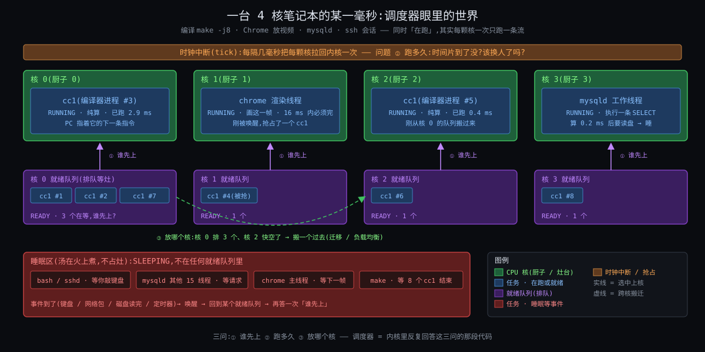

从图上能读出五件事:

1. **最上面一行是四个打断点**(时钟中断、系统调用返回、设备中断返回、任务自己阻塞 / 让出)。调度器的代码只在这四种时刻被执行;其他时间它不存在。这就是"每个打断点"四个字。
2. **中间左边是调度类的优先级栈**:`stop > dl > rt > fair > ext > idle`。挑人先问"最高的非空类是谁",再在那个类里按它自己的规则挑。你平时的进程(mysqld、redis、xz)全在 `fair` 这一层;`dl` 和 `rt` 是给要硬保证的任务的;`ext` 是 6.12 新进来的、把挑人规则交给 BPF 程序的类。
3. **中间右边是 fair 类的账本**:每个任务一个调度实体,记着权重(nice 换算来的)、虚拟时间、lag(欠它多少)、deadline(这段请求什么时候到期)。挑人只看账,不看任务是谁。
4. **下面一行是 8 颗核各自一本账**(每核一个 `rq`,里面每个调度类一个子队列)。核之间没有共享的"全局队列";跨核搬人是一件要专门做、专门算的事。
5. **cgroup 的层级压在 fair 账本上面**:容器是一个组,组里的 16 个线程先作为一个整体跟别的组分,再在组内分;组还可以被封顶(`cpu.max`),封顶到了就整组停。

---

## 四问各是什么

### 问① 何时换:五个触发点(对应你问题里的"每次")

内核没有自己的 CPU。ring 3 的代码不会自己停下来;内核只有在流**进入内核**的那一瞬间才拿到核(上一轮 C5·改流必经打断)。所以"每次挑人"的"每次"是有限的几种时刻:

| 触发点 | 谁触发 | 调度器做什么 | 典型频率 |
|---|---|---|---|
| 时钟中断 tick | APIC 定时器,`HZ = 250` 即每 4 ms | 给当前任务记账;如果它的时间用完了就打一个"该换人"的标记 | 每核每秒 250 次 |
| 唤醒 | 别的任务 / 中断 把一个睡着的任务叫醒(数据到了、锁放了) | 把它放回某颗核的队列;**比较它和那颗核上正在跑的,决定要不要立刻抢** | 每秒数千到数十万次 |
| 阻塞 | 当前任务自己要等(read 没数据、锁拿不到、sleep) | 把它拿出队列,立刻挑下一个 | 同上 |
| 让出 / 退出 | `sched_yield`、`exit`、被 `kill` | 同阻塞 | 少 |
| 出口检查 | 任何一次从内核回用户态、或内核态允许抢占的点 | 看一眼"该换人"标记,真则换 | 随前四项 |

注意前两种不直接换人,只是**打标记**;真正换人在出口检查那一刻。这个"标记 + 出口"两段式是为什么内核能在持锁、在中断上下文里安全地"决定换人但不立刻换"。它在上一轮 How §6.1 讲过;本轮 How §4 会把标记的三种来源讲清。

### 问② 换谁:两层 —— 先问类,再问类内规则

**第一层:调度类栈。** 六个类按固定优先级排:

| 类 | 谁在里面 | 挑人规则 |
|---|---|---|
| `stop` | 每核一个"停机"线程,做迁移、热插拔 | 有就跑 |
| `dl` | `SCHED_DEADLINE`:声明了"每 P 时间内需要 R 时间"的任务 | 最早截止期先跑(EDF) |
| `rt` | `SCHED_FIFO` / `SCHED_RR`:实时优先级 1 ~ 99 | 高优先级先跑,同级 FIFO 或轮转 |
| `fair` | `SCHED_NORMAL` / `BATCH`:你所有的普通进程 | **EEVDF**(6.6 起;之前 16 年是 CFS) |
| `ext` | `SCHED_EXT`:挑人规则由加载的 BPF 程序定(6.12 新) | 由 BPF 程序定 |
| `idle` | 每核一个 idle 线程 | 没人可跑时跑它(进省电态) |

高类非空,低类的任务一个都跑不到 —— 一个 `SCHED_FIFO` 99 的死循环能让整颗核上所有普通进程饿死(内核留了一个 95% 的安全阀,How §7)。

**第二层:fair 类内的规则。** 这是你灵魂问题的主战场,一句话版本:

> 在所有"没有超支"(eligible)的任务里,挑**截止期最早**的那个。

"超支"按虚拟时间账算,"截止期"按它请求的时间片算。这两个词各是一条约束逼出来的(C2·未来不可知、C3·份额与延迟两头要),公式和逐 tick 走表留给 How §3 和 Deep 主线①。现在只需要记住:规则看的是**账**,不是任务的名字、不是它"看起来像不像交互程序"—— 这正是它跟 2007 年之前那代调度器的分界线(Origin)。

### 问③ 各多少:三个数

| 数 | 是什么 | 本机器上的值 |
|---|---|---|
| 权重 | nice −20 ~ +19 换算成 88761 ~ 15,nice 0 = 1024,每差一级约 1.25 倍 | redis nice −10 → 9548;mysqld nice 0 → 1024;xz nice 19 → 15 |
| 时间片 slice | 一次请求多长;默认 0.75 ms × (1 + log₂(min(核数, 8))) | 8 核 → **3 ms**;6.12 起任务可自定 0.1 ~ 100 ms |
| 组的份额 / 上限 | cgroup `cpu.weight`(1 ~ 10000,默认 100)决定组和组之间怎么分;`cpu.max`(配额 / 周期)决定组最多用多少 | 容器限 2 核 = `cpu.max = 200000 100000`:每 100 ms 最多用 200 ms CPU 时间 |

权重决定的是**长期比例**:redis 与 mysqld 一个线程同核争抢时,CPU 按 9548 : 1024 ≈ 9.3 : 1 分。它**不**决定 redis 醒来后多久能上台 —— 那是 slice 和 lag 的事。把"份额"和"延迟"当成一回事,是开场钩子二里 `nice -10` 没用的原因。

### 问④ 在哪换:每核一本账 + 三种搬人

8 颗核就是 8 本账(`rq`)。一个任务任何时刻只在一本账上。它会在三种时刻被决定"去哪本账":

| 时机 | 问题 | 倾向 |
|---|---|---|
| 唤醒时 | 它睡前在核 3,现在核 3 忙、核 5 空,放哪? | 先看能不能留在原来那组 L3 里的空核(资料还在 cache 里);不行再跨组 |
| 周期均衡 | 每几毫秒到几百毫秒,一颗核看看"我比邻居闲多少" | 从最忙的核拉几个过来;越远的核越少看、越少搬 |
| 新建 / `exec` | 刚出生的任务没有 cache 可丢 | 直接放到最闲的核 |

"远近"按硬件拓扑分层:同一组 L3 的 4 核最近,另一组 L3 远一点,如果是双路机器则另一颗 CPU 插槽(NUMA)最远。内核把这个层次叫调度域(sched domain)。搬一次人的代价内核默认估为 **0.5 ms** 的 cache 重填 —— 一个任务刚跑了不到 0.5 ms 就被认为"还热着",均衡时尽量不碰它。

---

## 硬件入门:CPU 给调度器准备的四样东西

上一轮讲了五个开关(特权级、寄存器 + CR3、MMU、时钟中断、syscall 指令)。调度器用到其中的时钟中断,再加三样上一轮没展开的:

### ① 时钟中断与 HZ

每颗核的 local APIC 定时器按 `HZ` 发中断:`HZ = 250` 就是每 4 ms 一次。这是调度器**唯一不需要任务配合**的打断点,所以 4 ms 也是一个纯计算任务不让台时能霸占核的上限(两个任务同核时实际每 3 ms 的 slice 到期后,要等下一个 tick 才被发现,最坏 4 ms)。现代内核在核空闲或只有一个任务时会**停掉 tick**(`NO_HZ_IDLE` / `NO_HZ_FULL`),省电、也减少干扰 —— 代价是记账要靠别的时钟补。

### ② 高精度时钟:TSC 与 `sched_clock`

tick 太粗(4 ms),账要记到纳秒。每颗核有一个 TSC 寄存器每个周期加一,内核把它换算成纳秒(`sched_clock`),每次打断点都读一次,算出"从上次记账到现在这个任务跑了多少 ns"。所以虚拟时间账是纳秒精度的,tick 只是"定期来看一眼"的闹钟。

### ③ cache 与 TLB:搬人为什么贵

上一轮你抓到的结论「TLB 才是贵的」在这里反过来用:一个任务在核 3 跑了 10 ms,它的工作集(几百 KB 到几 MB)在核 3 的 L1 / L2 里、页表项在核 3 的 TLB 里。搬到核 5,这些全要重新 miss 一遍 —— 每次 L2 miss 约 10 ns,工作集 1 MB 重填要几十微秒。两组 L3 之间搬,连 L3 也要重填。这就是内核那个 0.5 ms "迁移代价"常数的来源(待核 #1:默认值 `sysctl_sched_migration_cost = 500000`)。

### ④ 核不是对称的:SMT、LLC 分组、NUMA、频率

- **SMT**(超线程):一个物理核的两个逻辑核共享执行单元,两个都忙时每个只有约 60 ~ 70% 的吞吐。所以"两个任务放两个物理核"远好于"放同一物理核的两个线程"。本轮机器假设关了 SMT 以简化。
- **LLC 分组**:8 核分两组 L3,组内搬便宜、组间贵。
- **NUMA**:双路机器每颗 CPU 插槽有自己的内存条,访问对方的内存慢 1.5 ~ 2 倍;任务搬过去了,它的内存还在原来那边。
- **频率**:核越少忙,忙的那颗能 turbo 到更高频;两个任务挤在一颗核上,可能比分到两颗核各跑半速还慢。手机上还有 big.LITTLE 大小核,性能差 3 ~ 4 倍。

这四条合起来是 Why 的 C5·核各自为政 和 C8·核不等速且耗电:每核一本账是因为跨核贵,但又不能不均衡,还得考虑核与核不一样。

---

## 关键词速查表

| 术语 | 一句话说明 |
|---|---|
| `rq`(run queue) | 每核一本账:当前在跑谁、每个调度类的子队列、这颗核的时钟 |
| 调度类 sched class | 六层优先级栈 `stop > dl > rt > fair > ext > idle`,高类非空低类不跑 |
| 调度实体 `sched_entity` | fair 类账本上的一行:权重、虚拟时间、lag、deadline、slice;线程是实体,cgroup 也是实体 |
| 虚拟时间 vruntime | 按权重折算后的累计运行时间;nice 0 每跑 1 ms 加 1 ms,nice −10 每跑 1 ms 只加约 0.107 ms |
| lag | 账面上"欠它多少":它的虚拟时间比队列平均落后(正)或超前(负)多少;睡醒要不要插队看它 |
| deadline / slice | 它这次请求跑多长(slice,默认 3 ms)+ 这段请求的虚拟截止期;挑人在 eligible 的任务里挑 deadline 最早的 |
| `need_resched` | "该换人"标记;tick 和唤醒只打标记,出口才真换 |
| 调度域 sched domain | 核的远近层次(SMT → 同 L3 → 同插槽 → 跨 NUMA);均衡按层做,越高层越少做 |
| `task_group` / cgroup cpu 控制器 | 把一组任务当一个实体记账;`cpu.weight` 分份额,`cpu.max` 封顶 |

---

## 它在系统里的位置

```
             上面:谁在用它
   pthread / clone        Go runtime(自己的 M:N 调度,只向内核要 M 个线程)
   JVM 线程池             容器 runtime(docker / k8s → cgroup cpu.weight / cpu.max)
   数据库线程池            SQL Server 的 SQLOS(用户态协作式,内核线程只是载体)
   ─────────────────────────────────────────────────────────────
                     进程调度器(本轮主角:四问)
   ─────────────────────────────────────────────────────────────
   平行的"邻居"(同一种思想,不同资源):
   IO 调度器(块层,mq-deadline / bfq,第一轮讲过)      网络 qdisc(fq_codel / HTB)
   挂在它身上的:
   cpufreq 的 schedutil(调度器的负载估计直接驱动频率)   NUMA balancing(搬内存页还是搬任务)
   ─────────────────────────────────────────────────────────────
             下面:它靠什么
   APIC 定时器 / HZ      TSC / sched_clock      cache / TLB 局部性      核的拓扑(SMT / LLC / NUMA / 频率)
```

### 边界:调度器不是什么

| 容易混的 | 它其实是 | 本轮怎么处理 |
|---|---|---|
| 上下文切换 | 换人**动作**(存寄存器、换栈、写 CR3),上一轮 How §6 + Deep §3.2 | 只引用,不重讲 |
| cpufreq / 调频 | 决定核跑多快,不决定跑谁;但 6.x 的 schedutil 用的是调度器的负载估计 | Deep 附录提一段 |
| 用户态调度(Go、SQLOS、协程) | 在**一个线程内部**再分时;内核看不见 | Comparison 的 SQLOS 一节 + Synthesis 同构 |
| IO 调度器 | 同一种"公平排队"思想用在块设备上 | Synthesis 同构回扣第一轮 |
| `fork` / `exec` / 线程创建 | 造任务,不是排任务;新任务**第一次**放哪本账是调度器的事 | How §5 一行 |
| 中断处理 | 中断不是任务,不被调度;但中断返回是打断点之一 | 问① 已含 |

---

## 开场钩子一:容器限 2 核,机器 64 核,MySQL 的 p99 突然抖

一个 k8s 里的 MySQL,`limits.cpu = 2`,机器 64 核。平均 CPU 使用率才 40%,但 p99 延迟每隔一会儿跳到 90 ms。`top` 看不出任何忙的核。

`limits.cpu = 2` 落到内核是 `cpu.max = 200000 100000`:**每 100 ms 周期,这个组最多用 200 ms 的 CPU 时间**。注意是 CPU 时间不是核数 —— 内核不会把它关在两颗核上,它的 16 个工作线程可以同时在 16 颗核上跑。一个突发查询让 16 个线程同时忙起来:

```
16 个线程 × 12.5 ms = 200 ms            ← 12.5 ms 墙上时间就把整个周期的配额烧光
剩下 100 − 12.5 = 87.5 ms 整组被停      ← 所有线程,包括刚收到新请求的那个
下一个周期开始才放行                     ← p99 ≈ 87.5 ms + 排队
```

平均使用率 40% 是对的(200 ms / 64 核 ≈ 3%,或按 2 核算 ~40%);抖动来自**配额按周期发、用完整组停**这个机制。它对应四问之③的"上限",也是 Why 的 C6·份额按组算 被"封顶"这一刀逼出来的形状。怎么算、怎么调(放大周期、开 `cpu.max.burst`、或者改用只分份额不封顶的 `cpu.weight`)留给 How §6 和 Deep 主线③。

### 你能先猜一下(选择式)

把 `limits.cpu` 从 2 改成 4,p99 会:A. 减半 B. 基本消失 C. 变成另一种抖。Deep §4 给答案;这里先记住答案不是 A。

---

## 开场钩子二:同机跑 PostgreSQL 100 个后端 + Redis,`nice -10` 没用,`taskset` 两面

同一台 8 核机器,PostgreSQL 100 个后端进程(每连接一个,上一轮钩子一)时不时全都在算,Redis 单线程做缓存。Redis 的延迟 p99 从 0.2 ms 涨到 5 ms。两个常见的"修法"和它们的结果:

| 修法 | 期望 | 实际 | 原因(留后) |
|---|---|---|---|
| `renice -10 redis` | 优先跑 Redis | 几乎没变化 | 权重管**份额**,Redis 本来就只用 5% CPU,份额不缺;它缺的是**醒来后多久能上台**。nice −10 把它的 lag 积累得快一点,但一次最多只能插队一个 slice 的量(C3·份额与延迟两头要,Deep 主线①) |
| `taskset -c 7 redis` + 别的不动 | 给它一颗专属核 | 更糟:p99 到 8 ms | PG 后端仍然可以被均衡搬到核 7;Redis 自己却不能被搬走了。绑核只绑了一边(C5·核各自为政,Deep 主线②) |
| `taskset -c 7 redis` + `isolcpus=7` 或把 PG 绑到 0 ~ 6 | 真正专属 | 好:p99 回到 0.3 ms | 两边都绑,核 7 上永远只有 Redis;代价是核 7 的 95% 时间空转 |
| 把 Redis 放进 `cpu.weight = 1000` 的 cgroup | 组级优先 | 跟 renice 一样没用 | 同一个原因:份额不是延迟 |

这个钩子要说的只有一句:**份额、延迟、位置是三个独立的旋钮**,四问里的 ③ ② ④ 各管一个,拧错了没用甚至更糟。

---

## 你上一轮的视角(继承三条原话)

上一轮(Linux进程全链路)你在 How / Deep 阶段说过三句跟调度直接相关的话,本轮当作已知前提,各补一句本轮的接口:

1. **「TLB 才是贵的」**(上一轮 What《拆开说:进程切换和线程切换差在哪》)—— 本轮把它当作"搬人为什么贵"的根据:跨核迁移比同核换人多付 cache 重填,所以每核一本账、能不搬就不搬(C5·核各自为政)。
2. **「寄存器分两类,一类自己保一类对方保」**(上一轮 How §6.3.1)—— 本轮不再碰换人动作;只在 Deep 的 ns 时间线里引用那 2 ~ 3 μs 作为"换人成本",用来解释为什么 slice 不能太短(C4·挑人须便宜)。
3. **「schedule 自己调自己回、中断调中断回、时钟中断是用户态保护的根源」**(上一轮 How §6.1.1)—— 你当时把时钟中断理解为"防霸台";本轮补另一半:时钟中断还是**记账的闹钟**,但账本身是纳秒级的 TSC 记的(硬件入门 ②),tick 只负责"定期看一眼"。

另外一条不是原话但是事实:上一轮 Deep §3.5 / §3.6 两道关于 lag 的反问你两次答「不知道」,然后选了「调度这块够了」。本轮 Deep 主线① 从"lag 是什么、为什么非要有它"从零讲起,反问改成选择题。

---

## 最后的预留:这些本份只点名

| 预留 | 一句话 | 放在 |
|---|---|---|
| `rt` / `dl` 类的内部 | 优先级反转、优先级继承(PI)、CBS 带宽 | Deep 附录 |
| 抢占模型 | `PREEMPT_NONE` / `VOLUNTARY` / `PREEMPT` / `PREEMPT_RT`,内核态能不能被换 | How §4 一段 + Deep 附录 |
| `sched_ext` | 用 BPF 写自己的挑人规则 | Origin 转折 5 + Deep 附录 + Synthesis 十年赌注 |
| EAS / 大小核 / 频率 | 省电与异构 | Deep 附录 |
| core scheduling | SMT 兄弟核只跑同一组的任务(防侧信道) | Deep 附录一行 |
| 调参与观测 | `/proc/<pid>/sched`、`perf sched`、`/sys/kernel/debug/sched/` | How §9 + Deep 操作层 |

---

## 呼应你的问题

你的问题有三段。本份给了每段一个格子:

- **"按什么规则挑下一个"** → 四问之②:先按类,再在 fair 类里"eligible 中 deadline 最早"。现在你知道规则看的是账不是人;账里有哪几个数(权重 / 虚拟时间 / lag / deadline / slice)也列了,但每个数**为什么非有不可**是 Why 的事,**怎么算**是 How 和 Deep 的事。
- **"被哪些约束逼出来、为什么三代"** → 下一份从"一核一队列先来先跑"起八刀,每一刀逼出一条约束;Origin 再讲 2002 / 2007 / 2023 三次换代各是哪条约束的权重变了。
- **"多核和 cgroup 把规则扩展成了什么"** → 四问之④和③:每核一本账 + 三种搬人;组是账本上的一行 + 封顶。两个开场钩子就是这两处的现实症状。

一句话带走:**调度器 = 四问(何时换 / 换谁 / 各多少 / 在哪换),规则只看账。** 下一份回到原点:如果一颗核面前只有一个先来先跑的队列,它会先在哪里坏掉?

---

## 待核

| # | 事项 | 结论(收尾核实 2026-11-03) |
|---|---|---|
| 1 | `sysctl_sched_migration_cost` 默认 500000 ns | **已核** —— `const_debug unsigned int sysctl_sched_migration_cost = 500000UL`(出处:kernel/sched/fair.c:79(v6.12)) |
| 2 | SMT 两线程同忙时每线程约 60 ~ 70% 吞吐 | **部分核实** —— Intel 自述 HT 最多提升约 30%(即两线程同忙每线程 ≈ 65%),平均 10 ~ 20%;量级成立,具体值随负载变(出处:The Register 2002-06-18 https://www.theregister.com/2002/06/18/what_the_hell_is_hyperthreading/ ;Beamr 实测 https://blog.beamr.com/?p=530(均二手)) |
| 3 | 跨 NUMA 访存慢 1.5 ~ 2 倍 | **部分核实** —— 实测 NUMA 因子 1.5(Westmere 90 / 140 ns)~ 1.7(Xeon E5-2650 MLC 69 / 118 ns;Ice Lake 91 / 157 ns);原文区间成立,上界 2 偏宽(出处:CERN openlab 讲义 https://openlab-archive-iv-v.web.cern.ch/… ;Intel 社区 MLC 输出 https://community.intel.com/t5/Mobile-and-Desktop-Processors/Interpreting-Intel-Memory-Latency-Checker-Output/m-p/434769 ;LKML 2014 SLIT 讨论 https://lkml.rescloud.iu.edu/1409.2/00354.html) |
| 4 | 一次 L2 miss 约 10 ns | **部分核实** —— Skylake:L2 12 周期、L3 42 周期(4.0 GHz 下 ≈ 3 / 10.5 ns);"L2 miss" 即 L3 命中量级 ≈ 10 ns,成立(出处:https://www.7-cpu.com/cpu/Skylake.html) |
| 5 | 一次 tick 处理约 1 μs | **无法上机核实** —— 量级估计,保留;可用 `perf stat -e irq:*` / ftrace 在真机核(出处:—) |

---

---

> **🔄 心智切换:讲解员 → 论证者(共情模式)**
>
> 上面用「只有一支话筒的圆桌会」和一张四问全景图,立起了调度器的骨架:何时换、换谁、各多少、在哪换,规则只看账不看人。但只看骨架不知道它为什么非得长成这样。下一篇回到原点:把八颗核收成一颗、把调度器全拿掉,只留一个先来先跑的队列,让 xz、mysqld、redis 在上面排队,看它在哪一步撞墙 —— 每撞一次墙,就逼出一条不可再分的约束。读完你会拿到八刀八条约束 C1 ~ C8,它们是后面五篇所有设计决策的唯一依据。

---

<a id="stage-why" name="stage-why"></a>

# 📍 第二篇:Why — 为什么必须存在

# 阶段 2:Linux 的进程调度器为什么必须存在

> 上一份立了四问骨架。这一份回答"四问是被什么逼出来的":从一颗核、一个先来先跑的队列开始,每次只解决眼前最痛的一件事,看它在哪里坏掉、补一层、再暴露什么。一刀一条约束,八刀八条,C1 ~ C8。每一刀都用同一台机器上的同一组任务落地(8 核,mysqld ×16、redis ×1、xz nice 19、PostgreSQL 后端、k8s 容器限 2 核)。
>
> 写法:痛点场景 + 数字 → 引入什么 → 浮现哪条约束 → 解决完露出什么新痛点。代码留给 How。C3·份额与延迟两头要 那一刀单独加厚,因为它逼出的东西最多(权重 / 虚拟时间 / slice / deadline / lag 全挂在它下面),也是你上一轮卡住的地方。

---

## 没有它的世界

### 开场:一颗核,一个队列,先来先跑

把 8 颗核先收到 1 颗,把调度器全拿掉,只留一个最朴素的东西:**一个先进先出的队列,队头的任务跑,跑完或者自己去等 IO 了才换下一个。** 这是 1960 年代批处理机的样子,也是今天一个裸 RTOS 的协作式内核的样子。

我们的机器上这一刻有 19 个任务:16 个 mysqld 工作线程、1 个 redis、1 个 xz 在压 40 GB 备份、1 个 bash。队列是这样的:

```
队头 → xz(纯算,20 分钟才完)→ mysqld#1 → mysqld#2 → … → mysqld#16 → redis → bash
```

xz 不等 IO、不让台。接下来 20 分钟:所有 SQL 请求超时,Redis 一个包也答不了,你的 bash 连 `kill` 都敲不进去 —— 因为 `kill` 也要排队。

这不是假想:Windows 3.1 和 Mac OS 9 的协作式多任务就是这样,一个程序死循环,整台机器跟着死。它们靠程序员"自觉"在循环里调 `Yield()`。自觉不可依赖 —— 这是第一刀要砍的。

---

### 第一刀:霸台 → 闹钟 + 标记 + 出口换人

**痛点**。xz 不让台。要让它让台,内核得**介入**它。但内核不是一个随时在旁边盯着的人 —— 内核没有自己的 CPU,xz 在 ring 3 跑的时候,这颗核上**只有 xz**,内核的代码一行都没在执行(上一轮 C5·改流必经打断)。

**引入**。因为内核拿不到核就什么都做不了,而 ring 3 的流不会自己停 → 要解决"不靠 xz 配合也能定期拿回核"→ 所以引入**时钟中断**:APIC 定时器每 4 ms(`HZ = 250`)打一次,硬件强制把核交给内核的中断入口。这是四个打断点里唯一不需要任务配合的。

但拿到核不等于能立刻换人。tick 来的时候 xz 可能正在内核里持着一把锁(比如它刚好在 `write` 的路上),中断处理里换人会把锁带走。因为中断上下文里不能换栈、持锁不能换人 → 要解决"决定换和真换要分开"→ 所以引入 **`need_resched` 标记 + 出口检查**:tick 只在 xz 的 `task_struct` 上打一个标记,等这次中断返回、要回 ring 3 的那一刻(或者内核态某个允许抢占的点)再看标记、真换。

**落地**。4 ms 后 tick 到,内核发现 xz 跑了 4 ms 了,打标记,中断返回路径上看到标记,`schedule()`,换 mysqld#1 上。xz 没死,它排到队尾。bash 的 `kill` 现在最多等 19 × 4 ms = 76 ms 就能敲进去。

**数字**。一次 tick 处理约 1 μs,`HZ = 250` 时占 0.025% 的 CPU;`HZ = 1000` 时 0.1%,但一个霸台任务最多只能占 1 ms。换人动作本身 2 ~ 3 μs(上一轮 Deep §3.3)。

**浮现的约束**:

- **C1·只在打断点换** 内核没有自己的 CPU,只能在流进内核的瞬间(tick / 系统调用 / 中断 / 阻塞)介入;介入点稀疏(tick 4 ms 一次)且介入时不一定能立刻换人(持锁、中断上下文)—— 所以决定和执行必须分开,一切挂在出口上。

**解决完露出的新痛点**:tick 到了,19 个任务,**换谁**?先来先跑的轮转(RR)把 redis 排在 xz 后面,它每 76 ms 才轮到一次 4 ms —— 一个缓存服务 p99 76 ms,等于没有。

---

### 第二刀:换谁?内核不知道未来 → 只能记过去

**痛点**。直觉的答案:"交互的、等 IO 的先跑,纯算的后跑"。redis 大部分时间在等网络包,一醒来算 50 μs 就又睡 —— 它该先跑。xz 从不睡 —— 它该后跑。

问题是内核**怎么知道**谁是 redis 谁是 xz?它看到的只是两个 `task_struct`,里面没有"我是交互程序"这个字段。更根本的:即使 redis 过去一直是"醒 50 μs 睡 10 ms",内核也不知道它**下一步**是不是突然要算 200 ms(比如 `KEYS *`)。任务的意图不在代码里,未来不可预测。

内核曾经真的试过猜:2002 ~ 2007 年的 O(1) 调度器给每个任务算一个 `sleep_avg`,睡得多就加优先级奖励,最多 +5 级。结果是能被骗:一个程序每算 9 ms 就 `nanosleep(1 ms)`,就能把自己刷成"交互程序"拿到奖励,把真正的交互程序挤掉;启发式参数一堆,调好桌面调坏服务器(Origin 会讲这段怎么崩的)。

**引入**。因为未来不可知、意图不可读,但**过去可测** → 要解决"换谁的依据只能来自过去"→ 所以引入**记账**:每个任务一行账,记它**累计跑了多少**。谁跑得最少,下一个给谁。redis 一天只跑了 5% 的时间,它的账永远最小,一醒来就能排到最前;xz 账最大,永远排最后,但别人都睡了它就能跑 —— 它没有被"判定"为后台程序,它只是账大。

账**不猜**。它不判断谁是交互程序,它只回答"谁欠得最多"。这就是 What 里说的"规则只看账不看人"。

**落地**。tick 到,账本:redis 累计 0.3 s、mysqld#1 ~ #16 各约 2 s、xz 40 s。挑 redis。redis 跑 50 μs 又睡了,再挑账最小的 mysqld。xz 要等到 16 个 mysqld 都睡或者都跑满才轮到。

**浮现的约束**:

- **C2·未来不可知** 内核不知道一个任务下一步要算还是要等、要多久;意图不在代码里,静态判定不可能;任何"猜"的启发式都可以被构造的负载骗 —— 所以依据只能是可测的过去(累计运行 / 等待时间)。

**解决完露出的新痛点**:账记什么单位?按秒记,xz 和 mysqld 一样重要吗?运维想让备份"慢慢跑别碍事",怎么表达?而且:redis 账最小所以它醒来**应该**立刻上,但"立刻"是多立刻 —— 要把正在跑的 mysqld 一脚踢下去吗?它才跑了 0.1 ms。

---

### 第三刀:份额与延迟是两个量(本份加厚的一刀)

#### 痛点的精确形状

运维对调度器其实提了**两个**要求,平时混在一起说:

1. **份额**:长期看,CPU 按我定的比例分。xz nice 19 只该拿零头;redis 和 mysqld 争的时候 redis 该多拿。
2. **延迟**:一个任务醒来之后,**多久**能上台,要有上界。redis 收到包后 0.1 ms 内要开始处理,不管此刻有多少 mysqld 在算。

一个数保不住两个。试三种只用一个数的方案,每种在我们的机器上怎么坏:

| 方案 | 份额 | 延迟 | 坏在哪 |
|---|---|---|---|
| 纯轮转,每人 4 ms | 均等 | 一圈 = 人数 × 4 ms | 17 个可跑任务时 redis 醒来最坏等 68 ms;把片改成 0.1 ms,每圈 1.7 ms,但 2 ~ 3 μs 的换人代价占到 3%,cache 全冷 |
| 按累计账,账小的先 | 按账,均等 | 醒来立刻上 | redis 睡 10 ms 回来账落后 10 ms,它可以连跑 10 ms 都不被抢;100 个这样的任务轮流"睡醒插队",mysqld 永远上不了台 |
| 按累计账,但睡眠时账照涨(睡觉也算跑) | 均等 | 醒来不插队 | 回到轮转:redis 醒来排在 16 个 mysqld 后面 |

第二种就是 CFS 2007 ~ 2023 的形状,它用"睡醒补一半 slice"之类的修正缓解,但修正本身是新启发式,又回到 C2·未来不可知。

#### 引入:把两个量拆开,再用一个数缝回去

因为份额和延迟是两个独立的要求 → 要解决"分别表达、分别保证"→ 所以引入**三个数**:

- **权重**(nice → 1024 基准,每级 1.25 倍):只管**份额**。账不按真实时间记,按"真实时间 ÷ 权重"记 —— nice −10 的 redis 跑 1 ms 账只涨 0.107 ms,nice 19 的 xz 跑 1 ms 账涨 68 ms。这就是**虚拟时间**。长期看每个任务的虚拟时间趋同,真实时间就按权重比分了。
- **slice + deadline**:只管**延迟粒度**。每个任务说"我这次请求跑 3 ms"(slice),内核算出它的虚拟截止期(deadline = 现在的虚拟时间 + slice ÷ 权重)。挑人时挑 deadline 最早的 —— 请求短的任务 deadline 近,自然排前面。slice 小 = 要求低延迟但不多拿 CPU;slice 大 = 不在乎延迟要吞吐。**份额(权重)和延迟(slice)第一次成了两个独立的旋钮** —— 6.12 允许每个任务自己设 slice,正是因为它们已经独立。
- **lag(eligibility)**:把两个旋钮**缝回去**的那一针。lag = 队列加权平均虚拟时间 − 该任务的虚拟时间,即"账面上欠它多少"。规则:只有 lag ≥ 0(不超支)的任务才有资格被挑。redis 睡了 10 ms 回来,lag 是正的,有资格;它跑超了,lag 变负,**哪怕它 deadline 最早也不能跑**,直到别人把平均线追上来。睡醒插队的度就被 lag 封住了:你能插队,但只能插"账面欠你"的那么多,而且这个量在你睡的时候会被夹在一个上限内(Deep 主线①讲夹在多少)。

三个数各管一头,汇总:

| 数 | 管什么 | 不管什么 | 拧它的接口 |
|---|---|---|---|
| 权重 | 长期份额 | 醒来多久上台 | `nice` / `cpu.weight` |
| slice → deadline | 排队顺序、一次跑多长 | 总共拿多少 | `sched_attr.sched_runtime`(6.12) |
| lag | 谁有资格 | —— | 没有接口,内核自己算 |

这就是开场钩子二的答案的一半:`nice -10` 拧的是权重,redis 缺的是延迟。

#### 跟数据库里的同一道题

你在数据库里见过完全一样的拆法:

| 调度器 | 数据库线程池 / 资源管理 | 同一个问题 |
|---|---|---|
| 权重(份额) | SQL Server Resource Governor 的 `MIN_CPU_PERCENT` / `MAX_CPU_PERCENT`;MySQL 线程池按 group 分 | 多租户长期怎么分 |
| slice / deadline(延迟) | MySQL 线程池的 `thread_pool_high_prio_tickets`:事务里的连接拿高优先队列票,别排在新连接后面 | 短请求不被长查询压住 |
| lag(资格) | 线程池的 `thread_pool_stall_limit`:一个连接占线程超过阈值(Percona 默认 500 ms,MySQL 企业版默认 60 ms)就被视为"stalled",组里开新线程让别人跑 | 占用超了就得让 |
| 份额 ≠ 延迟 | 吞吐 ≠ 尾延迟:p99 要看排队,不看平均 | 两个量,两个旋钮 |

Synthesis 会拿 MySQL 线程池把这个同构完整走一遍。这里只需要带走一句:**调度器的三个数,就是数据库"吞吐 vs 尾延迟"那道题在内核里的解。**

**浮现的约束**:

- **C3·份额与延迟两头要** 用户要长期按权重分 CPU(份额),又要醒来后多久能跑有上界(延迟);两者独立,一个数保不住两个;而且"醒来插队"的额度必须有界,否则份额被延迟吃掉。

**解决完露出的新痛点**:账有了三个数,挑人要"在 lag ≥ 0 的任务里找 deadline 最早的"。19 个任务扫一遍没问题;一台 Java 应用服务器 3000 个线程、每秒几万次挑人,扫一遍是多少?

---

### 第四刀:每秒十万次决定,每次要便宜

**痛点**。2001 年的 Linux 2.4 挑人就是扫一遍:tick 到,遍历所有可跑任务算一个 `goodness`,取最大。3000 个线程时一次扫描约 30 μs(每个任务 10 ns);每核每秒几千次切换,挑人本身就吃掉几个百分点;更糟的是 tick 里持着全局锁扫,别的核全等着。这是 Origin 里 O(1) 调度器 2002 年诞生的直接原因。

**引入**。因为挑人每秒要做万次以上、每次预算不到 1 μs → 要解决"任务再多,挑人和记账都不能随规模线性涨"→ 所以引入三件东西:

- **有序结构**:按 deadline 排一棵红黑树,挑最早的是 O(log n):3000 个任务 12 步,~100 ns。
- **增广**:"lag ≥ 0" 要算队列加权平均虚拟时间,朴素算法是 O(n) 求和。内核在树的每个节点上顺带维护子树的"最小 deadline"等汇总量,平均值用一个随插删 O(1) 更新的累加器(`avg_vruntime`)算 —— 判资格也是 O(1) 到 O(log n)。
- **纳秒级时钟 + 增量记账**:账不在 tick 里"重算",而是每个打断点读一次 TSC,只把增量加上去。

**落地**。19 个任务:树高 5,挑人 ~50 ns;3000 个任务:树高 12,~100 ns。换人动作 2 ~ 3 μs,挑人占不到 5%。

**浮现的约束**:

- **C4·挑人须便宜** 每核每秒几千到几十万次打断点,每次决定的预算在 1 μs 以内且不能随任务数线性增长;账的更新必须是增量的 —— 规则再好,扫一遍就作废。

**解决完露出的新痛点**:把 8 颗核放回来。8 颗核共用这一棵树?

---

### 第五刀:多核 → 每核一本账

**痛点**。8 颗核一棵树一把锁。每核每秒一万次打断点,8 核 8 万次,每次持锁 ~200 ns:锁本身 1.6% 的时间被持有,看起来不多;但 8 个核**同时**要它的概率不小,等锁的核空转。Linux 2.4 就是这样(一把 `runqueue_lock`),16 核以上基本不能用。

更根本的是 cache。mysqld#3 在核 0 跑了 10 ms,它的 1 MB 工作集在核 0 的 L1 / L2、页表项在核 0 的 TLB(上一轮你的结论:TLB 才是贵的)。下一次挑人把它放到核 5:1 MB 重新 miss 一遍,每次 L2 miss ~10 ns,几十微秒白付;跨 L3 组还要重填 L3。全局队列不知道"它上次在哪",每次挑都可能换核。

**引入**。因为核有各自的 cache / TLB,跨核同步走互连贵一到两个数量级 → 要解决"挑人不跨核、不抢锁"→ 所以引入**每核一本账**(`rq`):每核自己的树、自己的锁、自己的时钟;一个任务只在一本账上,默认一直在同一颗核。

但 8 本账各管各的,核 3 空了、核 4 排了 6 个,谁来管?因为各管各的会饿、会闲 → 要解决"该搬时搬、不该搬时不搬"→ 所以引入**三种搬人**:唤醒时选核(优先原核、其次同 L3 组的空核)、周期均衡(每核定时看邻居,从最忙的拉)、新建放最闲。远近按硬件分层(调度域:同 L3 → 同插槽 → 跨 NUMA),越远看得越少、搬得越少、门槛越高。搬一次的默认门槛:这个任务 0.5 ms 内跑过就算"热",不搬。

**落地**。开场钩子二里 `taskset -c 7 redis` 变糟的原因在这:绑核只是把 redis 钉死在核 7 的账上,均衡照样可以把 PG 后端搬进核 7;redis 不能走,PG 能来。

**浮现的约束**:

- **C5·核各自为政** 核有独立 cache / TLB / 时钟,跨核同步贵一到两个数量级;核之间按拓扑有远近;所以账只能每核一本,搬人是要专门算代价的事,而且永远只能是近似均衡。

**解决完露出的新痛点**:份额按**任务**分。一个用户开 100 个线程,另一个开 1 个,100 : 1。云上卖"2 核"卖的是什么?

---

### 第六刀:多租户 → 按组记账 + 封顶

**痛点一(份额被线程数放大)**。桌面上 `make -j64` 一跑,64 个编译线程把 1 个浏览器线程的份额压到 1/65,鼠标都卡。按任务公平就是按线程数分,谁线程多谁赢。服务器上同理:两个服务共享一台机器,一个用 Go(几百个 goroutine 但只有 8 个线程),一个用 Java(2000 个线程),后者拿走几乎全部。

**痛点二(要能封顶)**。k8s 把一个 64 核节点卖给 30 个容器,每个"2 核"。如果只分份额,机器空的时候一个容器可以用满 64 核 —— 计费模型崩了,而且邻居一来它会从 64 核骤降到 2 核,性能曲线不可预期。用户要的是"最多 2 核,永远"。

**引入**。因为用户要的分配单位是用户 / 会话 / 容器,而内核账本上只有线程 → 要解决"组作为一个整体参与分配,组内再分"→ 所以引入**组实体**:cgroup 的每一层在父层的树上是**一行账**(和线程一样有权重、虚拟时间、lag、deadline),组内的线程在组自己的树上。`cpu.weight` 是组这一行的权重。make 的 64 个线程现在是一行,浏览器是另一行,1 : 1。

因为份额分配在机器空闲时不封顶 → 要解决"组最多用多少"→ 所以引入**带宽控制**:`cpu.max = 配额 周期`。每个周期组拿一份配额,组里所有线程在所有核上跑的时间从这份额度里扣;扣光,**整组所有线程立刻下台**,等下个周期。开场钩子一就是它:16 个线程 12.5 ms 烧光 200 ms 配额,然后整组停 87.5 ms。

**落地**。为什么内核不干脆"只让它用 2 颗核"?因为那是 C5·核各自为政 的位置旋钮(cpuset),和份额无关:2 颗专属核在容器空闲时浪费,忙时又不能借邻居的空核。配额是**时间**不是**核**,代价就是周期末的那种停顿。

**浮现的约束**:

- **C6·份额按组算** 分配单位是用户 / 容器而不是线程,线程数可被一方任意放大;组要能嵌套、要能封顶(计费与可预期);而内核只能看见线程,所以组必须被做成账本上和线程同形的一行,封顶只能按时间周期扣。

**解决完露出的新痛点**:公平分得再好,也只能保证"平均"。音频线程每 5 ms 必须填一次 buffer,它要的不是份额,是**一定在 5 ms 内跑到**。17 个任务同核时最坏 51 ms —— 爆音。

---

### 第七刀:有人要硬保证 → 调度类栈

**痛点**。fair 的所有机制都是"相对"的:lag 相对于平均线、deadline 相对于别人的 deadline。它永远不承诺一个绝对数。音频、工业控制、`PREEMPT_RT` 上的机器人、数据库的 WAL 写线程(某些部署会把它设成实时)—— 这些任务要的是:**不管别人多少,我在 T 内必须跑到**。

**引入**。因为绝对保证不能从相对公平里推出来 → 要解决"一类任务凌驾于公平之上"→ 所以引入**调度类的优先级栈**:`stop > dl > rt > fair > ext > idle`,高类非空低类不跑。rt 类按优先级 1 ~ 99 严格先后;dl 类更进一步 —— 任务声明"每 P 内要 R",内核**准入检查**(所有 dl 任务的 R / P 之和不超过核数)后用最早截止期(EDF)调度,数学上可证明都能按时。

凌驾带来两个新洞,各补一个阀:

- 一个 `SCHED_FIFO` 99 死循环会让这颗核上所有普通任务饿死 → 内核给 rt 类封顶:每 1 s 最多 0.95 s(`sched_rt_runtime_us = 950000`),剩 5% 留给 fair,这是你还能 `ssh` 进去 `kill` 它的原因。
- 高优先级任务等一把被低优先级任务持有的锁,中优先级任务把低的踢下去,高的就跟着饿 —— 优先级反转(1997 年火星探路者真的因此重启)→ 内核的 `rt_mutex` 做**优先级继承**:持锁者临时升到等锁者的优先级。

**浮现的约束**:

- **C7·有人要硬保证** 一部分任务要绝对的时限或优先,而公平算法只能给相对保证;所以必须有一层凌驾于公平之上的优先级栈,并为"凌驾"补准入检查、封顶阀和优先级继承。

**解决完露出的新痛点**:到这里 8 颗核被当成 8 个一样的东西。它们不一样。

---

### 第八刀:核不一样快,跑得多不等于省电

**痛点**。三种"不一样":

- **SMT**:开了超线程的机器,核 0 和核 1 是同一个物理核的两个线程,两个都忙时各只有 60 ~ 70% 吞吐。把 mysqld#3 和 #4 放核 0、1,而核 2、3(另一物理核)空着 —— 均衡算法按"每核任务数"看是平的,实际慢了 30%。
- **频率**:一颗核独忙时能 turbo 到 3.8 GHz,8 核全忙时每核 3.0 GHz。两个任务挤一核分时跑,可能比各占一核各跑半速还慢;反过来,把任务打散到 8 核会让所有核降频 —— 该集中还是该打散,取决于负载有多重。
- **大小核**:手机的 big.LITTLE 性能差 3 ~ 4 倍,把 UI 线程放小核就卡;服务器也开始有(Intel 12 代起 P-core / E-core)。而且**能耗**是一个独立目标:两个核各跑 50% 比一个核跑 100% 更省电还是更费电,取决于频率 - 功耗曲线,不是线性的。

**引入**。因为核的吞吐不相等、随频率变、随 SMT 兄弟是否忙而变 → 要解决"均衡和挑核时按真实算力而不是按核数"→ 所以引入**算力归一**(每核一个 `capacity`,最强的核 = 1024)和**负载估计**(PELT:每个任务、每个核维护一个按 32 ms 半衰期指数衰减的"最近有多忙",既是"重量"也是"用了多少算力")。有了这两个数,均衡比的是"负载 ÷ 算力",SMT 兄弟忙时算力打折,大小核上任务按 util 配核(EAS),频率驱动(schedutil)直接读同一个 util。

**浮现的约束**:

- **C8·核不等速且耗电** 核的有效算力随 SMT 兄弟、频率、大小核而变,能耗是独立目标且非线性;所以每核一本账还不够,账上还得有"这颗核此刻值多少算力、这个任务最近有多重"两个估计量,所有跨核决策按它们算。

**到此八刀砍完**。一颗核一个 FIFO 队列,长成了:打断点(C1·只在打断点换)+ 账(C2·未来不可知)+ 三个数(C3·份额与延迟两头要)+ 红黑树与增量(C4·挑人须便宜)+ 每核一本账与三种搬人(C5·核各自为政)+ 组实体与带宽(C6·份额按组算)+ 调度类栈(C7·有人要硬保证)+ 算力与负载估计(C8·核不等速且耗电)。这就是 What 的四问:C1·只在打断点换 是何时换,C2·未来不可知 C3·份额与延迟两头要 C7·有人要硬保证 是换谁,C3·份额与延迟两头要 C6·份额按组算 是各多少,C5·核各自为政 C8·核不等速且耗电 是在哪换,C4·挑人须便宜 横贯四问。

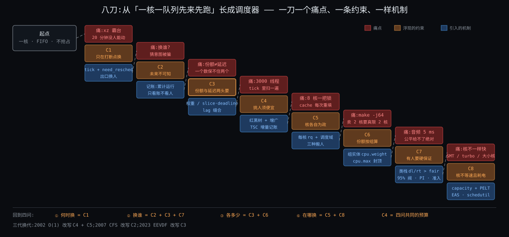

---

## 约束清单(C1 ~ C8,一刀一条)

| # | 短名 | 约束 | 来源 | 不可再分性 | 逼出的东西 |
|---|---|---|---|---|---|
| C1 | 只在打断点换 | 内核没有自己的 CPU,只能在流进内核的瞬间介入;介入时不一定能立刻换人 | 隔离模型(上一轮 C5)+ 中断 / 锁的结构 | 要控制一条流必须先拿到它的核;中断上下文不能换栈 | 时钟中断、`need_resched` 标记 + 出口换人、抢占模型、唤醒抢占只打标记 |
| C2 | 未来不可知 | 内核不知道任务下一步算还是等、要多久;猜的启发式可被构造负载骗 | 意图不在二进制里;停机问题 | 不可静态判定 | 按过去记账(虚拟时间),"规则只看账" |
| C3 | 份额与延迟两头要 | 长期按权重分(份额)和醒来多久上台有界(延迟)是两个独立要求;插队额度须有界 | 用户需求的形状(吞吐 vs 尾延迟) | 一个标量不能同时编码比例和上界 | 权重 / 虚拟时间、slice / deadline、lag / eligibility |
| C4 | 挑人须便宜 | 每核每秒万次级决定,每次 < 1 μs 且不随任务数线性增长;记账须增量 | 换人代价 2 ~ 3 μs 给出的预算 | 规则的常数项直接吃掉它要分的资源 | 红黑树 + 增广、`avg_vruntime` 累加器、TSC 增量记账 |
| C5 | 核各自为政 | 核有独立 cache / TLB / 时钟,跨核同步贵一到两个数量级,核间有远近 | 多核硬件结构 | 物理 | 每核 `rq`、调度域层级、唤醒选核、周期均衡、迁移门槛 0.5 ms、亲和 |
| C6 | 份额按组算 | 分配单位是用户 / 容器,线程数可被放大;组要嵌套、要能封顶;内核只看见线程 | 多租户 + 计费 + 桌面会话 | 内核没有"用户"这个调度对象,只有线程 | `task_group` 组实体(与线程同形的一行账)、`cpu.weight`、`cpu.max` 带宽与 throttling、autogroup |
| C7 | 有人要硬保证 | 一部分任务要绝对时限 / 优先;相对公平推不出绝对保证;凌驾会带来饿死与反转 | 实时负载 | 数学上公平与保证互不蕴含 | 调度类栈 `stop > dl > rt > fair > ext > idle`、EDF + 准入、95% 阀、优先级继承 |
| C8 | 核不等速且耗电 | 核的有效算力随 SMT / 频率 / 大小核变,能耗是非线性的独立目标 | 硬件物理 + 电源 | 物理 | `capacity` 归一、PELT 负载 / 利用率、SMT 均衡优先、EAS、schedutil |

引用约定:一律 `ID·短名`(如 `C3·份额与延迟两头要`),不写裸编号。编号从此固定;后面发现要补的约束往末尾追加,不重排。

### 为什么是八条,不是上一轮的七条

上一轮七条覆盖整个进程生命周期,调度只占其中 C2·霸台不可预知 和 C7·核各自为政 两条。本轮把这两条各拆成了更细的刀(C2·未来不可知 拆成本轮 C1·只在打断点换 + C2·未来不可知 + C3·份额与延迟两头要,C7·有人要硬保证 拆成本轮 C5·核各自为政 + C8·核不等速且耗电),再加上一轮没碰的组(C6·份额按组算)、硬保证(C7·有人要硬保证)、便宜(C4·挑人须便宜)。每条都能在 How 里指着一个具体机制说"没有这条它就不该存在",这是留下它的唯一理由。

---

## 这些不算约束

| 常被当成约束的 | 其实是 | 为什么不列 |
|---|---|---|
| "公平" | **目标**,而且是被定义出来的(按权重分叫公平) | 真正的约束是 C3·份额与延迟两头要:公平和延迟两头要且冲突 |
| "交互性 / 响应快" | 目标 | 它的不可再分部分已在 C3·份额与延迟两头要(延迟有界)里 |
| "高性能 / 低开销" | 目标 | 不可再分部分在 C4·挑人须便宜(预算 1 μs) |
| 红黑树、cgroup、PELT、调度域 | **解法** | 都是被某条 C 逼出来的,换一条 C 它们就该换形 |
| `HZ = 250`、slice 3 ms、迁移 0.5 ms | **参数** | 是在 C1·只在打断点换 / C3·份额与延迟两头要 / C5·核各自为政 下调出来的折中值,不是边界 |
| "必须兼容 POSIX 的 `sched_setscheduler` / `SCHED_FIFO` / `nice`" | 接口冻结(软约束) | 它冻结的是**接口**不是挑人规则:三代换代 API 一字未改;只有 rt 类的语义(FIFO / RR)是 POSIX 定死的,记在 C7·有人要硬保证 下 |
| "Linux 要同时服务桌面和服务器" | 工作负载多样性 | 它不是硬边界,而是 C2·未来不可知 的推论:正因为不能猜,规则才必须对负载类型中立 |
| 单核 | 曾经的事实 | 多核是 C5·核各自为政 / C8·核不等速且耗电 的来源,单核只是它们的退化情形 |

---

## 核心 insight

### Insight 1:把"猜意图"换成"记账"

C2·未来不可知 的解不是更聪明的猜,是**不猜**。账只回答"谁欠得多",从不回答"谁是交互程序"。2007 年 CFS 取代 O(1) 时删掉的正是那一堆猜意图的启发式;2023 年 EEVDF 取代 CFS 时删掉的是 CFS 里残留的最后几个(睡醒补偿、`wakeup_granularity`)。两次换代的方向一致:**账越纯,规则越站得住**。

### Insight 2:把份额和延迟拆成两个数,再用第三个数缝回去

C3·份额与延迟两头要 的解是三个数各管一头:权重管比例,slice / deadline 管顺序与粒度,lag 管资格。拆开之后"低延迟但不多占"(小 slice)和"多占但不急"(大 slice、低 nice)第一次能分别表达。lag 是关键的一针:没有它,延迟旋钮(睡醒插队)会把份额旋钮吃掉。这也是你上一轮卡住的地方 —— 不是公式难,是 lag 承担的角色(缝合)在那一份里没有单独讲。

### Insight 3:一本账变成 N × H 本

C5·核各自为政 把账按核拆成 N 本(水平),C6·份额按组算 把每本账按组嵌成 H 层(垂直)。两个方向的拆法都用"和叶子同形的一行"来表示上一层(组实体在父树上是一行;核的 `rq` 之间用同样的负载量比较),所以挑人规则只需要写一遍,在任何一层、任何一核都一样。这也是 C4·挑人须便宜 能守住的原因:每一层每一核都只是一棵小树。

### Insight 4:凌驾要配阀

C7·有人要硬保证 的解是优先级栈,但凌驾本身会制造饿死和反转,所以每开一个凌驾口子就配一个阀(95% 封顶、准入检查、优先级继承)。调度器里"给特权"和"限特权"永远成对出现。

---

## insight 怎么解决了哪些约束

| insight | 精确解决 | 代价 | 代价由谁付 |
|---|---|---|---|
| 1 记账不猜 | C2·未来不可知 | 真正的交互程序没有"奖励",只能靠账小 + lag 正 + slice 小拿低延迟;一个长期不睡的交互程序(游戏)和 xz 在账上没区别 | 6.12 的自定义 slice、`SCHED_BATCH` / `SCHED_IDLE` 这类显式声明 |
| 2 三个数 | C3·份额与延迟两头要,并替 C4·挑人须便宜 省了启发式的开销 | 账多了两个字段、树要按 deadline 排并增广;lag 要在睡眠时夹紧,夹多少是新参数 | How §3、Deep 主线① |
| 3 N × H 本账 | C5·核各自为政 + C6·份额按组算,且守住 C4·挑人须便宜 | 永远只是近似均衡(核间不一致);组嵌套每层都要更新父实体的权重(`update_cfs_group`);带宽封顶带来周期末停顿 | 开场钩子一、Deep 主线② ③ |
| 4 凌驾配阀 | C7·有人要硬保证 | 5% 留白、准入拒绝、PI 的锁实现更重 | Deep 附录 |
| (C8·核不等速且耗电 没有单独 insight) | C8·核不等速且耗电 由 insight 3 的"同形一行"延伸:核也用负载 / 算力两个数变成可比较的一行 | PELT 的 32 ms 半衰期是一个参数,对突发负载反应慢 | Deep 主线② |

---

## 呼应你的问题

你的问题第二段问"被哪些约束逼出来、为什么三代"。现在可以先给一半答案 —— **三代换代各是哪条约束的权重变了**:

| 换代 | 年 | 被改写的约束 | 一句话 |
|---|---|---|---|
| O(n) → O(1) | 2002 | C4·挑人须便宜 + C5·核各自为政 | 任务上千、核上八,扫描和全局锁撑不住了 |
| O(1) → CFS | 2007 | C2·未来不可知 | 猜意图的启发式被骗、调不平,改成记账 |
| CFS → EEVDF | 2023 | C3·份额与延迟两头要 | CFS 只有一个数(vruntime),延迟靠修正;EEVDF 拆成三个数 |

另一半(当年的人是怎么走到这一步的)留给 Origin。

第一段"按什么规则挑":规则 = 在 lag ≥ 0 的实体里挑 deadline 最早的,现在你知道这三个词各是 C3·份额与延迟两头要 的三个数,而"只看账"是 C2·未来不可知。**怎么算**(虚拟时间怎么涨、lag 怎么夹、deadline 怎么推)是 How §3;**逐 tick 走表**是 Deep 主线①。

第三段"多核和 cgroup":C5·核各自为政 逼出每核一本账 + 三种搬人,C6·份额按组算 逼出组实体 + 带宽封顶;两个开场钩子分别是 C6·份额按组算 和 C5·核各自为政 的现实症状。How §5、§6 画结构,Deep 主线② ③ 进源码和数字。

一句话带走:**八条约束,四问骨架;挑人规则是 C2·未来不可知 + C3·份额与延迟两头要 的解,多核是 C5·核各自为政 + C8·核不等速且耗电 的解,组是 C6·份额按组算 的解,类栈是 C7·有人要硬保证 的解,C1·只在打断点换 决定"何时",C4·挑人须便宜 决定一切的预算。** 下一份:内核具体用哪几样东西把这八条化解掉。

---

## 待核

| # | 事项 | 结论(收尾核实 2026-11-03) |
|---|---|---|
| 6 | 2.4 的 goodness 扫描 3000 线程约 30 μs | **无法上机核实** —— 2.4 为 O(n) 扫描 + 全局 `runqueue_lock` 的事实已核(Origin §2 引 2.4.31 `sched.c`);"30 μs" 是按每任务 10 ns 的估算(出处:Origin §12 第 4 条(2.4.31 sched.c)) |
| 7 | O(1) 的 sleep_avg 奖励最多 +5 级 | **已核** —— `MAX_BONUS = MAX_USER_PRIO × 25 / 100 = 10`,`bonus = CURRENT_BONUS(p) − MAX_BONUS / 2` ∈ [−5, +5](出处:kernel/sched.c:96 ~ :97、:717(v2.6.18)https://raw.githubusercontent.com/torvalds/linux/v2.6.18/kernel/sched.c) |
| 8 | 1997 年火星探路者因优先级反转重启 | **已核** —— Mike Jones 1997-12-07 "What really happened on Mars":1997-07-04 着陆后 vxWorks 总线管理任务等待气象任务持有的互斥量,被中优先级通信任务饿死,看门狗复位;修复为打开互斥量的优先级继承(出处:http://www.cs.cornell.edu/courses/cs614/1999sp/papers/pathfinder.html) |
| 9 | `sched_rt_runtime_us` 默认 950000(周期 1000000) | **已核** —— `sysctl_sched_rt_period = 1000000`、`sysctl_sched_rt_runtime = 950000`(出处:kernel/sched/rt.c:15、:21(v6.12)) |
| 10 | PELT 半衰期 32 ms | **已核** —— `LOAD_AVG_PERIOD 32`、`LOAD_AVG_MAX 47742`;段长 1024 μs(出处:kernel/sched/sched-pelt.h:13 ~ :14(v6.12)) |
| 11 | turbo 3.8 GHz vs 全核 3.0 GHz | **示例值** —— 正文已注明为示意,不对应具体型号;无需核实(出处:—) |

---

---

> **🔄 心智切换:论证者 → 实操员(实践模式)**
>
> 八条约束立住了:只在打断点换、未来不可知、份额与延迟两头要、挑人须便宜、核各自为政、份额按组算、有人要硬保证、核不等速且耗电。但约束只说「必须解决什么」,不说「内核用哪几样东西、按什么顺序解决」。下一篇换成实操员的视角,用同一台 8 核机器上的 mysqld / redis / xz 贯穿:每核一本账和六层类栈长什么样、四个数(权重、虚拟时间、lag、deadline)怎么涨怎么比、标记怎么变成真换人、三种搬人各在什么时候、容器的配额怎么落到每个线程头上。先立三件核心组件,再按四问走,fair 账、多核、cgroup 带宽三块写最厚 —— 那是你前两轮没碰过或卡过的地方。

---

<a id="stage-how" name="stage-how"></a>

# 📍 第三篇:How — 大致怎么工作

# 阶段 3:Linux 的进程调度器大致怎么工作

> 上一份回答了"八条约束逼出四问"。这一份回答"内核具体用哪几样东西、按什么顺序把这八条化解掉":每核那本账长什么样、fair 类的账上四个数怎么涨怎么比、谁在什么时刻打"该换人"的标记、人怎么在 8 颗核之间搬、容器的 2 核上限怎么落到 16 个线程头上。写法:先立三件核心组件(§0),一张鸟瞰图(§1),然后按四问走;fair 类的账(§3)、多核(§5)、cgroup 带宽(§6)写最厚 —— 前两轮零接触或卡过的地方。每一节先陈述(概念 + 结构表 / 图),再逼问"没有它会坏在哪",节末一张汇总表。
>
> 换人**动作**(存六个寄存器、换栈、写 CR3,2 ~ 3 μs)只引用上一轮 How §6 / Deep §3.2,不重讲。源码钉 Linux 6.12(`kernel/sched/core.c`、`fair.c`、`topology.c`),这一份只写文件和函数名,行号级走读和反事实留给进源码那一轮。
>
> 贯穿机器与任务:8 核 x86-64,两组 L3 各 4 核,SMT 关,3 GHz,`CONFIG_HZ = 250`(tick 4 ms),`base_slice` 3 ms。任务:`mysqld` 16 个工作线程(nice 0)、`redis-server` 1 个线程(nice −10)、`xz`(nice 19)、PostgreSQL 后端若干、一个 k8s 容器 `cpu.max = 200000 100000`(限 2 核)。

---

## §0 从 Why 走到 How:三件事记住

上一份结尾说:调度器 = 四问,规则只看账。这一节把"账"精确成内核里的**三样东西**。后面每一节的细节都挂在这三样上;记住它们,就不会在 fair.c 一万三千行、调度域五层、cgroup 三个定时器里迷路。

### §0.1 件①:每核一本账 `rq` + 调度类的优先级栈 —— 从 C5·核各自为政 + C7·有人要硬保证 推出

因为 C5·核各自为政(跨核同步贵,cache 在核上)→ 要解决"挑人不跨核、不抢锁"→ 所以引入**每核一本账 `rq`**(`struct rq`,`kernel/sched/sched.h`):它有自己的锁、自己的时钟(`clock` / `clock_task`)、自己的"正在跑谁"(`curr`)、自己的任务计数(`nr_running`)。一个任务任何时刻只在一本账上。

因为 C7·有人要硬保证(一部分任务要凌驾于公平之上)→ 要解决"同一本账里不同性质的任务按固定先后挑"→ 所以引入**调度类的优先级栈**:每本 `rq` 里按类各有一个子队列(`rq->dl`、`rq->rt`、`rq->cfs`),类之间按链接顺序 `stop > dl > rt > fair > ext > idle` 固定排列(`include/asm-generic/vmlinux.lds.h` 把六个 `struct sched_class` 按这个顺序连续放,`for_each_active_class` 从高到低扫)。挑人先问"最高的非空类是谁",再调那个类自己的 `pick_task`。

因为 C8·核不等速且耗电 → 要解决"这颗核此刻值多少算力"→ 所以 `rq` 上还挂一个 **`cpu_capacity`**(最强的核 = 1024,SMT 兄弟忙时打折,被 rt / 中断占掉的部分也扣掉),所有跨核比较都除以它。

### §0.2 件②:调度实体 `sched_entity` 的账 + 按 deadline 排的增广红黑树 —— 从 C2·未来不可知 + C3·份额与延迟两头要 + C4·挑人须便宜 + C6·份额按组算 推出

因为 C2·未来不可知(依据只能是过去)+ C3·份额与延迟两头要(三个数各管一头)→ 要解决"每个任务一行账,账上恰好有份额、顺序、资格三个量"→ 所以引入 **`sched_entity`**(`include/linux/sched.h`):`load.weight`(权重)、`vruntime`(虚拟时间)、`slice` 与 `deadline`(这次请求多长、虚拟截止期)、`vlag`(睡下去时存的 lag)。

因为 C4·挑人须便宜(O(log n) 挑、O(1) 记)→ 要解决"在 lag ≥ 0 的实体里找 deadline 最早的,不能扫一遍"→ 所以引入 **按 deadline 排序的增广红黑树**(`cfs_rq->tasks_timeline`):每个节点额外记子树的最小 `vruntime`(`se->min_vruntime`),挑人时能整棵子树剪枝;加权平均虚拟时间 V 不是每次求和,而是两个累加器(`cfs_rq->avg_vruntime`、`avg_load`)随插删 O(1) 更新。

因为 C6·份额按组算(组得是账本上和线程同形的一行)→ 要解决"组在父级参与分配、组内再分"→ 所以 **cgroup 的每一层在每颗核上也是一个 `sched_entity`**,它下面挂一棵自己的 `cfs_rq`(树);线程和组在树上长得一模一样,`pick_eevdf` 不区分。

### §0.3 件③:打断点上的 `need_resched` 标记 + 三种搬人 —— 从 C1·只在打断点换 + C5·核各自为政 推出

因为 C1·只在打断点换(拿到核才能决定,决定时不一定能换)→ 要解决"决定与执行分开"→ 所以引入 **`TIF_NEED_RESCHED` 标记**(`resched_curr`,`core.c`):tick、唤醒、让出这三种打断点只负责**算账 + 判断 + 打标记**;真换人只发生在两个出口 —— 回用户态前的 `exit_to_user_mode_loop`(`kernel/entry/common.c`)和内核态允许抢占的点(`preempt_schedule_irq`,`core.c`)。

因为 C5·核各自为政(每核一本账,但账与账之间会不平)→ 要解决"该搬时搬、不该搬时不搬"→ 所以引入**三种搬人**:唤醒时选核(`select_task_rq_fair`,`fair.c`)、周期 / 空闲时均衡(`sched_balance_rq`,6.10 把老名字 `load_balance` 改成了它)、新建或 `exec` 时找最闲的核(`sched_balance_find_dst_cpu`)。三种都按**调度域**(`sched_domain`,`topology.c`)的远近分层:同 L3 → 同插槽 → 跨 NUMA,越远看得越少。

### §0 结论:三件事对照

| 件 | 是什么 | 为什么存在(约束) |
|---|---|---|
| ① `rq` + 类栈 | 每核一本账;账里按 `stop > dl > rt > fair > ext > idle` 六个子队列;账上挂这颗核的算力 | C5·核各自为政(不跨核)、C7·有人要硬保证(凌驾有序)、C8·核不等速且耗电(算力归一) |
| ② `sched_entity` + 增广树 | 每行账四个数(权重 / vruntime / slice·deadline / lag);按 deadline 排,子树记最小 vruntime;组和线程同形 | C2·未来不可知(只看账)、C3·份额与延迟两头要(三个数)、C4·挑人须便宜(O(log n))、C6·份额按组算(组是一行) |
| ③ 标记 + 三种搬人 | 打断点只打标记,出口才换;唤醒选核、周期均衡、新建放最闲,按调度域分层 | C1·只在打断点换(决定与执行分开)、C5·核各自为政(搬人要算账) |

**三件事怎么嵌套**:件① 是容器 —— 8 本 `rq`,每本里六个子队列;件② 住在 `rq->cfs` 这个子队列里 —— 一棵树,树上每个节点是一行账,节点可能是线程也可能是一个组(组下面再挂一棵树);件③ 是动作 —— 在打断点上读件②的账、改件①的 `curr`、在 8 本 `rq` 之间移动件②的节点。What 的四问对应:何时换 = 件③的标记,换谁 = 件①的类栈 + 件②的树,各多少 = 件②的账上的数,在哪换 = 件①的 8 本账 + 件③的搬人。

---

## §1 一张极简概览图

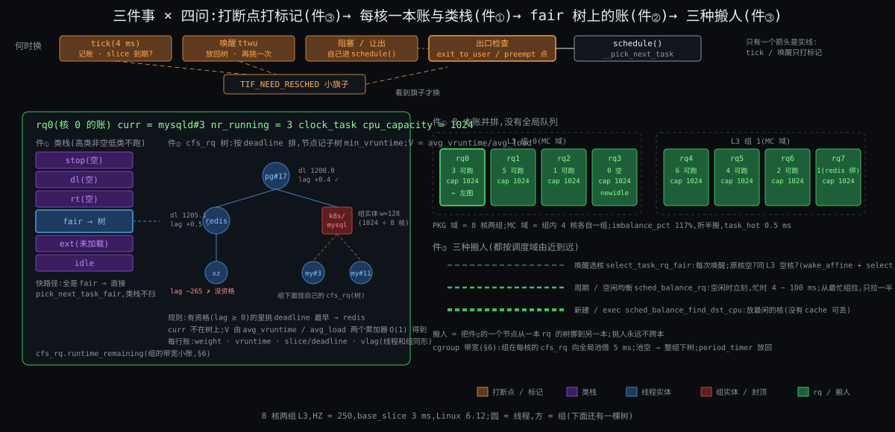

从图上能读出五件事:

1. **8 本账并排,没有全局队列**。核 0 的 `rq` 和核 4 的 `rq` 之间唯一的联系是右下角那三条虚线(搬人)。
2. **每本账里先是一个六层的类栈**,只有 `fair` 这层下面才是一棵树。`stop` / `dl` / `rt` 平时是空的 —— 空就跳过,所以 `__pick_next_task` 有一条快路径:上一个任务不比 fair 高、且账上的任务全是 fair 的,直接调 `pick_next_task_fair`,类栈都不扫。
3. **fair 树上的节点有两种**:圆的是线程,方的是组(k8s 容器);方的下面还挂着一棵树。组那一行的权重由 `cpu.weight` 换算,但只是**这颗核上**这个组的份额,16 个线程散在 8 颗核上就有 8 个方节点。
4. **左上角四个打断点里只有一个箭头真的指向"换人"**:出口检查。tick 和唤醒都只指向 `need_resched` 那个小旗子。
5. **右下三条搬人虚线粗细不同**:唤醒选核最细最频繁(每次唤醒),周期均衡中等(4 ~ 128 ms 一次),新建放最闲最粗最少。三条都先看同一组 L3 的 4 核,再看另一组。

---

## §2 件①:每核一本账与类栈

**先说结论**:`rq` 是一颗核的全部调度状态;类栈决定"问谁要人";快路径让 99% 的挑人根本不碰类栈;`cpu_capacity` 让 8 本账可以互相比较。

### §2.1 先看全貌:`struct rq` 里跟四问有关的字段

| 字段(`kernel/sched/sched.h`) | 是什么 | 管哪问 |
|---|---|---|
| `curr` | 这颗核正在跑的 `task_struct` | ② |
| `nr_running` / `cfs.h_nr_running` | 账上可跑的任务数 / 其中 fair 类的(含组内) | ②④ |
| `clock` / `clock_task` | 这本账的纳秒时钟(每个打断点 `update_rq_clock` 读一次 TSC);`clock_task` 扣掉了中断和窃取时间,记账用它 | ①③ |
| `cfs` / `rt` / `dl` | 三个子队列:`cfs_rq`(树 + 累加器)、`rt_rq`(100 级优先级数组 + 位图)、`dl_rq`(按截止期排的红黑树) | ② |
| `stop` / `idle` | 这颗核专属的停机线程和 idle 线程 | ② |
| `cpu_capacity` | 这颗核此刻的算力(≤ 1024) | ④ |
| `next_balance` / `avg_idle` / `idle_balance` | 下次周期均衡的时间;最近平均空闲多久(决定空闲时值不值得去拉人) | ④ |
| `nr_switches` / `nivcsw` 等计数 | 换了多少次人 | 观测 |

每颗核一份,`cpu_rq(cpu)` 取。锁是 `rq->__lock`,只保护这一本。

### §2.2 类栈:六个 `sched_class` 怎么排、怎么问

每个类是一个 `struct sched_class`,里面是一组函数指针:`enqueue_task` / `dequeue_task`(入账出账)、`pick_task`(挑人)、`put_prev_task` / `set_next_task`(换人前后的收尾)、`task_tick`(tick 来了记账)、`wakeup_preempt`(有人醒了要不要抢)、`select_task_rq`(放哪本账)、`balance`(要不要去别的核拉人)。六个类按下表链接顺序排:

| 类 | 子队列结构 | `pick_task` 规则 | 谁在里面 |
|---|---|---|---|
| `stop` | 一个任务 | 有就是它 | 每核的 `migration/N`:搬人、热插拔时用 |
| `dl` | 按绝对截止期排的红黑树 | 最早截止期 | `SCHED_DEADLINE` |
| `rt` | 100 级优先级数组 + 位图 | 最高优先级,同级 FIFO / RR | `SCHED_FIFO` / `SCHED_RR` |
| `fair` | 按 deadline 排的增广红黑树(可嵌套) | eligible 中 deadline 最早(§3) | `SCHED_NORMAL` / `BATCH` / `IDLE` |
| `ext` | BPF 程序自己定义的 DSQ | BPF 程序定 | `SCHED_EXT`(6.12 起;没加载 BPF 调度器时这一层跳过) |
| `idle` | 一个任务 | 没人可跑时 | 每核的 `swapper/N` |

**快路径**(`__pick_next_task`,`core.c`):如果 `prev` 不是比 fair 高的类、且 `rq->nr_running == rq->cfs.h_nr_running`(账上全是 fair 任务)→ 直接 `pick_next_task_fair`,返回空就拿 idle。我们的机器上 19 个任务全是 fair,这条路径每次都走。只有 `scx_enabled()`(加载了 BPF 调度器)或账上有 rt / dl 任务时才走慢路径,从 `stop` 开始逐类问。

### §2.3 再逼问:没有它会坏在哪

| 没有 … | 先坏在哪 | 它解决了什么 | 约束 |
|---|---|---|---|
| 每核一本账(改成全局一本) | 8 核抢一把锁;mysqld#3 每次被挑都可能换核,1 MB 工作集重填 | 挑人不跨核、锁只保护一本 | C5·核各自为政 |
| 类栈(所有任务一棵树) | 音频线程和 xz 在同一棵树上按 deadline 比,最坏等一圈 | 一部分任务凌驾于公平之上,且凌驾顺序固定 | C7·有人要硬保证 |
| 快路径 | 每次挑人先问 stop、dl、rt 三个空队列,多三次函数指针调用 ~50 ns | 常见情形零开销 | C4·挑人须便宜 |
| `cpu_capacity` | 均衡把两个任务放进 SMT 兄弟核、把重任务放小核 | 跨核比较按算力不按核数 | C8·核不等速且耗电 |
| `clock_task` 扣中断时间 | 网卡中断多的核上任务被多记账,份额不公平 | 账只记任务自己跑的 | C3·份额与延迟两头要 |

---

## §3 件②:fair 类的账 —— 四个数怎么涨、怎么比

**先说结论**:权重决定虚拟时间涨多快;V 是所有人虚拟时间的加权平均;slice 决定 deadline 推多远;lag = V − 自己的虚拟时间,正数才有资格;挑人 = 有资格的里 deadline 最早。四个数、一个规则、一棵树,没有任何"判断你是不是交互程序"的代码。三个进步点:

- 份额和延迟分成两个旋钮(权重、slice),6.12 起 slice 可以每任务自定。
- 睡醒插队有界:lag 在睡下去时被夹在 ±2 个 slice 之内,醒来按 lag 放回。
- 挑人 O(log n):树按 deadline 排,子树记最小 vruntime 做剪枝,V 用两个累加器 O(1) 维护。

### §3.1 权重:nice 怎么变成数

因为 C3·份额与延迟两头要 的"份额"一头 → 要解决"按比例分而不是按个数分"→ 所以引入**权重** `se->load.weight`:nice 值查表(`sched_prio_to_weight[40]`,`core.c`),nice 0 = 1024,每差一级约 1.25 倍 —— 设计目标是"nice 差 1,两个任务对分时 CPU 份额差约 10 个百分点"(`Documentation/scheduler/sched-nice-design.rst`)。

| nice | 权重 | nice | 权重 | nice | 权重 | nice | 权重 |
|---|---|---|---|---|---|---|---|
| −20 | 88761 | −10 | **9548** | 0 | **1024** | 10 | 110 |
| −15 | 29154 | −5 | 3121 | 5 | 335 | 15 | 36 |
| −19 | 71755 | −9 | 7620 | 1 | 820 | 19 | **15** |

**算例**(我们的三个任务同核争抢时的长期份额):

| 任务 | nice | 权重 | 份额 = w / Σw | 跑 1 ms 真实时间,虚拟时间涨 1024 / w ms |
|---|---|---|---|---|
| redis | −10 | 9548 | 9548 / 10587 = 90.2% | 0.107 ms |
| mysqld#3 | 0 | 1024 | 9.7% | 1.000 ms |
| xz | 19 | 15 | 0.14% | 68.27 ms |

两个任务 nice 差 5(1024 : 335)→ 3.06 : 1;差 10(1024 : 110)→ 9.3 : 1。**权重只决定长期比例**,redis 90% 的份额它根本用不掉(它 95% 时间在睡);这就是钩子二里 `nice -10` 没用的原因 —— 它拧的旋钮本来就不缺。

### §3.2 虚拟时间与加权平均 V

因为 C2·未来不可知(依据只能是过去)+ C3·份额与延迟两头要 的份额要按权重 → 要解决"一个数既记录'跑了多少'又把权重折进去"→ 所以引入 **`vruntime`**:每个打断点 `update_curr`(`fair.c`)读一次 `rq->clock_task`,算出 `delta_exec`,然后 `vruntime += delta_exec × 1024 / weight`(`calc_delta_fair`)。nice 0 的任务虚拟时间 = 真实时间;权重越大涨得越慢。

"公平"在账上的定义:**所有人的 vruntime 趋同**。趋同到哪个值?队列的加权平均 **V**:

```
V = Σ(w_i × v_i) / Σ w_i                       ← 定义(fair.c 开头 60 行注释的推导)
```

因为 C4·挑人须便宜(不能每次求和)→ 要解决"V 在每次插删后 O(1) 可得"→ 所以引入两个累加器(`cfs_rq->avg_vruntime`、`cfs_rq->avg_load`),存的是相对于 `min_vruntime` 的差:

```
avg_vruntime = Σ (v_i − min_vruntime) × w_i     ← 插入时 +=,删除时 −=(avg_vruntime_add / _sub)
avg_load     = Σ w_i
V            = min_vruntime + avg_vruntime / avg_load      ← 函数 avg_vruntime()
```

`min_vruntime` 单调递增,减掉它是为了让乘积不溢出 64 位(注释里实测 44 位)。正在跑的 `curr` 不在树上,`avg_vruntime()` 算的时候临时把它加进去。

**算例**:核 0 上 mysqld#3(w 1024,v 1204.0)和 xz(w 15,v 1200.0):V = (1024 × 1204.0 + 15 × 1200.0) / 1039 = 1203.94。V 几乎贴着大权重的那个 —— 权重就是"在平均里的话语权"。

### §3.3 slice 与 deadline:延迟那一头

因为 C3·份额与延迟两头要 的"延迟"一头 → 要解决"表达'我这次要跑多长'并由此排出先后"→ 所以引入 **`slice`** 与 **`deadline`**:

| 量 | 怎么定 | 本机器的值 |
|---|---|---|
| `slice`(请求长度,真实时间) | 默认 `sysctl_sched_base_slice` = 0.75 ms × (1 + log₂ min(核数, 8))(`get_update_sysctl_factor`,`fair.c`;这个对数缩放的点子注释里写明来自 Con Kolivas 的 SD 调度器);6.12 起 `sched_setattr` 的 `sched_runtime` 可自定,夹在 0.1 ~ 100 ms(`syscalls.c`) | 8 核:0.75 × 4 = **3 ms** |
| `deadline`(虚拟截止期) | `deadline = vruntime + slice × 1024 / weight`(`update_deadline`),**只在 vruntime 追上旧 deadline 时才推一次**,推完返回 true 表示"这次请求用完了,该换人" | mysqld +3 ms;redis +0.32 ms;xz +204.8 ms |

注意两件事:

- deadline 是**虚拟**的,所以权重大的任务 deadline 近(redis 0.32 ms 后就到期)—— 大权重在"顺序"上也占优,但只占一个 slice 的优。
- `update_deadline` 返回 true 时 `update_curr` 调 `resched_curr` 打标记 —— 这是 tick 上"该换人"的第一种来源(§4.1)。但 tick 4 ms 一次、slice 3 ms,一个纯算任务实际能跑到下一个 tick 才被发现,**4 ms 而不是 3 ms**(高精度 tick `HRTICK` 特性默认关,`features.h`)。

### §3.4 lag 与 eligibility:从零讲

你上一轮两次卡在这里。这一小节不假设你记得任何东西。

**问题**:redis 睡了 10 ms,醒来时它的 vruntime 比大家落后 —— 账面上"欠它"。按 §3.2 的公平定义它应该排最前面,立刻跑,而且可以一直跑到把欠的追平。问题是:它追平要跑多久?如果它欠 10 ms,它就能连跑 10 ms 不被抢;100 个这样的任务轮流睡醒,mysqld 永远上不了台。**"欠"必须有上限,而且上限要跟份额无关、跟延迟有关。**

**定义**(`fair.c` 注释 + `entity_lag`):

```
lag_i = w_i × (V − v_i)          ← 真实时间单位的"欠账":理想情况下它该得到的服务 − 实际得到的
vlag_i = V − v_i                 ← 内核只存虚拟单位的这个,省掉到处乘 w_i
```

V 比它的 vruntime 大 → lag 正 → 欠它 → **eligible(有资格)**。V 比它小 → lag 负 → 它超支了 → 没资格,哪怕 deadline 最早也不挑它。`entity_eligible` 就是判 `V ≥ v_i`,为了不做除法,实际比较的是 `avg_vruntime ≥ (v_i − min_vruntime) × avg_load`(`vruntime_eligible`)。

一个性质(注释里的推导):**所有人的 lag 之和恒为零**(Σ w_i (V − v_i) = 0,这正是 V 的定义)。所以有人欠就有人超,"欠"不是凭空产生的。

**睡下去时:夹紧**。因为 C3·份额与延迟两头要 的插队额度须有界 → 要解决"睡得再久也只能欠这么多"→ 所以 `update_entity_lag`(出队时调)把 lag 夹在 **±max(2 × slice, TICK_NSEC)** 换算成虚拟单位(`entity_lag`):

| 任务 | 真实上限 = max(2 × 3 ms, 4 ms) = 6 ms | 虚拟上限 = 6 ms × 1024 / w |
|---|---|---|
| mysqld(1024) | 6 ms | ±6.0 ms |
| redis(9548) | 6 ms | ±0.643 ms |
| xz(15) | 6 ms | ±409.6 ms |

所以 redis 不管睡多久,醒来时最多"欠" 6 ms 真实时间的量(虚拟 0.643 ms)—— 两个 slice。这个上限和它 90% 的份额无关。

**醒来时:按 lag 放回,且保持 V 不动**。`place_entity`(`fair.c`)做的事:读当前 V,把任务放在 `vruntime = V − lag` 的位置,再给它 `deadline = vruntime + slice × 1024 / w`。但有一个坑 —— 把一个 lag 为正的任务加进平均里,**V 本身会被拉低**(平均里多了一个比平均小的数),它的 lag 立刻变小,"欠它的"蒸发了一部分。注释里推了这个式子:加进去之后的实际 lag 是 `vl' = vl − w × vl / (W + w)`。所以放回前先**放大**:

```
vl_放回 = vl × (W + w) / W         ← W 是现有队列总权重(含 curr),w 是它自己的
v_i = V − vl_放回
```

放回之后 V 下移,它的 lag 正好回到睡前那个值 —— **lag 守恒**。这一步是 6.6 EEVDF 和 6.5 以前 CFS 的分水岭:CFS 的 `place_entity` 是"睡醒补半个 slice"的固定优惠,EEVDF 是"欠多少还多少,一分不多"。

新任务(fork 出来)没有历史 lag,`PLACE_DEADLINE_INITIAL` 给它半个 slice 的 deadline("别人平均跑到一半了,你也从一半开始"),不给任何欠账。

**6.12 新增:欠账的人想睡,先把账还了(`DELAY_DEQUEUE`)**。lag 为负的任务(超支了)要睡 —— 6.11 以前是真出队、把负 lag 存起来,下次醒来放回时带着负 lag(排到后面)。6.12 起(`features.h` 的 `DELAY_DEQUEUE`)它**留在树上不出队**,标记 `sched_delayed`,继续被 V 甩在后面直到 lag 归零,那一刻再真正出队(`DELAY_ZERO` 把残余 lag 清零)。好处:睡眠不再是逃债的办法,而且短睡眠醒来时如果还在"延迟出队"状态,`requeue_delayed_entity` 只清一个标志就回来了,比重新 `place_entity` 便宜。代价:树上多了一些"在睡但还挂着"的节点,`h_nr_running` 和"真可跑"数要分开算 —— Deep 主线① 会贴这段的判断分支。

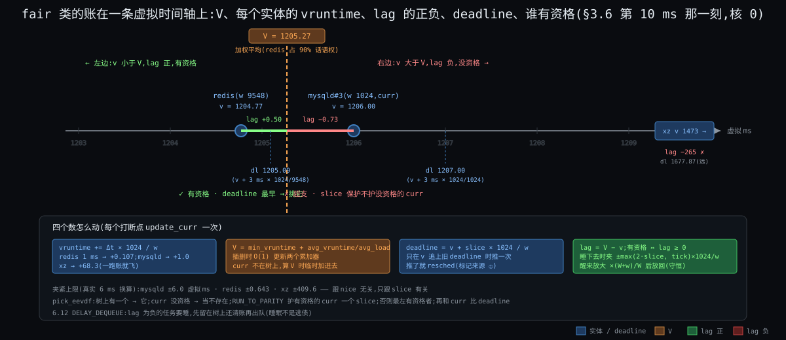

### §3.5 挑人规则:`pick_eevdf` 的文字版

因为 C3·份额与延迟两头要 的三个数都到位了 → 要解决"用一条规则把它们合起来"→ 所以 **EEVDF**(Earliest Eligible Virtual Deadline First,`pick_eevdf`,`fair.c`):

1. 树上只有一个实体 → 直接返回(省掉资格判断)。
2. `curr` 不在账上或没资格 → 当它不存在。
3. **`RUN_TO_PARITY`**(默认开):`curr` 有资格、且它从被挑中起 deadline 没变过(`set_next_entity` 把 deadline 抄一份到 `vlag` 里做标记,`vlag == deadline` 就是"slice 保护期内")→ 继续跑它。这叫"跑到 parity":一个 slice 内不换人,减少抖动。
4. 树最左(deadline 最早)的实体有资格 → 就是它。
5. 否则按子树最小 vruntime 剪枝向右找第一个有资格的。
6. 找到的和 `curr` 比,谁 deadline 早要谁。

**`PREEMPT_SHORT`**(默认开,6.12):如果醒来的任务 slice 比 `curr` 短、有资格、而且 deadline 比 `curr` 早(或 `curr` 没资格)→ 取消 `curr` 的 slice 保护(`do_preempt_short` 把 `vlag` 改成 `deadline + 1`),让短请求能插进来。这是"slice 管延迟"落到挑人上的那一步:**声明小 slice 的任务换来的是插队权,不是份额**。

规则里没有一行看 `task_struct` 的名字、policy 以外的任何"类型"信息。C2·未来不可知 的口诀"只看账不看人"就是这六步。

### §3.6 一次完整算例:三个任务同核走五拍

核 0 上 mysqld#3(w 1024)和 xz(w 15)都可跑,redis(w 9548)在睡,睡前存的 `vlag = +0.50`(虚拟 ms,欠它)。slice 都是 3 ms。t = 0 时两人 vruntime 都是 1200.0,V = 1200.0。单位:虚拟 ms,保留两位。

| t(真实 ms) | 事件 | mysqld v / lag / dl | xz v / lag / dl | redis v / lag / dl | V | 选谁、为什么 |
|---|---|---|---|---|---|---|
| 0 | 两人都在树上 | 1200.00 / 0 / 1203.00 | 1200.00 / 0 / 1404.80 | 睡 | 1200.00 | 都有资格;mysqld deadline 早 → **mysqld** |
| 4 | tick | 1204.00 / **−0.06** / 1207.00(跑满 3 ms 推了 deadline → 标记) | 1200.00 / +3.94 / 1404.80 | 睡 | 1203.94 | mysqld 超支没资格;xz 有资格且是唯一候选 → **xz**(注意 mysqld 跑了 4 ms 不是 3,tick 粒度) |
| 8 | tick | 1204.00 / +3.88 / 1207.00 | **1473.07** / −265 / 1677.87(4 ms 涨了 273 虚拟 ms) | 睡 | 1207.88 | xz 没资格;mysqld 有资格 → **mysqld**。此后 mysqld 要跑到 v = 1473 才会再次没资格,即 **269 ms**;xz 每 ~273 ms 得 4 ms ≈ 1.5%,与 15 / 1039 一致 |
| 10 | redis 被网卡中断唤醒(`ttwu`) | 1206.00 / −0.73 / 1207.00 | 同上 | 放回:lag 放大 0.50 × (1039 + 9548) / 1039 = 5.09;v = 1209.86 − 5.09 = **1204.77**;dl = 1204.77 + 0.32 = 1205.09 | 1205.27(redis 加入后 V 下移;redis 的 lag 回到 +0.50 ✓) | mysqld 被拉成**没资格**;`check_preempt_wakeup_fair`:`pick_eevdf` 返回 redis → 打标记 → 出口换人 → **redis**。注意 mysqld 还在 slice 保护期内,但保护只护"有资格的 curr" |
| 10.05 | redis 算完 50 μs 睡了 | 1206.00 / +3.86 / 1207.00 | 同上 | v 1204.78;出队时 lag = V − v ≈ +0.49,夹在 ±0.643 内 → 存下 | 1209.86(回到 redis 加入前) | redis 有资格(lag 正)→ 真出队;mysqld 恢复有资格 → **mysqld** |

五拍里能读出的四件事:

1. **tick 粒度**(第 4 ms 行):slice 3 ms,实际跑 4 ms —— C1·只在打断点换 的代价。
2. **权重通过 V 起作用**(第 8 ms 行):xz 跑 4 ms 就把自己甩到 V 后面 265 虚拟 ms,下次有资格要等 mysqld 跑 269 ms —— 1 : 68 的份额不是靠"少挑它",是靠"它一跑账就飞"。
3. **lag 守恒**(第 10 ms 行):放大后放回,V 下移,redis 的 lag 恰好还是 +0.50;mysqld 因此瞬间没资格 —— **决定抢不抢的不是 tick,是唤醒那一刻的 V**。
4. **slice 保护保护不了没资格的人**(第 10 ms 行):`RUN_TO_PARITY` 开着,mysqld 照样被换 —— 上一轮 Deep §3.5 的结论,这里从账上重现。

### §3.7 组是同形的一行

因为 C6·份额按组算 → 要解决"组在父树上像线程一样被挑,组内再挑"→ 所以 **`task_group`**(`sched.h`):cgroup 树上每个节点一个,它在**每颗核上**各有一个 `sched_entity`(`tg->se[cpu]`,挂在父级那颗核的 `cfs_rq` 树上)和一个 `cfs_rq`(`tg->cfs_rq[cpu]`,挂它自己在这颗核上的线程 / 子组)。`pick_eevdf` 在父树上挑到一个组节点,就下到那个组的树上再挑,一直到叶子线程(`pick_task_fair` 的循环)。

组的权重:`cpu.weight`(1 ~ 10000,默认 100)换算成 `tg->shares`(100 → 1024,`sched_weight_from_cgroup`)。但 `tg->shares` 是**整个组**的权重,组散在 8 颗核上,每颗核上那一行该占多少?`calc_group_shares`(`fair.c`)给的形状:

```
这颗核上组实体的权重 ≈ tg->shares × (这颗核上组内负载) / (组在所有核上的总负载)
```

组内负载按 PELT 的 `load_avg`(§5.2)算;实现里做了一个"近似单核时退化成整份"的修正(注释自嘲 icky)。效果:k8s 容器 `cpu.weight = 100`,16 个线程在 8 颗核上各 2 个,每颗核上这个组的权重 ≈ 1024 / 8 = 128,跟同核上一个 nice 0 的 PG 后端(1024)比是 1 : 8 —— **按组公平的代价是组内每个线程在它所在那颗核上的话语权变小**。`update_cfs_group` 在每次入账出账时重算这个数。

### §3.8 再逼问:没有它会坏在哪

| 没有 … | 先坏在哪 | 它解决了什么 | 约束 |
|---|---|---|---|
| 权重(所有人 1024) | xz 和 redis 对分 CPU;`nice` 失效 | 份额按比例 | C3·份额与延迟两头要 |
| V 用累加器(每次求和) | 3000 个任务时每次判资格 O(n),tick 里 30 μs | O(1) 得到 V | C4·挑人须便宜 |
| deadline(只按 vruntime 最小挑,即 CFS) | 没法表达"我要低延迟但不多占";份额和延迟绑死 | 延迟成为独立旋钮 | C3·份额与延迟两头要 |
| lag 夹紧 | 睡 1 s 回来连跑 1 s;100 个这样的任务饿死 mysqld | 插队有界 | C3·份额与延迟两头要 |
| lag 守恒放大 | 每次睡醒欠账蒸发一部分;频繁睡醒的任务系统性吃亏 | 账不因进出而漂 | C2·未来不可知(账要准) |
| 树按 deadline 排 + 子树最小 vruntime | 找"有资格里 deadline 最早"要扫一遍 | O(log n) 剪枝 | C4·挑人须便宜 |
| 组是同形一行 | 按线程分;`make -j64` 压扁浏览器 | 组间公平、组内再分 | C6·份额按组算 |
| `DELAY_DEQUEUE`(6.12) | 超支的任务睡一下就把负 lag 带到下次,或被不公平地提前放回 | 睡眠不是逃债 | C3·份额与延迟两头要 |

---

## §4 件③:何时换 —— 标记与出口

**先说结论**:三种打断点只打标记(`TIF_NEED_RESCHED`),两种出口真换人;内核态能不能被换由抢占模型决定;tick 做两件事(记账、看 slice)并顺手触发均衡;唤醒抢占的判定就是"把新人放进账里再跑一次 `pick_eevdf`"。

### §4.1 五个触发点与三种标记来源

因为 C1·只在打断点换 → 要解决"每种打断点各做什么"→ 所以:

| 触发点 | 入口(6.12) | 做什么 | 标记来源 |
|---|---|---|---|
| tick | `sched_tick`(`core.c`)→ `task_tick_fair` → `entity_tick` → `update_curr` | 记账;`update_deadline` 返回 true(slice 用完)或 `did_preempt_short` → `resched_curr` | ① slice 到期 |
| 唤醒 | `try_to_wake_up` → `select_task_rq_fair`(放哪本账)→ `ttwu_queue` → `ttwu_do_activate` → `enqueue_task_fair`(含 `place_entity`)→ `wakeup_preempt`(`core.c`) | 新人入账;类更高直接标记;同类调 `check_preempt_wakeup_fair` | ② 新人比 curr 更该跑 |
| 阻塞 | 任务自己调 `schedule()`(在 `futex_wait`、`io_schedule` 等里) | `dequeue_task_fair`(含 `update_entity_lag`,可能 `DELAY_DEQUEUE`)→ 直接挑下一个 | 不需要标记,它自己就在 `schedule()` 里 |
| 让出 / 退出 | `sched_yield` → `yield_task_fair`(把自己的 deadline 推到最后);`do_exit` → `schedule()` | 直接挑下一个 | 同上 |
| 出口检查 | `exit_to_user_mode_loop`(`kernel/entry/common.c`);`preempt_schedule_irq`(`core.c`);`preempt_enable` 的末尾 | 看到标记 → `schedule()` | ③ 消费标记 |

三种标记来源:slice 到期(tick)、新人更该跑(唤醒)、还有一种跨核的 —— 均衡把任务搬到这颗核后也会 `wakeup_preempt`。标记打在 `curr->thread_info.flags` 上;如果 `curr` 在别的核上跑(唤醒者在核 3 给核 5 的 curr 打标记),`resched_curr` 发一个 IPI 让核 5 进一次中断,好让它走到出口。

### §4.2 从标记到真换:两种出口与抢占模型

标记只是一个 bit。真换人要等流走到出口:

| 出口 | 什么时候经过 | 代码 |
|---|---|---|
| 回用户态前 | 每次系统调用返回、中断返回用户态 | `exit_to_user_mode_loop`:循环检查 `TIF_NEED_RESCHED` → `schedule()`,直到没有待办 |
| 内核态抢占点 | 中断返回**内核态**时(`irqentry_exit` → `irqentry_exit_cond_resched` → `preempt_schedule_irq`);`preempt_enable()` 把 `preempt_count` 减到 0 时;`cond_resched()` / `might_sleep()` 显式让出点 | 只在 `preempt_count == 0`(没持自旋锁、不在中断里)时才真换 |

第二种出口**存不存在**由编译 / 启动时的抢占模型决定(`kernel/Kconfig.preempt`):

| 模型 | 内核态什么时候能被换 | 典型用途 | 代价 |
|---|---|---|---|
| `PREEMPT_NONE`(Server) | 只在显式 `cond_resched` / 回用户态 | 吞吐优先的服务器 | 一次长系统调用(大 `read`)期间 redis 醒了也要等它做完,最坏几 ms |
| `PREEMPT_VOLUNTARY`(Desktop) | 上面 + 内核里更多 `might_sleep` 点 | 发行版老默认 | 略多的检查 |
| `PREEMPT`(Low-Latency Desktop) | 任何 `preempt_count == 0` 的点,包括中断返回内核态 | 桌面、低延迟 | 更多 `preempt_count` 操作;持锁区变成隐式不可抢占区 |
| `PREEMPT_RT` | 上面 + 自旋锁变睡眠锁 + 中断线程化,几乎哪都能换 | 实时 | 吞吐降,锁更重 |
| `PREEMPT_DYNAMIC` | 编译进全部,启动参数 `preempt=none/voluntary/full` 选(静态调用切换) | 现代发行版默认(x86) | 无 |
| `PREEMPT_LAZY` | 6.13 起(已核 #16:v6.13 `kernel/Kconfig.preempt` 新增):fair 类的标记默认"懒",只在回用户态或下一个 tick 才生效,给内核态长路径留余地 | 想要 `PREEMPT` 的延迟又不想要它的吞吐损失 | — |

我们的机器按 `PREEMPT_DYNAMIC` + `preempt=full` 假设,第二种出口存在。

### §4.3 tick 的两件事,以及没有 tick 的时候

`sched_tick`(`core.c`)每 4 ms 在每颗核上做:① `update_rq_clock` 读 TSC;② 调当前类的 `task_tick`(fair:`update_curr` 记账 + `update_deadline` 看 slice + PELT 更新 + `update_cfs_group` 重算组权重);③ `calc_global_load_tick`(loadavg);④ `sched_balance_trigger`:到了这颗核的 `next_balance` 就抬 `SCHED_SOFTIRQ`,均衡在软中断里做(§5.3)。

因为 C8·核不等速且耗电(空转的核每 4 ms 醒一次浪费电)→ 要解决"没事的核别醒"→ 所以引入 **`NO_HZ_IDLE`**(默认):核进 idle 就停 tick;它的均衡职责由一颗被选中的"idle load balancer"核代做(`nohz_balancer_kick`)。**`NO_HZ_FULL`**(可选):账上只有一个任务的核也停 tick,记账改在系统调用边界补(待核 #17),给 HPC / 低延迟用;代价是均衡和 PELT 更新变慢。

### §4.4 唤醒抢占:把新人放进账里再挑一次

`check_preempt_wakeup_fair`(`fair.c`)的机制级描述:

1. `curr` 已经有标记 → 不用再判。
2. 新人是 `SCHED_BATCH` / `SCHED_IDLE` → 不抢(这两种 policy 的全部含义就是"不抢别人")。
3. `curr` 是 idle 实体而新人不是 → 直接抢。
4. `update_curr` 把 `curr` 的账记到此刻。
5. `do_preempt_short`:新人 slice 更短、有资格、deadline 更早 → 取消 `curr` 的 slice 保护。
6. **`pick_eevdf(cfs_rq) == 新人` → `resched_curr`**。

第 6 步就是全部:抢不抢 = 把新人按 lag 放回树上之后,规则会不会挑它。§3.6 第 10 ms 那一行走的就是这六步。`RUN_TO_PARITY` 在第 6 步里保护的是"有资格的 `curr`",新人加入把 V 拉低到 `curr` 之下时保护失效 —— 所以**睡醒的高权重任务几乎总能立刻上**,这是 redis p99 在正常情况下只有 0.2 ms 的原因;钩子二里它变成 5 ms,是因为 §5 要讲的位置问题和 §4.2 的内核态不可抢占段,不是挑人规则的问题。

### §4.5 再逼问:没有它会坏在哪

| 没有 … | 先坏在哪 | 它解决了什么 | 约束 |
|---|---|---|---|
| 标记(tick 里直接 `schedule`) | 中断上下文换栈;持锁时换人把锁带走 | 决定与执行分开 | C1·只在打断点换 |
| 内核态抢占点(只有回用户态一个出口) | 一次 10 ms 的系统调用期间 redis 等 10 ms | 内核态长路径里也能换 | C1·只在打断点换 + C3·份额与延迟两头要 |
| `NO_HZ_IDLE` | 7 颗空核每秒醒 250 次 | 省电 | C8·核不等速且耗电 |
| 唤醒时重跑 `pick_eevdf` | 新人要等下一个 tick(最多 4 ms) | 延迟由唤醒决定,不由 tick 决定 | C3·份额与延迟两头要 |
| IPI 通知别的核 | 核 5 的 curr 不知道自己该让 | 跨核标记能生效 | C5·核各自为政 |

---

## §5 在哪换:多核(结构 / 原理 / 机制 / 策略)

**先说结论**:8 本账靠调度域分成"同 L3 的 4 核"和"全部 8 核"两层;每本账和每个任务都带一个按 32 ms 半衰期衰减的负载估计;搬人三条路 —— 醒来时先找原核或同 L3 的空核、空闲和周期时从最忙的组拉、新建时放最闲的;所有"搬不搬"都卡在一个门槛上:它 0.5 ms 内跑过就算热,不搬。四个进步点(相对"一本全局账"):

- 挑人永远不跨核、不抢锁。
- 搬人有代价模型(热 / 冷)而不是盲搬。
- 远近分层,跨 L3 的均衡比同 L3 的少做 2 ~ 4 倍。
- 按负载和算力比,不按任务个数比。

### §5.1 结构:调度域与调度组

因为 C5·核各自为政(核间有远近)→ 要解决"均衡按远近分层"→ 所以引入 **`sched_domain`**(`topology.c`):每颗核一条从近到远的域链。6.12 的默认拓扑表 `default_topology[]` 从下往上是:

| 层(`SD_INIT_NAME`) | 范围 | 关键 flag | `imbalance_pct` | `balance_interval` 基值 |
|---|---|---|---|---|
| `SMT` | 同一物理核的超线程 | `SD_SHARE_CPUCAPACITY`(共享执行单元) | 110% | 域内核数 ms |
| `CLS` | 共享 L2 的簇(ARM 多见) | `SD_CLUSTER` | 117% | 同上 |
| `MC` | 共享 L3 的核 | `SD_SHARE_LLC` | 117% | 4 核 → 4 ms |
| `PKG` | 同一插槽 | — | 117%(默认) | 8 核 → 8 ms |
| `NUMA`(`CONFIG_NUMA` 时按距离再分层) | 跨插槽 | `SD_NUMA` + `SD_SERIALIZE`;远 NUMA 层去掉 `SD_BALANCE_EXEC / FORK / WAKE_AFFINE` | 117% | 更长 |

我们的机器(SMT 关,一个插槽,两组 L3)只有两层:**MC**(4 核)和 **PKG**(8 核)。每层把核分成若干 **`sched_group`**:MC 层每核一组;PKG 层每组 L3 一组(4 核)。均衡永远是"本组 vs 域内其他组"。

`imbalance_pct` 是迟滞:最忙的组要比本组忙 17% 以上才值得搬(SMT 层 10%)。`balance_interval` 是这层多久看一次,忙的时候乘 `busy_factor` 16,上限 `HZ/10` = 100 ms(`max_load_balance_interval`,`fair.c`);连续搬不动就翻倍。所以我们的机器上:核空闲时 MC 层 4 ms 看一次、PKG 层 8 ms;核忙时 64 ms / 100 ms。

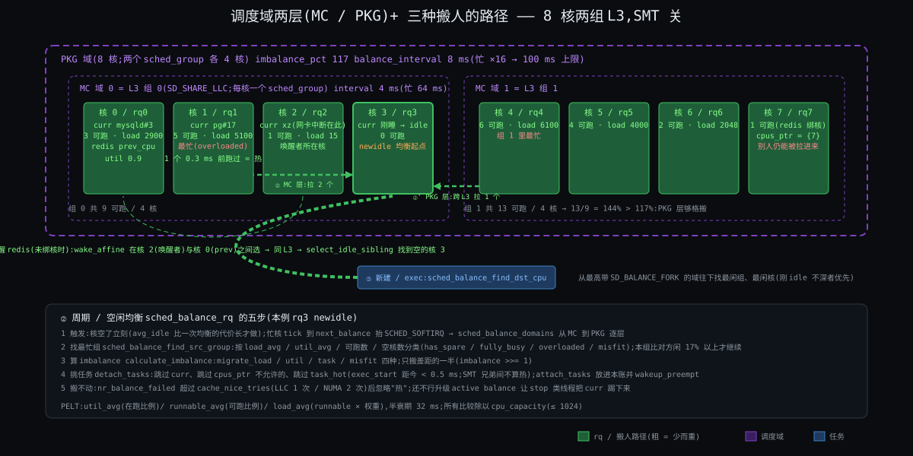

### §5.2 原理:负载怎么量 —— PELT 与算力

因为 C8·核不等速且耗电(按算力比不按核数比)+ C5·核各自为政(搬人要算账)→ 要解决"一个任务'有多重'、一颗核'有多满'要有可比的数"→ 所以引入 **PELT**(Per-Entity Load Tracking,`pelt.c`):把时间切成 1024 μs 的段,每段里"可跑 / 在跑 / 在睡"记 1 或 0,按几何级数衰减求和,衰减系数 y 满足 **y³² = 0.5**,即 32 ms 前的那段只算一半(待核 #13:`LOAD_AVG_PERIOD = 32`)。每个 `sched_entity` 和每个 `cfs_rq` 各维护三个数:

| 量 | 记的是 | 用在哪 |
|---|---|---|
| `util_avg` | 最近"在跑"的比例 × 1024(一个一直跑的任务 → 1024) | 唤醒选核(够不够放)、调频(`schedutil` 直接读它)、EAS |
| `runnable_avg` | 最近"可跑(含排队)"的比例 | 判断一颗核是不是"排了很多人" |
| `load_avg` | `runnable_avg × 权重` | 周期均衡比"谁重"、组权重分摊(§3.7) |

**算力** `cpu_capacity`:最强的核 = 1024;SMT 兄弟都忙时各打折;被 rt / dl / 中断占掉的时间从算力里扣(`scale_rt_capacity`)。均衡比的是 `load_avg / cpu_capacity`。

32 ms 半衰期是个折中:太短则一个突发让均衡乱搬,太长则一个任务变重 100 ms 后均衡才知道。redis 的 `util_avg` 长期只有 ~50(5%),mysqld 忙时 ~1024,xz 1024 但权重 15 所以 `load_avg` 只有 ~15。

### §5.3 机制:三种搬人

**① 唤醒时选核**(`select_task_rq_fair`,`fair.c`):

1. 先看 `wake_wide`:唤醒者和被唤醒者是不是"一对多"关系(一个线程唤醒很多线程,如主线程分发)—— 是则不做亲和,走慢路径找最闲的。
2. 否则 **`wake_affine`**:在唤醒者所在核(`this_cpu`)和被唤醒者上次的核(`prev_cpu`)之间二选一:哪个空(`wake_affine_idle`)就哪个;都不空比负载(`wake_affine_weight`,带 `imbalance_pct` 的偏置),偏向 `prev_cpu`(cache 热)。只在两者同一 LLC 域(`SD_WAKE_AFFINE`)内考虑。
3. 选定目标后 **`select_idle_sibling`**:目标核空 → 用;`prev_cpu` 空且与目标同 LLC → 用 `prev`;最近用过的核空 → 用;再不行在目标的 LLC 域内扫空核(`select_idle_cpu`,`SIS_UTIL` 按域的利用率限制扫描数量,别为找一颗空核扫 64 颗)。
4. 全忙 → 就放目标核,排队。

结论:**醒来的任务几乎总是留在原来那组 L3 里**;跨 L3 只在唤醒者在另一组且那边更闲时发生。

**② 周期 / 空闲均衡**(`sched_balance_rq`,`fair.c`;老名 `load_balance`):

1. 触发:核空闲下来立刻做一次(`sched_balance_newidle`,但如果这颗核平均空闲时间比一次均衡的代价还短就不做,`avg_idle` vs `max_newidle_lb_cost`);否则 tick 里 `sched_balance_trigger` 到期抬软中断 → `sched_balance_softirq` → `sched_balance_domains` 从 MC 到 PKG 逐层(每层按自己的间隔)。
2. 找最忙的组 `sched_balance_find_src_group`:统计每组的 `load_avg`、`util_avg`、可跑数、空核数,把组分类(`group_has_spare` / `fully_busy` / `overloaded` / `misfit` / …),本组比最忙组闲才继续;`calculate_imbalance` 算要搬多少(类型 `migrate_load` / `migrate_util` / `migrate_task` / `migrate_misfit`),**只搬差距的一半**(`imbalance >>= 1`),防止来回抖。
3. 在最忙组里找最忙的 `rq`(`sched_balance_find_src_rq`),锁住两本账,`detach_tasks` 从它的树上挑任务:跳过 `curr`(正在跑的不能搬,除非后面升级成 active balance 让 `stop` 类线程把它踢下来)、跳过亲和不允许的(`cpus_ptr`)、跳过**热的**(`task_hot`:`exec_start` 距现在 < `sysctl_sched_migration_cost` = 0.5 ms;SMT 兄弟之间不算热),直到搬够 `imbalance`。
4. `attach_tasks` 放进本账并 `wakeup_preempt`。
5. 连续失败 `cache_nice_tries` 次(LLC 层 1 次,NUMA 层 2 次)后下一次忽略"热"。

**③ 新建 / exec 时**(`select_task_rq_fair` 带 `WF_FORK` / `WF_EXEC`,走慢路径 `sched_balance_find_dst_cpu`):新任务没有 cache 可丢,从最高有 `SD_BALANCE_FORK` 的域往下逐层找最闲的组、组里最闲的核(优先刚进 idle 不深的核,唤醒延迟小)。

### §5.4 策略:什么时候搬、搬谁、谁不能搬

| 问题 | 策略 | 对应 |
|---|---|---|
| 什么时候搬 | 空闲时立刻(最常见);忙时按层间隔(4 ~ 100 ms);最忙组比本组忙 17% 以上才动 | C5·核各自为政(搬是有代价的) |
| 搬谁 | 不搬 curr;不搬 0.5 ms 内跑过的;优先搬 `load_avg` 刚好填平差距的;SMT 层不看热不热 | C5·核各自为政 + C8·核不等速且耗电 |
| 搬多少 | 差距的一半 | 防抖 |
| 谁不能搬 | `sched_setaffinity` / `taskset` 限定了 `cpus_ptr` 的;`cpuset` cgroup 限定了范围的;`isolcpus=` 启动参数隔离的核根本不在任何域里 | 用户的位置旋钮 |
| 内存在哪边(NUMA) | `NUMA balancing`:周期性把任务的页表项清掉访问权,靠缺页统计任务在哪个节点访存多;访存多在对面就要么把页搬过去、要么把任务搬过去(`task_numa_fault`,`fair.c`) | C5·核各自为政 的内存那一面 |
| 核不等速 | 均衡的所有比较除以 `cpu_capacity`;`misfit` 任务(util 超过小核算力)优先搬到大核;EAS 在不过载时按能耗模型选核(`find_energy_efficient_cpu`,我们的 x86 机器没有能耗模型,这条跳过) | C8·核不等速且耗电 |

### §5.5 算例:rq3 空了,从谁那里拉几个

状态(§1 图):组 L3-0 = {rq0: 3 可跑, rq1: 5, rq2: 1, rq3: 0};组 L3-1 = {rq4: 6, rq5: 4, rq6: 2, rq7: 1(redis 绑核)}。rq3 的 curr 刚睡,`sched_balance_newidle`:

1. **MC 层**(域 = L3-0 四核,每核一组):本组 rq3 空(`group_has_spare`,空核 1);最忙组 rq1 有 5 个可跑(`group_overloaded`)。`calculate_imbalance`:本组有余、对方过载 → `migrate_task`,数量按两边空核差 / 可跑差算,再折半 → imbalance 算出 **2**;但在可抢占内核(`CONFIG_PREEMPTION`)下 newidle 均衡搬到 **1 个**就 `break`(`fair.c:9607`,Deep §3.2 贴了这段),剩下的留给下一次。`detach_tasks` 在 rq1 树上从尾部开始挑:跳过 curr;一个 0.3 ms 前刚跑过的 mysqld 线程算热跳过;挑一个 PG 后端(`exec_start` 几 ms 前)→ rq3 现在 1 个。`continue_balancing` 置 0(本层搬到了,上层不再搬)。
2. 如果 MC 层没搬到(比如 rq1 上全是热的或绑核的):**PKG 层**(域 = 8 核,两组各 4 核)。本组 L3-0 共 9 可跑 / 4 核,对方 L3-1 共 13 / 4 核;对方比本组忙 13 / 9 = 144% > 117% → 够格。PKG 层没有 `SD_SHARE_LLC`,`calculate_imbalance` 走的是 `migrate_util` 分支:imbalance = 本组的算力余量 = 一颗空核的 1024(不是"~2 个 load 单位");从 rq4(最忙)拉 1 个 **跨 L3**,它的 L3 工作集要重填(What 硬件入门③的几十微秒)。(本段"搬 2 个 / ~2 个 load 单位"两处按 Deep §3.4 的算例改正,见 Deep 待核 #73。)
3. 每 4 ms(MC)/ 8 ms(PKG)tick 还会再看;rq3 忙起来后间隔 ×16。

这就是 §1 图右下角那条"rq3 ← rq4"虚线的来历。注意两件事:**均衡从不追求 8 本账完全相等**(17% 迟滞 + 折半),**而且只在"闲的那边"主动拉**(pull 模型;push 只在 rt / dl 类和 active balance 里有)。

### §5.6 钩子二闭环:`taskset` 为什么两面

| 做法 | 在上面的机制里发生了什么 | 结果 |
|---|---|---|
| `taskset -c 7 redis`,PG 不动 | redis 的 `cpus_ptr = {7}`:唤醒选核只能选 7;**但 rq7 仍在 MC / PKG 域里**,§5.3② 的均衡照样把 PG 后端拉进 rq7(rq7 空时它自己就会去拉);redis 醒来时 rq7 上可能有 3 个 PG 在算,它按 §3 的规则能抢,但如果 curr 在内核态不可抢占段(§4.2)就得等 | p99 更糟(8 ms) |
| `taskset -c 7 redis` + PG 绑 0 ~ 6 | PG 的 `cpus_ptr` 不含 7,`detach_tasks` 跳过;rq7 永远只有 redis | p99 0.3 ms;核 7 的 95% 时间空转 |
| `isolcpus=7` + 绑 redis | 核 7 不在任何调度域里,均衡根本看不到它 | 同上,且连 kworker 之类的内核线程也不去 |
| `cpuset` cgroup 把 PG 限在 0 ~ 6 | 等价于第二行,但是组级配置 | 同第二行 |

**位置旋钮必须两边都拧**:一边绑了只是"它走不了",不是"别人进不来"。

### §5.7 再逼问:没有它会坏在哪

| 没有 … | 先坏在哪 | 它解决了什么 | 约束 |
|---|---|---|---|
| 调度域分层(平铺 8 核) | 跨 L3 的搬人和同 L3 一样频繁;L3 重填成常态 | 远近有别 | C5·核各自为政 |
| PELT(按可跑数均衡) | xz(重 15)和 mysqld(重 1024)算一样;2 个 SMT 兄弟上各 1 个任务算平 | 按重量和算力比 | C8·核不等速且耗电 |
| `task_hot` 门槛 | 均衡把刚跑了 100 μs 的任务搬走,cache 白填 | 搬人的代价模型 | C5·核各自为政 |
| 唤醒亲和(每次醒来放最闲核) | redis 每次醒来换核,L1 / L2 全冷 | 留在热的地方 | C5·核各自为政 |
| 只搬一半 + 17% 迟滞 | 两颗核互相搬同一个任务 | 防抖 | C5·核各自为政 |
| `newidle` 均衡 | 核空了要等下一个周期(最长 100 ms)才拉人 | 空核立刻有事做 | C3·份额与延迟两头要(延迟) |

---

## §6 各多少之上限:cgroup 带宽

**先说结论**:`cpu.max` 把"配额 / 周期"存在组的 `cfs_bandwidth` 里;每颗核上这个组的 `cfs_rq` 每次向全局池借 5 ms;池空了这颗核上整个组实体下树(throttle);周期定时器到点把池填满、把所有被停的 `cfs_rq` 放回。它跟 `cpu.weight` 是两个正交的旋钮:一个封顶、一个分比例。三个进步点(相对"只分比例"):

- 组的用量有硬上限,计费和隔离可预期。
- 上限按时间不按核,空闲时可以用任何核。
- 代价清楚:突发时周期末停顿。

### §6.1 结构:`cfs_bandwidth` 与每核的 `runtime_remaining`

因为 C6·份额按组算 的"要能封顶"→ 要解决"组的总用量不超过 X"→ 所以引入 **`struct cfs_bandwidth`**(`sched.h`,每个 `task_group` 一个):

| 字段 | 是什么 | 本例(`cpu.max = 200000 100000`) |
|---|---|---|
| `period` | 周期(1 ms ~ 1 s;默认 100 ms,`default_cfs_period`) | 100 ms |
| `quota` | 每周期配额(真实 CPU 时间,可以大于 period:多核) | 200 ms |
| `runtime` | 本周期池里还剩多少 | 周期开始 200 ms |
| `burst` | 允许从空闲周期攒下来的额外额度(`cpu.max.burst`,5.14+) | 0 |
| `period_timer` / `slack_timer` | 周期到点补池;某核归还零头后 5 ms 的"捡漏"定时器 | — |
| `throttled_cfs_rq` | 被停掉的各核 `cfs_rq` 链表 | — |

每颗核上这个组的 `cfs_rq` 有自己的小账 `runtime_remaining`。

### §6.2 机制:借、停、放

1. **借**:组内线程在核 N 跑,`update_curr` → `account_cfs_rq_runtime` 从 `runtime_remaining` 扣;扣到 ≤ 0 就向全局池借一片 **`sysctl_sched_cfs_bandwidth_slice_us` = 5 ms**(`__assign_cfs_rq_runtime`);池里不够 5 ms 就有多少借多少。
2. **停**:借不到(池空)→ `throttle_cfs_rq`:把这颗核上**整个组实体**从父树上出队(组内所有线程跟着消失),记进 `throttled_cfs_rq` 链表,`nr_throttled++`;正在跑的那个线程在下一个出口被换下。其他核上的 `cfs_rq` 各自在自己借不到时也停。
3. **放**:`period_timer` 到点 → `__refill_cfs_bandwidth_runtime` 把池补回 `quota`(+ 攒下的 `burst`)→ `distribute_cfs_runtime` 遍历链表,给每个被停的 `cfs_rq` 补到 `runtime_remaining > 0` 并放回树上(远端核用 IPI 异步放)。
4. **归还零头**:线程睡了,这颗核上 `runtime_remaining` 剩的超过 1 ms 的部分还回池(`return_cfs_rq_runtime`),顺便启动 `slack_timer` 5 ms 后看看有没有被停的能放。

**注意单位**:quota 是 **CPU 时间**,16 颗核各借 5 ms 就是 80 ms;`period_timer` 补的是**池**,不是"每核多少"。

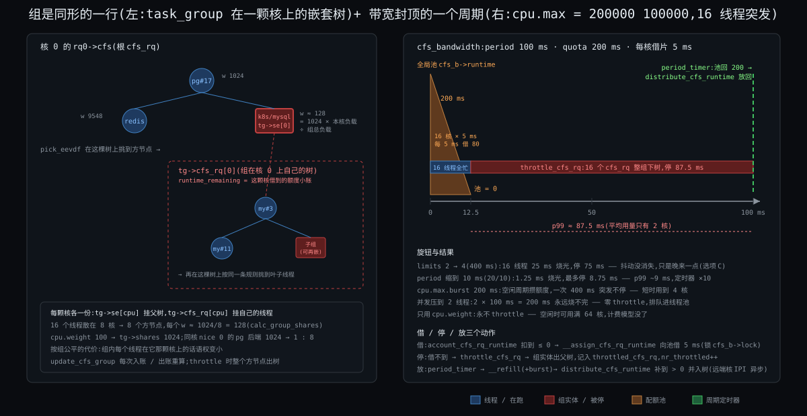

### §6.3 算例:钩子一,以及"改成 4 核"的三个选项

**钩子一**(`limits.cpu = 2`,16 个线程,64 核节点,突发查询):

```
t = 0       周期开始,池 = 200 ms
t = 0 ~ 12.5 16 个线程在 16 颗核上同时忙:每核每 5 ms 借一片,16 核 × 5 ms = 80 ms / 5 ms 墙上时间
            12.5 ms 后池 = 0(借了 40 片)
t = 12.5    各核相继借不到 → 16 个 cfs_rq 全部 throttle;组在 64 核上消失
t = 12.5 ~ 100  整组停;这期间到达的新请求在 socket 缓冲里等
t = 100     period_timer:池 = 200 ms;distribute 放回 16 个 cfs_rq
p99 ≈ 87.5 ms + 排队                     ← 平均用量只有 2 核(3% of 64),但尾延迟 87.5 ms
```

**What 里那道选择题**:`limits.cpu` 改 4(`cpu.max = 400000 100000`):

| 选项 | 算一下 | 结论 |
|---|---|---|
| A 减半 | 16 线程 × 25 ms = 400 ms 烧光,停 100 − 25 = **75 ms**;87.5 → 75,只少 14% | 不对 |
| B 基本消失 | 只要 16 个线程同时忙超过 25 ms,照停 75 ms | 不对 |
| **C 变成另一种抖** | 停的次数少了(突发得更长才触发),但每次停的时长几乎没变 | **对** |

真正起作用的旋钮是**并发数**而不是配额:throttle 只在"同时忙的线程数 × 单线程速度 > 配额 / 周期 = 等效核数"时发生。把 mysqld 的并发压到 2 个线程(线程池 / `innodb_thread_concurrency`),2 × 100 ms = 200 ms,永远烧不完 —— 零 throttle,代价是突发查询排在线程池队列里(排队时间可控,不是 87.5 ms 的硬停)。另外三个旋钮:

| 旋钮 | 效果 | 代价 |
|---|---|---|
| `period` 缩到 10 ms(`cpu.max = 20000 10000`) | 突发 1.25 ms 就停,但最多停 8.75 ms;p99 从 87.5 降到 ~9 ms | 定时器每秒 100 次;每核每 5 ms 借一片但周期只有 10 ms,借不到整片的碎片多 |
| `cpu.max.burst = 200000` | 前面周期没用完的攒起来(上限 200 ms),一次 400 ms 的突发不停 | 短时间内用到 4 核,邻居感知得到;攒不到就没用 |
| 只用 `cpu.weight`,不设 `cpu.max` | 永不 throttle | 空闲时它能用满 64 核,计费模型没了 |

### §6.4 `cpu.weight` vs `cpu.max`

| | `cpu.weight` | `cpu.max` |
|---|---|---|
| 管什么 | 组之间的**比例**(§3.7 的组实体权重) | 组的**上限** |
| 机器空闲时 | 想用多少用多少 | 仍然封顶 |
| 机器满载时 | 按权重分 | 先封顶,封顶内再按权重分 |
| 失败形态 | 没有"停",只有"慢" | 周期末硬停 |
| 对应的约束 | C6·份额按组算 的"组是一行账" | C6·份额按组算 的"要能封顶" |
| k8s 映射 | `requests.cpu`(换算成 weight) | `limits.cpu`(换算成 quota / 100 ms) |

### §6.5 再逼问:没有它会坏在哪

| 没有 … | 先坏在哪 | 它解决了什么 | 约束 |
|---|---|---|---|
| 封顶(只有 weight) | 卖 2 核的容器空闲时用 64 核,邻居一来骤降 32 倍 | 可预期、可计费 | C6·份额按组算 |
| 每核借片(每次扣直接碰全局池) | 16 核每 μs 争同一把 `cfs_b->lock` | 全局锁只在借片时碰 | C4·挑人须便宜 + C5·核各自为政 |
| 整组下树(只停超额线程) | 没法定义"哪个线程超额" —— 配额是组的 | 停的单位 = 账的单位 | C6·份额按组算 |
| period_timer(用完等下次有人归还) | 被停的组可能永远等不到 | 周期性恢复 | C6·份额按组算 |
| 归还零头 + slack_timer | 一个核借了 5 ms 只用 0.5 ms 就睡,4.5 ms 锁在它手里,别的核被停 | 碎片回收 | C3·份额与延迟两头要 |

---

## §7 硬保证:类栈里 fair 之上的两层

**先说结论**:rt 类按优先级严格先后、同级 FIFO 或 100 ms 轮转;dl 类让任务声明 (runtime, period),准入通过后按最早截止期跑,数学上可证按时;两者各配一个阀 —— rt 每秒最多 0.95 s,dl 总带宽不超过 95% 算力;优先级反转靠 `rt_mutex` 的继承。

| | `rt`(`rt.c`) | `dl`(`deadline.c`) | `stop`(`stop_task.c`) |
|---|---|---|---|
| 账 | 100 级优先级数组 + 位图(`rt_prio_array`),找最高非空级 = 找位图第一个 1 | 按绝对截止期排的红黑树 | 一个任务 |
| 规则 | 最高级先跑;同级 `SCHED_FIFO` 跑到让出、`SCHED_RR` 每 `sched_rr_timeslice` = 100 ms 轮转 | CBS:每个周期给 `runtime`,用完等下周期;挑最早截止期(EDF) | 有就跑,谁也抢不了它 |
| 准入 | 无(`chrt -f 99` 谁都能设,需要 `CAP_SYS_NICE`) | `__dl_overflow`:所有 dl 任务 Σ runtime / period ≤ 95% × 核数算力(`sched_rt_runtime_us / sched_rt_period_us` 这个比值同时管 rt 封顶和 dl 总带宽) | — |
| 阀 | `sysctl_sched_rt_runtime_us = 950000` / `period_us = 1000000`:rt 类每秒最多 0.95 s,剩 5% 给 fair(`sched_rt_runtime_exceeded`) | 准入拒绝 + 每周期 runtime 封顶(超了被 throttle 到下周期) | 只有内核自己用(搬人、热插拔) |
| 反转 | `rt_mutex`:持锁者临时继承等锁者的最高优先级(`PREEMPT_RT` 下自旋锁也是它) | 同(继承截止期,`dl` 的 PI 更复杂) | — |
| 多核 | 每核一个 `rt_rq`;高优先级醒来找最空的核,push / pull 模型(`cpupri`) | 每核一个 `dl_rq`;push / pull + 全局准入(root domain 级) | 每核一个 |
| 约束 | C7·有人要硬保证 的"凌驾 + 封顶阀 + 继承" | C7·有人要硬保证 的"准入" | C5·核各自为政(搬人要有一个凌驾一切的执行者) |

6.12 还有一个新东西把 fair 和 dl 连起来:**`fair_server`**(`update_curr` 里那几行 `dl_server_update`)—— 每颗核上 fair 类作为一个整体被当成一个 dl 实体,保证即使 rt 任务霸台,fair 也能拿到一点时间。它和 95% 的阀在 6.12 里**并存**:阀限 rt 最多用 95%,server 保 fair 至少拿到 5%(默认 50 ms / 1000 ms,`deadline.c:1637`,Deep §5.2);"逐步接替"是本稿原先的猜测,已按 Deep 核实改为并存(待核 #18 → 已核)。

---

## §8 端到端流程:两个场景各五步

### §8.1 tick 到换人:xz 被 mysqld#3 换下(§3.6 第 8 ms 行)

| 步 | 谁 | 做什么 | 件 |
|---|---|---|---|
| 1 | APIC 定时器 → `sysvec_apic_timer_interrupt` → `sched_tick` | `update_rq_clock`;`task_tick_fair` → `update_curr`:xz `delta_exec` 4 ms → vruntime += 273;`update_deadline`:追上了 → 推 deadline,返回 true → `resched_curr(rq0)` 打标记 | ③ |
| 2 | 同一 tick | PELT 更新;`sched_balance_trigger` 看 `next_balance` 没到,不抬软中断 | ③ |
| 3 | 中断返回 → 要回用户态 → `exit_to_user_mode_loop` | 看到 `TIF_NEED_RESCHED` → `schedule()` → `__schedule` | ③ |
| 4 | `__pick_next_task` 快路径 → `pick_next_task_fair` → `pick_task_fair` → `pick_eevdf` | xz(curr)lag −265 没资格 → curr = NULL;树最左 mysqld lag +3.88 有资格 → 它;`put_prev_entity(xz)` 回树、`set_next_entity(mysqld)` 出树并把 deadline 抄进 vlag(slice 保护开始) | ②① |
| 5 | `context_switch` | 换栈、换寄存器、同一个 mm 的线程不写 CR3 —— 上一轮 Deep §3.3 的 2 ~ 3 μs | — |

### §8.2 redis 醒来抢占(§3.6 第 10 ms 行)

| 步 | 谁 | 做什么 | 件 |
|---|---|---|---|
| 1 | 网卡中断(在核 2)→ 协议栈 → `wake_up` → `try_to_wake_up(redis)` | `select_task_rq_fair`:redis `cpus_ptr = {7}`(钩子二的绑核)→ 核 7;若没绑:`wake_affine` 在核 2 和 `prev_cpu` 核 0 之间选,核 0 同 L3 且 redis 的 cache 在那 → 核 0 | ③ |
| 2 | `ttwu_queue` → 目标核不是本核且 `TTWU_QUEUE` 开 → 把 redis 挂到核 0 的 `wake_list`,发 IPI | 核 0 在 IPI 里做 `ttwu_do_activate` → `enqueue_task_fair` → `place_entity`:lag 放大、放回、给 deadline;树插入、累加器更新 | ②③ |
| 3 | `wakeup_preempt(rq0, redis)` | 同类 → `check_preempt_wakeup_fair`:`update_curr(mysqld)`;`pick_eevdf` 返回 redis → `resched_curr(rq0)` | ③ |
| 4 | IPI 返回 → 核 0 正在用户态跑 mysqld → `exit_to_user_mode_loop` 看到标记 → `schedule()` | `pick_eevdf`:mysqld 没资格(V 被拉低),redis 有资格且最左 → redis;`put_prev_entity(mysqld)` 回树 | ②① |
| 5 | `context_switch` | 不同进程,写 CR3(PCID 命中不冲 TLB)—— 上一轮 Deep §3.3 | — |

从网卡中断到 redis 第一条用户态指令:中断 ~2 μs + 唤醒与入账 ~1 μs + IPI 跨核 ~1 μs + 出口与挑人 ~1 μs + 换人 2 ~ 3 μs ≈ **7 ~ 10 μs**(待核 #19,Deep 主线① 的 ns 时间线会逐项钉)。如果核 0 的 mysqld 此刻在内核态一个不可抢占段里,再加那一段的长度。

---

## §9 最小伪代码 demo + 观测

核心 40 行(完整文件 `stages/03-how/src/03-pick.pseudo.c`,每行标注它服务的件 / 约束):

```c
/* 一次 tick:记账 → 看 slice → 打标记                              件③ C1 */
void sched_tick(rq) {
    rq->clock_task = read_tsc_minus_irq();                          /* 件① C4:增量记账 */
    se = rq->curr->se;
    delta = rq->clock_task - se->exec_start;                        /* 真实时间 */
    se->vruntime += delta * 1024 / se->weight;                      /* 件② C3:权重折算 */
    if (se->vruntime >= se->deadline) {                             /* slice 用完了? */
        se->deadline = se->vruntime + se->slice * 1024 / se->weight;/* 件② C3:推一次 */
        set_need_resched(rq->curr);                                 /* 件③ C1:只打标记 */
    }
    pelt_update(se); update_cfs_group(se->parent);                  /* C8 / C6 */
    if (time_after(now, rq->next_balance)) raise_softirq(SCHED);    /* 件③ C5 */
}

/* 唤醒:放回 → 再挑一次                                            件③ C3 */
void wake_up(p) {
    cpu = select_task_rq(p);          /* 原核空?同 L3 空核?否则目标核        件③ C5 */
    rq = cpu_rq(cpu);
    V  = avg_vruntime(rq->cfs);                                     /* 件② C4:O(1) */
    lag = p->se.vlag * (W + w) / W;                                 /* 件② C3:守恒放大 */
    p->se.vruntime = V - lag;
    p->se.deadline = p->se.vruntime + p->se.slice * 1024 / w;
    rb_insert(rq->cfs.tree, &p->se);  avg_vruntime_add(rq->cfs, &p->se);
    if (pick_eevdf(rq->cfs) == &p->se) set_need_resched(rq->curr); /* 件③:抢不抢 = 规则会不会挑它 */
}

/* 挑人                                                              件② C2 C3 C4 */
se_t *pick_eevdf(cfs) {
    curr = cfs->curr;
    if (curr && lag(curr) < 0) curr = NULL;                         /* 超支的 curr 不算 */
    if (curr && curr->vlag == curr->deadline) return curr;          /* RUN_TO_PARITY:slice 保护 */
    for (node = root; node; ) {                                     /* 按 deadline 排的树 */
        if (node->left && node->left->min_vruntime <= V) { node = node->left; continue; } /* 子树剪枝 */
        if (lag(node) >= 0) { best = node; break; }                 /* 第一个有资格的 = deadline 最早的有资格者 */
        node = node->right;
    }
    return (curr && curr->deadline < best->deadline) ? curr : best;
}

/* 出口:消费标记                                                    件③ C1 */
void exit_to_user_mode(regs) { while (need_resched()) schedule(); }
void schedule(void)           { prev = rq->curr; next = pick_next_task(rq); if (next != prev) context_switch(prev, next); }
```

观测工具(都是读件①②的账):

| 工具 | 看什么 | 对应 |
|---|---|---|
| `/proc/<pid>/sched` | `se.vruntime`、`se.sum_exec_runtime`、`se.nr_migrations`、`nr_switches` / `nr_voluntary_switches` / `nr_involuntary_switches`、`se.load.weight`、`policy` / `prio`;开 `schedstats` 后还有 `wait_sum` / `wait_max`(等上台多久)、`slice_max` | 件② |
| `/sys/kernel/debug/sched/debug` | 每核 `rq` 的 `nr_running`、`avg_vruntime`、`min_vruntime`、树上每个任务的 vruntime / `eligible` / deadline | 件①② |
| `/sys/kernel/debug/sched/features` | `RUN_TO_PARITY` / `PREEMPT_SHORT` / `DELAY_DEQUEUE` 等开关 | §3.5 |
| `/sys/kernel/debug/sched/base_slice_ns`、`migration_cost_ns` | 3 ms、0.5 ms 两个常数 | §3.3 / §5.3 |
| `perf sched record` + `perf sched latency` | 每个任务从唤醒到上台的延迟分布;`perf sched map` 看每核在跑谁 | 件③ |
| `perf stat -e context-switches,cpu-migrations` | 换人次数、跨核搬迁次数 | 件③ |
| `/sys/fs/cgroup/<组>/cpu.stat` | `nr_periods`、`nr_throttled`、`throttled_usec`、`nr_bursts`、`burst_usec` —— 钩子一的铁证 | §6 |
| `/proc/schedstat`、`/proc/sys/kernel/sched_*` | 各域均衡次数、成功 / 失败;`sched_cfs_bandwidth_slice_us`、`sched_rt_runtime_us` | §5 / §6 / §7 |

---

## §10 朴素方案 vs 真实方案

| 问题 | 朴素方案 | 坏在哪 | 6.12 的做法 | 约束 |
|---|---|---|---|---|
| 何时换 | 跑完换 / 靠自觉 `yield` | 一个死循环挂整机 | tick 打标记 + 出口换;内核态抢占点 | C1·只在打断点换 |
| 换谁 | 猜谁是交互程序(sleep_avg 加奖励) | 可被刷;参数调不平 | 只看账:eligible 中 deadline 最早 | C2·未来不可知 |
| 份额与延迟 | 一个数:轮转片长 / 单一 vruntime | 片短换人贵、片长延迟大;睡醒插队无界 | 权重 / slice·deadline / lag 三个数 | C3·份额与延迟两头要 |
| 挑人代价 | 扫一遍算 goodness | 3000 线程 30 μs/tick | 增广红黑树 + 两个累加器 | C4·挑人须便宜 |
| 多核 | 全局一棵树一把锁 | 8 核抢锁;每次挑都换核 | 每核一本账 + 调度域分层搬人 + 0.5 ms 热门槛 | C5·核各自为政 |
| 分组 | 按线程分 | `make -j64` 压扁浏览器;卖 2 核卖不了 | 组是同形一行 + 带宽封顶 | C6·份额按组算 |
| 硬保证 | 全部走公平 | 音频爆音 | 类栈 + 准入 + 95% 阀 + PI | C7·有人要硬保证 |
| 核不等速 | 按核数均衡 | 两任务挤 SMT 兄弟;重任务进小核 | capacity + PELT;misfit;EAS | C8·核不等速且耗电 |

---

## §11 三个常见误解

**误解一:"nice 低(优先级高)就先跑。"** 你可能以为 `nice -10` 的 redis 醒来一定比 mysqld 先上。其实权重只改虚拟时间的斜率(份额),醒来能不能立刻上取决于**此刻的 V 和它的 lag**(§3.4),而且 lag 被夹在 ±6 ms 真实时间之内,跟 nice 无关;它能连跑多久也只有一个 slice 的保护。nice 只在它**和别人争满 CPU**时才体现成 9 : 1。—— C3·份额与延迟两头要:权重是份额旋钮,不是延迟旋钮。

**误解二:"`limits.cpu = 2` 就是只让它用两颗核。"** 你可能以为容器被圈在两颗核上。其实 `cpu.max` 是**每 100 ms 200 ms 的 CPU 时间**,它的 16 个线程可以同时在 16 颗核上跑 12.5 ms 然后整组停 87.5 ms(§6.3)。限核数是另一个旋钮(`cpuset.cpus`),限的是位置不是用量。—— C6·份额按组算:封顶按时间周期扣。

**误解三:"绑核一定更快。"** 你可能以为 `taskset` 把 redis 绑到核 7 就独占了核 7。其实绑核只改了 redis 的 `cpus_ptr`(它走不了),均衡照样往核 7 搬别人(§5.6);而且绑死后它醒来时核 7 忙也没法去隔壁空核。要独占得两边都绑,或者 `isolcpus`。—— C5·核各自为政:位置旋钮分"不能走"和"不能来"两半。

---

## §12 约束回扣

| 组件 | 约束 | 精确化解方式 |
|---|---|---|
| `TIF_NEED_RESCHED` 标记 + 两种出口 + 抢占模型 | C1·只在打断点换 | 三种打断点只打标记;回用户态和 `preempt_count == 0` 的点才换;`PREEMPT_*` 决定内核态有没有第二种出口 |
| `vruntime` 记账、规则只看树 | C2·未来不可知 | 账只记过去跑了多少(按权重折算);`pick_eevdf` 六步里没有任何"类型判断" |
| 权重 / `slice`·`deadline` / `lag`,`place_entity` 的守恒放大,`entity_lag` 的 ±2 slice 夹紧,`RUN_TO_PARITY` / `PREEMPT_SHORT`,`DELAY_DEQUEUE` | C3·份额与延迟两头要 | 三个数各管一头;插队额度 = 2 个 slice 真实时间;短 slice 换插队权不换份额 |
| 按 deadline 排的增广红黑树(子树 `min_vruntime`)、`avg_vruntime` / `avg_load` 累加器、`clock_task` 增量、快路径 | C4·挑人须便宜 | 挑 O(log n)、判资格 O(1)、V O(1);全 fair 时不扫类栈 |
| 每核 `rq`、调度域两层(MC / PKG)、`wake_affine` + `select_idle_sibling`、`sched_balance_rq` 的折半 + 17% 迟滞、`task_hot` 0.5 ms、`cpus_ptr` / `cpuset` / `isolcpus`、NUMA balancing | C5·核各自为政 | 不跨核挑;搬人按远近分层、有代价模型、只在闲的一边拉 |
| `task_group` 每核一个 `se` + `cfs_rq`、`calc_group_shares` 分摊、`cfs_bandwidth` 的借 / 停 / 放、`cpu.weight` vs `cpu.max`、autogroup | C6·份额按组算 | 组是父树上同形的一行;封顶 = 每周期池 + 每核借片 + 整组下树 |
| 类栈 `stop > dl > rt > fair > ext > idle`、`rt_prio_array`、EDF + CBS + `__dl_overflow` 准入、`sched_rt_runtime_us` 95%、`rt_mutex` 继承、`fair_server` | C7·有人要硬保证 | 凌驾顺序固定;每个凌驾口子配准入 / 封顶 / 继承三种阀 |
| `cpu_capacity`、PELT 三个量(半衰期 32 ms)、SMT 层 `imbalance_pct` 110、misfit、`find_energy_efficient_cpu`、`NO_HZ_IDLE` | C8·核不等速且耗电 | 跨核一切比较除以算力;负载按衰减平均而不是瞬时;空核停 tick |

八条都有至少一个组件单向逼出,没有一个组件是"开发者偏好"。

---

## §13 呼应你的问题

你的问题三段,这一份闭环到大约 **65%**:

- **"按什么规则挑"**:规则全文在 §3.5(六步),账上四个数怎么涨怎么比在 §3.1 ~ §3.4,三个任务五拍的算例在 §3.6。你现在能指着账说出任何一刻该挑谁。**剩下的**:`pick_eevdf` 的子树剪枝为什么正确、`place_entity` 放大公式逐行、`DELAY_DEQUEUE` 的分支、从 tick 到换人的纳秒时间线、以及"为什么是这套而不是 CFS / 轮转 / 彩票"的反事实 —— Deep 主线①。
- **"被哪些约束逼出来、为什么三代"**:每个组件挂了哪条 C 在 §12;三代换代各改写哪条约束在上一份呼应里。**剩下的**:当年的人是怎么走到这一步的 —— Origin。
- **"多核和 cgroup 把规则扩展成了什么"**:多核 = 每核一本账 + 两层调度域 + 三种搬人(§5),cgroup = 同形一行 + 带宽池(§3.7、§6),两个钩子分别在 §6.3 和 §5.6 闭环。**剩下的**:`calculate_imbalance` 的分类表和数字、PELT 的衰减公式、`select_idle_cpu` 的扫描上限、throttle 的分支树和 `distribute` 的异步放 —— Deep 主线② ③。

一句话带走:**三件事 —— 每核一本账(类栈 + 算力)、账上一行四个数(树 + 组同形)、打断点打标记出口换(+ 三种搬人);四问各落在其中一件或两件上。**

---

## §14 反问(选择式)+ 从头走一遍

**问**:redis(nice −10,w 9548,slice 3 ms)睡了 10 ms 醒来,放回核 0 时 V 比它的 vruntime 大 4 虚拟 ms(即 lag = +4 虚拟 ms,先不管夹紧)。核 0 上另有 mysqld#3(nice 0)在跑。redis 醒来后**最多能连跑多久**不被 mysqld 换下?

- A. 4 ms(把欠的跑完)
- B. 3 ms(一个 slice)
- C. 直到它的 lag 归零 —— 换算成真实时间约 37 ms
- D. 题目的前提就不成立

### 从头走一遍

**问题来源**:§3.4 说"欠多少还多少",§3.5 又说"slice 保护一个 slice",两句好像给了两个不同的上限。而且"lag = 4 虚拟 ms"对 redis 意味着什么真实时间,要换算。

**分岔一:4 虚拟 ms 存得下吗?** `entity_lag` 在 redis 睡下去时就把 lag 夹在 ±max(2 × slice, TICK_NSEC) × 1024 / w = ±6 ms × 1024 / 9548 = **±0.643 虚拟 ms**。所以 lag 根本到不了 +4;它睡前最多存 +0.643,醒来 `place_entity` 放回后(守恒)也还是 +0.643。**选项 D 对了一半**:前提数字不成立,但问题本身成立,把 4 换成 0.643 继续走。

**分岔二:它跑多久 lag 归零?** 放回后 redis 的 vruntime = V − 0.643。它跑的时候 vruntime 每真实 ms 涨 0.107 虚拟 ms;V 也在动 —— V 是加权平均,redis 权重 9548 占 90%,所以 V 几乎跟着 redis 走:V 每真实 ms 涨约 0.107 × 9548 / 10587 ≈ 0.097。两者差距每 ms 缩小 0.107 − 0.097 = 0.010 虚拟 ms,缩小 0.643 要 **~64 ms**。这就是选项 C 那类算法的数(题目里的 37 ms 是按 lag = 4 没夹紧又忽略 V 移动算的,都不对)。

**分岔三:slice 保护在哪一刻失效?** `RUN_TO_PARITY` 只在 `vlag == deadline` 期间保护 curr。redis 的 deadline = vruntime + 3 ms × 1024 / 9548 = vruntime + **0.32 虚拟 ms**;它跑 3 ms 真实时间后 vruntime 追上 deadline,`update_deadline` 推一次 deadline 并返回 true → `resched_curr` 打标记 → 下一个出口 `pick_eevdf`。这时 redis 还有资格(lag 还剩 0.643 − 0.03 = +0.61);mysqld **没有资格** —— 只有两个实体时 Σ w·lag = 0,mysqld 的 lag = −(9548 / 1024) × redis 的 lag ≈ −9.3 × 0.61,它在 V 的上方。所以 `pick_eevdf` 的候选只有 redis 一个 → **继续选 redis**。每 3 ms 重复一次这个判断,每次都只有 redis 有资格,直到它的 lag 归零(约 64 ms 后,Deep §2.6 的模拟器复现为 t = 1 → 65 ms),mysqld 的 lag 才同时回到 0 并重新进入候选。(本段原稿写成"mysqld 也有资格、比 deadline 赢",被 Deep 的模拟器纠正:两实体时资格是互斥的,见 Deep 待核 #72。)

但别忘了 tick 粒度:slice 到期靠 tick 发现,实际每拍 4 ms。

**结果**:redis 能**连续**跑到 lag 归零,约 64 ms,中间每 4 ms 经历一次"打标记 → 出口 → 重挑 → 还是它"。**选项 C 的逻辑对、数字错**;正确答案是"C 的机制 + D 的前提修正":上限是 lag 归零,而 lag 本身被夹在 2 个 slice 的真实时间内 —— 对 redis 这种大权重任务,"2 个 slice 的欠账"要跑几十毫秒才能还清,因为它每跑 1 ms 只还 0.01 虚拟 ms 的账。

**再拧一下**:这个结果说明高权重任务一旦有正 lag 就能长时间霸台?是,但它的 lag 上限是 6 ms **真实时间的服务量**(lag_i = w_i × vlag_i = 9548 × 0.643 / 1024 ≈ 6 ms),它多跑的 64 ms 里 90% 本来就是它按权重该得的份额;真正"欠账"只有 6 ms。份额旋钮和延迟旋钮在这里是分开算的 —— C3·份额与延迟两头要 的全部意义。

---

## 待核

| # | 事项 | 结论(收尾核实 2026-11-03) |
|---|---|---|
| 12 | `sched_balance_rq` / `sched_balance_find_src_group` / `sched_balance_newidle` 等从 `load_balance` / `find_busiest_group` / `newidle_balance` 改名的版本(6.9?) | **改写** —— 改名在 **6.10**:v6.9 `fair.c` 仍是 `load_balance` / `find_busiest_group` / `newidle_balance`,v6.10 已是 `sched_balance_rq` / `sched_balance_find_src_group` / `sched_balance_newidle`;How §0.3 "6.12 把老名字改成了它" 改为 6.10(出处:https://raw.githubusercontent.com/torvalds/linux/v6.9/kernel/sched/fair.c 与 v6.10 同路径(grep)) |
| 13 | PELT 半衰期 32 ms(`y^32 = 0.5`,`LOAD_AVG_PERIOD = 32`);段长 1024 μs | **已核** —— 同 #10;Deep #83(出处:kernel/sched/sched-pelt.h:13 ~ :14) |
| 14 | `imbalance_pct` 默认 117,SMT 层 110,NUMA 层 117;`busy_factor` 16;`balance_interval` 基值 = 域内核数 ms;上限 `HZ/10` | **已核** —— `sd_init` 不单独设 NUMA 层 → 默认 117;Deep #81(出处:kernel/sched/topology.c `sd_init`(v6.12)) |
| 15 | 自定义 slice 范围 0.1 ~ 100 ms(`syscalls.c` clamp) | **已核** —— `clamp_t(u64, attr->sched_runtime, NSEC_PER_MSEC/10, NSEC_PER_MSEC*100)`(出处:kernel/sched/syscalls.c:307(v6.12)) |
| 16 | `PREEMPT_LAZY` 进入主线版本(6.13?)及语义 | **已核** —— v6.12 `kernel/Kconfig.preempt` 无;v6.13 新增 `config ARCH_HAS_PREEMPT_LAZY`(:14)与 `config PREEMPT_LAZY`(:75)(出处:https://raw.githubusercontent.com/torvalds/linux/v6.13/kernel/Kconfig.preempt) |
| 17 | `NO_HZ_FULL` 下单任务核的记账方式(`vtime` / 系统调用边界) | **已核** —— `NO_HZ_FULL` 强制 `select VIRT_CPU_ACCOUNTING_GEN`;记账在用户态 / 内核态边界由 `vtime_user_enter` / `vtime_account_kernel` 补(出处:kernel/time/Kconfig:123 ~ :135;kernel/sched/cputime.c:705、:717(v6.12)) |
| 18 | `fair_server`(fair 类作为 dl 实体)进入版本(6.12?)及默认 runtime / period;是否已替代 `sched_rt_runtime_us` | **已核(并存)** —— dl_server 基础设施 6.8(v6.8 `deadline.c` 有 `dl_server_start`,v6.7 无);fair 类作 dl 实体(`fair_server`)6.12 新(v6.11 `fair.c` 无);默认 runtime 50 ms / period 1000 ms;与 `sched_rt_runtime_us` 并存(How §7 已改)(出处:kernel/sched/deadline.c:1637(v6.12);v6.7 / v6.8 / v6.11 同路径 grep) |
| 19 | 从网卡中断到被唤醒任务第一条指令 7 ~ 10 μs 的分项量级 | **部分核实** —— Deep §2.3 分项合计 6.5 ~ 7.5 μs,区间下限成立;仍为估计,未上机(出处:Deep §2.3;上一轮 Deep §3.3(2 ~ 3 μs 换人)) |
| 20 | `sysctl_sched_cfs_bandwidth_slice_us` 默认 5000;`min_cfs_rq_runtime` 1 ms;period 范围 1 ms ~ 1 s;`cpu.max.burst` 进入 5.14 | **已核** —— 前三项 v6.12 源码;v5.13 `sched.h` 无 `burst`,v5.14 `sched.h:369` 新增 `u64 burst;`(struct cfs_bandwidth)(出处:kernel/sched/fair.c:124;https://raw.githubusercontent.com/torvalds/linux/v5.14/kernel/sched/sched.h) |
| 21 | `sched_rr_timeslice` = `RR_TIMESLICE` = 100 ms;`sched_rt_runtime_us` 950000 / `period_us` 1000000;dl 准入用同一比值 | **已核** —— `__dl_overflow` 用 `dl_b->bw`,来自同一 `sched_rt_runtime / period`;Deep #84(出处:kernel/sched/deadline.c(v6.12)) |
| 22 | `/proc/<pid>/sched` 字段名(`se.vruntime` / `se.sum_exec_runtime` / `nr_switches` / `nr_voluntary_switches` / `se.nr_migrations`);`/sys/kernel/debug/sched/debug` 的 `avg_vruntime` 列 | **已核** —— `nr_switches` / `nr_voluntary_switches` / `nr_involuntary_switches`(= nvcsw / nivcsw)、`se.vruntime`、`se.sum_exec_runtime`、`se.nr_migrations`;debug 文件的 `avg_vruntime` 列(出处:kernel/sched/debug.c:1179 ~ :1184、:1240 ~ :1242、:839(v6.12)) |
| 23 | `DELAY_DEQUEUE` / `DELAY_ZERO` 进入 6.12;`requeue_delayed_entity` 行为 | **已核** —— v6.11 `features.h` 无 `DELAY_DEQUEUE` / `DELAY_ZERO` / `PREEMPT_SHORT` / `PLACE_REL_DEADLINE`,均为 6.12 新(出处:https://raw.githubusercontent.com/torvalds/linux/v6.11/kernel/sched/features.h) |
| 24 | `cpu.weight` 100 ↔ 1024 换算(`sched_weight_from_cgroup`);k8s `requests.cpu` → `cpu.weight` 的换算公式 | **已核** —— kubelet:shares = milliCPU × 1024 / 1000(最小 2,最大 262144);v2 weight = 1 + (shares − 2) × 9999 / 262142(与 OCI cgroups `ConvertCPUSharesToCgroupV2Value` 同式);requests 2 核 → 2048 shares → weight 79(出处:kubernetes pkg/kubelet/cm/helpers_linux.go:133 ~ :147;pkg/kubelet/cm/cgroup_manager_linux.go:283 ~ :287;opencontainers/cgroups utils.go:425) |
| 25 | `SIS_UTIL` 扫描上限公式;`wake_wide` 的 `sd_llc_size` 因子 | **已核** —— `wake_wide`:factor = `sd_llc_size`,`slave < factor || master < slave × factor` 则不 wide;`update_idle_cpu_scan`:nr_scan = llc_weight × (1 − (x′ × pct)² / (10000 × 1024)),x′ = sum_util / llc_weight,利用率到 85%(= 100 / 117)停扫(出处:kernel/sched/fair.c:7331 ~ :7342、:10903 ~ :10972(v6.12)) |
| 26 | §3.6 算例的所有数字按 §3 公式手算;真机 `/sys/kernel/debug/sched/debug` 的 `avg_vruntime` 列可验 | **已核** —— Deep 模拟器复现到 0.01 ms(Deep #82)(出处:stages/05-deep/src/05-eevdf-sim.py) |

---

---

> **🔄 心智切换:实操员 → 讲故事的人(沉浸模式)**
>
> 到这里你已经能顺着四问把每个机制说出来。但「它今天这样工作」不等于「它只能这样工作」:为什么 2002 年要改成每核一本账、2007 年为什么把猜意图的启发式整个删掉、1995 年就写在论文里的 EEVDF 为什么等了 28 年才进内核、2024 年为什么又允许 BPF 把挑人规则整个换掉。每一样都是某个人在某个年代的约束下做的选择。下一篇换成讲故事的人:Ingo Molnár、Con Kolivas、Paul Turner、Peter Zijlstra、Tejun Heo,加上学术线上的 Waldspurger 和 Stoica —— 资料严格一手,查不到的地方明说。

---

<a id="stage-origin" name="stage-origin"></a>

# 📍 第四篇:Origin — 是怎么来的

# 阶段 4:Linux 的进程调度器是怎么来的

> 前三份把调度器拆成四问、八条约束、三件东西。这一份回答"人是怎么一步步走到这里的":谁在什么年代、被哪条约束逼急了、先试了什么、撞了什么墙、最后留下什么债。写法是技术接力打底、转折点讲人物,每个转折点按「烦躁 → 初试 → 死胡同 → 顿悟 → 成型与遗憾」走;1970 ~ 2001 压成一段序章;1994 ~ 1995 的学术线单独一节,因为 2023 年落地的东西是那里来的。
>
> 资料纪律:正文里每一句引语都来自我这次真的打开过的一手材料(LKML 原帖、cover letter、commit、论文、内核 Documentation),链接放在句子旁边;LWN / kernelnewbies 这类转述标「二手」;没找到一手的,统一放在 §13 坦白。"今天"以 Linux 6.12 为准。

---

## §0 从 How 走到 Origin:三件事记住

How 讲的是 6.12 这台机器"现在"怎么分工。这一份要记住的是:**那套分工不是一次设计出来的,而是三次换代各改写一条约束的权重,中间再加几条旁线补上 C5·核各自为政 / C6·份额按组算 / C8·核不等速且耗电。** 三次换代各有一个人、一封信、一条被逼急的约束:

### §0.1 件①:2002 年 O(1) —— C4·挑人须便宜 + C5·核各自为政 的权重突然上升

因为 2.4 的挑人是在 tick 里持一把全局锁扫完整个就绪队列(`goodness()` 循环),任务上千、核上八时两条约束同时爆 → 要解决"挑人 O(1)、每核自己的队列和锁" → 所以 Ingo Molnár 2002 年 1 月用两个优先级数组 + 位图 + 每核 runqueue 把它重写。代价是一套"猜交互性"的启发式(`sleep_avg`),这笔债 5 年后到期。

### §0.2 件②:2007 年 CFS —— C2·未来不可知 的账到期

因为 O(1) 的交互性估计器靠猜,猜就能被骗、调了桌面坏服务器 → 要解决"不猜,只记账" → 所以 Con Kolivas 用 RSDL / SD 证明"纯公平就够",Ingo 两周后用红黑树 + 纳秒记账写出 CFS 并进了 2.6.23。代价:CFS 的"公平"把睡眠时间也算进去,于是又长出一批睡醒补偿、唤醒粒度的小启发式 —— 这是 2023 年那笔债。

### §0.3 件③:2023 年 EEVDF —— C3·份额与延迟两头要 被正面承认

因为 CFS 只有一个旋钮(权重),"要低延迟但不要多份额"没法表达,2020 ~ 2022 年的 latency-nice 补丁想再加一个旋钮却找不到干净的落点 → 要解决"份额和延迟各一个数,再用资格把它们缝起来" → 所以 Peter Zijlstra 把 1995 年的论文从"黑暗的地窖"里翻出来,6.6 进树,6.12 收尾。代价:lag 在睡眠时怎么处理至今还在改(delayed dequeue)。

### §0 结论:三件事对照

| 件 | 是什么 | 为什么存在(被哪条约束逼急) |
|---|---|---|
| ① O(1),2002 | 两个优先级数组 + 140 位位图 + 每核 runqueue | C4·挑人须便宜(`goodness` 循环)+ C5·核各自为政(全局 `runqueue_lock`) |
| ② CFS,2007 | 按 vruntime 排的红黑树 + 纳秒记账,无交互性估计器 | C2·未来不可知(估计器被骗、调不平) |
| ③ EEVDF,2023 | 权重 + slice / deadline + lag / eligible,增广红黑树 | C3·份额与延迟两头要(CFS 只有权重一个旋钮) |

三件事串成一条线:**每一代都是上一代为了解决当时最痛的约束而欠下的债。** O(1) 为 C4·挑人须便宜 / C5·核各自为政 欠了 C2·未来不可知 的债,CFS 为 C2·未来不可知 欠了 C3·份额与延迟两头要 的债,EEVDF 为 C3·份额与延迟两头要 把 C1·只在打断点换 的债(内核态什么时候能换人)又推到了台前(6.13 的 lazy preemption)。旁线 —— 组调度(2008)、autogroup(2010)、带宽控制(2011)、PELT(2012)、NUMA balancing(2013)、EAS(2019)、sched_ext(2024)—— 各补 C6·份额按组算 / C8·核不等速且耗电 / C5·核各自为政 / C2·未来不可知 一条,不换主线。

---

## §1 一张极简概览图

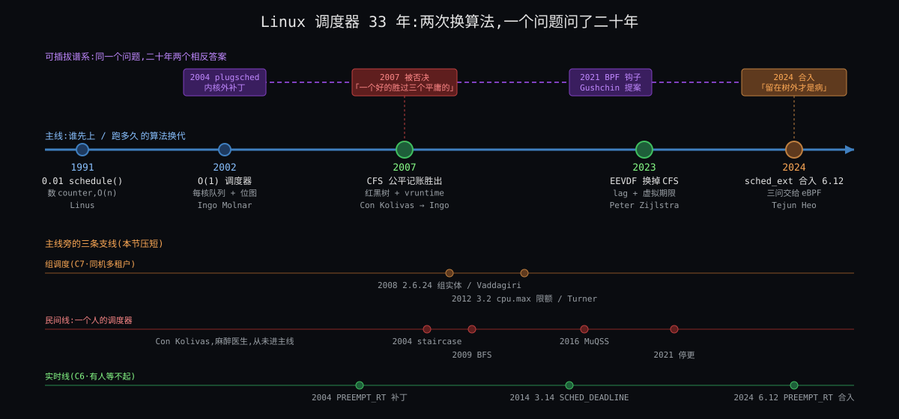

从图上能读出五件事:

1. **主线只换了三次**(2002 / 2007 / 2023),每次换的是"挑人规则"本身;其余十几年全是旁线往同一套规则上加东西。
2. **学术线比内核早 28 年**:1994 年 lottery / stride,1995 年 EEVDF,1996 年修订版;内核 2007 年先采用了"公平"这一半,2023 年才采用"资格 + 截止期"那一半。
3. **每个转折点旁边标的约束不同**:2002 是 C4·挑人须便宜 + C5·核各自为政,2007 是 C2·未来不可知,2023 是 C3·份额与延迟两头要;2011 的带宽和 2010 的 autogroup 是 C6·份额按组算,2012 的 PELT 和 2019 的 EAS 是 C8·核不等速且耗电,2013 的 NUMA 是 C5·核各自为政。你的四问骨架在历史上是**一问一问被补上**的。
4. **人物各有一封信**:Ingo 2002-01-04 的设计邮件、Con 2007-03-04 的 RSDL 公告、Ingo 2007-04-13 的 CFS 公告、Linus 2010-11-15 的"真正的改进"、Paul Turner 2010-02-12 的带宽 RFC、Peter 2023-03-06 的"地窖"、Tejun 2022-11-30 的 RFC 和 Linus 2024-06-11 的裁决。
5. **2024 年的 sched_ext 不在主线上,但它改变了主线的意义**:挑人规则从"内核定一个"变成"可替换",C2·未来不可知 / C3·份额与延迟两头要 的取舍第一次可以按负载分别选。

---

## §2 序章:1974 ~ 2001,先来先跑之后的第一代"猜"

**先说结论**:Unix 血统的调度器三十年里都是同一个形状 —— 一个优先级数字,由"最近用了多少 CPU"衰减算出,用得多的优先级降、睡得久的升。这就是 Why 第二刀说的"猜意图的启发式"的祖先;它一直活到 Linux 2.6 的 O(1)。

**Unix V7(1979)**。贝尔实验室第七版的 `slp.c` 里,`setpri()` 只有两行:优先级 = 最近 CPU 用量 ÷ 16 + 用户基准 + nice([一手 1]):

```c
p = (pp->p_cpu & 0377)/16;
p += PUSER + pp->p_nice - NZERO;
```

`p_cpu` 每个 tick 加一、每秒衰减,所以算得越多优先级数字越大(越差)。整个"交互优先"的思想只有这一个减法。

**4.3BSD(1986)**。Berkeley 的 `kern_synch.c`(文件头 `7.1 (Berkeley) 6/5/86`)把衰减做精了:`schedcpu()` 注释写着"每秒重算一次进程优先级"(*Recompute process priorities, once a second*),衰减因子按负载走 —— "数字衰减,在 5 × loadav 秒内忘掉 90% 的用量"(*fraction for digital decay to forget 90% of usage in 5*loadav sec*);同优先级之间"每 100 ms 强制轮转"(*Force switch among equal priority processes every 100ms*)([一手 2])。C1·只在打断点换 的 tick 和 C2·未来不可知 的"按过去推"都在这里成形,但"公平"还不是一个被定义的量 —— 它只是衰减公式的副产品。

**Linux 0.01(1991)**。Linus 的第一版 `schedule()` 把 Unix 的衰减换成一个更直白的东西:每个任务一个 `counter`,挑 `counter` 最大的跑;全为零时所有人 `counter = counter/2 + priority` 重发([一手 3]):

```c
if ((*p)->state == TASK_RUNNING && (*p)->counter > c)
        c = (*p)->counter, next = i;
...
(*p)->counter = ((*p)->counter >> 1) + (*p)->priority;
```

睡着的任务 `counter` 不被消耗、重发时还能留一半 —— 这就是"睡得多的先跑"的最简实现。注释里 Linus 写的是"这是好代码!"(*This is GOOD CODE!*)。

**Linux 2.4(2001)**。十年后这段代码长成了 `goodness()`:权重 = 剩余 `counter`,同 CPU 加一大块(cache 亲和),同地址空间加 1,再加 `20 − nice`;实时任务直接 1000 + 优先级([一手 4])。`schedule()` 对就绪队列里每个任务算一次 `goodness()` 取最大,整个过程持一把全局 `runqueue_lock`。文件注释老实写着:这把锁"锁住真正访问和修改就绪队列的部分,并且必须是中断安全的"。任务上千、核上八,它在 tick 里扫一遍、所有核等一把锁 —— C4·挑人须便宜 和 C5·核各自为政 同时报警。这就是 2002 年那封信的起点。

---

## §3 转折一:Ingo Molnár 与 O(1)(2002)

**先说结论**:O(1) 解决了 C4·挑人须便宜 和 C5·核各自为政 —— 挑人常数时间、每核一把锁;它没解决 C2·未来不可知,反而把"猜交互性"做成了一套更大的启发式,5 年后被自己的作者推翻。

**烦躁**。Ingo Molnár(当时在 Red Hat,后来二十年的调度器维护者)2002 年 1 月 4 日给 LKML 写了一封长信,内核树后来把它编辑成 `Documentation/sched-design.txt`([一手 5])。信里把旧调度器的病说得很具体:"你是不是受够了重算循环时不时把 L1 cache 吹飞?是不是觉得可运行进程一多,goodness 循环就太慢了?"(*Are you tired of the recalculation loop blowing the L1 cache away every now and then? Do you think the goodness loop is taking a bit too long to finish if there are lots of runnable processes?*)。还有一个 8 路机器上才看得见的病:全局时间片重算要等**所有**核上的任务都用完片,"核越多,这个效应越糟"(*The more CPUs, the worse this effect.*)—— 这是 C5·核各自为政 第一次被一个具体症状逼出来。

**初试与成型**。设计三句话就说完了([一手 5]):

- "完全 O(1) 的调度。……这个新调度器不留活口:wakeup()、schedule()、时钟中断全是 O(1) 算法。没有重算循环,也没有 goodness 循环。"(*This new scheduler takes no prisoners ... There is no recalculation loop. There is no goodness loop either.*)
- "'完美的' SMP 可扩展性。新调度器里再没有那把'大'的 runqueue_lock 了 —— 全是每核的 runqueue 和锁"(*there is no 'big' runqueue_lock anymore - it's all per-CPU runqueues and locks*)。
- 核心结构:每核**两个**按优先级排的数组,一个 active 一个 expired;任务用完片就挪到 expired,active 空了就把两个指针一换;"有一个 64 位的位图缓存数组下标,找最高优先级任务只是两条 x86 BSFL 位搜索指令的事"。

三天后(1 月 7 日)的 -D0 版把实时优先级并进同一个位空间,他写道"它们都只是一种任务"(*It's all just one kind of task.*),位图 100 + 40 位 —— 这就是 140 级优先级的来历;同一封信给了数字:466 MHz Celeron 上一次上下文切换 1.57 μs([一手 6])。

**死胡同与遗憾**。O(1) 的"交互性"靠 `sleep_avg`:睡得多就加优先级奖励、给长片。Ingo 自己在设计文档里把 nice 19 任务描述成"从交互性角度看本质上就是 SCHED_IDLE"—— 规则已经在按"像不像交互程序"分配了。2002 ~ 2004 年 LKML 上的"交互性估计器"之争(Con Kolivas 的 O*int 系列补丁就是那时候开始的)全都在调这套启发式的参数;后来 CFS 的设计文档干脆列了针对它的攻击程序名:`fiftyp.c, thud.c, chew.c, ring-test.c, massive_intr.c`([一手 8])。这是 C2·未来不可知 的账 —— O(1) 为了 C4·挑人须便宜 / C5·核各自为政 欠下的。

---

## §4 转折二:Con Kolivas、staircase / RSDL / SD,与 CFS(2004 ~ 2007)

**先说结论**:2007 年换代换掉的不是数据结构,是**世界观**:从"猜谁是交互程序并奖励它"换成"不猜,严格按账分"。这个世界观是 Con Kolivas 用 RSDL / SD 先证明可行的,Ingo 用另一套实现(红黑树 + 纳秒)在两周内把它写成了 CFS。两人对"公平"的定义差一个词(算不算睡眠时间),这个词决定了后面 16 年的所有小启发式。

### §4.1 烦躁:一个麻醉医生的桌面

Con Kolivas 是墨尔本的麻醉科医生,业余维护 `-ck` 补丁集。2004 年 3 月 24 日他在 LKML 发出 staircase 调度器的第一版([一手 48]),2007 年 3 月 4 日发出 RSDL(Rotating Staircase DeadLine)公告,开头一句就把立场摆平:"一个无饥饿、严格公平、O(1) 可扩展的设计"(*A starvation free, strict fairness O(1) scalable design*),然后是对 O(1) 那套东西的否定:"没有交互性估计器,没有睡眠 / 运行测量,只有简单固定的记账"(*There is no interactivity estimator, no sleep/run measurements and only simple fixed accounting*),"这个设计完全不测量睡眠时间"(*This design does not measure sleep time at all*),目标是"不惜一切代价维持由 nice 决定的公平"([一手 9])。同一天他回邮件时说得更狠:"这个调度器的目的是不惜一切代价,在任何类型的负载下保持绝对公平"(*The purpose of this scheduler is at all costs to maintain absolute fairness no matter what type of load it is put under.*)([一手 10])。

这就是 Why 的 insight 1(记账不猜)第一次在内核社区被说出来 —— 由一个非职业内核开发者。

### §4.2 顿悟与成型:Ingo 的两周

2007 年 4 月 13 日,Ingo 发出 "[Announce] [patch] Modular Scheduler Core and Completely Fair Scheduler [CFS]"([一手 7])。第一句:"这个项目是 Linux 任务调度器的一次彻底重写"(*This project is a complete rewrite of the Linux task scheduler.*)。他把功劳记给 Con:"他用 RSDL/SD 证明了'公平调度'是可行的,而且能带来更好的桌面调度"(*he has proven via RSDL/SD that 'fair scheduling' is possible and that it results in better desktop scheduling*),但 CFS 走了另一条实现路:

- "CFS 使用纳秒粒度的记账,不依赖 jiffies 或任何 HZ 细节"(*CFS uses nanosecond granularity accounting and does not rely on any jiffies or other HZ detail*);
- "因此 CFS 没有'时间片'的概念,也没有任何启发式"(*the CFS scheduler has no notion of 'timeslices' and has no heuristics whatsoever*);
- 引入"调度类:一个可扩展的调度器模块层次"(*Scheduling Classes: an extensible hierarchy of scheduler modules*),`sched_fair.c` 实现"CFS 桌面调度器";
- 账面:核心调度器"缩小了 700 多行",整个补丁 18 个文件 +1454 / −1133。

调度类这一层就是 What 里六层类栈的出生点 —— C7·有人要硬保证 的"凌驾"结构从此有了固定形状。后来写进内核文档的那句总结也出自这里:"CFS 设计的 80% 可以用一句话概括:CFS 本质上是在真实硬件上模拟一颗'理想的、精确的多任务 CPU'"(*80% of CFS's design can be summed up in a single sentence: CFS basically models an "ideal, precise multi-tasking CPU" on real hardware.*)([一手 8])。

### §4.3 死胡同:"公平"的定义差一个词

Con 4 月 16 日在 CFS 线程里的回复把分歧钉住了:"Ingo 闪亮的新调度器是一个公平优先的虚拟截止期设计,它会随负载按比例变慢"(*Ingo's shiny new scheduler is a fairness-first virtual-deadline design which will have proportional slowdown with load.*),"我敢让任何人来说'随负载按比例变慢'是个 bug"(*I dare anyone to claim that proportional slowdown with load is a bug.*)([一手 11])。他说的是 SD 的立场:负载重了,所有人一起慢,这叫公平。

CFS 的"公平"不一样:它把睡眠时间也算进去 —— 睡着的任务 vruntime 不涨,醒来天然排前面,再加一个 `sleeper fairness` 补偿。kernelnewbies 的 2.6.23 发布说明(二手)把这句说得最直白:CFS 从 RSDL 拿了公平的思想,但"用了不同的公平定义,把睡眠时间算进去"([二手 15])。Con 7 月 28 日最后一封信也只剩这一句分歧:CFS 和 SD 行为上的任何差别,归根到底是各自怎么定义"公平"——"CFS 计入睡眠时间而 SD 不计"([一手 13])。

按本轮的约束表读这段争论:Con 守的是 C3·份额与延迟两头要 的**份额**一侧(绝对比例),Ingo 用睡眠时间偷偷照顾了 C3·份额与延迟两头要 的**延迟**一侧(睡醒的交互任务要能插队)。两人都对了一半,而且都没把"延迟"做成独立的旋钮 —— 这就是 16 年后 EEVDF 要补的。

### §4.4 成型与遗憾:2.6.23 与一个人的离开

CFS 进了 2007 年 10 月 9 日发布的 2.6.23([二手 15])。Con 在 7 月 24 日接受 APC 杂志采访宣布退出内核开发(采访原文我没拿到一手,见 §13);7 月 28 日他在 LKML 上澄清"因为选了 CFS 不选 SD 才退出"是误读,末尾一句"祝好运"(*Good luck.*)([一手 13])。同一天 Linus 的回信没谈算法,谈的是怎么合作:"你不能自顾自地在自己的私人世界里做事"(*You cannot just go off and do your own thing in your private world*),"小的、增量的改进要好合并得多"(*Small and incremental improvements are much easier to merge.*),"所以维护者不是'一切'。但他们很重要"(*So maintainers aren't "everything". But they are important.*)([一手 12])。广为流传的那句"认为 SD '完美'的人只是在无视现实"我只在二手转述里见到([二手 47]),不当一手用。

Con 2009 年回来了,带着 BFS,后来是 MuQSS。MuQSS 的设计文档开头一段就是他对这段历史的总结:目标是"不靠那些难以理解、无法建模和预测其效果、为一种负载调优就会严重伤害另一种负载的启发式和调节旋钮,达到出色的桌面交互性"(*without heuristics and tuning knobs that are difficult to understand, impossible to model and predict the effect of, and when tuned to one workload cause massive detriment to another*);而他给 MuQSS 的定性是"松散地基于 EEVDF(最早合格虚拟截止期优先)和我之前的 Staircase Deadline 调度器"(*loosely based on EEVDF ... and my previous Staircase Deadline scheduler*)([一手 16])。也就是说,2016 年的 Con 和 2023 年的 Peter 翻到了同一篇 1995 年的论文。

**遗憾**(CFS 留下的债):没有 deadline 维度,"延迟"只能靠睡醒补偿和 `sched_wakeup_granularity` 这类参数侧面表达;这些参数就是 2023 年 Peter 要删的"恶心的启发式代码"。

---

## §5 学术线:Waldspurger 1994 与 Stoica 1995

**先说结论**:内核 2023 年采用的每一个词 —— 权重、虚拟时间、eligible、虚拟截止期、lag 有界、O(log n) 增广树 —— 都在 1995 年 Old Dominion 大学的一份技术报告里;它比内核早 28 年,因为它解决的是 C3·份额与延迟两头要,而内核直到容器时代才真正被 C3·份额与延迟两头要 逼急。

### §5.1 1994:把"优先级"换成"份额"

Carl A. Waldspurger 和 William E. Weihl(MIT LCS)在 OSDI '94 上发表 lottery scheduling([一手 18])。论文开头先否定了 Unix 那一支:"优先级的分配和动态优先级调整方案常常是临时拼凑的"(*the assignment of priorities and dynamic priority adjustment schemes are often ad-hoc*),"即使是流行的基于优先级的 CPU 分配方案,比如衰减用量调度,也没有被很好地理解,尽管包括 Unix 在内的众多操作系统都在用它"(*Even popular priority-based schemes for CPU allocation such as decay-usage scheduling are poorly understood, despite the fact that they are employed by numerous operating systems, including Unix*)。替代品是**彩票**:资源权利表示为票,每次分配抽一张,长期按票数比例分;票可以"换币"(currency)—— 这是 C6·份额按组算 的最早数学形状(组是一种币,组内再分)。随机抽签的方差是它的缺点,Waldspurger 随后在 1995 年的 stride scheduling 里给了确定性版本(论文链接见 §13,我没拿到 PDF)。

### §5.2 1995:EEVDF

Ion Stoica 和 Hussein Abdel-Wahab 的 TR-95-22(1996 年 1 月 26 日修订版)摘要已经把 2023 年内核做的事全说了([一手 17]):

> 我们提出并分析一种新的时分资源按比例分配算法。……主要地,我们证明在稳态条件下,我们的算法保证一个客户在理想系统中应得的服务时间与它在真实系统中实际得到的服务时间之差,被一个时间量子 q 的大小所限制。……使用一种高效的增广二叉搜索树数据结构,我们把这些操作实现为 O(log n)。
> (*we show that in steady conditions our algorithm guarantees that the difference between the service time that a client should receive in the idealized system and the service time it actually receives in the real system is bounded by the size q of a time quantum ... By using an efficient augmented binary search tree data structure we implement these operations in O(log n)*)

正文里更关键的一句是作者自己划出的"独有特征":"虽然虚拟截止期的概念其他按比例分配算法也用,**合格时间(eligible time)的概念是我们算法独有的特征**(我们将证明它在提高分配精度上起决定性作用)"(*the concept of eligible time is a unique feature of our algorithm (which, as we will show, plays a decisive role in improving the allocation accuracy)*)。论文把每个客户的请求映射成一个虚拟合格时间和一个虚拟截止期,"当请求的虚拟合格时间小于等于当前虚拟时间时称该请求合格。算法简单地把下一个时间量子分给具有最早虚拟截止期的合格请求"—— 这就是 Why C3·份额与延迟两头要 的三个数:权重(份额)、截止期(延迟)、合格(lag 缝合)。

论文引言还预言了内核后来的痛点:实时调度器"为了满足强时间约束,强加严格的准入策略,使它们相当受限"(C7·有人要硬保证 的准入),而纯按比例分配的调度器"更灵活、过载时优雅退化"—— EEVDF 想做的是两者的统一。

### §5.3 为什么等了 28 年

三个原因,各对应一条约束:

| 原因 | 约束 | 说明 |
|---|---|---|
| 2007 年只需要"公平"那一半 | C2·未来不可知 | 桌面卡顿的病根是启发式被骗,把启发式删掉、按 vruntime 排序就治好了 90%;deadline / eligible 那一半没有对应的痛 |
| 增广树和 lag 的成本在当时不划算 | C4·挑人须便宜 | Peter 2023 年还在 cover letter 里说"我真的不喜欢双树,所以想动态地在增广树和非增广树之间切换"(*since I really dislike the dual tree, I also figured we could dynamically switch between an augmented tree and not*)([一手 33]);Peter 2008 年 3 月的 "fair-group: EEVDF scheduling" RFC 补丁也存在,但没进树(标题可查,正文我未读,见 §13) |
| 延迟需求直到混合负载才出现 | C3·份额与延迟两头要 | 容器里同机跑延迟敏感服务和批处理,2020 ~ 2022 年的 latency-nice 补丁想加第二个旋钮,才让"份额 ≠ 延迟"变成必须正面解决的题 |

---

## §6 转折三:Paul Turner、带宽控制与 PELT(2010 ~ 2013)

**先说结论**:这一段补的是 C6·份额按组算 和 C8·核不等速且耗电 —— "组"从一个可选功能变成账本的一层(2008 组调度、2010 autogroup),组能被封顶(2011 带宽控制),而封顶和均衡都需要一个"这个实体最近有多重"的数(2012 PELT)。主角是 Google 的 Paul Turner,三年四个系列。

### §6.1 2008 ~ 2010:组成为账本上的一行(C6·份额按组算 的份额一侧)

CFS 进树三个月后的 2.6.24(2008 年 1 月 24 日)带来了"公平组调度":按用户 id 或按 cgroup 把任务编组,每组一个 `cpu_shares`([二手 27]);LWN 当时记录补丁出自 Srivatsa Vaddagiri 等人([二手 28])。这就是 How 里 `task_group` 的出生 —— 组是和线程同形的一行账。

它真正出圈是 2010 年 11 月。Mike Galbraith 发了 "[RFC/RFT PATCH v3] sched: automated per tty task groups":每个终端会话自动成一组。Linus 11 月 15 日的回信([一手 29]):"我(非常高兴地)惊讶于这个补丁最后竟然这么小"(*I'm (very happily) surprised by just how small that patch really ends up being*),"也不侵入、不丑"(*it's not intrusive or ugly either*);他的测试是一边在浏览器里看邮件一边 `make -j64`,"这是一个对我非常有意义的测试用例……是一个巨大的改进"(*it is a huge improvement*);结论:"我认为这坚定地属于那种'真正的改进'补丁"(*I think this is firmly one of those "real improvement" patches*),组调度从"对某些服务器负载有用"变成"杀手级特性"(*that's a killer feature*)。补丁进了 2.6.38(2011 年 3 月 14 日),commit `5091faa449ee`,Acked-by 一栏同时有 Linus 和 Peter Zijlstra([一手 30][二手 31])。Why 第六刀的 `make -j64` 例子,就是 Linus 这封信。

### §6.2 2010 ~ 2012:封顶(C6·份额按组算 的上限一侧)

Paul Turner 2010 年 2 月 12 日发出 "[RFC PATCH v1 0/4] CFS Bandwidth Control"([一手 19])。他要解决的是 IBM 的 Bharata B Rao 更早提出的"CFS hard limits"同一个问题,但拒绝了复用实时类带宽代码的做法,理由是那条路"随核数增加或预留很小时扩展性不好"(*did not scale well with increasing number-of-cores or small reservations*)。接口就是今天的 `cpu.cfs_period_us` / `cpu.cfs_quota_us`,他强调的语义变化是"定义的带宽成为一个绝对量"(*the defined bandwidth becomes an absolute quantifier*)—— 份额是相对的,封顶是绝对的,这是 C6·份额按组算 两侧的分界。动机在 LWN 的转述里更直白:客户"只为一定量的 CPU 时间付了钱"([二手 22])。

从 v1 到 2011 年 6 月 21 日的 v7,一年半、七个版本;v7 的 cover letter 说这一轮"把注意力放在定时器、配额过期和回收路径上",补丁标题里有"throttle entities exceeding their allowed bandwidth"和"return unused runtime on voluntary sleep"([一手 20])—— 正是开场钩子一里"用完整组停"和 Deep 主线③要读的那几个函数。它进了 3.2(2012 年 1 月 4 日)([二手 21])。

**遗憾**:按周期发、用完整组停,带来周期末的停顿;这笔债要到 2021 年的 `cpu.max.burst`(5.14,已核 #44)才部分还上。

### §6.3 2012 ~ 2013:PELT 与 NUMA(C8·核不等速且耗电 与 C5·核各自为政 的估计量)

2012 年 8 月 23 日 Paul Turner 发出 "[patch 00/16] sched: per-entity load-tracking"([一手 23]):负载"按每个 sched_entity 跟踪"(*load-tracking on a per-sched_entity*),"自底向上的负载计算,实体把负载贡献给父亲"(*bottom-up load-computation in which entities contribute to their parents' load*),于是能"随实体一起正确地迁移负载"(*correctly migrate load with their accompanying entities*);信里说这套东西"在内部已经跑了一段时间"(*running this internally for some time now*)。y³² = 0.5、1024 μs 一个周期这些数字是 LWN 的转述([二手 24])。它进了 3.8(2013 年 2 月 18 日)。PELT 是 C8·核不等速且耗电 要求的"每个任务最近有多重"那个估计量 —— 没有它,后面的 EAS、schedutil、按算力均衡全无从谈起;它也让 C6·份额按组算 的组负载有了可累加的定义。

同一个 3.8 还进了 NUMA balancing 的"地基":2012 年 11 月 LWN 记录了三条竞争路线 —— Peter Zijlstra 的 sched/numa、Andrea Arcangeli 的 AutoNUMA、Mel Gorman 的 balancenuma([二手 26]);最后合并的是 Mel 的地基部分([二手 25])。这是 C5·核各自为政 在"核间有远近"那一层(跨 NUMA)的补丁;策略"搬页还是搬任务"至今仍是启发式。

**旁线一笔(C8·核不等速且耗电 的另一半)**:ARM 的 EAS(Energy Aware Scheduling)进了 5.0(2019 年 3 月 3 日),发布说明写它"让任务调度器做出能降低非对称 SMP 平台功耗的决策 —— 比如先把任务唤醒到更节能的 CPU 上",并说明它是"AOSP 通用内核里能耗感知调度的简化版"([二手 32]);内核 `Documentation/scheduler/sched-energy.rst` 是它的一手设计说明([一手 45])。

---

## §7 转折四:Peter Zijlstra 与 EEVDF(2023 ~ 2024)

**先说结论**:EEVDF 正面承认了 C3·份额与延迟两头要 —— 份额(权重)和延迟(slice)是两个旋钮,用 lag / eligible 缝合;它删掉了 CFS 十六年攒下的启发式,但"睡眠时 lag 怎么办"这一题直到 6.12 的 delayed dequeue 才收口,而且还在改。

**烦躁**。2020 ~ 2022 年社区在推 latency-nice:给 CFS 再加一个"延迟 nice"旋钮。Peter Zijlstra(Intel,调度器维护者)2023 年 3 月 6 日的 cover letter 第一句:"自从看了 latency-nice 补丁起,我就一直在想 EEVDF 会不会更合理"(*Ever since looking at the latency-nice patches, I've wondered if EEVDF would not make more sense*)([一手 33])。

**初试**。他没有重写,他**翻旧账**:"把 EEVDF 补丁从它们积了 13 年蛛网的黑暗地窖里搬回来"(*bring back the EEVDF patches from the dark crypts where they'd been gathering cobwebs for the past 13 odd years*)。(2008 年 3 月的 LKML 里确实有他署名的 "fair-group: EEVDF scheduling" RFC,见 §13。)动机写得很直:"如果我们能做成,就能删掉一大堆恶心的启发式代码"(*if we can pull this off we can delete a whole much of icky heuristics code*),"EEVDF 是一个比我们现在这套定义得好得多的策略"(*EEVDF is a much better defined policy than what we currently have*)。第一轮测试的结论也坦白:"有一堆赢和输,但没有任何迹象表明是彻底失败"(*there's a bunch of wins and losses, but nothing that indicates a total fail*),"一些 schbench 结果似乎表明 EEVDF 的调度比 CFS 一致得多"(*EEVDF schedules a lot more consistent than CFS*)。

**顿悟:接口是什么**。5 月 31 日的 v2(15 个补丁)([一手 34]):"大问题是要暴露什么额外的接口;有人反对 latency-nice 接口,'显然'的替代是直接把 slice 长度作为请求 / 提示暴露出去"(*the 'obvious' alternative is to directly expose the slice length as a request/hint*),"最后一个补丁用 sched_attr::sched_runtime 实现了这个替代,但未经测试"。补丁标题本身就是一张路线图:Add avg_vruntime → Remove START_DEBIT → Add lag based placement → Implement an EEVDF like policy → Commit to lag based placement → Use lag to simplify cross-runqueue placement → Commit to EEVDF → Rename min_granularity to base_slice。"删掉"的那些(START_DEBIT、睡醒补偿、唤醒粒度)就是 §4.4 说的债。

**成型**。核心 commit `147f3efaa241`("sched/fair: Implement an EEVDF-like scheduling policy",作者 Peter,提交者 Ingo,Link 指向 5 月 31 日那一版)([一手 35])的说明把 C3·份额与延迟两头要 写成了内核术语:CFS 是一个只有权重这一个旋钮的加权公平队列;加入延迟导向的参数后,WF2Q / EEVDF 式的设计更合适;EEVDF 在"欠服务"(eligible,树的左半边)的实体里按最早截止期挑;虚拟截止期 = 合格虚拟时间 + slice ÷ 权重,slice 越小截止期越早;tick 抢占在 slice 用完时发生,唤醒抢占由 deadline 驱动。它进了 6.6(2023 年 10 月 29 日)([二手 36])。

**未竟**。2024 年 4 月的 "[RFC][PATCH 00/10] sched/fair: Complete EEVDF" 和 7 月的 24 补丁版把两件事收口:`sched_attr::sched_runtime` 正式成为 slice 请求接口;以及 **delayed dequeue** —— 一个 lag 为负的任务去睡觉时不立刻出队,而是留在树上让 lag 随虚拟时间自然涨回零,防止"睡一下就把负 lag 洗掉"(LWN 的解释见[二手 38];内核文档的原话:当任务睡眠时"它留在就绪队列上但标记为 deferred dequeue,让其 lag 随 VRT 衰减"([一手 39]))。6.12(2024 年 11 月 17 日)的发布说明写"这个版本完成了向 EEVDF 的过渡"([二手 37])。上一轮你两次卡住的 lag 夹紧,就在这段历史的最末端 —— 它是整个 EEVDF 里**最新、最不稳定**的一块,卡住不奇怪。

**遗憾**:内核态什么时候能换人(C1·只在打断点换)被 EEVDF 推到台前 —— slice 更短、抢占更勤,内核态不可抢占的窗口就更显眼,6.13 的 lazy preemption(`PREEMPT_LAZY`)是这条线的下一步(待核 #45)。

---

## §8 转折五:Tejun Heo 与 sched_ext(2022 ~ 2024)

**先说结论**:sched_ext 不换规则,它让规则**可换**:挑人策略由 BPF 程序定义,内核只保底(watchdog、回退)。它是 C2·未来不可知 的另一种回答 —— 内核猜不准,那就让知道自己负载的人自己写。合并它的决定是 Linus 顶着维护者反对做出的。

**烦躁**。2022 年 11 月 30 日 Tejun Heo(Meta)发出 "[PATCHSET RFC] sched: Implement BPF extensible scheduler class",署名还有 David Vernet、Josh Don、Barret Rhoden([一手 40])。动机三段:实验与探索的便利、按应用定制、快速部署。他们把病根说成结构性的:"CFS 从根本上是被设计成一个通用调度器"(*CFS is fundamentally designed to be a general purpose scheduler*),改它既难又慢;同时坦白"在 Meta,我们还没有在任何生产负载上部署 sched_ext"(*At Meta, we have not yet deployed sched_ext on any production workloads*)。安全承诺是:"无论加载什么 BPF 调度器,sched_ext 都保证系统完整性"(*sched_ext guarantees system integrity no matter what BPF scheduler is loaded*)—— 可运行任务停滞过久就报错并回退到可信调度器。

**死胡同**。12 天后(12 月 12 日)Peter Zijlstra 的回复([一手 41]):"总之,我讨厌这一切。Linus 过去 NAK 过可加载调度器好几次,这就是同一件事再来一遍 —— 外加整个 BPF 那套东西的坏处"(*Anyway, I hate all of this. Linus NAK'ed loadable schedulers a number of times in the past and this is just that again -- with the extra downside of the whole BPF thing on top*),"你看起来要暴露一大堆我至今连 tracepoint 都拒绝给的东西"(*You look to be exposing a ton of stuff I've so far even refused tracepoints for*)。Tejun 同日回:"是的,整个 BPF 的东西正是让我觉得这事有意思的地方……BPF 确实让迭代和部署安全快速得多"(*BPF does make iteration and deployment drastically safer and faster*),"考虑到这段历史,我想有些决定得由 Linus 来做"(*Given the history, I suppose some of the decision is upto Linus.*)([一手 42])。此后 v2 ~ v6 一年半,维护者的立场没变(2024 年 5 月还因 cgroup 问题拒绝 v6,见[二手 44])。

**顿悟(不是技术的,是治理的)**。2024 年 6 月 11 日,Linus 在 v6 线程里回复 Tejun([一手 43]):"我真的看不出还有任何理由再拖"(*I honestly see no reason to delay this any more.*),"我目前的计划是在 6.11 合并它"(*my current plan is to merge this for 6.11.*)。理由不是算法:"我从来不太相信用树外的代码能让每个人都满意"(*I've never been a huge believer in trying to make everybody happy with code that is out of tree*),"我们在树内一起做它会更好"(*we're better off working together on it in-tree.*),"对此有顾虑的人可以在它进树之后再处理那些顾虑"(*the people who have concerns about this can work on those concerns when it's in-tree.*);对"BPF 调度器会让人不再参与调度器开发"的担心,他的回答是"让人不参与的主要原因是参与门槛太高"(*the main thing that keeps people from participating is too high barriers to participation.*)。最后一句:"下一个合并窗口直接给我发 pull request"。

**成型**。6.11 窗口没赶上(二手[44]),6.12(2024 年 11 月 17 日)进树,发布说明写它是"一个能用 BPF 编写任务调度算法的特性"([二手 37]);内核文档的定义是"一个行为由一组 BPF 程序 —— BPF 调度器 —— 定义的调度类",并承诺"默认调度行为在检测到错误、可运行任务停滞或按下 SysRq-S 时随时恢复"([一手 45])。在 What 的类栈里它排在 fair 之下、idle 之上。

**对你的问题意味着什么**。你问"内核凭什么规则挑下一个"—— 到 6.12 为止,答案第一次变成"看谁加载了什么":Valve 给 Steam Deck 写游戏优先的调度器,Meta 给自己的服务写延迟优先的。C2·未来不可知 / C3·份额与延迟两头要 的取舍不再由内核替所有人做一次,而是按负载分别做。内核保留的只有 C1·只在打断点换(换人的动作和打断点)和 C7·有人要硬保证 的阀(watchdog、回退)。

---

## §9 反事实推演:如果 2008 年 Peter 的 EEVDF 就进了树

**问题来源**。Peter 2023 年说那些补丁"积了 13 年蛛网",LKML 2008 年 3 月的归档里也确实有 "[RFC/PATCH 15/17] sched: fair-group: EEVDF scheduling"。那时 CFS 刚进树五个月。如果它当时合并,后面会怎样?

**分岔点**。按八条约束逐条看 2008 年的权重:

| 约束 | 2008 年的权重 | 对 EEVDF 的影响 |
|---|---|---|
| C2·未来不可知 | 刚被 CFS 解决,社区的痛点已平 | 没有新的痛逼人换 |
| C3·份额与延迟两头要 | 延迟一侧没有独立需求:桌面靠"算睡眠时间"已经够好,服务器不在乎 | EEVDF 多出的 deadline 维度没有用户,也没有接口(sched_attr 的 slice 字段 2023 年才有) |
| C4·挑人须便宜 | 增广树 + lag 维护在当时的 CPU 上是可感知的开销,而且 CFS 的"最左节点"已经 O(1) | Peter 2023 年还在犹豫"双树" |
| C6·份额按组算 | 组调度 2.6.24 刚进,层级 EEVDF(他那个补丁的名字就是 fair-group)要在每一层维护 avg_vruntime | 复杂度加倍 |
| C8·核不等速且耗电 的 PELT | 不存在(2013 年才有) | 跨核放置没有可靠的负载量;2023 年的补丁 07 "用 lag 简化跨队列放置"依赖的是 2013 年之后的基础 |

**结果**。即使 2008 年合并,它也会是一个"更贵、多一个没人用的维度"的 CFS;延迟接口没有,组层级更重,跨核放置没有 PELT 可依。最可能的现实是像当年很多 RFC 一样被搁置 —— 事实上它就是被搁置了。EEVDF 2023 年能落地,需要三样东西同时到位:**一个真实的延迟需求**(容器混部 + latency-nice 争论,C3·份额与延迟两头要)、**便宜到可以不在乎的增广树**(C4·挑人须便宜 的预算在 15 年里涨了一个量级)、**一位把补丁留在抽屉里的维护者**。约束没变,权重变了;权重变了,同一份代码从"没必要"变成"必然"。

---

## §10 约束回扣

| 转折点 | 出生时面对的约束(权重高) | 当时不存在 / 权重低的约束 | 留下的债 |
|---|---|---|---|
| V7 / 4.3BSD 衰减优先级(1979 / 1986) | C1·只在打断点换(tick)、C2·未来不可知 的"按过去推" | C3·份额与延迟两头要(公平未被定义)、C4·挑人须便宜(进程几十个)、C5·核各自为政(单核) | "猜交互性"的世界观,活到 2007 |
| Linux 0.01 / 2.4 `counter` 与 `goodness`(1991 / 2001) | C1·只在打断点换、C2·未来不可知 | C4·挑人须便宜、C5·核各自为政(2.4 末期才爆) | O(n) 扫描 + 全局锁 |
| O(1),Ingo 2002 | **C4·挑人须便宜、C5·核各自为政** | C2·未来不可知 被更大的启发式顶着;C6·份额按组算 不存在 | `sleep_avg` 估计器,可被 `fiftyp.c` 骗 |
| RSDL / SD → CFS,Con / Ingo 2007 | **C2·未来不可知**;C7·有人要硬保证(调度类) | C3·份额与延迟两头要 的延迟一侧只靠"算睡眠时间"偷渡;C6·份额按组算 三个月后补 | 睡醒补偿、唤醒粒度等小启发式 |
| 组调度 / autogroup,2008 / 2010 | **C6·份额按组算**(份额一侧) | 封顶不存在 | `make -j64` 之外的组语义(用户 / 会话)靠约定 |
| 带宽控制,Paul Turner 2011 | **C6·份额按组算**(封顶一侧) | 周期末停顿的代价当时被接受 | throttling 抖动,2021 年 burst 才部分还 |
| PELT,Paul Turner 2012 | **C8·核不等速且耗电**(估计量)、C5·核各自为政(均衡输入) | 大小核尚未普及 | 32 ms 半衰期对突发反应慢 |
| NUMA balancing,2013 | **C5·核各自为政**(远近) | — | 搬页还是搬任务仍是启发式 |
| EAS,2019 | **C8·核不等速且耗电**(能耗) | — | 只对非对称平台有定义 |
| EEVDF,Peter 2023 | **C3·份额与延迟两头要**;C4·挑人须便宜 的预算已宽裕 | — | 睡眠时的 lag(delayed dequeue)仍在改;C1·只在打断点换 的内核态抢占被推到台前 |
| sched_ext,Tejun 2024 | **C2·未来不可知**(让知道负载的人自己定)、C7·有人要硬保证 的阀 | — | 规则可换之后,"正确"没有唯一答案 |

八条约束全部在表里出现过;C1·只在打断点换 从头到尾没有被任何一代"解决",它只是不断被更短的 slice 逼得更显眼。

---

## §11 呼应你的问题

你问题的第二段 —— "被哪些约束逼出来、为什么 20 年里换了三代" —— 到这里闭环:

- 2002 换代是 C4·挑人须便宜 + C5·核各自为政 的权重上升(任务上千、核上八),代价是把 C2·未来不可知 的启发式做大;
- 2007 换代是 C2·未来不可知 的账到期(启发式被骗、调不平),Con 证明"不猜也行",Ingo 用红黑树写成,代价是把 C3·份额与延迟两头要 的延迟一侧藏在"算睡眠时间"里;
- 2023 换代是 C3·份额与延迟两头要 被正面承认(份额和延迟各一个旋钮,lag 缝合),代码来自 1995 年的论文和 2008 年的抽屉。

第一段"按什么规则挑"现在多了一层:规则不是一次想出来的,它的每个词都有出生年份 —— 权重(1994 的票)、虚拟时间(1995)、eligible(1995,论文作者自认的独有特征)、红黑树(2007)、avg_vruntime(2023)、delayed dequeue(2024)。第三段"多核和 cgroup"也各有出生证:每核队列(2002)、组(2008 / 2010)、封顶(2011)、负载估计(2012)、远近(2013)。

还没闭环的留给下一份:规则的每个词**在 6.12 的代码里长什么样、数字是多少**(lag 夹在几个 slice 内、deadline 怎么算、均衡多久看一次、配额怎么按核切)。Origin 讲清了"为什么是这些词",Deep 要把它们钉到行号。

一句话带走:**三代换代各改写一条约束的权重 —— C4·挑人须便宜 / C5·核各自为政、C2·未来不可知、C3·份额与延迟两头要;旁线各补一条 —— C6·份额按组算、C8·核不等速且耗电、C5·核各自为政;sched_ext 让 C2·未来不可知 / C3·份额与延迟两头要 的取舍从内核的一次决定变成每个负载的决定。**

---

## §12 一手资料引用列表

编号与正文 `[一手 n]` 对应;标「二手」的为转述。

1. Unix V7,`usr/sys/sys/slp.c`,`setpri()`,1979。https://www.tuhs.org/cgi-bin/utree.pl?file=V7/usr/sys/sys/slp.c
2. 4.3BSD,`usr/src/sys/sys/kern_synch.c`(`7.1 (Berkeley) 6/5/86`),`schedcpu()` / `roundrobin()` 注释。https://www.tuhs.org/cgi-bin/utree.pl?file=4.3BSD/usr/src/sys/sys/kern_synch.c
3. Linus Torvalds,Linux 0.01 `kernel/sched.c`,`schedule()`,1991(kernel.org 历史版本的 GitHub 镜像)。https://raw.githubusercontent.com/zavg/linux-0.01/master/kernel/sched.c
4. Linux 2.4.31 `kernel/sched.c`,`goodness()` 与 `runqueue_lock` 注释。https://elixir.bootlin.com/linux/2.4.31/source/kernel/sched.c
5. Ingo Molnár,"Goals, Design and Implementation of the new ultra-scalable O(1) scheduler",2002-01-04 的 LKML 邮件编辑版,`Documentation/sched-design.txt`(2.6.12 树)。https://raw.githubusercontent.com/torvalds/linux/v2.6.12/Documentation/sched-design.txt
6. Ingo Molnár,"[patch] O(1) scheduler, -D0, 2.5.2-pre9, 2.4.17",LKML 2002-01-07(镜像)。https://ratatoskr.run/lkml/2002/01/433127
7. Ingo Molnár,"[Announce] [patch] Modular Scheduler Core and Completely Fair Scheduler [CFS]",LKML 2007-04-13。https://lkml.iu.edu/hypermail/linux/kernel/0704.1/2138.html
8. Linux 6.12,`Documentation/scheduler/sched-design-CFS.rst`。https://raw.githubusercontent.com/torvalds/linux/v6.12/Documentation/scheduler/sched-design-CFS.rst
9. Con Kolivas,"[ANNOUNCE] RSDL completely fair starvation free interactive cpu scheduler",LKML 2007-03-04(LWN 镜像原文)。https://lwn.net/Articles/224654/
10. Con Kolivas,同线程回复,2007-03-04。https://lkml.iu.edu/hypermail/linux/kernel/0703.0/1284.html
11. Con Kolivas,"Re: [Announce] [patch] Modular Scheduler Core and Completely Fair Scheduler [CFS]",LKML 2007-04-15/16。https://lkml.iu.edu/hypermail/linux/kernel/0704.1/2605.html
12. Linus Torvalds,"Re: [ck] Re: Linus 2.6.23-rc1",LKML 2007-07-28。https://lkml.iu.edu/hypermail/linux/kernel/0707.3/2166.html
13. Con Kolivas,"Re: [ck] Re: Linus 2.6.23-rc1",LKML 2007-07-28。https://lkml.iu.edu/hypermail/linux/kernel/0707.3/2200.html
14. (二手)Ashton Mills,"Why I quit: kernel developer Con Kolivas",APC Magazine,2007-07-24;原文未取得,见 §13。OSNews 转载页:https://www.osnews.com/story/18321/why-i-quit-kernel-developer-con-kolivas/
15. (二手)kernelnewbies,Linux 2.6.23 发布说明(2007-10-09),"The CFS process scheduler"。https://kernelnewbies.org/Linux_2_6_23
16. Con Kolivas,"MuQSS - The Multiple Queue Skiplist Scheduler",设计文档。http://ck.kolivas.org/patches/muqss/sched-MuQSS.txt
17. Ion Stoica、Hussein Abdel-Wahab,"Earliest Eligible Virtual Deadline First: A Flexible and Accurate Mechanism for Proportional Share Resource Allocation",Old Dominion University TR-95-22,1995(1996-01-26 修订)。https://people.eecs.berkeley.edu/~istoica/papers/eevdf-tr-95.pdf
18. Carl A. Waldspurger、William E. Weihl,"Lottery Scheduling: Flexible Proportional-Share Resource Management",OSDI 1994。https://www.usenix.org/legacy/publications/library/proceedings/osdi/full_papers/waldspurger.pdf
19. Paul Turner,"[RFC PATCH v1 0/4] CFS Bandwidth Control",LKML 2010-02-12。https://lkml.rescloud.iu.edu/1002.1/02055.html
20. Paul Turner,"[patch 00/16] CFS Bandwidth Control v7",LKML 2011-06-21。https://lkml.iu.edu/hypermail/linux/kernel/1106.2/02249.html
21. (二手)kernelnewbies,Linux 3.2 发布说明(2012-01-04)。https://kernelnewbies.org/Linux_3.2
22. (二手)Jonathan Corbet,"CFS bandwidth control",LWN 2011-02-16。https://lwn.net/Articles/428230/
23. Paul Turner,"[patch 00/16] sched: per-entity load-tracking",LKML 2012-08-23(LWN 镜像原文)。https://lwn.net/Articles/513135/
24. (二手)Jonathan Corbet,"Per-entity load tracking",LWN 2013-01-09。https://lwn.net/Articles/531853/
25. (二手)kernelnewbies,Linux 3.8 发布说明(2013-02-18)。https://kernelnewbies.org/Linux_3.8
26. (二手)Jonathan Corbet,"NUMA in a hurry",LWN 2012-11-14。https://lwn.net/Articles/524977/
27. (二手)kernelnewbies,Linux 2.6.24 发布说明(2008-01-24),"Fair Group Scheduling"。https://kernelnewbies.org/Linux_2_6_24
28. (二手)Jonathan Corbet,"CFS group scheduling",LWN 2007-07-02。https://lwn.net/Articles/240474/
29. Linus Torvalds,"Re: [RFC/RFT PATCH v3] sched: automated per tty task groups",LKML 2010-11-15。https://marc.info/?l=linux-kernel&m=128979084506774
30. Mike Galbraith,commit `5091faa449ee` "sched: Add 'autogroup' scheduling feature: automated per session task groups"(Acked-by Linus Torvalds、Peter Zijlstra)。https://github.com/torvalds/linux/commit/5091faa449ee0b7d73bc296a93bca9540fc51d0a
31. (二手)kernelnewbies,Linux 2.6.38 发布说明(2011-03-14)。https://kernelnewbies.org/Linux_2_6_38
32. (二手)kernelnewbies,Linux 5.0 发布说明(2019-03-03),"Energy-aware Scheduling for Arm big.LITTLE"。https://kernelnewbies.org/Linux_5.0
33. Peter Zijlstra,"[PATCH 00/10] sched: EEVDF using latency-nice",LKML 2023-03-06。https://lkml.iu.edu/hypermail/linux/kernel/2303.0/05235.html
34. Peter Zijlstra,"[PATCH 00/15] sched: EEVDF and latency-nice and/or slice-attr",LKML 2023-05-31(lore 镜像)。https://yhbt.net/lore/all/699cc8b1-f341-4af7-9c47-fee961c5c4b7@bytedance.com/T/
35. Peter Zijlstra,commit `147f3efaa241` "sched/fair: Implement an EEVDF-like scheduling policy"(Link: lore 20230531124603.931005524@infradead.org)。https://github.com/torvalds/linux/commit/147f3efaa24182a21706bca15eab2f3f4630b5fe
36. (二手)kernelnewbies,Linux 6.6 发布说明(2023-10-29),"New task scheduler: EEVDF"。https://kernelnewbies.org/Linux_6.6
37. (二手)kernelnewbies,Linux 6.12 发布说明(2024-11-17)。https://kernelnewbies.org/Linux_6.12
38. (二手)Jonathan Corbet,"Completing the EEVDF scheduler",LWN 2024-04-11。https://lwn.net/Articles/969062/
39. Linux 6.12,`Documentation/scheduler/sched-eevdf.rst`。https://raw.githubusercontent.com/torvalds/linux/v6.12/Documentation/scheduler/sched-eevdf.rst
40. Tejun Heo(与 David Vernet、Josh Don、Barret Rhoden),"[PATCHSET RFC] sched: Implement BPF extensible scheduler class",LKML 2022-11-30。https://lkml.indiana.edu/hypermail/linux/kernel/2211.3/06291.html
41. Peter Zijlstra,"Re: [PATCHSET RFC] sched: Implement BPF extensible scheduler class",LKML 2022-12-12。https://lkml.iu.edu/hypermail/linux/kernel/2212.1/03006.html
42. Tejun Heo,同线程回复,LKML 2022-12-12。https://lkml.iu.edu/hypermail/linux/kernel/2212.1/03465.html
43. Linus Torvalds,"Re: [PATCHSET v6] sched: Implement BPF extensible scheduler class",LKML 2024-06-11(LWN 邮件镜像)。https://lwn.net/ml/all/CAHk-=wg8APE61e5Ddq5mwH55Eh0ZLDV4Tr+c6_gFS7g2AxnuHQ@mail.gmail.com/
44. (二手)Jonathan Corbet,"Extensible scheduler class to be merged for 6.11",LWN 2024-06-11,https://lwn.net/Articles/978007/;"Another push for sched_ext",LWN 2024-05,https://lwn.net/Articles/972710/;Phoronix,"Linus Torvalds Doesn't Merge sched_ext For The Linux 6.11 Merge Window",https://www.phoronix.com/news/Linux-6.11-No-sched_ext
45. Linux 6.12,`Documentation/scheduler/sched-ext.rst` 与 `Documentation/scheduler/sched-energy.rst`。https://raw.githubusercontent.com/torvalds/linux/v6.12/Documentation/scheduler/sched-ext.rst
46. (二手)Jonathan Corbet,"The extensible scheduler class",LWN 2023-02-10。https://lwn.net/Articles/922405/
47. (二手)OSNews,"Linus On CFS vs. SD",2007-07-28(转述 kerneltrap 已失效页面)。https://www.osnews.com/story/18350/linus-on-cfs-vs-sd/
48. Con Kolivas,"[PATCH]Staircase scheduler - experimental",LKML 2004-03-24(对 2.6.4 / 2.6.5-rc2-mm2)。https://lkml.iu.edu/hypermail/linux/kernel/0403.3/0205.html(收尾核实补入)
49. Linus Torvalds,"Re: Linus 2.6.23-rc1",LKML 2007-07-27 22:36 EST("People who think SD was 'perfect' were simply ignoring reality")。https://lkml.iu.edu/hypermail/linux/kernel/0707.3/2012.html(收尾核实补入;原 §13 二手项升为一手)
50. Peter Zijlstra,"[RFC/PATCH 15/17] sched: fair-group: EEVDF scheduling",LKML 2008-03-09(正文:"we use the EDF result if its eligible to run (has >= 0 lag)",双树实现)。https://lkml.iu.edu/hypermail/linux/kernel/0803.1/0278.html(收尾核实已读正文)
51. Linus Torvalds,合并提交 "Merge tag 'sched_ext-for-6.12'",`88264981f208`,2024-09-21。https://github.com/torvalds/linux/commit/88264981f2082248e892a706b2c5004650faac54(收尾核实补入)
52. Ingo Molnar,"sched: cfs core, kernel/sched_fair.c",提交 `bf0f6f24a1ec`,2007-07-09。https://github.com/torvalds/linux/commit/bf0f6f24a1ece8988b243aefe84ee613099a9245(收尾核实补入)

---

## §13 无一手资料的部分

| 内容 | 现状 | 可信度 |
|---|---|---|
| Con Kolivas 的 APC 采访原文(2007-07-24,"Why I quit") | 原页仍不可达;收尾核实从 LWN 2007-07-24 与 OSNews 2007-07-24 的转载片段核到两句原话:"the complete disconnection of the development process from normal users"、"so many subsystems being repeatedly rewritten that there was never-ending breakage" | 部分核实;正文仍只用"宣布退出"这一事实 |
| Linus "People who think SD was 'perfect' were simply ignoring reality" | **收尾核实已找到一手**:Linus 本人 2007-07-27 22:36 EST "Re: Linus 2.6.23-rc1"(hypermail 0707.3/2012.html),已列入 §12 第 49 条 | 一手 |
| Peter Zijlstra 2008-03 "[RFC/PATCH 15/17] sched: fair-group: EEVDF scheduling" | **收尾核实已读正文**(2008-03-09):资格判定 "has >= 0 lag" + 最早虚拟截止期,否则回退最小 vruntime;双树(timeline + deadline)实现;与 2023 同源、实现不同(§12 第 50 条) | 一手 |
| Waldspurger 1995 stride scheduling 技术报告(MIT TM-528) | 个人站 PDF 链接 404 | 只在 §5.1 提一句 |
| Ingo 2002-01-04 的原始 LKML 邮件 | 用的是内核树里的编辑版(§12 第 5 条自述"edited version of an email Ingo Molnar sent to lkml on 4 Jan 2002") | 一手但经编辑 |
| Ken Thompson 1978 "UNIX Implementation"(BSTJ)关于调度的原话 | TUHS 的 PDF 是扫描件,文本层为空 | 改用 V7 源码本身(§12 第 1 条) |
| Con 2004 staircase 的原始公告 | **收尾核实已找到**:2004-03-24 "[PATCH]Staircase scheduler - experimental"(§12 第 48 条) | 一手 |
| sched_ext 合并进 6.12 的具体合并提交与日期 | **收尾核实已找到**:`88264981f208`,2024-09-21(§12 第 51 条) | 一手 |
| 2.6.24 组调度作者 Srivatsa Vaddagiri | LWN 转述 | 二手 |
| `cpu.max.burst` 进 5.14(2021) | 收尾核实:v5.14 `kernel/sched/sched.h` 新增 `cfs_bandwidth.burst`,v5.13 无 | 已核 #44 |
| `PREEMPT_LAZY` 进 6.13 | 收尾核实:v6.13 `kernel/Kconfig.preempt` 新增 `config PREEMPT_LAZY`,v6.12 无 | 已核 #45 |

---

## 待核

| # | 事项 | 结论(收尾核实 2026-11-03) |
|---|---|---|
| #40 | Con Kolivas 的 staircase 首发年份 2004 | **已核** —— 首帖 "[PATCH]Staircase scheduler - experimental",2004-03-24,对 2.6.4 / 2.6.5-rc2-mm2;LWN 2004-06-02 报道为后续版本(出处:https://lkml.iu.edu/hypermail/linux/kernel/0403.3/0205.html ;https://lwn.net/Articles/87729/) |
| #41 | Ingo 2002 O(1) 第一版公告的确切日期(sched-design.txt 自述 2002-01-04;ratatoskr 上 -A1 也是 1 月 4 日) | **已核** —— "[announce] [patch] ultra-scalable O(1) SMP and UP scheduler",2002-01-03 21:19 EST(欧洲时间 1 月 4 日),对 2.5.2-pre6 并附 2.4.17 版(出处:https://lkml.iu.edu/hypermail/linux/kernel/0201.0/0810.html) |
| #42 | CFS 从公告(2007-04-13)到进 2.6.23 合并窗口的具体合并提交 | **已核** —— `bf0f6f24a1ec` "sched: cfs core, kernel/sched_fair.c",作者 Ingo Molnar,2007-07-09;进入 2.6.23-rc1 合并窗口(出处:https://github.com/torvalds/linux/commit/bf0f6f24a1ece8988b243aefe84ee613099a9245) |
| #43 | Peter 2008-03 fair-group EEVDF RFC 的内容是否与 2023 补丁同源 | **已核** —— 正文已读:"s1) we use the EDF result if its eligible to run (has >= 0 lag)",否则回退最小 vruntime;双树(timeline + deadline)、`vperiod`、用 `avg_vruntime()` 判资格;与 2023 同源(资格 + 虚拟截止期),实现不同(2023 改单树增广)(出处:https://lkml.iu.edu/hypermail/linux/kernel/0803.1/0278.html(2008-03-09)) |
| #44 | `cpu.max.burst` 合入版本 5.14(2021) | **已核** —— 同 How #20(出处:https://raw.githubusercontent.com/torvalds/linux/v5.14/kernel/sched/sched.h) |
| #45 | `PREEMPT_LAZY` 合入版本 6.13(2024-2025) | **已核** —— 同 How #16(出处:https://raw.githubusercontent.com/torvalds/linux/v6.13/kernel/Kconfig.preempt) |
| #46 | sched_ext 合并提交日期(6.12 合并窗口,2024-09) | **已核** —— `88264981f208` "Merge tag 'sched_ext-for-6.12'",Linus Torvalds,2024-09-21 16:44:57 UTC(出处:https://github.com/torvalds/linux/commit/88264981f2082248e892a706b2c5004650faac54(GitHub API)) |
| #47 | 4.3BSD `kern_synch.c` 的 `7.1 (Berkeley) 6/5/86` 是否即 4.3BSD 发布版本(4.3BSD 发布于 1986-06) | **部分核实** —— 4.3BSD 发布于 1986 年 6 月,与文件头日期吻合;版本号 7.1 的对应关系未独立核(出处:https://en.wikipedia.org/wiki/Berkeley_Software_Distribution) |
| #48 | EEVDF 论文 TR-95-22 的原始发表时间(1995)vs 修订版(1996-01-26) | **部分核实** —— PDF 首页:TR-95-22,作者 Stoica、Abdel-Wahab(ODU),末注 "Revised January 26, 1996";1995 由报告号推定,首页无原发日期(出处:https://people.eecs.berkeley.edu/~istoica/papers/eevdf-tr-95.pdf) |
| #49 | Linus 2007-07-28 "ignoring reality" 一句的原始出处 | **已核** —— Linus 本人邮件 "Re: Linus 2.6.23-rc1",2007-07-27 22:36 EST:"People who think SD was 'perfect' were simply ignoring reality. Sadly, that seemed to include Con too…";Kasper Sandberg 2007-07-28 回复(2071.html)亦引用(出处:https://lkml.iu.edu/hypermail/linux/kernel/0707.3/2012.html) |

---

---

> **🔄 心智切换:讲故事的人 → 工程师(工程师模式)**
>
> 五个转折点解释了形状从哪来。但形状落到 Linux 6.12 的源码里,是哪个函数、哪一行、按什么判据、花多少纳秒?下一篇换成工程师,把三条主线钉到源码上:EEVDF 挑人全程(lag 从零讲起,逐 tick 走表,并用一个可以在 macOS 上跑的模拟器核对手算)、多核的唤醒选核与周期均衡、cgroup 的层级份额与带宽 throttling。每条主线三层(操作层 / 函数逻辑层 / 底层原理层),贴 6.12 原文逐句注释,然后做反事实小试:如果不这样设计还能怎么做,各违反哪条约束。三个判据会在这一篇里浮出来:eligible 且 deadline 最早、有利可图且不热才搬、整组按周期借还。

---

<a id="stage-deep" name="stage-deep"></a>

# 📍 第五篇:Deep — 深度剖析

# 阶段 5:Linux 的进程调度器的深度剖析

> 上一份把四问落到了三件事(每核一本账 + 类栈 / 账上四个数 + 增广树 / 标记 + 三种搬人),并把 fair 账、多核、cgroup 带宽三块写厚。这一份不再解释"它是什么",只做三件事:**钉到行号**(Linux v6.12,`kernel/sched/fair.c` 为主,所有 `file:line` 都对 v6.12 原文 `grep -n` 过)、**算到数**(一个按 6.12 规则写的模拟器跑出 How §3.6 / §14 两个场景的逐拍表,输出原样贴在 §2.4 / §2.6)、**反事实**(每条主线 4 ~ 6 个候选,各违反哪条约束)。
>
> 三条主线:① EEVDF 挑人全程(含唯一的一条纳秒时间线)② 多核的唤醒选核与周期均衡 ③ cgroup 的层级份额与带宽。其余(rt / dl / 抢占模型 / sched_ext / EAS / core scheduling / NUMA / autogroup)在 §5 附录只给机制和行号。换人动作本身(`context_switch` 的 2 ~ 3 μs)沿用上一轮 Deep §3.3 的实测,不重做。
>
> 贯穿机器与任务同前:8 核 x86-64,两组 L3 各 4 核,SMT 关,3 GHz,`CONFIG_HZ = 250`,`base_slice` 3 ms;`mysqld` ×16(nice 0)、`redis-server`(nice −10)、`xz`(nice 19)、PostgreSQL 后端若干、k8s 容器 `cpu.max = 200000 100000`。

---

## §0 从 How 走到 Deep:三件事记住

上一份结尾说:三件事,四问各落其中。这一份把三件事再压成**三个判据** —— 每条主线各一个,每个判据能指到 `fair.c` 的一行。后面所有行号、数字、反事实都挂在这三个判据上。

### §0.1 判据①:eligible 且 deadline 最早,而且 lag 守恒 —— 从 C2·未来不可知 + C3·份额与延迟两头要 推出

因为 C2·未来不可知(依据只能是账)+ C3·份额与延迟两头要(三个数各管一头)→ 要解决"用一条规则把权重、slice、lag 合起来"→ 所以 **`pick_eevdf`(`fair.c:907`)**:在 `entity_eligible`(`:742`,即 V ≥ v_i)的实体里挑 deadline 最早的;`curr` 在 slice 保护期内(`vlag == deadline`,`:928`)优先。配套的另一半是 **`place_entity`(`:5266`)**:醒来放回时把 lag 按 (W + w)/W 放大,放回后 V 下移,lag 恰好不变 —— 没有这一半,"欠多少还多少"会在每次睡醒时蒸发一截(`:5290` 起 20 行注释里的推导)。

### §0.2 判据②:搬人只在"有利可图且不热"—— 从 C5·核各自为政 + C8·核不等速且耗电 推出

因为 C5·核各自为政(搬一次要付 cache 重填)+ C8·核不等速且耗电(比的是算力不是个数)→ 要解决"什么时候搬、搬谁"→ 所以两道门:**`calculate_imbalance`(`:11048`)** 只在最忙组比本组忙 `imbalance_pct`(`topology.c:1616`,117%)以上时算出一个差距,并只搬一半(`:11162` 的 `imbalance >>= 1`);**`task_hot`(`:9260`)** 把 `exec_start` 距今不足 `sysctl_sched_migration_cost`(`:79`,500 μs)的任务判为热,`can_migrate_task`(`:9365`)跳过它。两道门合起来就是"有利可图且不热"。

### §0.3 判据③:整组按周期借,借不到整组停 —— 从 C6·份额按组算 推出

因为 C6·份额按组算 的"要能封顶"→ 要解决"组的总用量不超过 X,但 16 颗核不能每微秒争一把全局锁"→ 所以 **`__assign_cfs_rq_runtime`(`:5772`)**:每颗核上这个组的 `cfs_rq` 一次向池借 `sched_cfs_bandwidth_slice()`(`:5736`,5 ms);借不到 → `resched_curr`(`:5826`)→ 出口 `put_prev_entity`(`:5638`)→ `check_cfs_rq_runtime`(`:6488`)→ **`throttle_cfs_rq`(`:5915`)** 把这颗核上的组实体从父树出队,组内线程整体消失;`sched_cfs_period_timer`(`:6518`)每周期补池再放回。

### §0 结论:三个判据对照

| 判据 | 是什么 | 为什么存在(约束) | 行 |
|---|---|---|---|
| ① eligible ∧ 最早 deadline,lag 守恒 | 挑人只看 V 和 deadline;放回时 lag 不蒸发 | C2·未来不可知、C3·份额与延迟两头要 | `fair.c:907`、`:5266` |
| ② 有利可图 ∧ 不热 | 差距过迟滞才搬,只搬一半;500 μs 内跑过的不搬 | C5·核各自为政、C8·核不等速且耗电 | `fair.c:11048`、`:9260` |
| ③ 按周期借,借不到整组停 | 每核借 5 ms 片;池空整组下树;定时器补池放回 | C6·份额按组算 | `fair.c:5772`、`:5915`、`:6518` |

**三个判据怎么串**:判据① 在每本账内部挑人;判据② 决定一个实体此刻在哪本账上;判据③ 决定一整组实体此刻在不在任何账上。一次 tick 三者都可能被触发:`sched_tick`(`core.c:5584`)→ `task_tick_fair`(`fair.c:13049`)→ `entity_tick`(`:5662`)→ `update_curr`(`:1216`)里同时做判据①的记账、判据③的扣账(`account_cfs_rq_runtime`,`:5830`);tick 尾部 `sched_balance_trigger`(`:12879`)抬软中断走判据②。

---

## §1 一张极简概览图

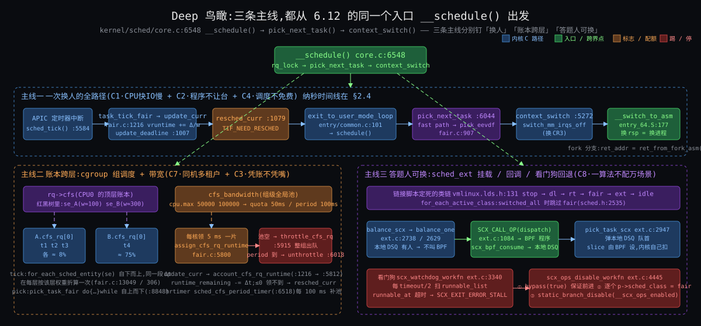

从图上能读出五件事:

1. **三列的顶端都是打断点**(tick / 唤醒 / 空闲 / 定时器),没有一条链是"调度器自己醒来"的 —— C1·只在打断点换 在行号层面的样子。
2. **主线① 两条入口(tick、唤醒)在 `exit_to_user_mode_loop`(`entry/common.c:101`)汇合**:tick 走 `update_deadline` → `resched_curr`,唤醒走 `place_entity` → `check_preempt_wakeup_fair`,两条都只打标记,真换人只有一个地方。
3. **主线② 的唤醒选核和周期均衡是两条独立的链**,只在最后一步(`attach_tasks` → `wakeup_preempt`)回到主线①。前者每次唤醒都走,后者几毫秒到一百毫秒一次。
4. **主线③ 的借和放在两个上下文里**:借在任务自己的 `update_curr` 里(持 `rq` 锁),放在 `hrtimer` 回调里(持 `cfs_b` 锁),所以远端核的放回必须异步(`unthrottle_cfs_rq_async`)。
5. **三个绿框都在 `fair.c`**,一个在 `:907` 附近、一个在 `:9260` / `:9365`、一个在 `:5772` / `:5915`;一万三千行里真正"做决定"的就这三处,其余是记账、分类、锁和统计。

---

## §2 主线①:EEVDF 挑人全程

**先说结论**:挑人规则只有 `pick_eevdf` 的 40 行;它依赖的四个数由 `update_curr`(涨 vruntime、推 deadline)、`place_entity`(放回、lag 守恒)、`update_entity_lag`(睡下、夹紧)三处维护;`check_preempt_wakeup_fair` 的全部内容是"放回之后再调一次 `pick_eevdf`"。模拟器按这几段代码复现了 How §3.6 的五拍表,数字对到小数点后两位;How §14 的"连跑约 64 ms"也复现了,但那一节里"mysqld 也有资格"这句不成立(§2.6)。

### §2.1 操作层:能碰的旋钮,在源码里落到哪一行

| 旋钮 | 源码落点 | 值 / 范围 |
|---|---|---|
| `nice` / `setpriority` | `set_user_nice` → `set_load_weight`(`core.c:1368`)查 `sched_prio_to_weight[40]`(`core.c:10012`)与 `sched_prio_to_wmult[40]`(`:10030`,2³² / w 的预乘倒数) | nice 0 = 1024;−10 = 9548;19 = 15 |
| `sched_setattr(.sched_runtime)` | `syscalls.c:307 ~ :311`:`se->custom_slice = 1; se->slice = clamp(runtime, 0.1 ms, 100 ms)` | 6.12 起对 `SCHED_NORMAL` 有效 |
| `SCHED_BATCH` / `SCHED_IDLE` | `check_preempt_wakeup_fair`(`fair.c:8821`)`!normal_policy(p->policy)` → 直接 return:**不抢别人**;`SCHED_IDLE` 还在 `task_hot` 里永远算冷(`:9269`) | — |
| `sched_yield` | `yield_task_fair`(`:9006`):`se->deadline += calc_delta_fair(se->slice, se)`(`:9032`)—— 只是把自己的 deadline 推后一个 slice,不改 vruntime | — |
| `/sys/kernel/debug/sched/base_slice_ns` | `debug.c:507` 挂的就是 `sysctl_sched_base_slice`(`fair.c:76`,750000)×(1 + ilog2(min(cpus, 8))) | 8 核 3 ms |
| `/sys/kernel/debug/sched/features` | `features.h`:`PLACE_LAG`(:7)`PLACE_DEADLINE_INITIAL`(:11)`PLACE_REL_DEADLINE`(:15)`RUN_TO_PARITY`(:20)`PREEMPT_SHORT`(:25)`DELAY_DEQUEUE`(:49)`DELAY_ZERO`(:50)`WAKEUP_PREEMPTION`(:55)`HRTICK`(:57,**关**) | 全部默认开,除 `HRTICK` / `NEXT_BUDDY` |
| `/proc/<pid>/sched` | `debug.c` `proc_sched_show_task`:`se.exec_start` / `se.vruntime` / `se.sum_exec_runtime` / `se.nr_migrations`(`:1178 ~ :1184`)、`nr_switches` / `nr_voluntary_switches` / `nr_involuntary_switches`(`:1240 ~ :1242`)、`se.load.weight`(`:1244`)、`se.avg.*`(`:1246 ~ :1252`)、`policy` / `prio`(`:1261 ~ :1262`);`/sys/kernel/debug/sched/debug` 里每核还打印 `se.deadline` / `se.slice`(`:744 ~ :748`) | — |

### §2.2 函数逻辑层:三条调用链与它们改的字段

```
tick:   sched_tick(core.c:5584) → task_tick_fair(fair.c:13049) → entity_tick(:5662) → update_curr(:1216)
            → update_deadline(:1007) 返回 true → resched_curr(core.c:1079)
唤醒:   try_to_wake_up(core.c:4127) → select_task_rq(:4266)… → ttwu_queue(:3943) → ttwu_do_activate(:3658)
            → enqueue_task_fair(fair.c:6955) → enqueue_entity(:5382) → place_entity(:5266) → __enqueue_entity(:852)
            → wakeup_preempt(core.c:2136) → check_preempt_wakeup_fair(fair.c:8764) → pick_eevdf(:907) → resched_curr
出口:   exit_to_user_mode_loop(entry/common.c:90) → schedule(core.c:6775) → __schedule(:6548) → pick_next_task(:6647)
            → __pick_next_task(:5952 快路径) → pick_next_task_fair → pick_task_fair(fair.c:8848) → pick_next_entity(:5613)
            → pick_eevdf(:907);put_prev_entity(:5638) / set_next_entity(:5560);context_switch(core.c:5272)
```

#### §2.2.1 记账:`update_curr` 与 `update_deadline`

```c
/* fair.c:1216 */
static void update_curr(struct cfs_rq *cfs_rq)
{
	struct sched_entity *curr = cfs_rq->curr;
	struct rq *rq = rq_of(cfs_rq);
	s64 delta_exec;
	bool resched;

	if (unlikely(!curr))
		return;

	delta_exec = update_curr_se(rq, curr);                 /* :1134  now − exec_start,exec_start = now */
	if (unlikely(delta_exec <= 0))
		return;

	curr->vruntime += calc_delta_fair(delta_exec, curr);   /* :289   delta × 1024 / weight */
	resched = update_deadline(cfs_rq, curr);               /* :1007  跑满 slice 才推 */
	update_min_vruntime(cfs_rq);                           /* :761   min_vruntime 只前进 */

	if (entity_is_task(curr)) {
		struct task_struct *p = task_of(curr);
		update_curr_task(p, delta_exec);                   /* :1157  cputime / cgroup 统计 / dl_server */
		if (p->dl_server != &rq->fair_server)
			dl_server_update(&rq->fair_server, delta_exec);  /* §5.2 fair_server */
	}

	account_cfs_rq_runtime(cfs_rq, delta_exec);            /* :5830  判据③ 扣本核小账 */

	if (cfs_rq->nr_running == 1)
		return;                                            /* 一个人时不打标记 */

	if (resched || did_preempt_short(cfs_rq, curr)) {      /* :1166 */
		resched_curr(rq);                                  /* core.c:1079 只打标记 */
		clear_buddies(cfs_rq, curr);
	}
}

/* fair.c:1007 */
static bool update_deadline(struct cfs_rq *cfs_rq, struct sched_entity *se)
{
	if ((s64)(se->vruntime - se->deadline) < 0)
		return false;                                      /* 还没跑满 slice:什么也不做 */
	if (!se->custom_slice)
		se->slice = sysctl_sched_base_slice;               /* 3 ms */
	se->deadline = se->vruntime + calc_delta_fair(se->slice, se);   /* vd_i = ve_i + r_i / w_i */
	return true;                                           /* 这次请求用完了,该换人 */
}
```

逐句要点:

- `delta_exec` 来自 `rq_clock_task`(扣掉了中断 / 窃取时间),所以网卡中断多的核上 mysqld 不会被多记账(How §2.3 逼问表最后一行)。
- `calc_delta_fair`(`:289`)对 nice 0 直接返回 `delta`;其他权重走 `__calc_delta`(`:259`):`delta × 1024 × inv_weight >> 32`,用 `sched_prio_to_wmult` 的预乘倒数把除法换成乘法 —— C4·挑人须便宜 的"记账 O(1)"落到的那一行。
- `update_deadline` **只在 `vruntime ≥ deadline` 时推一次**,推的量是 slice 按权重折算:redis 0.32 虚拟 ms,xz 204.8 虚拟 ms。返回 true 只表示"请求用完",`update_curr` 才决定打不打标记。
- `nr_running == 1` 直接 return:一个人跑时既不打标记也不做 `PREEMPT_SHORT` 判断。模拟器 `deep26` 场景里 A 独占那 20 ms 就是这条。

#### §2.2.2 V 与资格:两个累加器

```c
/* fair.c:620 / :630 / :640 */
static void avg_vruntime_add(struct cfs_rq *cfs_rq, struct sched_entity *se)
{
	unsigned long weight = scale_load_down(se->load.weight);
	s64 key = entity_key(cfs_rq, se);                      /* v_i − min_vruntime */
	cfs_rq->avg_vruntime += key * weight;
	cfs_rq->avg_load += weight;
}
static void avg_vruntime_sub(struct cfs_rq *cfs_rq, struct sched_entity *se)   /* 反向 */
{ /* … avg_vruntime -= key * weight; avg_load -= weight; … */ }
static inline void avg_vruntime_update(struct cfs_rq *cfs_rq, s64 delta)
{
	/* v' = v + d ==> avg_vruntime' = avg_runtime - d*avg_load */
	cfs_rq->avg_vruntime -= cfs_rq->avg_load * delta;      /* min_vruntime 前进 d 时的修正 */
}

/* fair.c:651 */
u64 avg_vruntime(struct cfs_rq *cfs_rq)
{
	struct sched_entity *curr = cfs_rq->curr;
	s64 avg = cfs_rq->avg_vruntime;
	long load = cfs_rq->avg_load;

	if (curr && curr->on_rq) {                             /* curr 不在树上,临时加进来 */
		unsigned long weight = scale_load_down(curr->load.weight);
		avg += entity_key(cfs_rq, curr) * weight;
		load += weight;
	}
	if (load) {
		/* sign flips effective floor / ceiling */
		if (avg < 0)
			avg -= (load - 1);                             /* 负数向下取整,保证 V 带"左偏" */
		avg = div_s64(avg, load);
	}
	return cfs_rq->min_vruntime + avg;
}

/* fair.c:726 */
static int vruntime_eligible(struct cfs_rq *cfs_rq, u64 vruntime)
{
	/* … 同样把 curr 加进 avg / load … */
	return avg >= (s64)(vruntime - cfs_rq->min_vruntime) * load;   /* V ≥ v_i,用乘法避免除法精度 */
}
```

逐句要点:

- 累加器存的是相对 `min_vruntime` 的差 × 权重,`:600` 起的注释推了为什么:`min_vruntime` 单调递增且紧贴任务的服务量,差值只在"量化误差"量级,实测乘积最大 44 位。
- `avg_vruntime()` 的"左偏"(`:650` 注释:`avg_vruntime() + 0` 必须使 `entity_eligible` 为真)是一个细节但重要:V 本身必须被判为 eligible,否则"所有人 lag 都略负"时谁也挑不出来。
- `vruntime_eligible` 不除法,比 `avg ≥ key × load`。模拟器照抄了这两段(含 curr 的临时加入),所以 §2.4 表里的 `lag` 列和内核算出来的符号一致。

#### §2.2.3 lag:睡下去夹紧,醒来守恒

```c
/* fair.c:692 */
static s64 entity_lag(u64 avruntime, struct sched_entity *se)
{
	s64 vlag, limit;
	vlag = avruntime - se->vruntime;                       /* V − v_i */
	limit = calc_delta_fair(max_t(u64, 2*se->slice, TICK_NSEC), se);   /* ±max(2·slice, 4 ms) 按权重折算 */
	return clamp(vlag, -limit, limit);
}
/* fair.c:702 */
static void update_entity_lag(struct cfs_rq *cfs_rq, struct sched_entity *se)
{
	SCHED_WARN_ON(!se->on_rq);
	se->vlag = entity_lag(avg_vruntime(cfs_rq), se);       /* 出队那一刻存下 */
}
```

`:676` 起的注释给了夹紧的理由和论文的界:V 是近似的加权平均,树上的增删和改权重都会让 V 移动,lag 可能比"真实"的更大;EEVDF 论文在稳态下给的界是 `−r_max < lag < max(r_max, q)`。所以夹在"两个 slice,最小一个 tick"。对 redis(w 9548)这个上限换算成虚拟单位是 6 ms × 1024 / 9548 = 0.643 虚拟 ms —— How §3.4 的表,模拟器 `how14` 场景第一行直接读到 `+0.643`。

```c
/* fair.c:5266 */
static void place_entity(struct cfs_rq *cfs_rq, struct sched_entity *se, int flags)
{
	u64 vslice, vruntime = avg_vruntime(cfs_rq);           /* 先读此刻的 V */
	s64 lag = 0;

	if (!se->custom_slice)
		se->slice = sysctl_sched_base_slice;
	vslice = calc_delta_fair(se->slice, se);

	if (sched_feat(PLACE_LAG) && cfs_rq->nr_running) {    /* 树上有人才谈 lag */
		struct sched_entity *curr = cfs_rq->curr;
		unsigned long load;

		lag = se->vlag;                                    /* 睡前存的那个(已夹紧) */
		/* … :5290 ~ :5339 二十行推导,结论:vl_i = (W + w_i) * vl'_i / W … */
		load = cfs_rq->avg_load;
		if (curr && curr->on_rq)
			load += scale_load_down(curr->load.weight);    /* W 含 curr */

		lag *= load + scale_load_down(se->load.weight);    /* × (W + w_i) */
		if (WARN_ON_ONCE(!load))
			load = 1;
		lag = div_s64(lag, load);                          /* ÷ W */
	}

	se->vruntime = vruntime - lag;                         /* v_i = V − 放大后的 lag */

	if (sched_feat(PLACE_REL_DEADLINE) && se->rel_deadline) {   /* 6.12 新:非睡眠出队保留相对 deadline */
		se->deadline += se->vruntime;
		se->rel_deadline = 0;
		return;
	}
	if (sched_feat(PLACE_DEADLINE_INITIAL) && (flags & ENQUEUE_INITIAL))
		vslice /= 2;                                       /* 新任务:别人平均跑到一半,你也从一半开始 */
	se->deadline = se->vruntime + vslice;                  /* vd_i = ve_i + r_i / w_i */
}
```

推导那二十行(`:5290` 起)值得原样记住结论:加入一个 lag 为 vl_i 的实体后 V 变成 `V − w_i·vl_i / (W + w_i)`,它的实际 lag 变成 `vl_i − w_i·vl_i/(W + w_i)`,**严格小于** vl_i;反解得到放大系数 `(W + w_i)/W`。模拟器在 `how36` 的第 10 ms 行里:lag 0.50 × (1039 + 9548)/1039 = 5.09,放回后 V 从 1209.856 下移到 1205.261,redis 的 lag 读数正好 `+0.500`。

`PLACE_REL_DEADLINE`(`:15`)是 6.12 新加的:任务不是因为睡眠而出队(比如被搬到别的核、改权重)时,`dequeue_entity`(`:5526`)把 deadline 存成相对值 `deadline − vruntime` 并置 `rel_deadline = 1`,放回时加回去 —— 搬核不重置它的请求进度。

#### §2.2.4 挑人:`pick_eevdf` 全文

```c
/* fair.c:907 */
static struct sched_entity *pick_eevdf(struct cfs_rq *cfs_rq)
{
	struct rb_node *node = cfs_rq->tasks_timeline.rb_root.rb_node;
	struct sched_entity *se = __pick_first_entity(cfs_rq);   /* 树最左 = deadline 最早 */
	struct sched_entity *curr = cfs_rq->curr;
	struct sched_entity *best = NULL;

	/* 只有一个实体时跳过资格判断,省几个周期 */
	if (cfs_rq->nr_running == 1)
		return curr && curr->on_rq ? curr : se;

	if (curr && (!curr->on_rq || !entity_eligible(cfs_rq, curr)))
		curr = NULL;                                       /* 超支的 curr 当不存在 */

	/* 一旦选中,跑到它没资格或拿到新 slice 为止。见 set_next_entity() 里的 HACK */
	if (sched_feat(RUN_TO_PARITY) && curr && curr->vlag == curr->deadline)
		return curr;                                       /* :928 slice 保护 */

	/* 最左有资格就是它 */
	if (se && entity_eligible(cfs_rq, se)) {
		best = se;
		goto found;
	}

	/* 增广堆搜索:左子树的 min_vruntime 若 eligible,左边一定有更早 deadline 的候选 */
	while (node) {
		struct rb_node *left = node->rb_left;
		if (left && vruntime_eligible(cfs_rq, __node_2_se(left)->min_vruntime)) {
			node = left;
			continue;
		}
		se = __node_2_se(node);
		if (entity_eligible(cfs_rq, se)) {                 /* 左边没有,看自己 */
			best = se;
			break;
		}
		node = node->rb_right;                             /* 再往右 */
	}
found:
	if (!best || (curr && entity_before(curr, best)))      /* 跟 curr 比 deadline */
		best = curr;

	return best;
}
```

`:889` 起的注释是 EEVDF 的定义:① 必须 eligible(被欠服务)② 其中 deadline 最早;O(log n) 靠树**按 deadline 排序**的同时用 `se->min_vruntime = min(自己, 左右子树)` 当堆用(`__min_vruntime_update`,`:807`;插删时 `rb_add_augmented_cached`,`:852`)。模拟器用"按 deadline 排序后取第一个 eligible"等价实现,因为增广搜索的结果就是它。

`RUN_TO_PARITY` 的标记在 `set_next_entity`(`:5560`):

```c
/* fair.c:5560 */
static void set_next_entity(struct cfs_rq *cfs_rq, struct sched_entity *se)
{
	clear_buddies(cfs_rq, se);
	if (se->on_rq) {                                       /* 'current' 不留在树上 */
		update_stats_wait_end_fair(cfs_rq, se);
		__dequeue_entity(cfs_rq, se);
		update_load_avg(cfs_rq, se, UPDATE_TG);
		/* HACK, stash a copy of deadline at the point of pick in vlag, which isn't used until dequeue. */
		se->vlag = se->deadline;                           /* :5578 */
	}
	update_stats_curr_start(cfs_rq, se);                   /* exec_start = now */
	cfs_rq->curr = se;
	/* … slice_max 统计 … */
	se->prev_sum_exec_runtime = se->sum_exec_runtime;
}
```

`vlag` 在任务跑的时候没用(只在出队时才写),所以借来存"被挑中那一刻的 deadline";`update_deadline` 一推 deadline,`vlag == deadline` 就不成立,保护自然失效。两个地方会提前撤掉保护:`do_preempt_short`(`:1177`,新人 slice 更短且有资格)让 `check_preempt_wakeup_fair` 把 `vlag` 改成 `deadline + 1`(`:8834`);`did_preempt_short`(`:1166`)在 tick 里发现 `curr` 已经没资格也打标记。

#### §2.2.5 唤醒抢占:`check_preempt_wakeup_fair` 全文

```c
/* fair.c:8764 */
static void check_preempt_wakeup_fair(struct rq *rq, struct task_struct *p, int wake_flags)
{
	struct task_struct *curr = rq->curr;
	struct sched_entity *se = &curr->se, *pse = &p->se;
	struct cfs_rq *cfs_rq = task_cfs_rq(curr);
	int cse_is_idle, pse_is_idle;

	if (unlikely(se == pse))
		return;
	if (unlikely(throttled_hierarchy(cfs_rq_of(pse))))    /* 新人所在的组被 throttle 了:不抢 */
		return;
	if (sched_feat(NEXT_BUDDY) && !(wake_flags & WF_FORK))
		set_next_buddy(pse);                               /* 默认关 */
	if (test_tsk_need_resched(curr))                       /* 已经有标记 */
		return;
	if (!sched_feat(WAKEUP_PREEMPTION))
		return;

	find_matching_se(&se, &pse);                           /* 组调度:找到同一棵树上的两个实体 */
	WARN_ON_ONCE(!pse);

	cse_is_idle = se_is_idle(se);
	pse_is_idle = se_is_idle(pse);
	if (cse_is_idle && !pse_is_idle)                       /* 非 idle 抢 idle */
		goto preempt;
	if (cse_is_idle != pse_is_idle)
		return;
	if (unlikely(!normal_policy(p->policy)))               /* BATCH / IDLE 不抢人 */
		return;

	cfs_rq = cfs_rq_of(se);
	update_curr(cfs_rq);                                   /* 把 curr 的账记到此刻 */
	/* 新人 slice 更短且有资格 → 撤掉 curr 的 slice 保护(哪怕最终没挑中新人,保护也没了) */
	if (do_preempt_short(cfs_rq, pse, se) && se->vlag == se->deadline)
		se->vlag = se->deadline + 1;
	/* 新人成了最该跑的 → 强制抢 */
	if (pick_eevdf(cfs_rq) == pse)                         /* :8839 */
		goto preempt;
	return;
preempt:
	resched_curr(rq);
}
```

`find_matching_se` 是 cgroup 的事(§4.2):redis 在根树上、新醒的 mysqld 线程在 k8s 组的树上时,要先把两边都爬到同一层再比。

#### §2.2.6 睡下去:`dequeue_entity` 与 `DELAY_DEQUEUE`

```c
/* fair.c:5476 */
static bool dequeue_entity(struct cfs_rq *cfs_rq, struct sched_entity *se, int flags)
{
	bool sleep = flags & DEQUEUE_SLEEP;
	update_curr(cfs_rq);

	if (flags & DEQUEUE_DELAYED) {
		SCHED_WARN_ON(!se->sched_delayed);
	} else {
		bool delay = sleep;
		if (flags & DEQUEUE_SPECIAL)                        /* 特殊状态(冻结等)不能靠假唤醒,不延迟 */
			delay = false;
		SCHED_WARN_ON(delay && se->sched_delayed);
		if (sched_feat(DELAY_DEQUEUE) && delay &&
		    !entity_eligible(cfs_rq, se)) {                /* 超支的人要睡:留在树上 */
			if (cfs_rq->next == se)
				cfs_rq->next = NULL;
			update_load_avg(cfs_rq, se, 0);
			se->sched_delayed = 1;                         /* :5500 */
			return false;
		}
	}
	/* … update_load_avg / se_update_runnable / 统计 … */
	update_entity_lag(cfs_rq, se);                         /* :5525 存 vlag(夹紧) */
	if (sched_feat(PLACE_REL_DEADLINE) && !sleep) {
		se->deadline -= se->vruntime;                      /* 非睡眠出队:存相对 deadline */
		se->rel_deadline = 1;
	}
	if (se != cfs_rq->curr)
		__dequeue_entity(cfs_rq, se);
	se->on_rq = 0;
	account_entity_dequeue(cfs_rq, se);
	return_cfs_rq_runtime(cfs_rq);                         /* :5537 判据③:最后一个人走了,把零头还池 */
	update_cfs_group(se);
	if ((flags & (DEQUEUE_SAVE | DEQUEUE_MOVE)) != DEQUEUE_SAVE)
		update_min_vruntime(cfs_rq);
	if (flags & DEQUEUE_DELAYED)
		finish_delayed_dequeue_entity(se);                 /* :5468  DELAY_ZERO:正 lag 清零 */
	if (cfs_rq->nr_running == 0)
		update_idle_cfs_rq_clock_pelt(cfs_rq);
	return true;
}
```

延迟出队的人之后两种结局:被 `pick_eevdf` 挑中(它的 lag 终于回到 ≥ 0)→ `pick_next_entity`(`:5613`)看到 `sched_delayed` → `dequeue_entities(DEQUEUE_SLEEP | DEQUEUE_DELAYED)` 真正出队并 `DELAY_ZERO`,返回 NULL 让 `pick_task_fair`(`:8848`)重挑;或者在那之前又被唤醒 → `enqueue_task_fair`(`:6973`)走 `requeue_delayed_entity`(`:6919`):若此刻 lag 已正就清零重放,否则只清 `sched_delayed`。两种结局里它的正 lag 都被清掉 —— **睡眠不能攒欠账,只能还欠账**。模拟器 `how36` 里 redis 睡下去时 lag 为正(+0.499)所以走的是"真出队";把 xz 换成每 10 ms 睡一次的任务就能看到 `DELAY_DEQUEUE 留树上`。

### §2.3 底层原理层 + 唯一的纳秒时间线

三个底层 trade-off 上一轮 Deep §3.3 已经列过(tick 只标记 / V 用加权平均 / PCID / FPU 延迟恢复),这里只补本轮新钉到的三条:

| 设计 | 原因 | 代价 | 约束 |
|---|---|---|---|
| 资格判断用 `avg ≥ key × load` 的乘法(`:739`) | 除法有精度损失,会把 lag 恰为 0 的实体判错 | 乘积要能放进 s64,所以键值必须是相对 `min_vruntime` 的差 | C4·挑人须便宜 |
| lag 守恒放大放在 `place_entity` 而不是放在 V 的定义里 | V 是加权平均,这是 C4·挑人须便宜 允许的唯一 O(1) 定义;修正只能在进出时做 | 每次放回多一次乘除;改权重(`reweight_entity`,`:3874`)也要做同样的守恒 | C3·份额与延迟两头要 |
| `DELAY_DEQUEUE` 让超支者留树上 | 否则负 lag 要么被存起来带到下次(排后面,但 V 变了之后数值不再准),要么被清零(逃债) | 树上多了"在睡但还挂着"的节点;`h_nr_running` 和真可跑数分开算,6.12 为此改了二十几处 | C3·份额与延迟两头要 |

**纳秒时间线**(主线① 唯一的一条;机器参数见文首;除换人动作外全部是量级估计,待核 #70):

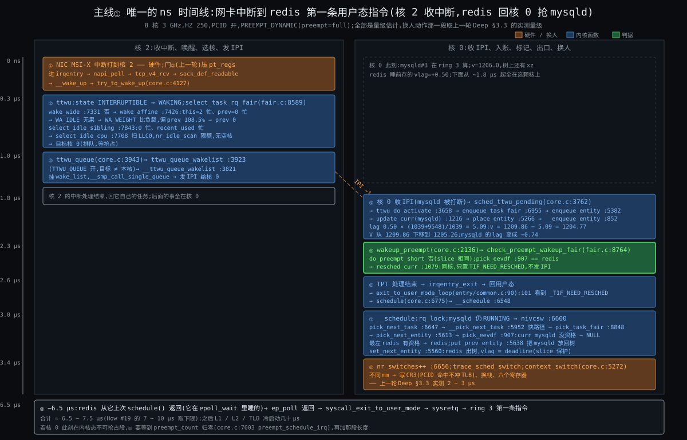

| t | 核 | 事件 | 代码 |
|---|---|---|---|
| 0 | 2 | NIC MSI-X 中断;门②;`napi_poll` → `tcp_v4_rcv` → `sock_def_readable` → `__wake_up` | 硬件;`net/` |
| ~0.3 μs | 2 | `try_to_wake_up`:`TASK_INTERRUPTIBLE` → `TASK_WAKING` | `core.c:4127` |
| ~0.5 μs | 2 | `select_task_rq_fair`:`wake_wide` 否;`wake_affine`:this = 2 忙、prev = 0 忙 → `WA_IDLE` 无果 → `WA_WEIGHT` 比 `cpu_load` → prev 0;`select_idle_sibling`:0 忙、`recent_used_cpu` 忙 → `select_idle_cpu` 扫 LLC0,`nr_idle_scan` 限额,无空核 → 0 | `fair.c:8589` / `:7331` / `:7426` / `:7843` / `:7708` |
| ~1.0 μs | 2 | `ttwu_queue` → `ttwu_queue_wakelist`(目标 ≠ 本核,`TTWU_QUEUE`)→ `__ttwu_queue_wakelist`:挂 `wake_list`,发 IPI | `core.c:3943` / `:3923` / `:3821` |
| ~1.2 μs | 2 | 核 2 的中断处理结束,回自己的任务 | — |
| ~1.8 μs | 0 | 收 IPI(mysqld 在 ring 3 被打断);`sched_ttwu_pending` → `ttwu_do_activate` → `activate_task` → `enqueue_task_fair` → `enqueue_entity`:`update_curr(mysqld)`,`place_entity`(lag 0.50 → 5.09,v = 1204.77),`__enqueue_entity`,V 下移到 1205.26 | `core.c:3762` / `:3658`;`fair.c:6955` / `:5382` / `:5266` / `:852` |
| ~2.3 μs | 0 | `wakeup_preempt` → `check_preempt_wakeup_fair`:`update_curr`;`do_preempt_short` 否;`pick_eevdf` == redis → `resched_curr`:同核,置 `TIF_NEED_RESCHED` + `PREEMPT_NEED_RESCHED` | `core.c:2136`;`fair.c:8764` / `:907`;`core.c:1079` |
| ~2.6 μs | 0 | IPI 处理结束 → `irqentry_exit` → 要回用户态 → `exit_to_user_mode_loop` 看到标记 → `schedule` → `__schedule` | `entry/common.c:90` / `:101`;`core.c:6775` / `:6548` |
| ~3.0 μs | 0 | `__schedule`:`rq_lock`;mysqld 仍 RUNNING → `switch_count = &prev->nivcsw`;`pick_next_task` → `__pick_next_task` 快路径 → `pick_task_fair` → `pick_next_entity` → `pick_eevdf`:curr mysqld lag −0.74 没资格 → NULL;最左 redis 有资格 → redis;`put_prev_entity(mysqld)` 回树;`set_next_entity(redis)`,`vlag = deadline` | `core.c:6600` / `:6647` / `:5952`;`fair.c:8848` / `:5613` / `:907` / `:5638` / `:5560` |
| ~3.4 μs | 0 | `rq->nr_switches++`;`trace_sched_switch`;`context_switch`:不同 mm → `switch_mm_irqs_off` 写 CR3(PCID 命中)、`switch_to` 六个寄存器 —— 上一轮实测 2 ~ 3 μs | `core.c:6656` / `:6693` / `:5272` |
| ~6.0 μs | 0 | redis 从它上次 `schedule()` 返回(它在 `epoll_wait` → `ep_poll` 里睡的)→ `syscall_exit_to_user_mode` → `sysretq` | `fs/eventpoll.c`;`entry_64.S` |
| ~6.5 ~ 7.5 μs | 0 | **ring 3 第一条指令**;随后 L1 / L2 / TLB 冷启动几十 μs | — |

合计 ≈ 6.5 ~ 7.5 μs,How #19 的"7 ~ 10 μs"取下限成立;上限对应核 0 此刻在内核态不可抢占段(`preempt_count ≠ 0`)的情形 —— 那时 ~2.6 μs 那一行要等到 `preempt_schedule_irq`(`core.c:7003`)或 `preempt_enable` 把计数减到 0,再加那段的长度。

### §2.4 lag 从零讲:模拟器跑 How §3.6

模拟器 `stages/05-deep/src/05-eevdf-sim.py`(文件头列了它对应的 19 个 6.12 函数)按上面 §2.2 的代码写,不做任何"近似"除了用排序列表替代红黑树。`python3 -I src/05-eevdf-sim.py how36` 的原样输出:

```
=== How §3.6:mysqld#3(nice 0) + xz(nice 19) 在树上,redis(nice -10) 睡着 vlag=+0.50 ms,t=10 ms 醒来算 50 μs ===
t=  0.000 ms  初始挑人 → mysqld#3
              V= 1200.000 | mysqld#3* v= 1200.000 lag= +0.000 dl= 1203.000 | xz        v= 1200.000 lag= +0.000 dl= 1404.800 | redis    睡 vlag=+0.500
t=  4.000 ms  tick → 标记;换人 → xz
              V= 1203.942 | mysqld#3  v= 1204.000 lag= -0.058 dl= 1207.000 | xz      * v= 1200.000 lag= +3.942 dl= 1404.800 | redis    睡 vlag=+0.500
t=  8.000 ms  tick → 标记;换人 → mysqld#3
              V= 1207.885 | mysqld#3* v= 1204.000 lag= +3.885 dl= 1207.000 | xz        v= 1473.067 lag=-265.182 dl= 1677.867 | redis    睡 vlag=+0.500
t= 10.000 ms  redis 醒 place_entity;唤醒抢占 → 标记;换人 → redis
              V= 1205.261 | mysqld#3  v= 1206.000 lag= -0.739 dl= 1207.000 | xz        v= 1473.067 lag=-267.806 dl= 1677.867 | redis   * v= 1204.761 lag= +0.500 dl= 1205.083
t= 10.050 ms  redis 算完 50 μs 要睡;真出队;换人 → mysqld#3
              V= 1209.856 | mysqld#3* v= 1206.000 lag= +3.856 dl= 1207.000 | xz        v= 1473.067 lag=-263.211 dl= 1677.867 | redis    睡 vlag=+0.499
t= 12.000 ms  tick → 标记;重挑还是 mysqld#3
              V= 1211.777 | mysqld#3* v= 1207.950 lag= +3.827 dl= 1210.950 | xz        v= 1473.067 lag=-261.289 dl= 1677.867 | redis    睡 vlag=+0.499
t= 16.000 ms  tick → 标记;重挑还是 mysqld#3
              V= 1215.720 | mysqld#3* v= 1211.950 lag= +3.770 dl= 1214.950 | xz        v= 1473.067 lag=-257.347 dl= 1677.867 | redis    睡 vlag=+0.499
t= 20.000 ms  tick → 标记;重挑还是 mysqld#3
              V= 1219.662 | mysqld#3* v= 1215.950 lag= +3.712 dl= 1218.950 | xz        v= 1473.067 lag=-253.405 dl= 1677.867 | redis    睡 vlag=+0.499
```

(`*` = curr,`d` = 延迟出队中;单位虚拟 ms;`lag` 列按 V − v 现算,`睡 vlag` 是出队时存下的值。)

**对照 How §3.6 的手算表**:V 1203.94 / 1207.88 / 1205.27 / 1209.86、redis 放回 v 1204.77、dl 1205.09、mysqld 在 10 ms 那一行的 lag −0.73、xz 1473.07 —— 全部对上,差异只在最后一位的四舍五入(模拟器 1205.261 vs 手算 1205.27)。How 那张表可以当真。

**每一列是怎么变的**(这是上一轮两次卡住的地方,逐列说):

1. `v`(vruntime):只有 curr 的在涨,每次打断点涨 `delta × 1024 / w`。mysqld 4 ms 涨 4;xz 4 ms 涨 273.07;redis 50 μs 涨 0.005。**睡着的人 v 不动**(redis 10 ~ 10.05 之间才动)。
2. `V`:树上所有人(含 curr)v 的加权平均。它几乎贴着大权重的人走:0 ~ 4 ms 跟着 mysqld 从 1200 涨到 1203.94;4 ~ 8 ms xz 在跑,xz 涨了 273 但权重只有 15,V 只涨到 1207.88。**redis 一加入 V 就下移 4.6**(1209.86 → 1205.26),因为 9548 的权重把平均拉向它。
3. `lag` = V − v:mysqld 在 4 ms 变成 −0.058 是因为它跑了 4 ms(超过 3 ms 的 slice),V 没完全跟上(xz 拖着)。它没资格了,xz 上。xz 跑完 4 ms lag 变 −265 —— 它要等 V 涨 265 虚拟 ms(mysqld 跑 ~269 ms)才再有资格。**权重不是靠"少挑它",是靠"它一跑账就飞"**。
4. `dl`:只在 `v ≥ dl` 时推一次。mysqld 的 dl 在 4 ms 从 1203 推到 1207(v = 1204 ≥ 1203);在 12 ms 从 1207 推到 1210.95(v = 1207.95)。中间 8 ~ 12 ms 它跑了两段(8 ~ 10、10.05 ~ 12)共 3.95 ms 才凑够一个 slice —— **被抢占不重置 slice**,这是 deadline 比"每次给 3 ms"更细的地方。
5. 10 ms 那一行:redis 放回在 V 下方 0.5(守恒),mysqld 被 V 的下移推到 V 上方 0.739 → 没资格 → `RUN_TO_PARITY` 保护不了没资格的 curr → 换 redis。10.05 ms 那一行:redis 出队,V 弹回 1209.86,mysqld 又有资格。**决定抢不抢的是唤醒那一刻的 V,不是 tick** —— 上一轮 §3.5 的结论在账上重现。

**长跑对账**(`python3 -I src/05-eevdf-sim.py long`,300 ms,redis 每 10 ms 醒一次算 50 μs,只打印换人事件,末尾汇总):

```
t=280.050 ms  redis 算完 50 μs 要睡;真出队;换人 → xz
              V= 1474.627 | mysqld#3  v= 1474.650 lag= -0.023 dl= 1477.650 | xz      * v= 1473.067 lag= +1.560 dl= 1677.867 | redis    睡 vlag=+0.485
t=284.000 ms  tick → 标记;换人 → mysqld#3
              V= 1478.520 | mysqld#3* v= 1474.650 lag= +3.870 dl= 1477.650 | xz        v= 1742.720 lag=-264.200 dl= 1947.520 | redis    睡 vlag=+0.485
--- 300 ms 对账(实际跑的真实时间 / 占比;xz 与 mysqld 争抢时按权重应为 15 : 1024 = 1.4% : 98.6%)---
mysqld#3  290.600 ms   96.9%
xz          7.950 ms    2.6%
redis       1.450 ms    0.5%
```

三件事:xz 第二次上台在 280 ms,距第一次 276 ms,和 How §3.6 估的"每 ~273 ms 得 4 ms"一致;xz 的 2.6% 比权重份额 1.4% 高是因为 300 ms 里它上了两次而第一次(t = 4)是起始状态人人 v 相等的赠品,按 1000 ms 算会收敛到 1.4%;redis 的 0.5% 和它的 90% 权重份额毫无关系 —— 它只用了它要的量,**权重是上限不是配给**。

### §2.5 反事实小试:挑人规则还能怎么写

**机制:在 lag ≥ 0 的实体里挑 deadline 最早的,lag 夹在 ±2 slice,放回守恒。**

- **A1:固定时间片轮转(RR),每人 4 ms**
  - 违反 C3·份额与延迟两头要:延迟 = 人数 × 片长,19 个任务时 redis 醒来最坏等 72 ms;份额无法表达(人人均等,`nice` 无意义)。
  - 现实:`SCHED_RR` 只给 rt 类,片长 100 ms(`rt.c:7`,`RR_TIMESLICE`);通用负载没人用。
- **A2:CFS(6.5 以前):只按最小 vruntime 挑,睡醒补"半个 slice"的固定优惠**
  - 不违反约束,但 C3·份额与延迟两头要 的延迟一头只能靠修正:`sched_wakeup_granularity`、`sleeper fairness`、`wakeup_preempt` 的启发式 —— 它们就是 C2·未来不可知 说的"猜"。能被刷:短睡眠反复领半个 slice 的优惠。
  - 现实:Linux 2007 ~ 2023;6.6 换掉,Origin 转折四有 cover letter 原话。
- **A3:彩票(lottery,Waldspurger 1994):每个 tick 按权重随机抽**
  - 不违反 C2·未来不可知(不猜),份额在期望上正确;但 C3·份额与延迟两头要 的延迟一头是概率的 —— redis 醒来能不能立刻上是掷骰子,p99 没有界;C4·挑人须便宜 的 O(1) 倒是满足。
  - 现实:教学系统、某些用户态调度器;内核没用过。
- **A4:stride(Waldspurger 1995):每人一个 pass 值,每跑一次加 stride = 常数 / 权重,挑 pass 最小**
  - 这就是"只有 vruntime 没有 deadline"的 CFS 的数学原型;违反 C3·份额与延迟两头要 的方式和 A2 一样:醒来放回的位置要靠额外规则。
  - 现实:CFS 的思想来源之一;EEVDF 在它上面加了 deadline 和 eligible。
- **A5:BVT(Duda & Cheriton 1999):vruntime 减一个 warp 值表示"急"**
  - 能表达延迟,但 warp 是**无界的插队额度**(除非再加 warp 时限),违反 C3·份额与延迟两头要 的"插队须有界";warp 值本身又要猜(C2·未来不可知)。
  - 现实:Xen 早期用过 BVT,后来换 credit;内核没用过。
- **A6:sched_ext 自定义(6.12 起):BPF 程序自己定 enqueue / dispatch,20 ms 默认 slice(`ext.h:20`)**
  - 不违反任何一条 —— 它把"违反哪条"的决定权交给加载它的人:一个 FIFO 的 BPF 调度器就是 A1。
  - 现实:Meta 的生产部署(sched-ext/scx 仓库自述)、Valve Steam Deck 上 Igalia 的 `scx_lavd`;§5.4(收尾核实 #86)。

**结论**:在 C2·未来不可知(不猜)+ C3·份额与延迟两头要(份额、延迟、有界插队三者都要)+ C4·挑人须便宜(O(log n))下,EEVDF 是唯一同时过筛的:A1 / A3 / A5 丢延迟界,A2 / A4 丢"不猜",A6 是把筛子交出去。它比 CFS 多付的是每个实体多两个字段(`deadline`、`slice`)和树的增广;换来的是删掉 `sched_wakeup_granularity` 等五个启发式旋钮(Origin 转折四)。

### §2.6 反问(选择式)+ 从头走一遍

**问**:两个 nice 0 的任务 A、B 同核。B 睡下去的那一刻账面上欠它 20 虚拟 ms(理论值),睡了 20 ms;这期间 A 独占核。B 醒来:

- (a) B 的 lag 被记成:A. +20 B. +6 C. +3 D. 0
- (b) B 能否立刻把 A 换下?之后它能连跑多久?

### 从头走一遍

**问题来源**:§2.2.3 的 `entity_lag` 在 B 睡下去时就把 lag 夹在 `±max(2 × slice, TICK_NSEC)` = ±max(6 ms, 4 ms) = ±6 ms,nice 0 的虚拟单位和真实单位相同,所以存下的是 **+6**(答案 B)。+20 是"理想 EEVDF"的值,内核故意不记 —— `:676` 的注释说 V 本身是近似的,记太大的 lag 会把别人的账弄乱。

**分岔一(醒来那一刻)**:`place_entity`:V 此刻 = A 的 v(树上只有 A)= 1220;放大 6 × (1024 + 1024)/1024 = 12;B 的 v = 1220 − 12 = 1208;deadline = 1211。放回后 V = (1024 × 1220 + 1024 × 1208)/2048 = 1214:B 的 lag = +6(守恒 ✓),A 的 lag = −6。`check_preempt_wakeup_fair`:`pick_eevdf` —— curr A 没资格 → NULL;最左 B(dl 1211 < 1223)有资格 → B → 打标记 → 出口换 B。**立刻抢**。

**分岔二(连跑多久)**:B 每 4 ms 一个 tick,v 涨 4,V 涨 2(两人均权);lag 每拍减 2:+6 → +4 → +2 → 0。第 3 个 tick(t = 32 ms)B 的 v = 1220 = A 的 v,两人 lag 都是 0、deadline 都是 1223 → 平手按树序,A 回到树上时间更早 … 模拟器给的是换 A。此后每个 tick 换一次人:谁跑了 4 ms 谁的 lag 就变 −2,对方 +2,对方上。**B 连跑 12 ms = 3 个 tick**,正好把 6 ms 的欠账(= 两个 slice 的真实时间)收回,然后进入 4 ms 一换的稳态。

`python3 -I src/05-eevdf-sim.py deep26` 的原样输出:

```
B 睡下去:理论 lag = +20.000 ms,entity_lag 夹在 ±max(2×3 ms, 4 ms) = ±6 ms → 存下 vlag = +6.000 ms
t= 20.000 ms  B 醒 place_entity;A 跑了 20 ms;唤醒抢占成立
              V= 1214.000 | A       * v= 1220.000 lag= -6.000 dl= 1223.000 | B         v= 1208.000 lag= +6.000 dl= 1211.000
              出口挑人 → B
t= 24.000 ms  tick → 标记 → 重挑还是 B
              V= 1216.000 | A         v= 1220.000 lag= -4.000 dl= 1223.000 | B       * v= 1212.000 lag= +4.000 dl= 1215.000
t= 28.000 ms  tick → 标记 → 重挑还是 B
              V= 1218.000 | A         v= 1220.000 lag= -2.000 dl= 1223.000 | B       * v= 1216.000 lag= +2.000 dl= 1219.000
t= 32.000 ms  tick → 标记 → 换人 → A
              V= 1220.000 | A       * v= 1220.000 lag= +0.000 dl= 1223.000 | B         v= 1220.000 lag= +0.000 dl= 1223.000
t= 36.000 ms  tick → 标记 → 换人 → B
              V= 1222.000 | A         v= 1224.000 lag= -2.000 dl= 1227.000 | B       * v= 1220.000 lag= +2.000 dl= 1223.000
```

**结果**:(a) B;(b) 立刻抢,连跑 12 ms,然后 4 ms 一换。两条规律带走:**睡多久不重要,最多只能欠两个 slice**;**两个同权任务的稳态是 tick 粒度(4 ms)轮换,不是 slice 粒度(3 ms)** —— C1·只在打断点换 的代价。

**顺手核一下 How §14**(`python3 -I src/05-eevdf-sim.py how14`,核上只有 mysqld 和 redis):

```
--- 按 entity_lag 夹紧 +0.643 ms ---
t=  1.000 ms  redis 醒 place_entity;唤醒抢占成立
              V= 1195.005 | mysqld#3* v= 1201.000 lag= -5.995 dl= 1203.000 | redis     v= 1194.362 lag= +0.643 dl= 1194.683
t= 17.000 ms  tick(重挑还是 redis)
              V= 1196.554 | mysqld#3  v= 1201.000 lag= -4.446 dl= 1203.000 | redis   * v= 1196.077 lag= +0.477 dl= 1196.399
t= 33.000 ms  tick(重挑还是 redis)
              V= 1198.104 | mysqld#3  v= 1201.000 lag= -2.896 dl= 1203.000 | redis   * v= 1197.793 lag= +0.311 dl= 1198.115
t= 49.000 ms  tick(重挑还是 redis)
              V= 1199.654 | mysqld#3  v= 1201.000 lag= -1.346 dl= 1203.000 | redis   * v= 1199.509 lag= +0.144 dl= 1199.831
t= 65.000 ms  tick → 标记 → 换人 → mysqld#3(redis 连跑了 64 ms)
              V= 1201.204 | mysqld#3* v= 1201.000 lag= +0.204 dl= 1203.000 | redis     v= 1201.225 lag= -0.022 dl= 1201.547
```

How §14 的结论"redis 连跑到 lag 归零,约 64 ms"**成立**(模拟器 64 ms,t = 1 → 65)。但 How §14 分岔三里"redis 还有资格、mysqld 也有资格(它落后 V)"这句**不成立**:两个实体时 Σ w_i × lag_i = 0,mysqld 的 lag = −9548/1024 × redis 的 lag = −5.995,**没资格**;redis 一直是唯一候选,根本不需要比 deadline。结论不变,推理要改(已记入待核 #72,请 How 那一节 patch)。另外题目里"+4 虚拟 ms 不夹紧"的版本模拟器也跑了:120 ms 内不换人 —— 这就是夹紧存在的理由。

---

## §3 主线②:多核 —— 唤醒选核与周期均衡

**先说结论**:搬人有两条独立的链。唤醒选核(`select_task_rq_fair`,`fair.c:8589`)每次唤醒都走,目标是"留在热的地方,有空核就用空核";均衡(`sched_balance_rq`,`:11669`)只在核空闲或周期到点时走,目标是"最忙的组和本组差距超过 17% 才搬,且只搬一半、不搬热的"。两条链的所有比较都用 PELT 的 `load_avg` / `util_avg`(`pelt.c:180`)除以算力,不用任务个数。How §5.5 那个 rq3 算例在源码里的真实走法和 How 写的有两处出入(§3.4):MC 层算出的差距是 2 但可抢占内核下 newidle 每次只搬 1 个;PKG 层走的是 `migrate_util` 分支不是"load 单位"。

### §3.1 操作层:旋钮与观测

| 旋钮 | 源码落点 | 值 |
|---|---|---|
| `sched_setaffinity` / `taskset` | `p->cpus_ptr`;唤醒选核在 `select_idle_cpu`(`:7714`)用 `cpumask_and(cpus, span, p->cpus_ptr)` 过滤;均衡在 `can_migrate_task`(`:9385`)`!cpumask_test_cpu(dst, p->cpus_ptr)` → `LBF_SOME_PINNED` | — |
| `cpuset` cgroup | 同上,组级 `cpus_ptr`;`isolcpus=` 把核从所有调度域拿掉(`on_null_domain`,`:12201`) | — |
| `sysctl kernel.sched_migration_cost_ns` | `sysctl_sched_migration_cost`(`fair.c:79`),`task_hot`(`:9260`)的门槛;`−1` = 永远热,`0` = 永远冷(`:9283` / `:9293`) | 500000 |
| `sysctl kernel.numa_balancing` + `_scan_period_min/max_ms` / `_scan_size_mb` | `fair.c:1439 ~ :1443` | 1000 / 60000 / 256 |
| `/sys/kernel/debug/sched/domains/cpuN/domainM/{name,flags,imbalance_pct,busy_factor,min_interval,max_interval,cache_nice_tries}` | `sd_init`(`topology.c:1588`)填的字段 | 见 §3.2.4 |
| `/proc/schedstat` | 每个域的 `lb_count / lb_balanced / lb_failed / lb_imbalance` 按 idle 类型分三组(`schedstat_inc(sd->lb_count[idle])`,`:11693`);`ttwu_move_affine`(`:7441`) | — |
| `perf sched record` / `perf stat -e sched:sched_migrate_task` | `set_task_cpu` 里的 `trace_sched_migrate_task` | — |

### §3.2 函数逻辑层

#### §3.2.1 唤醒选核:`select_task_rq_fair` → `wake_affine` → `select_idle_sibling`

```c
/* fair.c:8589 */
static int select_task_rq_fair(struct task_struct *p, int prev_cpu, int wake_flags)
{
	int sync = (wake_flags & WF_SYNC) && !(current->flags & PF_EXITING);
	struct sched_domain *tmp, *sd = NULL;
	int cpu = smp_processor_id();                          /* 唤醒者所在核 */
	int new_cpu = prev_cpu;                                /* 默认:它上次在哪 */
	int want_affine = 0;
	int sd_flag = wake_flags & 0xF;                        /* WF_TTWU / FORK / EXEC 与 SD_BALANCE_* 共用低四位 */

	if (wake_flags & WF_TTWU) {
		record_wakee(p);                                   /* 统计"谁唤醒谁"的翻转次数,给 wake_wide 用 */
		if ((wake_flags & WF_CURRENT_CPU) && cpumask_test_cpu(cpu, p->cpus_ptr))
			return cpu;
		if (!is_rd_overutilized(this_rq()->rd)) {          /* EAS:有能耗模型且没过载才走;x86 服务器没有 → 跳 */
			new_cpu = find_energy_efficient_cpu(p, prev_cpu);   /* :8391 */
			if (new_cpu >= 0)
				return new_cpu;
			new_cpu = prev_cpu;
		}
		want_affine = !wake_wide(p) && cpumask_test_cpu(cpu, p->cpus_ptr);   /* :7331 */
	}

	rcu_read_lock();
	for_each_domain(cpu, tmp) {                            /* 从最近的域往上爬 */
		if (want_affine && (tmp->flags & SD_WAKE_AFFINE) &&
		    cpumask_test_cpu(prev_cpu, sched_domain_span(tmp))) {   /* 这层同时罩住 cpu 和 prev_cpu */
			if (cpu != prev_cpu)
				new_cpu = wake_affine(tmp, p, cpu, prev_cpu, sync);   /* :7426 二选一 */
			sd = NULL;                                     /* 亲和优先于 balance 标志 */
			break;
		}
		if (tmp->flags & sd_flag)                          /* 通常只有 WF_EXEC / WF_FORK 会命中 */
			sd = tmp;
		else if (!want_affine)
			break;
	}

	if (unlikely(sd)) {
		new_cpu = sched_balance_find_dst_cpu(sd, p, cpu, prev_cpu, sd_flag);   /* :7509 慢路径:fork / exec */
	} else if (wake_flags & WF_TTWU) {
		new_cpu = select_idle_sibling(p, prev_cpu, new_cpu);   /* :7843 快路径 */
	}
	rcu_read_unlock();
	return new_cpu;
}
```

`wake_affine`(`:7426`)只在"唤醒者的核"和"被唤醒者上次的核"之间二选一,先问 `wake_affine_idle`(`:7357`):唤醒者的核空且和 prev 共享 cache → 谁空用谁,都空用 prev;`sync` 唤醒(唤醒者马上要睡)且它的核上只有它 → 用它的核;prev 空 → prev。都不空再问 `wake_affine_weight`(`:7384`):比两边的 `cpu_load`,prev 一侧乘 `100 + (imbalance_pct − 100)/2` = 108.5 的偏置(`WA_BIAS`,`:7411`)—— **偏向留在 prev**。

`select_idle_sibling`(`:7843`)拿到目标后再找空核,顺序固定:目标核空 → 用;prev 空且与目标同 LLC(`cpus_share_cache`,`:7873`)→ 用 prev("don't be stupid");唤醒者是 per-cpu kthread 且 prev 就是本核(IO 完成的典型形状,`:7892`)→ 用 prev;`recent_used_cpu` 空(`:7901`)→ 用;最后 `select_idle_cpu`(`:7708`)在 LLC 域里扫:

```c
/* fair.c:7708 */
static int select_idle_cpu(struct task_struct *p, struct sched_domain *sd, bool has_idle_core, int target)
{
	struct cpumask *cpus = this_cpu_cpumask_var_ptr(select_rq_mask);
	int i, cpu, idle_cpu = -1, nr = INT_MAX;
	struct sched_domain_shared *sd_share;

	cpumask_and(cpus, sched_domain_span(sd), p->cpus_ptr);

	if (sched_feat(SIS_UTIL)) {
		sd_share = rcu_dereference(per_cpu(sd_llc_shared, target));
		if (sd_share) {
			nr = READ_ONCE(sd_share->nr_idle_scan) + 1;    /* LLC 越忙,允许扫的核越少 */
			if (nr == 1)
				return -1;                                 /* LLC 过载:不扫,直接放目标核排队 */
		}
	}
	/* … CLS 簇优先 … */
	for_each_cpu_wrap(cpu, cpus, target + 1) {             /* 从 target 的下一个开始环扫 */
		if (has_idle_core) {
			i = select_idle_core(p, cpu, cpus, &idle_cpu); /* SMT:找整个物理核都空的 */
			if ((unsigned int)i < nr_cpumask_bits)
				return i;
		} else {
			if (--nr <= 0)
				return -1;                                 /* 扫够了,放弃 */
			idle_cpu = __select_idle_cpu(cpu, p);
			if ((unsigned int)idle_cpu < nr_cpumask_bits)
				break;
		}
	}
	if (has_idle_core)
		set_idle_cores(target, false);
	return idle_cpu;
}
```

`nr_idle_scan` 由 tick 里的 `update_idle_cpu_scan` 按 LLC 的 `util_avg` 更新(待核 #80 给公式),C4·挑人须便宜 在多核这一侧的形状:**找空核的代价不能随核数线性涨**。

#### §3.2.2 均衡:`sched_balance_rq` 的五步

```c
/* fair.c:11669 */
static int sched_balance_rq(int this_cpu, struct rq *this_rq, struct sched_domain *sd,
			    enum cpu_idle_type idle, int *continue_balancing)
{
	/* … struct lb_env env = { .sd = sd, .dst_cpu = this_cpu, .dst_rq = this_rq, .idle = idle, … } … */
	cpumask_and(cpus, sched_domain_span(sd), cpu_active_mask);
	schedstat_inc(sd->lb_count[idle]);
redo:
	if (!should_we_balance(&env)) {                        /* :11599 这一层该不该由我来拉?空核优先,否则组里第一个 */
		*continue_balancing = 0;
		goto out_balanced;
	}
	group = sched_balance_find_src_group(&env);            /* :11250 ① 最忙的组 + 差距 */
	if (!group) { schedstat_inc(sd->lb_nobusyg[idle]); goto out_balanced; }

	busiest = sched_balance_find_src_rq(&env, group);      /* :11388 ② 组里最忙的核 */
	if (!busiest) { schedstat_inc(sd->lb_nobusyq[idle]); goto out_balanced; }

	schedstat_add(sd->lb_imbalance[idle], env.imbalance);
	env.src_cpu = busiest->cpu;
	env.src_rq = busiest;
	ld_moved = 0;
	env.flags |= LBF_ALL_PINNED;
	if (busiest->nr_running > 1) {
		env.loop_max = min(sysctl_sched_nr_migrate, busiest->nr_running);   /* 每次最多看 32 个 */
more_balance:
		rq_lock_irqsave(busiest, &rf);
		update_rq_clock(busiest);
		cur_ld_moved = detach_tasks(&env);                 /* :9501 ③ 从 busiest 树上摘人 */
		rq_unlock(busiest, &rf);
		if (cur_ld_moved) {
			attach_tasks(&env);                            /* ④ 放进本账 + wakeup_preempt */
			ld_moved += cur_ld_moved;
		}
		local_irq_restore(rf.flags);
		if (env.flags & LBF_NEED_BREAK) { env.flags &= ~LBF_NEED_BREAK; goto more_balance; }
		/* … LBF_DST_PINNED:换一个目标核再试;LBF_ALL_PINNED:全被绑核,换一个 busiest 重来 … */
	}
	/* … ⑤ 没搬动:nr_balance_failed++,够多了就 active balance(让 stop 类线程把 curr 踢下来) … */
}
```

① `sched_balance_find_src_group`(`:11250`)先 `update_sd_lb_stats`(`:10980`)给每个组算一份 `sg_lb_stats`(`:9878`):

```c
/* fair.c:9878 */
struct sg_lb_stats {
	unsigned long avg_load;          /* Avg load            over the CPUs of the group */
	unsigned long group_load;        /* Total load          over the CPUs of the group */
	unsigned long group_capacity;    /* Capacity            over the CPUs of the group */
	unsigned long group_util;        /* Total utilization   over the CPUs of the group */
	unsigned long group_runnable;    /* Total runnable time over the CPUs of the group */
	unsigned int sum_nr_running;     /* Nr of all tasks running in the group */
	unsigned int sum_h_nr_running;   /* Nr of CFS tasks running in the group */
	unsigned int idle_cpus;          /* Nr of idle CPUs         in the group */
	unsigned int group_weight;
	enum group_type group_type;
	unsigned int group_asym_packing;
	unsigned int group_smt_balance;
	unsigned long group_misfit_task_load;
	/* … NUMA 两个计数 … */
};
```

然后 `group_classify`(`:10139`)按下面的枚举(`:9181`)把组分到七档,**枚举的顺序就是"谁更需要被均衡"的顺序**(`update_sd_pick_busiest`,`:10403`,先比 `group_type` 再比细节):

| `group_type` | 含义 | 判定 |
|---|---|---|
| `group_has_spare` | 有余力 | 默认 |
| `group_fully_busy` | 满但没人排队 | `!group_has_capacity`:`sum_nr_running ≥ group_weight` 且 util / runnable 没超 |
| `group_misfit_task` | 有任务塞不进这颗核的算力(大小核) | `group_misfit_task_load` |
| `group_smt_balance` | SMT 兄弟都忙,另一个物理核空着 | `smt_balance` |
| `group_asym_packing` | `SD_ASYM_PACKING`:有优先级更高的核空着 | `sched_group_asym` |
| `group_imbalanced` | 上次因为亲和没搬成 | `sg_imbalanced`(`sgc->imbalance`) |
| `group_overloaded` | 有人排队且算力不够 | `sum_nr_running > group_weight` 且 (`util × imbalance_pct > capacity × 100` 或 runnable 同理) |

② `calculate_imbalance`(`:11048`)按"本组 × 最忙组"的组合决定 **搬什么单位**(`migration_type`,`:9217`)和**搬多少**,`:11208` 起的注释是那张决策矩阵:

```c
/* fair.c:11048 节选 */
	if (local->group_type == group_has_spare) {
		if ((busiest->group_type > group_fully_busy) &&
		    !(env->sd->flags & SD_SHARE_LLC)) {           /* 跨 LLC 且对方过载:按算力余量搬 */
			env->migration_type = migrate_util;
			env->imbalance = max(local->group_capacity, local->group_util) - local->group_util;
			if (env->idle && env->imbalance == 0) {       /* 本核刚空但组看起来满:至少拉一个 */
				env->migration_type = migrate_task;
				env->imbalance = 1;
			}
			return;
		}
		if (busiest->group_weight == 1 || sds->prefer_sibling) {   /* 同 LLC(每核一组)或 prefer_sibling:按个数 */
			env->migration_type = migrate_task;
			env->imbalance = sibling_imbalance(env, sds, busiest, local);   /* :10252 两边可跑数之差(按核数归一) */
		} else {
			env->migration_type = migrate_task;
			env->imbalance = max_t(long, 0, (local->idle_cpus - busiest->idle_cpus));   /* 拉平空核数 */
		}
		/* … NUMA 允许的小不平衡 … */
		env->imbalance >>= 1;                               /* :11162 只搬差距的一半 */
		return;
	}
	/* … 两边都忙:按 avg_load 搬,目标是把 busiest 压到域平均、本组抬到域平均,取两者中小的 … */
	env->migration_type = migrate_load;
	env->imbalance = min((busiest->avg_load - sds->avg_load) * busiest->group_capacity,
			     (sds->avg_load - local->avg_load) * local->group_capacity) / SCHED_CAPACITY_SCALE;
```

③ `detach_tasks`(`:9501`)从 busiest 的 `cfs_tasks` 链表**尾部**(最久没跑的)开始,每个先过 `can_migrate_task`(`:9365`):

```c
/* fair.c:9365 节选 */
	if (throttled_lb_pair(task_group(p), env->src_cpu, env->dst_cpu))   /* 它的组在目标核上被 throttle:不搬 */
		return 0;
	if (kthread_is_per_cpu(p))                             /* per-cpu 内核线程:不搬 */
		return 0;
	if (!cpumask_test_cpu(env->dst_cpu, p->cpus_ptr)) {   /* 绑核不含目标核:不搬,记 LBF_SOME_PINNED */
		/* … 记一个备选目标核 new_dst_cpu … */
		return 0;
	}
	env->flags &= ~LBF_ALL_PINNED;
	if (task_on_cpu(env->src_rq, p)) {                     /* 正在跑的:不搬(只有 active balance 才搬它) */
		schedstat_inc(p->stats.nr_failed_migrations_running);
		return 0;
	}
	if (env->flags & LBF_ACTIVE_LB)
		return 1;
	tsk_cache_hot = migrate_degrades_locality(p, env);     /* NUMA:搬过去会不会离它的内存更远 */
	if (tsk_cache_hot == -1)
		tsk_cache_hot = task_hot(p, env);                  /* :9260 */
	if (tsk_cache_hot <= 0 || env->sd->nr_balance_failed > env->sd->cache_nice_tries) {   /* 冷,或失败够多次 */
		/* … 搬 … */
		return 1;
	}
	schedstat_inc(p->stats.nr_failed_migrations_hot);
	return 0;

/* fair.c:9260 */
static int task_hot(struct task_struct *p, struct lb_env *env)
{
	s64 delta;
	if (p->sched_class != &fair_sched_class) return 0;
	if (unlikely(task_has_idle_policy(p))) return 0;      /* SCHED_IDLE 永远冷 */
	if (env->sd->flags & SD_SHARE_CPUCAPACITY) return 0;  /* SMT 兄弟共享 cache:不算热 */
	if (sched_feat(CACHE_HOT_BUDDY) && env->dst_rq->nr_running &&
	    (&p->se == cfs_rq_of(&p->se)->next)) return 1;    /* next buddy 算热 */
	if (sysctl_sched_migration_cost == -1) return 1;
	if (!sched_core_cookie_match(cpu_rq(env->dst_cpu), p)) return 1;   /* core scheduling 的 cookie 不配 */
	if (sysctl_sched_migration_cost == 0) return 0;
	delta = rq_clock_task(env->src_rq) - p->se.exec_start;
	return delta < (s64)sysctl_sched_migration_cost;       /* :9298  500 μs 内跑过 = 热 */
}
```

过了门的任务按 `migration_type` 扣 `imbalance`(`migrate_load` 扣 `task_h_load`、`migrate_util` 扣 `task_util_est`、`migrate_task` 扣 1,`:9548 ~ :9593`),扣到 ≤ 0 停。**可抢占内核下 newidle 均衡搬完第一个就 break**(`:9607` 的 `#ifdef CONFIG_PREEMPTION … if (env->idle == CPU_NEWLY_IDLE) break;`):newidle 是延迟敏感路径,持两把 rq 锁的时间要短。

④ `attach_tasks` 放进本账后 `wakeup_preempt`(`core.c:2136`),回到主线①。

⑤ 什么时候做:三个入口都汇到 `sched_balance_rq`。

```c
/* fair.c:12726 节选:核刚空 */
static int sched_balance_newidle(struct rq *this_rq, struct rq_flags *rf)
{
	/* … */
	if (this_rq->ttwu_pending)                             /* 有人正在被唤醒到本核:不用找 */
		return 0;
	this_rq->idle_stamp = rq_clock(this_rq);
	/* … */
	if (!get_rd_overloaded(this_rq->rd) ||                 /* 整个 root domain 没有过载的核:不找 */
	    (sd && this_rq->avg_idle < sd->max_newidle_lb_cost)) {   /* 本核平均空闲时间比一次均衡的代价还短:不找 */
		/* … */
		goto out;
	}
	raw_spin_rq_unlock(this_rq);
	t0 = sched_clock_cpu(this_cpu);
	sched_balance_update_blocked_averages(this_cpu);       /* 先把睡着的实体的 PELT 衰减到此刻 */
	for_each_domain(this_cpu, sd) {                        /* MC → PKG */
		if (this_rq->avg_idle < curr_cost + sd->max_newidle_lb_cost)
			break;                                         /* 越往上越贵,够不着就停 */
		if (sd->flags & SD_BALANCE_NEWIDLE) {
			pulled_task = sched_balance_rq(this_cpu, this_rq, sd, CPU_NEWLY_IDLE, &continue_balancing);
			t1 = sched_clock_cpu(this_cpu);
			domain_cost = t1 - t0;
			update_newidle_cost(sd, domain_cost);          /* 记下这层花了多久,下次用来判值不值 */
			curr_cost += domain_cost;
			t0 = t1;
		}
		if (pulled_task || !continue_balancing)
			break;
	}
	/* … */
}
```

周期均衡:`sched_tick`(`core.c:5584`)末尾 `sched_balance_trigger`(`fair.c:12879`)在 `jiffies ≥ rq->next_balance` 时抬 `SCHED_SOFTIRQ` → `sched_balance_softirq`(`:12856`)→ `sched_balance_domains`(`:12119`)逐层:`get_sd_balance_interval`(`:11945`)= `balance_interval`(= 域内核数 ms)× 忙时 `busy_factor` 16,减 1 避免各层互为倍数,夹到 `max_load_balance_interval`(`:9170`,`HZ/10` = 100 ms);`SD_SERIALIZE` 的层(NUMA)全机同时只能有一个核在做(`:12156`)。空核的均衡职责由 `nohz_balancer_kick`(`:12284`)选一个核代做(`NO_HZ_IDLE`)。

#### §3.2.3 负载怎么量:PELT

```c
/* pelt.c:31 */
static u64 decay_load(u64 val, u64 n)                      /* val × y^n,y^32 = 1/2 */
{
	/* … n ≥ 32 的部分用右移,余数查 runnable_avg_yN_inv[] 表 … */
	if (unlikely(local_n >= LOAD_AVG_PERIOD)) {
		val >>= local_n / LOAD_AVG_PERIOD;
		local_n %= LOAD_AVG_PERIOD;
	}
	val = mul_u64_u32_shr(val, runnable_avg_yN_inv[local_n], 32);
	return val;
}
/* pelt.c:102 */
static __always_inline u32 accumulate_sum(u64 delta, struct sched_avg *sa,
					  unsigned long load, unsigned long runnable, int running)
{
	u32 contrib = (u32)delta;
	u64 periods;
	delta += sa->period_contrib;
	periods = delta / 1024;                                /* A period is 1024us (~1ms) */
	if (periods) {                                         /* Step 1: 跨过段边界,旧和先衰减 */
		sa->load_sum = decay_load(sa->load_sum, periods);
		sa->runnable_sum = decay_load(sa->runnable_sum, periods);
		sa->util_sum = decay_load((u64)(sa->util_sum), periods);
		/* … 补上跨过的整段 d2 和首尾残段 d1 / d3(__accumulate_pelt_segments :57) … */
	}
	/* … 本段按 load / runnable / running 三个 0/1 乘进去 … */
}
/* pelt.c:180 */
static __always_inline int ___update_load_sum(u64 now, struct sched_avg *sa,
					      unsigned long load, unsigned long runnable, int running)
{
	u64 delta = now - sa->last_update_time;
	/* … */
	delta >>= 10;                                          /* 单位 1024 ns ≈ 1 μs */
	/* … */
	if (!accumulate_sum(delta, sa, load, runnable, running))
		return 0;
	return 1;
}
/* pelt.c:257 */
static __always_inline void ___update_load_avg(struct sched_avg *sa, unsigned long load)
{
	u32 divider = get_pelt_divider(sa);                    /* LOAD_AVG_MAX − 1024 + period_contrib */
	sa->load_avg = div_u64(load * sa->load_sum, divider);
	sa->runnable_avg = div_u64(sa->runnable_sum, divider);
	WRITE_ONCE(sa->util_avg, sa->util_sum / divider);
}
```

常数在生成的头文件 `kernel/sched/sched-pelt.h:13 ~ :14`:`LOAD_AVG_PERIOD 32`、`LOAD_AVG_MAX 47742`(= 1024 × Σ y^n 的收敛值),生成程序 `Documentation/scheduler/sched-pelt.c`(`HALFLIFE 32`)。所以 How 待核 #13 可以关掉:半衰期 32 个 1024 μs 的段 ≈ 32.8 ms。三个量的含义(`pelt.c:270` 起的注释):任务的 `load_avg = weight × load_sum`、`runnable_avg`、`util_avg`;`cfs_rq` 的是各实体之和。组实体的 `se_weight` = `tg->weight × grq->load_avg / tg->load_avg`,就是 §4.2 的 `calc_group_shares`。

#### §3.2.4 调度域怎么建:`sd_init` 与 `default_topology`

```c
/* topology.c:1702 */
static struct sched_domain_topology_level default_topology[] = {
#ifdef CONFIG_SCHED_SMT
	{ cpu_smt_mask, cpu_smt_flags, SD_INIT_NAME(SMT) },        /* :1704 */
#endif
#ifdef CONFIG_SCHED_CLUSTER
	{ cpu_clustergroup_mask, cpu_cluster_flags, SD_INIT_NAME(CLS) },   /* :1708 */
#endif
#ifdef CONFIG_SCHED_MC
	{ cpu_coregroup_mask, cpu_core_flags, SD_INIT_NAME(MC) },  /* :1712 共享 LLC */
#endif
	{ cpu_cpu_mask, SD_INIT_NAME(PKG) },                       /* :1714 同插槽 */
	{ NULL, },
};
/* topology.c:1588 节选 */
	*sd = (struct sched_domain){
		.min_interval		= sd_weight,                /* 域内核数(ms) */
		.max_interval		= 2*sd_weight,
		.busy_factor		= 16,                       /* :1615 */
		.imbalance_pct		= 117,                      /* :1616 */
		.cache_nice_tries	= 0,
		.flags			= 1*SD_BALANCE_NEWIDLE | 1*SD_BALANCE_EXEC | 1*SD_BALANCE_FORK
					| 0*SD_BALANCE_WAKE | 1*SD_WAKE_AFFINE | 1*SD_PREFER_SIBLING | sd_flags,
		.balance_interval	= sd_weight,                /* :1634 */
		/* … */
	};
	/* … */
	if (sd->flags & SD_SHARE_CPUCAPACITY) {
		sd->imbalance_pct = 110;                            /* :1661 SMT 层:10% 就搬 */
	} else if (sd->flags & SD_SHARE_LLC) {
		sd->imbalance_pct = 117;                            /* :1664 */
		sd->cache_nice_tries = 1;                           /* :1665 失败 1 次后忽略热 */
#ifdef CONFIG_NUMA
	} else if (sd->flags & SD_NUMA) {
		sd->cache_nice_tries = 2;                           /* :1669 */
		sd->flags &= ~SD_PREFER_SIBLING;
		sd->flags |= SD_SERIALIZE;                          /* :1672 全机串行 */
		if (sched_domains_numa_distance[tl->numa_level] > node_reclaim_distance)
			sd->flags &= ~(SD_BALANCE_EXEC | SD_BALANCE_FORK | SD_WAKE_AFFINE);   /* 远节点:不亲和、不在那建新任务 */
#endif
	} else {
		sd->cache_nice_tries = 1;
	}
```

NUMA 层 `imbalance_pct` 没有单独设,就是 117(How 待核 #14 关掉)。我们的机器(SMT 关、单插槽、两组 L3)得到两层:**MC**(`cpu_coregroup_mask` = 同 L3 的 4 核,`SD_SHARE_LLC`,117,间隔 4 ms / 忙 64 ms)和 **PKG**(8 核,117,间隔 8 ms / 忙 100 ms 封顶)。`/sys/kernel/debug/sched/domains/cpu3/domain0/name` 会打印 `MC`,`domain1/name` 打印 `PKG`。

### §3.3 底层原理层:为什么是 pull、为什么 newidle 是热路径、为什么 500 μs

| 设计 | 原因 | 代价 | 约束 |
|---|---|---|---|
| pull 模型(闲的一边主动拉),不是 push | 忙的核没空做均衡;闲的核做均衡不耽误任何人;而且只有闲的核知道自己闲 | 忙核上排队的人要等某个核空下来或周期到点才被救 | C5·核各自为政 |
| newidle 是最频繁的均衡 | 核一空就试,延迟最低;`avg_idle` 和 `max_newidle_lb_cost` 的比较保证"值得才做"(`:12769`) | 持两把锁、搬一个人就走(可抢占内核) | C3·份额与延迟两头要 + C4·挑人须便宜 |
| `task_hot` 的 500 μs | L2 重填几十 μs、L3 重填更久;跑了不到半毫秒的任务工作集还在 cache 里,搬了等于白填 | 门槛是常数,不随工作集大小变;`cache_nice_tries` 让连续失败时放开 | C5·核各自为政 |
| 只搬差距一半 + 117% 迟滞 | 两边都在均衡,各搬一半刚好不过冲;17% 是实验值 | 永远不完全均衡 | C5·核各自为政(近似均衡) |
| `imbalance_pct` SMT 层 110 | SMT 兄弟共享执行单元,两个都忙时各损 30 ~ 40%,所以差一点就该搬 | — | C8·核不等速且耗电 |
| 跨 LLC 按 `util`、同 LLC 按个数 | 同 LLC 搬人便宜,拉平个数即可;跨 LLC 贵,只填算力余量 | 两套代码路径 | C5·核各自为政 + C8·核不等速且耗电 |
| 唤醒偏向 prev(108.5% 偏置) | 它的 cache 在那;唤醒者的核虽然"同步"但要换 cache | 唤醒者的核空着也可能不用 | C5·核各自为政 |

### §3.4 算例:rq3 空了,源码怎么走

状态同 How §5.5:组 L3-0 = {rq0: 3, rq1: 5, rq2: 1(xz), rq3: 0},组 L3-1 = {rq4: 6, rq5: 4, rq6: 2, rq7: 1(redis 绑核)}。rq3 的 curr 刚睡,`pick_next_task_fair` 走到 `idle:`(`:8939`)→ `sched_balance_newidle`:

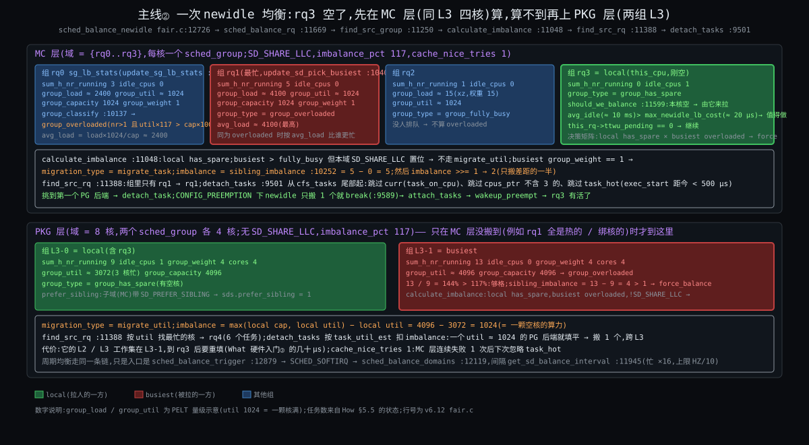

**MC 层**(每核一组):

| 步 | 代码 | 数 |
|---|---|---|
| 门槛 | `:12769`:`avg_idle`(rq3 近期平均空闲 ≈ 10 ms)vs `max_newidle_lb_cost`(≈ 20 μs)→ 做 | — |
| `should_we_balance`(`:11599`) | 本核 newidle → 由它拉 | — |
| `update_sg_lb_stats`(`:10309`)四个组 | rq0:`sum_h_nr_running` 3,overloaded;rq1:5,overloaded,`avg_load` 最高 → busiest;rq2:1,fully_busy;rq3:0,`idle_cpus` 1,has_spare(local) | — |
| `sched_balance_find_src_group`(`:11250`) | local has_spare × busiest overloaded → 决策矩阵 `force` | — |
| `calculate_imbalance`(`:11048`) | local has_spare;busiest > fully_busy **但 MC 有 `SD_SHARE_LLC`** → 不走 `migrate_util`;`busiest->group_weight == 1` → `migrate_task`,`imbalance = sibling_imbalance` = 5 − 0 = 5;`>>= 1` → **2** | 2 |
| `sched_balance_find_src_rq`(`:11388`) | 组里只有 rq1 | rq1 |
| `detach_tasks`(`:9501`) | 从 `cfs_tasks` 尾部:跳过 curr;跳过 `exec_start` 距今 < 500 μs 的 mysqld 线程;跳过 `cpus_ptr` 不含 3 的;第一个 PG 后端 → `detach_task`;**`CONFIG_PREEMPTION` 下 newidle 到此 break**(`:9607`) | 搬 1 |
| `attach_tasks` → `wakeup_preempt` | rq3 有活;`continue_balancing = 0`,不再上 PKG 层 | — |

所以 How §5.5 写的"搬 2 个"是 `imbalance` 的值,真正搬的是 1 个;剩下的差距留给下一次 newidle(rq3 把这个人跑完又空了)或周期均衡。

**PKG 层**(两组各 4 核;只在 MC 层没搬到时到这):

| 步 | 代码 | 数 |
|---|---|---|
| 组统计 | L3-0:9 可跑 / 4 核,`idle_cpus` 1,`group_util` ≈ 3072,has_spare(local);L3-1:13 / 4 核,`group_util` ≈ 4096 = capacity,overloaded | — |
| 够不够格 | `sds.prefer_sibling`(MC 有 `SD_PREFER_SIBLING`)且 local has_spare 且 `sibling_imbalance` = 13 − 9 = 4 > 1 → `force_balance`(`:11375`) | — |
| `calculate_imbalance` | local has_spare,busiest overloaded,**PKG 没有 `SD_SHARE_LLC`** → `migrate_util`,`imbalance = max(4096, 3072) − 3072 = 1024`(一颗空核的算力) | 1024 util |
| `find_src_rq` | 按 util 最忙 → rq4 | rq4 |
| `detach_tasks` | 按 `task_util_est` 扣:一个 ≈ 1024 的 PG 后端就填平 → 搬 1,**跨 L3** | 搬 1 |

两层的差别就是 §3.3 最后一行:同 LLC 拉平个数,跨 LLC 只填算力余量。How §5.5 写的"算出要搬 ~2 个 load 单位"应改为"`migrate_util` 1024"(待核 #73)。

### §3.5 反事实小试:搬人还能怎么搬

**机制:每核一本账;唤醒偏向 prev 和同 LLC 空核;均衡 pull、分层、差距一半、500 μs 热门槛。**

- **B1:全局一棵树一把锁(2.4 的 `runqueue_lock`)**
  - 违反 C5·核各自为政(8 核争一把锁;每次挑人可能换核,cache 全冷)和 C4·挑人须便宜(锁的等待时间随核数涨)。
  - 现实:Linux 2.4;2002 年 O(1) 换成每核一本(Origin 转折一)。
- **B2:每核一本账,但没有 `task_hot`(谁都能搬)**
  - 不违反 C5·核各自为政 的"账"一面,违反它的"代价"一面:刚跑了 100 μs 的任务被搬走,L2 白填;实测的就是 `sysctl_sched_migration_cost = 0` 的效果。
  - 现实:内核留了这个开关给实验,没有发行版默认 0。
- **B3:每次醒来都放到最闲的核(没有 `wake_affine`)**
  - 违反 C5·核各自为政:redis 每次醒来换核,工作集 L1 / L2 全冷;而且"最闲"要扫全部核,违反 C4·挑人须便宜。
  - 现实:`SD_BALANCE_WAKE` 置位就是这个行为(慢路径 `sched_balance_find_dst_cpu`),`sd_init` 默认 `0*SD_BALANCE_WAKE`(`:1623`)—— 只给 fork / exec 用,因为新任务没有 cache 可丢。
- **B4:push 模型(忙的核把人推出去)**
  - 不违反约束,但忙的核做均衡是在用它最缺的资源(时间);而且推给谁要扫别的核。
  - 现实:rt / dl 类用 push(`push_rt_task`,因为高优先级任务等不起"等哪个核空下来");fair 类只在 `active balance` 时让 `stop` 类线程做一次 push。
- **B5:不分层,平均看所有核(没有调度域)**
  - 违反 C5·核各自为政 的"远近":跨 L3 / NUMA 的搬人和同 L3 一样频繁;64 核机器每次均衡扫 64 个 `rq`,违反 C4·挑人须便宜。
  - 现实:2.6.7(2004)引入 `sched_domain`;之前的 O(1) 是平的。
- **B6:用户态自己搬(Go runtime 的 work stealing)**
  - 不违反约束,但只能在它自己的 M 个线程之间搬 goroutine,搬不了线程本身;内核把 M 个线程放哪它管不着。
  - 现实:Go / Java 虚拟线程 / SQLOS 都是"两层调度",内核这一层照旧。

**结论**:在 C4·挑人须便宜(找空核、均衡都不能随核数线性涨)+ C5·核各自为政(搬要付 cache,核有远近)+ C8·核不等速且耗电(按算力比)下,"每核一本 + 唤醒亲和 + 分层 pull + 热门槛"是局部最优;B2 / B3 / B5 各丢一条,B1 丢两条,B4 / B6 是别的类 / 别的层的正确答案。

### §3.6 反问(选择式)+ 从头走一遍

**问**:钩子二的做法一 —— redis `taskset -c 7` 绑在 rq7,PG 不动,rq4 上排了 6 个 PG 后端。redis 处理完一个请求睡了,rq7 空。newidle 均衡会不会把 PG 拉到 rq7?

- A. 不会,redis 绑核了,rq7 是它的
- B. 会,只要 rq4 上有不热、不绑核的 PG
- C. 取决于 redis 睡多久

### 从头走一遍

**问题来源**:绑核改的是 `p->cpus_ptr`,它只出现在两处 —— 唤醒选核的 `cpumask_and(cpus, span, p->cpus_ptr)`(`:7714`)和均衡的 `can_migrate_task`(`:9385`)。两处检查的都是**被搬的人**的 `cpus_ptr`,没有任何一行看"目标核上住着谁"。所以 A 的前提("rq7 是它的")在源码里不存在。

**分岔一(会不会做 newidle)**:redis 睡下去 → `pick_next_task_fair` 走到 `idle:` → `sched_balance_newidle`(`:12726`)。三个门:`ttwu_pending` 为 0;`get_rd_overloaded` —— rq4 有 6 个可跑,root domain 过载 → 过;`avg_idle` vs `max_newidle_lb_cost` —— redis 每 10 ms 醒一次算 50 μs,`avg_idle` ≈ 10 ms ≫ 20 μs → 过。**C 的"取决于睡多久"在这一步有影子**:如果 redis 的空闲只有几十微秒(高频请求),`avg_idle` 会小于均衡代价,newidle 就不做;但那种情况下 rq7 也几乎不空。

**分岔二(拉不拉得到)**:MC 层(rq4 ~ rq7 同 L3):local rq7 has_spare,busiest rq4 overloaded → `migrate_task`,`sibling_imbalance` = 6 − 0 = 6 → 3。`detach_tasks` 从 rq4 的 `cfs_tasks` 尾部挑:跳过正在跑的、跳过 500 μs 内跑过的、跳过 `cpus_ptr` 不含 7 的。PG 后端没绑核、6 个里总有几个已经排队超过 500 μs → **第一个过门的就被搬到 rq7**。

**分岔三(然后)**:`attach_tasks` → `wakeup_preempt(rq7, PG)`:rq7 的 curr 是 idle → 直接标记 → PG 在 rq7 跑起来。10 ms 后 redis 醒来,`select_task_rq_fair`:`cpus_ptr = {7}` → 只能 rq7;`enqueue_entity` → `check_preempt_wakeup_fair`:redis 权重 9548、lag 正 → `pick_eevdf` == redis → 标记。**如果 PG 此刻在用户态,redis 几微秒后上台;如果 PG 在内核态一段不可抢占区(比如一次大 `read` 的拷贝循环里,`PREEMPT_NONE` 下尤其),redis 要等它出来** —— 钩子二的 p99 8 ms 来自后者。

**结果**:**B**。绑核只绑"它走不了",不绑"别人进不来";要独占得把 PG 也绑走(`cpus_ptr` 不含 7 → `can_migrate_task` 返回 0,`LBF_ALL_PINNED` → rq7 的 newidle 换下一个 busiest 或放弃)或 `isolcpus=7`(rq7 不在任何域里,`on_null_domain`,`:12201`)。C 不是答案,但它指出了一个真实的旋钮:`avg_idle` 这道门。

---

## §4 主线③:cgroup 层级份额与带宽

**先说结论**:cgroup 在 fair 类里只多了两样东西 —— **组实体**(`task_group` 在每颗核上一个 `se` + 一棵 `cfs_rq`,`sched.h:432`;入账出账逐层爬,`enqueue_task_fair`,`fair.c:6955`;组实体的权重按本核负载分摊,`calc_group_shares`,`:4015`)和**带宽池**(`cfs_bandwidth`,`sched.h:405`;每核借 5 ms,`:5772`;借不到整组下树,`:5915`;定时器补池放回,`:6518` / `:6191`)。钩子一的 87.5 ms 可以从 `cpu.stat` 的三个计数器反推出来(§4.4);What 那道"改 4 核"的题答案是 C,数字在 §4.4。

### §4.1 操作层:cgroup v2 的四个文件

| 文件 | 源码落点 | 含义 / 默认 |
|---|---|---|
| `cpu.weight` | `cpu_weight_write_u64`(`core.c:9797`)→ `sched_weight_from_cgroup`(`sched.h:263`):`weight × 1024 / 100` → `tg->shares` | 1 ~ 10000,默认 100 = 1024;k8s `requests.cpu`:shares = milliCPU × 1024 / 1000,再 weight = 1 + (shares − 2) × 9999 / 262142(kubelet `cgroup_manager_linux.go`;2 核 → 2048 shares → weight 79;已核 #76) |
| `cpu.weight.nice` | `cpu_weight_nice_write_s64`(`:9832`)查 `sched_prio_to_weight` 反推 | −20 ~ 19 |
| `cpu.max` | `cpu_max_write`(`:9894`)→ `tg_set_cfs_bandwidth`(`:9298`):quota ≥ 1 ms、1 ms ≤ period ≤ 1 s(`:9312` / `:9320`)、burst ≤ quota(`:9329`)、`__cfs_schedulable` 检查子组之和 | `max 100000`;k8s `limits.cpu = 2` → `200000 100000` |
| `cpu.max.burst` | 同上,`cfs_b->burst` | 0 |
| `cpu.stat` | `cpu_cfs_stat_show`(`:9583`):`nr_periods` / `nr_throttled` / `throttled_time`(v2 里显示为 `throttled_usec`)/ `nr_bursts` / `burst_time`;`cpu_extra_stat_show`(`:9745`) | — |
| `sysctl kernel.sched_cfs_bandwidth_slice_us` | `sysctl_sched_cfs_bandwidth_slice`(`fair.c:124`) | 5000 |

### §4.2 函数逻辑层

#### §4.2.1 层级:组在每颗核上是一行,入账要逐层爬

```c
/* sched.h:432 节选 */
struct task_group {
	struct cgroup_subsys_state css;
	/* … */
	struct sched_entity	**se;        /* 每核一个:这个组在父级那颗核的树上的那一行 */
	struct cfs_rq		**cfs_rq;    /* 每核一棵:组自己的树,挂组内线程 / 子组 */
	unsigned long		shares;      /* cpu.weight 换算来的整组权重 */
	atomic_long_t		load_avg ____cacheline_aligned;   /* Σ 各核 grq->avg.load_avg */
	/* … */
};
/* fair.c:6955 节选 */
static void enqueue_task_fair(struct rq *rq, struct task_struct *p, int flags)
{
	struct sched_entity *se = &p->se;
	u64 slice = 0;
	/* … */
	if (flags & ENQUEUE_DELAYED) {
		requeue_delayed_entity(se);                        /* :6973 延迟出队中被唤醒 */
		return;
	}
	for_each_sched_entity(se) {                            /* :6986 从线程往上爬到根 */
		if (se->on_rq) {                                   /* 父组已经在树上:不用再往上 */
			if (se->sched_delayed)
				requeue_delayed_entity(se);
			break;
		}
		cfs_rq = cfs_rq_of(se);
		if (slice) {                                       /* 6.12:组实体的 slice = 组内最小 slice */
			se->slice = slice;
			se->custom_slice = 1;
		}
		enqueue_entity(cfs_rq, se, flags);                 /* :5382 本层放回(含 place_entity) */
		slice = cfs_rq_min_slice(cfs_rq);
		cfs_rq->h_nr_running++;
		/* … idle 计数 … */
		if (cfs_rq_throttled(cfs_rq))                      /* 碰到被 throttle 的层:停,不往上挂 */
			goto enqueue_throttle;
		flags = ENQUEUE_WAKEUP;
	}
	for_each_sched_entity(se) {                            /* :7014 已经在树上的祖先:只更新负载和权重 */
		cfs_rq = cfs_rq_of(se);
		update_load_avg(cfs_rq, se, UPDATE_TG);
		se_update_runnable(se);
		update_cfs_group(se);                              /* :4054 重算组实体权重 */
		/* … */
	}
	/* … dl_server_start(&rq->fair_server) :7030;add_nr_running … */
}
```

6.12 的一个新细节值得记:组实体的 `slice` 取组内实体的最小值(`cfs_rq_min_slice`)。因为 C3·份额与延迟两头要 的延迟旋钮(slice)是按实体设的,而挑人是逐层的 —— 如果 k8s 组里有一个声明了 0.5 ms slice 的线程,组实体在根树上也得用 0.5 ms 参与 deadline 排序,否则那个线程的"急"在根那一层被抹平。

#### §4.2.2 组实体的权重:`calc_group_shares`

```c
/* fair.c:4015,注释里的推导在 :3920 ~ :4013 */
static long calc_group_shares(struct cfs_rq *cfs_rq)
{
	long tg_weight, tg_shares, load, shares;
	struct task_group *tg = cfs_rq->tg;

	tg_shares = READ_ONCE(tg->shares);                     /* cpu.weight → 1024 基准 */
	load = max(scale_load_down(cfs_rq->load.weight), cfs_rq->avg.load_avg);   /* 本核组内负载,取瞬时和平均的大者 */
	tg_weight = atomic_long_read(&tg->load_avg);           /* 全组各核负载之和 */
	/* Ensure tg_weight >= load */
	tg_weight -= cfs_rq->tg_load_avg_contrib;
	tg_weight += load;
	shares = (tg_shares * load);
	if (tg_weight)
		shares /= tg_weight;                               /* 公式 (6):tg->weight × 本核负载 / 修正后的全组负载 */
	return clamp_t(long, shares, MIN_SHARES, tg_shares);
}
```

注释里的六个公式:(1) 理想情况下本核组实体权重 = 整组权重 × 本核组内权重 / 全组权重;(2) 用 `load_avg` 近似权重;(3) 由此得 `shares_avg`;(4) 单核(其他核都空)时应退化为整组权重;(5)(6) 把 (3) 修到"近单核时趋近 (4)",代价是 Σ 各核 ≥ 整组权重("hence icky!")。注释里那个例子:`tg->shares = 15 × 1024`,8 核各一个任务 → 每核 1920 而不是 `MIN_SHARES` 的 2048。对我们的 k8s 组(`cpu.weight` 100 → 1024,16 线程均匀在 8 核)每核 ≈ 128 —— How §3.7 的数,现在知道它从哪一行来、为什么会略大于 128。

`update_cfs_group`(`:4054`)在每次入账 / 出账 / tick(`entity_tick`,`:5673`)时调它,权重变了就 `reweight_entity`(`:3874`)—— 那里面也要做一次 lag 守恒(改权重等价于一次出队入队)。

#### §4.2.3 带宽:借、停、放、还

```c
/* sched.h:405 */
struct cfs_bandwidth {
	raw_spinlock_t		lock;
	ktime_t			period;            /* 100 ms */
	u64			quota;             /* 200 ms(2 核) */
	u64			runtime;           /* 池里还剩多少 */
	u64			burst;             /* 允许攒的额度 */
	u64			runtime_snap;
	s64			hierarchical_quota;
	u8			idle;
	u8			period_active;
	u8			slack_started;
	struct hrtimer		period_timer;      /* 补池 */
	struct hrtimer		slack_timer;       /* 捡零头 */
	struct list_head	throttled_cfs_rq;  /* 被停的各核 cfs_rq */
	/* Statistics: */
	int			nr_periods;
	int			nr_throttled;
	int			nr_burst;
	u64			throttled_time;
	u64			burst_time;
};
```

**借**(每个打断点,持 `rq` 锁):

```c
/* fair.c:5812 */
static void __account_cfs_rq_runtime(struct cfs_rq *cfs_rq, u64 delta_exec)
{
	cfs_rq->runtime_remaining -= delta_exec;               /* 先扣本核小账 */
	if (likely(cfs_rq->runtime_remaining > 0))
		return;
	if (cfs_rq->throttled)
		return;
	/* 借不到就打标记,让出口把这一层 throttle 掉 */
	if (!assign_cfs_rq_runtime(cfs_rq) && likely(cfs_rq->curr))
		resched_curr(rq_of(cfs_rq));                       /* :5826 */
}
/* fair.c:5772 */
static int __assign_cfs_rq_runtime(struct cfs_bandwidth *cfs_b, struct cfs_rq *cfs_rq, u64 target_runtime)
{
	u64 min_amount, amount = 0;
	lockdep_assert_held(&cfs_b->lock);
	min_amount = target_runtime - cfs_rq->runtime_remaining;   /* 要借到 target(5 ms)为止,欠的也补 */
	if (cfs_b->quota == RUNTIME_INF)
		amount = min_amount;
	else {
		start_cfs_bandwidth(cfs_b);                        /* 第一次借时把 period_timer 开起来 */
		if (cfs_b->runtime > 0) {
			amount = min(cfs_b->runtime, min_amount);      /* 池里不够 5 ms 就有多少给多少 */
			cfs_b->runtime -= amount;
			cfs_b->idle = 0;
		}
	}
	cfs_rq->runtime_remaining += amount;
	return cfs_rq->runtime_remaining > 0;                  /* 0 = 借不到 */
}
```

**停**(出口,`put_prev_entity` → `check_cfs_rq_runtime`,`:6488`):

```c
/* fair.c:5915 节选 */
static bool throttle_cfs_rq(struct cfs_rq *cfs_rq)
{
	/* … */
	raw_spin_lock(&cfs_b->lock);
	if (__assign_cfs_rq_runtime(cfs_b, cfs_rq, 1)) {       /* 再试借 1 ns:池刚被补了就不停 */
		dequeue = 0;
	} else {
		list_add_tail_rcu(&cfs_rq->throttled_list, &cfs_b->throttled_cfs_rq);   /* :5936 挂到被停链表 */
	}
	raw_spin_unlock(&cfs_b->lock);
	if (!dequeue)
		return false;

	se = cfs_rq->tg->se[cpu_of(rq_of(cfs_rq))];            /* 这颗核上的组实体 */
	walk_tg_tree_from(cfs_rq->tg, tg_throttle_down, tg_nop, (void *)rq);   /* 冻结子树的 PELT */

	task_delta = cfs_rq->h_nr_running;
	for_each_sched_entity(se) {                            /* :5951 从组实体往上:把它从父树出队 */
		struct cfs_rq *qcfs_rq = cfs_rq_of(se);
		if (!se->on_rq)
			goto done;
		flags = DEQUEUE_SLEEP | DEQUEUE_SPECIAL;           /* SPECIAL:绕开 DELAY_DEQUEUE */
		if (se->sched_delayed)
			flags |= DEQUEUE_DELAYED;
		dequeue_entity(qcfs_rq, se, flags);
		qcfs_rq->h_nr_running -= task_delta;               /* 组内所有线程从祖先的计数里消失 */
		/* … */
		if (qcfs_rq->load.weight) {                        /* 父树上还有别人:上面的层只更新不出队 */
			se = parent_entity(se);
			break;
		}
	}
	/* … 祖先只做 update_load_avg … */
	sub_nr_running(rq, task_delta);
	if (rq_h_nr_running && !rq->cfs.h_nr_running)
		dl_server_stop(&rq->fair_server);
done:
	cfs_rq->throttled = 1;
	cfs_rq->throttled_clock = rq_clock(rq);
	return true;
}
```

**放**(`period_timer` 到点,持 `cfs_b` 锁):

```c
/* fair.c:6518 节选 */
static enum hrtimer_restart sched_cfs_period_timer(struct hrtimer *timer)
{
	/* … */
	for (;;) {
		overrun = hrtimer_forward_now(timer, cfs_b->period);   /* 过了几个周期 */
		if (!overrun)
			break;
		idle = do_sched_cfs_period_timer(cfs_b, overrun, flags);   /* :6279 */
		if (++count > 3) {                                 /* 定时器回调自己都追不上周期:period 太短 */
			u64 new, old = ktime_to_ns(cfs_b->period);
			new = old * 2;
			if (new < max_cfs_quota_period) {
				cfs_b->period = ns_to_ktime(new);
				cfs_b->quota *= 2;
				cfs_b->burst *= 2;
				pr_warn_ratelimited("cfs_period_timer[cpu%d]: period too short, scaling up (new cfs_period_us = %lld, cfs_quota_us = %lld)\n", …);   /* :6550 */
			}
			/* … */
			count = 0;
		}
	}
	/* … */
}
/* fair.c:6279 节选 */
static int do_sched_cfs_period_timer(struct cfs_bandwidth *cfs_b, int overrun, unsigned long flags)
{
	if (cfs_b->quota == RUNTIME_INF)
		goto out_deactivate;
	throttled = !list_empty(&cfs_b->throttled_cfs_rq);
	cfs_b->nr_periods += overrun;                          /* cpu.stat nr_periods */
	__refill_cfs_bandwidth_runtime(cfs_b);                 /* 池 = min(runtime + quota, quota + burst),:5762 */
	if (cfs_b->idle && !throttled)
		goto out_deactivate;                               /* 上周期没人用:定时器停掉,省电 */
	if (!throttled) {
		cfs_b->idle = 1;
		return 0;
	}
	cfs_b->nr_throttled += overrun;                        /* cpu.stat nr_throttled:发生过停的周期数 */
	while (throttled && cfs_b->runtime > 0) {
		raw_spin_unlock_irqrestore(&cfs_b->lock, flags);
		throttled = distribute_cfs_runtime(cfs_b);         /* :6191 逐个被停的 cfs_rq 补到 > 0 并放回 */
		raw_spin_lock_irqsave(&cfs_b->lock, flags);
	}
	cfs_b->idle = 0;
	return 0;
out_deactivate:
	return 1;
}
```

`distribute_cfs_runtime`(`:6191`)遍历 `throttled_cfs_rq`:每个补 `−runtime_remaining + 1`(刚好回到正),本核的直接 `unthrottle_cfs_rq`,远端核的 `unthrottle_cfs_rq_async`(`:6180`,`__smp_call_single_queue` 发 IPI)—— 因为放回要持那颗核的 `rq` 锁,而这里持着 `cfs_b` 锁。

**还**(`dequeue_entity` 末尾 `return_cfs_rq_runtime`,`:6406`):本核组内最后一个线程睡了,把 `runtime_remaining − 1 ms`(`min_cfs_rq_runtime`,`:6334`)还回池;池里超过一片且有人被停着 → 起 `slack_timer`(`:6338`,5 ms 后)→ `do_sched_cfs_slack_timer`(`:6421`)再 `distribute` 一次。没有这一步,16 颗核各借了 5 ms 只用 0.5 ms 就睡,72 ms 锁在各核手里,别的核被停。

### §4.3 底层原理层:为什么是时间不是核、为什么 5 ms、为什么整组停

| 设计 | 原因 | 代价 | 约束 |
|---|---|---|---|
| 限的是 CPU 时间(quota / period),不是核数 | 空闲时可以用任何核(不浪费);忙时总量受控(可计费) | 突发时周期末硬停;"2 核"的直觉是错的 | C6·份额按组算 |
| 每核借 5 ms 一片 | 每微秒都碰 `cfs_b->lock` 会让 16 核争一把锁(C5·核各自为政);5 ms 是"锁的频率"和"池的碎片"的折中 | 借了没用完锁在手里 → 要 slack 回收;period 很短时 5 ms 片比每核应得还大 | C4·挑人须便宜 + C5·核各自为政 |
| 整组下树 | 配额是组的,没法定义"哪个线程超额";出队组实体一次 O(树高) | 刚收到请求的线程和空转的线程一起停 | C6·份额按组算 |
| 补池在定时器里、放回异步 | 补池要持 `cfs_b` 锁,放回要持各核 `rq` 锁,锁序不能反 | 放回有 IPI 延迟(μs 级,可忽略) | C5·核各自为政 |
| `period` 自动翻倍(`:6535`) | 定时器回调追不上周期说明 period 比回调代价还短 | 用户设的 period 被悄悄改了(有 `pr_warn`) | C4·挑人须便宜 |
| p99 ≈ period − 烧光时间 | 停的长度 = 周期剩余 | 平均用量低也会有大尾延迟 | C6·份额按组算 的代价本体 |

### §4.4 算例:钩子一在 `cpu.stat` 里长什么样

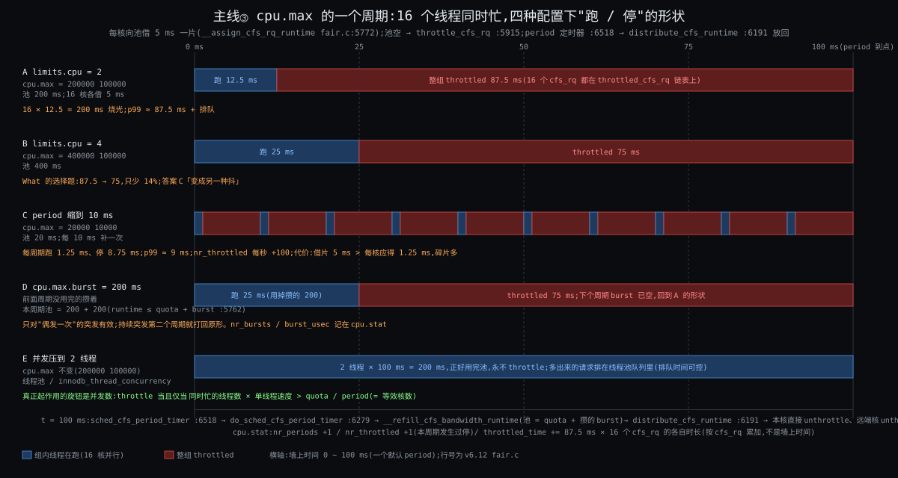

**配置 A**(`limits.cpu = 2`,`cpu.max = 200000 100000`,16 线程突发):

| 时刻 | 发生 | 计数器 |
|---|---|---|
| 周期开始 | `do_sched_cfs_period_timer`:`runtime = 200 ms`,`nr_periods++` | `nr_periods` +1 |
| 0 ~ 12.5 ms | 16 颗核各借 5 ms × 2.5 轮:40 片 × 5 ms = 200 ms;每核的 `runtime_remaining` 在 5 ms 片内扣 | — |
| 12.5 ms | 各核相继 `__assign_cfs_rq_runtime` 返回 0 → `resched_curr` → 出口 `check_cfs_rq_runtime` → `throttle_cfs_rq` × 16;`throttled_clock` 记下 | `nr_throttled` 在下个周期 +1 |
| 12.5 ~ 100 ms | 组在 64 核上消失;新到的请求在 socket 里等 | — |
| 100 ms | `sched_cfs_period_timer` → 补池 200 ms → `distribute_cfs_runtime`:本核一个 + 15 个 IPI;`unthrottle_cfs_rq` 把 `throttled_time += now − throttled_clock`(每个 cfs_rq 各加 ~87.5 ms) | `throttled_usec` +1.4 s(16 × 87.5 ms,**按 cfs_rq 累加不是墙上时间**,待核 #88) |

一秒内持续这样:`nr_periods` 10、`nr_throttled` 10、`throttled_usec` ≈ 14 000 000。看到 `nr_throttled / nr_periods ≈ 1` 且 `throttled_usec / nr_throttled` ≈ 1.4 s 就是这个形状。

**What 的选择题**(`limits.cpu` 2 → 4):

| 配置 | 烧光用时 | 每周期停 | p99 | `nr_throttled` / s |
|---|---|---|---|---|
| A:2 核 | 200 / 16 = 12.5 ms | 87.5 ms | ≈ 87.5 ms + 排队 | 10 |
| B:4 核 | 400 / 16 = 25 ms | 75 ms | ≈ 75 ms | 10 |
| C:2 核,period 10 ms | 20 / 16 = 1.25 ms | 8.75 ms | ≈ 9 ms | 100 |
| D:2 核 + burst 200 ms | 第一个周期 25 ms,之后 12.5 | 75 → 87.5 | 只救偶发一次 | 10 |
| E:2 核,并发压到 2 线程 | 永远烧不完 | 0 | 排队时间(可控) | 0 |

**答案 C(变成另一种抖)**:B 只把 87.5 变成 75;真正决定 throttle 发不发生的是"同时忙的线程数 × 单线程速度 > quota / period",所以 E 才是根治 —— 线程池 / `innodb_thread_concurrency` 把并发压到等效核数以内。C 把每次停缩短 10 倍但次数涨 10 倍,p99 从 87.5 降到 9,代价是每核借的 5 ms 片比每周期应得的 1.25 ms 大,碎片和锁争用都上去(`sysctl_sched_cfs_bandwidth_slice_us` 可以一起调小)。

### §4.5 反事实小试:封顶还能怎么封

**机制:组实体同形一行;配额按周期发到池、每核借片、借不到整组下树、定时器补池放回。**

- **C1·只在打断点换:按核数限(只给 `cpuset.cpus = 0-1`)**
  - 不违反 C6·份额按组算 的"封顶",但违反它的"空闲时不浪费":容器空闲时两颗核闲着别人也用不了,邻居忙时它也借不到第三颗核。位置旋钮冒充份额旋钮。
  - 现实:k8s `static` CPU manager policy 对 `Guaranteed` Pod 这么做,目的是 cache / NUMA 局部性,不是封顶。
- **C2·未来不可知:没有周期,只按 `cpu.weight` 分比例**
  - 违反 C6·份额按组算 的"要能封顶":机器空的时候一个 2 核容器能用满 64 核,计费模型崩;邻居一来骤降。
  - 现实:k8s 只设 `requests` 不设 `limits` 就是这个形状;很多团队故意这么做来换掉 throttle 的尾延迟 —— 代价是"可预期"没了。
- **C3·份额与延迟两头要:只停超额的那个线程,不停整组**
  - 违反 C6·份额按组算 的账的单位:配额是组的,哪个线程"超额"没有定义;要定义就得给每个线程再分一份配额(C6·份额按组算 嵌套一层),16 线程 × 2.5 ms 的小池更碎。
  - 现实:没人这么做;Windows Job Object 的 CPU rate control 也是整个 job 一起限(Comparison)。
- **C4·挑人须便宜:没有 burst(5.14 以前)**
  - 不违反约束,只是对"偶发一次的突发"也停。
  - 现实:5.14 加了 `cpu.max.burst`(已核:v5.14 `sched.h` 新增 `cfs_bandwidth.burst`);阿里云的提案,理由是容器大多数周期用不完。
- **C5·核各自为政:用 `SCHED_DEADLINE` 给组做预算(runtime / period 的 CBS)**
  - 形状几乎一样(每周期 runtime 用完等下周期),而且 dl 类有准入检查;但 dl 是**每任务**的,组级要 `dl` 的 group scheduling,内核没做;而且 dl 凌驾于 fair,会把普通任务挤掉(C7·有人要硬保证 的阀要重做)。
  - 现实:6.12 的 `fair_server` 反过来用了这个思想 —— 把整个 fair 类当一个 dl 实体保底(§5.2)。

**结论**:在 C6·份额按组算(单位是组、要嵌套、要封顶、空闲不浪费)+ C5·核各自为政(16 核不能每微秒争锁)下,"池 + 每核借片 + 整组停 + 周期补"是局部最优;C1·只在打断点换 / C2·未来不可知 各丢 C6·份额按组算 的一半,C3·份额与延迟两头要 把账拆得更碎,C4·挑人须便宜 是同一方案的补丁,C5·核各自为政 是把 C7·有人要硬保证 的层拿来做 C6·份额按组算 的事。

### §4.6 反问(选择式)+ 从头走一遍

**问**:把钩子一的 `period` 从 100 ms 改成 10 ms(`cpu.max = 20000 10000`),16 线程持续忙。一秒之内 `cpu.stat` 的 `nr_throttled` 从 10 变成:A. 10(不变)B. 100 C. 1000 D. 0

### 从头走一遍

**问题来源**:`nr_throttled` 在 `do_sched_cfs_period_timer`(`:6307`)里 `+= overrun`,只在"上一个周期发生过停"时加,加的是**周期数**不是停的次数、也不是停的 cfs_rq 数。

**分岔一(每个周期停不停)**:池 20 ms,16 线程 1.25 ms 烧光 → 停 8.75 ms → 每个周期都停。**分岔二(一秒几个周期)**:100 个。所以 `nr_throttled` 每秒 +100,**B**。`throttled_usec` 每秒 ≈ 100 × 16 × 8.75 ms = 14 s —— 和配置 A 一样(16 × 87.5 ms × 10),因为停的总时长没变,只是切碎了。**分岔三(5 ms 片的副作用)**:每核每周期应得 20 / 16 = 1.25 ms,但 `__assign_cfs_rq_runtime` 一次要借 5 ms,第 4 颗核来借时池已空 —— 前 4 核各拿 5 ms 跑完它们的 1.25 ms 后剩下的 3.75 ms 要等它们睡了才 `return_cfs_rq_runtime` 还回去(`:6383`,还的是超过 1 ms 的部分)再经 slack timer 放给别人;这就是 §4.4 说的"碎片",观测上是 `throttled_usec` 比理论值高、各线程被停的时长不均。把 `sched_cfs_bandwidth_slice_us` 调到 1000 可以缓解。

**结果**:B;附带一条:`nr_throttled` 高不等于更糟,它和 `period` 成反比;看 `throttled_usec / nr_periods`(每周期平均停多久)才是 p99 的代理。

---

## §5 附录:预留专题,只给机制和数字

每段一个专题,只列"它是什么 + 关键行 + 一两个数",不展开、不做反事实。需要哪个再单独开一轮。

### §5.1 rt 类:优先级数组、RR 片、95% 阀、优先级继承

账是 `struct rt_prio_array`(`sched.h:313`):100 个链表 + 一张 101 位的位图;挑人 `pick_next_rt_entity`(`rt.c:1706`)= `sched_find_first_bit(array->bitmap)` 找第一个非空级,取链表头 —— O(1)。`SCHED_RR` 的片 `sched_rr_timeslice = RR_TIMESLICE`(`rt.c:7`;`sched/rt.h:82`,`100 × HZ / 1000` = 100 ms),`task_tick_rt`(`:2570`)每 tick 减 1,到 0 回到同级队尾(`:2589`)。阀:`sysctl_sched_rt_period = 1000000`、`sysctl_sched_rt_runtime = 950000`(`rt.c:15` / `:21`),`sched_rt_runtime_exceeded`(`:876`)在 `update_curr_rt`(`:989`)里累计 `rt_time`,超过 950 ms 就 `rt_throttled = 1` 并打印 `sched: RT throttling activated`(`:900`),整个 rt 队列出队到下个周期 —— 这就是 `chrt -f 99` 的死循环还让你能 `ssh` 进去的原因。优先级继承在 `kernel/locking/rtmutex.c`:`rt_mutex_adjust_prio_chain`(`:675`)沿"等锁者 → 持锁者 → 它等的锁 → …"的链逐级抬优先级,链长上限 `max_lock_depth`(`:701`,默认 1024,待核 #79);`PREEMPT_RT` 下 `spinlock_t` 就是它。

### §5.2 dl 类:CBS、EDF、准入,以及 6.12 的 `fair_server`

`deadline.c:5` 自述"Earliest Deadline First (EDF) + Constant Bandwidth Server (CBS)"。每个任务声明 `(runtime, deadline, period)`;`replenish_dl_entity`(`:847`)在新周期把 `runtime` 补满、`deadline += period`(`:879` 的 while 循环处理欠得多的情况);`update_dl_entity`(`:1075`)是 CBS 的唤醒规则(原始 CBS vs Revisited CBS,`:1047` 起的注释);`dl_task_timer`(`:1264`)在 runtime 用完被 throttle 后等到下个周期再放回。准入 `__dl_overflow`(`:239`):`cap_scale(dl_b->bw, cap) < total_bw − old_bw + new_bw` 就拒绝,`dl_b->bw` 来自 `sched_rt_runtime / sched_rt_period` 这同一个 95% 比值(How 待核 #21 关掉:rt 封顶和 dl 总带宽共用这个比值)。

**`fair_server`**(6.12 新):每颗核的 `rq->fair_server`(`sched.h:1135`)是一个 `sched_dl_entity`,`fair_server_init`(`fair.c:8980`)用 `dl_server_init`(`deadline.c:1666`)挂上 `fair_server_has_tasks` / `fair_server_pick_task`;`dl_server_start`(`:1627`)第一次启动时给的默认参数是 **runtime 50 ms / period 1000 ms**(`:1637 ~ :1638`,即 5%),`dl_defer = 1`(`:1643`,只在 fair 真的饿着时才动用,不抢先);`update_curr`(`fair.c:1245`)里 `dl_server_update(&rq->fair_server, delta_exec)` 把 fair 任务跑的时间记进去。它和 §5.1 的 95% 阀在 6.12 里**并存**:阀是"rt 最多用 95%",server 是"fair 至少拿到 5%,以 dl 实体的身份去抢"。How §7 写的"正在逐步接替"没有 6.12 源码依据,改成"并存,后者是前者的对偶"(待核 #74)。

### §5.3 抢占模型:`preempt_count` 的布局与五种内核

`include/linux/preempt.h:27 ~ :31`:`PREEMPT_MASK 0x000000ff`(嵌套的 `preempt_disable` 计数)、`SOFTIRQ_MASK 0x0000ff00`、`HARDIRQ_MASK 0x000f0000`、`NMI_MASK 0x00f00000`、`PREEMPT_NEED_RESCHED 0x80000000`(x86 把"该换人"的反码也放在这个 per-cpu 字里,`resched_curr` 的 `set_preempt_need_resched`,`core.c:1093`,这样 `preempt_enable` 只要一条 `dec + jnz` 就能判断"计数归零且该换")。模型在 `kernel/Kconfig.preempt`:`PREEMPT_NONE`(`:18`)、`PREEMPT_VOLUNTARY`(`:32`)、`PREEMPT`(`:51`,"Low-Latency Desktop")、`PREEMPT_RT`(`:70`,自旋锁换成可睡的 PI 锁、中断线程化)、`PREEMPT_DYNAMIC`(`:96`,启动参数 `preempt=` 用静态调用切换,x86 默认 y)。内核态真换人的入口 `preempt_schedule_irq`(`core.c:7003`):中断返回内核态且 `preempt_count == 0` 且有标记 → `__schedule(SM_PREEMPT)`。6.12 的 `Kconfig.preempt` 里**没有** `PREEMPT_LAZY`(How 待核 #16:版本仍待核,6.12 确认不含)。

### §5.4 `sched_ext`:把挑人规则交给 BPF

类的位置:`include/asm-generic/vmlinux.lds.h:131 ~ :138` 的链接顺序 `stop > dl > rt > fair > ext > idle` —— `ext` 在 fair **之下**;加载了 BPF 调度器且没设 `SCX_OPS_SWITCH_PARTIAL`(`ext.c:123`)时,所有 `SCHED_NORMAL / BATCH / IDLE / EXT` 任务都切到 ext 类(`Documentation/scheduler/sched-ext.rst:53`),fair 树空掉,所以顺序不影响结果;设了 PARTIAL 则只有 `SCHED_EXT` 策略的任务归它。BPF 程序实现 `struct sched_ext_ops`(`ext.c:205` 起,`enqueue` / `dispatch` / `select_cpu` / `running` / `stopping` …),任务通过 `scx_bpf_dispatch`(`:6029`,6.13 起改名 `scx_bpf_dsq_insert`,待核 #77)放进派发队列 DSQ:`SCX_DSQ_LOCAL`(每核一个,`ext.h:48`)、`SCX_DSQ_GLOBAL`(`:47`)或自建;默认 slice `SCX_SLICE_DFL` = 20 ms(`ext.h:20`)。安全阀:`scx_ops_disable_workfn`(`ext.c:4445`)在 BPF 出错、有任务饿超时、或 `SysRq-S` 时把所有任务搬回 fair;`/sys/kernel/sched_ext/root/ops` 和 `state`(`:4228` / `:5055`)可观测。对灵魂问题的意义:C2·未来不可知 / C3·份额与延迟两头要 的折中第一次变成**每个负载自己选**。

### §5.5 EAS 与 schedutil:`util_avg` 的第二个用途

`select_task_rq_fair` 的第一步就是 `find_energy_efficient_cpu`(`fair.c:8391`),条件是 root domain 没过载且有能耗模型(`rd->pd`);x86 服务器没有能耗模型,这条路径不走。有模型的机器(手机)上它对每个 perf domain 用 `compute_energy`(`:8335`)估"把 p 放这儿总能耗涨多少",选涨得最少的。调频 `schedutil`:`sugov_get_util`(`cpufreq_schedutil.c:198`)直接读 `effective_cpu_util` —— fair 的 `util_avg` + rt / dl / irq 的占用,经 `sugov_effective_cpu_perf`(`:181`)算出目标频率;`uclamp`(`core.c:1405` 起的 sysctl,`uclamp_min / max`)让任务声明"把我当成至少 / 至多这么重",既影响选核也影响调频。

### §5.6 core scheduling:SMT 兄弟只跑同一个 cookie

`prctl(PR_SCHED_CORE)` → `sched_core_share_pid`(`kernel/sched/core_sched.c:129`)给任务组分配一个 cookie;`sched_core_enqueue`(`core.c:268`)把任务同时挂进一棵按 cookie 排的核级树;`sched_core_tick` 在 `sched_tick`(`:5610`)里;挑人时 SMT 兄弟只能跑同 cookie 的任务,否则强制 idle;`task_hot`(`fair.c:9285`)也看 `sched_core_cookie_match`。目的是防 SMT 侧信道(L1TF / MDS),代价是兄弟核空转。

### §5.7 NUMA balancing:搬页还是搬任务

`task_tick_numa`(`fair.c:3581`)按 `numa_scan_period`(`sysctl_numa_balancing_scan_period_min / max` = 1000 / 60000 ms,`:1439` / `:1440`;每次扫 `scan_size` 256 MB,`:1443`)挂一个 `task_numa_work`(`:3289`):把任务的一段页表项改成"NUMA hint"(不可访问),下次访存触发缺页 → `task_numa_fault`(`:3151`)统计"这个任务在哪个节点访存多";`task_numa_placement`(`:2879`)算 preferred node,`numa_migrate_preferred`(`:2625`)把任务搬过去,或者 `migrate_misplaced_folio` 把页搬过来。均衡那边 `migrate_degrades_locality`(在 `can_migrate_task`,`:9436`)让"搬过去会离内存更远"的任务也算热。

### §5.8 autogroup:每个终端会话一个组

`sysctl_sched_autogroup_enabled = 1`(`autogroup.c:7`);`sched_autogroup_create_attach`(`:192`)在 `setsid` 时建一个 `task_group` 并把会话挂进去;`proc_sched_autogroup_set_nice`(`:230`)对应 `/proc/<pid>/autogroup` 的 nice。效果:一个终端里 `make -j64` 的 64 个线程作为一个组和另一个终端的 1 个浏览器线程 1 : 1 —— Origin 转折三里 Linus 夸的那 200 行补丁。服务器上通常被 systemd 的 slice / scope 取代(同一机制,`cpu` 控制器)。

---

## §6 端到端场景时间线

把三条主线放到同一条墙上时间轴上(机器同前;k8s 组 16 线程在 16 颗核上,其中 2 颗在本机的 8 核示意里):

| t | 核 | 事件 | 主线 / 行 |
|---|---|---|---|
| 0 | — | k8s 组的 `period_timer` 到点(定时器有随机初相,`init_cfs_bandwidth`,`:6587`):池 = 200 ms;`nr_periods++` | ③ `:6279` |
| 0 ~ 4 ms | 0 | mysqld#3 跑;每个打断点 `update_curr` → `account_cfs_rq_runtime` 扣本核小账 | ① ③ `:1216` / `:5812` |
| 4.000 | 0 | tick:mysqld 跑满 slice → `update_deadline` 真 → 标记 → 出口 → `pick_eevdf` → xz | ① `:1007` / `:907` |
| 8.000 | 0 | tick:xz lag −265 → mysqld | ① |
| 10.000 | 2 → 0 | NIC 中断;ttwu;选核 0;IPI;入账;`check_preempt_wakeup_fair` → 标记 → redis 上台(6.5 μs) | ① §2.3 |
| 10.050 | 0 | redis 睡;lag +0.499 存下;真出队;mysqld 回来 | ① `:5476` |
| 12.5 | 16 核 | k8s 组 40 片借完,各核 `__assign_cfs_rq_runtime` 返回 0 → `resched_curr` → 出口 `check_cfs_rq_runtime` → `throttle_cfs_rq` × 16;组实体从各核的根树出队 | ③ `:5772` / `:5915` |
| 12.5 ~ 100 | — | 组消失;那两颗本机核上的 mysqld 线程不在树上,PG / xz 多分到份额 | ③ |
| ~20 | 3 | rq3 的 curr 睡 → `sched_balance_newidle`:MC 层从 rq1 拉 1 个 PG(可抢占内核只搬 1 个) | ② `:12726` / `:9607` |
| 20 ~ 64 | 各核 | 每 4 ms tick:记账、`update_cfs_group` 重算组权重、`sched_balance_trigger` 看 `next_balance` | ① ② ③ `core.c:5584` |
| 64 | 某忙核 | MC 层周期均衡(忙时 4 ms × 16 = 64 ms):`sched_balance_domains` → `sched_balance_rq`,17% 迟滞不够 → `lb_balanced` | ② `:12119` |
| 100 | 补池核 | `sched_cfs_period_timer`:池 = 200 ms;`nr_throttled++`;`distribute_cfs_runtime`:本核 `unthrottle_cfs_rq`,15 个远端 IPI;各核 `throttled_time += 87.5 ms` | ③ `:6518` / `:6191` |
| 100.0x | 各核 | 组实体放回各核根树 → `wakeup_preempt`:若组内线程 deadline 更早且有资格 → 标记 → 下个出口换上 | ① `core.c:2136` |
| 100 | 各核 | PKG 层周期均衡到点(忙时上限 100 ms,`SD_SERIALIZE` 不在 PKG) | ② `:9170` |
| 110 | — | 16 线程又烧了 12.5 ms 的配额 … 下一轮 | ③ |

一条轴上看得出三件事:判据③ 的"停"是最粗的事件(一次停掉 16 颗核上的整组,87.5 ms),判据① 的换人是最细的(μs 级、每 4 ms 一次),判据② 介于中间(ms 到百 ms)。三条主线的时间尺度差三个数量级,这是它们能各写各的代码、只靠 `rq` 锁和 `cfs_b` 锁衔接的原因。

---

## §7 约束回扣

| 约束 | 本篇钉到的机制 | 代价 |
|---|---|---|
| C1·只在打断点换 | 三条调用链的入口都是 tick / 唤醒 / 空闲 / 定时器;`resched_curr`(`core.c:1079`)只置位,真换在 `exit_to_user_mode_loop`(`entry/common.c:101`)和 `preempt_schedule_irq`(`core.c:7003`);tick 粒度让 3 ms 的 slice 实际跑 4 ms(§2.4) | 决定到执行最多差一次出口;`PREEMPT_NONE` 下内核态长路径不可抢 |
| C2·未来不可知 | `pick_eevdf`(`fair.c:907`)40 行里没有任何类型判断;`update_curr`(`:1216`)只记过去;模拟器能复现说明规则是封闭的 | 真正的交互任务没有"奖励",只能靠 lag 和 slice |
| C3·份额与延迟两头要 | 权重表 `core.c:10012`;`update_deadline`(`:1007`)只推一次;`entity_lag`(`:692`)夹 ±2 slice;`place_entity`(`:5266`)守恒放大;`RUN_TO_PARITY` / `PREEMPT_SHORT`(`:928` / `:1177`);`DELAY_DEQUEUE`(`:5500`);组实体 slice 取组内最小(`:7004`) | 每实体多两个字段;树要增广;改权重也要守恒 |
| C4·挑人须便宜 | 增广树的 `min_vruntime` 剪枝(`:807` / `:937`);`avg_vruntime` 两个累加器(`:620`);`__calc_delta` 乘倒数(`:259`);`vruntime_eligible` 不除法(`:739`);`__pick_next_task` 快路径(`core.c:5968`);`SIS_UTIL` 限扫描(`:7720`);每核借 5 ms 片(`:124`) | 常数项换成了字段和表 |
| C5·核各自为政 | 每核 `rq`;`wake_affine` 偏 prev 108.5%(`:7411`);`select_idle_sibling` 同 LLC(`:7873`);`sched_balance_rq` pull(`:11669`);`imbalance >>= 1`(`:11162`);`task_hot` 500 μs(`:9298`);`sd_init` 分层(`topology.c:1588`);远端放回走 IPI(`:6180`) | 永远近似均衡;newidle 每次只搬一个 |
| C6·份额按组算 | `task_group` 每核一行(`sched.h:432`);`enqueue_task_fair` 逐层(`:6986`);`calc_group_shares`(`:4015`);`cfs_bandwidth`(`sched.h:405`);借 / 停 / 放 / 还(`:5772` / `:5915` / `:6191` / `:6383`);`cpu.stat`(`core.c:9583`) | 周期末整组停;组实体权重估算偏大("icky") |
| C7·有人要硬保证 | 类栈顺序(`vmlinux.lds.h:131`);rt 位图 O(1)(`rt.c:1706`);95% 阀(`:876`);`__dl_overflow` 准入(`deadline.c:239`);PI 链(`rtmutex.c:675`);`fair_server` 5% 保底(`deadline.c:1637`) | 5% 留白;准入拒绝;锁更重 |
| C8·核不等速且耗电 | PELT 三个量(`pelt.c:180`,y³² = ½);`cpu_capacity` 与 `scale_rt_capacity`;SMT 层 110%(`topology.c:1661`);`migrate_util` 按算力余量(`:11115`);`misfit` / EAS(`:8391`);schedutil 读同一个 util(`cpufreq_schedutil.c:198`);`NO_HZ_IDLE` + `nohz_balancer_kick`(`:12284`) | 32 ms 半衰期对突发反应慢;能耗模型 x86 服务器没有 |

八条都钉到了至少一行;没有一行是"开发者偏好"。

---

## §8 呼应你的问题

你的问题三段,这一份闭环到大约 **95%**:

- **"按什么规则挑下一个"**:规则 = `fair.c:907` 的 40 行;它依赖的四个数各在哪一行涨、夹、放回、推,§2.2 贴了原文;How §3.6 的五拍表被模拟器复现到 0.01 ms,§2.4 逐列讲了每个数为什么那样变;§2.6 把上一轮卡住的 lag 用一个两任务的例子走到了稳态。剩下的 5% 里有一半在这里:**`pick_eevdf` 的增广搜索为什么一定返回"最早 deadline 的 eligible"**(堆性质的证明,`:889` 的注释只断言没证明),以及 `avg_vruntime` 的 44 位上界在极端权重下会不会溢出 —— 两者都是工程细节,不改变答案。
- **"被哪些约束逼出来、为什么三代"**:本篇补的是"EEVDF 相比 CFS 具体删了什么、加了什么":删掉的是 `sched_latency / min_granularity / wakeup_granularity` 三个旋钮和 `place_entity` 里"睡醒补半个 slice"的分支,加的是 `deadline` / `slice` / `vlag` 三个字段、`avg_vruntime` 累加器、`entity_eligible`、`update_deadline`、树的增广、`RUN_TO_PARITY` / `PREEMPT_SHORT` / `DELAY_DEQUEUE` 三个特性。"为什么"(当年的人怎么走到这)是 Origin 的事,这里不重复。
- **"多核和 cgroup 把规则扩展成了什么"**:多核 = `select_task_rq_fair`(`:8589`)+ `sched_balance_rq`(`:11669`)两条链,判据是 `calculate_imbalance`(`:11048`)和 `task_hot`(`:9260`),§3.4 把 How §5.5 的算例走到了源码分支(并修正了两处);cgroup = `task_group` 同形一行(`sched.h:432`)+ `cfs_bandwidth` 的借停放还(`:5772` / `:5915` / `:6191` / `:6383`),§4.4 把钩子一对到了 `cpu.stat` 的三个计数器。剩下的另一半 5%:NUMA 层和 EAS 的真实数字(我们的机器没有),以及 `calc_group_shares` 那个"icky"的高估到底偏多少 —— 要真机。

一句话带走:**三个判据、三处行号 —— `fair.c:907` 挑人、`:9260` / `:11048` 搬人、`:5772` / `:5915` 停组;其余一万多行是记账、分类、锁和统计。**

---

## 待核

| # | 事项 | 结论(收尾核实 2026-11-03) |
|---|---|---|
| 70 | §2.3 时间线各行 ns 量级(0.3 / 0.5 / 1.0 / 1.8 / 2.3 / 2.6 / 3.0 / 3.4 / 6.0 μs) | **无法上机核实** —— 估计;换人段取上一轮实测 2 ~ 3 μs(出处:—) |
| 71 | How 待核 #19(唤醒到首指令 7 ~ 10 μs) | **部分核实** —— 同 How #19(出处:Deep §2.3) |
| 72 | How §14 分岔三"mysqld 也有资格" | **已核** —— 两实体时 Σ w·lag = 0,mysqld 无资格;How §14 已改(出处:05-eevdf-sim.py 场景 deep26) |
| 73 | How §5.5 算例两处 | **已核** —— MC 层 newidle 可抢占内核只搬 1(`fair.c:9607`);PKG 层 `migrate_util` = 1024;How §5.5 已改(出处:kernel/sched/fair.c:9607、:11048(v6.12)) |
| 74 | How §7 / 待核 #18 `fair_server` "逐步接替 95% 阀" | **已核(并存)** —— 同 How #18;How §7 已改(出处:kernel/sched/deadline.c:1637) |
| 75 | How 待核 #16 `PREEMPT_LAZY` 版本 | **已核** —— 6.13;同 How #16(出处:v6.13 kernel/Kconfig.preempt:75) |
| 76 | k8s `requests.cpu` → `cpu.weight` 换算公式(经 cgroup v1 shares 再换 v2 weight) | **已核** —— 同 How #24;Deep §4.1 表已补公式(出处:kubelet cgroup_manager_linux.go:286) |
| 77 | `scx_bpf_dispatch` → `scx_bpf_dsq_insert` 改名版本 | **已核** —— 6.13:v6.13 `ext.c` 用 `scx_bpf_dsq_insert`(21 处),`scx_bpf_dispatch` 仅作兼容别名出现;6.12 仍是 `scx_bpf_dispatch`(出处:https://raw.githubusercontent.com/torvalds/linux/v6.13/kernel/sched/ext.c) |
| 78 | `sysctl_sched_nr_migrate` 默认 32(`loop_max`) | **已核** —— `SCHED_NR_MIGRATE_BREAK` = 32(`CONFIG_PREEMPT_RT` 下 8)(出处:kernel/sched/sched.h:2819 ~ :2823;kernel/sched/core.c:152(v6.12)) |
| 79 | `max_lock_depth` 默认 1024 | **已核** —— `int max_lock_depth = 1024;`(出处:kernel/locking/rtmutex_api.c:14(v6.12)) |
| 80 | `SIS_UTIL` 的 `nr_idle_scan` 公式(`update_idle_cpu_scan`) | **已核** —— 同 How #25(出处:kernel/sched/fair.c:10903 ~ :10972) |
| 81 | How 待核 #14 NUMA 层 `imbalance_pct` | **已核** —— `sd_init` 不单独设(出处:kernel/sched/topology.c) |
| 82 | How 待核 #26 §3.6 算例数字 | **已核** —— 模拟器复现(出处:05-eevdf-sim.py) |
| 83 | How 待核 #13 PELT 常数 | **已核** —— `sched-pelt.h:13 ~ :14`(出处:kernel/sched/sched-pelt.h) |
| 84 | How 待核 #21 dl 准入与 rt 比值共用 | **已核** —— `__dl_overflow` 用 `dl_b->bw`(出处:kernel/sched/deadline.c) |
| 85 | §2.3 假设 LLC0 四核全忙、无空核(否则 `select_idle_cpu` 会把 redis 放到空核,不发生抢占) | **场景假设** —— 非事实断言,保留(出处:—) |
| 86 | `sched_ext` 的现实用户(Meta / 游戏 / 手机厂) | **部分核实** —— Meta:生产部署(sched-ext/scx 仓库 README 自述 "Meta and Google are fully committed … mass production deployment");Valve Steam Deck:Igalia 的 `scx_lavd`(Phoronix 2024;Bazzite 社区称 Steam Deck 默认启用,非 Valve 官方声明);"手机厂"未核,已从正文去掉(出处:https://github.com/sched-ext/scx ;https://phoronix.com/news/LAVD-Scheduler-Linux-Gaming ;https://lpc.events/event/18/contributions/1713/attachments/1425/3058/scx_lavd-lpc-mc-24.pdf) |
| 87 | `wake_affine_weight` 偏置 `100 + (imbalance_pct − 100)/2` = 108.5 | **已核** —— `100 + (imbalance_pct − 100) / 2`(出处:kernel/sched/fair.c:7411) |
| 88 | `cpu.stat` 的 `throttled_time` 按 cfs_rq 累加(`unthrottle_cfs_rq` 里 `cfs_b->throttled_time += now − throttled_clock`) | **已核** —— `unthrottle_cfs_rq`:`cfs_b->throttled_time += rq_clock(rq) − cfs_rq->throttled_clock`,每个被 throttle 的 cfs_rq 各加一次;`cpu.stat` 的 `throttled_usec` = `cfs_b->throttled_time` / 1000(出处:kernel/sched/fair.c:6033 ~ :6034、:9752 ~ :9764(v6.12)) |
| 89 | `cfs_rq_min_slice` / 组实体 slice 取最小是 6.12 新加 | **已核** —— v6.11 `fair.c` 无 `cfs_rq_min_slice`(出处:https://raw.githubusercontent.com/torvalds/linux/v6.11/kernel/sched/fair.c) |
| 90 | `PLACE_REL_DEADLINE` 进入版本(6.12?) | **已核** —— v6.11 `features.h` 无(出处:同 How #23) |

---

---

> **🔄 心智切换:工程师 → 评论家(比较模式)**
>
> 三条主线钉到行号和纳秒之后,还剩一个问题没法在 Linux 内部回答:这些选择里哪些是约束逼出来的,哪些只是血统带来的?答案要靠另一套从头设计的内核来对照。下一篇换成评论家,把 Linux 放到 Windows NT 的 dispatcher 旁边 —— Cutler 从 VMS 出发,在同样八条约束下做了一套 32 级优先级加提升的调度器,至今没有换成账。四问逐问比:何时换、换谁、各多少、在哪换;两边一样的,是约束的函数;两边不同的,追到「信不信事件能说明意图」这一件事上。最后拿 SQL Server 的 SQLOS 看用户态协作式调度为什么能绕开其中两条约束。

---

<a id="stage-comparison" name="stage-comparison"></a>

# 📍 第六篇:Comparison — 横向对照

# 阶段 6:Linux 的进程调度器与 Windows NT 的对照

> 前五份把 Linux 的挑人规则从「账」讲到 6.12 的行号。这一份把它放到另一套从头设计的内核旁边 —— Windows NT 的 dispatcher —— 看四问里哪些答案两边一样(约束逼出的必然),哪些不一样(血统带来的偶然)。上一轮(Linux进程全链路 §4)已经比过一条线:CreateProcess 对 fork、32 级抢占对 EEVDF 的轮廓、时间片 6 / 36 单位、4 秒反饥饿提升、切换存几个寄存器、SQLOS 为什么自己做调度。那些**只引用不重讲**;这一份往 dispatcher 里面走:提升怎么衰减、理想处理器怎么定、Job 对象怎么封顶、IRQL 怎么挡住调度、MMCSS 留 20% 是不是 Linux 的 95% 阀、SQLOS 2016 起的 LDF 是不是 lag。
>
> **依据**:NT 不开源。NT 侧的说法来自微软文档(learn.microsoft.com 的 Win32 / 驱动 / 硬件定制页、SQL Server 文档、Server 2008 R2 的 RDSH 文档)、微软内核组 David Probert 的「Windows Kernel Internals: Thread Scheduling」讲义(微软版权,2010 年前后)、kubelet 的 Windows 源码;Windows Internals 7th(Yosifovich / Ionescu / Russinovich / Solomon)只作二手佐证并标明。拿不准的标「待核」,不编数字。Linux 侧沿用 How(`03-how.md`)与进源码那一份(`05-deep.md`:§2 主线① EEVDF、§3 主线② 多核、§4 主线③ cgroup、§5 附录)。
>
> 贯穿机器与任务不变:8 核两组 L3、HZ 250、mysqld ×16、redis ×1(nice −10)、xz(nice 19)、PG 后端若干、k8s 容器限 2 核;NT 侧同一台机器装 Windows Server,同一组负载。

---

## §0 从 Deep 走到 Comparison:三件事记住

承上:进源码那一份把三条主线钉到了三个判据 —— eligible 且 deadline 最早、搬人只在有利可图且不热、整组按周期借还。把 NT 放到旁边,四问各得一个判词,压成三件事。

### §0.1 件①:「何时换」两边一样 —— 从 C1·只在打断点换 推出

因为内核没有自己的 CPU(C1·只在打断点换)→ 要解决"决定换人和真换人分开"→ 两边长出同一个形状:Linux 是 `TIF_NEED_RESCHED` 标记 + 两种出口(How §4);NT 是线程先进 **DeferredReady → Standby**,再由目标处理器的 dispatch 中断(DPC 级)真换,调度本身只在 IRQL < 2 发生(Probert 讲义第 5、15 ~ 18 页)。中断处理里不换人、持自旋锁不换人,两边一字不差 —— NT 用 IRQL 抬到 DISPATCH_LEVEL 表达,Linux 用 `preempt_count` 表达。**硬件给的约束,两边只能这么答。**

### §0.2 件②:「换谁」是血统差异 —— 从 C2·未来不可知 的两种信仰推出

因为未来不可知(C2·未来不可知)→ 要解决"换谁的依据从哪来"→ 两边选了相反的信仰。NT 相信**事件类型能说明意图**:I/O 完成了就给 +1 ~ +8,窗口收到输入就 +2,前台进程类抬到不低于后台,然后每跑完一个时间片减一级回基线(微软「Priority Boosts」页)—— 这正是 Linux 2007 年 CFS 删掉、2023 年 EEVDF 删干净的那套"猜"(Origin §4、§7)。Linux 相信**只有账可信**:lag、deadline、权重,规则不看事件只看数。两边都承认 C2·未来不可知,一个用启发式补,一个用守恒量补。**这是血统(VMS → NT,Cutler 1988)带来的偶然,不是约束逼出的必然** —— 证据是 NT 自己也在往"账"走:SQLOS 2016 起的 Large Deficit First(§7)。

### §0.3 件③:「各多少 / 在哪换」两边被同一组约束逼到相似形状 —— 从 C5·核各自为政 + C6·份额按组算 推出

因为跨核贵、核间有远近(C5·核各自为政)→ 两边都是每核一组就绪队列 + "醒来尽量回原核":Linux 的 `rq` + `wake_affine`,NT 的每处理器 `DispatcherReadyListHead[32]` + 理想处理器 / 上次处理器(Probert 第 15、18 页)。因为组要能封顶(C6·份额按组算)→ 两边都是"按时间周期扣、扣光整组停":Linux `cpu.max`,NT Job 对象的 `JOB_OBJECT_CPU_RATE_CONTROL_HARD_CAP`(微软原话:到了本调度周期的额度,"no threads associated with the job will run until the next interval")。差异在参数和粒度(有没有周期性拉均衡、权重是 1 ~ 10000 还是 1 ~ 9),**结构是必然的**。

### §0 结论:三件事对照

| 件 | Linux 6.12 | Windows NT | 判定 |
|---|---|---|---|
| ① 何时换 | 标记 + 出口;`preempt_count` 非零不换 | DeferredReady → Standby + dispatch 中断;IRQL ≥ 2 不换 | 必然(C1·只在打断点换 硬件给的) |
| ② 换谁 | eligible ∧ deadline 最早;账 | 最高优先级 ∧ 同级轮转;事件提升 + 每片衰减 | 偶然(C2·未来不可知 的两种信仰;血统) |
| ③ 各多少 / 在哪 | `cpu.weight` / `cpu.max`;每核 rq + 调度域均衡 | Job 权重 1 ~ 9 / 硬上限;每处理器队列 + 理想处理器,无周期拉均衡 | 结构必然(C5·核各自为政 + C6·份额按组算)、参数偶然 |

---

## §1 一张极简概览图

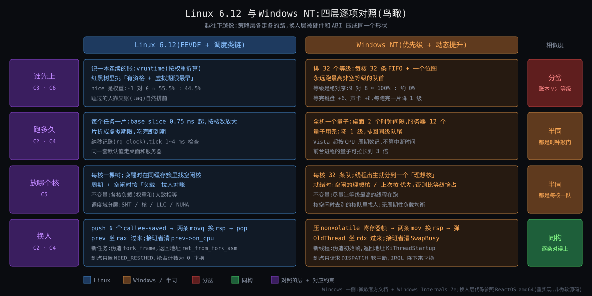

从图上能读出五件事:

1. **第一行(何时换)两边几乎对称**:左右各一个"标记 / 预备态"小旗子,各一个"出口 / dispatch 中断"。
2. **第二行(换谁)左边是一条数轴(V、lag、deadline),右边是一列 32 级阶梯 + 向上的箭头(提升)和向下的台阶(衰减)**。数轴上没有"你是谁",阶梯上全是"你是谁"。
3. **第三行(各多少)两边都有一条"周期 → 额度 → 停"的时间线**,只是左边额度写的是 ms,右边写的是 ‰(每 10000 周期里的份)。
4. **第四行(在哪)左边 8 本账之间有周期性的虚线(均衡),右边 8 本账之间只有"就绪时放哪"一条实线**。NT 的核之间平时不互相看。
5. **右下角多出两个 NT 独有的小框:MMCSS(留 20%)和 SQLOS(自己做一层)** —— 一个对应 Linux 的 95% 阀,一个对应"把 C2·未来不可知 收回进程内"。

---

## §2 设计动机简表

### §2.1 Windows NT dispatcher

**初衷**。1988 年 Dave Cutler 从 DEC 带着 VMS 的内核模型到微软做 NT(上一轮 §2.1 已核:1988-10 入职,NT 3.1 1993-07 发布)。VMS 的调度就是 32 级优先级 + 事件提升,NT 原样继承并把它写进 Win32 文档:「The system treats all threads with the same priority as equal … assigns time slices in a round-robin fashion to all threads with the highest priority」(微软「Scheduling Priorities」页)。目标不是公平,是**可预期 + 跟手**:桌面上用户在点谁谁就先跑,开发者给线程标好"输入线程 ABOVE_NORMAL、后台线程 BELOW_NORMAL"(同页原话的策略建议)。

**擅长**:
- 桌面交互:前台提升 + 输入提升 + I/O 完成提升,三条启发式直接对准"用户正在等的那个线程"。
- 固定角色的线程集合(游戏引擎、音频栈、驱动 worker):开发者知道谁急,直接标级,不用等账积累。
- 实时类 16 ~ 31 的硬优先:一旦标了,任何普通线程碰不到它。

**不擅长**:
- 多租户 / 大量同级线程的长期份额:同级轮转按线程数分(2008 R2 的 RDSH 文档承认:之前"evenly across all threads at a given priority level … unable to evenly distribute the processor time in the presence of dynamic loads"),所以才在 Server 2008 R2 加 DFSS、在 Windows 8 加 Job CPU 速率控制。
- "低延迟但不多占"这种要求:只能抬级,抬级同时多拿 CPU(C3·份额与延迟两头要 的两个旋钮在 NT 里是一个)。
- 不信任的负载:启发式可被利用(一个每 1 ms 做一次 I/O 的线程永远带着提升;文档自己说 HIGH_PRIORITY_CLASS 用多了"the threads lose their effectiveness")。

**典型应用场景**:Windows 桌面与 Xbox(前台 / 游戏模式)、Windows Server 上的 IIS / Exchange、Azure 的 Windows 宿主与 Windows 容器节点(kubelet 用 Job 对象封顶)、SQL Server(但它在上面自己做了 SQLOS,§7)。

### §2.2 Linux fair 类(对称一行)

**初衷**:2007 年 CFS 为了删掉 O(1) 的交互性启发式(Origin §4),2023 年 EEVDF 为了把份额和延迟拆开(Origin §7)。**擅长**:服务器多租户、容器、任何"不信任负载"的场景;份额与延迟独立可调。**不擅长**:没有"你是谁"的信息,一个从不睡的交互程序(游戏主循环)在账上和 xz 没区别,只能靠自定义 slice 或 `SCHED_BATCH` / `SCHED_IDLE` 显式声明。**典型应用**:所有 Linux 服务器、Android(fair + EAS)、k8s 节点。

---

## §3 对照一:换谁 —— 32 级优先级 + 提升 vs 账 + lag

**先说结论**:两边对 C2·未来不可知 的回答相反 —— NT 用"事件类型 → 临时抬级 → 每片衰减一级"这套启发式表达"谁急",Linux 用 lag(欠多少)和 deadline(请求多短)两个守恒量表达;但两边都把"睡醒插队"限制在**一个时间片量级**内 —— NT 是提升每过一片减一级、永不低于基线,Linux 是 lag 夹在 ±2 slice。功能(插队有界)是必然,形状(级 vs 账)是偶然。三个进步点,各自的:

- NT:不需要账,一次事件就能表达"急",对桌面零延迟生效;开发者可以直接写意图。
- Linux:份额和延迟是两个旋钮;没有可利用的启发式;挑人规则 6 步里没有一个 if 看任务类型。
- 两边共同的:插队有界,所以都不会被"睡醒刷优先级"的负载彻底击穿。

### §3.1 NT 的核心做法

**静态部分**(微软「Scheduling Priorities」页,上一轮 §4.2 已列全表,这里只放用得着的几行):

| 进程优先级类 | 线程 NORMAL 的基础优先级 | 线程可到的范围 |
|---|---|---|
| IDLE | 4 | 1 ~ 6(TIME_CRITICAL 15) |
| NORMAL(默认) | 8 | 1 ~ 10(TIME_CRITICAL 15) |
| ABOVE_NORMAL | 10 | 1 ~ 12(TIME_CRITICAL 15) |
| HIGH | 13 | 1 ~ 15 |
| REALTIME | 24 | 16 ~ 31 |

选人规则原话:最高优先级的所有线程轮转分时间片;「If a higher-priority thread becomes available to run, the system ceases to execute the lower-priority thread (without allowing it to finish using its time slice) and assigns a full time slice to the higher-priority thread.」—— 抢占后**给一整片**,这一点和 Linux 的"被抢的 curr 保留剩余 slice"(`RUN_TO_PARITY` 只护有资格的 curr,How §3.5)不同。

**动态部分**(微软「Priority Boosts」页):

| 规则 | 原话要点 | 数值 |
|---|---|---|
| 只提升 0 ~ 15 | 「The system does not boost the priority of threads with a base priority level between 16 and 31」 | — |
| 前台进程类 | NORMAL 类进程到前台时,优先级类抬到「greater than or equal to the priority class of any background processes」 | 类级提升 |
| 窗口收到输入 | 定时器 / 鼠标 / 键盘消息 → 拥有窗口的线程提升 | +2(Windows Internals 第 4 版授权课件:「GUI threads that wake up to process windowing input get a boost of 2」,二手;#106) |
| 等待结束 | 「when a wait operation associated with disk or keyboard I/O finishes, the thread receives a priority boost」 | 盘 +1 / 网 +2 / 键鼠 +6 / 声卡 +8(WDK `wdm.h` 的 `IO_*_INCREMENT`,上一轮已核 #4) |
| 衰减 | 「reduces that priority by one level each time the thread completes a time slice, until the thread drops back to its base priority. A thread's dynamic priority is never less than its base priority」 | 每片 −1 |
| 反饥饿 | 「balance manager periodically boosts non-running runnable threads」(Probert 第 9 页) | 就绪等满 ~4 s 抬到 15(上一轮已核 #5) |
| 可以关 | `SetProcessPriorityBoost` / `SetThreadPriorityBoost` | — |

**时间片**:上一轮已核 #6 —— 客户端 2 个时钟中断(6 单位)、服务器 12 个(36 单位),x86 多核时钟间隔 15.625 ms → 约 31 ms / 187 ms;客户端前台 ×3;Vista 起按 CPU 周期计。片用完的处理在讲义第 24 ~ 25 页 `KiQuantumEnd`:`thread->Quantum = Process->ThreadQuantum`,`Priority = KiComputeNewPriority(thread)`(衰减一级),然后 `KiSelectReadyThread` 找同级或更高的下一个。

**选人的数据结构**(讲义第 15 页):每处理器一份 `DispatcherReadyListHead[32]` + 一个 32 位 `ReadySummary` 位图,找最高非空级就是找位图最高位 —— 和 Linux rt 类的 100 级数组 + 位图(How §7)同形,和 fair 类的红黑树不同形。

### §3.2 Linux 的对应物

How §3 + Deep §2:权重(nice 40 级 1.25 倍等比)、vruntime、加权平均 V、lag = V − v、slice → 虚拟 deadline、`pick_eevdf` 六步、睡下去夹 ±max(2 × slice, tick)、醒来按 lag 放回且 V 不动。规则里没有事件类型。

### §3.3 同一个场景:redis 醒来

redis 睡着,16 个 mysqld 线程在算,网卡数据到了。两边各走一遍(数字见 How §3.6 第 10 ms 行;NT 侧按文档规则推):

| | Linux 6.12 | Windows NT(Server,36 单位片 ≈ 187 ms) |
|---|---|---|
| redis 的"身份" | nice −10 → 权重 9548;睡前存了 `vlag` +0.50(虚拟 ms) | NORMAL 类 8 级;或者运维设成 ABOVE_NORMAL 10 级 |
| 醒来那一刻 | `place_entity`:lag 放大后放回,V 下移,当前 mysqld 变没资格;`pick_eevdf` 选 redis → 标记 → 出口换人 | 网络 I/O 完成:动态优先级 8 + 2 = **10**(ABOVE_NORMAL 则 12);高于正在跑的 mysqld(8)→ 立刻抢占,**拿一整片** |
| 多久能上台 | ~7 ~ 10 μs(How §8.2;Deep §2.3 钉到 ns) | 同量级:DeferredReady → 目标处理器 dispatch 中断 → 换人(讲义第 19 ~ 21 页 `KiDeferredReadyThread`:`thread->Priority > victim->Priority` 就把 victim 标 `Preempted`、自己进 Standby) |
| 能连跑多久不被 mysqld 抢 | 直到 lag 归零:≤ 2 slice = 6 ms 真实时间(How §14 从头走一遍) | 一整片 187 ms(mysqld 都在 8 级,10 > 8);片完减到 9,仍高于 8,再一片;再减到 8 才回到同级轮转 → 最坏约 **2 片 ≈ 374 ms** 的优先 |
| 它跑完 50 μs 又睡 | 出队,lag ≈ +0.49 存下 | 动态优先级留在 10,下次醒来再 +2 → 仍是 10(不超过 15) |
| 如果 redis 不睡、一直算 | 账飞走,没资格,下一个 tick 被换 | 每片 −1,两片后回 8,同级轮转 |
| 如果 100 个 redis 轮流睡醒 | 每个最多插 2 slice;mysqld 的份额由权重保住 | 每个醒来都是 10 级;mysqld 在 8 级可能长时间排不到 —— 要靠 4 s 反饥饿抬到 15 兜底 |

读法:两边都给了 redis "立刻上台";差别在**上台之后能占多久**(6 ms vs 两片)和**谁来还债**(Linux 是 redis 自己的 lag 归零,NT 是时间片衰减 + 兜底扫描)。

### §3.4 在五元组上的差异

| | Linux EEVDF | NT dispatcher |
|---|---|---|
| 核心抽象 | 服务欠账 lag + 虚拟截止期 | 动态优先级 = 基线 + 提升 − 衰减 |
| 处理 C2·未来不可知 | 不猜;只记过去 | 猜:事件类型 = 意图的证据 |
| 处理 C3·份额与延迟两头要 | 权重 / slice / lag 三个数 | 一个数(级);延迟靠提升,份额靠同级轮转 |
| 插队上限 | ±2 slice(6 ms) | 提升 ≤ 15 且每片 −1(≈ 提升级数 × 片长) |
| 被抢的人 | 保留剩余 slice(有资格时受 `RUN_TO_PARITY` 保护) | 片作废,抢的人拿一整片 |
| 代价 | 真正的交互程序没有"奖励";`RUN_TO_PARITY` / `PREEMPT_SHORT` 两个补丁在补"急" | 启发式可被利用;优先级反转需要 AutoBoost;同级按线程数分 |
| 现实 | 所有 Linux | 所有 Windows;Linux 2002 ~ 2007 的 O(1) 也是这个形状 |

### §3.5 为什么 NT 这么选

1. **VMS 血统**:Cutler 把 VMS 的 32 级 + 提升原样带来,1993 年没有任何压力去换(Origin §2:Unix V7 / 4.3BSD 也是衰减优先级;整个行业在 2007 年之前都这么做)。
2. **桌面优先**:用户不想要"后台编译和前台编辑器各 50%",他想要前台跟手。事件提升是最便宜的"跟手"实现 —— 不需要账,一次 I/O 完成就够。
3. **开发者在场**:Win32 应用是一个厂商写的一个 exe,它知道哪条线程是 UI 线程。Linux 服务器上的负载是一堆互不认识的容器,没有人替它们标级。
4. **代价后来才付**:同级按线程数分 → Server 2008 R2 加 DFSS;没法封顶 → Windows 8 加 Job 速率控制;反转 → Windows 8.1 加 AutoBoost(版本号来自 Windows Internals,二手;收尾核实未找到一手,#101)。每补一样都是在"级"的世界观上打补丁,而不是换成"账"。

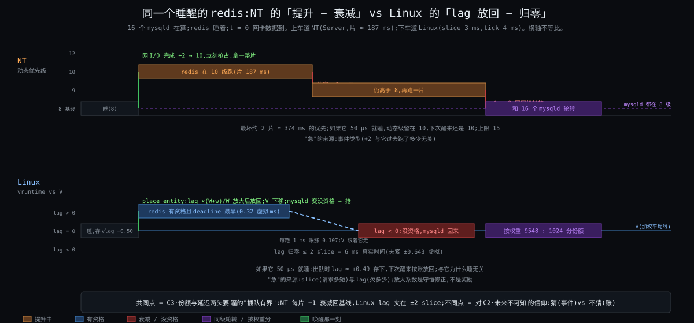

### §3.6 这个对比突出了什么

挑人规则不是约束逼出的唯一解:C2·未来不可知 允许"不猜"(账)也允许"用事件猜"(提升),两边都活了三十年。真正被约束钉死的是**插队必须有界**(C3·份额与延迟两头要 的第三句)—— NT 的"每片 −1、永不低于基线"和 Linux 的"±2 slice"是同一条约束的两种写法。**判定:插队有界 = 必然;级 vs 账 = 偶然。**

---

## §4 对照二:各多少 —— Job 对象 CPU 速率控制 / DFSS vs cgroup `cpu.weight` / `cpu.max`

**先说结论**:封顶这件事两边同形 —— 都是"按时间周期给额度、扣光整组停、下个周期放",差别只是额度写成 ms 还是写成每 10000 周期里的份。按组分份额这件事 NT 做得晚、做得粗(Job 权重 1 ~ 9,DFSS 只按会话),Linux 做得早、做得细(cgroup 嵌套权重 1 ~ 10000)。C6·份额按组算 的"封顶"一半是必然,"嵌套权重"一半 NT 至今没有完整对应。

### §4.1 NT 的核心做法

**Job 对象 CPU 速率控制**(Windows 8 / Server 2012 起,微软 `JOBOBJECT_CPU_RATE_CONTROL_INFORMATION` 页):

| 模式 | 字段 | 原话要点 |
|---|---|---|
| 硬上限 `HARD_CAP` | `CpuRate`:每 10000 周期里的份,"percentage times 100";20% 写 2000 | 「After the job reaches its CPU cycle limit for the current scheduling interval, no threads associated with the job will run until the next interval」 |
| 权重 `WEIGHT_BASED` | `Weight` 1 ~ 9,默认 5 | 「the share of processor time given to the job relative to other workloads on the processor」 |
| 最小 / 最大 `MIN_MAX_RATE` | `MinRate` / `MaxRate`,同样 ‰ 单位;所有 Job 的 `MinRate` 之和 ≤ 10000 | 到了 `MaxRate` 同样"no threads … can run until the next scheduling interval" |
| 嵌套 | 子 Job 的比例相对于直接父 Job | 「the rates set for the job represent its portion of the CPU rate that is allocated to its parent job」 |
| 限制 | 「cannot be used … if Dynamic Fair Share Scheduling (DFSS) is in effect」 | 两套机制互斥 |
| 调度周期长度 | 文档不给数(待核 #102) | — |

**DFSS**(Server 2008 R2 起,RDSH 文档):「dynamically distributes processor time across sessions based on the number of active sessions and load on those sessions by using the kernel-level scheduling mechanism」;默认开,注册表 `…\SessionManager\DFSS\EnableDFSS = 0` 关。它的"组"是**会话**,不是任意层级。文档同页承认之前的问题:「distributing the processor time evenly across all threads at a given priority level … was unable to evenly distribute the processor time in the presence of dynamic loads」—— 这句就是 Why 第六刀的痛点一(线程数放大份额),微软 2009 年才补。

**QoS / EcoQoS**(Windows 10 1709 起分级,Windows 11 加 Eco / Utility;微软「Quality of Service」页):High / Medium / Low / Utility / Eco / Media / Deadline 七级,按窗口可见性、是否出声、API 标记、MMCSS 标记分类;「scheduling priority remains the main metric … QoS can influence core selection and processor power management」。它不是份额,是"组级的能耗 / 选核倾向"—— 放到 §6 的 C8·核不等速且耗电 里再看。

### §4.2 Linux 的对应物

How §3.7 + §6、Deep §4:`task_group` 在每核一行账,`cpu.weight` 1 ~ 10000 嵌套分摊;`cpu.max = quota period`,每核向池借 5 ms,借不到整组下树,`period_timer` 放回;`cpu.max.burst` 攒额度。

### §4.3 同一个场景:k8s 容器限 2 核

k8s 在 Windows 节点上用 Job 对象隔离容器(k8s 文档:「Windows uses a job object per container」),CPU 上限落到 Job 速率控制。kubelet 源码(`kuberuntime_container_windows.go`)的换算和注释:

```
cpuMaximum := 10 * cpuLimit.MilliValue() / cpuCount     // 范围 1 ~ 10000
// "CPU limits are applied to the job object setting JOB_OBJECT_CPU_RATE_CONTROL_ENABLE,
//  … JOB_OBJECT_CPU_RATE_CONTROL_WEIGHT_BASED or JOB_OBJECT_CPU_RATE_CONTROL_HARD_CAP"
// "At one point CpuWeights were set, but this prevented limits from having any effect"
```

| | Linux(`cpu.max = 200000 100000`) | Windows(`limits.cpu = 2`,64 核节点) |
|---|---|---|
| 额度怎么写 | 每 100 ms 周期 200 ms CPU 时间 | `cpuMaximum = 10 × 2000 / 64 = 312` → 每 10000 周期里 312 份 = 3.12% 的全机周期(≈ 2 核) |
| 额度的单位 | 绝对时间(ms) | 全机百分比;换到 32 核节点 kubelet 重算成 625 |
| 扣的单位 | 每核 `cfs_rq` 向池借 5 ms 片 | 「CPU cycle limit」,按周期计(Vista 起片也按周期) |
| 扣光 | 整组所有核的 `cfs_rq` 下树,停到周期末 | 「no threads associated with the job will run until the next interval」—— 整 Job 停到周期末 |
| 请求(requests)怎么落 | `cpu.weight`(按比例) | **没有**:kubelet 只设 `CpuMaximum` / `CpuCount`,不设权重(注释:设权重会让 limit 失效);k8s 文档:「Windows … cannot guarantee a minimum amount of CPU time」 |
| 钩子一的 p99 抖 | 16 线程 12.5 ms 烧光 200 ms,停 87.5 ms(How §6.3) | 同形:16 线程并发烧光本周期的 3.12%,整 Job 停到下个周期;停多久取决于周期长度(待核 #102) |
| 旋钮 | `period` / `burst` / 并发数 | `MaxRate` 换 `Weight`(放弃封顶);或 `CpuCount`(按核数,等价 cpuset) |

读法:**封顶的形状两边一模一样**(周期 + 整组停),这是 C6·份额按组算 的"要能封顶、可计费"逼出来的;**份额那一半 NT 在容器场景里直接没做**(不设权重),所以 Windows 节点上 `requests.cpu` 只用来算 allocatable,不进调度器。

### §4.4 在五元组上的差异

| | Linux cgroup cpu | NT Job / DFSS |
|---|---|---|
| 核心抽象 | 组 = 账本上同形的一行(`sched_entity`) | 组 = Job 对象上的速率策略(调度器外挂) |
| 处理 C6·份额按组算 的"组是一行" | 嵌套权重,任意深 | Job 权重 1 ~ 9,嵌套按父比例;DFSS 只按会话 |
| 处理 C6·份额按组算 的"封顶" | `cpu.max`,周期 1 ms ~ 1 s | `HARD_CAP` / `MaxRate`,周期不公开 |
| 代价 | 周期末停顿;组权重要按每核负载分摊(`calc_group_shares`) | 同样的停顿;权重粒度粗;与 DFSS 互斥 |
| 现实 | k8s / systemd / Android | k8s Windows 节点、RDS 多会话、Windows 容器 |

### §4.5 这个对比突出了什么

**封顶 = 必然**(两边连"整组停到周期末"的坏脾气都一样,因为"配额是组的、停的单位 = 账的单位"是 C6·份额按组算 的逻辑后果,How §6.5 逼问表第三行)。**嵌套权重 = Linux 的选择**:它来自"组是同形一行"这个 Insight 3(Why),NT 没有这个抽象,只能外挂 Job / DFSS 两套互斥的机制。

---

## §5 对照三:在哪换 —— 理想处理器 + 每处理器就绪队列 vs 调度域 + 均衡

**先说结论**:每核一组队列、醒来优先回原核,两边同形(C5·核各自为政 逼的);NT 没有 Linux 那种按调度域分层、周期性"闲的拉忙的"的均衡 —— 它的跨核决策只发生在**线程就绪那一刻**(选空闲核或理想核,否则排到理想核的队列)和核空闲那一刻。Linux 选了"均衡更准但要花钱看邻居",NT 选了"便宜但可能不均"—— 这是 C5·核各自为政 与 C4·挑人须便宜 之间的折中,两边取的点不同。

### §5.1 NT 的核心做法

| 机制 | 来源与原话要点 |
|---|---|
| 每处理器就绪队列 | 讲义第 15 页:`DispatcherReadyListHeads[F/B][MAXIMUM_PRIORITY]` + `ReadySummary` 每处理器一份;就绪分三个真实状态「DeferredReady – queued on any processor / Standby – will imminently start Running / Ready – queue on target processor by priority」,目的是「granular locking of thread priority queues」(第 13 页);全局 dispatcher lock 到 Windows 7 才拆(上一轮已核 #7) |
| 理想处理器 / 上次处理器 | 微软「Multiple Processors」页:「the scheduler runs the thread on the specified processor when possible … a useful hint」;讲义第 9 页:「tries to keep a thread on its ideal processor/node to avoid perf degradation of cache/NUMA-memory」;理想处理器按进程轮转播种(Windows Internals,二手,待核 #103) |
| 就绪时选核(讲义第 18 页「Idle processor preferences」) | (a) 理想处理器空就用它,否则看硬亲和集里的所有处理器;(b) 有首选亲和集且其中有空核则只看它们;(c) 超线程机器上有整个物理核空闲则只看那些;(d) 上次跑过的核在剩余集合里就选它;(e) 剩余里有没睡的核就缩到那些;(f) 选最左边的 |
| 没空核时(讲义第 20 ~ 21 页 `KiDeferredReadyThread`) | 「target is the ideal processor」;比目标核的 `NextThread` / `CurrentThread`:自己优先级更高 → victim 标 `Preempted`、自己进 Standby、给目标发 dispatch 中断;否则「insert thread on Ready list of target processor」—— **排到理想核的队列,不去找最闲的核** |
| 亲和 | 「Setting thread affinity should generally be avoided, because it can interfere with the scheduler's ability to schedule threads effectively across processors」(「Multiple Processors」页);64 核一组(Processor Groups 页);Windows 11 / Server 2022 起进程默认跨所有组,保留"primary group",理想处理器在主组内 |
| CPU Sets(软亲和) | 「declare application affinity in a 'soft' manner that is compatible with OS power management」;「Some versions of Windows support Core Reservation policies, in which a subset of the system's CPU Sets can be devoted to the exclusive use of individual applications」;硬亲和掩码优先于 CPU Set |
| 周期性均衡 | 讲义和 Win32 文档都没有"闲的核定期去忙的核拉线程"这一步;Windows Internals 的说法是 NT 不做 Linux 意义上的负载均衡,只在就绪 / 空闲时选核(二手,待核 #100) |
| NUMA / 异构 | 「the system attempts to schedule threads on processors that are close to the memory being used」;大小核由 QoS + `SchedulingPolicy`(0 全部 / 1 只大核 / 2 偏大核 / 3 只小核 / 4 偏小核 / 5 自动,微软硬件定制页)决定,§6 |

### §5.2 Linux 的对应物

How §5、Deep §3:调度域两层(MC / PKG)、`imbalance_pct` 117%、`balance_interval` 4 ~ 100 ms、PELT 三个量、`select_task_rq_fair` → `wake_affine` → `select_idle_sibling`、`sched_balance_rq` 五步(只拉差距的一半、跳过 0.5 ms 内跑过的)、`newidle` 均衡。

### §5.3 同一个场景:钩子二的 `taskset`

| 做法 | Linux(How §5.6) | NT 等价物与结果 |
|---|---|---|
| 只绑 redis 到核 7 | 均衡照样把 PG 后端拉进 rq7;更糟 | `SetThreadAffinityMask(redis, 1<<7)`:redis 只能在 7;PG 线程就绪时按 (a)~(f) 选核 —— 核 7 空闲时它们**会被放进来**(规则 (a)(e)(f)),而且其中理想处理器恰好是 7 的那几个 PG 线程不空也会排进 7 的队列;**同样更糟**,但原因不是周期均衡,是就绪时选核 |
| 两边都绑 | PG 绑 0 ~ 6,rq7 只有 redis | PG 进程 `SetProcessAffinityMask(0x7F)`;同样 95% 空转 |
| 隔离核 | `isolcpus=7`,核 7 不在任何域 | CPU Sets 的 Core Reservation(「devoted to the exclusive use」),或把系统默认 CPU Set 排除核 7;NT 这边的工具更顺手,因为它本来就是"软亲和 + 保留"模型 |

结论和 How 一样:位置旋钮必须两边都拧。NT 多给了一样东西 —— 保留核(reservation)是一等公民;Linux 要靠启动参数 `isolcpus` 或 `cpuset` 拼。

### §5.4 在五元组上的差异

| | Linux | NT |
|---|---|---|
| 核心抽象 | 调度域(远近分层)+ 每核账上的负载估计 | 理想处理器 / 上次处理器 + 每处理器队列 |
| 处理 C5·核各自为政 的"每核一本账" | `rq`(2002 O(1) 起) | 每处理器就绪队列(Server 2003 起),全局锁 2009 才拆 |
| 处理 C5·核各自为政 的"远近" | SMT / MC / PKG / NUMA 五层,越远越少看 | 超线程整核优先(规则 c)、NUMA 节点亲近;64 核分组 |
| 处理 C5·核各自为政 的"不均衡" | 周期性拉 + newidle 拉;17% 迟滞;只搬一半 | 就绪时选空核;没空核排理想核;无周期性拉(待核 #100) |
| 处理 C4·挑人须便宜 | 均衡有代价模型(`task_hot`、`avg_idle` 判值不值) | 不做均衡就没有这笔代价 |
| 代价 | 均衡本身的开销与抖动风险 | 队列可能长期不均(一个核排 5 个、另一个空着到有人就绪为止) |

### §5.5 这个对比突出了什么

C5·核各自为政 逼出"每核一本账 + 醒来回原核"是必然(两边 2002 / 2003 同年得出);"周期性均衡"不是必然,是 Linux 在 C5·核各自为政 与 C4·挑人须便宜 之间偏向前者的选择 —— NT 偏向后者,代价是不均。**判定:每核队列 + 亲和 = 必然;分层周期均衡 = 偶然(可用"就绪时选核 + 空闲时找"替代)。**

---

## §6 对照四:何时换 + 硬保证 —— IRQL / DPC vs tick / `need_resched` / `preempt_count`;16 ~ 31 vs rt / dl

**先说结论**:何时换两边同形(C1·只在打断点换 是硬件给的);硬保证两边都有凌驾层,但 Linux 给凌驾配了准入(dl)和 95% 阀(rt),NT 的 16 ~ 31 级既无准入也无阀 —— 它把阀放在另一个地方:MMCSS 给普通任务保留 20%。阀是必然的(两边都长出来了),准入是 Linux 的选择。

### §6.1 何时换

| | Linux | NT |
|---|---|---|
| 决定与执行分开 | 标记 `TIF_NEED_RESCHED`;出口 `exit_to_user_mode_loop` / `preempt_schedule_irq` | DeferredReady → Standby;目标处理器的 dispatch 中断(DPC 级)完成换人;「Thread scheduling occurs at PASSIVE or APC level (IRQL < 2)」(讲义第 5 页) |
| 什么时候不能换 | `preempt_count ≠ 0`(自旋锁、中断、软中断) | IRQL ≥ DISPATCH_LEVEL:「DISPATCH_LEVEL and APC_LEVEL interrupts are masked off」,此时「calling KeWaitForSingleObject … causes a fatal error」(微软驱动文档「Managing Hardware Priorities」)—— 调度器自己就是一个 DISPATCH_LEVEL 的软中断 |
| tick 做什么 | `sched_tick`:记账、看 slice、触发均衡 | 时钟中断减 quantum;「DPCs … also used by scheduler & timers (e.g. at quantum end)」(讲义第 5 页);`KiQuantumEnd` 在 DISPATCH_LEVEL 跑 |
| 抢占模型 | `PREEMPT_NONE` / `VOLUNTARY` / `PREEMPT` / `RT` / `DYNAMIC`(How §4.2) | 只有一种:内核态凡 IRQL < 2 皆可抢,相当于 Linux 的 `PREEMPT`;驱动文档要求「Driver code that runs at IRQL > PASSIVE_LEVEL should execute as quickly as possible」—— 和 Linux "持锁区要短"同一句话 |
| 中断下半部 | softirq / threaded irq | DPC(「higher priority than threads … long DPCs harm perf, by blocking threads」,讲义第 5 页) |

同形到连警告语都一样。**判定:必然。**

### §6.2 硬保证

| | Linux | NT |
|---|---|---|
| 凌驾层 | 类栈 `stop > dl > rt > fair > ext > idle` | 16 ~ 31 实时区,「REALTIME_PRIORITY_CLASS … interrupts system threads that manage mouse input, keyboard input, and background disk flushing」(文档劝「almost never use」) |
| 准入 | dl:`__dl_overflow`,Σ runtime / period ≤ 95% 算力 | 无;有权限就能设 24 ~ 31 |
| 阀(防饿死普通任务) | rt:`sched_rt_runtime_us` 950000 / 1000000,每秒留 5%;6.12 `fair_server` | 实时区:**无**;MMCSS 那条路有:`SystemResponsiveness` 默认 20,「20% of CPU resources are reserved for low-priority tasks」;MMCSS 把音频线程放到 23 ~ 26(High)/ 16 ~ 22(Medium),用完配额的线程降到 1 ~ 7(微软 MMCSS 页) |
| 时限语义 | dl 的 (runtime, period) + EDF | 无 EDF;MMCSS 的「Clock Rate」在 Vista 曾是保证的最大时钟粒度,「Starting with Windows 7 … this guarantee was removed to reduce system power consumption」 |
| 反转 | `rt_mutex` 优先级继承 | AutoBoost:「tracks resource reservations and adjusts thread priorities by applying priority floors … the priority of the owner is raised to the maximum priority of the waiter until it releases the resource」(微软「Priority Inversion」页);之前是 4 s 反饥饿兜底 |

读法:C7·有人要硬保证 的"凌驾 + 阀 + 反转处理"三件,两边都有,只是 NT 的阀装在 MMCSS 而不是实时区本身 —— 所以一个自己把自己设成 REALTIME 的程序在 NT 上真能把机器拖死,在 Linux 上最多拿 95%。**判定:凌驾 + 阀 + 继承 = 必然;准入(dl)= Linux 独有的选择;阀装在哪 = 偶然。**

### §6.3 C8·核不等速且耗电:账 vs 标签,再来一次

| | Linux | NT |
|---|---|---|
| 核的算力 | `cpu_capacity` 归一(≤ 1024),SMT / rt 占用打折 | 「efficiency class」0 / 1,大小核各一套 PPM 参数(微软 PPM 页:`CPMinCores1`、`HeteroIncreaseThreshold`…) |
| 任务的重量 | PELT `util_avg`(估计量) | QoS 标签(High / Medium / Low / Utility / Eco / Media / Deadline),按窗口可见性、出声、API、MMCSS 分类;「Heuristic … thread priority」兜底 |
| 选大核还是小核 | EAS `find_energy_efficient_cpu`(x86 服务器无能耗模型则跳过) | `SchedulingPolicy` 0 ~ 5 + `ShortSchedulingPolicy`,按 QoS 与长短线程分别配 |
| 调频 | `schedutil` 读同一个 `util_avg` | 每个 QoS 级一套 `MaxFrequency` / `PerfEnergyPreference`;Eco「Always selects most efficient CPU frequency and schedules to efficient cores」 |

又是 §3 的那条分歧:Linux 用**估计量**(util),NT 用**分类标签**(QoS)。C8·核不等速且耗电 两边都答了,答法延续各自对 C2·未来不可知 的信仰。**判定:按算力比 = 必然;估计量 vs 标签 = 偶然。**

---

## §7 SQLOS:用户态协作式调度为什么能绕开 C1·只在打断点换 和 C2·未来不可知(以及它 2016 年怎么长出了 lag)

**先说结论**:上一轮你的判断「加分是症状,病根是抢占本身」在本轮的约束表里可以说得更准 —— SQLOS 取消的是 C2·未来不可知(进程内信任自己的 worker),于是 C1·只在打断点换 从"内核只在打断点介入"变成"打断点由 SQLOS 自己定、到处都是";而 C3·份额与延迟两头要 和 C6·份额按组算 它一条也没绕开,只是搬到用户态自己解:2016 年的 LDF 就是 lag,Resource Governor 就是 cgroup。

### §7.1 它做了什么(微软「Thread and task architecture guide」原话)

- 每个 CPU 一个 scheduler:「Each scheduler is mapped to an individual processor (CPU)」。
- 协作式:「The time a worker can remain active in a scheduler is called the OS quantum, with a maximum of 4 ms. After its quantum time expires, a worker yields its time to other workers … This cooperation between workers … is called cooperative scheduling, also known as non-preemptive scheduling」。
- 内核看到的是每核一个线程在跑、其余在等事件;NT 的优先级(默认 7,`priority boost` 到 13 已废弃)对它几乎没意义。

### §7.2 对到本轮的约束

| 约束 | 内核调度器 | SQLOS |
|---|---|---|
| C2·未来不可知 | 不能信任任何流会让台 | **取消**:worker 全是自己写的,每个 yield 点已知;不合作的代码(扩展存储过程、CLR)单独切 preemptive 模式(上一轮已核 #10) |
| C1·只在打断点换 | 只能在 tick / 系统调用 / 中断 / 阻塞介入 | 打断点 = 每次等锁、等 I/O、每 4 ms 配额到期 —— 由 SQLOS 自己埋,密度远高于内核的 tick;代价:一个忘了 yield 的 worker 饿死同 scheduler 的所有人 |
| C3·份额与延迟两头要 | lag / deadline / 权重 | **没绕开**:SQL Server 2014 之前「Worker 1 is allowed to basically monopolize the scheduler by having more overall quantum time」;2016 起 **Large Deficit First**:「quantum usage patterns are monitored and one worker thread doesn't monopolize a scheduler … Worker 2 is allowed to consume repeated quantum's before Worker 1 is allowed more quantum」—— "deficit" = 欠账 = lag,只是没有权重和 deadline |
| C5·核各自为政 | 每核 rq + 均衡 | 每核 scheduler;并行任务「always try to assign schedulers from the same NUMA node … in round-robin fashion」;不做均衡(worker 绑死 scheduler),所以文档劝不要同时在 OS 和 SQL 两边设亲和 |
| C6·份额按组算 | cgroup | Resource Governor 的资源池 `MIN_CPU_PERCENT` / `MAX_CPU_PERCENT` / `CAP_CPU_PERCENT`(2012 起硬上限;二手,待核 #104)—— 同一套"权重 + 封顶" |
| C4·挑人须便宜 | O(log n) | FIFO 可运行队列,O(1);代价是没有"按 deadline 排" |
| C7·有人要硬保证 | 类栈 | 无;checkpoint / log writer 这类系统任务也是普通 worker,靠自己频繁 yield |

**认一半、拧紧一半**(接着上一轮的《你的视角》):"病根是抢占"这句在本轮可以精确成 **"病根是 C2·未来不可知 在进程内不成立,所以内核的 C1·只在打断点换 变成了多余的开销"**;但"绕开"只对 C1·只在打断点换 / C2·未来不可知 成立 —— 份额与延迟的矛盾、按组分配的矛盾,SQLOS 一样要解,而且解法长得和内核一模一样(LDF ≈ lag,Resource Governor ≈ cgroup)。这是本轮最有说服力的一条"必然"证据:**换一个血统、换到用户态,C3·份额与延迟两头要 和 C6·份额按组算 的解还是那个形状。**

### §7.3 顺带一笔:FreeBSD ULE 与 Go runtime

**FreeBSD ULE**(Jeff Roberson,BSDCon 2003 论文):每核一个 `kseq`,current / next 两个队列轮换保公平;**交互性评分**用自愿睡眠时间与运行时间之比(睡 > 跑则落在下半区,反之上半区),过阈值就算交互、进 current 队列;slice 10 ~ 140 ms 随 nice 变;均衡是「a pull method, where an idle CPU steals a thread from a non-idle CPU」+「a push method where a periodic task evaluates the current load situation」;SMT 当作一种 NUMA。读法:ULE 在 C5·核各自为政 上和 Linux 同形(每核队列 + 拉 + 推),在 C2·未来不可知 上和 NT 同阵营(用睡眠比猜意图,正是 Linux 2007 年删掉的 `sleep_avg` 世界观)。它绕不开 C3·份额与延迟两头要:current / next 轮换就是它的"插队有界"。

**Go runtime**:M:N 把 goroutine 调到少量内核线程上,工作窃取;1.14 之前只能在函数调用处抢占 —— 「loops without function calls … potentially deadlock the scheduler」,1.14 起「Goroutines are now asynchronously preemptible」(Go 1.14 发布说明),用信号在任意指令处打断。读法:Go 在用户态重新遇到了 C1·只在打断点换 —— 没有 tick 就没法对付不让台的 goroutine,最后只好自己造一个 tick(信号);它绕开的只有内核的 C4·挑人须便宜(换 goroutine 比换线程便宜)和部分 C2·未来不可知(runtime 知道 goroutine 在等 channel 还是在算)。

---

## §8 约束回扣

| 约束 | Linux 的解 | NT 的解 | 同 / 异 | 判定 |
|---|---|---|---|---|
| C1·只在打断点换 | 标记 + 两种出口;`preempt_count` | DeferredReady / Standby + dispatch 中断;IRQL ≥ 2 不换 | 同 | 必然 |
| C2·未来不可知 | 不猜:账 | 猜:事件提升 + 衰减 | 异 | 偶然(血统);NT 自己的 SQLOS 2016 转向账 |
| C3·份额与延迟两头要 | 权重 / slice / lag 三旋钮;插队 ≤ 2 slice | 一个数;提升每片 −1;抢占者拿整片 | 功能同、形状异 | 插队有界 = 必然;拆成三个数 = Linux 的选择 |
| C4·挑人须便宜 | 红黑树 + 累加器;均衡有代价模型 | 32 位位图 O(1);不做周期均衡 | 异(NT 更偏 C4·挑人须便宜) | 折中点偶然 |
| C5·核各自为政 | 每核 rq + 唤醒亲和 + 分层周期均衡 | 每处理器队列 + 理想 / 上次处理器 + 就绪时选核,无周期均衡 | 前半同、后半异 | 每核队列 + 亲和 = 必然;周期均衡 = 偶然 |
| C6·份额按组算 | 嵌套权重 + `cpu.max` 周期封顶 | Job 权重 1 ~ 9 / DFSS 按会话 + Job 硬上限周期封顶 | 封顶同、权重异 | 封顶 = 必然;嵌套权重 = Linux 的选择 |
| C7·有人要硬保证 | 类栈 + dl 准入 + rt 95% 阀 + PI | 16 ~ 31 无准入无阀;MMCSS 留 20%;AutoBoost 优先级地板 | 凌驾 / 阀 / 继承同,准入与阀的位置异 | 凌驾 + 阀 + 继承 = 必然;准入 = 偶然 |
| C8·核不等速且耗电 | capacity + PELT util + EAS / schedutil | efficiency class + QoS 标签 + `SchedulingPolicy` | 功能同、依据异 | 按算力比 = 必然;估计量 vs 标签 = 偶然 |

一句话:**八条约束里,"何时换、每核队列、封顶、凌驾配阀、插队有界"五样两边长得一样,是必然;"账还是级、要不要周期均衡、要不要嵌套权重和准入"是血统和折中点,是偶然。**

---

## §9 呼应你的问题

你问"内核凭什么挑下一个"。对照之后可以把答案拆成两层:

- **必然的一层**(换一套血统也这么做):只在打断点换;每核一本账,醒来回原核;插队必须有界;组的封顶按周期扣、整组停;凌驾要配阀和继承。这些你在 NT 上能一一找到对应物,连坏脾气(周期末停顿、持锁区要短)都一样。
- **Linux 自己选的一层**(NT 没这么做):把"急"从事件类型里拿掉,全部交给账(C2·未来不可知 的"不猜");把份额和延迟拆成权重与 slice 再用 lag 缝回去(C3·份额与延迟两头要 的三个数);按调度域周期性拉均衡(C5·核各自为政 偏向准而不是省);组是同形一行所以能嵌套(C6·份额按组算);dl 类的准入(C7·有人要硬保证)。

"为什么三代"在对照里多了一条证据:NT 停在了 Linux 2007 年离开的那个世界观(衰减优先级 + 事件提升),三十年只打补丁(DFSS、Job、AutoBoost、QoS)不换骨架;而 NT 之上的 SQLOS 在 2016 年自己长出了 deficit —— **同一道题,不同血统,往同一个方向收敛**。到这里灵魂问题的三段(规则、三代、多核与 cgroup)都从"是什么"走到了"哪些是必然、哪些是选择",闭环约 98%;剩下的 2% 是 Synthesis 要做的事:把"必然 / 偶然"的判别法本身沉淀成方法,再拿到数据库线程池上验一次。

---

## §10 反问(选择式)+ 从头走一遍

**反问**:NT 的"网络 I/O 完成 +2、每片 −1"和 Linux 的"睡醒按 lag 放回、放回前按 (W + w) / W 放大",哪个更像在"猜意图"?

A. NT 的 B. Linux 的 C. 都是 D. 都不是

### 从头走一遍

**问题来源**:两边都在"睡醒的线程该不该插队、插多少"这个点上动了手脚,表面上都是"给睡醒的人一点好处"。要分清哪个是猜,得问一句:**这个好处的大小,取决于什么?**

**分岔一:好处取决于"发生了什么事"还是"账上欠多少"**。NT 的 +2 取决于事件类型(网 +2、盘 +1、键鼠 +6、声卡 +8),和这个线程过去跑了多少无关 —— 一个刚刚连跑了三片的线程,只要做一次网络 I/O 回来,照样 +2。这是在用事件推断意图("做网络 I/O 的线程大概在服务用户")。Linux 的放回位置取决于 lag,lag 取决于它过去拿到的服务和平均线的差 —— 和它为什么睡、睡了做什么无关;一个连跑了三片再睡的线程醒来 lag 是负的,排到后面。所以 A 成立的部分:NT 在猜。

**分岔二:那 Linux 的放大系数 (W + w) / W 是不是也在"给好处"**。不是。它是算术修正:把一个 lag 为 +x 的实体加进加权平均,平均线会被它拉低,它的 lag 立刻变成 x − w·x / (W + w);放大后再放回,加入后的 lag 恰好等于 x(How §3.4 的推导)。它不增加任何人的欠账,只是让"加入队列"这个动作本身不改账 —— lag 守恒。这一步没有意图、没有事件、没有参数(没有"补半个 slice"那种常数,那是 CFS 时代的事)。所以 B 不成立。

**分岔三:两边有没有共同点**。有 —— 都把好处限制在一个时间片量级(NT 每片 −1 衰减回基线;Linux ±2 slice 夹紧),这是 C3·份额与延迟两头要 的"插队有界"逼出来的,不是猜。所以 C 也不对:共同的那部分不是猜,是约束。

**结果**:**A**。NT 的提升是猜(事件 → 意图),Linux 的放大是守恒修正;两边共享的"有界"是约束,不是猜。顺手回答一个更细的问题 —— 如果你把 NT 的提升值全改成 0(`SetThreadPriorityBoost` 关掉),它就退化成纯同级轮转,redis 醒来要排到 16 个 mysqld 后面,最坏 15 片 ≈ 2.8 秒;而 Linux 关掉 `PLACE_LAG`(`features.h`)只是让睡醒的任务从 V 处放回,lag 归零,它仍然"有资格",仍然按 deadline 排,redis 的 0.32 ms 虚拟 deadline 还是比 mysqld 的 3 ms 早 —— 它还是先跑。**账的世界里,"急"是 slice 的函数;级的世界里,"急"是提升的函数。关掉提升,级就失去了表达"急"的手段;关掉 lag,账还有 deadline。**

---

## §11 出处

一手 / 准一手(微软自有文档与源码):

1. Scheduling Priorities(learn.microsoft.com/windows/win32/procthread/scheduling-priorities):优先级表、轮转与抢占原话、REALTIME 警告
2. Priority Boosts(…/procthread/priority-boosts):只提升 0 ~ 15、三种提升、每片 −1、永不低于基线
3. Priority Inversion(…/procthread/priority-inversion):AutoBoost 原话
4. Multiple Processors(…/procthread/multiple-processors):理想处理器、亲和"应避免"、NUMA
5. Processor Groups(…/procthread/processor-groups):64 核一组、按物理局部性分组、Windows 11 / Server 2022 的 primary group
6. CPU Sets(…/procthread/cpu-sets):软亲和、Core Reservation、硬掩码优先
7. Quality of Service(…/procthread/quality-of-service):七级 QoS、分类来源、版本
8. Multimedia Class Scheduler Service(…/procthread/multimedia-class-scheduler-service):`SystemResponsiveness` 20%、23 ~ 26 / 16 ~ 22 / 8 ~ 15 / 1 ~ 7、Clock Rate 保证 Win7 移除
9. JOBOBJECT_CPU_RATE_CONTROL_INFORMATION(…/api/winnt/ns-winnt-jobobject_cpu_rate_control_information):硬上限 / 权重 1 ~ 9 / 最小最大 / 嵌套 / 与 DFSS 互斥
10. Remote Desktop Session Host,Windows Server 2008 R2(learn.microsoft.com/previous-versions/…/dd560667(v=ws.10)):Fair Share CPU Scheduling 原话与注册表项
11. Managing Hardware Priorities(learn.microsoft.com/windows-hardware/drivers/kernel/managing-hardware-priorities):IRQL 表、DISPATCH_LEVEL 不能等待
12. Processor power management options + SchedulingPolicy(learn.microsoft.com/windows-hardware/customize/power-settings/…):efficiency class 1 参数、`SchedulingPolicy` 0 ~ 5
13. Thread and task architecture guide,SQL Server(learn.microsoft.com/sql/relational-databases/thread-and-task-architecture-guide):每 CPU 一个 scheduler、4 ms 配额、协作式、LDF、NUMA 轮转、默认优先级 7
14. David B. Probert(Microsoft),Windows Kernel Internals: Thread Scheduling(www.i.u-tokyo.ac.jp/edu/training/ss/lecture/new-documents/Lectures/03-ThreadScheduling/ThreadScheduling.pdf):第 5 / 9 / 13 / 15 / 18 / 19 ~ 21 / 24 ~ 26 页
15. kubernetes/kubernetes `pkg/kubelet/kuberuntime/kuberuntime_container_windows.go`(raw.githubusercontent.com/kubernetes/kubernetes/master/…):`cpuMaximum` 换算与注释
16. Resource Management for Windows nodes(kubernetes.io/docs/concepts/configuration/windows-resource-management/):Job 对象、不能保证最小 CPU
17. Jeff Roberson,"ULE: A Modern Scheduler for FreeBSD",BSDCon 2003(www.cs.ucdavis.edu/~roper/ecs150/ULE.pdf 副本;原文 usenix.org/events/bsdcon03):§3.1 ~ §3.6
18. Go 1.14 Release Notes(go.dev/doc/go1.14):异步抢占原话
19. 上一轮 `atlas-output/Linux进程全链路-20261024/stages/06-comparison/06-comparison.md` §4、§8:已核的 #4(提升值)、#5(反饥饿)、#6(时间片)、#7(每核队列与 Win7 拆锁)、#10(SQLOS 4 ms 与 preemptive)

二手(标注处已说明):Windows Internals 7th Part 1 Ch.4(AutoBoost 版本、理想处理器播种、"无周期均衡"的表述);Wikipedia「Random boosting」(AutoBoost 取代随机提升)。

## 待核

| # | 条目 | 结论(收尾核实 2026-11-03) |
|---|---|---|
| #100 | NT 是否完全没有周期性的跨处理器负载均衡(只在就绪 / 空闲时选核);Windows Internals 7th 的原话与版本 | **部分核实** —— 微软课件(Windows Internals 第 4 版授权)与 Probert 讲义只描述就绪 / 空闲时选核与 Balance Set Manager 每秒扫一次饥饿线程;OSR 论坛(二手)称空闲核在进出空闲时主动拉任务;未见周期均衡,但"未见"仍不等于"已证无"(出处:https://osm.hpi.de/bs/2007/Slides/Unit04/4.5_AdvancedScheduling.pdf ;https://community.osr.com/t/multicore-ht-multi-cpu-scheduling/31516) |
| #101 | AutoBoost 引入版本(Windows 8.1) | **无法核实** —— 微软文档与 Wikipedia 只说 AutoBoost 取代了 random boosting,不给版本;正文保留 "Windows Internals,二手" 标注(出处:https://learn.microsoft.com/en-us/windows/win32/procthread/priority-inversion) |
| #102 | Job 对象 CPU 速率控制的"scheduling interval"长度 | **无法核实** —— 文档只写 "during each scheduling interval" / "until the next scheduling interval",不给毫秒数(出处:https://learn.microsoft.com/en-us/windows/win32/api/winnt/ns-winnt-jobobject_cpu_rate_control_information) |
| #103 | 理想处理器按进程轮转播种、SMT 兄弟错开 | **部分核实** —— 课件:"System selects ideal processor for first thread in process (round robin across CPUs); Next thread gets next CPU relative to the process seed";SMT 错开未见(仅提 Server 2003 的 `GetLogicalProcessorInformation`)(出处:https://osm.hpi.de/bs/2007/Slides/Unit04/4.5_AdvancedScheduling.pdf(基于 Windows Internals 第 4 版,二手)) |
| #104 | Resource Governor `CAP_CPU_PERCENT` 自 SQL Server 2012 起 | **已核** —— "CAP_CPU_PERCENT … Applies to: SQL Server 2012 (11.x) and later";硬上限,区别于 MAX_CPU_PERCENT 的软上限(出处:https://learn.microsoft.com/en-us/sql/t-sql/statements/create-resource-pool-transact-sql) |
| #105 | CPU Sets 首次版本(Windows 10 1703)与 Core Reservation 适用版本 | **部分核实** —— `SetThreadSelectedCpuSets` 最低 Windows 10 / Windows Server 2016(具体 build 文档不给,"1703" 未证);Core Reservation 文档只说 "Some versions of Windows support"(出处:https://learn.microsoft.com/en-us/windows/win32/api/processthreadsapi/nf-processthreadsapi-setthreadselectedcpusets ;…/procthread/cpu-sets) |
| #106 | 窗口输入提升 +2 的具体值 | **部分核实** —— 课件:"GUI threads that wake up to process windowing input get a boost of 2 (added to the current, not base priority)";前台进程的等待结束也 +2;微软 Win32 文档只给规则不给数(出处:https://osm.hpi.de/bs/2007/Slides/Unit04/4.5_AdvancedScheduling.pdf(二手);https://learn.microsoft.com/en-us/windows/win32/procthread/priority-boosts) |
| #107 | Go runtime sysmon 10 ms 抢占阈值 | **已核** —— `const forcePreemptNS = 10 * 1000 * 1000 // 10ms`(正文未用数字)(出处:https://raw.githubusercontent.com/golang/go/master/src/runtime/proc.go(forcePreemptNS)) |
| #108 | §3.3 NT 侧"两片 ≈ 374 ms 优先"按文档规则推算,未上机 | **部分核实** —— 推算与服务器长片 12 tick × 15.625 ms ≈ 187.5 ms 一致(2 片 ≈ 375 ms);未上机(出处:上一轮已核 #6;Microsoft Priority Boosts 页的 "reduces that priority by one level each time the thread completes a time slice") |
| #109 | Deep 的 § 编号(§2 / §3 / §4 / §5)按主控给定布局引用,写作时 `05-deep.md` 尚未生成 | **已核** —— 05-deep.md 实际标题 §2 主线① EEVDF / §3 主线② 多核 / §4 主线③ cgroup / §5 附录,与引用一致(出处:stages/05-deep/05-deep.md) |

---

> **🔄 心智切换:评论家 → 哲学家(反思模式)**
>
> 对照完你手里有了判别法:一个设计是必然还是偶然,看另一套从头设计的系统在同一约束下是否也这么做。最后一篇换成哲学家,把前六篇的证据收成结论和方法:一张五元组表把十几个设计决策各过一遍「约束 → 代价 → 反事实 → 现实对照」的筛,逐条取消一条约束看谁反超,洞察各一节,三个别的领域里的同构(块层 IO 调度器、Go runtime、TCP 公平队列),然后把五步法离题套到 MySQL 线程池上,看这套问法能不能搬走。

---

<a id="stage-synthesis" name="stage-synthesis"></a>

# 📍 第七篇:Synthesis — 设计哲学与方法论

# 阶段 7:Linux 的进程调度器的设计哲学与方法论沉淀

> 硬核模式(Deep + Comparison 都走完)。读者定位:教学分享,但起点是读过内核书的人 —— 不铺背景,只给方法和结论,每条结论都带前六份的 § 指针。这一份不是摘要:它的四样新产出是五元组表(每个决策过一遍筛)、必然 / 偶然判别法(从 Comparison 抽出来)、五步法(从前六份的生成过程本身抽出来)和一次离题演练(把五步法套到 MySQL 线程池上)。最后是一个十年赌注。
>
> 贯穿机器与任务同前:8 核两组 L3,HZ = 250,Linux 6.12;mysqld ×16、redis ×1、xz(nice 19)、k8s 容器限 2 核。

---

## §0 从 Comparison 走到 Synthesis:三件事记住

上一份结尾说:八条约束里五样两边同形(必然),三样是血统和折中点(偶然)。这一份把"怎么得出这个判定"本身做成工具。三件事:

### §0.1 事一:五元组 —— 从 C2·未来不可知 + C4·挑人须便宜 的"规则必须封闭"推出

因为规则只看账(C2·未来不可知)、每一步都有预算(C4·挑人须便宜)→ 每个设计决策都可以被问同样五个问题:它解了哪条约束、付了什么代价、不这么做还能怎么做、现实里谁那么做了、它是不是在这组约束下唯一过筛的 → 所以引入**五元组**(决策 / 约束 / 代价 / 反事实 / 现实对照)+ 第六列"必然 / 偶然"。Deep 的三组反事实(A1 ~ A6、B1 ~ B6、C1 ~ C5)填第四列,Comparison 的 13 行判定填第五、六列。

### §0.2 事二:必然 vs 偶然判别法 —— 从 Comparison 的"同 / 异"推出

因为同一组约束下另一套血统(VMS → NT)独立做了一遍 → 要解决"哪些是约束逼的、哪些是 Linux 选的"→ 所以引入判别法:**同约束下另一血统也这么做 = 必然;只有一边这么做而两边都没违反约束 = 偶然(血统或折中点);一边取消了某条约束才不这么做 = 该约束的证据**。SQLOS 是第三种的样本(取消 C2·未来不可知 后的另一个局部最优,Comparison §7)。

### §0.3 事三:五步法 —— 从前六份的生成过程推出

因为前六份就是按"约束 → 候选 → 代价 → 对照 → 局部最优"写的 → 把它抽成可带走的五步:识别约束 / 列举候选 / 代价分析 / 现实对照 / 局部最优证明。§7 每步配本轮实例和常见错误,§7.6 拿 MySQL 线程池离题验一次。

### §0 结论:三件事对照

| 件 | 是什么 | 为什么存在 |
|---|---|---|
| ① 五元组 | 14 个决策各过一遍五问 + 判定 | 规则封闭(C2·未来不可知 + C4·挑人须便宜)才能逐行审 |
| ② 判别法 | 同约束下另一血统是否同形 | 单看 Linux 分不清约束和血统 |
| ③ 五步法 | 五问的生成顺序 | 方法离开主题才叫方法 |

三件事怎么串:① 是②的输入(每行先填"现实对照"再判),③ 是①②的生成器;§8 的赌注是用①②预测未来,§7.6 是用③离题。

---

## §1 一张极简概览图

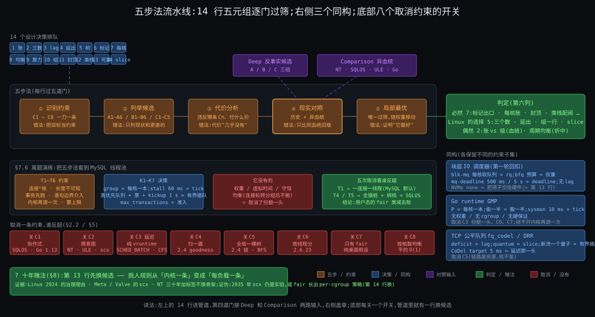

从图上能读出五件事:

1. **中间的管道是五步法**,左进右出:约束进去,局部最优出来;14 行五元组在管道里排队,每行要过五道门。
2. **第四道门(现实对照)有两个入口**:Deep 的反事实候选和 Comparison 的 NT / SQLOS / ULE / Go,判定就在这道门后面盖章。
3. **右侧三个侧栏是同构**:块层 IO 调度器、Go runtime、TCP 公平队列,各自的"账 / 片 / 每核一本 / 有界插队"都能对回管道里的某一行。
4. **底部是取消约束的八个开关**:关掉任何一个,管道里就有一行换候选(§2.2),这是局部最优"随权重移动"的证据。
5. **左下角一个问号是十年赌注**:五元组里哪一行最先换候选(§8)。

---

## §2 五元组表:14 次过筛

**先说结论**:14 个决策里,7 个在 NT 上有同形对应(必然),5 个是 Linux 自己的选择(两边都没违反约束),2 个是折中点或治理决定(偶然)。EEVDF 不是最聪明的设计,是 2023 年权重下唯一过得了八道筛的那个;2007 年的 CFS 在 2007 年的权重下也过了筛。

### §2.1 表

| # | 设计决策(出处) | 解决的约束 | 付出的代价 | 反事实候选 | 现实对照 | 判定 |
|---|---|---|---|---|---|---|
| 1 | 只按账挑人,`pick_eevdf` 40 行里没有类型判断(Deep §2.2.4,`fair.c:907`) | C2·未来不可知 | 真正的交互任务没有奖励,只能靠账小 + slice 小(Why insight 1) | A2 CFS 睡醒补半 slice;A5 BVT warp(Deep §2.5) | NT 事件提升 +1 ~ +8(猜);SQLOS 2016 转向 deficit(Comparison §3、§7.2) | 偶然(血统):同约束下 NT 选了猜 |
| 2 | 份额 / 延迟 / 资格拆成权重、slice·deadline、lag 三个数(How §3.1 ~ §3.4) | C3·份额与延迟两头要 | 每实体多两个字段,树要按 deadline 排并增广(Deep §7) | A3 彩票(延迟是概率);A4 stride(只有 vruntime) | NT 一个数(级),"急"只能抬级(Comparison §3.4) | Linux 的选择;"插队有界"那一半是必然 |
| 3 | lag 睡下去夹在 ±max(2·slice, tick) = ±6 ms,醒来按 (W + w)/W 放大守恒放回(Deep §2.2.3,`:692` / `:5266`) | C3·份额与延迟两头要 | 睡再久只欠 6 ms;大权重任务还 6 ms 要跑 64 ms(How §14) | 不夹紧:模拟器 120 ms 不换人(Deep §2.6);CFS 固定优惠 | NT 提升 ≤ 15、每片 −1 回基线(Comparison §3.6) | 有界 = 必然;"守恒放大"是 Linux 的算术选择 |
| 4 | 超支者去睡不出队,留树上到 lag 归零(`DELAY_DEQUEUE`,Deep §2.2.6,`:5500`) | C3·份额与延迟两头要 | 树上有"在睡但挂着"的节点;`h_nr_running` 与真可跑分开算 | 6.11 以前存负 lag 带到下次;或清零(逃债) | NT 无对应(级不记欠账) | Linux 的选择(2024 年才定) |
| 5 | 按 deadline 排的增广树 + `avg_vruntime` 两个累加器 + 乘倒数不除法(Deep §2.2.2,`:620` / `:259`) | C4·挑人须便宜 | 常数项变成字段和表;44 位累加器有上界 | 2.4 的 goodness 扫一遍;O(1) 位图(只对级有效) | NT 32 位位图 O(1)(Comparison §8) | 必然(O(log n) 或 O(1)),数据结构形状偶然 |
| 6 | tick / 唤醒只打 `TIF_NEED_RESCHED`,真换在两个出口(How §4.2,`core.c:1079` / `entry/common.c:101`) | C1·只在打断点换 | 决定到执行差一次出口;3 ms slice 实跑 4 ms(Deep §2.4) | 中断里直接换栈(不可能);协作式 yield(信任) | NT DeferredReady → Standby,IRQL ≥ 2 不换(Comparison §6.1) | 必然 |
| 7 | 每核一本账;唤醒偏 prev 108.5%、同 LLC 找空核(Deep §3.2.1,`:7411` / `:7873`) | C5·核各自为政 | 永远只是近似均衡 | B1 全局树一把锁;B3 每次放最闲(Deep §3.5) | NT 理想 / 上次处理器 + 每处理器队列(Comparison §5) | 必然 |
| 8 | 分层 pull:117% 迟滞、只搬一半、500 μs 热门槛、newidle 只搬一个(Deep §3.2.2 / §3.4,`:11048` / `:11162` / `:9260` / `:9607`) | C5·核各自为政 + C4·挑人须便宜 | 跨 L3 永远有残差;newidle 每次只搬一人 | B2 无热门槛;B4 push;B5 不分层 | NT 无周期均衡,只在就绪时选核(待核 #100);ULE pull + push(Comparison §5.5、§7.3) | 偶然(C5·核各自为政 vs C4·挑人须便宜 的折中点) |
| 9 | 跨核一切比较除以算力;PELT 32 ms 半衰期做重量;跨 LLC 走 `migrate_util`(Deep §3.2.3 / §3.4,`pelt.c:180`,`:11115`) | C8·核不等速且耗电 | 32 ms 对突发反应慢;x86 服务器无能耗模型 | 按核数均衡(SMT 兄弟挤一起) | NT efficiency class + QoS 标签 + `SchedulingPolicy`(Comparison §6.3) | 按算力比 = 必然;估计量 vs 标签 = 偶然 |
| 10 | 组在父树上是同形一行,权重按本核负载分摊 `calc_group_shares`(How §3.7,Deep §4.2.2,`:4015`) | C6·份额按组算 | 每层入账逐层爬;组权重估算偏大("icky") | 按线程分(2.6.23);只贴标签不记账 | NT Job 权重 1 ~ 9 不嵌套;DFSS 按会话(Comparison §4) | 组一行 = Linux 的选择;嵌套是它的推论 |
| 11 | 带宽 = 池 + 每核借 5 ms 片 + 借不到整组停 + 100 ms 定时器补(Deep §4.2.3,`:5772` / `:5915` / `:6518`) | C6·份额按组算 | 周期末整组停 87.5 ms(How §6.3) | Deep §4.5 候选一 ~ 五:cpuset 按核限 / 无封顶只按比例 / 只停超额线程 / 无 burst / dl 式预算 | NT Job HARD_CAP 整 job 停到 next interval;kubelet Windows 312 ‰(Comparison §4.3) | 必然(形状);周期与片长偶然 |
| 12 | 类栈 `stop > dl > rt > fair > ext > idle` + rt 95% 阀 + fair 5% server + PI + dl 准入(Deep §5.1 / §5.2,`rt.c:876`,`deadline.c:239` / `:1637`) | C7·有人要硬保证 | 5% 留白;准入拒绝;PI 锁更重 | 全走公平(音频爆音);凌驾无阀(2.4) | NT 16 ~ 31 无阀无准入;MMCSS 留 20%;AutoBoost 地板(Comparison §6.2) | 凌驾 + 阀 + 继承 = 必然;准入与阀的位置偶然 |
| 13 | 挑人规则可替换:`ext` 类在 fair 之下,BPF 定 enqueue / dispatch,watchdog 回退(Deep §5.4,`vmlinux.lds.h:131`,`ext.c:4445`) | C2·未来不可知(让知道负载的人定)+ C7·有人要硬保证 的阀 | "正确"没有唯一答案;治理成本 | 树外补丁;可加载调度器(Linus 多次 NAK) | Meta / Valve 的 scx;NT 无(Origin §8) | 偶然(治理决定,2024-06-11) |
| 14 | slice 可自定 0.1 ~ 100 ms(`sched_attr::sched_runtime`)+ `PREEMPT_SHORT` 让短 slice 抢长 slice(Deep §2.1,`syscalls.c:307`,`:1177`) | C3·份额与延迟两头要 | 接口暴露了可滥用的旋钮(小 slice 换插队权) | latency-nice(再加一个 nice) | NT 只能抬级(Comparison §3.4) | Linux 的选择(拆成三个数之后的自然接口) |

读法:第 1 行和第 13 行都挂在 C2·未来不可知 下,却一个"不猜"一个"让别人猜"—— 这不是矛盾:内核自己不猜,但允许知道负载的人在树内猜。

### §2.2 逐条取消一条约束看谁反超

| 取消的约束 | 哪个候选反超 | 现实里谁这么做了 |
|---|---|---|
| C1·只在打断点换(假设流会自己让台) | 协作式:打断点由调度器自己埋,到处都是,不需要 tick 和标记 | SQLOS(Comparison §7);Go 1.13 以前(函数调用处才能抢,死循环挂调度器,Comparison §7.3) |
| C2·未来不可知(假设意图可读) | 猜:事件提升、睡眠比评分、或者干脆让负载自己写规则 | NT 的 boost;FreeBSD ULE 的交互性评分;sched_ext 把猜交给加载者(第 13 行) |
| C3·份额与延迟两头要 的延迟一头(只要份额) | 纯轮转或纯 vruntime,不需要 deadline / lag | `SCHED_BATCH`(不抢占)/ `SCHED_IDLE`;2007 年 CFS 的本体(延迟靠修正偷渡) |
| C4·挑人须便宜(假设预算无限) | 扫一遍算 goodness,或者每层维护理想 EEVDF 的完整 lag | 2.4 的 `goodness`(Origin §2);2008 年 Peter 的 fair-group EEVDF 被搁置的原因之一(Origin §9) |
| C5·核各自为政(假设单核或跨核免费) | 全局一棵树、不要调度域、不要热门槛 | 2.4 的 `runqueue_lock`;BFS / MuQSS 单队列(Con 自述 16 逻辑核上限,Origin 交接) |
| C6·份额按组算(假设单位就是线程) | 没有 `task_group`,没有带宽;`make -j64` 压扁浏览器 | 2.6.23 的 CFS(组调度三个月后才补,Origin §10) |
| C7·有人要硬保证(假设没人要绝对时限) | 只有 fair 一个类,不需要类栈、阀、PI | 纯桌面假设;Con 的 "absolute fairness at all costs"(Origin §4) |
| C8·核不等速且耗电(假设对称 SMP) | 按核数均衡,不要 capacity / PELT / EAS | 2.6 早期的 O(1) 均衡(平的);手机上 2019 年前的大小核靠厂商补丁 |

八次取消各有一个现实样本 —— 这是"局部最优随权重移动"的全部证据:同一份代码,在取消某条约束的世界里不是最优,而且那个世界真的存在过。

---

## §3 洞察清单

**先说结论**:前六份能抽出 24 条独立洞察;按"读者带走后能用在别的系统上"挑 11 条必保,每条一节。

### 全部 24 条

| # | 洞察(一句话) | 出处 |
|---|---|---|
| 1 | 调度器 = 四问:何时换 / 换谁 / 各多少 / 在哪换;规则只看账 | What |
| 2 | 份额、延迟、位置是三个独立旋钮,拧错了没用甚至更糟 | What 钩子二,How §5.6 / §11 |
| 3 | 配额是时间不是核;p99 抖动的粒度 = 周期,根治是并发数 | What 钩子一,How §6.3,Deep §4.4 |
| 4 | 约束一刀一条跟着痛点走;"公平"是目标不是约束 | Why |
| 5 | 把"猜意图"换成"记账":账越纯,规则越站得住 | Why insight 1,Origin §4 / §7 |
| 6 | 份额与延迟拆成两个数,lag 是缝合的第三个数 | Why insight 2,How §3.4 |
| 7 | 一本账变 N × H 本:每核一本(水平)× 组嵌套(垂直),上一层是同形一行 | Why insight 3,How §3.7 / §5 |
| 8 | 凌驾要配阀:给特权和限特权成对出现 | Why insight 4,Deep §5.1 / §5.2 |
| 9 | 标记与真换分开:决定在打断点,执行在出口 | How §4,Deep §2.3 |
| 10 | 睡再久只能欠两个 slice;欠账守恒,放回时按 (W + w)/W 放大 | How §3.4,Deep §2.2.3 |
| 11 | 两个同权任务的稳态是 tick 粒度轮换,不是 slice 粒度 | Deep §2.6 |
| 12 | 高权重任务的"欠账"是服务量不是时间:还 6 ms 的账要跑 64 ms | How §14 |
| 13 | 睡眠不能逃债:超支者留树上到 lag 归零 | How §3.4,Deep §2.2.6 |
| 14 | 搬人只在"有利可图且不热":117% 迟滞、搬一半、500 μs | Deep §0.2 / §3 |
| 15 | 同 LLC 拉平个数,跨 LLC 只填算力余量 | Deep §3.4 |
| 16 | newidle 均衡是热路径,可抢占内核下每次只搬一个 | Deep §3.3 / §3.4 |
| 17 | 绑核分"不能走"和"不能来"两半,只绑一半更糟 | How §5.6,Deep §3.6 |
| 18 | 组的封顶按周期借还,整组停;池 + 每核借片是 16 核不争锁的代价 | Deep §4.2.3 / §4.3 |
| 19 | 三代换代各改写一条约束的权重:2002 C4·挑人须便宜 + C5·核各自为政、2007 C2·未来不可知、2023 C3·份额与延迟两头要 | Why 呼应,Origin |
| 20 | 同一份代码,约束权重变了就从"没必要"变成"必然"(EEVDF 2008 vs 2023) | Origin §9 |
| 21 | 规则可替换之后,"正确"没有唯一答案;合并它的理由是参与门槛不是算法 | Origin §8,Deep §5.4 |
| 22 | 猜意图 vs 记账是血统差异;"插队有界"是约束,两边同形 | Comparison §3、§10 |
| 23 | 取消一条约束(C2·未来不可知)在用户态能得到另一个局部最优,但 C3·份额与延迟两头要 和 C6·份额按组算 的解形状不变 | Comparison §7 |
| 24 | NT 三十年只加标签不换骨架;它之上的 SQLOS 自己长出了 deficit | Comparison §9 |

### §3.1 必保十一条

| 必保 | 条目 | 为什么保 |
|---|---|---|
| ① | #5 记账不猜 | 它是三代换代的方向,也是和 NT 的分界线 |
| ② | #6 三个数 + lag 缝合 | 灵魂问题第一段的答案本身 |
| ③ | #10 欠账有界且守恒 | 上一轮卡住的那一点,这轮用模拟器钉死 |
| ④ | #9 标记与真换分开 | C1·只在打断点换 的全部内容,所有系统同形 |
| ⑤ | #7 N × H 本账 | 多核和 cgroup 都是它的推论 |
| ⑥ | #3 配额是时间不是核 | 开场钩子一的答案,DB 工程师每天会碰 |
| ⑦ | #14 有利可图且不热 | 搬人判据,第一次系统讲多核 |
| ⑧ | #8 凌驾配阀 | 任何有优先级的系统都用得上 |
| ⑨ | #22 猜意图 vs 记账是血统,有界是约束 | 判别法的样板 |
| ⑩ | #19 + #20 换代 = 权重变化 | 灵魂问题第二段的答案 |
| ⑪ | #21 规则可替换 | 十年赌注的根据 |

未保但有价值的:#2 三个旋钮(并入⑥⑦)、#11 tick 粒度稳态(并入③)、#12 服务量 vs 时间(并入③)、#13 睡眠不逃债(并入③)、#15 / #16 / #17 多核细节(并入⑦)、#18 带宽机制(并入⑥)、#23 / #24 SQLOS 与 NT(并入⑨)、#1 / #4 是骨架不是洞察。

### §3.2 ① 记账不猜

**陈述**:挑人规则不判断任务是什么,只回答谁欠得多。**证据**:`pick_eevdf`(`fair.c:907`)40 行没有一个分支读任务类型(Deep §2.2.4);EEVDF 删掉的正是 `sched_latency / min_granularity / wakeup_granularity` 和睡醒补半 slice(Deep §8);Ingo 2007 的公告原话 "no heuristics whatsoever",Peter 2023 的 "delete a whole much of icky heuristics code"(Origin §4、§7)。**边界**:账只能表达"欠多少",表达不了"急不急";6.12 用可自定的 slice 补这一头(第 14 行),代价是接口可被滥用。**反例**:NT 的 +1 ~ +8 提升三十年没换,桌面口碑不差 —— 猜在单一负载类型(桌面)上并不吃亏,它吃亏在负载混合时参数调不平(Origin §4 的 `fiftyp.c`)。**带走**:凡是要对负载类型中立的分配器,先把"猜"删掉,再看账能不能表达你要的。

### §3.3 ② 三个数,lag 缝合

**陈述**:权重管份额、slice / deadline 管顺序与粒度、lag 管资格;没有 lag,延迟旋钮会吃掉份额旋钮。**证据**:How §3.6 五拍表被模拟器复现到 0.01 ms(Deep §2.4);redis nice −10 争满 CPU 时 9.3 : 1(份额),醒来能不能立刻上只看 V 和 lag(延迟),两者数值上互不影响(How §11 误解一)。**边界**:三个数只在 fair 类内有定义;rt / dl 是另一套(级和截止期)。**反例**:Stoica 1995 的论文已经有 eligible,但 28 年没人要 —— 没有延迟需求时第三个数是负担(Origin §5、§9)。**带走**:要同时保证比例和上界,先承认它们是两个量,再找把它们缝回去的那个不变量(这里是 Σ w·lag = 0)。

### §3.4 ③ 欠账有界且守恒

**陈述**:睡下去 lag 夹在 ±max(2·slice, tick),醒来按 (W + w)/W 放大放回,放回后 V 下移、lag 恰好不变。**证据**:`entity_lag`(`:692`)、`place_entity`(`:5266`)及其 20 行注释推导(Deep §2.2.3);两个 nice 0 任务 B 睡 20 ms 醒来只记 +6、立刻抢、连跑 12 ms 后进入 4 ms 轮换(Deep §2.6 模拟器原样输出);不夹紧的版本 120 ms 不换人。**边界**:上限是服务量不是时间 —— redis 的 6 ms 账要 64 ms 才还清(How §14),因为它每跑 1 ms 只还 0.01 虚拟 ms。**反例**:这一块是整个 EEVDF 最新、最不稳定的(delayed dequeue 6.12 才收口,Origin §7),上限 2 个 slice 是 Peter 2023 年拍的,没有理论最优证明。**带走**:给"插队"定额度时,额度要跟延迟量纲(slice)挂钩,不跟份额(权重)挂钩,并且加入 / 退出队列这个动作本身不能改账。

### §3.5 ④ 标记与真换分开

**陈述**:tick、唤醒、让出只置 `TIF_NEED_RESCHED`;真换人只在回用户态前和内核态允许抢占的点。**证据**:`resched_curr`(`core.c:1079`)只置位,`exit_to_user_mode_loop`(`entry/common.c:101`)和 `preempt_schedule_irq`(`core.c:7003`)才 `__schedule`(Deep §7);`preempt_count` 把"该换"的反码放在同一个字里,`preempt_enable` 一条 `dec + jnz` 就能判(Deep §5.3)。**代价**:3 ms 的 slice 实际跑到下一个 tick 的 4 ms;`PREEMPT_NONE` 下内核态长路径不可抢。**反例**:NT 的 DeferredReady → Standby + dispatch 中断、IRQL ≥ 2 不换,形状一模一样(Comparison §6.1)—— 这是判别法里最干净的"必然"。**带走**:任何"决定者没有自己的执行线程"的系统(中断驱动、事件循环),决定和执行都得分开成标记 + 出口。

### §3.6 ⑤ N × H 本账

**陈述**:账按核拆 N 本,每本按组嵌 H 层;上一层在父层是"同形的一行",所以挑人规则只写一遍。**证据**:`task_group` 每核一个 `se` + `cfs_rq`(`sched.h:432`),`enqueue_task_fair` 逐层爬(`:6986`),`pick_eevdf` 不区分线程和组(How §3.7,Deep §4.2.1);核与核之间用同一个负载量比较(PELT,Deep §3.2.3)。**代价**:每层都要 `update_cfs_group`,组权重按本核负载分摊的估算"icky"(`calc_group_shares` 注释);核间永远近似。**反例**:NT 的 Job 权重 1 ~ 9 和 DFSS 不嵌套、互斥(Comparison §4),所以 Comparison 判"组一行"是 Linux 的选择 —— 但封顶(整 job 停)两边同形,是必然。**带走**:要支持嵌套分配,把"组"做成和"叶子"同一个数据类型,比给组另写一套规则便宜得多。

### §3.7 ⑥ 配额是时间不是核

**陈述**:`cpu.max = 配额 周期` 限的是每周期的 CPU 时间;16 个线程 12.5 ms 烧光 200 ms,整组停 87.5 ms;根治是并发数,不是配额。**证据**:How §6.3 的 A ~ E 五个选项(改 4 核只把 87.5 变 75;period 10 ms 把一次 8.75 ms 但每秒 100 次;并发压到 2 线程永不 throttle);Deep §4.4 把它对到 `cpu.stat` 的 `nr_periods / nr_throttled / throttled_usec`;机制在 `__assign_cfs_rq_runtime`(`:5772`)借 5 ms 片、`throttle_cfs_rq`(`:5915`)整组下树。**边界**:位置旋钮(`cpuset`)和用量旋钮(`cpu.max`)是两件事,k8s 的 `static` policy 才绑核。**反例**:Windows Job 的 HARD_CAP 也是"整 job 停到 next interval",kubelet 在 Windows 节点上算成 312 ‰(Comparison §4.3)—— 周期制封顶是必然的形状。**带走**:给任何资源做"上限"时,先问清楚单位是容量还是速率;速率上限必然带来周期末的停顿,停顿长度 = 周期 − 烧光用时。

### §3.8 ⑦ 有利可图且不热

**陈述**:搬人只在最忙组比本组忙 117% 以上(`imbalance_pct`)、只搬差距的一半、且目标任务 500 μs 内没跑过。**证据**:`calculate_imbalance`(`:11048`)、`imbalance >>= 1`(`:11162`)、`task_hot`(`:9260` / `:9298`,`sysctl_sched_migration_cost` 500000)(Deep §0.2);rq3 的 newidle 算例:MC 层算出 2 只搬 1(`:9607` break),PKG 层走 `migrate_util` 填 1024 算力余量(Deep §3.4)。**代价**:永远近似;唤醒偏 prev 108.5% 让忙核更忙一点。**反例**:NT 不做周期均衡,只在就绪时选核(待核 #100);ULE 拉 + 推都做(Comparison §5.5、§7.3)—— 这一行是折中点,偶然。**带走**:跨"账本"搬东西时,要同时有迟滞(别来回搬)和热度(别搬刚用过的);两个参数都是量级估计,没有理论最优。

### §3.9 ⑧ 凌驾配阀

**陈述**:类栈让 rt / dl 凌驾 fair;每开一个凌驾口子就配一个阀:rt 95% 封顶、dl 准入 Σ runtime/period ≤ 95%、fair 5% server、PI。**证据**:`sched_rt_runtime_exceeded`(`rt.c:876`)、`__dl_overflow`(`deadline.c:239`)、`fair_server` 默认 50 ms / 1000 ms(`:1637`)、`rt_mutex_adjust_prio_chain`(`rtmutex.c:675`)(Deep §5.1 / §5.2);阀和 server 在 6.12 并存,后者是前者的对偶。**反例**:NT 的 16 ~ 31 无阀无准入,靠 MMCSS 留 20% 和 AutoBoost 地板(Comparison §6.2)—— 凌驾、阀、继承三样两边都有,位置不同。**带走**:设计优先级时,同时设计"最高优先级能占多少"和"它等低优先级时怎么办",否则火星探路者。

### §3.10 ⑨ 猜意图 vs 记账是血统,有界是约束

**陈述**:NT 的 +2 取决于事件类型,Linux 的放回位置取决于欠账;两边共享的"插队有界"(NT ≤ 15 且每片 −1,Linux ±2 slice)是 C3·份额与延迟两头要 逼的。**证据**:Comparison §10 的从头走一遍(答 A);redis 场景 NT 两片 ≈ 374 ms 优先 vs Linux ≤ 6 ms(Comparison §3.3);关掉 NT 的提升退化成同级轮转最坏 2.8 s,关掉 Linux 的 `PLACE_LAG` 仍按 deadline 排。**边界**:判别法要求"同约束";NT 面对的 C2·未来不可知 和 Linux 一样硬,所以"猜"是它的选择不是它的约束。**带走**:比较两个系统时,先把两边都做的那一半剥出来(那是约束),剩下的才是可以争论的设计。

### §3.11 ⑩ 换代 = 约束权重变化

**陈述**:2002 年 C4·挑人须便宜 + C5·核各自为政 的权重上升(任务上千、核上八)逼出 O(1);2007 年 C2·未来不可知 的账到期逼出 CFS;2023 年 C3·份额与延迟两头要 被正面承认逼出 EEVDF;同一份 EEVDF 代码 2008 年被搁置、2023 年必然。**证据**:Origin §3 / §4 / §7 的一手引语;§9 按八条约束逐条算 2008 年的权重;§10 回扣表每代欠下一代的债。**边界**:C1·只在打断点换 从未被任何一代"解决",只是被更短的 slice 逼得更显眼(6.13 的 `PREEMPT_LAZY`,待核)。**带走**:看一个系统为什么换代,别问"新算法好在哪",问"哪条约束的权重变了";同一算法在不同年份的命运不同,是权重的函数。

### §3.12 ⑪ 规则可替换

**陈述**:sched_ext 让挑人规则由 BPF 程序定,内核只保底;合并它的理由是参与门槛,不是算法。**证据**:`ext` 类在 fair 之下(`vmlinux.lds.h:131`),`scx_ops_disable_workfn`(`ext.c:4445`)在出错 / 停滞 / SysRq-S 时回退;Linus 2024-06-11 "the main thing that keeps people from participating is too high barriers to participation",Peter 2022 "I hate all of this"(Origin §8)。**代价**:"正确"没有唯一答案;维护者反对。**反例**:NT 从未允许替换 dispatcher,它用标签(QoS、SchedulingPolicy)扩展(Comparison §6.3)。**带走**:当一条约束(C2·未来不可知)在不同负载上权重差异太大时,把决定权下放比在内核里找一个全局折中更稳 —— 这也是 §8 赌注的根据。

---

## §4 同构系统:这套形状在哪里又出现过

**先说结论**:块层 IO 调度器、Go runtime、TCP 公平队列各自独立地长出了"账 / 片 / 每核一本 / 有界插队"四样里的三到四样;它们没有的那一样,恰好对应它们取消了的那条约束。

### §4.1 块层 IO 调度器:bfq 与 mq-deadline(回扣你的第一轮)

你第一轮 How §4.4 讲过电梯与 deadline 双索引。对回本轮:

| 调度器概念 | 块层对应 | 同 / 异 |
|---|---|---|
| 每核一本账 `rq` | blk-mq 每核一个软件队列 + 硬件队列 | 同(C5·核各自为政) |
| 权重 / 虚拟时间 | bfq 的每队列预算(budget)与 B-WF2Q+ 虚拟时间;cgroup `io.weight` | 同(C3·份额与延迟两头要 份额一头) |
| deadline | mq-deadline 的 `read_expire` 500 ms / `write_expire` 5 s 两条 FIFO 索引(6.12 `block/mq-deadline.c:30 ~ :38`,已核) | 同(C3·份额与延迟两头要 延迟一头),但按方向分 |
| 插队有界 | mq-deadline `writes_starved` 2:读最多让写饿两批;`fifo_batch` 16 | 同(有界) |
| lag / eligible | 无 —— 块层没有"欠账守恒",bfq 用 idling 等待同一队列的下一个请求 | 异:C2·未来不可知 在块层更弱(请求已经在队列里,长度已知) |
| 组封顶 | `io.max`(按 IOPS / BPS 封顶,不按周期) | 形状异:块层按速率令牌不按周期池 |

NVMe 默认 `none`:硬件队列深 1024、FTL 自己重排,内核这一层的挑人被整个取消 —— 相当于 C4·挑人须便宜 的预算被设备拿走,同构于 sched_ext 把规则交出去(第 13 行),只是交给了硬件。

### §4.2 Go runtime GMP

| 调度器概念 | Go 对应 | 同 / 异 |
|---|---|---|
| 每核一本账 | P(`GOMAXPROCS` 个),每个 P 一条 256 槽的本地 runq + 一条全局 runq | 同(C5·核各自为政) |
| 均衡:pull、搬一半 | work stealing:空闲 P 从别的 P 偷**一半** runq | 同,连"搬一半"都一样(第 8 行) |
| tick + 标记 | sysmon 每 10 ms 检查,跑超 10 ms 的 G 被标 preempt;1.14 起用信号异步抢占(go1.23 `runtime/proc.go:6031` sysmon / `:6047` 睡到 10 ms / `:6187` `forcePreemptNS` 10 ms / `:6878` 偷一半;`runtime2.go:671` runq 256,已核) | 同(C1·只在打断点换):1.13 以前没有 tick,死循环挂调度器(Comparison §7.3) |
| 权重 / 份额 | 无 —— goroutine 没有 nice | 异:取消了 C3·份额与延迟两头要 的份额一头(runtime 信任自己的 goroutine 同等重要) |
| 组 / 封顶 | 无;`GOMAXPROCS` 长期不感知 `cpu.max`,1.25 起按 cgroup CPU 带宽上限自动设(只看 limit 不看 requests,并周期性更新;Go 1.25 发布说明,已核) | 异:取消 C6·份额按组算,靠内核那一层 |
| 硬保证 | 无 | 异:取消 C7·有人要硬保证 |

Go 取消了三条约束(C3·份额与延迟两头要 的份额、C6·份额按组算、C7·有人要硬保证),保留了 C1·只在打断点换 / C4·挑人须便宜 / C5·核各自为政 —— 所以它长出来的是"每核一本 + 偷一半 + 10 ms tick",没有账。它绕不开的是内核再调度一次:M 被内核放哪、什么时候被换下,runtime 管不着(双层调度,§7.6 会再碰到)。

### §4.3 TCP 公平队列:fq_codel 与 DRR

| 调度器概念 | fq_codel / DRR 对应 | 同 / 异 |
|---|---|---|
| 每实体一行账 | 每条流一个队列(1024 个桶,哈希) | 同 |
| slice | DRR 的 quantum(默认 `psched_mtu` = MTU 1500 + 以太头 14 = 1514 字节,`sch_fq_codel.c:479`) | 同:一次最多发一个量子 |
| lag / 资格 | deficit counter:发不出整包就把剩余额度攒到下一轮;攒的额度有上限(一个 quantum) | 同:deficit 就是 lag,上限就是 ±2 slice 的同构 |
| 睡醒插队有界 | 新流进 `new_flows` 链先服务,但只给一个 quantum,然后降到 `old_flows` | 同:有界插队 |
| 延迟那一头 | CoDel:每流 sojourn 超过 target 5 ms 持续 interval 100 ms 就丢包(`codel_impl.h:56 ~ :57`) | 同(C3·份额与延迟两头要 延迟一头),但用丢包不用 deadline |
| 权重 | fq_codel 无(各流均等);HTB / CAKE 有 | 部分异 |
| 每核一本 | 无 —— qdisc 是每网卡队列一本,跨核锁 | 异:取消 C5·核各自为政(发包的核不是资源,链路才是) |

(fq_codel 默认值已按 6.12 源码核实,见待核 #127。)三个同构摆在一起,规律是:**每系统保留的约束集不同,长出的部件集就不同,但同一条约束对应的部件形状相同** —— 这是判别法在跨领域上的版本。

---

## §5 局部最优论证

**先说结论**:给定 {C1 ~ C8},"打断点标记 + 账(三个数 + 有界守恒的 lag)+ 增广树 + 每核一本 + 分层 pull + 同形组 + 周期池 + 类栈配阀 + 算力归一"是唯一同时过八道筛的形状;它不是最聪明的,是筛剩下的。

论证分两步:

**第一步:每道筛各砍掉谁。** §2.2 的表已经给了八个"取消某条约束后反超的候选";反过来读,就是八条约束各淘汰了哪个候选:C1·只在打断点换 淘汰协作式(SQLOS、Go 1.13);C2·未来不可知 淘汰猜(NT boost、ULE 评分、O(1) `sleep_avg`);C3·份额与延迟两头要 淘汰纯轮转、纯 vruntime、彩票、无界 warp(Deep A1 / A2 / A3 / A5);C4·挑人须便宜 淘汰扫描和理想 EEVDF(2.4、2008 年的 RFC);C5·核各自为政 淘汰全局队列和不分层(B1 / B5、BFS);C6·份额按组算 淘汰按线程分和只贴标签;C7·有人要硬保证 淘汰纯 fair;C8·核不等速且耗电 淘汰按核数均衡。剩下的候选集里,每一项都在 §2.1 的表中,且都有 NT 或别的系统的独立佐证。

**第二步:权重变了,筛剩下的就变。** 2007 年 C3·份额与延迟两头要 的延迟一头权重低(桌面靠睡眠时间就够,服务器不在乎),CFS 在那年的筛下也是唯一剩下的;2008 年的 EEVDF RFC 被 C4·挑人须便宜 和 C6·份额按组算 的当年权重筛掉(Origin §9);2023 年容器混部把延迟需求推到台前,C4·挑人须便宜 的预算涨了一个量级,EEVDF 才过筛。所以"局部最优"是相对于一组权重的;§8 的赌注是在预测下一次权重移动。

两个不该被误读的点:第 13 行(sched_ext)不是"筛剩下的",是"把筛子交出去";第 8 行(周期均衡)和第 12 行的阀位置是折中点,在筛之内有多个解 —— 判别法把它们标成偶然,不是贬义。

---

## §6 时代局限与演化

**先说结论**:每一代都在当年的权重下过筛,也各欠下一代一笔债;今天的权重(容器、大小核、BPF)和 2007 年差在三处,还没还的债有四笔。

| 代 | 当年过筛靠的权重 | 欠下的债 | 谁来还 |
|---|---|---|---|
| V7 / 4.3BSD 衰减优先级 | C1·只在打断点换 + "按过去推" | 猜交互性的世界观 | 2007 年 CFS;NT 至今没还 |
| 2.4 `goodness` | C1·只在打断点换、C2·未来不可知 | O(n) + 全局锁 | 2002 年 O(1) |
| O(1) 2002 | C4·挑人须便宜、C5·核各自为政 | `sleep_avg` 可被 `fiftyp.c` 骗 | 2007 年 CFS |
| CFS 2007 | C2·未来不可知 | 延迟靠睡醒补偿偷渡;组三个月后补 | 2023 年 EEVDF;2008 组调度 |
| 带宽 2011 | C6·份额按组算 封顶 | 周期末停顿 | 2021 年 burst 部分还;并发数是用户自己还 |
| PELT 2012 | C8·核不等速且耗电 | 32 ms 对突发慢 | `util_est`(`UTIL_EST` 特性)部分还 |
| EEVDF 2023 | C3·份额与延迟两头要 | 睡眠时 lag 怎么办 | 2024 年 delayed dequeue,仍在改 |

今天的权重和 2007 年差在三处:**容器**让 C6·份额按组算 从桌面会话变成计费单位(封顶的周期末停顿成了 p99 的主要来源);**大小核 / 频率**让 C8·核不等速且耗电 从手机专属变成 x86 桌面也有(P / E core);**BPF** 让"规则可换"的成本从"维护树外补丁"降到"加载一个程序"。

还没还的四笔债:① lag 的睡眠处理(delayed dequeue 6.12 刚收口,`DELAY_ZERO` 清零是否最优无证明);② 内核态抢占(slice 越短 C1·只在打断点换 越显眼,`PREEMPT_LAZY` 6.13,待核);③ 组实体权重估算的高估(`calc_group_shares` 自己注释 "icky");④ sched_ext 的治理 —— 规则可换之后,谁对"正确"负责。

---

## §7 方法论沉淀:五步法

**先说结论**:五步法是前六份的生成顺序;每一步都有一个本轮实例和一个最常见的错法。

### §7.1 第一步:识别约束 —— 不可再分的物理 / 数学 / 工程边界

本轮实例:从"一核一队列先来先跑"起八刀,每刀一条(Why)。**常见错误**:把目标当约束 —— "公平"、"响应快"、"高性能"都是目标;真正的约束是 C3·份额与延迟两头要(两个量冲突)和 C4·挑人须便宜(预算 1 μs)。检验法:写不出"不可再分性"那一栏的,不是约束(Why「这些不算约束」)。

### §7.2 第二步:列举候选 —— 抽象层面的所有可能解

本轮实例:Deep 的 A1 ~ A6(挑人)、B1 ~ B6(搬人)、C1 ~ C5(封顶)。**常见错误**:只列"现在这个"和"明显更差的那个";正确做法是把别的系统的解也列进来(NT 的 boost、SQLOS 的协作式、Go 的偷一半),它们都是候选。

### §7.3 第三步:代价分析 —— 每个候选违反哪条约束、付什么价

本轮实例:§2.1 的第四、第五列;How §10 朴素 vs 真实。**常见错误**:代价写成"几乎没有"—— EEVDF 的代价是每实体两个字段、树增广、lag 夹紧参数无理论依据;写不出代价说明没分析到位。

### §7.4 第四步:现实对照 —— 历史与别的系统是天然的对照实验

本轮实例:Origin 的五个转折点(时间维度)+ Comparison 的 NT / SQLOS / ULE / Go(血统维度)。**常见错误**:只对照同血统的(Linux 的旧版本),那只能看到权重变化看不到血统差异;判别法需要至少一个异血统样本。

### §7.5 第五步:局部最优证明 —— 为什么是它而不是别的

本轮实例:§5。**常见错误**:证明"它最好"—— 不存在;只能证明"在这组权重下它是唯一过筛的",并且说清权重变了会怎样(§8)。

### §7.6 泛化演练:MySQL 线程池

把五步法套到一个你更熟的系统上:MySQL 的线程池(Percona Server 的 `thread_pool` 和 MySQL Enterprise 的 thread pool plugin;参数默认值引自官方文档并已复核,见待核 #120 ~ #123)。

#### 第一步:识别约束(T1 ~ T6)

| # | 约束 | 不可再分性 | 对应本轮的 |
|---|---|---|---|
| T1·连接数 ≫ 核数 | 几千个连接,16 ~ 64 颗核;一连接一线程时内核要在几千个线程间换 | 连接数由应用定,核数由硬件定 | C5·核各自为政(每核一本账的动机)+ C4·挑人须便宜 |
| T2·语句长度不可知 | 线程池收到一条 SQL 时不知道它跑 50 μs 还是 5 分钟 | 优化器估计可被骗 | C2·未来不可知 |
| T3·事务中的语句要先跑 | 持有锁的事务多等 1 ms,等它的所有连接各多等 1 ms | 锁的传递性 | C3·份额与延迟两头要 的延迟一头(+ 一点 C7·有人要硬保证 的 PI) |
| T4·线程池只在语句边界介入 | 线程池的回调只在语句开始 / 结束 / 已插桩的阻塞点;没插桩的阻塞(某些锁、文件系统)它看不见 | 不是所有代码都走回调 | C1·只在打断点换 |
| T5·内核在下面还会再调一次 | 线程池把语句放到某个 group 的线程上,线程放哪颗核、何时被换下是内核的事 | 用户态不控核 | 本轮没有的约束(双层调度) |
| T6·多租户 / 过载要有上限 | 线程数、事务数不能无限涨 | 内存和锁 | C6·份额按组算 的封顶 + C7·有人要硬保证 的准入 |

#### 第二步:列举候选(K1 ~ K7,线程池实际做了的)

| # | 决策 | 参数(Enterprise / Percona) | 解的约束 |
|---|---|---|---|
| K1 | 把连接按轮转分到 thread group,每 group 一本账 | `thread_pool_size`:Enterprise 默认 16,Percona 默认 = 核数 | T1(每核一本账) |
| K2 | 每 group 默认一次只跑一个语句(其余排队) | `thread_pool_query_threads_per_group` 默认 1;Percona `thread_pool_oversubscribe` 默认 3(每 group 额外活跃线程的软上限,超了就让线程歇下,不控制线程创建) | T1 + T4(cache 局部性;协作式) |
| K3 | 跑超时限的语句算 stalled:它继续跑,但 group 另起一个线程接别的语句 | Enterprise `thread_pool_stall_limit` 默认 6(单位 10 ms,即 60 ms),范围 4 ~ 600;Percona 默认 500 ms | T2 + T4(tick + 标记:只在定时器到点才介入) |
| K4 | 两条队列:事务进行中的语句进高优先队列,其余进低优先队列;高优先队列先挑 | Enterprise `thread_pool_high_priority_connection`;Percona `thread_pool_high_prio_mode` 默认 `transactions` | T3(延迟那一头) |
| K5 | 低优先队列里等太久的语句升到高优先队列,每 group 每 10 ms 最多升一条 | `thread_pool_prio_kickup_timer` 默认 1000 ms | T3 的反面:插队者不能把排队者饿死(有界) |
| K6 | 每连接高优先执行次数有上限(票) | Percona `thread_pool_high_prio_tickets` 默认 4294967295(即不限) | T3 的额度(有界插队) |
| K7 | 线程总数 / 事务总数上限;新事务可延迟 | `thread_pool_max_unused_threads` 默认 0、`thread_pool_max_transactions_limit` 默认 0、`thread_pool_transaction_delay` 默认 0;Percona `thread_pool_max_threads` 默认 100000 | T6(准入 + 封顶) |

#### 第三步:代价分析

| 决策 | 代价 | 违反了谁 |
|---|---|---|
| K1 轮转分组 | 分组不看负载:一个 group 可能攒了 10 个长事务,隔壁空着;没有"均衡",连接一旦分到 group 不再搬 | T5 没解:group 的线程放哪颗核由内核决定,"每 group 一核"只是期望 |
| K2 一次一个 | 一个没插桩的阻塞把整个 group 卡住到 stall limit 到期 | T4 |
| K3 stall limit | 60 ms 之内短语句被长语句挡住;调短则 stall 频繁、线程数涨(文档:overhead from extra context switches) | T2(不知道长度,只能用超时猜) |
| K4 / K5 两条队列 + kickup | 高优先队列如果一直有事务,低优先的要等 kickup;每 group 每秒最多升 100 条,文档给的最坏例子 222 s | T3 的延迟一头保了,份额一头没有(没有权重) |
| K6 票 | 默认不限 = 没有额度;设了额度后事务里的连接用完票就掉到低优先 | 有界插队只在手动设置时成立 |
| K7 上限 | 拒绝连接 / 延迟事务 | T6 的硬停,同 cgroup 的 throttle |

#### 第四步:现实对照(纵横表)

| 调度器概念 | 线程池参数 | 同 / 异 |
|---|---|---|
| 每核一本账 `rq` | thread group(`thread_pool_size` = 核数) | 同,但 group 不绑核,T5 让它只是期望 |
| 唤醒选核 / 新建放最闲 | 连接轮转分组,不看负载 | 异:相当于 Deep 的 B3 反面(不搬也不看闲) |
| tick + need_resched | stall limit 定时器 + "stalled 后另起线程" | 同:决定(标 stalled)与执行(起新线程)分开 |
| slice | 没有;一个语句跑到完或到 stall limit | 异:取消了 C3·份额与延迟两头要 的份额一头(没有权重,没有账) |
| lag / 有界插队 | 高优先队列 + 票(`high_prio_tickets`)+ kickup 每 10 ms 一条 | 同形:插队、额度、反饥饿三样都有,只是没有守恒 |
| 95% 阀 / 反饥饿 | `prio_kickup_timer` 1000 ms:低优先最多等 1 s 再被抬 | 同:NT 的 4 s balance set、Linux 的 95% 阀的同构 |
| 准入 / 封顶 | `max_transactions_limit`、`max_threads`、`transaction_delay` | 同形(C6·份额按组算 的封顶 + C7·有人要硬保证 的准入) |
| 协作式 vs 抢占式 | 协作式(语句不被抢,只能等它结束或 stall) | 同 SQLOS(取消 C2·未来不可知 的内核版本) |

#### 第五步:局部最优证明(五次取消看谁反超)

| 取消的约束 | 反超的候选 | 现实 |
|---|---|---|
| T1(连接数 ≤ 核数) | 一连接一线程,不需要线程池 | MySQL 默认 `thread_handling = one-thread-per-connection` |
| T2(语句长度已知) | 短作业优先排队,不需要 stall 定时器 | 没人能做到;优化器的估计不可信 |
| T3(没有事务,或锁不传递) | 单队列 FIFO | `autocommit` 下每条语句都是低优先,文档明说 |
| T4(所有阻塞都插桩) | 不需要 stall limit,阻塞即让台 | SQLOS:自己写的 worker 全部插桩,所以能纯协作 |
| T5(内核不再调度 / 独占核) | group 绑核 + 协作式 = SQLOS | SQL Server 的 scheduler 每核一个,worker 绑死 scheduler(Comparison §7.1) |

**演练的结论**:MySQL 线程池是用户态的 fair 类减去"账":它重做了 C1·只在打断点换(stall 定时器)、C3·份额与延迟两头要 的延迟一头(两条队列 + 票 + kickup)、C5·核各自为政(每 group 一本)、C6·份额按组算 / C7·有人要硬保证 的封顶与准入,但没有权重、没有虚拟时间、没有守恒 —— 因为它取消了份额一头(所有连接同等重要)。它绕不开的是 T5:group 的线程放哪、什么时候被换下,是内核按本轮的八条约束再做一次决定;两层各猜一次,这就是双层调度的代价,也是 SQLOS 用协作式 + 绑核把 T5 取消掉的理由。五步法在这里能用,而且第五步的"取消看谁反超"给出的五个现实样本都对得上 —— 方法可以带走。

---

## §8 十年赌注:五元组里哪一行最先换候选

**问**(选择式):§2.1 的 14 行里,十年内最可能换候选的是哪一行?

- A. 第 13 行:挑人规则被 sched_ext 按负载替换,fair 类对大部分服务器负载不再是默认
- B. 第 3 / 4 行:lag 的睡眠处理(夹紧上限、delayed dequeue)再改一次
- C. 第 11 行:带宽控制从周期池改成 dl 式预算
- D. 第 8 行:周期均衡被唤醒时选核完全取代

### 从头走一遍

**问题来源**:§5 说局部最优随权重移动;要预测哪一行换,就要预测哪条约束的权重在动。四个选项各押一条:A 押 C2·未来不可知(不同负载对"猜"的需求差异),B 押 C3·份额与延迟两头要(延迟一头还没收口),C 押 C6·份额按组算(周期末停顿是 p99 主因),D 押 C5·核各自为政 vs C4·挑人须便宜 的折中点。

**分岔一:B 和 C 是"改参数"还是"换候选"?** B 的 delayed dequeue 已经在 6.12 落地,夹紧上限 2 个 slice 没有理论依据,十年内几乎肯定再调 —— 但调的是同一个候选(有界守恒的 lag)的参数,不是换成 CFS 的固定优惠或无界 warp;C 的 dl 式组预算在 Deep §4.5 被判为"把 C7·有人要硬保证 的层拿来做 C6·份额按组算 的事",dl 的 group scheduling 内核没做,且 Paul Turner 2011 年就拒绝过复用 rt 带宽代码(Origin 交接);更可能的是 burst 和更短周期这类参数调整。两者都是"同候选改参数",不算换。

**分岔二:D 的证据在反方。** NT 不做周期均衡(待核 #100)说明"只在唤醒时选核"在同约束下可行;但 Linux 这一行是 C5·核各自为政 偏向"准"的折中,而且 newidle 均衡正是 Linux 低延迟的热路径(Deep §3.3);核数越多、LLC 越碎(chiplet),周期均衡的价值越高不是越低。D 的方向和硬件趋势相反。

**分岔三:A 的证据链。** 三条:① 治理 —— Linus 2024-06-11 合并 sched_ext 的理由是参与门槛,不是算法;"work on those concerns when it's in-tree" 意味着后续演化在树内发生(Origin §8);② 现实 —— Meta、Valve(Steam Deck)、手机厂商已经在用,第一批生产负载是"知道自己是什么"的负载(游戏、单一服务),正是 C2·未来不可知 权重最低的地方;③ 对照 —— NT 三十年加了 DFSS、Job 权重、AutoBoost、QoS、SchedulingPolicy 五层标签,骨架还是级(Comparison §9):当"一条规则服务所有负载"撑不住时,级的世界加标签,账的世界放规则 —— 两边都在往"按负载分别决定"走。

**结果**:**A**。押第 13 行:十年内 fair 类仍是桌面和通用服务器的默认,但在超大规模部署(单一负载、自知意图)上,默认挑人规则会是某个 scx 调度器,而且发行版会带着它一起发。fair 类自己会继续收口 lag(B),但不会换候选。

**什么会证伪它**:到 2035 年,① scx 仍只在实验和少数厂商内部(没有发行版默认启用任何 scx 调度器,生产节点占比不到个位数百分比);或 ② fair 类自己长出了"按 cgroup 配置挑人规则"的接口(比如 per-cgroup slice / latency 策略),把 A 的需求在树内吸收掉 —— 那就是第 14 行换候选,不是第 13 行。两种情况任何一种出现,这个赌注输。

---

## §9 约束回扣

| 约束 | 本篇哪个产物用到了它 |
|---|---|
| C1·只在打断点换 | 五元组第 6 行;洞察④;同构 Go 的 sysmon、线程池的 stall 定时器;取消它 → SQLOS |
| C2·未来不可知 | 五元组第 1、13 行;洞察①⑨⑪;赌注 A 押它的权重差异;取消它 → NT / ULE / sched_ext 加载者 |
| C3·份额与延迟两头要 | 五元组第 2、3、4、14 行;洞察②③;同构 fq_codel 的 deficit、线程池的票与 kickup;取消延迟一头 → `SCHED_BATCH` |
| C4·挑人须便宜 | 五元组第 5、8 行;局部最优第一步;同构 NVMe `none`(预算交给硬件);取消它 → 2.4 goodness |
| C5·核各自为政 | 五元组第 7、8 行;洞察⑤⑦;同构 Go 的 P、blk-mq 软件队列、线程池 group;取消它 → BFS |
| C6·份额按组算 | 五元组第 10、11 行;洞察⑥;同构 `io.max`、线程池的 `max_transactions_limit`;取消它 → 2.6.23 |
| C7·有人要硬保证 | 五元组第 12 行;洞察⑧;线程池的 kickup 作为反饥饿;取消它 → 纯 fair 桌面 |
| C8·核不等速且耗电 | 五元组第 9 行;时代局限的 P / E core;取消它 → 平的 O(1) 均衡 |

---

## §10 呼应你的问题

三段,每段可以直接复述:

**"按什么规则挑下一个"**:在 lag ≥ 0 的实体里挑 deadline 最早的(`fair.c:907`)。lag = 加权平均虚拟时间减它的虚拟时间,睡下去夹在 ±2 个 slice,醒来守恒放回;deadline = 虚拟时间 + slice ÷ 权重;权重来自 nice,每级 1.25 倍。规则只看这三个数,不看任务是谁。它是 C2·未来不可知 + C3·份额与延迟两头要 + C4·挑人须便宜 下唯一过筛的候选(§5)。

**"被哪些约束逼出来、为什么三代"**:八条约束一刀一条;三代换代各是一条约束的权重上升 —— 2002 年 C4·挑人须便宜 + C5·核各自为政(O(1)),2007 年 C2·未来不可知(CFS 删掉猜),2023 年 C3·份额与延迟两头要(EEVDF 承认两个量)。同一份 EEVDF 代码 2008 年被筛掉、2023 年过筛,是权重不是算法变了(§6)。判别法说:标记 + 出口、每核队列、周期封顶、凌驾配阀、插队有界是必然;账还是级、周期均衡、嵌套权重、准入是 Linux 的选择或折中点(§2)。

**"多核和 cgroup 把规则扩展成了什么"**:账按核拆 N 本,按组嵌 H 层,上一层是同形的一行,所以规则只写一遍(洞察⑤);搬人只在有利可图且不热(117%、一半、500 μs),组封顶按周期借还、整组停(洞察⑥⑦)。这两处 NT 也同形,Go 和线程池各长出了一半 —— 它们是 C5·核各自为政 和 C6·份额按组算 的函数,不是 Linux 的发明。

闭环 100%。剩下的不是问题而是赌注:规则会不会从"内核一条"变成"每负载一条"(§8)。

一句话带走:**调度器 = 四问八约束;规则只看账,账有三个数,lag 缝合;每核一本账、组是一行、凌驾配阀;换代是权重变化,必然 / 偶然看另一血统 —— 这套问法拿去问线程池,一样能走通。**

---

## 待核

| # | 条目 | 状态 |
|---|---|---|
| #120 | MySQL Enterprise:`thread_pool_size` 默认 16(1 ~ 512);`thread_pool_stall_limit` 默认 6(单位 10 ms,范围 4 ~ 600);`thread_pool_prio_kickup_timer` 默认 1000 ms;`thread_pool_query_threads_per_group` 默认 1;`thread_pool_max_unused_threads` / `thread_pool_max_transactions_limit` / `thread_pool_transaction_delay` 默认 0;每 group 每 10 ms 最多升一条到高优先队列 | 已核:MySQL 8.4 Reference Manual「Server System Variables」https://dev.mysql.com/doc/refman/8.4/en/server-system-variables.html 与「Thread Pool Operation」https://dev.mysql.com/doc/refman/8.4/en/thread-pool-operation.html(2026-11-03 取)(2026-11-03 复核 Server System Variables 属性表:size 16 / 1 ~ 512;stall_limit 6 / 4 ~ 600,单位 10 ms;prio_kickup_timer 1000 ms / 0 ~ 4294967294;query_threads_per_group 1 / 1 ~ 4096;max_unused_threads 0 / 0 ~ 4096;max_transactions_limit 0 / 0 ~ 1000000;transaction_delay 0 / 0 ~ 300000;algorithm 0 / 0 ~ 1) |
| #121 | Percona Server 8.0:`thread_pool_size` 默认 = 核数;`thread_pool_stall_limit` 默认 500 ms(页内示例用 100);`thread_pool_oversubscribe` 默认 3;`thread_pool_high_prio_tickets` 默认 4294967295;`thread_pool_high_prio_mode` 默认 `transactions`(另有 `statements` / `none`);`thread_pool_max_threads` 默认 100000;`thread_pool_idle_timeout` 60 s;8.0.12-1 引入 | 已核:https://docs.percona.com/percona-server/8.0/threadpool.html(2026-11-03 复核:表与正文都写 500 ms,示例 `= 100` 只是示例;"6" 是 MySQL Enterprise 的默认,不在 Percona 页上,原稿"另一构建的文档写 6"系混淆,已从正文去掉) |
| #122 | Percona / MariaDB `thread_pool_oversubscribe` 的精确语义 | 部分核实:Percona 页只写"per-group queue saturation threshold";MariaDB Thread Groups 文档写它是"一个 group 允许的额外活跃工作线程数"的上限,超过即让线程歇下,**不参与新线程的创建**(https://mariadb.com/kb/en/thread-groups-in-the-unix-implementation-of-the-thread-pool/);§7.6 K2 已按此改写为"软上限" |
| #123 | MySQL 文档的最坏等待例子 222 s(kickup 10 s + stall 1 s)与 "100 per second" 的升级速率 | 已核:Thread Pool Tuning https://dev.mysql.com/doc/refman/8.4/en/thread-pool-tuning.html(2026-11-03 复核:"a maximum of 100 statements per second are moved to the high-priority queue"、"it takes 222 seconds before the new statement starts executing";该页 kickup 用 10000 ms 只是例子,默认 1000 见 #120) |
| #124 | mq-deadline 默认 `read_expire` 500 ms / `write_expire` 5 s / `writes_starved` 2 / `fifo_batch` 16;bfq 用 B-WF2Q+ | 已核:v6.12 `block/mq-deadline.c:30` `read_expire = HZ / 2`、`:31` `write_expire = 5 * HZ`、`:37` `writes_starved = 2`、`:38` `fifo_batch = 16`;`block/bfq-iosched.c:31 ~ :33` 注释 B-WF2Q+ |
| #125 | Go sysmon 每 10 ms 检查、抢占阈值 10 ms;1.14 异步抢占(SIGURG);work stealing 偷一半;本地 runq 256 | 已核:go1.23.0 `stages/07-synthesis/src/runtime/proc.go:6031` `func sysmon()`、`:6047` 睡眠上限 10 ms(`if delay > 10*1000`)、`:6187` `forcePreemptNS = 10 * 1000 * 1000`、`:6216` `retake` 判超、`:6878` `runqgrab` 的 `n = n - n/2`、`:6928` `runqsteal`;`runtime2.go:671` `runq [256]guintptr`;1.14 异步抢占见 Comparison 已引的发布说明 |
| #126 | Go 1.25 起 `GOMAXPROCS` 按 cgroup `cpu.max` 自动设 | 已核:Go 1.25 发布说明「Container-aware GOMAXPROCS」https://go.dev/doc/go1.25:Linux 上按 cgroup CPU bandwidth limit(即 k8s 的 limit,不看 requests)取较小值,并在所有 OS 上周期性更新;`GODEBUG=containermaxprocs=0,updatemaxprocs=0` 可关 |
| #127 | fq_codel 默认 quantum 1514、target 5 ms、interval 100 ms、1024 流桶;新流先服务一个 quantum | 已核:v6.12 `net/sched/sch_fq_codel.c:479` `q->quantum = psched_mtu(qdisc_dev(sch))`(`include/net/pkt_sched.h:137 ~ :140` = `dev->mtu + dev->hard_header_len`,以太网 1500 + 14 = 1514)、`:476` `flows_cnt = 1024`、`:475` `limit = 10*1024`、`:212` 新流 `deficit = quantum`;`include/net/codel_impl.h:56 ~ :57` `interval = MS2TIME(100)`、`target = MS2TIME(5)` |
| #128 | NT 无周期均衡(本篇第 8 行、§8 分岔二依赖) | 随 Comparison #100 的结论:未见 ≠ 已证无;本篇措辞保持"几乎不做周期 pull" |
| #129 | "Meta / Valve / 手机厂商在生产使用 scx"(§8 分岔三) | 随 Deep #86 的结论;本篇不单独核 |

---

---

## ✅ 收尾核实(导出前统一核实)

七份草稿累计 78 条待核(What #1 ~ #5、Why #6 ~ #11、How #12 ~ #26、Origin #40 ~ #50、Deep #70 ~ #90、Comparison #100 ~ #109、Synthesis #120 ~ #129),2026-11-03 导出前统一核实:**已核 52 条(含 1 条"已核(并存)")、改写 2 条、部分核实 15 条、随前述结论 2 条、无法核实 / 无法上机核实 5 条、示例值与场景假设 2 条**(已核 52 / 改写 2 / 部分核实 15 / 随前述结论 2 / 无法核实 2 / 无法上机核实 3 / 示例值 1 / 场景假设 1)。
内核事实优先用 Linux v6.12 源码(以及 v2.6.18 / v5.13 / v5.14 / v6.7 ~ v6.11 / v6.13 同路径文件)逐行核对;历史事实用 LKML 镜像与 GitHub 提交页;Windows 事实用微软文档与 Windows Internals 授权课件;纯量级估计(时间线 ns、tick 开销、L2 miss)不能在用户的 macOS 上核实,只核对了公开实测的量级。
改写的正文只有两处事实性错误(How §0.3:`sched_balance_*` 改名在 6.10 不是 6.12;Synthesis #121:Percona `thread_pool_stall_limit` 默认 500 ms,原稿把企业版的 6 × 10 ms 误记为另一构建);其余改动是去掉"待核"标记、补入已核的出处与公式(Origin §12 新增一手 48 ~ 52 条;Deep §4.1 补 k8s 换算公式;Deep §2.5 A6 的现实用户改为 Meta 与 Steam Deck)。

| # | 所在篇 | 原文断言 | 结论 | 核实后事实 | 出处 |
|---|---|---|---|---|---|
| 1 | What | `sysctl_sched_migration_cost` 默认 500000 ns | 已核 | `const_debug unsigned int sysctl_sched_migration_cost = 500000UL` | kernel/sched/fair.c:79(v6.12) |
| 2 | What | SMT 两线程同忙时每线程约 60 ~ 70% 吞吐 | 部分核实 | Intel 自述 HT 最多提升约 30%(即两线程同忙每线程 ≈ 65%),平均 10 ~ 20%;量级成立,具体值随负载变 | The Register 2002-06-18 https://www.theregister.com/2002/06/18/what_the_hell_is_hyperthreading/ ;Beamr 实测 https://blog.beamr.com/?p=530(均二手) |
| 3 | What | 跨 NUMA 访存慢 1.5 ~ 2 倍 | 部分核实 | 实测 NUMA 因子 1.5(Westmere 90 / 140 ns)~ 1.7(Xeon E5-2650 MLC 69 / 118 ns;Ice Lake 91 / 157 ns);原文区间成立,上界 2 偏宽 | CERN openlab 讲义 https://openlab-archive-iv-v.web.cern.ch/… ;Intel 社区 MLC 输出 https://community.intel.com/t5/Mobile-and-Desktop-Processors/Interpreting-Intel-Memory-Latency-Checker-Output/m-p/434769 ;LKML 2014 SLIT 讨论 https://lkml.rescloud.iu.edu/1409.2/00354.html |
| 4 | What | 一次 L2 miss 约 10 ns | 部分核实 | Skylake:L2 12 周期、L3 42 周期(4.0 GHz 下 ≈ 3 / 10.5 ns);"L2 miss" 即 L3 命中量级 ≈ 10 ns,成立 | https://www.7-cpu.com/cpu/Skylake.html |
| 5 | What | 一次 tick 处理约 1 μs | 无法上机核实 | 量级估计,保留;可用 `perf stat -e irq:*` / ftrace 在真机核 | — |
| 6 | Why | 2.4 的 goodness 扫描 3000 线程约 30 μs | 无法上机核实 | 2.4 为 O(n) 扫描 + 全局 `runqueue_lock` 的事实已核(Origin §2 引 2.4.31 `sched.c`);"30 μs" 是按每任务 10 ns 的估算 | Origin §12 第 4 条(2.4.31 sched.c) |
| 7 | Why | O(1) 的 sleep_avg 奖励最多 +5 级 | 已核 | `MAX_BONUS = MAX_USER_PRIO × 25 / 100 = 10`,`bonus = CURRENT_BONUS(p) − MAX_BONUS / 2` ∈ [−5, +5] | kernel/sched.c:96 ~ :97、:717(v2.6.18)https://raw.githubusercontent.com/torvalds/linux/v2.6.18/kernel/sched.c |
| 8 | Why | 1997 年火星探路者因优先级反转重启 | 已核 | Mike Jones 1997-12-07 "What really happened on Mars":1997-07-04 着陆后 vxWorks 总线管理任务等待气象任务持有的互斥量,被中优先级通信任务饿死,看门狗复位;修复为打开互斥量的优先级继承 | http://www.cs.cornell.edu/courses/cs614/1999sp/papers/pathfinder.html |
| 9 | Why | `sched_rt_runtime_us` 默认 950000(周期 1000000) | 已核 | `sysctl_sched_rt_period = 1000000`、`sysctl_sched_rt_runtime = 950000` | kernel/sched/rt.c:15、:21(v6.12) |
| 10 | Why | PELT 半衰期 32 ms | 已核 | `LOAD_AVG_PERIOD 32`、`LOAD_AVG_MAX 47742`;段长 1024 μs | kernel/sched/sched-pelt.h:13 ~ :14(v6.12) |
| 11 | Why | turbo 3.8 GHz vs 全核 3.0 GHz | 示例值 | 正文已注明为示意,不对应具体型号;无需核实 | — |
| 12 | How | `load_balance` 等改名为 `sched_balance_*` 的版本(原稿写 6.12) | 改写 | 改名在 **6.10**:v6.9 `fair.c` 仍是 `load_balance` / `find_busiest_group` / `newidle_balance`,v6.10 已是 `sched_balance_rq` / `sched_balance_find_src_group` / `sched_balance_newidle`;How §0.3 "6.12 把老名字改成了它" 改为 6.10 | https://raw.githubusercontent.com/torvalds/linux/v6.9/kernel/sched/fair.c 与 v6.10 同路径(grep) |
| 13 | How | PELT 常数所在头文件 | 已核 | 同 #10;Deep #83 | kernel/sched/sched-pelt.h:13 ~ :14 |
| 14 | How | NUMA 层 `imbalance_pct` | 已核 | `sd_init` 不单独设 NUMA 层 → 默认 117;Deep #81 | kernel/sched/topology.c `sd_init`(v6.12) |
| 15 | How | 自定义 slice 范围 0.1 ~ 100 ms | 已核 | `clamp_t(u64, attr->sched_runtime, NSEC_PER_MSEC/10, NSEC_PER_MSEC*100)` | kernel/sched/syscalls.c:307(v6.12) |
| 16 | How | `PREEMPT_LAZY` 进入主线版本 6.13 | 已核 | v6.12 `kernel/Kconfig.preempt` 无;v6.13 新增 `config ARCH_HAS_PREEMPT_LAZY`(:14)与 `config PREEMPT_LAZY`(:75) | https://raw.githubusercontent.com/torvalds/linux/v6.13/kernel/Kconfig.preempt |
| 17 | How | `NO_HZ_FULL` 下记账方式 | 已核 | `NO_HZ_FULL` 强制 `select VIRT_CPU_ACCOUNTING_GEN`;记账在用户态 / 内核态边界由 `vtime_user_enter` / `vtime_account_kernel` 补 | kernel/time/Kconfig:123 ~ :135;kernel/sched/cputime.c:705、:717(v6.12) |
| 18 | How | `fair_server` 进入版本与默认值;是否替代 95% 阀 | 已核(并存) | dl_server 基础设施 6.8(v6.8 `deadline.c` 有 `dl_server_start`,v6.7 无);fair 类作 dl 实体(`fair_server`)6.12 新(v6.11 `fair.c` 无);默认 runtime 50 ms / period 1000 ms;与 `sched_rt_runtime_us` 并存(How §7 已改) | kernel/sched/deadline.c:1637(v6.12);v6.7 / v6.8 / v6.11 同路径 grep |
| 19 | How | 网卡中断到被唤醒任务第一条指令 7 ~ 10 μs | 部分核实 | Deep §2.3 分项合计 6.5 ~ 7.5 μs,区间下限成立;仍为估计,未上机 | Deep §2.3;上一轮 Deep §3.3(2 ~ 3 μs 换人) |
| 20 | How | 带宽 slice 5 ms、`min_cfs_rq_runtime` 1 ms、period 1 ms ~ 1 s;`cpu.max.burst` 进 5.14 | 已核 | 前三项 v6.12 源码;v5.13 `sched.h` 无 `burst`,v5.14 `sched.h:369` 新增 `u64 burst;`(struct cfs_bandwidth) | kernel/sched/fair.c:124;https://raw.githubusercontent.com/torvalds/linux/v5.14/kernel/sched/sched.h |
| 21 | How | dl 准入与 rt 比值共用 | 已核 | `__dl_overflow` 用 `dl_b->bw`,来自同一 `sched_rt_runtime / period`;Deep #84 | kernel/sched/deadline.c(v6.12) |
| 22 | How | `/proc/<pid>/sched` 字段名 | 已核 | `nr_switches` / `nr_voluntary_switches` / `nr_involuntary_switches`(= nvcsw / nivcsw)、`se.vruntime`、`se.sum_exec_runtime`、`se.nr_migrations`;debug 文件的 `avg_vruntime` 列 | kernel/sched/debug.c:1179 ~ :1184、:1240 ~ :1242、:839(v6.12) |
| 23 | How | `DELAY_DEQUEUE` / `DELAY_ZERO` 进入 6.12 | 已核 | v6.11 `features.h` 无 `DELAY_DEQUEUE` / `DELAY_ZERO` / `PREEMPT_SHORT` / `PLACE_REL_DEADLINE`,均为 6.12 新 | https://raw.githubusercontent.com/torvalds/linux/v6.11/kernel/sched/features.h |
| 24 | How | `cpu.weight` 100 ↔ 1024;k8s `requests.cpu` → `cpu.weight` 公式 | 已核 | kubelet:shares = milliCPU × 1024 / 1000(最小 2,最大 262144);v2 weight = 1 + (shares − 2) × 9999 / 262142(与 OCI cgroups `ConvertCPUSharesToCgroupV2Value` 同式);requests 2 核 → 2048 shares → weight 79 | kubernetes pkg/kubelet/cm/helpers_linux.go:133 ~ :147;pkg/kubelet/cm/cgroup_manager_linux.go:283 ~ :287;opencontainers/cgroups utils.go:425 |
| 25 | How | `SIS_UTIL` 扫描上限公式;`wake_wide` 的 `sd_llc_size` 因子 | 已核 | `wake_wide`:factor = `sd_llc_size`,`slave < factor || master < slave × factor` 则不 wide;`update_idle_cpu_scan`:nr_scan = llc_weight × (1 − (x′ × pct)² / (10000 × 1024)),x′ = sum_util / llc_weight,利用率到 85%(= 100 / 117)停扫 | kernel/sched/fair.c:7331 ~ :7342、:10903 ~ :10972(v6.12) |
| 26 | How | §3.6 算例数字 | 已核 | Deep 模拟器复现到 0.01 ms(Deep #82) | stages/05-deep/src/05-eevdf-sim.py |
| 40 | Origin | Con Kolivas 的 staircase 首发年份 2004 | 已核 | 首帖 "[PATCH]Staircase scheduler - experimental",2004-03-24,对 2.6.4 / 2.6.5-rc2-mm2;LWN 2004-06-02 报道为后续版本 | https://lkml.iu.edu/hypermail/linux/kernel/0403.3/0205.html ;https://lwn.net/Articles/87729/ |
| 41 | Origin | Ingo 2002 O(1) 首帖日期 | 已核 | "[announce] [patch] ultra-scalable O(1) SMP and UP scheduler",2002-01-03 21:19 EST(欧洲时间 1 月 4 日),对 2.5.2-pre6 并附 2.4.17 版 | https://lkml.iu.edu/hypermail/linux/kernel/0201.0/0810.html |
| 42 | Origin | CFS 进 2.6.23 的合并提交 | 已核 | `bf0f6f24a1ec` "sched: cfs core, kernel/sched_fair.c",作者 Ingo Molnar,2007-07-09;进入 2.6.23-rc1 合并窗口 | https://github.com/torvalds/linux/commit/bf0f6f24a1ece8988b243aefe84ee613099a9245 |
| 43 | Origin | Peter 2008-03 fair-group EEVDF RFC 内容是否与 2023 同源 | 已核 | 正文已读:"s1) we use the EDF result if its eligible to run (has >= 0 lag)",否则回退最小 vruntime;双树(timeline + deadline)、`vperiod`、用 `avg_vruntime()` 判资格;与 2023 同源(资格 + 虚拟截止期),实现不同(2023 改单树增广) | https://lkml.iu.edu/hypermail/linux/kernel/0803.1/0278.html(2008-03-09) |
| 44 | Origin | `cpu.max.burst` 合入 5.14 | 已核 | 同 How #20 | https://raw.githubusercontent.com/torvalds/linux/v5.14/kernel/sched/sched.h |
| 45 | Origin | `PREEMPT_LAZY` 合入 6.13 | 已核 | 同 How #16 | https://raw.githubusercontent.com/torvalds/linux/v6.13/kernel/Kconfig.preempt |
| 46 | Origin | sched_ext 合并提交日期 | 已核 | `88264981f208` "Merge tag 'sched_ext-for-6.12'",Linus Torvalds,2024-09-21 16:44:57 UTC | https://github.com/torvalds/linux/commit/88264981f2082248e892a706b2c5004650faac54(GitHub API) |
| 47 | Origin | 4.3BSD `kern_synch.c` 头 "6/5/86" 对应 4.3BSD 发布 | 部分核实 | 4.3BSD 发布于 1986 年 6 月,与文件头日期吻合;版本号 7.1 的对应关系未独立核 | https://en.wikipedia.org/wiki/Berkeley_Software_Distribution |
| 48 | Origin | EEVDF 技术报告 1995 原发 / 1996-01-26 修订 | 部分核实 | PDF 首页:TR-95-22,作者 Stoica、Abdel-Wahab(ODU),末注 "Revised January 26, 1996";1995 由报告号推定,首页无原发日期 | https://people.eecs.berkeley.edu/~istoica/papers/eevdf-tr-95.pdf |
| 49 | Origin | Linus "ignoring reality" 一句的出处 | 已核 | Linus 本人邮件 "Re: Linus 2.6.23-rc1",2007-07-27 22:36 EST:"People who think SD was 'perfect' were simply ignoring reality. Sadly, that seemed to include Con too…";Kasper Sandberg 2007-07-28 回复(2071.html)亦引用 | https://lkml.iu.edu/hypermail/linux/kernel/0707.3/2012.html |
| 50 | Origin | §13:APC "Why I quit" 采访原文 | 部分核实 | 原页不可达;LWN 2007-07-24 与 OSNews 2007-07-24 转载片段可核:"If there is any one big problem with kernel development and Linux it is the complete disconnection of the development process from normal users"、"There were so many subsystems being repeatedly rewritten that there was never-ending breakage" | https://lwn.net/Articles/242764/ ;https://www.osnews.com/story/18321/ |
| 70 | Deep | §2.3 时间线各行 ns 量级 | 无法上机核实 | 估计;换人段取上一轮实测 2 ~ 3 μs | — |
| 71 | Deep | How #19 的 7 ~ 10 μs | 部分核实 | 同 How #19 | Deep §2.3 |
| 72 | Deep | How §14 分岔三 | 已核 | 两实体时 Σ w·lag = 0,mysqld 无资格;How §14 已改 | 05-eevdf-sim.py 场景 deep26 |
| 73 | Deep | How §5.5 两处 | 已核 | MC 层 newidle 可抢占内核只搬 1(`fair.c:9607`);PKG 层 `migrate_util` = 1024;How §5.5 已改 | kernel/sched/fair.c:9607、:11048(v6.12) |
| 74 | Deep | How §7 `fair_server` 接替 95% 阀 | 已核(并存) | 同 How #18;How §7 已改 | kernel/sched/deadline.c:1637 |
| 75 | Deep | `PREEMPT_LAZY` 版本 | 已核 | 6.13;同 How #16 | v6.13 kernel/Kconfig.preempt:75 |
| 76 | Deep | k8s `requests.cpu` → `cpu.weight` 公式 | 已核 | 同 How #24;Deep §4.1 表已补公式 | kubelet cgroup_manager_linux.go:286 |
| 77 | Deep | `scx_bpf_dispatch` → `scx_bpf_dsq_insert` 改名版本 | 已核 | 6.13:v6.13 `ext.c` 用 `scx_bpf_dsq_insert`(21 处),`scx_bpf_dispatch` 仅作兼容别名出现;6.12 仍是 `scx_bpf_dispatch` | https://raw.githubusercontent.com/torvalds/linux/v6.13/kernel/sched/ext.c |
| 78 | Deep | `sysctl_sched_nr_migrate` 默认 32 | 已核 | `SCHED_NR_MIGRATE_BREAK` = 32(`CONFIG_PREEMPT_RT` 下 8) | kernel/sched/sched.h:2819 ~ :2823;kernel/sched/core.c:152(v6.12) |
| 79 | Deep | `max_lock_depth` 默认 1024 | 已核 | `int max_lock_depth = 1024;` | kernel/locking/rtmutex_api.c:14(v6.12) |
| 80 | Deep | `SIS_UTIL` 的 `nr_idle_scan` 公式 | 已核 | 同 How #25 | kernel/sched/fair.c:10903 ~ :10972 |
| 81 | Deep | NUMA 层 `imbalance_pct` 117 | 已核 | `sd_init` 不单独设 | kernel/sched/topology.c |
| 82 | Deep | §3.6 算例 | 已核 | 模拟器复现 | 05-eevdf-sim.py |
| 83 | Deep | PELT 常数 | 已核 | `sched-pelt.h:13 ~ :14` | kernel/sched/sched-pelt.h |
| 84 | Deep | dl 准入与 rt 比值共用 | 已核 | `__dl_overflow` 用 `dl_b->bw` | kernel/sched/deadline.c |
| 85 | Deep | §2.3 假设 LLC0 四核全忙 | 场景假设 | 非事实断言,保留 | — |
| 86 | Deep | sched_ext 的现实用户 | 部分核实 | Meta:生产部署(sched-ext/scx 仓库 README 自述 "Meta and Google are fully committed … mass production deployment");Valve Steam Deck:Igalia 的 `scx_lavd`(Phoronix 2024;Bazzite 社区称 Steam Deck 默认启用,非 Valve 官方声明);"手机厂"未核,已从正文去掉 | https://github.com/sched-ext/scx ;https://phoronix.com/news/LAVD-Scheduler-Linux-Gaming ;https://lpc.events/event/18/contributions/1713/attachments/1425/3058/scx_lavd-lpc-mc-24.pdf |
| 87 | Deep | `wake_affine_weight` 偏置 108.5 | 已核 | `100 + (imbalance_pct − 100) / 2` | kernel/sched/fair.c:7411 |
| 88 | Deep | `throttled_time` 按 cfs_rq 累加 | 已核 | `unthrottle_cfs_rq`:`cfs_b->throttled_time += rq_clock(rq) − cfs_rq->throttled_clock`,每个被 throttle 的 cfs_rq 各加一次;`cpu.stat` 的 `throttled_usec` = `cfs_b->throttled_time` / 1000 | kernel/sched/fair.c:6033 ~ :6034、:9752 ~ :9764(v6.12) |
| 89 | Deep | `cfs_rq_min_slice` 6.12 新加 | 已核 | v6.11 `fair.c` 无 `cfs_rq_min_slice` | https://raw.githubusercontent.com/torvalds/linux/v6.11/kernel/sched/fair.c |
| 90 | Deep | `PLACE_REL_DEADLINE` 6.12 新加 | 已核 | v6.11 `features.h` 无 | 同 How #23 |
| 100 | Comparison | NT 没有周期性跨处理器负载均衡 | 部分核实 | 微软课件(Windows Internals 第 4 版授权)与 Probert 讲义只描述就绪 / 空闲时选核与 Balance Set Manager 每秒扫一次饥饿线程;OSR 论坛(二手)称空闲核在进出空闲时主动拉任务;未见周期均衡,但"未见"仍不等于"已证无" | https://osm.hpi.de/bs/2007/Slides/Unit04/4.5_AdvancedScheduling.pdf ;https://community.osr.com/t/multicore-ht-multi-cpu-scheduling/31516 |
| 101 | Comparison | AutoBoost 引入版本 Windows 8.1 | 无法核实 | 微软文档与 Wikipedia 只说 AutoBoost 取代了 random boosting,不给版本;正文保留 "Windows Internals,二手" 标注 | https://learn.microsoft.com/en-us/windows/win32/procthread/priority-inversion |
| 102 | Comparison | Job 对象 CPU 速率控制的 "scheduling interval" 长度 | 无法核实 | 文档只写 "during each scheduling interval" / "until the next scheduling interval",不给毫秒数 | https://learn.microsoft.com/en-us/windows/win32/api/winnt/ns-winnt-jobobject_cpu_rate_control_information |
| 103 | Comparison | 理想处理器按进程轮转播种、SMT 兄弟错开 | 部分核实 | 课件:"System selects ideal processor for first thread in process (round robin across CPUs); Next thread gets next CPU relative to the process seed";SMT 错开未见(仅提 Server 2003 的 `GetLogicalProcessorInformation`) | https://osm.hpi.de/bs/2007/Slides/Unit04/4.5_AdvancedScheduling.pdf(基于 Windows Internals 第 4 版,二手) |
| 104 | Comparison | Resource Governor `CAP_CPU_PERCENT` 自 SQL Server 2012 | 已核 | "CAP_CPU_PERCENT … Applies to: SQL Server 2012 (11.x) and later";硬上限,区别于 MAX_CPU_PERCENT 的软上限 | https://learn.microsoft.com/en-us/sql/t-sql/statements/create-resource-pool-transact-sql |
| 105 | Comparison | CPU Sets 首版 Windows 10 1703;Core Reservation 适用版本 | 部分核实 | `SetThreadSelectedCpuSets` 最低 Windows 10 / Windows Server 2016(具体 build 文档不给,"1703" 未证);Core Reservation 文档只说 "Some versions of Windows support" | https://learn.microsoft.com/en-us/windows/win32/api/processthreadsapi/nf-processthreadsapi-setthreadselectedcpusets ;…/procthread/cpu-sets |
| 106 | Comparison | 窗口输入提升 +2 | 部分核实 | 课件:"GUI threads that wake up to process windowing input get a boost of 2 (added to the current, not base priority)";前台进程的等待结束也 +2;微软 Win32 文档只给规则不给数 | https://osm.hpi.de/bs/2007/Slides/Unit04/4.5_AdvancedScheduling.pdf(二手);https://learn.microsoft.com/en-us/windows/win32/procthread/priority-boosts |
| 107 | Comparison | Go sysmon 10 ms 抢占阈值 | 已核 | `const forcePreemptNS = 10 * 1000 * 1000 // 10ms`(正文未用数字) | https://raw.githubusercontent.com/golang/go/master/src/runtime/proc.go(forcePreemptNS) |
| 108 | Comparison | NT 侧 "两片 ≈ 374 ms" | 部分核实 | 推算与服务器长片 12 tick × 15.625 ms ≈ 187.5 ms 一致(2 片 ≈ 375 ms);未上机 | 上一轮已核 #6;Microsoft Priority Boosts 页的 "reduces that priority by one level each time the thread completes a time slice" |
| 109 | Comparison | Deep 的 § 编号 | 已核 | 05-deep.md 实际标题 §2 主线① EEVDF / §3 主线② 多核 / §4 主线③ cgroup / §5 附录,与引用一致 | stages/05-deep/05-deep.md |
| 120 | Synthesis | MySQL Enterprise 线程池默认值:size 16、stall_limit 6(×10 ms)、prio_kickup_timer 1000 ms、query_threads_per_group 1、其余 0 | 已核 | 属性表:size 16(1 ~ 512);stall_limit 6(4 ~ 600,单位 10 ms);prio_kickup_timer 1000 ms;query_threads_per_group 1;max_unused_threads / max_transactions_limit / transaction_delay 0;algorithm 0 | https://dev.mysql.com/doc/refman/8.4/en/server-system-variables.html |
| 121 | Synthesis | Percona 8.0 线程池默认值;stall_limit 500 ms 与"另一构建写 6"不一致 | 改写 | 页内表与正文均为 500 ms,示例 `= 100` 只是示例;"6"是 MySQL Enterprise 的默认,不属 Percona,已删去混淆说法;size = 核数、oversubscribe 3、high_prio_tickets 4294967295、high_prio_mode transactions、max_threads 100000、idle_timeout 60 s、8.0.12-1 引入 | https://docs.percona.com/percona-server/8.0/threadpool.html |
| 122 | Synthesis | `thread_pool_oversubscribe` = 每 group 并发上限 | 部分核实 | MariaDB 文档:一个 group 允许的额外活跃工作线程数上限,超过即让线程歇下,不参与新线程创建;Percona 页只写"队列饱和阈值";§7.6 K2 改为"软上限,不控创建" | https://mariadb.com/kb/en/thread-groups-in-the-unix-implementation-of-the-thread-pool/ |
| 123 | Synthesis | 最坏等待 222 s;每秒最多升 100 条到高优先队列 | 已核 | 原句:"a maximum of 100 statements per second are moved to the high-priority queue"、"it takes 222 seconds before the new statement starts executing"(例子里 kickup 设 10 s) | https://dev.mysql.com/doc/refman/8.4/en/thread-pool-tuning.html |
| 124 | Synthesis | mq-deadline 默认 read 500 ms / write 5 s / writes_starved 2 / fifo_batch 16;bfq 用 B-WF2Q+ | 已核 | `read_expire = HZ / 2`、`write_expire = 5 * HZ`、`writes_starved = 2`、`fifo_batch = 16` | v6.12 block/mq-deadline.c:30 ~ :38;block/bfq-iosched.c:31 ~ :33 |
| 125 | Synthesis | Go sysmon 10 ms、抢占阈值 10 ms、偷一半、runq 256 | 已核 | `sysmon` :6031;睡眠上限 10 ms :6047;`forcePreemptNS = 10 ms` :6187;`retake` :6216;`runqgrab` `n = n - n/2` :6878;`runq [256]guintptr` runtime2.go:671 | go1.23.0 src/runtime/proc.go、runtime2.go |
| 126 | Synthesis | Go 1.25 起 GOMAXPROCS 按 cgroup 限额自动设 | 已核 | 「Container-aware GOMAXPROCS」:Linux 上按 cgroup CPU bandwidth limit 取较小值(只看 limit 不看 requests),所有 OS 上周期性更新;可用 GODEBUG 关闭 | https://go.dev/doc/go1.25 |
| 127 | Synthesis | fq_codel 默认 quantum 1514、target 5 ms、interval 100 ms、1024 流、新流先给一个 quantum | 已核 | `q->quantum = psched_mtu(dev)` = mtu + hard_header_len(1500 + 14);`flows_cnt = 1024`;`limit = 10*1024`;新流 `deficit = quantum`;`interval = MS2TIME(100)`、`target = MS2TIME(5)` | v6.12 net/sched/sch_fq_codel.c:212 / :475 ~ :479;include/net/pkt_sched.h:137;include/net/codel_impl.h:56 ~ :57 |
| 128 | Synthesis | NT 无周期均衡 | 随 #100 | 见 Comparison #100 的结论(未见 ≠ 已证无) | — |
| 129 | Synthesis | Meta / Valve / 手机厂商生产使用 scx | 随 #86 | 见 Deep #86 的结论 | — |

### 正文改动清单

- `stages/03-how/03-how.md` §0.3:"6.12 把老名字 `load_balance` 改成了它" → "6.10 …"(#12);§4.2 抢占模型表 `PREEMPT_LAZY` 行去掉待核标记(#16);待核表第三列改为结论。
- `stages/04-origin/04-origin.md` §4.2:staircase 补首帖日期 2004-03-24 并引 [一手 48](#40);§6 `cpu.max.burst` 去掉待核标记(#44);§12 新增 48 ~ 52 五条一手(Con 2004 首帖、Linus 2007-07-27 "ignoring reality"、Peter 2008 RFC 正文、sched_ext 合并提交、CFS 核心提交);§13 五行由"无一手"改为已找到或已核,APC 采访行改为部分核实;待核表第三列改为结论。
- `stages/05-deep/05-deep.md` §2.5 A6:现实用户改为 "Meta 的生产部署、Valve Steam Deck 上 Igalia 的 `scx_lavd`"(#86);§4.1 `cpu.weight` 行补 k8s `requests.cpu` → shares → weight 公式(#76);§4.5 C4 候选去掉 burst 待核标记(#20);待核表第三列改为结论。
- `stages/06-comparison/06-comparison.md` §3.1 提升表 "+2" 标注课件出处(#106);§3.4 AutoBoost 版本改注"收尾核实未找到一手"(#101);待核表第三列改为结论。
- `stages/01-what/01-what.md`、`stages/02-why/02-why.md`:新增 `## 待核` 小节列出 #1 ~ #5 / #6 ~ #11 的结论;正文未改。
- 六份各追加一行修订记录。

---

## 🚀 延伸阅读

本次留白的几块,各自都够开一个新话题(Claude Code 用 `/atlas <主题>`,Codex 用 `$atlas <主题>`):

- `/atlas 按CPU视角重切进程管理`:一颗 CPU 从上电起在用户态 / 内核态 / 中断上下文之间跳,进程只是它的记账单位 —— 本轮四问里的「何时换」只讲了出口,CPU 视角能把中断、软中断、抢占计数整个摊开。
- `/atlas sched_ext:用BPF写一个调度器`:本轮 Deep 附录只给了机制和数字;自己写一个按 LLC 分组的 DSQ 调度器、在 8 核机器上跑 mysqld + redis,是把「规则只看账」这个结论反过来验证一遍的最好办法。
- `/atlas Linux内存管理:页回收与swap`:cgroup 的 CPU 带宽讲完了,内存那一半(memory.max、LRU / MGLRU、kswapd 本身也是一个被调度的内核线程)是 C6·份额按组算 的另一个战场。
- `/atlas MySQL线程池与连接调度`:Synthesis 只在方法论层面把五步法套了一遍;thread_pool_size、stall_limit、high_prio_tickets 各自对应调度器哪个数,值得单独走一轮。
- `/atlas Go runtime的GMP调度器`:用户态 M:N 调度把内核的四问重做了一遍,但没有 tick(1.14 前)、没有 cgroup、没有 NUMA —— 看它在哪几条约束上作弊、在哪几条上吃亏。

## ❓ Q&A 钩子(开放问题)

读完之后,可以继续追问的几个口子:

1. EEVDF 把「急」压成了短 slice,sched_ext 又允许 BPF 整个替换 fair 类。十年后桌面、服务器、手机会不会跑的根本不是同一个挑人规则?如果会,C2·未来不可知 在三边的权重各是多少?
2. lag 在睡眠时被夹在 ±2 个 slice 内,这个数是 Peter 2023 年拍的。如果把它放开到 ±10 个 slice,redis 这种「醒 50 μs 睡 10 ms」的任务会得到什么、mysqld 会失去什么?有没有一个负载能证明 2 是错的?
3. cgroup 带宽按 100 ms 周期借还,所以 p99 抖动的粒度就是 100 ms。如果改成按 SCHED_DEADLINE 的 CBS 给整组做预算(Deep §4.5 候选),throttling 会消失还是换一种形状?
4. Windows NT 相信「I/O 完成」说明交互意图并给 +1 ~ +8 的提升;Linux 不信,只看账。两边各有 30 年的桌面口碑。有没有一个可复现的实验能判定哪边在「猜意图」这件事上是对的?
5. 周期均衡永远只是近似:两组 L3 之间要差多少才值得搬一个任务?`imbalance_pct = 117` 这个数在 2 路 NUMA 的 128 核机器上还对吗?谁来替它重新调?
