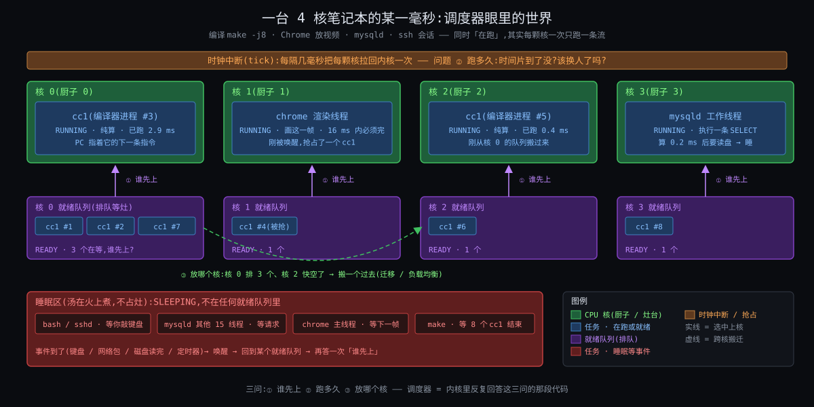

# 阶段 1:Linux 的进程调度器是什么

> 这一份只做一件事:把「调度器」这个词从一团雾变成一个有四个格子的骨架,后面六份全部往这四个格子里填。不讲公式、不贴源码、不讲历史 —— 那些各有各的份。上一轮(Linux进程全链路)已经讲厚了"换人那一瞬间存什么、CR3 / TLB 为什么贵",本份对那部分只引用不重讲。
>
> 贯穿机器与任务(后面六份沿用):8 核 x86-64,两组 L3(每组 4 核),3 GHz,`CONFIG_HZ = 250`,Linux 6.12。机器上跑着 `mysqld`(16 个工作线程)、`redis-server`(1 个线程)、一个 nice 19 的 `xz` 备份压缩,还有一个 k8s 容器被限了 2 核。

---

## 一句话定义

**内核在每个打断点按账本决定这颗核接下来跑谁、跑多久的规则。**

30 个字,五个词各是一个格子,后面的一切都挂在这五个词上:

| 词 | 问的是 | 展开在 |
|---|---|---|
| 每个打断点 | **何时换**(内核不能随时换人,只能在它拿到核的瞬间换) | 四问之① |
| 跑谁 | **换谁**(调度类的优先级栈 → 类内的挑人规则) | 四问之② |
| 按账本 | **各多少**(权重、虚拟时间、份额上限 —— 全是账) | 四问之③ |
| 这颗核 | **在哪换**(每核一本账,跨核搬人要付钱) | 四问之④ |
| 跑多久 | 份额与延迟的折中(一次给多长,什么时候可以被抢) | ②③ 交界 |

调度器**不是**"换人"这个动作本身。换人(`context_switch`:存六个寄存器、写 CR3)是上一轮 How §6 的事,大约 2 ~ 3 μs。调度器是**决定**换不换、换谁、换到哪的那套规则,每次决定本身也只有零点几微秒 —— 便宜,但一秒钟要做几千到几十万次,而且每次决定都会影响后面几毫秒里谁在挨饿。

---

## 跨领域类比:只有一支话筒的圆桌会

一间会议室,一支话筒,十几个人都想说话。主持人要定的事只有四件,恰好就是调度器的四问:

**何时换。** 主持人不能冲上去抢话筒 —— 那样谁也说不完整句话。他只能在**停顿点**换人:发言人说完一段(让出)、发言人说"等我查个资料"(阻塞等 IO)、或者桌上的闹钟响了(时钟中断)。闹钟是唯一不需要发言人配合的停顿点,所以闹钟间隔决定了一个人最长能霸台多久。

**换谁。** 主持人手里有一张表,记着每个人**累计发言了多少分钟**。话筒给累计最少的人 —— 这样长期看每人拿到的时间一样多。但有股份的人不一样:大股东说 1 分钟只记 0.5 分钟,所以他拿到的真实时间是别人的两倍。这张"按股份折算的累计发言时间"表,就是调度器的虚拟时间账本。

**各多少。** 每次给话筒时主持人会说"你先讲 3 分钟"。3 分钟是折中:太短了人人都说不完整、换人本身也费时间;太长了排在后面的人等一圈太久。而且公司里是先按**部门**分时间,再在部门内按人分 —— 研发部占 60%,研发部 20 个人分这 60%,销售部 2 个人分 40%。这就是按组记账。

**在哪换。** 大公司有 8 间会议室,每间一支话筒、一份自己的名单。把人从一间搬到另一间要让他把摊了一桌的资料收起来再铺开(cache),所以能不搬就不搬;但有一间房空着、另一间排了 20 个人时,还是得搬。谁去搬、多久看一次、搬谁 —— 这是跨房间的均衡。

类比里能直接推出来的几条性质,后面都会在真实机制里碰到:

- 人越多,每人份额越小 **且** 轮一圈越久 —— 份额和延迟是两个量,不能用一个数同时保住(Why 的 C3·份额与延迟两头要)。
- 一个人睡了一小时回来,按"累计最少"他应该立刻拿话筒;但如果他一回来就说 3 分钟又去睡,反复如此,他就把别人全挤掉了 —— "睡醒的人该不该插队、插多少"是挑人规则里最难的一条(Deep 主线①,上一轮你卡住的 lag 就是它)。
- 两间房各一个人,比一间房两个人好;但 8 间房 7 个人,搬一次人值不值,取决于他桌上资料有多厚(Deep 主线②)。
- 部门限额 40% 不等于部门里每个人都慢:2 个人分 40% 比 20 个人分 60% 宽裕得多 —— 限的是组,痛的是组里的人(Deep 主线③,开场钩子一)。

---

## 一张全景图



从图上能读出五件事:

1. **最上面一行是四个打断点**(时钟中断、系统调用返回、设备中断返回、任务自己阻塞 / 让出)。调度器的代码只在这四种时刻被执行;其他时间它不存在。这就是"每个打断点"四个字。
2. **中间左边是调度类的优先级栈**:`stop > dl > rt > fair > ext > idle`。挑人先问"最高的非空类是谁",再在那个类里按它自己的规则挑。你平时的进程(mysqld、redis、xz)全在 `fair` 这一层;`dl` 和 `rt` 是给要硬保证的任务的;`ext` 是 6.12 新进来的、把挑人规则交给 BPF 程序的类。
3. **中间右边是 fair 类的账本**:每个任务一个调度实体,记着权重(nice 换算来的)、虚拟时间、lag(欠它多少)、deadline(这段请求什么时候到期)。挑人只看账,不看任务是谁。
4. **下面一行是 8 颗核各自一本账**(每核一个 `rq`,里面每个调度类一个子队列)。核之间没有共享的"全局队列";跨核搬人是一件要专门做、专门算的事。
5. **cgroup 的层级压在 fair 账本上面**:容器是一个组,组里的 16 个线程先作为一个整体跟别的组分,再在组内分;组还可以被封顶(`cpu.max`),封顶到了就整组停。

---

## 四问各是什么

### 问① 何时换:五个触发点(对应你问题里的"每次")

内核没有自己的 CPU。ring 3 的代码不会自己停下来;内核只有在流**进入内核**的那一瞬间才拿到核(上一轮 C5·改流必经打断)。所以"每次挑人"的"每次"是有限的几种时刻:

| 触发点 | 谁触发 | 调度器做什么 | 典型频率 |
|---|---|---|---|
| 时钟中断 tick | APIC 定时器,`HZ = 250` 即每 4 ms | 给当前任务记账;如果它的时间用完了就打一个"该换人"的标记 | 每核每秒 250 次 |
| 唤醒 | 别的任务 / 中断 把一个睡着的任务叫醒(数据到了、锁放了) | 把它放回某颗核的队列;**比较它和那颗核上正在跑的,决定要不要立刻抢** | 每秒数千到数十万次 |
| 阻塞 | 当前任务自己要等(read 没数据、锁拿不到、sleep) | 把它拿出队列,立刻挑下一个 | 同上 |
| 让出 / 退出 | `sched_yield`、`exit`、被 `kill` | 同阻塞 | 少 |
| 出口检查 | 任何一次从内核回用户态、或内核态允许抢占的点 | 看一眼"该换人"标记,真则换 | 随前四项 |

注意前两种不直接换人,只是**打标记**;真正换人在出口检查那一刻。这个"标记 + 出口"两段式是为什么内核能在持锁、在中断上下文里安全地"决定换人但不立刻换"。它在上一轮 How §6.1 讲过;本轮 How §4 会把标记的三种来源讲清。

### 问② 换谁:两层 —— 先问类,再问类内规则

**第一层:调度类栈。** 六个类按固定优先级排:

| 类 | 谁在里面 | 挑人规则 |
|---|---|---|
| `stop` | 每核一个"停机"线程,做迁移、热插拔 | 有就跑 |
| `dl` | `SCHED_DEADLINE`:声明了"每 P 时间内需要 R 时间"的任务 | 最早截止期先跑(EDF) |
| `rt` | `SCHED_FIFO` / `SCHED_RR`:实时优先级 1 ~ 99 | 高优先级先跑,同级 FIFO 或轮转 |
| `fair` | `SCHED_NORMAL` / `BATCH`:你所有的普通进程 | **EEVDF**(6.6 起;之前 16 年是 CFS) |
| `ext` | `SCHED_EXT`:挑人规则由加载的 BPF 程序定(6.12 新) | 由 BPF 程序定 |
| `idle` | 每核一个 idle 线程 | 没人可跑时跑它(进省电态) |

高类非空,低类的任务一个都跑不到 —— 一个 `SCHED_FIFO` 99 的死循环能让整颗核上所有普通进程饿死(内核留了一个 95% 的安全阀,How §7)。

**第二层:fair 类内的规则。** 这是你灵魂问题的主战场,一句话版本:

> 在所有"没有超支"(eligible)的任务里,挑**截止期最早**的那个。

"超支"按虚拟时间账算,"截止期"按它请求的时间片算。这两个词各是一条约束逼出来的(C2·未来不可知、C3·份额与延迟两头要),公式和逐 tick 走表留给 How §3 和 Deep 主线①。现在只需要记住:规则看的是**账**,不是任务的名字、不是它"看起来像不像交互程序"—— 这正是它跟 2007 年之前那代调度器的分界线(Origin)。

### 问③ 各多少:三个数

| 数 | 是什么 | 本机器上的值 |
|---|---|---|
| 权重 | nice −20 ~ +19 换算成 88761 ~ 15,nice 0 = 1024,每差一级约 1.25 倍 | redis nice −10 → 9548;mysqld nice 0 → 1024;xz nice 19 → 15 |
| 时间片 slice | 一次请求多长;默认 0.75 ms × (1 + log₂(min(核数, 8))) | 8 核 → **3 ms**;6.12 起任务可自定 0.1 ~ 100 ms |
| 组的份额 / 上限 | cgroup `cpu.weight`(1 ~ 10000,默认 100)决定组和组之间怎么分;`cpu.max`(配额 / 周期)决定组最多用多少 | 容器限 2 核 = `cpu.max = 200000 100000`:每 100 ms 最多用 200 ms CPU 时间 |

权重决定的是**长期比例**:redis 与 mysqld 一个线程同核争抢时,CPU 按 9548 : 1024 ≈ 9.3 : 1 分。它**不**决定 redis 醒来后多久能上台 —— 那是 slice 和 lag 的事。把"份额"和"延迟"当成一回事,是开场钩子二里 `nice -10` 没用的原因。

### 问④ 在哪换:每核一本账 + 三种搬人

8 颗核就是 8 本账(`rq`)。一个任务任何时刻只在一本账上。它会在三种时刻被决定"去哪本账":

| 时机 | 问题 | 倾向 |
|---|---|---|
| 唤醒时 | 它睡前在核 3,现在核 3 忙、核 5 空,放哪? | 先看能不能留在原来那组 L3 里的空核(资料还在 cache 里);不行再跨组 |
| 周期均衡 | 每几毫秒到几百毫秒,一颗核看看"我比邻居闲多少" | 从最忙的核拉几个过来;越远的核越少看、越少搬 |
| 新建 / `exec` | 刚出生的任务没有 cache 可丢 | 直接放到最闲的核 |

"远近"按硬件拓扑分层:同一组 L3 的 4 核最近,另一组 L3 远一点,如果是双路机器则另一颗 CPU 插槽(NUMA)最远。内核把这个层次叫调度域(sched domain)。搬一次人的代价内核默认估为 **0.5 ms** 的 cache 重填 —— 一个任务刚跑了不到 0.5 ms 就被认为"还热着",均衡时尽量不碰它。

---

## 硬件入门:CPU 给调度器准备的四样东西

上一轮讲了五个开关(特权级、寄存器 + CR3、MMU、时钟中断、syscall 指令)。调度器用到其中的时钟中断,再加三样上一轮没展开的:

### ① 时钟中断与 HZ

每颗核的 local APIC 定时器按 `HZ` 发中断:`HZ = 250` 就是每 4 ms 一次。这是调度器**唯一不需要任务配合**的打断点,所以 4 ms 也是一个纯计算任务不让台时能霸占核的上限(两个任务同核时实际每 3 ms 的 slice 到期后,要等下一个 tick 才被发现,最坏 4 ms)。现代内核在核空闲或只有一个任务时会**停掉 tick**(`NO_HZ_IDLE` / `NO_HZ_FULL`),省电、也减少干扰 —— 代价是记账要靠别的时钟补。

### ② 高精度时钟:TSC 与 `sched_clock`

tick 太粗(4 ms),账要记到纳秒。每颗核有一个 TSC 寄存器每个周期加一,内核把它换算成纳秒(`sched_clock`),每次打断点都读一次,算出"从上次记账到现在这个任务跑了多少 ns"。所以虚拟时间账是纳秒精度的,tick 只是"定期来看一眼"的闹钟。

### ③ cache 与 TLB:搬人为什么贵

上一轮你抓到的结论「TLB 才是贵的」在这里反过来用:一个任务在核 3 跑了 10 ms,它的工作集(几百 KB 到几 MB)在核 3 的 L1 / L2 里、页表项在核 3 的 TLB 里。搬到核 5,这些全要重新 miss 一遍 —— 每次 L2 miss 约 10 ns,工作集 1 MB 重填要几十微秒。两组 L3 之间搬,连 L3 也要重填。这就是内核那个 0.5 ms "迁移代价"常数的来源(待核 #1:默认值 `sysctl_sched_migration_cost = 500000`)。

### ④ 核不是对称的:SMT、LLC 分组、NUMA、频率

- **SMT**(超线程):一个物理核的两个逻辑核共享执行单元,两个都忙时每个只有约 60 ~ 70% 的吞吐。所以"两个任务放两个物理核"远好于"放同一物理核的两个线程"。本轮机器假设关了 SMT 以简化。
- **LLC 分组**:8 核分两组 L3,组内搬便宜、组间贵。
- **NUMA**:双路机器每颗 CPU 插槽有自己的内存条,访问对方的内存慢 1.5 ~ 2 倍;任务搬过去了,它的内存还在原来那边。
- **频率**:核越少忙,忙的那颗能 turbo 到更高频;两个任务挤在一颗核上,可能比分到两颗核各跑半速还慢。手机上还有 big.LITTLE 大小核,性能差 3 ~ 4 倍。

这四条合起来是 Why 的 C5·核各自为政 和 C8·核不等速且耗电:每核一本账是因为跨核贵,但又不能不均衡,还得考虑核与核不一样。

---

## 关键词速查表

| 术语 | 一句话说明 |
|---|---|
| `rq`(run queue) | 每核一本账:当前在跑谁、每个调度类的子队列、这颗核的时钟 |
| 调度类 sched class | 六层优先级栈 `stop > dl > rt > fair > ext > idle`,高类非空低类不跑 |
| 调度实体 `sched_entity` | fair 类账本上的一行:权重、虚拟时间、lag、deadline、slice;线程是实体,cgroup 也是实体 |
| 虚拟时间 vruntime | 按权重折算后的累计运行时间;nice 0 每跑 1 ms 加 1 ms,nice −10 每跑 1 ms 只加约 0.107 ms |
| lag | 账面上"欠它多少":它的虚拟时间比队列平均落后(正)或超前(负)多少;睡醒要不要插队看它 |
| deadline / slice | 它这次请求跑多长(slice,默认 3 ms)+ 这段请求的虚拟截止期;挑人在 eligible 的任务里挑 deadline 最早的 |
| `need_resched` | "该换人"标记;tick 和唤醒只打标记,出口才真换 |
| 调度域 sched domain | 核的远近层次(SMT → 同 L3 → 同插槽 → 跨 NUMA);均衡按层做,越高层越少做 |
| `task_group` / cgroup cpu 控制器 | 把一组任务当一个实体记账;`cpu.weight` 分份额,`cpu.max` 封顶 |

---

## 它在系统里的位置

```
             上面:谁在用它
   pthread / clone        Go runtime(自己的 M:N 调度,只向内核要 M 个线程)
   JVM 线程池             容器 runtime(docker / k8s → cgroup cpu.weight / cpu.max)
   数据库线程池            SQL Server 的 SQLOS(用户态协作式,内核线程只是载体)
   ─────────────────────────────────────────────────────────────
                     进程调度器(本轮主角:四问)
   ─────────────────────────────────────────────────────────────
   平行的"邻居"(同一种思想,不同资源):
   IO 调度器(块层,mq-deadline / bfq,第一轮讲过)      网络 qdisc(fq_codel / HTB)
   挂在它身上的:
   cpufreq 的 schedutil(调度器的负载估计直接驱动频率)   NUMA balancing(搬内存页还是搬任务)
   ─────────────────────────────────────────────────────────────
             下面:它靠什么
   APIC 定时器 / HZ      TSC / sched_clock      cache / TLB 局部性      核的拓扑(SMT / LLC / NUMA / 频率)
```

### 边界:调度器不是什么

| 容易混的 | 它其实是 | 本轮怎么处理 |
|---|---|---|
| 上下文切换 | 换人**动作**(存寄存器、换栈、写 CR3),上一轮 How §6 + Deep §3.2 | 只引用,不重讲 |
| cpufreq / 调频 | 决定核跑多快,不决定跑谁;但 6.x 的 schedutil 用的是调度器的负载估计 | Deep 附录提一段 |
| 用户态调度(Go、SQLOS、协程) | 在**一个线程内部**再分时;内核看不见 | Comparison 的 SQLOS 一节 + Synthesis 同构 |
| IO 调度器 | 同一种"公平排队"思想用在块设备上 | Synthesis 同构回扣第一轮 |
| `fork` / `exec` / 线程创建 | 造任务,不是排任务;新任务**第一次**放哪本账是调度器的事 | How §5 一行 |
| 中断处理 | 中断不是任务,不被调度;但中断返回是打断点之一 | 问① 已含 |

---

## 开场钩子一:容器限 2 核,机器 64 核,MySQL 的 p99 突然抖

一个 k8s 里的 MySQL,`limits.cpu = 2`,机器 64 核。平均 CPU 使用率才 40%,但 p99 延迟每隔一会儿跳到 90 ms。`top` 看不出任何忙的核。

`limits.cpu = 2` 落到内核是 `cpu.max = 200000 100000`:**每 100 ms 周期,这个组最多用 200 ms 的 CPU 时间**。注意是 CPU 时间不是核数 —— 内核不会把它关在两颗核上,它的 16 个工作线程可以同时在 16 颗核上跑。一个突发查询让 16 个线程同时忙起来:

```
16 个线程 × 12.5 ms = 200 ms            ← 12.5 ms 墙上时间就把整个周期的配额烧光
剩下 100 − 12.5 = 87.5 ms 整组被停      ← 所有线程,包括刚收到新请求的那个
下一个周期开始才放行                     ← p99 ≈ 87.5 ms + 排队
```

平均使用率 40% 是对的(200 ms / 64 核 ≈ 3%,或按 2 核算 ~40%);抖动来自**配额按周期发、用完整组停**这个机制。它对应四问之③的"上限",也是 Why 的 C6·份额按组算 被"封顶"这一刀逼出来的形状。怎么算、怎么调(放大周期、开 `cpu.max.burst`、或者改用只分份额不封顶的 `cpu.weight`)留给 How §6 和 Deep 主线③。

### 你能先猜一下(选择式)

把 `limits.cpu` 从 2 改成 4,p99 会:A. 减半 B. 基本消失 C. 变成另一种抖。Deep §4 给答案;这里先记住答案不是 A。

---

## 开场钩子二:同机跑 PostgreSQL 100 个后端 + Redis,`nice -10` 没用,`taskset` 两面

同一台 8 核机器,PostgreSQL 100 个后端进程(每连接一个,上一轮钩子一)时不时全都在算,Redis 单线程做缓存。Redis 的延迟 p99 从 0.2 ms 涨到 5 ms。两个常见的"修法"和它们的结果:

| 修法 | 期望 | 实际 | 原因(留后) |
|---|---|---|---|
| `renice -10 redis` | 优先跑 Redis | 几乎没变化 | 权重管**份额**,Redis 本来就只用 5% CPU,份额不缺;它缺的是**醒来后多久能上台**。nice −10 把它的 lag 积累得快一点,但一次最多只能插队一个 slice 的量(C3·份额与延迟两头要,Deep 主线①) |
| `taskset -c 7 redis` + 别的不动 | 给它一颗专属核 | 更糟:p99 到 8 ms | PG 后端仍然可以被均衡搬到核 7;Redis 自己却不能被搬走了。绑核只绑了一边(C5·核各自为政,Deep 主线②) |
| `taskset -c 7 redis` + `isolcpus=7` 或把 PG 绑到 0 ~ 6 | 真正专属 | 好:p99 回到 0.3 ms | 两边都绑,核 7 上永远只有 Redis;代价是核 7 的 95% 时间空转 |
| 把 Redis 放进 `cpu.weight = 1000` 的 cgroup | 组级优先 | 跟 renice 一样没用 | 同一个原因:份额不是延迟 |

这个钩子要说的只有一句:**份额、延迟、位置是三个独立的旋钮**,四问里的 ③ ② ④ 各管一个,拧错了没用甚至更糟。

---

## 你上一轮的视角(继承三条原话)

上一轮(Linux进程全链路)你在 How / Deep 阶段说过三句跟调度直接相关的话,本轮当作已知前提,各补一句本轮的接口:

1. **「TLB 才是贵的」**(上一轮 What《拆开说:进程切换和线程切换差在哪》)—— 本轮把它当作"搬人为什么贵"的根据:跨核迁移比同核换人多付 cache 重填,所以每核一本账、能不搬就不搬(C5·核各自为政)。
2. **「寄存器分两类,一类自己保一类对方保」**(上一轮 How §6.3.1)—— 本轮不再碰换人动作;只在 Deep 的 ns 时间线里引用那 2 ~ 3 μs 作为"换人成本",用来解释为什么 slice 不能太短(C4·挑人须便宜)。
3. **「schedule 自己调自己回、中断调中断回、时钟中断是用户态保护的根源」**(上一轮 How §6.1.1)—— 你当时把时钟中断理解为"防霸台";本轮补另一半:时钟中断还是**记账的闹钟**,但账本身是纳秒级的 TSC 记的(硬件入门 ②),tick 只负责"定期看一眼"。

另外一条不是原话但是事实:上一轮 Deep §3.5 / §3.6 两道关于 lag 的反问你两次答「不知道」,然后选了「调度这块够了」。本轮 Deep 主线① 从"lag 是什么、为什么非要有它"从零讲起,反问改成选择题。

---

## 最后的预留:这些本份只点名

| 预留 | 一句话 | 放在 |
|---|---|---|
| `rt` / `dl` 类的内部 | 优先级反转、优先级继承(PI)、CBS 带宽 | Deep 附录 |
| 抢占模型 | `PREEMPT_NONE` / `VOLUNTARY` / `PREEMPT` / `PREEMPT_RT`,内核态能不能被换 | How §4 一段 + Deep 附录 |
| `sched_ext` | 用 BPF 写自己的挑人规则 | Origin 转折 5 + Deep 附录 + Synthesis 十年赌注 |
| EAS / 大小核 / 频率 | 省电与异构 | Deep 附录 |
| core scheduling | SMT 兄弟核只跑同一组的任务(防侧信道) | Deep 附录一行 |
| 调参与观测 | `/proc/<pid>/sched`、`perf sched`、`/sys/kernel/debug/sched/` | How §9 + Deep 操作层 |

---

## 呼应你的问题

你的问题有三段。本份给了每段一个格子:

- **"按什么规则挑下一个"** → 四问之②:先按类,再在 fair 类里"eligible 中 deadline 最早"。现在你知道规则看的是账不是人;账里有哪几个数(权重 / 虚拟时间 / lag / deadline / slice)也列了,但每个数**为什么非有不可**是 Why 的事,**怎么算**是 How 和 Deep 的事。
- **"被哪些约束逼出来、为什么三代"** → 下一份从"一核一队列先来先跑"起八刀,每一刀逼出一条约束;Origin 再讲 2002 / 2007 / 2023 三次换代各是哪条约束的权重变了。
- **"多核和 cgroup 把规则扩展成了什么"** → 四问之④和③:每核一本账 + 三种搬人;组是账本上的一行 + 封顶。两个开场钩子就是这两处的现实症状。

一句话带走:**调度器 = 四问(何时换 / 换谁 / 各多少 / 在哪换),规则只看账。** 下一份回到原点:如果一颗核面前只有一个先来先跑的队列,它会先在哪里坏掉?

---

## 待核

| # | 事项 | 结论(收尾核实 2026-11-03) |
|---|---|---|
| 1 | `sysctl_sched_migration_cost` 默认 500000 ns | **已核** —— `const_debug unsigned int sysctl_sched_migration_cost = 500000UL`(出处:kernel/sched/fair.c:79(v6.12)) |
| 2 | SMT 两线程同忙时每线程约 60 ~ 70% 吞吐 | **部分核实** —— Intel 自述 HT 最多提升约 30%(即两线程同忙每线程 ≈ 65%),平均 10 ~ 20%;量级成立,具体值随负载变(出处:The Register 2002-06-18 https://www.theregister.com/2002/06/18/what_the_hell_is_hyperthreading/ ;Beamr 实测 https://blog.beamr.com/?p=530(均二手)) |
| 3 | 跨 NUMA 访存慢 1.5 ~ 2 倍 | **部分核实** —— 实测 NUMA 因子 1.5(Westmere 90 / 140 ns)~ 1.7(Xeon E5-2650 MLC 69 / 118 ns;Ice Lake 91 / 157 ns);原文区间成立,上界 2 偏宽(出处:CERN openlab 讲义 https://openlab-archive-iv-v.web.cern.ch/… ;Intel 社区 MLC 输出 https://community.intel.com/t5/Mobile-and-Desktop-Processors/Interpreting-Intel-Memory-Latency-Checker-Output/m-p/434769 ;LKML 2014 SLIT 讨论 https://lkml.rescloud.iu.edu/1409.2/00354.html) |
| 4 | 一次 L2 miss 约 10 ns | **部分核实** —— Skylake:L2 12 周期、L3 42 周期(4.0 GHz 下 ≈ 3 / 10.5 ns);"L2 miss" 即 L3 命中量级 ≈ 10 ns,成立(出处:https://www.7-cpu.com/cpu/Skylake.html) |
| 5 | 一次 tick 处理约 1 μs | **无法上机核实** —— 量级估计,保留;可用 `perf stat -e irq:*` / ftrace 在真机核(出处:—) |

---

## 修订记录

| 时间 | 修订摘要 | 触发原因 |
|---|---|---|
| 2026-11-03 | 初稿:一句话定义 + 圆桌会类比 + 四问总纲 + 硬件四样 + 速查表 + 位置与边界 + 两个 DB 口味钩子 + 继承上一轮三条视角 + 预留 + 呼应 | 自动运行(用户授权),对齐按品味画像自答:轮廓 + 边界都要、四问总纲、硬件入门不省、钩子两个、性能专题留后 |
| 2026-11-03 | 收尾核实:#1 / #2 / #3 / #4 按源码与公开实测核对(#1 已核,#2 ~ #4 部分核实,量级成立);#5 为量级估计,无法上机核实;正文无改动 | 导出前统一核实(verify-results.md) |
