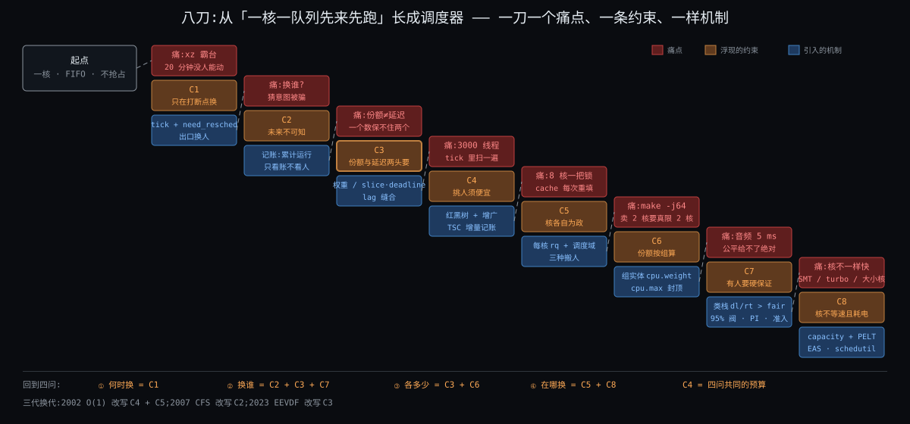

# 阶段 2:Linux 进程调度器为什么必须存在

> 上一节你已经能指着那台 4 核笔记本说出哪里是核、哪里是队列、哪里是睡眠区,也记住了三问:谁先上 / 跑多久 / 放哪个核。这一节把调度器拆掉,从「一次只跑一个程序」开始,一刀一刀把它长回来。每一刀先看坏在哪,再看补什么,最后浮现一条约束。六刀切完,约束清单就是后面每个机制的出处。

## §0 起点:你的机器一次只跑一个程序

还是那台 4 核笔记本,但先把三颗核拔掉,只剩一颗。你是第一个写系统的人,最省事的做法是:**一次只装一个程序进内存,跑完再装下一个**。这不是假想,1970 年代以前的批处理机器和早期的个人电脑就是这样,DOS 时代你开着编译器就不能开别的。

你敲 `make`,cc1 开始跑。你想顺手 `ls` 看一眼目录,敲了没反应,因为机器上只有 cc1 一条流,PC 在它那儿,你的 `ls` 连内存都没进。等编译跑完,`ls` 才轮到。

这台机器没坏,它只是蠢。接下来每一刀,都是你受不了它的某一种蠢。

## §1 六刀:每刀一个痛、一个补、一条约束

### §1.1 第一刀:CPU 在陪外设干等

**痛**。cc1 编译到一半要读一个头文件,发了 `read`。机械硬盘找到那一块要 10 毫秒;这台机器的核每秒执行 30 亿条指令,10 毫秒就是三千万条。这三千万条指令的空档里,PC 停在 `read` 后面那条指令上一动不动,核在等磁盘。换成 SSD,等 100 微秒,也是三十万条指令。换成等你敲键盘,人类按一个键的间隔是 100 毫秒以上,三亿条。

把核和它要等的东西放一起看:

| 核要等的东西 | 一次要等 | 等价于多少条指令 |
|---|---|---|
| 内存里的数据(缓存没命中) | ~100 ns | ~300 |
| NVMe SSD 读一块 | ~100 μs | ~3 × 10⁵ |
| 机械硬盘读一块 | ~10 ms | ~3 × 10⁷ |
| 一个网络来回 | ~1 ms 到几十 ms | 10⁶ ~ 10⁸ |
| 你敲下一个键 | ≥ 100 ms | ≥ 3 × 10⁸ |

(待核 #1:各量级取 2020 年代消费级硬件典型值。)

你的机器大部分时间在等,真正算的时间是零头。

**补**。既然 cc1 在等,就让别人上:cc1 发了 `read` 的那一刻把它标成「睡眠」,把 `ls` 装进来跑;磁盘读完了发个中断,把 cc1 标回「就绪」。于是任务有了三种状态:正在核上跑(RUNNING)、随时能跑等核空(READY)、在等某件事(SLEEPING)。这就是上一节厨房里「汤坐上火就走开」那一下。

**浮现的约束**:

#### C1 — CPU快IO慢
核比它要等的任何东西都快 10⁴ ~ 10⁷ 倍,**等待是常态,计算是零头**。
**不可再分**:物理事实。电子在硅片里跑,磁头和网络包在物理世界里跑,差距不会因为软件写得好而消失。
**口诀**:等的时候让别人上。

### §1.2 第二刀:换人靠自觉,自觉靠不住

**痛**。第一刀的换人有个前提:cc1 得先发 `read`、先睡着,别人才有机会。可编译器不总读盘。cc1 把头文件读完以后,接下来几秒钟是纯算:语法分析、优化、生成代码,一个 `read` 都没有。这几秒钟它一次都不睡,`ls` 一次都上不了核。你又回到了起点:整机被一个程序霸住。

你可以求它:「每算一会儿主动让一下」。1990 年代的 Windows 3.x 和 Mac OS 9 就是这么干的,叫协作式多任务。结果是一个程序死循环,整机跟着死。而且就算程序愿意让,**让多久一次才合适,它自己也不知道**:它不知道旁边还有多少人在等。

更根本的是:内核也不知道 cc1 这一轮要算多久。它可能 1 毫秒后就读盘,也可能 10 秒不读。内核看不见它的未来。

**补**。不求它,抢它。给机器接一个硬件定时器,每隔 4 毫秒打断核一次,PC 被硬件强行拉回内核(待核 #2:tick 频率取内核默认配置 CONFIG_HZ=250,每 4 ms 一次;发行版可以改成 1000,即每 1 ms 一次)。内核在这个打断点上问一句:cc1 跑够一个时间片了吗?够了就换。这叫抢占,时钟中断是抢占的钟。cc1 对此一无所知:从它的视角看,它只是某条指令和下一条指令之间「恍惚」了一下。

**浮现的约束**:

#### C2 — 程序不让台
程序不会主动让出 CPU,**内核也猜不到它还要算多久**。
**不可再分**:程序是别人写的,内核不能假设它善良或聪明;而「它接下来要算多久」取决于它还没执行的代码和还没到的输入,原理上不可知。
**口诀**:不求让,定时抢。

### §1.3 第三刀:轮流不等于公平,视频卡了

**痛**。有了时钟中断,你写了最直觉的算法:所有就绪任务排成一圈,每人跑 10 毫秒,到点换下一个。编译器、Chrome、mysqld、bash 一视同仁。

把上一节的全景图再拿出来:`make -j8` 的 8 个 cc1 永远就绪,加上 Chrome 的几个线程、mysqld 偶尔醒来的工作线程、系统自己的几十个后台任务,排队的常年有 30 个。一圈 30 × 10 ms = 300 毫秒。Chrome 的渲染线程画完一帧睡过去,显卡 16 毫秒后说「下一帧」,它醒来排到队尾,等 290 毫秒才轮到。它每秒本该画 60 帧,现在画 3 帧。**视频成了幻灯片**,这就是上一节悬念 3 的答案:不是编译抢了 Chrome 的核,是「轮流」让一个睡得多的任务每次醒来都排在 29 个从不睡的任务后面。

这里也揭了悬念 2。轮流看起来公平,每人 10 毫秒,童叟无欺。可算一下一秒钟的账:cc1 从不睡,30 轮里它每轮都在,拿到 1000 / 300 × 10 ≈ 33 毫秒;Chrome 渲染线程一秒里只需要 3 到 5 毫秒的核就能画满 60 帧,它拿到的却是 3 次 × 不到 1 毫秒,然后剩下时间全在排队。**它要得少,得到的更少**。轮流公平的是「上场次数」,不公平的是「实际拿到的 CPU」。

**补**。不按圈排,按账排。给每个任务记一本「已经用了多少 CPU」的账,核空出来时,**谁用得最少谁先上**。cc1 一秒用了 33 毫秒,Chrome 渲染线程一秒只用了 3 毫秒,它一醒来账面远远落后,直接插到队首,16 毫秒内一定轮到。它不用告诉内核自己在放视频;它的睡眠记录替它说了。

这一刀的关键选择:内核**不问任务「你急不急」**,因为任务可能不知道、可能撒谎(谁都会说自己急)、而且「急」没法量化;内核只看**已经发生的事**。

**浮现的约束**:

#### C3 — 凭账不凭嘴
内核看不见任务的未来,任务不自报需求,自报了也不可信;**内核能依据的只有已经发生的事:它跑了多久、睡了多久、醒了几次**。
**不可再分**:「需要多少 CPU 才够」取决于未来的输入;而让任务自报等于把分配权交给最会喊的那个。
**口诀**:不猜未来,记过去;谁欠得多谁先上。

#### §1.3.1 你的视角:nice 和实时优先级算不算「自报」

拷问:C3 说任务自报不可信,可 nice 值、实时优先级不就是任务自己报的吗?你的判断:「不矛盾。」对,理由补三条:

- **报的是权重,不是需求**。nice 不让任务绕过账本,只改账本涨的速度:nice 高的任务每跑 1 ms 记 1.5 ms 的账,于是更早被换下去;nice 低的反之。内核依旧只看历史,只是给历史加了倍率。(待核 #6:nice 相邻一级约 1.25 倍权重,nice 0 → 1024。)
- **报的方向受限**。普通用户只能把自己的 nice 调高(让自己吃亏);调低、或设实时优先级,需要特权(CAP_SYS_NICE)。让自己吃亏的自报不需要信任;让自己占便宜的自报,内核要求先有 root。
- **即便有特权也只信一半**。实时任务默认每秒最多拿 950 ms,留 50 ms 给普通任务,防止一个失控的实时任务锁死整机。(待核 #7:sched_rt_runtime_us 默认 950000。)

一句话:C3 禁的是「任务说自己急」,允许的是「有权限的人给它定倍率」,倍率只作用在账上。

### §1.4 第四刀:调度器自己的开销,换人贵、选人慢

这一刀有两张面孔,根是同一个:**调度器的每一微秒都从任务的时间里扣**。它是厨师长,厨师长洗手、开会的时间,厨子都在等。

**痛一:换得太勤,整晚都在洗手**。第三刀让你尝到甜头,你想把「公平」做到极致:每 100 微秒重算一次账,谁落后就立刻换谁上。结果整机变慢了 20%(待核 #3:示意数字,按下面的代价估算)。换人不是免费的,分两笔账:

| 代价 | 量级 | 是什么 |
|---|---|---|
| 直接代价 | 1 ~ 2 μs | 存旧任务的寄存器和栈指针,装新任务的;切页表 |
| 间接代价 | 几十 μs 起 | 新任务的数据不在缓存里,头几十微秒每次访问都要去内存拿;TLB 也得重新填 |

(待核 #4:直接切换 1 ~ 2 μs、缓存变冷几十 μs 的量级,沿用上一期「Linux进程全链路」待核项。)

每 100 微秒换一次,每次赔几十微秒,赔掉的就是两三成。

**痛二:选人本身比干活还慢**。第三刀的「谁用得最少谁先上」,你最初的实现是每次选人把就绪队列从头扫到尾。30 个任务,扫一遍几十纳秒,没感觉。换成一台跑着 3 万个线程的数据库服务器:每次选人扫 3 万个,几十微秒;每颗核每秒做上千次选人(tick、唤醒、睡眠各触发一次),光选人就吃掉核的几个百分点;唤醒再频繁一点,选人比干活还慢。上一节悬念 1 埋的那个事实在这里露出约束面:**调度器自己也是代码,也在这颗核上跑**。

**补**。对痛一:给「公平」加一个下限,任务一旦上核至少跑够一个最小粒度(毫秒级),账面再落后也等它跑完这一阵再换;公平按一个周期(几十毫秒)摊平,不追求每一微秒都公平。对痛二:就绪队列按账面排好序存放,选人只看头部,插入删除都是对数时间;任务数翻一千倍,选人只多几步。

**浮现的约束**:

#### C4 — 调度不免费
调度器没有自己的 CPU,换人和选人都从任务的时间里扣:**换一次直接 1 ~ 2 μs 加缓存变冷几十 μs,换得越勤浪费越高;选人的代价必须与任务数无关或近乎无关**。
**不可再分**:硬件只有一套寄存器、缓存只认最近用过的地址;机器上没有「专管调度的核」,即便有也得跨核通知,更贵(见下一刀)。
**口诀**:公平摊着算、别瞬时算;选人看队头、别扫全表。

### §1.5 第五刀:第二颗核来了,核与核之间没有共用的桌面

**先说硬件事实**。把拔掉的三颗核装回去。每颗核有自己的缓存,核与核之间**没有「共用的桌面」**:

| 一颗核要做的事 | 代价 | 慢多少 |
|---|---|---|
| 读自己缓存里的数据 | ~1 ns | 基准 |
| 读另一颗核刚写过的数据(硬件把那行缓存从对方搬过来) | 40 ~ 100 ns | 几十倍 |
| 打断另一颗核(核间中断,让它停下来处理一件事) | μs 级 | 上千倍 |

(待核 #5:跨核缓存行传输与核间中断的量级。)

厨房里就是:两个厨子各有各的灶台和调料架。共用一个调料架,两人得排队伸手;一道菜做到一半换厨子,新厨子得重新熟悉这道菜放了什么。

**痛**。最直觉的做法:全机一条就绪队列,四颗核都从这条队列里拿任务。两个问题立刻出现。

第一,这条队列是所有核都要写的共享结构。四颗核同时去拿,得加一把锁;每次有核选人,锁和队列的那几行数据就在核之间来回搬。4 核还好,一台 64 核的服务器上,64 个核排队抢同一把锁,这把锁本身成了整机的瓶颈。

第二,任务 A 这一轮在核 0 跑,下一轮被核 2 拿走。核 0 的缓存里有它的数据,核 2 的没有;它在核 2 上头几十微秒全在从内存重新拿,跟第四刀的换人间接代价一样,只是这次是换核不是换人。

**补**。每颗核一条自己的就绪队列、一本自己的账,平时各管各的,锁只锁自己这条。任务尽量留在上次跑的核上(缓存还热)。隔一阵(毫秒级)对一次账:核 0 排 3 个、核 2 快空了,就搬一个过去。搬是例外,不搬是常态。

这一刀揭了问题 ③ 的来路:「放哪个核」不是因为多核天然需要分配,而是因为**跨核的任何共享和打断都贵**,贵到不敢随便动,所以默认不共享,偶尔同步。

**浮现的约束**:

#### C5 — 核间不通气
每颗核有自己的缓存和时钟,核与核之间没有共用的桌面;**跨核共享一行数据慢几十倍,打断另一颗核慢上千倍**。
**不可再分**:缓存一致性协议和核间中断的硬件代价,软件绕不过去。
**口诀**:各算各的账,偶尔对账。

### §1.6 第六刀:份额给够了,还是爆音

**痛**。你的机器现在公平、省切换、多核均衡。前五刀讲的都是一件事:**每个任务拿到多少 CPU**。公平记账保证一秒里你拿到你那一份。

你开了个音乐播放器。播放线程一秒只需要 20 毫秒 CPU,按份额它要得极少,公平算法一定给得够。可声卡的缓冲只装得下 5 毫秒的声音,播放线程**必须每 5 毫秒填一次**。公平算法说「这一秒的 20 毫秒我一定给你」,但它完全可以安排成「前 300 毫秒一口气给完,后 700 毫秒别人上」:份额一点没少,中间每 5 毫秒的期限全错过,音箱「啪啪」爆音。

为什么公平算法保证不了?因为它只比「谁欠得多」。播放线程醒来时账面确实落后,排在前面;可核上那个 cc1 还在跑第四刀保证的最小粒度,播放线程得等它跑完这几毫秒。等 1 毫秒没事,等 6 毫秒就爆音。公平算法保证的是**长期平均拿到应得的份额**,保证不了**某个时刻之前一定上核**。

工业控制、机器人、车载系统更极端:一个控制循环晚 20 毫秒,不是卡顿,是撞车。

**补**。承认有两类任务。一类只要长期份额够就行,按账排;另一类带着期限,**它来了就得立刻上,不跟任何人讲公平**。内核先问「有没有带期限的任务在等」,有就先满足它,没有才轮到公平那一套。这就是上一节速查表里「调度类」分家的原因:普通一套、实时一套、期限一套,各自回答三问,按优先级串起来。

**浮现的约束**:

#### C6 — 有人等不起
份额和时限是两回事:有一类任务要的不是「一秒拿到多少」,而是「某个时刻之前一定拿到」;**公平记账只能保证份额,保证不了时限**。
**不可再分**:时限来自物理世界(声卡缓冲长度、控制周期、刹车距离),软件改不了。
**口诀**:先问有没有人等不起,再谈公平。

## §2 约束清单(C1 ~ C6)

| # | 短名 | 约束 | 来源 | 逼出的东西(How 再讲) |
|---|---|---|---|---|
| C1 | CPU快IO慢 | 核比它要等的东西快 10⁴ ~ 10⁷ 倍,等待是常态 | 物理 | 任务三态、等待时换人、唤醒 |
| C2 | 程序不让台 | 程序不会主动让,内核也猜不到它还要多久 | 程序不可信 + 未来不可知 | 时钟中断、时间片、抢占 |
| C3 | 凭账不凭嘴 | 看不见未来,任务不自报也不可信,只能凭已发生的事 | 信息论上的事实 | 按已用 CPU 记账、谁欠得多谁先上、睡眠补偿 |
| C4 | 调度不免费 | 换人直接 1 ~ 2 μs + 缓存冷几十 μs;选人代价须与任务数无关 | CPU 微架构 + 没有专管调度的核 | 最小运行粒度、公平按周期摊、有序就绪队列、O(log n) 选人 |
| C5 | 核间不通气 | 跨核共享 / 打断贵一到两个数量级 | 缓存一致性 + 核间中断的硬件代价 | 每核一条队列、亲和、定期均衡 |
| C6 | 有人等不起 | 份额 ≠ 时限:有一类任务要「某时刻前一定拿到」,公平记账只保份额 | 物理世界的期限 | 调度类分家、实时 / 期限优先于普通 |

引用约定:后面一律写「编号·短名」,如 `C3·凭账不凭嘴`,不写裸编号。

### §2.1 你的视角:哪条约束最软

拷问:七条里哪条最可能随硬件演进变弱?你选了当时的 `C4·切换不免费`(现已并入 `C4·调度不免费` 的换人那一面)。对一半:

- **直接代价那半是软的**。存取现场的 1 ~ 2 μs 是指令序列,硬件可以做快;但它不总往软的方向走:2018 年 Meltdown 之后,内核在用户态 / 内核态之间多切一次页表(KPTI),这笔账反而翻倍。(待核 #8:KPTI 对切换开销的量级影响。)
- **间接代价那半是硬的**。缓存比内存快、比内存小,这两条只要成立,换一个工作集就必然挤掉上一个的热行。工艺进步不改变这个结构。

所以 C4 换人那一面以后要写成「直接代价越来越小,间接代价不变」,它不会变成零。

真正最可能变形的是 `C1·CPU快IO慢` 的**下半截**:持久内存、CXL 把「等存储」从毫秒拉到百纳秒级,接近一次缓存未命中。这时「换人」(赔 C4)反而不如「原地等」划算,内核在这类设备上已经用轮询代替睡眠(待核 #9:NVMe / io_uring 的轮询模式、DAX 路径)。但 C1 的**上半截**不会动:网络来回、人敲键盘,永远比核慢 10⁶ 倍以上。

反过来有一条在**变硬**:`C5·核间不通气`。核数从 4 到 128、chiplet 把一颗芯片切成几个硅片、NUMA 让内存也分远近,跨核代价在涨。后面讲负载均衡时,这条是加厚的理由。

## §3 核心 insight:两句话

**第一句:不猜未来,记过去。** 内核不可能知道谁接下来需要多少 CPU(`C2·程序不让台` + `C3·凭账不凭嘴`),所以它干脆不猜,给每个任务记一本「已经用了多少」的账,谁用得少谁先上。「公平」从一个形容词变成一个可以比较的数字。睡得多的任务自动欠得多、自动排前面,交互性不用猜,是记账的副产品。

**第二句:默认不共享,偶尔同步。** 因为跨核贵(`C5·核间不通气`)、换人和选人都贵(`C4·调度不免费`),调度器把「全机一本账、每时每刻精确公平」改成「每核一本账、按周期摊平、隔一阵对一次」。三种贵都用「少做」来省。

这两句话配上 `C2·程序不让台` 逼出的时钟中断,和 `C6·有人等不起` 逼出的「先问期限再谈公平」,就是调度器的全部骨架。

## §4 insight 对着约束看

| 约束 | 第一句「记账」怎么化解 | 第二句「少同步」怎么化解 |
|---|---|---|
| C1·CPU快IO慢 | 睡着的任务不记账,醒来账面落后,天然补偿等待 | — |
| C2·程序不让台 | 账由内核记,不由任务报 | 时钟中断是「同步」的最低频率 |
| C3·凭账不凭嘴 | 账就是历史,正面回答 | — |
| C4·调度不免费 | 账可排序,选人只看头 | 最小粒度:账落后也等一阵再换;每核自己的账,无全局锁 |
| C5·核间不通气 | — | 每核一本账,隔一阵对账,搬是例外 |
| C6·有人等不起 | 记账不管期限 | 期限任务绕过记账,直接插队 |

C6 是唯一一条「记账」化解不了的,所以它逼出了一套独立的调度类。这是后面讲机制时第一个要分家的地方。

## §5 这些不算约束

写清单时容易混进来的几样,它们不是约束,是目标、是手段、或是别人的约束:

| 看起来像约束 | 为什么不算 |
|---|---|
| 「调度器要高性能」 | 目标,不是约束;约束是 C4、C5 这种「什么东西贵」 |
| 「要公平」 | 一个设计选择,不是不可再分的事实;第六刀已经证明它不是唯一选择 |
| 「任务太多」 | 数量本身不是约束;C4 说的是「选人代价不能随数量涨」 |
| 「内存不够」 | 内存管理的约束,调度器不分配内存 |
| 「用户态 / 内核态隔离」 | 它是调度器能「抢」的前提,但约束在上一期进程主题里(互不信任),这里当已知条件 |
| 「多租户、容器之间要隔离 CPU」 | 真约束,但属于 cgroup 那一刀,讲到时往清单末尾追加 C7 |
| 「一个算法覆盖不了所有场景」 | 真约束,属于 sched_ext 那一刀,讲到时追加 C8 |

## §6 呼应灵魂问题

你的问题是从「调度器的作用」入门,再讲 cgroup 和 sched_ext 增强了什么。

这一节回答了「作用」的另一半:它不只是「回答三问的代码」,它是六刀逼出来的形状。拿掉任何一条约束,调度器都会长成另一个样子:没有 C1 就不需要换人,没有 C2 就不需要时钟中断,没有 C3 就可以让任务自报优先级,没有 C5 就一条全局队列够用。小白读到这里应该能说出:**调度器之所以长这样,是因为核快外设慢、程序不让台、内核凭账不凭嘴、换人和跨核都贵、还有人等不起**。

上一节的五个悬念,这一节揭了 2 和 3(轮流不等于公平、视频为什么卡),都落在 `C3·凭账不凭嘴` 上。悬念 1(调度器在谁的时间里跑)在这节露了半面,`C4·调度不免费` 的选人那一面就是它的约束面,机制面留给下一节。悬念 4 和 5 对应的约束被明确留在 §5 的末尾两行,等讲到 cgroup 和 sched_ext 时追加成 C7、C8。

## 修订记录

| 时间 | 修订摘要 | 触发原因 |
|---|---|---|
| 2026-11-07 | 第五刀局部重写:先立硬件事实表(本地 1 ns / 跨核 40~100 ns / 核间中断 μs)+ 厨房类比,再讲全局队列抢锁与换核缓存冷两个痛;C5 短名「核各自为政」→「核间不通气」 | 用户「C5 也说一下」+ 四选一选 2 |
| 2026-11-07 | 第六刀局部重写:先立「份额 vs 时限」的区分,播放线程 20 ms/s 份额给够仍爆音的例子;C6 短名「迟到即失败」→「有人等不起」,约束改为「份额 ≠ 时限,公平只保份额」 | 用户不懂反馈「C6 没说清楚」+ 四选一选 2 |
| 2026-11-07 | 第四刀与第五刀合并为一刀「调度器自己的开销」,C4·切换不免费 + C5·决策也占CPU → C4·调度不免费;原 C6 / C7 重排为 C5·核间不通气 / C6·有人等不起;全文、表、SVG 同步,共六刀六条 | 用户「4 5 感觉可以合并」 |
| 2026-11-07 | C3 短名「只能看历史」→「凭账不凭嘴」,全文与 SVG 同步 | 用户要求换短名,四选一选 4 |
| 2026-11-07 | §2.1 新增《你的视角:哪条约束最软》:C4 直接代价软 / 间接代价硬;C1 下半截最可能变形(持久内存 / CXL → 轮询);C6 在变硬 | 用户回答反问 2「4」 |
| 2026-11-07 | §1.3.1 新增《你的视角:nice 和实时优先级算不算自报》:权重非需求 / 方向受限 / 特权也只信一半 | 用户回答反问 1「不矛盾」 |
| 2026-11-07 | 初稿:§0 单程序起点 / §1 七刀(痛 / 补 / 约束)+ SVG / §2 清单 C1 ~ C7 / §3 两句 insight / §4 insight × 约束表 / §5 不算约束 / §6 呼应 | 对齐 2 问 + 刀表 reconfirm 后用户「ok」 |
| 2026-11-12 | 导出前核实:tick 频率的口径由「主流发行版」改为「内核默认配置 CONFIG_HZ=250」(kernel/Kconfig.hz `default HZ_250`) | 导出前统一核实 |
