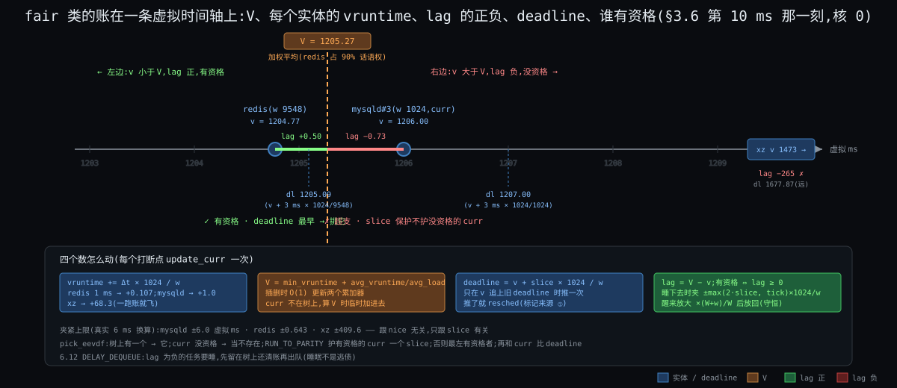
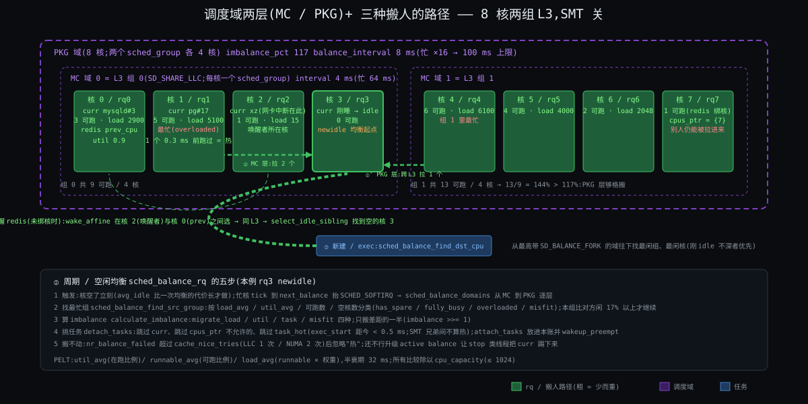
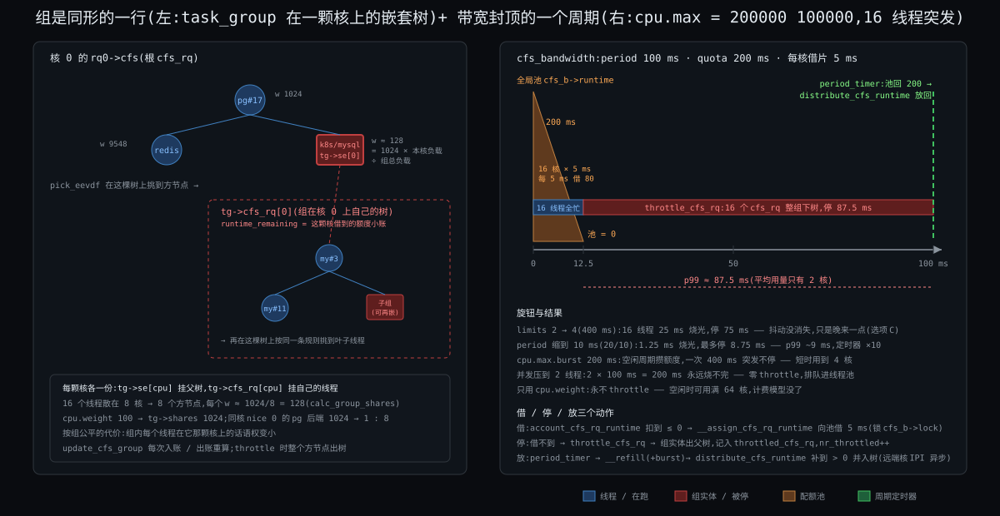

# 阶段 3:Linux 的进程调度器大致怎么工作

> 上一份回答了"八条约束逼出四问"。这一份回答"内核具体用哪几样东西、按什么顺序把这八条化解掉":每核那本账长什么样、fair 类的账上四个数怎么涨怎么比、谁在什么时刻打"该换人"的标记、人怎么在 8 颗核之间搬、容器的 2 核上限怎么落到 16 个线程头上。写法:先立三件核心组件(§0),一张鸟瞰图(§1),然后按四问走;fair 类的账(§3)、多核(§5)、cgroup 带宽(§6)写最厚 —— 前两轮零接触或卡过的地方。每一节先陈述(概念 + 结构表 / 图),再逼问"没有它会坏在哪",节末一张汇总表。
>
> 换人**动作**(存六个寄存器、换栈、写 CR3,2 ~ 3 μs)只引用上一轮 How §6 / Deep §3.2,不重讲。源码钉 Linux 6.12(`kernel/sched/core.c`、`fair.c`、`topology.c`),这一份只写文件和函数名,行号级走读和反事实留给进源码那一轮。
>
> 贯穿机器与任务:8 核 x86-64,两组 L3 各 4 核,SMT 关,3 GHz,`CONFIG_HZ = 250`(tick 4 ms),`base_slice` 3 ms。任务:`mysqld` 16 个工作线程(nice 0)、`redis-server` 1 个线程(nice −10)、`xz`(nice 19)、PostgreSQL 后端若干、一个 k8s 容器 `cpu.max = 200000 100000`(限 2 核)。

---

## 约束清单速查(C1 ~ C8)

> 后文所有 `Cn·短名` 都对应下面 8 条,每条在上一份里从"一核一队列先来先跑"一刀一刀推出过,这里只放"约束 + 不可再分性 + 口诀"。推导见 `stages/02-why/02-why.md`。每条是 markdown 标题,viewer 里可以 `Ctrl+F` 搜 `C3` 直接滚到。

#### C1 — 只在打断点换

内核没有自己的 CPU,只能在流进内核的瞬间(tick / 系统调用 / 中断 / 阻塞)介入;介入时不一定能立刻换人(持锁、中断上下文)。
**不可再分**:要控制一条流必须先拿到它的核;中断上下文不能换栈。
**口诀**:先打标记 → 出口再换

#### C2 — 未来不可知

内核不知道任务下一步算还是等、要多久;猜的启发式可被构造负载骗。
**不可再分**:意图不在二进制里,不可静态判定。
**口诀**:只看账 → 不看人

#### C3 — 份额与延迟两头要

长期按权重分 CPU(份额)和醒来多久上台有界(延迟)是两个独立要求;插队额度须有界。
**不可再分**:一个标量不能同时编码比例和上界。
**口诀**:权重管份额 → slice 管延迟 → lag 管资格

#### C4 — 挑人须便宜

每核每秒万次级决定,每次 < 1 μs 且不随任务数线性增长;记账必须增量。
**不可再分**:规则的常数项直接吃掉它要分的资源。
**口诀**:O(log n) 挑 → O(1) 记

#### C5 — 核各自为政

核有独立 cache / TLB / 时钟,跨核同步贵一到两个数量级,核间有远近。
**不可再分**:多核硬件结构。
**口诀**:每核一本账 → 搬人要算账

#### C6 — 份额按组算

分配单位是用户 / 容器,线程数可被放大;组要嵌套、要能封顶;内核只看见线程。
**不可再分**:内核没有"用户"这个调度对象。
**口诀**:组是一行账 → 封顶按周期扣

#### C7 — 有人要硬保证

一部分任务要绝对时限 / 优先;相对公平推不出绝对保证;凌驾带来饿死与反转。
**不可再分**:公平与保证互不蕴含。
**口诀**:类栈凌驾 → 每个口子配阀

#### C8 — 核不等速且耗电

核的有效算力随 SMT / 频率 / 大小核变,能耗是非线性的独立目标。
**不可再分**:硬件物理。
**口诀**:按算力比 → 不按核数比

---

## §0 从 Why 走到 How:三件事记住

上一份结尾说:调度器 = 四问,规则只看账。这一节把"账"精确成内核里的**三样东西**。后面每一节的细节都挂在这三样上;记住它们,就不会在 fair.c 一万三千行、调度域五层、cgroup 三个定时器里迷路。

### §0.1 件①:每核一本账 `rq` + 调度类的优先级栈 —— 从 C5·核各自为政 + C7·有人要硬保证 推出

因为 C5·核各自为政(跨核同步贵,cache 在核上)→ 要解决"挑人不跨核、不抢锁"→ 所以引入**每核一本账 `rq`**(`struct rq`,`kernel/sched/sched.h`):它有自己的锁、自己的时钟(`clock` / `clock_task`)、自己的"正在跑谁"(`curr`)、自己的任务计数(`nr_running`)。一个任务任何时刻只在一本账上。

因为 C7·有人要硬保证(一部分任务要凌驾于公平之上)→ 要解决"同一本账里不同性质的任务按固定先后挑"→ 所以引入**调度类的优先级栈**:每本 `rq` 里按类各有一个子队列(`rq->dl`、`rq->rt`、`rq->cfs`),类之间按链接顺序 `stop > dl > rt > fair > ext > idle` 固定排列(`include/asm-generic/vmlinux.lds.h` 把六个 `struct sched_class` 按这个顺序连续放,`for_each_active_class` 从高到低扫)。挑人先问"最高的非空类是谁",再调那个类自己的 `pick_task`。

因为 C8·核不等速且耗电 → 要解决"这颗核此刻值多少算力"→ 所以 `rq` 上还挂一个 **`cpu_capacity`**(最强的核 = 1024,SMT 兄弟忙时打折,被 rt / 中断占掉的部分也扣掉),所有跨核比较都除以它。

### §0.2 件②:调度实体 `sched_entity` 的账 + 按 deadline 排的增广红黑树 —— 从 C2·未来不可知 + C3·份额与延迟两头要 + C4·挑人须便宜 + C6·份额按组算 推出

因为 C2·未来不可知(依据只能是过去)+ C3·份额与延迟两头要(三个数各管一头)→ 要解决"每个任务一行账,账上恰好有份额、顺序、资格三个量"→ 所以引入 **`sched_entity`**(`include/linux/sched.h`):`load.weight`(权重)、`vruntime`(虚拟时间)、`slice` 与 `deadline`(这次请求多长、虚拟截止期)、`vlag`(睡下去时存的 lag)。

因为 C4·挑人须便宜(O(log n) 挑、O(1) 记)→ 要解决"在 lag ≥ 0 的实体里找 deadline 最早的,不能扫一遍"→ 所以引入 **按 deadline 排序的增广红黑树**(`cfs_rq->tasks_timeline`):每个节点额外记子树的最小 `vruntime`(`se->min_vruntime`),挑人时能整棵子树剪枝;加权平均虚拟时间 V 不是每次求和,而是两个累加器(`cfs_rq->avg_vruntime`、`avg_load`)随插删 O(1) 更新。

因为 C6·份额按组算(组得是账本上和线程同形的一行)→ 要解决"组在父级参与分配、组内再分"→ 所以 **cgroup 的每一层在每颗核上也是一个 `sched_entity`**,它下面挂一棵自己的 `cfs_rq`(树);线程和组在树上长得一模一样,`pick_eevdf` 不区分。

### §0.3 件③:打断点上的 `need_resched` 标记 + 三种搬人 —— 从 C1·只在打断点换 + C5·核各自为政 推出

因为 C1·只在打断点换(拿到核才能决定,决定时不一定能换)→ 要解决"决定与执行分开"→ 所以引入 **`TIF_NEED_RESCHED` 标记**(`resched_curr`,`core.c`):tick、唤醒、让出这三种打断点只负责**算账 + 判断 + 打标记**;真换人只发生在两个出口 —— 回用户态前的 `exit_to_user_mode_loop`(`kernel/entry/common.c`)和内核态允许抢占的点(`preempt_schedule_irq`,`core.c`)。

因为 C5·核各自为政(每核一本账,但账与账之间会不平)→ 要解决"该搬时搬、不该搬时不搬"→ 所以引入**三种搬人**:唤醒时选核(`select_task_rq_fair`,`fair.c`)、周期 / 空闲时均衡(`sched_balance_rq`,6.10 把老名字 `load_balance` 改成了它)、新建或 `exec` 时找最闲的核(`sched_balance_find_dst_cpu`)。三种都按**调度域**(`sched_domain`,`topology.c`)的远近分层:同 L3 → 同插槽 → 跨 NUMA,越远看得越少。

### §0 结论:三件事对照

| 件 | 是什么 | 为什么存在(约束) |
|---|---|---|
| ① `rq` + 类栈 | 每核一本账;账里按 `stop > dl > rt > fair > ext > idle` 六个子队列;账上挂这颗核的算力 | C5·核各自为政(不跨核)、C7·有人要硬保证(凌驾有序)、C8·核不等速且耗电(算力归一) |
| ② `sched_entity` + 增广树 | 每行账四个数(权重 / vruntime / slice·deadline / lag);按 deadline 排,子树记最小 vruntime;组和线程同形 | C2·未来不可知(只看账)、C3·份额与延迟两头要(三个数)、C4·挑人须便宜(O(log n))、C6·份额按组算(组是一行) |
| ③ 标记 + 三种搬人 | 打断点只打标记,出口才换;唤醒选核、周期均衡、新建放最闲,按调度域分层 | C1·只在打断点换(决定与执行分开)、C5·核各自为政(搬人要算账) |

**三件事怎么嵌套**:件① 是容器 —— 8 本 `rq`,每本里六个子队列;件② 住在 `rq->cfs` 这个子队列里 —— 一棵树,树上每个节点是一行账,节点可能是线程也可能是一个组(组下面再挂一棵树);件③ 是动作 —— 在打断点上读件②的账、改件①的 `curr`、在 8 本 `rq` 之间移动件②的节点。What 的四问对应:何时换 = 件③的标记,换谁 = 件①的类栈 + 件②的树,各多少 = 件②的账上的数,在哪换 = 件①的 8 本账 + 件③的搬人。

---

## §1 一张极简概览图


从图上能读出五件事:

1. **8 本账并排,没有全局队列**。核 0 的 `rq` 和核 4 的 `rq` 之间唯一的联系是右下角那三条虚线(搬人)。
2. **每本账里先是一个六层的类栈**,只有 `fair` 这层下面才是一棵树。`stop` / `dl` / `rt` 平时是空的 —— 空就跳过,所以 `__pick_next_task` 有一条快路径:上一个任务不比 fair 高、且账上的任务全是 fair 的,直接调 `pick_next_task_fair`,类栈都不扫。
3. **fair 树上的节点有两种**:圆的是线程,方的是组(k8s 容器);方的下面还挂着一棵树。组那一行的权重由 `cpu.weight` 换算,但只是**这颗核上**这个组的份额,16 个线程散在 8 颗核上就有 8 个方节点。
4. **左上角四个打断点里只有一个箭头真的指向"换人"**:出口检查。tick 和唤醒都只指向 `need_resched` 那个小旗子。
5. **右下三条搬人虚线粗细不同**:唤醒选核最细最频繁(每次唤醒),周期均衡中等(4 ~ 128 ms 一次),新建放最闲最粗最少。三条都先看同一组 L3 的 4 核,再看另一组。

---

## §2 件①:每核一本账与类栈

**先说结论**:`rq` 是一颗核的全部调度状态;类栈决定"问谁要人";快路径让 99% 的挑人根本不碰类栈;`cpu_capacity` 让 8 本账可以互相比较。

### §2.1 先看全貌:`struct rq` 里跟四问有关的字段

| 字段(`kernel/sched/sched.h`) | 是什么 | 管哪问 |
|---|---|---|
| `curr` | 这颗核正在跑的 `task_struct` | ② |
| `nr_running` / `cfs.h_nr_running` | 账上可跑的任务数 / 其中 fair 类的(含组内) | ②④ |
| `clock` / `clock_task` | 这本账的纳秒时钟(每个打断点 `update_rq_clock` 读一次 TSC);`clock_task` 扣掉了中断和窃取时间,记账用它 | ①③ |
| `cfs` / `rt` / `dl` | 三个子队列:`cfs_rq`(树 + 累加器)、`rt_rq`(100 级优先级数组 + 位图)、`dl_rq`(按截止期排的红黑树) | ② |
| `stop` / `idle` | 这颗核专属的停机线程和 idle 线程 | ② |
| `cpu_capacity` | 这颗核此刻的算力(≤ 1024) | ④ |
| `next_balance` / `avg_idle` / `idle_balance` | 下次周期均衡的时间;最近平均空闲多久(决定空闲时值不值得去拉人) | ④ |
| `nr_switches` / `nivcsw` 等计数 | 换了多少次人 | 观测 |

每颗核一份,`cpu_rq(cpu)` 取。锁是 `rq->__lock`,只保护这一本。

### §2.2 类栈:六个 `sched_class` 怎么排、怎么问

每个类是一个 `struct sched_class`,里面是一组函数指针:`enqueue_task` / `dequeue_task`(入账出账)、`pick_task`(挑人)、`put_prev_task` / `set_next_task`(换人前后的收尾)、`task_tick`(tick 来了记账)、`wakeup_preempt`(有人醒了要不要抢)、`select_task_rq`(放哪本账)、`balance`(要不要去别的核拉人)。六个类按下表链接顺序排:

| 类 | 子队列结构 | `pick_task` 规则 | 谁在里面 |
|---|---|---|---|
| `stop` | 一个任务 | 有就是它 | 每核的 `migration/N`:搬人、热插拔时用 |
| `dl` | 按绝对截止期排的红黑树 | 最早截止期 | `SCHED_DEADLINE` |
| `rt` | 100 级优先级数组 + 位图 | 最高优先级,同级 FIFO / RR | `SCHED_FIFO` / `SCHED_RR` |
| `fair` | 按 deadline 排的增广红黑树(可嵌套) | eligible 中 deadline 最早(§3) | `SCHED_NORMAL` / `BATCH` / `IDLE` |
| `ext` | BPF 程序自己定义的 DSQ | BPF 程序定 | `SCHED_EXT`(6.12 起;没加载 BPF 调度器时这一层跳过) |
| `idle` | 一个任务 | 没人可跑时 | 每核的 `swapper/N` |

**快路径**(`__pick_next_task`,`core.c`):如果 `prev` 不是比 fair 高的类、且 `rq->nr_running == rq->cfs.h_nr_running`(账上全是 fair 任务)→ 直接 `pick_next_task_fair`,返回空就拿 idle。我们的机器上 19 个任务全是 fair,这条路径每次都走。只有 `scx_enabled()`(加载了 BPF 调度器)或账上有 rt / dl 任务时才走慢路径,从 `stop` 开始逐类问。

### §2.3 再逼问:没有它会坏在哪

| 没有 … | 先坏在哪 | 它解决了什么 | 约束 |
|---|---|---|---|
| 每核一本账(改成全局一本) | 8 核抢一把锁;mysqld#3 每次被挑都可能换核,1 MB 工作集重填 | 挑人不跨核、锁只保护一本 | C5·核各自为政 |
| 类栈(所有任务一棵树) | 音频线程和 xz 在同一棵树上按 deadline 比,最坏等一圈 | 一部分任务凌驾于公平之上,且凌驾顺序固定 | C7·有人要硬保证 |
| 快路径 | 每次挑人先问 stop、dl、rt 三个空队列,多三次函数指针调用 ~50 ns | 常见情形零开销 | C4·挑人须便宜 |
| `cpu_capacity` | 均衡把两个任务放进 SMT 兄弟核、把重任务放小核 | 跨核比较按算力不按核数 | C8·核不等速且耗电 |
| `clock_task` 扣中断时间 | 网卡中断多的核上任务被多记账,份额不公平 | 账只记任务自己跑的 | C3·份额与延迟两头要 |

---

## §3 件②:fair 类的账 —— 四个数怎么涨、怎么比

**先说结论**:权重决定虚拟时间涨多快;V 是所有人虚拟时间的加权平均;slice 决定 deadline 推多远;lag = V − 自己的虚拟时间,正数才有资格;挑人 = 有资格的里 deadline 最早。四个数、一个规则、一棵树,没有任何"判断你是不是交互程序"的代码。三个进步点:

- 份额和延迟分成两个旋钮(权重、slice),6.12 起 slice 可以每任务自定。
- 睡醒插队有界:lag 在睡下去时被夹在 ±2 个 slice 之内,醒来按 lag 放回。
- 挑人 O(log n):树按 deadline 排,子树记最小 vruntime 做剪枝,V 用两个累加器 O(1) 维护。

### §3.1 权重:nice 怎么变成数

因为 C3·份额与延迟两头要 的"份额"一头 → 要解决"按比例分而不是按个数分"→ 所以引入**权重** `se->load.weight`:nice 值查表(`sched_prio_to_weight[40]`,`core.c`),nice 0 = 1024,每差一级约 1.25 倍 —— 设计目标是"nice 差 1,两个任务对分时 CPU 份额差约 10 个百分点"(`Documentation/scheduler/sched-nice-design.rst`)。

| nice | 权重 | nice | 权重 | nice | 权重 | nice | 权重 |
|---|---|---|---|---|---|---|---|
| −20 | 88761 | −10 | **9548** | 0 | **1024** | 10 | 110 |
| −15 | 29154 | −5 | 3121 | 5 | 335 | 15 | 36 |
| −19 | 71755 | −9 | 7620 | 1 | 820 | 19 | **15** |

**算例**(我们的三个任务同核争抢时的长期份额):

| 任务 | nice | 权重 | 份额 = w / Σw | 跑 1 ms 真实时间,虚拟时间涨 1024 / w ms |
|---|---|---|---|---|
| redis | −10 | 9548 | 9548 / 10587 = 90.2% | 0.107 ms |
| mysqld#3 | 0 | 1024 | 9.7% | 1.000 ms |
| xz | 19 | 15 | 0.14% | 68.27 ms |

两个任务 nice 差 5(1024 : 335)→ 3.06 : 1;差 10(1024 : 110)→ 9.3 : 1。**权重只决定长期比例**,redis 90% 的份额它根本用不掉(它 95% 时间在睡);这就是钩子二里 `nice -10` 没用的原因 —— 它拧的旋钮本来就不缺。

### §3.2 虚拟时间与加权平均 V

因为 C2·未来不可知(依据只能是过去)+ C3·份额与延迟两头要 的份额要按权重 → 要解决"一个数既记录'跑了多少'又把权重折进去"→ 所以引入 **`vruntime`**:每个打断点 `update_curr`(`fair.c`)读一次 `rq->clock_task`,算出 `delta_exec`,然后 `vruntime += delta_exec × 1024 / weight`(`calc_delta_fair`)。nice 0 的任务虚拟时间 = 真实时间;权重越大涨得越慢。

"公平"在账上的定义:**所有人的 vruntime 趋同**。趋同到哪个值?队列的加权平均 **V**:

```
V = Σ(w_i × v_i) / Σ w_i                       ← 定义(fair.c 开头 60 行注释的推导)
```

因为 C4·挑人须便宜(不能每次求和)→ 要解决"V 在每次插删后 O(1) 可得"→ 所以引入两个累加器(`cfs_rq->avg_vruntime`、`cfs_rq->avg_load`),存的是相对于 `min_vruntime` 的差:

```
avg_vruntime = Σ (v_i − min_vruntime) × w_i     ← 插入时 +=,删除时 −=(avg_vruntime_add / _sub)
avg_load     = Σ w_i
V            = min_vruntime + avg_vruntime / avg_load      ← 函数 avg_vruntime()
```

`min_vruntime` 单调递增,减掉它是为了让乘积不溢出 64 位(注释里实测 44 位)。正在跑的 `curr` 不在树上,`avg_vruntime()` 算的时候临时把它加进去。

**算例**:核 0 上 mysqld#3(w 1024,v 1204.0)和 xz(w 15,v 1200.0):V = (1024 × 1204.0 + 15 × 1200.0) / 1039 = 1203.94。V 几乎贴着大权重的那个 —— 权重就是"在平均里的话语权"。

### §3.3 slice 与 deadline:延迟那一头

因为 C3·份额与延迟两头要 的"延迟"一头 → 要解决"表达'我这次要跑多长'并由此排出先后"→ 所以引入 **`slice`** 与 **`deadline`**:

| 量 | 怎么定 | 本机器的值 |
|---|---|---|
| `slice`(请求长度,真实时间) | 默认 `sysctl_sched_base_slice` = 0.75 ms × (1 + log₂ min(核数, 8))(`get_update_sysctl_factor`,`fair.c`;这个对数缩放的点子注释里写明来自 Con Kolivas 的 SD 调度器);6.12 起 `sched_setattr` 的 `sched_runtime` 可自定,夹在 0.1 ~ 100 ms(`syscalls.c`) | 8 核:0.75 × 4 = **3 ms** |
| `deadline`(虚拟截止期) | `deadline = vruntime + slice × 1024 / weight`(`update_deadline`),**只在 vruntime 追上旧 deadline 时才推一次**,推完返回 true 表示"这次请求用完了,该换人" | mysqld +3 ms;redis +0.32 ms;xz +204.8 ms |

注意两件事:

- deadline 是**虚拟**的,所以权重大的任务 deadline 近(redis 0.32 ms 后就到期)—— 大权重在"顺序"上也占优,但只占一个 slice 的优。
- `update_deadline` 返回 true 时 `update_curr` 调 `resched_curr` 打标记 —— 这是 tick 上"该换人"的第一种来源(§4.1)。但 tick 4 ms 一次、slice 3 ms,一个纯算任务实际能跑到下一个 tick 才被发现,**4 ms 而不是 3 ms**(高精度 tick `HRTICK` 特性默认关,`features.h`)。

### §3.4 lag 与 eligibility:从零讲

你上一轮两次卡在这里。这一小节不假设你记得任何东西。

**问题**:redis 睡了 10 ms,醒来时它的 vruntime 比大家落后 —— 账面上"欠它"。按 §3.2 的公平定义它应该排最前面,立刻跑,而且可以一直跑到把欠的追平。问题是:它追平要跑多久?如果它欠 10 ms,它就能连跑 10 ms 不被抢;100 个这样的任务轮流睡醒,mysqld 永远上不了台。**"欠"必须有上限,而且上限要跟份额无关、跟延迟有关。**

**定义**(`fair.c` 注释 + `entity_lag`):

```
lag_i = w_i × (V − v_i)          ← 真实时间单位的"欠账":理想情况下它该得到的服务 − 实际得到的
vlag_i = V − v_i                 ← 内核只存虚拟单位的这个,省掉到处乘 w_i
```

V 比它的 vruntime 大 → lag 正 → 欠它 → **eligible(有资格)**。V 比它小 → lag 负 → 它超支了 → 没资格,哪怕 deadline 最早也不挑它。`entity_eligible` 就是判 `V ≥ v_i`,为了不做除法,实际比较的是 `avg_vruntime ≥ (v_i − min_vruntime) × avg_load`(`vruntime_eligible`)。

一个性质(注释里的推导):**所有人的 lag 之和恒为零**(Σ w_i (V − v_i) = 0,这正是 V 的定义)。所以有人欠就有人超,"欠"不是凭空产生的。

**睡下去时:夹紧**。因为 C3·份额与延迟两头要 的插队额度须有界 → 要解决"睡得再久也只能欠这么多"→ 所以 `update_entity_lag`(出队时调)把 lag 夹在 **±max(2 × slice, TICK_NSEC)** 换算成虚拟单位(`entity_lag`):

| 任务 | 真实上限 = max(2 × 3 ms, 4 ms) = 6 ms | 虚拟上限 = 6 ms × 1024 / w |
|---|---|---|
| mysqld(1024) | 6 ms | ±6.0 ms |
| redis(9548) | 6 ms | ±0.643 ms |
| xz(15) | 6 ms | ±409.6 ms |

所以 redis 不管睡多久,醒来时最多"欠" 6 ms 真实时间的量(虚拟 0.643 ms)—— 两个 slice。这个上限和它 90% 的份额无关。

**醒来时:按 lag 放回,且保持 V 不动**。`place_entity`(`fair.c`)做的事:读当前 V,把任务放在 `vruntime = V − lag` 的位置,再给它 `deadline = vruntime + slice × 1024 / w`。但有一个坑 —— 把一个 lag 为正的任务加进平均里,**V 本身会被拉低**(平均里多了一个比平均小的数),它的 lag 立刻变小,"欠它的"蒸发了一部分。注释里推了这个式子:加进去之后的实际 lag 是 `vl' = vl − w × vl / (W + w)`。所以放回前先**放大**:

```
vl_放回 = vl × (W + w) / W         ← W 是现有队列总权重(含 curr),w 是它自己的
v_i = V − vl_放回
```

放回之后 V 下移,它的 lag 正好回到睡前那个值 —— **lag 守恒**。这一步是 6.6 EEVDF 和 6.5 以前 CFS 的分水岭:CFS 的 `place_entity` 是"睡醒补半个 slice"的固定优惠,EEVDF 是"欠多少还多少,一分不多"。

新任务(fork 出来)没有历史 lag,`PLACE_DEADLINE_INITIAL` 给它半个 slice 的 deadline("别人平均跑到一半了,你也从一半开始"),不给任何欠账。

**6.12 新增:欠账的人想睡,先把账还了(`DELAY_DEQUEUE`)**。lag 为负的任务(超支了)要睡 —— 6.11 以前是真出队、把负 lag 存起来,下次醒来放回时带着负 lag(排到后面)。6.12 起(`features.h` 的 `DELAY_DEQUEUE`)它**留在树上不出队**,标记 `sched_delayed`,继续被 V 甩在后面直到 lag 归零,那一刻再真正出队(`DELAY_ZERO` 把残余 lag 清零)。好处:睡眠不再是逃债的办法,而且短睡眠醒来时如果还在"延迟出队"状态,`requeue_delayed_entity` 只清一个标志就回来了,比重新 `place_entity` 便宜。代价:树上多了一些"在睡但还挂着"的节点,`h_nr_running` 和"真可跑"数要分开算 —— Deep 主线① 会贴这段的判断分支。



### §3.5 挑人规则:`pick_eevdf` 的文字版

因为 C3·份额与延迟两头要 的三个数都到位了 → 要解决"用一条规则把它们合起来"→ 所以 **EEVDF**(Earliest Eligible Virtual Deadline First,`pick_eevdf`,`fair.c`):

1. 树上只有一个实体 → 直接返回(省掉资格判断)。
2. `curr` 不在账上或没资格 → 当它不存在。
3. **`RUN_TO_PARITY`**(默认开):`curr` 有资格、且它从被挑中起 deadline 没变过(`set_next_entity` 把 deadline 抄一份到 `vlag` 里做标记,`vlag == deadline` 就是"slice 保护期内")→ 继续跑它。这叫"跑到 parity":一个 slice 内不换人,减少抖动。
4. 树最左(deadline 最早)的实体有资格 → 就是它。
5. 否则按子树最小 vruntime 剪枝向右找第一个有资格的。
6. 找到的和 `curr` 比,谁 deadline 早要谁。

**`PREEMPT_SHORT`**(默认开,6.12):如果醒来的任务 slice 比 `curr` 短、有资格、而且 deadline 比 `curr` 早(或 `curr` 没资格)→ 取消 `curr` 的 slice 保护(`do_preempt_short` 把 `vlag` 改成 `deadline + 1`),让短请求能插进来。这是"slice 管延迟"落到挑人上的那一步:**声明小 slice 的任务换来的是插队权,不是份额**。

规则里没有一行看 `task_struct` 的名字、policy 以外的任何"类型"信息。C2·未来不可知 的口诀"只看账不看人"就是这六步。

### §3.6 一次完整算例:三个任务同核走五拍

核 0 上 mysqld#3(w 1024)和 xz(w 15)都可跑,redis(w 9548)在睡,睡前存的 `vlag = +0.50`(虚拟 ms,欠它)。slice 都是 3 ms。t = 0 时两人 vruntime 都是 1200.0,V = 1200.0。单位:虚拟 ms,保留两位。

| t(真实 ms) | 事件 | mysqld v / lag / dl | xz v / lag / dl | redis v / lag / dl | V | 选谁、为什么 |
|---|---|---|---|---|---|---|
| 0 | 两人都在树上 | 1200.00 / 0 / 1203.00 | 1200.00 / 0 / 1404.80 | 睡 | 1200.00 | 都有资格;mysqld deadline 早 → **mysqld** |
| 4 | tick | 1204.00 / **−0.06** / 1207.00(跑满 3 ms 推了 deadline → 标记) | 1200.00 / +3.94 / 1404.80 | 睡 | 1203.94 | mysqld 超支没资格;xz 有资格且是唯一候选 → **xz**(注意 mysqld 跑了 4 ms 不是 3,tick 粒度) |
| 8 | tick | 1204.00 / +3.88 / 1207.00 | **1473.07** / −265 / 1677.87(4 ms 涨了 273 虚拟 ms) | 睡 | 1207.88 | xz 没资格;mysqld 有资格 → **mysqld**。此后 mysqld 要跑到 v = 1473 才会再次没资格,即 **269 ms**;xz 每 ~273 ms 得 4 ms ≈ 1.5%,与 15 / 1039 一致 |
| 10 | redis 被网卡中断唤醒(`ttwu`) | 1206.00 / −0.73 / 1207.00 | 同上 | 放回:lag 放大 0.50 × (1039 + 9548) / 1039 = 5.09;v = 1209.86 − 5.09 = **1204.77**;dl = 1204.77 + 0.32 = 1205.09 | 1205.27(redis 加入后 V 下移;redis 的 lag 回到 +0.50 ✓) | mysqld 被拉成**没资格**;`check_preempt_wakeup_fair`:`pick_eevdf` 返回 redis → 打标记 → 出口换人 → **redis**。注意 mysqld 还在 slice 保护期内,但保护只护"有资格的 curr" |
| 10.05 | redis 算完 50 μs 睡了 | 1206.00 / +3.86 / 1207.00 | 同上 | v 1204.78;出队时 lag = V − v ≈ +0.49,夹在 ±0.643 内 → 存下 | 1209.86(回到 redis 加入前) | redis 有资格(lag 正)→ 真出队;mysqld 恢复有资格 → **mysqld** |

五拍里能读出的四件事:

1. **tick 粒度**(第 4 ms 行):slice 3 ms,实际跑 4 ms —— C1·只在打断点换 的代价。
2. **权重通过 V 起作用**(第 8 ms 行):xz 跑 4 ms 就把自己甩到 V 后面 265 虚拟 ms,下次有资格要等 mysqld 跑 269 ms —— 1 : 68 的份额不是靠"少挑它",是靠"它一跑账就飞"。
3. **lag 守恒**(第 10 ms 行):放大后放回,V 下移,redis 的 lag 恰好还是 +0.50;mysqld 因此瞬间没资格 —— **决定抢不抢的不是 tick,是唤醒那一刻的 V**。
4. **slice 保护保护不了没资格的人**(第 10 ms 行):`RUN_TO_PARITY` 开着,mysqld 照样被换 —— 上一轮 Deep §3.5 的结论,这里从账上重现。

### §3.7 组是同形的一行

因为 C6·份额按组算 → 要解决"组在父树上像线程一样被挑,组内再挑"→ 所以 **`task_group`**(`sched.h`):cgroup 树上每个节点一个,它在**每颗核上**各有一个 `sched_entity`(`tg->se[cpu]`,挂在父级那颗核的 `cfs_rq` 树上)和一个 `cfs_rq`(`tg->cfs_rq[cpu]`,挂它自己在这颗核上的线程 / 子组)。`pick_eevdf` 在父树上挑到一个组节点,就下到那个组的树上再挑,一直到叶子线程(`pick_task_fair` 的循环)。

组的权重:`cpu.weight`(1 ~ 10000,默认 100)换算成 `tg->shares`(100 → 1024,`sched_weight_from_cgroup`)。但 `tg->shares` 是**整个组**的权重,组散在 8 颗核上,每颗核上那一行该占多少?`calc_group_shares`(`fair.c`)给的形状:

```
这颗核上组实体的权重 ≈ tg->shares × (这颗核上组内负载) / (组在所有核上的总负载)
```

组内负载按 PELT 的 `load_avg`(§5.2)算;实现里做了一个"近似单核时退化成整份"的修正(注释自嘲 icky)。效果:k8s 容器 `cpu.weight = 100`,16 个线程在 8 颗核上各 2 个,每颗核上这个组的权重 ≈ 1024 / 8 = 128,跟同核上一个 nice 0 的 PG 后端(1024)比是 1 : 8 —— **按组公平的代价是组内每个线程在它所在那颗核上的话语权变小**。`update_cfs_group` 在每次入账出账时重算这个数。

### §3.8 再逼问:没有它会坏在哪

| 没有 … | 先坏在哪 | 它解决了什么 | 约束 |
|---|---|---|---|
| 权重(所有人 1024) | xz 和 redis 对分 CPU;`nice` 失效 | 份额按比例 | C3·份额与延迟两头要 |
| V 用累加器(每次求和) | 3000 个任务时每次判资格 O(n),tick 里 30 μs | O(1) 得到 V | C4·挑人须便宜 |
| deadline(只按 vruntime 最小挑,即 CFS) | 没法表达"我要低延迟但不多占";份额和延迟绑死 | 延迟成为独立旋钮 | C3·份额与延迟两头要 |
| lag 夹紧 | 睡 1 s 回来连跑 1 s;100 个这样的任务饿死 mysqld | 插队有界 | C3·份额与延迟两头要 |
| lag 守恒放大 | 每次睡醒欠账蒸发一部分;频繁睡醒的任务系统性吃亏 | 账不因进出而漂 | C2·未来不可知(账要准) |
| 树按 deadline 排 + 子树最小 vruntime | 找"有资格里 deadline 最早"要扫一遍 | O(log n) 剪枝 | C4·挑人须便宜 |
| 组是同形一行 | 按线程分;`make -j64` 压扁浏览器 | 组间公平、组内再分 | C6·份额按组算 |
| `DELAY_DEQUEUE`(6.12) | 超支的任务睡一下就把负 lag 带到下次,或被不公平地提前放回 | 睡眠不是逃债 | C3·份额与延迟两头要 |

---

## §4 件③:何时换 —— 标记与出口

**先说结论**:三种打断点只打标记(`TIF_NEED_RESCHED`),两种出口真换人;内核态能不能被换由抢占模型决定;tick 做两件事(记账、看 slice)并顺手触发均衡;唤醒抢占的判定就是"把新人放进账里再跑一次 `pick_eevdf`"。

### §4.1 五个触发点与三种标记来源

因为 C1·只在打断点换 → 要解决"每种打断点各做什么"→ 所以:

| 触发点 | 入口(6.12) | 做什么 | 标记来源 |
|---|---|---|---|
| tick | `sched_tick`(`core.c`)→ `task_tick_fair` → `entity_tick` → `update_curr` | 记账;`update_deadline` 返回 true(slice 用完)或 `did_preempt_short` → `resched_curr` | ① slice 到期 |
| 唤醒 | `try_to_wake_up` → `select_task_rq_fair`(放哪本账)→ `ttwu_queue` → `ttwu_do_activate` → `enqueue_task_fair`(含 `place_entity`)→ `wakeup_preempt`(`core.c`) | 新人入账;类更高直接标记;同类调 `check_preempt_wakeup_fair` | ② 新人比 curr 更该跑 |
| 阻塞 | 任务自己调 `schedule()`(在 `futex_wait`、`io_schedule` 等里) | `dequeue_task_fair`(含 `update_entity_lag`,可能 `DELAY_DEQUEUE`)→ 直接挑下一个 | 不需要标记,它自己就在 `schedule()` 里 |
| 让出 / 退出 | `sched_yield` → `yield_task_fair`(把自己的 deadline 推到最后);`do_exit` → `schedule()` | 直接挑下一个 | 同上 |
| 出口检查 | `exit_to_user_mode_loop`(`kernel/entry/common.c`);`preempt_schedule_irq`(`core.c`);`preempt_enable` 的末尾 | 看到标记 → `schedule()` | ③ 消费标记 |

三种标记来源:slice 到期(tick)、新人更该跑(唤醒)、还有一种跨核的 —— 均衡把任务搬到这颗核后也会 `wakeup_preempt`。标记打在 `curr->thread_info.flags` 上;如果 `curr` 在别的核上跑(唤醒者在核 3 给核 5 的 curr 打标记),`resched_curr` 发一个 IPI 让核 5 进一次中断,好让它走到出口。

### §4.2 从标记到真换:两种出口与抢占模型

标记只是一个 bit。真换人要等流走到出口:

| 出口 | 什么时候经过 | 代码 |
|---|---|---|
| 回用户态前 | 每次系统调用返回、中断返回用户态 | `exit_to_user_mode_loop`:循环检查 `TIF_NEED_RESCHED` → `schedule()`,直到没有待办 |
| 内核态抢占点 | 中断返回**内核态**时(`irqentry_exit` → `irqentry_exit_cond_resched` → `preempt_schedule_irq`);`preempt_enable()` 把 `preempt_count` 减到 0 时;`cond_resched()` / `might_sleep()` 显式让出点 | 只在 `preempt_count == 0`(没持自旋锁、不在中断里)时才真换 |

第二种出口**存不存在**由编译 / 启动时的抢占模型决定(`kernel/Kconfig.preempt`):

| 模型 | 内核态什么时候能被换 | 典型用途 | 代价 |
|---|---|---|---|
| `PREEMPT_NONE`(Server) | 只在显式 `cond_resched` / 回用户态 | 吞吐优先的服务器 | 一次长系统调用(大 `read`)期间 redis 醒了也要等它做完,最坏几 ms |
| `PREEMPT_VOLUNTARY`(Desktop) | 上面 + 内核里更多 `might_sleep` 点 | 发行版老默认 | 略多的检查 |
| `PREEMPT`(Low-Latency Desktop) | 任何 `preempt_count == 0` 的点,包括中断返回内核态 | 桌面、低延迟 | 更多 `preempt_count` 操作;持锁区变成隐式不可抢占区 |
| `PREEMPT_RT` | 上面 + 自旋锁变睡眠锁 + 中断线程化,几乎哪都能换 | 实时 | 吞吐降,锁更重 |
| `PREEMPT_DYNAMIC` | 编译进全部,启动参数 `preempt=none/voluntary/full` 选(静态调用切换) | 现代发行版默认(x86) | 无 |
| `PREEMPT_LAZY` | 6.13 起(已核 #16:v6.13 `kernel/Kconfig.preempt` 新增):fair 类的标记默认"懒",只在回用户态或下一个 tick 才生效,给内核态长路径留余地 | 想要 `PREEMPT` 的延迟又不想要它的吞吐损失 | — |

我们的机器按 `PREEMPT_DYNAMIC` + `preempt=full` 假设,第二种出口存在。

### §4.3 tick 的两件事,以及没有 tick 的时候

`sched_tick`(`core.c`)每 4 ms 在每颗核上做:① `update_rq_clock` 读 TSC;② 调当前类的 `task_tick`(fair:`update_curr` 记账 + `update_deadline` 看 slice + PELT 更新 + `update_cfs_group` 重算组权重);③ `calc_global_load_tick`(loadavg);④ `sched_balance_trigger`:到了这颗核的 `next_balance` 就抬 `SCHED_SOFTIRQ`,均衡在软中断里做(§5.3)。

因为 C8·核不等速且耗电(空转的核每 4 ms 醒一次浪费电)→ 要解决"没事的核别醒"→ 所以引入 **`NO_HZ_IDLE`**(默认):核进 idle 就停 tick;它的均衡职责由一颗被选中的"idle load balancer"核代做(`nohz_balancer_kick`)。**`NO_HZ_FULL`**(可选):账上只有一个任务的核也停 tick,记账改在系统调用边界补(待核 #17),给 HPC / 低延迟用;代价是均衡和 PELT 更新变慢。

### §4.4 唤醒抢占:把新人放进账里再挑一次

`check_preempt_wakeup_fair`(`fair.c`)的机制级描述:

1. `curr` 已经有标记 → 不用再判。
2. 新人是 `SCHED_BATCH` / `SCHED_IDLE` → 不抢(这两种 policy 的全部含义就是"不抢别人")。
3. `curr` 是 idle 实体而新人不是 → 直接抢。
4. `update_curr` 把 `curr` 的账记到此刻。
5. `do_preempt_short`:新人 slice 更短、有资格、deadline 更早 → 取消 `curr` 的 slice 保护。
6. **`pick_eevdf(cfs_rq) == 新人` → `resched_curr`**。

第 6 步就是全部:抢不抢 = 把新人按 lag 放回树上之后,规则会不会挑它。§3.6 第 10 ms 那一行走的就是这六步。`RUN_TO_PARITY` 在第 6 步里保护的是"有资格的 `curr`",新人加入把 V 拉低到 `curr` 之下时保护失效 —— 所以**睡醒的高权重任务几乎总能立刻上**,这是 redis p99 在正常情况下只有 0.2 ms 的原因;钩子二里它变成 5 ms,是因为 §5 要讲的位置问题和 §4.2 的内核态不可抢占段,不是挑人规则的问题。

### §4.5 再逼问:没有它会坏在哪

| 没有 … | 先坏在哪 | 它解决了什么 | 约束 |
|---|---|---|---|
| 标记(tick 里直接 `schedule`) | 中断上下文换栈;持锁时换人把锁带走 | 决定与执行分开 | C1·只在打断点换 |
| 内核态抢占点(只有回用户态一个出口) | 一次 10 ms 的系统调用期间 redis 等 10 ms | 内核态长路径里也能换 | C1·只在打断点换 + C3·份额与延迟两头要 |
| `NO_HZ_IDLE` | 7 颗空核每秒醒 250 次 | 省电 | C8·核不等速且耗电 |
| 唤醒时重跑 `pick_eevdf` | 新人要等下一个 tick(最多 4 ms) | 延迟由唤醒决定,不由 tick 决定 | C3·份额与延迟两头要 |
| IPI 通知别的核 | 核 5 的 curr 不知道自己该让 | 跨核标记能生效 | C5·核各自为政 |

---

## §5 在哪换:多核(结构 / 原理 / 机制 / 策略)

**先说结论**:8 本账靠调度域分成"同 L3 的 4 核"和"全部 8 核"两层;每本账和每个任务都带一个按 32 ms 半衰期衰减的负载估计;搬人三条路 —— 醒来时先找原核或同 L3 的空核、空闲和周期时从最忙的组拉、新建时放最闲的;所有"搬不搬"都卡在一个门槛上:它 0.5 ms 内跑过就算热,不搬。四个进步点(相对"一本全局账"):

- 挑人永远不跨核、不抢锁。
- 搬人有代价模型(热 / 冷)而不是盲搬。
- 远近分层,跨 L3 的均衡比同 L3 的少做 2 ~ 4 倍。
- 按负载和算力比,不按任务个数比。

### §5.1 结构:调度域与调度组

因为 C5·核各自为政(核间有远近)→ 要解决"均衡按远近分层"→ 所以引入 **`sched_domain`**(`topology.c`):每颗核一条从近到远的域链。6.12 的默认拓扑表 `default_topology[]` 从下往上是:

| 层(`SD_INIT_NAME`) | 范围 | 关键 flag | `imbalance_pct` | `balance_interval` 基值 |
|---|---|---|---|---|
| `SMT` | 同一物理核的超线程 | `SD_SHARE_CPUCAPACITY`(共享执行单元) | 110% | 域内核数 ms |
| `CLS` | 共享 L2 的簇(ARM 多见) | `SD_CLUSTER` | 117% | 同上 |
| `MC` | 共享 L3 的核 | `SD_SHARE_LLC` | 117% | 4 核 → 4 ms |
| `PKG` | 同一插槽 | — | 117%(默认) | 8 核 → 8 ms |
| `NUMA`(`CONFIG_NUMA` 时按距离再分层) | 跨插槽 | `SD_NUMA` + `SD_SERIALIZE`;远 NUMA 层去掉 `SD_BALANCE_EXEC / FORK / WAKE_AFFINE` | 117% | 更长 |

我们的机器(SMT 关,一个插槽,两组 L3)只有两层:**MC**(4 核)和 **PKG**(8 核)。每层把核分成若干 **`sched_group`**:MC 层每核一组;PKG 层每组 L3 一组(4 核)。均衡永远是"本组 vs 域内其他组"。

`imbalance_pct` 是迟滞:最忙的组要比本组忙 17% 以上才值得搬(SMT 层 10%)。`balance_interval` 是这层多久看一次,忙的时候乘 `busy_factor` 16,上限 `HZ/10` = 100 ms(`max_load_balance_interval`,`fair.c`);连续搬不动就翻倍。所以我们的机器上:核空闲时 MC 层 4 ms 看一次、PKG 层 8 ms;核忙时 64 ms / 100 ms。



### §5.2 原理:负载怎么量 —— PELT 与算力

因为 C8·核不等速且耗电(按算力比不按核数比)+ C5·核各自为政(搬人要算账)→ 要解决"一个任务'有多重'、一颗核'有多满'要有可比的数"→ 所以引入 **PELT**(Per-Entity Load Tracking,`pelt.c`):把时间切成 1024 μs 的段,每段里"可跑 / 在跑 / 在睡"记 1 或 0,按几何级数衰减求和,衰减系数 y 满足 **y³² = 0.5**,即 32 ms 前的那段只算一半(待核 #13:`LOAD_AVG_PERIOD = 32`)。每个 `sched_entity` 和每个 `cfs_rq` 各维护三个数:

| 量 | 记的是 | 用在哪 |
|---|---|---|
| `util_avg` | 最近"在跑"的比例 × 1024(一个一直跑的任务 → 1024) | 唤醒选核(够不够放)、调频(`schedutil` 直接读它)、EAS |
| `runnable_avg` | 最近"可跑(含排队)"的比例 | 判断一颗核是不是"排了很多人" |
| `load_avg` | `runnable_avg × 权重` | 周期均衡比"谁重"、组权重分摊(§3.7) |

**算力** `cpu_capacity`:最强的核 = 1024;SMT 兄弟都忙时各打折;被 rt / dl / 中断占掉的时间从算力里扣(`scale_rt_capacity`)。均衡比的是 `load_avg / cpu_capacity`。

32 ms 半衰期是个折中:太短则一个突发让均衡乱搬,太长则一个任务变重 100 ms 后均衡才知道。redis 的 `util_avg` 长期只有 ~50(5%),mysqld 忙时 ~1024,xz 1024 但权重 15 所以 `load_avg` 只有 ~15。

### §5.3 机制:三种搬人

**① 唤醒时选核**(`select_task_rq_fair`,`fair.c`):

1. 先看 `wake_wide`:唤醒者和被唤醒者是不是"一对多"关系(一个线程唤醒很多线程,如主线程分发)—— 是则不做亲和,走慢路径找最闲的。
2. 否则 **`wake_affine`**:在唤醒者所在核(`this_cpu`)和被唤醒者上次的核(`prev_cpu`)之间二选一:哪个空(`wake_affine_idle`)就哪个;都不空比负载(`wake_affine_weight`,带 `imbalance_pct` 的偏置),偏向 `prev_cpu`(cache 热)。只在两者同一 LLC 域(`SD_WAKE_AFFINE`)内考虑。
3. 选定目标后 **`select_idle_sibling`**:目标核空 → 用;`prev_cpu` 空且与目标同 LLC → 用 `prev`;最近用过的核空 → 用;再不行在目标的 LLC 域内扫空核(`select_idle_cpu`,`SIS_UTIL` 按域的利用率限制扫描数量,别为找一颗空核扫 64 颗)。
4. 全忙 → 就放目标核,排队。

结论:**醒来的任务几乎总是留在原来那组 L3 里**;跨 L3 只在唤醒者在另一组且那边更闲时发生。

**② 周期 / 空闲均衡**(`sched_balance_rq`,`fair.c`;老名 `load_balance`):

1. 触发:核空闲下来立刻做一次(`sched_balance_newidle`,但如果这颗核平均空闲时间比一次均衡的代价还短就不做,`avg_idle` vs `max_newidle_lb_cost`);否则 tick 里 `sched_balance_trigger` 到期抬软中断 → `sched_balance_softirq` → `sched_balance_domains` 从 MC 到 PKG 逐层(每层按自己的间隔)。
2. 找最忙的组 `sched_balance_find_src_group`:统计每组的 `load_avg`、`util_avg`、可跑数、空核数,把组分类(`group_has_spare` / `fully_busy` / `overloaded` / `misfit` / …),本组比最忙组闲才继续;`calculate_imbalance` 算要搬多少(类型 `migrate_load` / `migrate_util` / `migrate_task` / `migrate_misfit`),**只搬差距的一半**(`imbalance >>= 1`),防止来回抖。
3. 在最忙组里找最忙的 `rq`(`sched_balance_find_src_rq`),锁住两本账,`detach_tasks` 从它的树上挑任务:跳过 `curr`(正在跑的不能搬,除非后面升级成 active balance 让 `stop` 类线程把它踢下来)、跳过亲和不允许的(`cpus_ptr`)、跳过**热的**(`task_hot`:`exec_start` 距现在 < `sysctl_sched_migration_cost` = 0.5 ms;SMT 兄弟之间不算热),直到搬够 `imbalance`。
4. `attach_tasks` 放进本账并 `wakeup_preempt`。
5. 连续失败 `cache_nice_tries` 次(LLC 层 1 次,NUMA 层 2 次)后下一次忽略"热"。

**③ 新建 / exec 时**(`select_task_rq_fair` 带 `WF_FORK` / `WF_EXEC`,走慢路径 `sched_balance_find_dst_cpu`):新任务没有 cache 可丢,从最高有 `SD_BALANCE_FORK` 的域往下逐层找最闲的组、组里最闲的核(优先刚进 idle 不深的核,唤醒延迟小)。

### §5.4 策略:什么时候搬、搬谁、谁不能搬

| 问题 | 策略 | 对应 |
|---|---|---|
| 什么时候搬 | 空闲时立刻(最常见);忙时按层间隔(4 ~ 100 ms);最忙组比本组忙 17% 以上才动 | C5·核各自为政(搬是有代价的) |
| 搬谁 | 不搬 curr;不搬 0.5 ms 内跑过的;优先搬 `load_avg` 刚好填平差距的;SMT 层不看热不热 | C5·核各自为政 + C8·核不等速且耗电 |
| 搬多少 | 差距的一半 | 防抖 |
| 谁不能搬 | `sched_setaffinity` / `taskset` 限定了 `cpus_ptr` 的;`cpuset` cgroup 限定了范围的;`isolcpus=` 启动参数隔离的核根本不在任何域里 | 用户的位置旋钮 |
| 内存在哪边(NUMA) | `NUMA balancing`:周期性把任务的页表项清掉访问权,靠缺页统计任务在哪个节点访存多;访存多在对面就要么把页搬过去、要么把任务搬过去(`task_numa_fault`,`fair.c`) | C5·核各自为政 的内存那一面 |
| 核不等速 | 均衡的所有比较除以 `cpu_capacity`;`misfit` 任务(util 超过小核算力)优先搬到大核;EAS 在不过载时按能耗模型选核(`find_energy_efficient_cpu`,我们的 x86 机器没有能耗模型,这条跳过) | C8·核不等速且耗电 |

### §5.5 算例:rq3 空了,从谁那里拉几个

状态(§1 图):组 L3-0 = {rq0: 3 可跑, rq1: 5, rq2: 1, rq3: 0};组 L3-1 = {rq4: 6, rq5: 4, rq6: 2, rq7: 1(redis 绑核)}。rq3 的 curr 刚睡,`sched_balance_newidle`:

1. **MC 层**(域 = L3-0 四核,每核一组):本组 rq3 空(`group_has_spare`,空核 1);最忙组 rq1 有 5 个可跑(`group_overloaded`)。`calculate_imbalance`:本组有余、对方过载 → `migrate_task`,数量按两边空核差 / 可跑差算,再折半 → imbalance 算出 **2**;但在可抢占内核(`CONFIG_PREEMPTION`)下 newidle 均衡搬到 **1 个**就 `break`(`fair.c:9607`,Deep §3.2 贴了这段),剩下的留给下一次。`detach_tasks` 在 rq1 树上从尾部开始挑:跳过 curr;一个 0.3 ms 前刚跑过的 mysqld 线程算热跳过;挑一个 PG 后端(`exec_start` 几 ms 前)→ rq3 现在 1 个。`continue_balancing` 置 0(本层搬到了,上层不再搬)。
2. 如果 MC 层没搬到(比如 rq1 上全是热的或绑核的):**PKG 层**(域 = 8 核,两组各 4 核)。本组 L3-0 共 9 可跑 / 4 核,对方 L3-1 共 13 / 4 核;对方比本组忙 13 / 9 = 144% > 117% → 够格。PKG 层没有 `SD_SHARE_LLC`,`calculate_imbalance` 走的是 `migrate_util` 分支:imbalance = 本组的算力余量 = 一颗空核的 1024(不是"~2 个 load 单位");从 rq4(最忙)拉 1 个 **跨 L3**,它的 L3 工作集要重填(What 硬件入门③的几十微秒)。(本段"搬 2 个 / ~2 个 load 单位"两处按 Deep §3.4 的算例改正,见 Deep 待核 #73。)
3. 每 4 ms(MC)/ 8 ms(PKG)tick 还会再看;rq3 忙起来后间隔 ×16。

这就是 §1 图右下角那条"rq3 ← rq4"虚线的来历。注意两件事:**均衡从不追求 8 本账完全相等**(17% 迟滞 + 折半),**而且只在"闲的那边"主动拉**(pull 模型;push 只在 rt / dl 类和 active balance 里有)。

### §5.6 钩子二闭环:`taskset` 为什么两面

| 做法 | 在上面的机制里发生了什么 | 结果 |
|---|---|---|
| `taskset -c 7 redis`,PG 不动 | redis 的 `cpus_ptr = {7}`:唤醒选核只能选 7;**但 rq7 仍在 MC / PKG 域里**,§5.3② 的均衡照样把 PG 后端拉进 rq7(rq7 空时它自己就会去拉);redis 醒来时 rq7 上可能有 3 个 PG 在算,它按 §3 的规则能抢,但如果 curr 在内核态不可抢占段(§4.2)就得等 | p99 更糟(8 ms) |
| `taskset -c 7 redis` + PG 绑 0 ~ 6 | PG 的 `cpus_ptr` 不含 7,`detach_tasks` 跳过;rq7 永远只有 redis | p99 0.3 ms;核 7 的 95% 时间空转 |
| `isolcpus=7` + 绑 redis | 核 7 不在任何调度域里,均衡根本看不到它 | 同上,且连 kworker 之类的内核线程也不去 |
| `cpuset` cgroup 把 PG 限在 0 ~ 6 | 等价于第二行,但是组级配置 | 同第二行 |

**位置旋钮必须两边都拧**:一边绑了只是"它走不了",不是"别人进不来"。

### §5.7 再逼问:没有它会坏在哪

| 没有 … | 先坏在哪 | 它解决了什么 | 约束 |
|---|---|---|---|
| 调度域分层(平铺 8 核) | 跨 L3 的搬人和同 L3 一样频繁;L3 重填成常态 | 远近有别 | C5·核各自为政 |
| PELT(按可跑数均衡) | xz(重 15)和 mysqld(重 1024)算一样;2 个 SMT 兄弟上各 1 个任务算平 | 按重量和算力比 | C8·核不等速且耗电 |
| `task_hot` 门槛 | 均衡把刚跑了 100 μs 的任务搬走,cache 白填 | 搬人的代价模型 | C5·核各自为政 |
| 唤醒亲和(每次醒来放最闲核) | redis 每次醒来换核,L1 / L2 全冷 | 留在热的地方 | C5·核各自为政 |
| 只搬一半 + 17% 迟滞 | 两颗核互相搬同一个任务 | 防抖 | C5·核各自为政 |
| `newidle` 均衡 | 核空了要等下一个周期(最长 100 ms)才拉人 | 空核立刻有事做 | C3·份额与延迟两头要(延迟) |

---

## §6 各多少之上限:cgroup 带宽

**先说结论**:`cpu.max` 把"配额 / 周期"存在组的 `cfs_bandwidth` 里;每颗核上这个组的 `cfs_rq` 每次向全局池借 5 ms;池空了这颗核上整个组实体下树(throttle);周期定时器到点把池填满、把所有被停的 `cfs_rq` 放回。它跟 `cpu.weight` 是两个正交的旋钮:一个封顶、一个分比例。三个进步点(相对"只分比例"):

- 组的用量有硬上限,计费和隔离可预期。
- 上限按时间不按核,空闲时可以用任何核。
- 代价清楚:突发时周期末停顿。

### §6.1 结构:`cfs_bandwidth` 与每核的 `runtime_remaining`

因为 C6·份额按组算 的"要能封顶"→ 要解决"组的总用量不超过 X"→ 所以引入 **`struct cfs_bandwidth`**(`sched.h`,每个 `task_group` 一个):

| 字段 | 是什么 | 本例(`cpu.max = 200000 100000`) |
|---|---|---|
| `period` | 周期(1 ms ~ 1 s;默认 100 ms,`default_cfs_period`) | 100 ms |
| `quota` | 每周期配额(真实 CPU 时间,可以大于 period:多核) | 200 ms |
| `runtime` | 本周期池里还剩多少 | 周期开始 200 ms |
| `burst` | 允许从空闲周期攒下来的额外额度(`cpu.max.burst`,5.14+) | 0 |
| `period_timer` / `slack_timer` | 周期到点补池;某核归还零头后 5 ms 的"捡漏"定时器 | — |
| `throttled_cfs_rq` | 被停掉的各核 `cfs_rq` 链表 | — |

每颗核上这个组的 `cfs_rq` 有自己的小账 `runtime_remaining`。

### §6.2 机制:借、停、放

1. **借**:组内线程在核 N 跑,`update_curr` → `account_cfs_rq_runtime` 从 `runtime_remaining` 扣;扣到 ≤ 0 就向全局池借一片 **`sysctl_sched_cfs_bandwidth_slice_us` = 5 ms**(`__assign_cfs_rq_runtime`);池里不够 5 ms 就有多少借多少。
2. **停**:借不到(池空)→ `throttle_cfs_rq`:把这颗核上**整个组实体**从父树上出队(组内所有线程跟着消失),记进 `throttled_cfs_rq` 链表,`nr_throttled++`;正在跑的那个线程在下一个出口被换下。其他核上的 `cfs_rq` 各自在自己借不到时也停。
3. **放**:`period_timer` 到点 → `__refill_cfs_bandwidth_runtime` 把池补回 `quota`(+ 攒下的 `burst`)→ `distribute_cfs_runtime` 遍历链表,给每个被停的 `cfs_rq` 补到 `runtime_remaining > 0` 并放回树上(远端核用 IPI 异步放)。
4. **归还零头**:线程睡了,这颗核上 `runtime_remaining` 剩的超过 1 ms 的部分还回池(`return_cfs_rq_runtime`),顺便启动 `slack_timer` 5 ms 后看看有没有被停的能放。

**注意单位**:quota 是 **CPU 时间**,16 颗核各借 5 ms 就是 80 ms;`period_timer` 补的是**池**,不是"每核多少"。



### §6.3 算例:钩子一,以及"改成 4 核"的三个选项

**钩子一**(`limits.cpu = 2`,16 个线程,64 核节点,突发查询):

```
t = 0       周期开始,池 = 200 ms
t = 0 ~ 12.5 16 个线程在 16 颗核上同时忙:每核每 5 ms 借一片,16 核 × 5 ms = 80 ms / 5 ms 墙上时间
            12.5 ms 后池 = 0(借了 40 片)
t = 12.5    各核相继借不到 → 16 个 cfs_rq 全部 throttle;组在 64 核上消失
t = 12.5 ~ 100  整组停;这期间到达的新请求在 socket 缓冲里等
t = 100     period_timer:池 = 200 ms;distribute 放回 16 个 cfs_rq
p99 ≈ 87.5 ms + 排队                     ← 平均用量只有 2 核(3% of 64),但尾延迟 87.5 ms
```

**What 里那道选择题**:`limits.cpu` 改 4(`cpu.max = 400000 100000`):

| 选项 | 算一下 | 结论 |
|---|---|---|
| A 减半 | 16 线程 × 25 ms = 400 ms 烧光,停 100 − 25 = **75 ms**;87.5 → 75,只少 14% | 不对 |
| B 基本消失 | 只要 16 个线程同时忙超过 25 ms,照停 75 ms | 不对 |
| **C 变成另一种抖** | 停的次数少了(突发得更长才触发),但每次停的时长几乎没变 | **对** |

真正起作用的旋钮是**并发数**而不是配额:throttle 只在"同时忙的线程数 × 单线程速度 > 配额 / 周期 = 等效核数"时发生。把 mysqld 的并发压到 2 个线程(线程池 / `innodb_thread_concurrency`),2 × 100 ms = 200 ms,永远烧不完 —— 零 throttle,代价是突发查询排在线程池队列里(排队时间可控,不是 87.5 ms 的硬停)。另外三个旋钮:

| 旋钮 | 效果 | 代价 |
|---|---|---|
| `period` 缩到 10 ms(`cpu.max = 20000 10000`) | 突发 1.25 ms 就停,但最多停 8.75 ms;p99 从 87.5 降到 ~9 ms | 定时器每秒 100 次;每核每 5 ms 借一片但周期只有 10 ms,借不到整片的碎片多 |
| `cpu.max.burst = 200000` | 前面周期没用完的攒起来(上限 200 ms),一次 400 ms 的突发不停 | 短时间内用到 4 核,邻居感知得到;攒不到就没用 |
| 只用 `cpu.weight`,不设 `cpu.max` | 永不 throttle | 空闲时它能用满 64 核,计费模型没了 |

### §6.4 `cpu.weight` vs `cpu.max`

| | `cpu.weight` | `cpu.max` |
|---|---|---|
| 管什么 | 组之间的**比例**(§3.7 的组实体权重) | 组的**上限** |
| 机器空闲时 | 想用多少用多少 | 仍然封顶 |
| 机器满载时 | 按权重分 | 先封顶,封顶内再按权重分 |
| 失败形态 | 没有"停",只有"慢" | 周期末硬停 |
| 对应的约束 | C6·份额按组算 的"组是一行账" | C6·份额按组算 的"要能封顶" |
| k8s 映射 | `requests.cpu`(换算成 weight) | `limits.cpu`(换算成 quota / 100 ms) |

### §6.5 再逼问:没有它会坏在哪

| 没有 … | 先坏在哪 | 它解决了什么 | 约束 |
|---|---|---|---|
| 封顶(只有 weight) | 卖 2 核的容器空闲时用 64 核,邻居一来骤降 32 倍 | 可预期、可计费 | C6·份额按组算 |
| 每核借片(每次扣直接碰全局池) | 16 核每 μs 争同一把 `cfs_b->lock` | 全局锁只在借片时碰 | C4·挑人须便宜 + C5·核各自为政 |
| 整组下树(只停超额线程) | 没法定义"哪个线程超额" —— 配额是组的 | 停的单位 = 账的单位 | C6·份额按组算 |
| period_timer(用完等下次有人归还) | 被停的组可能永远等不到 | 周期性恢复 | C6·份额按组算 |
| 归还零头 + slack_timer | 一个核借了 5 ms 只用 0.5 ms 就睡,4.5 ms 锁在它手里,别的核被停 | 碎片回收 | C3·份额与延迟两头要 |

---

## §7 硬保证:类栈里 fair 之上的两层

**先说结论**:rt 类按优先级严格先后、同级 FIFO 或 100 ms 轮转;dl 类让任务声明 (runtime, period),准入通过后按最早截止期跑,数学上可证按时;两者各配一个阀 —— rt 每秒最多 0.95 s,dl 总带宽不超过 95% 算力;优先级反转靠 `rt_mutex` 的继承。

| | `rt`(`rt.c`) | `dl`(`deadline.c`) | `stop`(`stop_task.c`) |
|---|---|---|---|
| 账 | 100 级优先级数组 + 位图(`rt_prio_array`),找最高非空级 = 找位图第一个 1 | 按绝对截止期排的红黑树 | 一个任务 |
| 规则 | 最高级先跑;同级 `SCHED_FIFO` 跑到让出、`SCHED_RR` 每 `sched_rr_timeslice` = 100 ms 轮转 | CBS:每个周期给 `runtime`,用完等下周期;挑最早截止期(EDF) | 有就跑,谁也抢不了它 |
| 准入 | 无(`chrt -f 99` 谁都能设,需要 `CAP_SYS_NICE`) | `__dl_overflow`:所有 dl 任务 Σ runtime / period ≤ 95% × 核数算力(`sched_rt_runtime_us / sched_rt_period_us` 这个比值同时管 rt 封顶和 dl 总带宽) | — |
| 阀 | `sysctl_sched_rt_runtime_us = 950000` / `period_us = 1000000`:rt 类每秒最多 0.95 s,剩 5% 给 fair(`sched_rt_runtime_exceeded`) | 准入拒绝 + 每周期 runtime 封顶(超了被 throttle 到下周期) | 只有内核自己用(搬人、热插拔) |
| 反转 | `rt_mutex`:持锁者临时继承等锁者的最高优先级(`PREEMPT_RT` 下自旋锁也是它) | 同(继承截止期,`dl` 的 PI 更复杂) | — |
| 多核 | 每核一个 `rt_rq`;高优先级醒来找最空的核,push / pull 模型(`cpupri`) | 每核一个 `dl_rq`;push / pull + 全局准入(root domain 级) | 每核一个 |
| 约束 | C7·有人要硬保证 的"凌驾 + 封顶阀 + 继承" | C7·有人要硬保证 的"准入" | C5·核各自为政(搬人要有一个凌驾一切的执行者) |

6.12 还有一个新东西把 fair 和 dl 连起来:**`fair_server`**(`update_curr` 里那几行 `dl_server_update`)—— 每颗核上 fair 类作为一个整体被当成一个 dl 实体,保证即使 rt 任务霸台,fair 也能拿到一点时间。它和 95% 的阀在 6.12 里**并存**:阀限 rt 最多用 95%,server 保 fair 至少拿到 5%(默认 50 ms / 1000 ms,`deadline.c:1637`,Deep §5.2);"逐步接替"是本稿原先的猜测,已按 Deep 核实改为并存(待核 #18 → 已核)。

---

## §8 端到端流程:两个场景各五步

### §8.1 tick 到换人:xz 被 mysqld#3 换下(§3.6 第 8 ms 行)

| 步 | 谁 | 做什么 | 件 |
|---|---|---|---|
| 1 | APIC 定时器 → `sysvec_apic_timer_interrupt` → `sched_tick` | `update_rq_clock`;`task_tick_fair` → `update_curr`:xz `delta_exec` 4 ms → vruntime += 273;`update_deadline`:追上了 → 推 deadline,返回 true → `resched_curr(rq0)` 打标记 | ③ |
| 2 | 同一 tick | PELT 更新;`sched_balance_trigger` 看 `next_balance` 没到,不抬软中断 | ③ |
| 3 | 中断返回 → 要回用户态 → `exit_to_user_mode_loop` | 看到 `TIF_NEED_RESCHED` → `schedule()` → `__schedule` | ③ |
| 4 | `__pick_next_task` 快路径 → `pick_next_task_fair` → `pick_task_fair` → `pick_eevdf` | xz(curr)lag −265 没资格 → curr = NULL;树最左 mysqld lag +3.88 有资格 → 它;`put_prev_entity(xz)` 回树、`set_next_entity(mysqld)` 出树并把 deadline 抄进 vlag(slice 保护开始) | ②① |
| 5 | `context_switch` | 换栈、换寄存器、同一个 mm 的线程不写 CR3 —— 上一轮 Deep §3.3 的 2 ~ 3 μs | — |

### §8.2 redis 醒来抢占(§3.6 第 10 ms 行)

| 步 | 谁 | 做什么 | 件 |
|---|---|---|---|
| 1 | 网卡中断(在核 2)→ 协议栈 → `wake_up` → `try_to_wake_up(redis)` | `select_task_rq_fair`:redis `cpus_ptr = {7}`(钩子二的绑核)→ 核 7;若没绑:`wake_affine` 在核 2 和 `prev_cpu` 核 0 之间选,核 0 同 L3 且 redis 的 cache 在那 → 核 0 | ③ |
| 2 | `ttwu_queue` → 目标核不是本核且 `TTWU_QUEUE` 开 → 把 redis 挂到核 0 的 `wake_list`,发 IPI | 核 0 在 IPI 里做 `ttwu_do_activate` → `enqueue_task_fair` → `place_entity`:lag 放大、放回、给 deadline;树插入、累加器更新 | ②③ |
| 3 | `wakeup_preempt(rq0, redis)` | 同类 → `check_preempt_wakeup_fair`:`update_curr(mysqld)`;`pick_eevdf` 返回 redis → `resched_curr(rq0)` | ③ |
| 4 | IPI 返回 → 核 0 正在用户态跑 mysqld → `exit_to_user_mode_loop` 看到标记 → `schedule()` | `pick_eevdf`:mysqld 没资格(V 被拉低),redis 有资格且最左 → redis;`put_prev_entity(mysqld)` 回树 | ②① |
| 5 | `context_switch` | 不同进程,写 CR3(PCID 命中不冲 TLB)—— 上一轮 Deep §3.3 | — |

从网卡中断到 redis 第一条用户态指令:中断 ~2 μs + 唤醒与入账 ~1 μs + IPI 跨核 ~1 μs + 出口与挑人 ~1 μs + 换人 2 ~ 3 μs ≈ **7 ~ 10 μs**(待核 #19,Deep 主线① 的 ns 时间线会逐项钉)。如果核 0 的 mysqld 此刻在内核态一个不可抢占段里,再加那一段的长度。

---

## §9 最小伪代码 demo + 观测

核心 40 行(完整文件 `src/03-pick.pseudo.c`,每行标注它服务的件 / 约束):

```c
/* 一次 tick:记账 → 看 slice → 打标记                              件③ C1 */
void sched_tick(rq) {
    rq->clock_task = read_tsc_minus_irq();                          /* 件① C4:增量记账 */
    se = rq->curr->se;
    delta = rq->clock_task - se->exec_start;                        /* 真实时间 */
    se->vruntime += delta * 1024 / se->weight;                      /* 件② C3:权重折算 */
    if (se->vruntime >= se->deadline) {                             /* slice 用完了? */
        se->deadline = se->vruntime + se->slice * 1024 / se->weight;/* 件② C3:推一次 */
        set_need_resched(rq->curr);                                 /* 件③ C1:只打标记 */
    }
    pelt_update(se); update_cfs_group(se->parent);                  /* C8 / C6 */
    if (time_after(now, rq->next_balance)) raise_softirq(SCHED);    /* 件③ C5 */
}

/* 唤醒:放回 → 再挑一次                                            件③ C3 */
void wake_up(p) {
    cpu = select_task_rq(p);          /* 原核空?同 L3 空核?否则目标核        件③ C5 */
    rq = cpu_rq(cpu);
    V  = avg_vruntime(rq->cfs);                                     /* 件② C4:O(1) */
    lag = p->se.vlag * (W + w) / W;                                 /* 件② C3:守恒放大 */
    p->se.vruntime = V - lag;
    p->se.deadline = p->se.vruntime + p->se.slice * 1024 / w;
    rb_insert(rq->cfs.tree, &p->se);  avg_vruntime_add(rq->cfs, &p->se);
    if (pick_eevdf(rq->cfs) == &p->se) set_need_resched(rq->curr); /* 件③:抢不抢 = 规则会不会挑它 */
}

/* 挑人                                                              件② C2 C3 C4 */
se_t *pick_eevdf(cfs) {
    curr = cfs->curr;
    if (curr && lag(curr) < 0) curr = NULL;                         /* 超支的 curr 不算 */
    if (curr && curr->vlag == curr->deadline) return curr;          /* RUN_TO_PARITY:slice 保护 */
    for (node = root; node; ) {                                     /* 按 deadline 排的树 */
        if (node->left && node->left->min_vruntime <= V) { node = node->left; continue; } /* 子树剪枝 */
        if (lag(node) >= 0) { best = node; break; }                 /* 第一个有资格的 = deadline 最早的有资格者 */
        node = node->right;
    }
    return (curr && curr->deadline < best->deadline) ? curr : best;
}

/* 出口:消费标记                                                    件③ C1 */
void exit_to_user_mode(regs) { while (need_resched()) schedule(); }
void schedule(void)           { prev = rq->curr; next = pick_next_task(rq); if (next != prev) context_switch(prev, next); }
```

观测工具(都是读件①②的账):

| 工具 | 看什么 | 对应 |
|---|---|---|
| `/proc/<pid>/sched` | `se.vruntime`、`se.sum_exec_runtime`、`se.nr_migrations`、`nr_switches` / `nr_voluntary_switches` / `nr_involuntary_switches`、`se.load.weight`、`policy` / `prio`;开 `schedstats` 后还有 `wait_sum` / `wait_max`(等上台多久)、`slice_max` | 件② |
| `/sys/kernel/debug/sched/debug` | 每核 `rq` 的 `nr_running`、`avg_vruntime`、`min_vruntime`、树上每个任务的 vruntime / `eligible` / deadline | 件①② |
| `/sys/kernel/debug/sched/features` | `RUN_TO_PARITY` / `PREEMPT_SHORT` / `DELAY_DEQUEUE` 等开关 | §3.5 |
| `/sys/kernel/debug/sched/base_slice_ns`、`migration_cost_ns` | 3 ms、0.5 ms 两个常数 | §3.3 / §5.3 |
| `perf sched record` + `perf sched latency` | 每个任务从唤醒到上台的延迟分布;`perf sched map` 看每核在跑谁 | 件③ |
| `perf stat -e context-switches,cpu-migrations` | 换人次数、跨核搬迁次数 | 件③ |
| `/sys/fs/cgroup/<组>/cpu.stat` | `nr_periods`、`nr_throttled`、`throttled_usec`、`nr_bursts`、`burst_usec` —— 钩子一的铁证 | §6 |
| `/proc/schedstat`、`/proc/sys/kernel/sched_*` | 各域均衡次数、成功 / 失败;`sched_cfs_bandwidth_slice_us`、`sched_rt_runtime_us` | §5 / §6 / §7 |

---

## §10 朴素方案 vs 真实方案

| 问题 | 朴素方案 | 坏在哪 | 6.12 的做法 | 约束 |
|---|---|---|---|---|
| 何时换 | 跑完换 / 靠自觉 `yield` | 一个死循环挂整机 | tick 打标记 + 出口换;内核态抢占点 | C1·只在打断点换 |
| 换谁 | 猜谁是交互程序(sleep_avg 加奖励) | 可被刷;参数调不平 | 只看账:eligible 中 deadline 最早 | C2·未来不可知 |
| 份额与延迟 | 一个数:轮转片长 / 单一 vruntime | 片短换人贵、片长延迟大;睡醒插队无界 | 权重 / slice·deadline / lag 三个数 | C3·份额与延迟两头要 |
| 挑人代价 | 扫一遍算 goodness | 3000 线程 30 μs/tick | 增广红黑树 + 两个累加器 | C4·挑人须便宜 |
| 多核 | 全局一棵树一把锁 | 8 核抢锁;每次挑都换核 | 每核一本账 + 调度域分层搬人 + 0.5 ms 热门槛 | C5·核各自为政 |
| 分组 | 按线程分 | `make -j64` 压扁浏览器;卖 2 核卖不了 | 组是同形一行 + 带宽封顶 | C6·份额按组算 |
| 硬保证 | 全部走公平 | 音频爆音 | 类栈 + 准入 + 95% 阀 + PI | C7·有人要硬保证 |
| 核不等速 | 按核数均衡 | 两任务挤 SMT 兄弟;重任务进小核 | capacity + PELT;misfit;EAS | C8·核不等速且耗电 |

---

## §11 三个常见误解

**误解一:"nice 低(优先级高)就先跑。"** 你可能以为 `nice -10` 的 redis 醒来一定比 mysqld 先上。其实权重只改虚拟时间的斜率(份额),醒来能不能立刻上取决于**此刻的 V 和它的 lag**(§3.4),而且 lag 被夹在 ±6 ms 真实时间之内,跟 nice 无关;它能连跑多久也只有一个 slice 的保护。nice 只在它**和别人争满 CPU**时才体现成 9 : 1。—— C3·份额与延迟两头要:权重是份额旋钮,不是延迟旋钮。

**误解二:"`limits.cpu = 2` 就是只让它用两颗核。"** 你可能以为容器被圈在两颗核上。其实 `cpu.max` 是**每 100 ms 200 ms 的 CPU 时间**,它的 16 个线程可以同时在 16 颗核上跑 12.5 ms 然后整组停 87.5 ms(§6.3)。限核数是另一个旋钮(`cpuset.cpus`),限的是位置不是用量。—— C6·份额按组算:封顶按时间周期扣。

**误解三:"绑核一定更快。"** 你可能以为 `taskset` 把 redis 绑到核 7 就独占了核 7。其实绑核只改了 redis 的 `cpus_ptr`(它走不了),均衡照样往核 7 搬别人(§5.6);而且绑死后它醒来时核 7 忙也没法去隔壁空核。要独占得两边都绑,或者 `isolcpus`。—— C5·核各自为政:位置旋钮分"不能走"和"不能来"两半。

---

## §12 约束回扣

| 组件 | 约束 | 精确化解方式 |
|---|---|---|
| `TIF_NEED_RESCHED` 标记 + 两种出口 + 抢占模型 | C1·只在打断点换 | 三种打断点只打标记;回用户态和 `preempt_count == 0` 的点才换;`PREEMPT_*` 决定内核态有没有第二种出口 |
| `vruntime` 记账、规则只看树 | C2·未来不可知 | 账只记过去跑了多少(按权重折算);`pick_eevdf` 六步里没有任何"类型判断" |
| 权重 / `slice`·`deadline` / `lag`,`place_entity` 的守恒放大,`entity_lag` 的 ±2 slice 夹紧,`RUN_TO_PARITY` / `PREEMPT_SHORT`,`DELAY_DEQUEUE` | C3·份额与延迟两头要 | 三个数各管一头;插队额度 = 2 个 slice 真实时间;短 slice 换插队权不换份额 |
| 按 deadline 排的增广红黑树(子树 `min_vruntime`)、`avg_vruntime` / `avg_load` 累加器、`clock_task` 增量、快路径 | C4·挑人须便宜 | 挑 O(log n)、判资格 O(1)、V O(1);全 fair 时不扫类栈 |
| 每核 `rq`、调度域两层(MC / PKG)、`wake_affine` + `select_idle_sibling`、`sched_balance_rq` 的折半 + 17% 迟滞、`task_hot` 0.5 ms、`cpus_ptr` / `cpuset` / `isolcpus`、NUMA balancing | C5·核各自为政 | 不跨核挑;搬人按远近分层、有代价模型、只在闲的一边拉 |
| `task_group` 每核一个 `se` + `cfs_rq`、`calc_group_shares` 分摊、`cfs_bandwidth` 的借 / 停 / 放、`cpu.weight` vs `cpu.max`、autogroup | C6·份额按组算 | 组是父树上同形的一行;封顶 = 每周期池 + 每核借片 + 整组下树 |
| 类栈 `stop > dl > rt > fair > ext > idle`、`rt_prio_array`、EDF + CBS + `__dl_overflow` 准入、`sched_rt_runtime_us` 95%、`rt_mutex` 继承、`fair_server` | C7·有人要硬保证 | 凌驾顺序固定;每个凌驾口子配准入 / 封顶 / 继承三种阀 |
| `cpu_capacity`、PELT 三个量(半衰期 32 ms)、SMT 层 `imbalance_pct` 110、misfit、`find_energy_efficient_cpu`、`NO_HZ_IDLE` | C8·核不等速且耗电 | 跨核一切比较除以算力;负载按衰减平均而不是瞬时;空核停 tick |

八条都有至少一个组件单向逼出,没有一个组件是"开发者偏好"。

---

## §13 呼应你的问题

你的问题三段,这一份闭环到大约 **65%**:

- **"按什么规则挑"**:规则全文在 §3.5(六步),账上四个数怎么涨怎么比在 §3.1 ~ §3.4,三个任务五拍的算例在 §3.6。你现在能指着账说出任何一刻该挑谁。**剩下的**:`pick_eevdf` 的子树剪枝为什么正确、`place_entity` 放大公式逐行、`DELAY_DEQUEUE` 的分支、从 tick 到换人的纳秒时间线、以及"为什么是这套而不是 CFS / 轮转 / 彩票"的反事实 —— Deep 主线①。
- **"被哪些约束逼出来、为什么三代"**:每个组件挂了哪条 C 在 §12;三代换代各改写哪条约束在上一份呼应里。**剩下的**:当年的人是怎么走到这一步的 —— Origin。
- **"多核和 cgroup 把规则扩展成了什么"**:多核 = 每核一本账 + 两层调度域 + 三种搬人(§5),cgroup = 同形一行 + 带宽池(§3.7、§6),两个钩子分别在 §6.3 和 §5.6 闭环。**剩下的**:`calculate_imbalance` 的分类表和数字、PELT 的衰减公式、`select_idle_cpu` 的扫描上限、throttle 的分支树和 `distribute` 的异步放 —— Deep 主线② ③。

一句话带走:**三件事 —— 每核一本账(类栈 + 算力)、账上一行四个数(树 + 组同形)、打断点打标记出口换(+ 三种搬人);四问各落在其中一件或两件上。**

---

## §14 反问(选择式)+ 从头走一遍

**问**:redis(nice −10,w 9548,slice 3 ms)睡了 10 ms 醒来,放回核 0 时 V 比它的 vruntime 大 4 虚拟 ms(即 lag = +4 虚拟 ms,先不管夹紧)。核 0 上另有 mysqld#3(nice 0)在跑。redis 醒来后**最多能连跑多久**不被 mysqld 换下?

- A. 4 ms(把欠的跑完)
- B. 3 ms(一个 slice)
- C. 直到它的 lag 归零 —— 换算成真实时间约 37 ms
- D. 题目的前提就不成立

### 从头走一遍

**问题来源**:§3.4 说"欠多少还多少",§3.5 又说"slice 保护一个 slice",两句好像给了两个不同的上限。而且"lag = 4 虚拟 ms"对 redis 意味着什么真实时间,要换算。

**分岔一:4 虚拟 ms 存得下吗?** `entity_lag` 在 redis 睡下去时就把 lag 夹在 ±max(2 × slice, TICK_NSEC) × 1024 / w = ±6 ms × 1024 / 9548 = **±0.643 虚拟 ms**。所以 lag 根本到不了 +4;它睡前最多存 +0.643,醒来 `place_entity` 放回后(守恒)也还是 +0.643。**选项 D 对了一半**:前提数字不成立,但问题本身成立,把 4 换成 0.643 继续走。

**分岔二:它跑多久 lag 归零?** 放回后 redis 的 vruntime = V − 0.643。它跑的时候 vruntime 每真实 ms 涨 0.107 虚拟 ms;V 也在动 —— V 是加权平均,redis 权重 9548 占 90%,所以 V 几乎跟着 redis 走:V 每真实 ms 涨约 0.107 × 9548 / 10587 ≈ 0.097。两者差距每 ms 缩小 0.107 − 0.097 = 0.010 虚拟 ms,缩小 0.643 要 **~64 ms**。这就是选项 C 那类算法的数(题目里的 37 ms 是按 lag = 4 没夹紧又忽略 V 移动算的,都不对)。

**分岔三:slice 保护在哪一刻失效?** `RUN_TO_PARITY` 只在 `vlag == deadline` 期间保护 curr。redis 的 deadline = vruntime + 3 ms × 1024 / 9548 = vruntime + **0.32 虚拟 ms**;它跑 3 ms 真实时间后 vruntime 追上 deadline,`update_deadline` 推一次 deadline 并返回 true → `resched_curr` 打标记 → 下一个出口 `pick_eevdf`。这时 redis 还有资格(lag 还剩 0.643 − 0.03 = +0.61);mysqld **没有资格** —— 只有两个实体时 Σ w·lag = 0,mysqld 的 lag = −(9548 / 1024) × redis 的 lag ≈ −9.3 × 0.61,它在 V 的上方。所以 `pick_eevdf` 的候选只有 redis 一个 → **继续选 redis**。每 3 ms 重复一次这个判断,每次都只有 redis 有资格,直到它的 lag 归零(约 64 ms 后,Deep §2.6 的模拟器复现为 t = 1 → 65 ms),mysqld 的 lag 才同时回到 0 并重新进入候选。(本段原稿写成"mysqld 也有资格、比 deadline 赢",被 Deep 的模拟器纠正:两实体时资格是互斥的,见 Deep 待核 #72。)

但别忘了 tick 粒度:slice 到期靠 tick 发现,实际每拍 4 ms。

**结果**:redis 能**连续**跑到 lag 归零,约 64 ms,中间每 4 ms 经历一次"打标记 → 出口 → 重挑 → 还是它"。**选项 C 的逻辑对、数字错**;正确答案是"C 的机制 + D 的前提修正":上限是 lag 归零,而 lag 本身被夹在 2 个 slice 的真实时间内 —— 对 redis 这种大权重任务,"2 个 slice 的欠账"要跑几十毫秒才能还清,因为它每跑 1 ms 只还 0.01 虚拟 ms 的账。

**再拧一下**:这个结果说明高权重任务一旦有正 lag 就能长时间霸台?是,但它的 lag 上限是 6 ms **真实时间的服务量**(lag_i = w_i × vlag_i = 9548 × 0.643 / 1024 ≈ 6 ms),它多跑的 64 ms 里 90% 本来就是它按权重该得的份额;真正"欠账"只有 6 ms。份额旋钮和延迟旋钮在这里是分开算的 —— C3·份额与延迟两头要 的全部意义。

---

## 待核

| # | 事项 | 结论(收尾核实 2026-11-03) |
|---|---|---|
| 12 | `sched_balance_rq` / `sched_balance_find_src_group` / `sched_balance_newidle` 等从 `load_balance` / `find_busiest_group` / `newidle_balance` 改名的版本(6.9?) | **改写** —— 改名在 **6.10**:v6.9 `fair.c` 仍是 `load_balance` / `find_busiest_group` / `newidle_balance`,v6.10 已是 `sched_balance_rq` / `sched_balance_find_src_group` / `sched_balance_newidle`;How §0.3 "6.12 把老名字改成了它" 改为 6.10(出处:https://raw.githubusercontent.com/torvalds/linux/v6.9/kernel/sched/fair.c 与 v6.10 同路径(grep)) |
| 13 | PELT 半衰期 32 ms(`y^32 = 0.5`,`LOAD_AVG_PERIOD = 32`);段长 1024 μs | **已核** —— 同 #10;Deep #83(出处:kernel/sched/sched-pelt.h:13 ~ :14) |
| 14 | `imbalance_pct` 默认 117,SMT 层 110,NUMA 层 117;`busy_factor` 16;`balance_interval` 基值 = 域内核数 ms;上限 `HZ/10` | **已核** —— `sd_init` 不单独设 NUMA 层 → 默认 117;Deep #81(出处:kernel/sched/topology.c `sd_init`(v6.12)) |
| 15 | 自定义 slice 范围 0.1 ~ 100 ms(`syscalls.c` clamp) | **已核** —— `clamp_t(u64, attr->sched_runtime, NSEC_PER_MSEC/10, NSEC_PER_MSEC*100)`(出处:kernel/sched/syscalls.c:307(v6.12)) |
| 16 | `PREEMPT_LAZY` 进入主线版本(6.13?)及语义 | **已核** —— v6.12 `kernel/Kconfig.preempt` 无;v6.13 新增 `config ARCH_HAS_PREEMPT_LAZY`(:14)与 `config PREEMPT_LAZY`(:75)(出处:https://raw.githubusercontent.com/torvalds/linux/v6.13/kernel/Kconfig.preempt) |
| 17 | `NO_HZ_FULL` 下单任务核的记账方式(`vtime` / 系统调用边界) | **已核** —— `NO_HZ_FULL` 强制 `select VIRT_CPU_ACCOUNTING_GEN`;记账在用户态 / 内核态边界由 `vtime_user_enter` / `vtime_account_kernel` 补(出处:kernel/time/Kconfig:123 ~ :135;kernel/sched/cputime.c:705、:717(v6.12)) |
| 18 | `fair_server`(fair 类作为 dl 实体)进入版本(6.12?)及默认 runtime / period;是否已替代 `sched_rt_runtime_us` | **已核(并存)** —— dl_server 基础设施 6.8(v6.8 `deadline.c` 有 `dl_server_start`,v6.7 无);fair 类作 dl 实体(`fair_server`)6.12 新(v6.11 `fair.c` 无);默认 runtime 50 ms / period 1000 ms;与 `sched_rt_runtime_us` 并存(How §7 已改)(出处:kernel/sched/deadline.c:1637(v6.12);v6.7 / v6.8 / v6.11 同路径 grep) |
| 19 | 从网卡中断到被唤醒任务第一条指令 7 ~ 10 μs 的分项量级 | **部分核实** —— Deep §2.3 分项合计 6.5 ~ 7.5 μs,区间下限成立;仍为估计,未上机(出处:Deep §2.3;上一轮 Deep §3.3(2 ~ 3 μs 换人)) |
| 20 | `sysctl_sched_cfs_bandwidth_slice_us` 默认 5000;`min_cfs_rq_runtime` 1 ms;period 范围 1 ms ~ 1 s;`cpu.max.burst` 进入 5.14 | **已核** —— 前三项 v6.12 源码;v5.13 `sched.h` 无 `burst`,v5.14 `sched.h:369` 新增 `u64 burst;`(struct cfs_bandwidth)(出处:kernel/sched/fair.c:124;https://raw.githubusercontent.com/torvalds/linux/v5.14/kernel/sched/sched.h) |
| 21 | `sched_rr_timeslice` = `RR_TIMESLICE` = 100 ms;`sched_rt_runtime_us` 950000 / `period_us` 1000000;dl 准入用同一比值 | **已核** —— `__dl_overflow` 用 `dl_b->bw`,来自同一 `sched_rt_runtime / period`;Deep #84(出处:kernel/sched/deadline.c(v6.12)) |
| 22 | `/proc/<pid>/sched` 字段名(`se.vruntime` / `se.sum_exec_runtime` / `nr_switches` / `nr_voluntary_switches` / `se.nr_migrations`);`/sys/kernel/debug/sched/debug` 的 `avg_vruntime` 列 | **已核** —— `nr_switches` / `nr_voluntary_switches` / `nr_involuntary_switches`(= nvcsw / nivcsw)、`se.vruntime`、`se.sum_exec_runtime`、`se.nr_migrations`;debug 文件的 `avg_vruntime` 列(出处:kernel/sched/debug.c:1179 ~ :1184、:1240 ~ :1242、:839(v6.12)) |
| 23 | `DELAY_DEQUEUE` / `DELAY_ZERO` 进入 6.12;`requeue_delayed_entity` 行为 | **已核** —— v6.11 `features.h` 无 `DELAY_DEQUEUE` / `DELAY_ZERO` / `PREEMPT_SHORT` / `PLACE_REL_DEADLINE`,均为 6.12 新(出处:https://raw.githubusercontent.com/torvalds/linux/v6.11/kernel/sched/features.h) |
| 24 | `cpu.weight` 100 ↔ 1024 换算(`sched_weight_from_cgroup`);k8s `requests.cpu` → `cpu.weight` 的换算公式 | **已核** —— kubelet:shares = milliCPU × 1024 / 1000(最小 2,最大 262144);v2 weight = 1 + (shares − 2) × 9999 / 262142(与 OCI cgroups `ConvertCPUSharesToCgroupV2Value` 同式);requests 2 核 → 2048 shares → weight 79(出处:kubernetes pkg/kubelet/cm/helpers_linux.go:133 ~ :147;pkg/kubelet/cm/cgroup_manager_linux.go:283 ~ :287;opencontainers/cgroups utils.go:425) |
| 25 | `SIS_UTIL` 扫描上限公式;`wake_wide` 的 `sd_llc_size` 因子 | **已核** —— `wake_wide`:factor = `sd_llc_size`,`slave < factor || master < slave × factor` 则不 wide;`update_idle_cpu_scan`:nr_scan = llc_weight × (1 − (x′ × pct)² / (10000 × 1024)),x′ = sum_util / llc_weight,利用率到 85%(= 100 / 117)停扫(出处:kernel/sched/fair.c:7331 ~ :7342、:10903 ~ :10972(v6.12)) |
| 26 | §3.6 算例的所有数字按 §3 公式手算;真机 `/sys/kernel/debug/sched/debug` 的 `avg_vruntime` 列可验 | **已核** —— Deep 模拟器复现到 0.01 ms(Deep #82)(出处:stages/05-deep/src/05-eevdf-sim.py) |

---

## 修订记录

| 时间 | 修订摘要 | 触发原因 |
|---|---|---|
| 2026-11-03 | 初稿:速查 C1 ~ C8 + §0 三件事(rq 与类栈 / 实体账与增广树 / 标记与三种搬人)+ §1 鸟瞰 + §2 ~ §7 按四问展开(§3 fair 账、§5 多核、§6 带宽加厚;每节先陈述后逼问)+ §8 两条端到端 + §9 伪代码与观测 + §10 朴素对照 + §11 三误解 + §12 回扣 + §13 呼应 65% + §14 选择式反问与从头走一遍 + 待核 #12 ~ #26;四张 SVG;`src/03-pick.pseudo.c` | 自动运行(用户授权),对齐按品味画像自答:机制级全链路、弱项(lag / 多核 / cgroup)按结构 / 原理 / 机制 / 策略加厚、先陈述后逼问、算例 + 图、换人动作只引用上一轮 |
| 2026-11-03 | §14 分岔三改为"两实体时 mysqld 无资格,redis 唯一候选";§5.5 改为"newidle 只搬 1 个 / PKG 层走 migrate_util = 1024";§7 fair_server 改为"与 95% 阀并存";待核 #13 / #14 / #18 / #19 / #21 / #26 按 Deep 核实关闭 | Deep 模拟器与源码核对(Deep 待核 #72 ~ #74) |
| 2026-11-03 | 收尾核实:#12 改写(`sched_balance_*` 改名在 6.10 而非 6.12,§0.3 已改);#16 已核(6.13)并去掉 §4.2 表里的待核标记;#17 / #18 / #20 / #22 / #23 / #24 / #25 按 v6.12 与相邻版本源码核对为已核;#19 部分核实(Deep 分项 6.5 ~ 7.5 μs);其余承 Deep 关闭 | 导出前统一核实(verify-results.md) |
