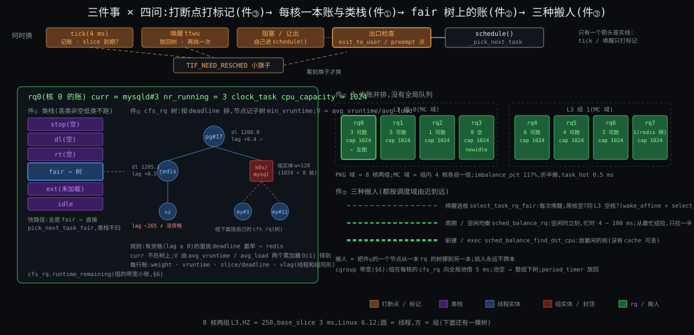
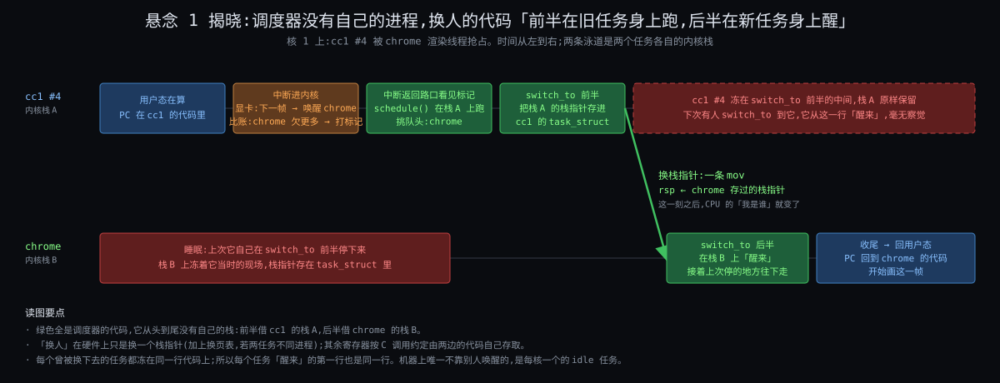
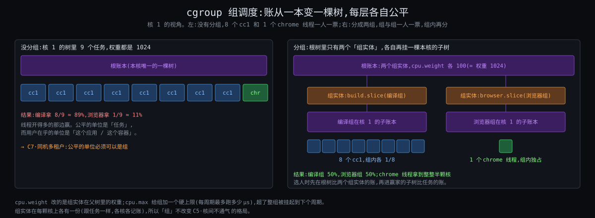

# 阶段 3:Linux 进程调度器大致怎么工作

> 上一节六刀切出六条约束。这一节正面回答三问:内核怎么记账、怎么选人、怎么换人、怎么换核;末尾把 cgroup 和 sched_ext 各讲到骨架,追加 C7、C8。源码钉在 Linux 6.12,x86-64 为主,只到「骨架」为止:为什么时间片是这个数、权重表怎么来的,留给后面钻源码。

## 约束清单速查(C1 ~ C6)

#### C1 — CPU快IO慢
核比它要等的任何东西快 10⁴ ~ 10⁷ 倍,**等待是常态,计算是零头**。
**不可再分**:物理事实。
**口诀**:等的时候让别人上。

#### C2 — 程序不让台
程序不会主动让出 CPU,**内核也猜不到它还要算多久**。
**不可再分**:程序是别人写的;它的未来取决于还没到的输入。
**口诀**:不求让,定时抢。

#### C3 — 凭账不凭嘴
内核看不见未来,任务不自报也不可信;**只能凭已经发生的事:跑了多久、睡了多久**。
**不可再分**:「需要多少」取决于未来;让任务自报等于把分配权交给最会喊的。
**口诀**:不猜未来,记过去;谁欠得多谁先上。

#### C4 — 调度不免费
换人直接 1 ~ 2 μs 加缓存变冷几十 μs,换得越勤浪费越高;**选人的代价必须与任务数无关**。
**不可再分**:硬件只有一套寄存器、缓存只认最近;机器上没有专管调度的核。
**口诀**:公平摊着算;选人看队头。

#### C5 — 核间不通气
核与核之间没有共用的桌面;**跨核共享一行数据慢几十倍,打断另一颗核慢上千倍**。
**不可再分**:缓存一致性与核间中断的硬件代价。
**口诀**:各算各的账,偶尔对账。

#### C6 — 有人等不起
份额和时限是两回事;**公平记账只保份额,保不了「某时刻前一定拿到」**。
**不可再分**:时限来自物理世界。
**口诀**:先问有没有人等不起,再谈公平。

## §0 从 Why 走到 How:三件事记住

上一节的六条约束,这一节精确化成三个组件:一个是数据(账本和树),一个是控制(三扇门和换人的几行),一个是策略(调度类链)。后面所有细节都挂在这三件下面。

### §0.1 每核一本账 + 一棵有序树:数据

因为 `C3·凭账不凭嘴`(只能凭已用 CPU 排序)+ `C4·调度不免费`(选人不能扫全表)+ `C5·核间不通气`(账不能全机共享)→ 要解决「每颗核在对数时间内找出本核欠得最多的任务」→ 所以引入 **每核一个就绪队列(runqueue),里面按每个任务的 vruntime(加权已用时间)排成一棵红黑树,队头就是账面最小的**。

### §0.2 三扇门 + 换人的几行:控制

因为 `C2·程序不让台`(内核只能在任务进内核的瞬间介入)+ `C4·调度不免费`(不能每次进内核都换人)→ 要解决「在哪些时刻检查、在哪个时刻真换」→ 所以引入 **三扇门(时钟中断、系统调用 / 主动睡、唤醒)只打一个「需要重调度」的标记,出口处的 `schedule()` 统一看标记、挑人、`context_switch` 换栈**。调度器没有自己的进程,这几行借当前任务的内核栈跑。

### §0.3 调度类链:策略

因为 `C6·有人等不起`(有人不能按账排)+ `C3·凭账不凭嘴`(多数人要按账排)→ 要解决「同一颗核上既有按期限的、又有按账的,谁先问」→ 所以引入 **调度类(sched_class)链:stop → 期限 → 实时 → 普通 → ext → idle,每类各自回答三问,`schedule()` 从高到低问「你有人要上吗」,谁先答有谁上**。这张链在源码里就是一排函数指针表,是 sched_ext 插座的前身。

### §0.4 三件事对照

| 三件事 | 是什么 | 为什么存在 |
|---|---|---|
| 账本 + 树 | 每核一条 runqueue,任务按 vruntime 排红黑树 | C3 要按账排、C4 要 O(log n)、C5 要每核各记 |
| 三扇门 + 换人 | tick / 系统调用 / 唤醒打标记,出口 schedule() 换栈 | C2 只能在进内核时介入、C4 检查和换人分开 |
| 调度类链 | 六类按优先级串起来,各自答三问 | C6 期限优先于公平,且策略要可替换 |

三件事的嵌套:**调度类链**是最外层的分发,每一类内部都有自己的**账本 + 树**(普通类是红黑树,实时类是按优先级的位图队列,期限类是按期限的红黑树);**三扇门 + 换人**是贯穿所有类的控制流,不管哪一类选出了人,换人的代码都是同一段。

## §1 一张极简概览图



从图上读五件事:

1. **三扇门不换人,只打标记**(橙到紫)。时钟中断、系统调用、唤醒进内核时,内核只做「记账 + 判断 + 置 NEED_RESCHED」;真正换人在出口。这是 C4 的要求:检查便宜、换人贵,所以分开。
2. **`schedule()` 是唯一的出口**(绿)。不管哪扇门,最后都走到同一个函数;它借当前任务的内核栈跑。
3. **调度类链从高到低问**(红到蓝到紫到灰)。stop 和期限、实时在前,普通在中,ext 和 idle 在后;普通类的任务永远排在任何一个就绪的实时任务后面。
4. **普通类的树按账排**(蓝)。chrome 线程 v=3.97 s 比正在跑的 cc1 v=4.1 s 小,所以它一醒来就抢。
5. **别的核各有各的树**(右下)。本核选人不碰别的核;只有唤醒时选核、以及隔一阵的对账(虚线)才跨核。这是 C5 逼出的「默认不共享」。

## §2 账本与树:问题 ① 谁先上

### §2.1 先说结论

- 每个任务身上记一个数 **vruntime**(虚拟运行时间):它每在核上跑 1 纳秒,vruntime 按权重折算后涨一点。权重高的涨得慢,权重低的涨得快。
- 每颗核的普通类就绪队列是一棵按 vruntime 排序的**红黑树**;选人就是取最左节点(账最小 = 欠得最多),O(1) 取、O(log n) 插删。
- **nice 值只决定权重**,权重只决定 vruntime 涨的速度。
- 睡醒的任务不是从零开始记账,而是被**放回本核当前水位附近**,带着它睡前的欠或超。
- 6.6 起账本上多了「期限」一栏(EEVDF):选人不只看谁欠得多,还看谁的虚拟期限最早。这一节只讲账本的骨架,期限那栏钻源码时再展开。

### §2.2 vruntime:把「公平」变成一个可以比的数

`C3·凭账不凭嘴` 说只能凭已发生的事。最直接的账是「实际跑了多少纳秒」(sum_exec_runtime),内核确实记着它。但光有它不够:nice 高低的任务应该拿到的份额不同,如果直接比实际时间,nice 没法起作用。

于是账本记的是**折算后的时间**:

```
vruntime += 实际跑的纳秒 × (1024 / 本任务权重)
```

nice 0 的权重是 1024,折算系数正好 1,账和实际时间一样涨。nice -5 的权重约 3121,跑 1 ms 账只涨 0.33 ms;nice +5 的权重约 335,跑 1 ms 账涨 3 ms(待核 #1:nice 权重表,相邻一级约 1.25 倍)。

这样「所有任务 vruntime 齐头并进」就等价于「每个任务拿到的实际时间和它的权重成正比」。公平从一个形容词变成了「让树里所有节点的 vruntime 尽量一样大」这个可执行的目标。

### §2.3 算例:cc1 和 chrome 渲染线程一秒的账

核 1 上只有两个任务,都是 nice 0,权重 1024:cc1 #4 从不睡;chrome 渲染线程每 16.7 ms 醒一次,画一帧要 2 ms,然后睡。

| 时刻 | 发生什么 | cc1 的 vruntime | chrome 的 vruntime | 谁在核上 |
|---|---|---|---|---|
| 0 ms | 两个都就绪,账都是 0 | 0 | 0 | 并列,假设 cc1 先 |
| 0 ~ 2 ms | cc1 跑 2 ms | 2 ms | 0 | cc1 |
| 2 ms | tick 发现 chrome 账更小,换 | 2 | 0 | chrome |
| 2 ~ 4 ms | chrome 画完一帧,睡 | 2 | 2 | chrome → 睡 |
| 4 ~ 16.7 ms | 只剩 cc1,一直跑 | 14.7 | 2(睡着不涨) | cc1 |
| 16.7 ms | 显卡中断,chrome 醒,账 2 ≪ 14.7,立刻抢 | 14.7 | 2 | chrome |
| 16.7 ~ 18.7 ms | chrome 画一帧,睡 | 14.7 | 4 | chrome → 睡 |
| … | 每一帧都是「醒来立刻上」 | | | |
| 1000 ms | 一秒结束 | ≈ 880 ms | ≈ 120 ms | |

(待核 #2:示意算例,忽略了唤醒放置的水位修正和最小粒度;真实数值见 Deep。)

读出两件事:chrome 一秒只要 120 ms,它每次醒来账都远远落后,所以**每一帧都是醒来立刻上核**,没有排队,这就是「视频不卡」的机制面;cc1 拿走剩下的 880 ms,**一点没浪费**。「睡得多」不需要被识别,它自动等于「账面落后」。

### §2.4 睡醒的任务放在哪:水位

上面的算例有个漏洞。如果 chrome 睡了 10 秒(用户切去别的窗口),它的账停在 4 ms,cc1 的账已经到了 10 s。chrome 醒来后账面落后 10 秒,按「欠得多先上」它可以**连续霸占核 10 秒**,cc1 一点都拿不到。这又违反了公平。

所以内核不让账落后太多。每颗核维护一个 **min_vruntime(本核水位)**:树里最小的账,只涨不跌。任务睡醒入队时,它的 vruntime 被**拉到水位附近**:睡前比水位落后多少、超前多少(叫 lag),醒来后保留这个差,但不让它超过一个上限。

效果:睡 10 秒的 chrome 醒来后账 ≈ 水位减一小截,它仍然排前面(保证交互性),但只领先一小截,跑几毫秒账就追平,又轮到 cc1。**既补偿了等待,又不让补偿变成霸占**。(待核 #3:6.12 的 place_entity 用 lag 保留 + PLACE_LAG 特性;老 CFS 用 sched_latency/2 的固定折扣。)

### §2.5 为什么是红黑树

`C4·调度不免费` 说选人不能扫全表。账本要支持三种操作:取最小、插入、删除,而且任务数从 3 到 3 万都要稳。

| 结构 | 取最小 | 插入 | 删除 | 问题 |
|---|---|---|---|---|
| 无序链表 | O(n) | O(1) | O(n) | 3 万任务时取最小要扫 3 万 |
| 有序链表 | O(1) | O(n) | O(1) | 插入要找位置 |
| 堆 | O(1) | O(log n) | O(log n) 但要知道位置 | 删除任意节点麻烦 |
| 红黑树 | O(1)(缓存最左) | O(log n) | O(log n) | 够用,内核已有现成实现 |

内核选红黑树,并把最左节点缓存起来,取最小是 O(1)。3 万任务时插入约 15 层,几百纳秒。这就是 C4 选人那一面的化解。

### §2.6 实时类和期限类的「账本」

普通类按账排;`C6·有人等不起` 逼出的两类不按账:

- **实时类(SCHED_FIFO / SCHED_RR)**:100 个优先级,每个优先级一条队列,外加一张位图标记哪些优先级非空。选人 = 找位图里最高的非空位,O(1)。同优先级 FIFO 先来先跑到让出,RR 轮转。
- **期限类(SCHED_DEADLINE)**:每个任务申报「每周期 P 内要 Q 的运行时间,期限 D」,内核按**最早期限优先**排一棵红黑树,并在准入时检查总量不超过核数,保证只要准入就按时。

这两类的账本不是「欠多少」,是「谁最急」。它们和普通类谁先问,由 §4 的链决定。

## §3 三扇门与换人:问题 ② 跑多久

### §3.1 先说结论

- 内核只能在任务进内核的三种时刻介入:**时钟中断、系统调用(含主动睡)、唤醒**。这三扇门都只做两件事:记账、判断要不要换;然后打一个标记 `NEED_RESCHED`。
- 真正换人只在**出口**:从内核回用户态的路口、中断返回的路口、或任务自己调 `schedule()` 的地方。
- 换人 = `schedule()` 挑人 + `context_switch()` 换页表 + `switch_to()` 换栈。调度器没有自己的进程,**前半在旧任务的栈上跑,后半在新任务的栈上醒**。

### §3.2 门 1:时钟中断

每 4 ms(CONFIG_HZ=250,待核 #4)硬件定时器打断本核,进入 `sched_tick()`(6.10 之前叫 `scheduler_tick()`):

1. 给当前任务**记账**:这 4 ms 加到它的 sum_exec_runtime,按权重折进 vruntime。
2. 问当前任务所属的调度类:**它该下了吗?** 普通类看它这次上核已经跑了多久、是否超过它的时间片(6.12 里叫 slice,由权重和树里任务数算出,基准约 3 ms,待核 #5);或者树里有没有人账面比它小太多。
3. 该下就 `resched_curr()`:给当前任务打 `NEED_RESCHED` 标记。**不在这里换人**。
4. 顺手做一点多核的事:看本核是不是该跟别的核对账了(§5)。

中断返回用户态的路口看见标记,才调 `schedule()`。所以 cc1 的「时间片到了」不是立刻被踢,而是「下一次经过出口时被踢」。两者差不了几微秒。

### §3.3 门 2:系统调用与主动睡

任务调 `read()`,磁盘要等。内核在 `read` 的实现里把任务标成 TASK_INTERRUPTIBLE(可被信号打断的睡眠),挂到那次磁盘请求的等待队列,然后**自己调 `schedule()`**。这是唯一一扇「任务自己走进调度器」的门,不用标记。

`schedule()` 看到当前任务已经不是 RUNNING,把它从树里摘掉(dequeue),然后挑下一个。它什么时候回来?等磁盘读完,中断处理把它从等待队列摘下来,走门 3。

系统调用返回用户态的路口也会看标记。所以一个系统调用哪怕不睡,也可能在返回时被换掉(因为 tick 或唤醒在它执行期间打了标记)。

### §3.4 门 3:唤醒

磁盘读完、键盘按下、显卡说下一帧:硬件中断,中断处理调 `try_to_wake_up(p)`:

1. 把 p 标回 TASK_RUNNING。
2. **选核**(§5.2):p 睡前在核 3,核 3 现在忙不忙?旁边有没有空核?
3. 把 p 入队到选中的核的树里,账按 §2.4 的水位放置。
4. **比一比**:p 的账比那颗核上正在跑的任务小得多吗(或者 p 是更高的调度类)?是就给那颗核的当前任务打 `NEED_RESCHED`。如果那颗核不是本核,还要发一个核间中断把它叫醒去看标记(贵,C5)。

唤醒抢占的「比一比」是 chrome 能挤掉 cc1 的机制;实时类任务被唤醒时不用比,直接抢。

### §3.5 出口:`schedule()` 做什么

三扇门汇到同一个函数。它的骨架(6.12 `kernel/sched/core.c` 的 `__schedule()`):

1. 关本核抢占,锁本核的 runqueue。
2. 如果当前任务要睡,把它摘出树。
3. **`pick_next_task()`**:顺着调度类链从高到低问(§4),拿到 next。
4. 如果 next 就是当前任务(没人更该上),解锁返回。
5. 否则清掉 `NEED_RESCHED`,调 **`context_switch(prev, next)`**。

### §3.6 换人:悬念 1 揭晓



上一节问:调度器自己也是程序,它在谁的 CPU 时间里跑?答案:**在被换下去的那个任务的时间里跑,换完之后,在被换上来的那个任务的时间里收尾。**

`context_switch()` 做两件事:

1. **换地址空间**(如果 prev 和 next 属于不同进程):写一次页表寄存器 CR3。同进程的两个线程之间切换不用换。
2. **换栈**:`switch_to(prev, next)`。x86-64 上它是几行汇编(`__switch_to_asm`):把 prev 的被调用者保存寄存器压到 prev 的内核栈上,把 prev 的栈指针存进 `prev->thread.sp`;把 `next->thread.sp` 装进栈指针寄存器;从 next 的栈上弹出 next 上次压的寄存器;`ret`。

**那条「装栈指针」的指令就是换人的一瞬间。** 它之前 CPU 跑在 prev 的栈上、「是」prev;它之后 CPU 跑在 next 的栈上、「是」next。next 从哪里醒来?从它上次被换下去时停在的同一行,也就是 `switch_to` 的后半。每个曾被换下去的任务都冻在这一行,每个任务醒来的第一行也是这一行。

所以调度器**不需要自己的栈,也就不需要自己的进程**。它是一段所有任务共用的内核代码,谁被换下去谁就「顺手」替下一个人跑一遍挑人和换栈。这是对 `C4·调度不免费` 最彻底的回答:连一个独立线程的切换代价都省了。

唯一的例外是每核一个的 **idle 任务**(swapper):树里没人时 `pick_next_task` 挑它,它循环执行让核休眠的指令,直到下一次中断。它是机器上唯一「永远就绪、永远在最后」的任务。

(待核 #6:x86-64 `__switch_to_asm` 保存的寄存器集:rbp, rbx, r12 ~ r15;`__switch_to` 再处理 FPU、TLS、栈顶指针等。)

#### §3.6.1 你的视角:从没上过核的新任务从哪儿醒

拷问:刚 fork 出来、从没上过核的任务,栈上没有「上次停的那一行」,`switch_to` 换到它时它从哪儿醒?你的回答:「fork 的时候会伪造一段栈,然后从 switch_to 的汇编中醒来,回到用户态的 fork 调用点。」对,补三个细节:

- **伪造的是一个帧**。`copy_thread()` 在子任务的内核栈上压一个假帧:被调用者保存寄存器的位置填好(大多为 0),返回地址填成 `ret_from_fork`;再把 `child->thread.sp` 指到这个帧。于是子任务看起来「上次就停在 switch_to 后半」。
- **醒的第一行是专门的入口**。`switch_to` 后半那条 `ret` 弹出的地址就是 `ret_from_fork`。它先补做 `schedule_tail()`(= 新任务版的 `finish_task_switch`:解 runqueue 的锁、给上一个任务善后),再顺着系统调用返回路径回用户态,返回值寄存器填 0,这就是子进程里 `fork()` 返回 0 的来源;父进程那边是正常从 `fork` 系统调用返回,拿到子 pid。
- **内核线程走同一个入口**。`ret_from_fork` 看到这是内核线程(没有用户态可回),不回用户态,直接调它的线程函数。

一句话:新任务不是「从上次停的那行醒」,而是「从一段事先伪造好的上次醒」。(待核 #15:x86-64 `ret_from_fork` / `ret_from_fork_asm` 与 `schedule_tail` 的 6.12 形态。)

### §3.7 算例:chrome 渲染线程从显卡中断到上核

核 1 上 cc1 #4 在跑。显卡画完上一帧,发中断。微秒级时间线(待核 #7:各步量级为典型值,不是实测):

| 时间 | 在哪个栈上 | 发生什么 |
|---|---|---|
| 0 | cc1 用户态 | 显卡中断到达,CPU 切到内核态,压现场到 cc1 的内核栈 |
| +0.5 μs | cc1 内核栈 | 中断处理 → 显卡驱动 → `try_to_wake_up(chrome)` |
| +1 μs | cc1 内核栈 | 选核:chrome 睡前在核 1,核 1 不空但缓存热 → 留核 1;入队,账放到水位附近 |
| +1.2 μs | cc1 内核栈 | 比账:chrome ≪ cc1 → `resched_curr`,给 cc1 打标记 |
| +1.5 μs | cc1 内核栈 | 中断返回路口看见标记 → `schedule()` → `pick_next_task` 问链:期限类没人、实时类没人、普通类队头 = chrome |
| +2 μs | cc1 内核栈 | `context_switch`:两者不同进程 → 写 CR3;`switch_to` 前半存 cc1 的栈指针 |
| +2.1 μs | **chrome 内核栈** | `switch_to` 后半:chrome 从上次睡着的那一行醒来,`finish_task_switch` 收尾 |
| +2.5 μs | chrome 内核栈 | 顺着它上次睡觉的调用链一路返回,回到用户态 |
| +3 μs | chrome 用户态 | 开始画这一帧 |
| 之后几十 μs | chrome 用户态 | 缓存和 TLB 在暖,比稳态慢(C4 间接代价) |

从中断到 chrome 的第一条用户态指令,约 3 μs;16.7 ms 的一帧,调度延迟占不到千分之二。cc1 的账在这 3 μs 里继续涨(它名义上还在核上),这就是「调度器在被换下去的人的时间里跑」的字面意思。

## §4 调度类链:策略怎么串

### §4.1 先说结论

- 6.12 的链:**stop → dl(期限) → rt(实时) → fair(普通) → ext(sched_ext) → idle**。
- 每一类是一张函数指针表 `struct sched_class`,表里有 `enqueue_task / dequeue_task / pick_next_task / task_tick / select_task_rq / …` 等十几个槽位,各自回答三问。
- `pick_next_task()` 从高到低问,谁先答有谁上。普通类任务永远排在任何就绪的实时任务后面;实时任务默认每秒最多 950 ms,留 50 ms 给下面的类。
- 这张表就是编译期的策略模式:链的顺序固定,但每格的实现可换。sched_ext 把其中一格做成运行时可换。

### §4.2 六类各答三问

| 类 | 谁先上 | 跑多久 | 放哪个核 | 典型任务 |
|---|---|---|---|---|
| stop | 永远第一,每核一个 | 做完即走 | 固定本核 | 迁移、热插拔这种「全核停一下」的内核活 |
| dl 期限 | 最早期限 | 申报的 runtime 用完即停 | 看哪个核期限最松 | 工业控制、带周期的音视频 |
| rt 实时 | 最高优先级;同级 FIFO 或 RR | FIFO 直到让出;RR 一个时间片(默认 100 ms,待核 #8) | 优先级最低的那颗核 | 音频服务、PREEMPT_RT 的驱动线程 |
| fair 普通 | 账最小(+ 期限最早) | 到 slice 或被更小的账抢 | 睡前的核优先,空核次之 | 几乎所有东西 |
| ext | 由 eBPF 程序决定 | 由 eBPF 程序决定 | 由 eBPF 程序决定 | 加载了 scx 程序时的普通任务 |
| idle | 没人时 | 直到下一次中断 | 本核 | 每核一个 swapper |

### §4.3 实时的 950 ms 兜底

`C3·凭账不凭嘴` 在 §1.3.1 说过:即便有特权也只信一半。实时类有一个带宽控制:每 1 秒周期内实时任务合计最多跑 950 ms(`sched_rt_runtime_us=950000`,待核 #9),超了整类被挂起到下个周期,普通类在那 50 ms 里至少能动一动。这是「实时任务死循环把整机锁死、连 ssh 都登不上去」的保险丝。

### §4.4 这张表为什么说是策略模式

`schedule()` 从不关心「怎么选」,它只调 `class->pick_next_task(rq)`。选谁、按什么排、什么时候下,全在每个类自己的表里。换一种算法 = 换一张表的实现,`schedule()` 一行不改。

但它只是**编译期**的策略模式:六张表在编译内核时就定死了,顺序也定死了。想试一个新算法,要改内核源码、重编、重启。2007 年 Linus 拒绝的 plugsched,想做的是把这张表做成运行时可换;2024 年的 sched_ext 用另一种方式做到了(§7)。

## §5 多核:问题 ③ 放哪个核

### §5.1 先说结论

- 每核一条 runqueue、一本账、一把锁,平时互不碰(`C5·核间不通气`)。
- 任务换核只在两个时刻:**唤醒时选核**、**周期性对账搬人**。前者便宜(顺手),后者贵(要跨核拿锁),所以后者频率低。
- 核有远近:同一物理核的两个超线程最近,同一颗芯片的核次之,不同芯片(NUMA)最远。对账的频率和「允许搬多少」按远近分层(调度域)。

### §5.2 唤醒时选核

`try_to_wake_up` 里的 `select_task_rq()`,普通类的逻辑(`select_task_rq_fair`,骨架):

1. 任务睡前在核 3。**核 3 现在空吗?** 空就回核 3(缓存热,最便宜)。
2. 不空:**唤醒它的那颗核(本核)空吗?** 空就放本核(数据刚被本核碰过,也热)。
3. 都不空:在核 3 所在的那一层调度域里**找一颗空核**(先找超线程兄弟,再找同芯片的)。
4. 都不空:回核 3 排队。

默认是「粘」:能不动就不动。这正是 C5 的化解。

### §5.3 周期性对账

每颗核在 tick 里隔一阵(毫秒级,按调度域层级不同)检查一次:我和同域的核相比,是不是明显闲?闲就从最忙的核拉几个任务过来(`sched_balance_rq`,6.10 之前叫 `load_balance`,待核 #10)。拉人要拿对方的锁、跨核改对方的树,所以:

- 频率低:同芯片内几毫秒一次,跨芯片几十毫秒一次。
- 门槛高:忙闲差超过一定比例才搬。
- 挑软柿子:优先搬缓存已经冷了的(睡了很久的)任务,不搬正在跑的。

### §5.4 算例:核 0 排 3 个,核 2 空了

核 0 树里 cc1 #1、#2、#7,核 2 空转。核 2 的 tick 到了,它检查同芯片域:平均负载 1,自己 0,核 0 是 3。差距够大,核 2 拿核 0 的锁,从核 0 的树里摘出一个最久没跑的 cc1(#7),插进自己的树,解锁。整个过程几微秒,cc1 #7 在核 2 上头几十微秒缓存冷。之后核 0 排 2 个、核 2 跑 1 个,下一轮对账再看。

搬完以后 cc1 #7 的账怎么算?它的 vruntime 换到核 2 时按两核的水位差调整,不然核 0 水位 10 s、核 2 水位 2 s,它一过去不是永远排最后就是永远排最前。(待核 #11:迁移时的 vruntime 归一化。)

### §5.5 核的远近:调度域

一台 2 路、每路 32 核、每核 2 超线程的服务器,共 128 个逻辑核。内核开机时按硬件拓扑建一棵「调度域」树:

| 层 | 范围 | 搬人的代价 | 对账频率 |
|---|---|---|---|
| SMT | 同一物理核的 2 个超线程 | 几乎免费,共用 L1/L2 | 最高 |
| MC | 同一芯片的 32 核 | 丢 L1/L2,保 L3 | 中 |
| NUMA | 跨芯片 | 连内存都远了 | 最低 |

4 核笔记本只有一层 MC。这里只到骨架,层内怎么算「忙闲差」留给钻源码。

## §6 cgroup:三问的主语从任务换成组

### §6.1 先说结论

- 没有分组时公平的单位是任务:谁线程多谁赢。cgroup 的 CPU 控制器把公平的单位改成**组**:组与组之间按权重分,组内再按任务分。
- 实现上,每个组在每颗核上有一个**组实体**和一棵**子树**,组实体挂在父树里当一个「任务」参与排序;选人先在根树比组,再进赢家的子树比任务。账从一本变一棵树。
- 两个旋钮:**cpu.weight**(组实体的权重,默认 100,范围 1 ~ 10000)决定份额;**cpu.max**(每周期配额)给组加硬上限。
- 追加约束 **C7·同机多租户**。

### §6.2 痛:线程多的赢

回到上一节的画面:`make -j8` 的 8 个 cc1 和 chrome 的 1 个渲染线程在核 1 的树里一人一票,权重都是 1024。公平记账给每人 1/9,编译拿 89%,浏览器拿 11%。chrome 每帧 2 ms,一秒 120 ms,11% 的核只有 110 ms,**帧率开始掉**。

用户的直觉是「编译和浏览器一人一半」,但内核眼里没有「编译」和「浏览器」这两个东西,只有 9 个任务。多开线程就多拿份额,这在一台多用户、多容器的机器上是灾难:谁开的线程多谁赢。

#### C7 — 同机多租户
一台机器同时住着互不相让的多个租户(用户、容器、服务),**它们在乎的公平单位是「我这一摊」,不是「我的某个线程」;而租户可以随意多开线程**。
**不可再分**:线程数由租户自己决定,内核管不了;份额按任务分就必然被线程数劫持。
**口诀**:公平的单位必须可以是组。

### §6.3 补:账变成树



因为 `C7·同机多租户`(公平的单位要能是组)+ `C3·凭账不凭嘴`(组之间也只能按账排)+ `C5·核间不通气`(组的账也得每核各记)→ 要解决「组与组按账公平,组内再按账公平,还不打破每核一本账」→ 所以引入 **组实体(group sched_entity):每个 cgroup 在每颗核上有一个组实体和一棵子 runqueue(cfs_rq);组实体挂在父级的树里像任务一样记账、排序;选人时从根树一路往下挑最左节点,直到挑到一个真任务**。

图右边:根树里只有两个组实体,各 1024 权重,各拿 50%;编译组的子树里 8 个 cc1 分那 50%,浏览器组的子树里 chrome 独占 50%。chrome 从 11% 变成 50%,帧率稳了。

组实体的账怎么涨?组内任意任务跑了 1 ns,组实体的 vruntime 也按组权重折算涨一点。所以根树看到的是「这组用了多少」。嵌套可以多层(systemd 默认就有 system.slice / user.slice / 容器各自的 slice),每一层各自公平。

### §6.4 两个旋钮

| 旋钮 | 文件 | 改什么 | 效果 |
|---|---|---|---|
| 份额 | `cpu.weight`(1 ~ 10000,默认 100) | 组实体在父树里的权重 | 相对的:只在争抢时起作用,没人争时可以用满 |
| 上限 | `cpu.max`(`配额 周期`,默认 `max 100000`) | 每周期最多跑多少 μs | 绝对的:哪怕核空着也不许超;超了整组挂起到下个周期 |

cpu.max 的实现叫带宽控制:每周期(默认 100 ms)给组发一笔配额,组内任务跑掉多少扣多少,扣完整组从树里摘掉(throttle),周期一到再放回去。容器限 CPU(`docker --cpus=2`)就是这个旋钮:配额 200 ms / 周期 100 ms。(待核 #12:cgroup v2 的 cpu.weight 默认值与范围、cpu.max 默认周期。)

### §6.5 cgroup 没改什么

- 没改三扇门和换人:组只影响「选谁」,不影响「什么时候检查」和「怎么换」。
- 没改每核一本账:组实体在每颗核上各有一份,跨核仍然只在唤醒选核和对账时碰。
- 没改调度类链:组调度只在普通类里(实时类有自己的组带宽,但不按权重分)。

所以 cgroup 是「以组为单位再答三问」,不是另一个调度器。

## §7 sched_ext:三问的答题人换成你

### §7.1 先说结论

- §4 的调度类链是编译期策略模式;sched_ext(6.12 合入)在链上加了一格 **ext 类**,这一格的实现**由一段运行时加载的 eBPF 程序提供**。
- 内核定义了一张回调表 `struct sched_ext_ops`:`select_cpu / enqueue / dispatch / running / stopping / …`,分别对应三问和账本的操作。你写的 eBPF 程序填这张表,通过 BPF 的 struct_ops 机制加载;加载后 SCHED_NORMAL 任务转由 ext 类管。
- 兜底:eBPF 验证器保证程序不会崩内核;一个看门狗保证任务不会被饿死(默认 30 秒没被调度到就判程序失职);任何错误或看门狗触发,内核**自动卸载程序,所有任务切回普通类**,机器照常跑。
- 追加约束 **C8·一算法不配万场景**。

### §7.2 痛:一个算法三种要求

游戏机要「这一帧别掉」:谁最近醒得勤谁先上,哪怕不公平。数据库服务器要「每秒多扛几条查询」:让同一个连接的线程粘在同一颗核上,别为公平来回搬。编译集群要「把 128 个核全喂饱」:公平和延迟都不重要,只要没空核。

普通类的账本对三者一视同仁,它是三者的折中,对谁都不是最优。改普通类?一改影响所有人,要经过内核社区几个月到几年的争论,还要等发行版更新内核。Meta 和 Google 这样的公司有几十种负载,每种想要不同的三问答案,等不起。

#### C8 — 一算法不配万场景
不同负载对三问的最优答案不同,**而且负载变化的速度远快于内核发布的速度**;策略必须能在不改内核、不重启的前提下替换和试错,**并且错了不能伤及内核**。
**不可再分**:负载多样性来自应用,内核发布节奏来自社区流程,两者都不由调度器决定。
**口诀**:策略可插拔,错了能兜底。

### §7.3 补:把一格做成运行时可换

因为 `C8·一算法不配万场景`(策略要可换且安全)+ `C4·调度不免费`(换上来的策略不能比原来慢太多)+ `C6·有人等不起`(期限 / 实时类不能被替换掉)→ 要解决「让用户态写的策略安全地接管普通任务的三问,又不碰实时类和换人机制」→ 所以引入 **ext 调度类 + eBPF 回调表 + 派发队列(DSQ)+ 看门狗**。

骨架:

| 内核留的插口 | 对应哪一问 | 你的 eBPF 程序填什么 |
|---|---|---|
| `select_cpu(p, prev_cpu)` | ③ 放哪个核 | 唤醒时返回一个核号 |
| `enqueue(p)` | ① 谁先上(入队) | 把 p 放进某条派发队列(DSQ),可以带一个你自己算的优先级 |
| `dispatch(cpu)` | ① 谁先上(出队) | 某颗核空了,从你的 DSQ 里挑一个给它 |
| `running / stopping(p)` | ② 跑多久(记账) | 任务上核 / 下核时回调,你自己记账 |
| `tick(p)` | ② 跑多久 | 每 tick 一次,你决定要不要让它下 |
| `init / exit` | — | 加载 / 卸载时的准备和清理 |

派发队列(DSQ)是内核替你维护的队列结构:每核一条本地 DSQ、一条全局 DSQ,外加你自己建的任意条。你的程序只管「把谁放进哪条、从哪条拿」,入队出队的锁和跨核的事内核做(C5 的苦活内核扛)。

不变的部分:三扇门、`schedule()`、`context_switch`、实时类和期限类,**一行都不碰**。ext 类排在 fair 之后、idle 之前,实时任务照样优先于它。

### §7.4 兜底:错了怎么办

| 风险 | 兜底 |
|---|---|
| 程序有野指针、死循环 | eBPF 验证器在加载前拒绝:只允许有界循环、受控内存访问 |
| 程序逻辑错,某个任务永远不被派发 | 看门狗:任务在 DSQ 里超过 `timeout_ms`(默认 30 s,待核 #13)没被调度到,内核判程序失职 |
| 程序调用内核函数出错 | 内核记录错误原因,触发卸载 |
| 卸载时任务怎么办 | 全部任务原地切回普通类,普通类的树和账本一直在,照常跑;dmesg 留一条「scx 被禁用,原因 X」 |
| 紧急情况 | sysrq-S 强制卸载 |

所以「把答题权交出去」的代价被压到了「最坏情况退回普通类」。这是 2007 年做不到、2024 年做到的那一步:**不是内核变得愿意信任用户,是 eBPF 让内核可以不信任用户也不出事。**

### §7.5 悬念 5 的机制面

What 一节的悬念 5 问:一个算法能覆盖所有场景吗、内核为什么肯交权。机制面的答案:不能,所以链上留了一格;肯交权是因为验证器 + 看门狗 + 自动回退让交权不再危险。历史面(2007 到 2024 中间发生了什么、谁推的)留给下一节讲来路。

## §8 最小伪代码 demo:一次 tick 到换人

六十行伪代码,只为手感。每行右侧标它对应三件事里的哪一件、哪条约束。

```c
/* ---------- 门 1:时钟中断 ---------- */
void sched_tick(void) {                           /* 控制:门 1,C2 */
    rq = this_cpu_rq();                           /* 数据:每核一本账,C5 */
    curr = rq->curr;
    curr->sum_exec += 4ms;                        /* 记实际账,C3 */
    curr->vruntime += 4ms * 1024 / curr->weight;  /* 记折算账,C3 */
    curr->sched_class->task_tick(rq, curr);       /* 策略:问它的类,C6 */
    maybe_trigger_balance(rq);                    /* 多核:隔一阵对账,C5 */
}

void fair_task_tick(rq, curr) {                   /* 策略:普通类的「跑多久」 */
    if (curr->ran_this_turn >= curr->slice        /* 到 slice 了,C4 最小粒度 */
        || leftmost(rq->tree)->vruntime + TH < curr->vruntime)  /* 有人欠得多得多 */
        set_flag(curr, NEED_RESCHED);             /* 只打标记,不换人,C4 */
}

/* ---------- 门 3:唤醒 ---------- */
void try_to_wake_up(p) {                          /* 控制:门 3,C1 */
    p->state = RUNNING;
    cpu = p->sched_class->select_task_rq(p);      /* 策略 + 多核:③ 放哪个核,C5 */
    rq = cpu_rq(cpu);
    p->vruntime = max(p->vruntime, rq->min_vruntime - lag(p));  /* 水位放置,C3 */
    p->sched_class->enqueue_task(rq, p);          /* 数据:插进树,O(log n),C4 */
    if (p->sched_class > rq->curr->sched_class    /* 更高的类直接抢,C6 */
        || should_preempt(rq->curr, p))           /* 账小得多就抢,C3 */
        set_flag(rq->curr, NEED_RESCHED);         /* 还是只打标记 */
    if (cpu != this_cpu()) send_ipi(cpu);         /* 跨核要打断对方,贵,C5 */
}

/* ---------- 出口:schedule ---------- */
void schedule(void) {                             /* 控制:唯一出口 */
    rq = this_cpu_rq(); lock(rq);
    prev = rq->curr;
    if (prev->state != RUNNING)                   /* 门 2:它自己要睡 */
        prev->sched_class->dequeue_task(rq, prev);/* 数据:摘出树 */
    for (class = stop; class; class = class->next) {  /* 策略:链从高到低问,C6 */
        next = class->pick_next_task(rq);         /* 普通类 = 最左节点,O(1),C4 */
        if (next) break;
    }                                             /* 最后一定是 idle */
    clear_flag(prev, NEED_RESCHED);
    if (next != prev) context_switch(rq, prev, next);
    unlock(rq);
}

/* ---------- 换人 ---------- */
void context_switch(rq, prev, next) {             /* 控制:换人,C4 */
    if (next->mm != prev->mm) load_cr3(next->mm); /* 不同进程才换页表 */
    switch_to(prev, next);                        /* ↓ 前半在 prev 的栈上 */
    /* ---- 从这里开始,已经站在 next 的栈上了 ---- */
    finish_task_switch(prev);                     /* ↑ 后半在 next 的栈上,悬念 1 */
}

switch_to(prev, next):                            /* 几行汇编 */
    push callee_saved_regs                        /* 存到 prev 的栈 */
    prev->thread.sp = rsp                         /* 记下 prev 停在哪 */
    rsp = next->thread.sp                         /* ← 换人的一瞬间 */
    pop  callee_saved_regs                        /* 从 next 的栈取回 */
    ret                                           /* 回到 next 上次停的那一行 */
```

## §9 朴素方案 vs 真实方案

| 维度 | 朴素方案(Why 里每刀之前) | 真实方案(6.12) | 对应约束 |
|---|---|---|---|
| 谁先上 | 排成一圈轮流 | 按加权已用时间排红黑树,取最左 | C3、C4 |
| 睡醒的人 | 排到队尾 | 放到本核水位附近,带着睡前的欠 | C3、C1 |
| 什么时候换 | 固定 10 ms 一换 | 三扇门打标记,出口换;slice 按权重和人数算 | C2、C4 |
| 换人代价 | 一个调度进程来回切 | 借被换者的栈跑,只换一个栈指针 | C4 |
| 急的任务 | 加大权重 | 单独的实时 / 期限类,链上排在前面,带 950 ms 保险丝 | C6 |
| 多核 | 一条全局队列 | 每核一条,唤醒时选核,周期对账,按远近分层 | C5 |
| 多租户 | 多开线程多拿 | 组实体 + 子树,cpu.weight / cpu.max | C7 |
| 换算法 | 改内核重编重启 | ext 类 + eBPF 回调表,错了自动退回 | C8 |

## §10 三个常见误解

### §10.1 「调度器是一个一直在后台跑的内核线程」

你可能以为有一个「调度进程」每隔几毫秒醒来看看该换谁。其实没有。调度器是一段所有任务共用的代码,谁进内核谁顺手跑它;换人的那几行,前半在旧任务的栈上、后半在新任务的栈上。机器上唯一永远在的只有每核一个的 idle 任务,它是「没人时的占位」,不是调度器。`ps` 里你找不到调度器。

### §10.2 「时间片是固定的,到点就换」

你可能以为每个任务固定 10 ms 一换。其实 slice 由权重和树里的人数算出来(人多就短,人少就长),而且 tick 只是打标记,真正换在出口;更常见的换人根本不是「到点」,而是「有人醒了且账更小」或「它自己要睡」。一台桌面机上绝大多数切换是后两种。

### §10.3 「nice -20 能独占 CPU;SCHED_FIFO 就是硬实时」

nice -20 的权重约 88761,nice 0 是 1024,两者 87 : 1,**不是无限**:nice 0 的任务仍能拿到 1% 以上。SCHED_FIFO 在普通内核上只是「比普通类先问」,中断、自旋锁、不可抢占的内核段都能让它晚几十微秒到几毫秒;硬实时要 PREEMPT_RT 内核加整套工程(待核 #14:PREEMPT_RT 于 6.12 合入主线)。而且它受 950 ms 保险丝约束。

## §11 约束回扣

| 组件 | 对应约束 | 精确化解方式 |
|---|---|---|
| 任务三态 + 等待队列 | C1·CPU快IO慢 | 要等就标 SLEEPING 挂等待队列,核让给别人 |
| 时钟中断 + NEED_RESCHED | C2·程序不让台 | 每 4 ms 硬件强拉回内核,内核在出口统一换 |
| vruntime + 权重 | C3·凭账不凭嘴 | 账由内核记,nice 只改涨速 |
| 水位放置(min_vruntime + lag) | C3·凭账不凭嘴 + C1 | 补偿等待但封顶,不让睡久的霸占 |
| 红黑树 + 缓存最左 | C4·调度不免费 | 选人 O(1),插删 O(log n) |
| slice / 最小粒度 | C4·调度不免费 | 上了核至少跑一阵,公平按周期摊 |
| 借栈换人(switch_to) | C4·调度不免费 | 连调度线程的切换都省掉 |
| 每核 runqueue + 粘核选核 + 周期对账 | C5·核间不通气 | 默认不共享,跨核只在唤醒和对账 |
| 调度域分层 | C5·核间不通气 | 越远的核对账越少、门槛越高 |
| 调度类链 + dl / rt | C6·有人等不起 | 期限和优先级类排在普通类前面 |
| rt 带宽 950 ms | C6 + C3 | 等不起的也只信一半 |
| 组实体 + 子树 + cpu.weight / cpu.max | C7·同机多租户 | 公平单位升到组,份额 + 上限两个旋钮 |
| ext 类 + eBPF 回调表 + DSQ + 看门狗 | C8·一算法不配万场景 | 一格运行时可换,错了自动退回普通类 |

## §12 呼应灵魂问题

你的问题:调度器的作用,让小白入门;cgroup 和 sched_ext 增强了什么。

到这一节,三问都有了机制面的答案:

- ① 谁先上:每核一棵按加权已用时间排的树,取最左;急的人走单独的类排在前面。
- ② 跑多久:三扇门打标记、出口换人;slice 按权重和人数算;换人借栈跑,没有调度进程。
- ③ 放哪个核:睡前的核优先,唤醒时顺手选,隔一阵按远近对账。

两个增强也落了位:cgroup 把树套成树,公平的单位升到组(C7);sched_ext 把链上的一格做成运行时可换,用验证器和看门狗换来交权的安全(C8)。

悬念 1 和 4 在这节揭了,悬念 5 揭了机制面。灵魂问题闭环约 70%:作用、三问机制、两个增强的「是什么」都有了。剩下 30% 留给后面:为什么 2007 年不行 2024 年行(来路),slice、权重表、EEVDF 期限那一栏的具体数字和源码(钻源码),以及跟别的内核比(对照)。

## 修订记录

| 时间 | 修订摘要 | 触发原因 |
|---|---|---|
| 2026-11-07 | §3.6.1 新增《你的视角:从没上过核的新任务从哪儿醒》:copy_thread 伪造帧 + ret_from_fork + schedule_tail + 内核线程同入口 | 用户回答反问 1 |
| 2026-11-07 | 初稿:速查 C1 ~ C6 / §0 三件事(账本与树、三扇门与换人、调度类链)/ §1 概览 SVG / §2 账本(vruntime、算例、水位、红黑树、rt / dl 账本)/ §3 三扇门与换人 + switch SVG + μs 时间线 / §4 调度类链 / §5 多核 / §6 cgroup + C7 + 树 SVG / §7 sched_ext + C8 / §8 伪代码 / §9 对照 / §10 三误解 / §11 回扣 / §12 呼应 | 对齐 3 问 + 章节 reconfirm 后用户「ok」 |
| 2026-11-12 | 导出前核实:时钟中断处理函数名更正为 6.12 的 `sched_tick()`(core.c:5584;旧名 `scheduler_tick()`),§3.1 正文与 §8 伪代码各一处 | 导出前统一核实 |
