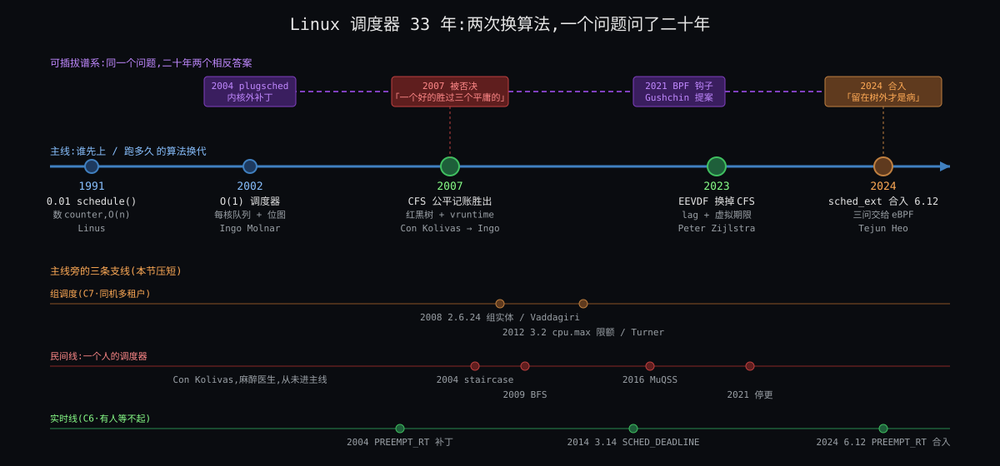

# 阶段 4:Linux 的进程调度器是怎么来的

> 前三份把调度器拆成四问、八条约束、三件东西。这一份回答"人是怎么一步步走到这里的":谁在什么年代、被哪条约束逼急了、先试了什么、撞了什么墙、最后留下什么债。写法是技术接力打底、转折点讲人物,每个转折点按「烦躁 → 初试 → 死胡同 → 顿悟 → 成型与遗憾」走;1970 ~ 2001 压成一段序章;1994 ~ 1995 的学术线单独一节,因为 2023 年落地的东西是那里来的。
>
> 资料纪律:正文里每一句引语都来自我这次真的打开过的一手材料(LKML 原帖、cover letter、commit、论文、内核 Documentation),链接放在句子旁边;LWN / kernelnewbies 这类转述标「二手」;没找到一手的,统一放在 §13 坦白。"今天"以 Linux 6.12 为准。

---

## 约束清单速查(C1 ~ C8)

> 后文所有 `Cn·短名` 都对应下面 8 条,推导见 `stages/02-why/02-why.md`。每条是标题,viewer 里 `Ctrl+F` 搜 `C3` 可直接跳。

#### C1 — 只在打断点换
内核没有自己的 CPU,只能在流进内核的瞬间(tick / 系统调用 / 中断 / 阻塞)介入;介入时不一定能立刻换人。
**不可再分**:要控制一条流必须先拿到它的核;中断上下文不能换栈。
**口诀**:决定和执行分开 → 一切挂出口上

#### C2 — 未来不可知
内核不知道任务下一步算还是等、要多久;猜的启发式可被构造负载骗。
**不可再分**:意图不在二进制里。
**口诀**:只记过去 → 规则只看账

#### C3 — 份额与延迟两头要
长期按权重分(份额)和醒来多久上台有界(延迟)是两个独立要求;插队额度须有界。
**不可再分**:一个标量不能同时编码比例和上界。
**口诀**:权重管份额、slice 管延迟、lag 缝合

#### C4 — 挑人须便宜
每核每秒万次级决定,每次 < 1 μs 且不随任务数线性增长;记账须增量。
**不可再分**:规则的常数项直接吃掉它要分的资源。
**口诀**:不能扫一遍 → 树 + 增量

#### C5 — 核各自为政
核有独立 cache / TLB / 时钟,跨核同步贵一到两个数量级,核间有远近。
**不可再分**:多核物理结构。
**口诀**:每核一本账 → 搬人要算代价

#### C6 — 份额按组算
分配单位是用户 / 容器,线程数可被放大;组要嵌套、要能封顶;内核只看见线程。
**不可再分**:内核没有"用户"这个调度对象。
**口诀**:组是账本上同形的一行 → 封顶按周期扣

#### C7 — 有人要硬保证
一部分任务要绝对时限 / 优先;相对公平推不出绝对保证;凌驾带来饿死与反转。
**不可再分**:公平与保证互不蕴含。
**口诀**:类栈凌驾 → 凌驾配阀

#### C8 — 核不等速且耗电
核的有效算力随 SMT / 频率 / 大小核变,能耗是非线性的独立目标。
**不可再分**:硬件物理 + 电源。
**口诀**:账上还要有算力和负载两个估计量

---

## §0 从 How 走到 Origin:三件事记住

How 讲的是 6.12 这台机器"现在"怎么分工。这一份要记住的是:**那套分工不是一次设计出来的,而是三次换代各改写一条约束的权重,中间再加几条旁线补上 C5·核各自为政 / C6·份额按组算 / C8·核不等速且耗电。** 三次换代各有一个人、一封信、一条被逼急的约束:

### §0.1 件①:2002 年 O(1) —— C4·挑人须便宜 + C5·核各自为政 的权重突然上升

因为 2.4 的挑人是在 tick 里持一把全局锁扫完整个就绪队列(`goodness()` 循环),任务上千、核上八时两条约束同时爆 → 要解决"挑人 O(1)、每核自己的队列和锁" → 所以 Ingo Molnár 2002 年 1 月用两个优先级数组 + 位图 + 每核 runqueue 把它重写。代价是一套"猜交互性"的启发式(`sleep_avg`),这笔债 5 年后到期。

### §0.2 件②:2007 年 CFS —— C2·未来不可知 的账到期

因为 O(1) 的交互性估计器靠猜,猜就能被骗、调了桌面坏服务器 → 要解决"不猜,只记账" → 所以 Con Kolivas 用 RSDL / SD 证明"纯公平就够",Ingo 两周后用红黑树 + 纳秒记账写出 CFS 并进了 2.6.23。代价:CFS 的"公平"把睡眠时间也算进去,于是又长出一批睡醒补偿、唤醒粒度的小启发式 —— 这是 2023 年那笔债。

### §0.3 件③:2023 年 EEVDF —— C3·份额与延迟两头要 被正面承认

因为 CFS 只有一个旋钮(权重),"要低延迟但不要多份额"没法表达,2020 ~ 2022 年的 latency-nice 补丁想再加一个旋钮却找不到干净的落点 → 要解决"份额和延迟各一个数,再用资格把它们缝起来" → 所以 Peter Zijlstra 把 1995 年的论文从"黑暗的地窖"里翻出来,6.6 进树,6.12 收尾。代价:lag 在睡眠时怎么处理至今还在改(delayed dequeue)。

### §0 结论:三件事对照

| 件 | 是什么 | 为什么存在(被哪条约束逼急) |
|---|---|---|
| ① O(1),2002 | 两个优先级数组 + 140 位位图 + 每核 runqueue | C4·挑人须便宜(`goodness` 循环)+ C5·核各自为政(全局 `runqueue_lock`) |
| ② CFS,2007 | 按 vruntime 排的红黑树 + 纳秒记账,无交互性估计器 | C2·未来不可知(估计器被骗、调不平) |
| ③ EEVDF,2023 | 权重 + slice / deadline + lag / eligible,增广红黑树 | C3·份额与延迟两头要(CFS 只有权重一个旋钮) |

三件事串成一条线:**每一代都是上一代为了解决当时最痛的约束而欠下的债。** O(1) 为 C4·挑人须便宜 / C5·核各自为政 欠了 C2·未来不可知 的债,CFS 为 C2·未来不可知 欠了 C3·份额与延迟两头要 的债,EEVDF 为 C3·份额与延迟两头要 把 C1·只在打断点换 的债(内核态什么时候能换人)又推到了台前(6.13 的 lazy preemption)。旁线 —— 组调度(2008)、autogroup(2010)、带宽控制(2011)、PELT(2012)、NUMA balancing(2013)、EAS(2019)、sched_ext(2024)—— 各补 C6·份额按组算 / C8·核不等速且耗电 / C5·核各自为政 / C2·未来不可知 一条,不换主线。

---

## §1 一张极简概览图



从图上能读出五件事:

1. **主线只换了三次**(2002 / 2007 / 2023),每次换的是"挑人规则"本身;其余十几年全是旁线往同一套规则上加东西。
2. **学术线比内核早 28 年**:1994 年 lottery / stride,1995 年 EEVDF,1996 年修订版;内核 2007 年先采用了"公平"这一半,2023 年才采用"资格 + 截止期"那一半。
3. **每个转折点旁边标的约束不同**:2002 是 C4·挑人须便宜 + C5·核各自为政,2007 是 C2·未来不可知,2023 是 C3·份额与延迟两头要;2011 的带宽和 2010 的 autogroup 是 C6·份额按组算,2012 的 PELT 和 2019 的 EAS 是 C8·核不等速且耗电,2013 的 NUMA 是 C5·核各自为政。你的四问骨架在历史上是**一问一问被补上**的。
4. **人物各有一封信**:Ingo 2002-01-04 的设计邮件、Con 2007-03-04 的 RSDL 公告、Ingo 2007-04-13 的 CFS 公告、Linus 2010-11-15 的"真正的改进"、Paul Turner 2010-02-12 的带宽 RFC、Peter 2023-03-06 的"地窖"、Tejun 2022-11-30 的 RFC 和 Linus 2024-06-11 的裁决。
5. **2024 年的 sched_ext 不在主线上,但它改变了主线的意义**:挑人规则从"内核定一个"变成"可替换",C2·未来不可知 / C3·份额与延迟两头要 的取舍第一次可以按负载分别选。

---

## §2 序章:1974 ~ 2001,先来先跑之后的第一代"猜"

**先说结论**:Unix 血统的调度器三十年里都是同一个形状 —— 一个优先级数字,由"最近用了多少 CPU"衰减算出,用得多的优先级降、睡得久的升。这就是 Why 第二刀说的"猜意图的启发式"的祖先;它一直活到 Linux 2.6 的 O(1)。

**Unix V7(1979)**。贝尔实验室第七版的 `slp.c` 里,`setpri()` 只有两行:优先级 = 最近 CPU 用量 ÷ 16 + 用户基准 + nice([一手 1]):

```c
p = (pp->p_cpu & 0377)/16;
p += PUSER + pp->p_nice - NZERO;
```

`p_cpu` 每个 tick 加一、每秒衰减,所以算得越多优先级数字越大(越差)。整个"交互优先"的思想只有这一个减法。

**4.3BSD(1986)**。Berkeley 的 `kern_synch.c`(文件头 `7.1 (Berkeley) 6/5/86`)把衰减做精了:`schedcpu()` 注释写着"每秒重算一次进程优先级"(*Recompute process priorities, once a second*),衰减因子按负载走 —— "数字衰减,在 5 × loadav 秒内忘掉 90% 的用量"(*fraction for digital decay to forget 90% of usage in 5*loadav sec*);同优先级之间"每 100 ms 强制轮转"(*Force switch among equal priority processes every 100ms*)([一手 2])。C1·只在打断点换 的 tick 和 C2·未来不可知 的"按过去推"都在这里成形,但"公平"还不是一个被定义的量 —— 它只是衰减公式的副产品。

**Linux 0.01(1991)**。Linus 的第一版 `schedule()` 把 Unix 的衰减换成一个更直白的东西:每个任务一个 `counter`,挑 `counter` 最大的跑;全为零时所有人 `counter = counter/2 + priority` 重发([一手 3]):

```c
if ((*p)->state == TASK_RUNNING && (*p)->counter > c)
        c = (*p)->counter, next = i;
...
(*p)->counter = ((*p)->counter >> 1) + (*p)->priority;
```

睡着的任务 `counter` 不被消耗、重发时还能留一半 —— 这就是"睡得多的先跑"的最简实现。注释里 Linus 写的是"这是好代码!"(*This is GOOD CODE!*)。

**Linux 2.4(2001)**。十年后这段代码长成了 `goodness()`:权重 = 剩余 `counter`,同 CPU 加一大块(cache 亲和),同地址空间加 1,再加 `20 − nice`;实时任务直接 1000 + 优先级([一手 4])。`schedule()` 对就绪队列里每个任务算一次 `goodness()` 取最大,整个过程持一把全局 `runqueue_lock`。文件注释老实写着:这把锁"锁住真正访问和修改就绪队列的部分,并且必须是中断安全的"。任务上千、核上八,它在 tick 里扫一遍、所有核等一把锁 —— C4·挑人须便宜 和 C5·核各自为政 同时报警。这就是 2002 年那封信的起点。

---

## §3 转折一:Ingo Molnár 与 O(1)(2002)

**先说结论**:O(1) 解决了 C4·挑人须便宜 和 C5·核各自为政 —— 挑人常数时间、每核一把锁;它没解决 C2·未来不可知,反而把"猜交互性"做成了一套更大的启发式,5 年后被自己的作者推翻。

**烦躁**。Ingo Molnár(当时在 Red Hat,后来二十年的调度器维护者)2002 年 1 月 4 日给 LKML 写了一封长信,内核树后来把它编辑成 `Documentation/sched-design.txt`([一手 5])。信里把旧调度器的病说得很具体:"你是不是受够了重算循环时不时把 L1 cache 吹飞?是不是觉得可运行进程一多,goodness 循环就太慢了?"(*Are you tired of the recalculation loop blowing the L1 cache away every now and then? Do you think the goodness loop is taking a bit too long to finish if there are lots of runnable processes?*)。还有一个 8 路机器上才看得见的病:全局时间片重算要等**所有**核上的任务都用完片,"核越多,这个效应越糟"(*The more CPUs, the worse this effect.*)—— 这是 C5·核各自为政 第一次被一个具体症状逼出来。

**初试与成型**。设计三句话就说完了([一手 5]):

- "完全 O(1) 的调度。……这个新调度器不留活口:wakeup()、schedule()、时钟中断全是 O(1) 算法。没有重算循环,也没有 goodness 循环。"(*This new scheduler takes no prisoners ... There is no recalculation loop. There is no goodness loop either.*)
- "'完美的' SMP 可扩展性。新调度器里再没有那把'大'的 runqueue_lock 了 —— 全是每核的 runqueue 和锁"(*there is no 'big' runqueue_lock anymore - it's all per-CPU runqueues and locks*)。
- 核心结构:每核**两个**按优先级排的数组,一个 active 一个 expired;任务用完片就挪到 expired,active 空了就把两个指针一换;"有一个 64 位的位图缓存数组下标,找最高优先级任务只是两条 x86 BSFL 位搜索指令的事"。

三天后(1 月 7 日)的 -D0 版把实时优先级并进同一个位空间,他写道"它们都只是一种任务"(*It's all just one kind of task.*),位图 100 + 40 位 —— 这就是 140 级优先级的来历;同一封信给了数字:466 MHz Celeron 上一次上下文切换 1.57 μs([一手 6])。

**死胡同与遗憾**。O(1) 的"交互性"靠 `sleep_avg`:睡得多就加优先级奖励、给长片。Ingo 自己在设计文档里把 nice 19 任务描述成"从交互性角度看本质上就是 SCHED_IDLE"—— 规则已经在按"像不像交互程序"分配了。2002 ~ 2004 年 LKML 上的"交互性估计器"之争(Con Kolivas 的 O*int 系列补丁就是那时候开始的)全都在调这套启发式的参数;后来 CFS 的设计文档干脆列了针对它的攻击程序名:`fiftyp.c, thud.c, chew.c, ring-test.c, massive_intr.c`([一手 8])。这是 C2·未来不可知 的账 —— O(1) 为了 C4·挑人须便宜 / C5·核各自为政 欠下的。

---

## §4 转折二:Con Kolivas、staircase / RSDL / SD,与 CFS(2004 ~ 2007)

**先说结论**:2007 年换代换掉的不是数据结构,是**世界观**:从"猜谁是交互程序并奖励它"换成"不猜,严格按账分"。这个世界观是 Con Kolivas 用 RSDL / SD 先证明可行的,Ingo 用另一套实现(红黑树 + 纳秒)在两周内把它写成了 CFS。两人对"公平"的定义差一个词(算不算睡眠时间),这个词决定了后面 16 年的所有小启发式。

### §4.1 烦躁:一个麻醉医生的桌面

Con Kolivas 是墨尔本的麻醉科医生,业余维护 `-ck` 补丁集。2004 年 3 月 24 日他在 LKML 发出 staircase 调度器的第一版([一手 48]),2007 年 3 月 4 日发出 RSDL(Rotating Staircase DeadLine)公告,开头一句就把立场摆平:"一个无饥饿、严格公平、O(1) 可扩展的设计"(*A starvation free, strict fairness O(1) scalable design*),然后是对 O(1) 那套东西的否定:"没有交互性估计器,没有睡眠 / 运行测量,只有简单固定的记账"(*There is no interactivity estimator, no sleep/run measurements and only simple fixed accounting*),"这个设计完全不测量睡眠时间"(*This design does not measure sleep time at all*),目标是"不惜一切代价维持由 nice 决定的公平"([一手 9])。同一天他回邮件时说得更狠:"这个调度器的目的是不惜一切代价,在任何类型的负载下保持绝对公平"(*The purpose of this scheduler is at all costs to maintain absolute fairness no matter what type of load it is put under.*)([一手 10])。

这就是 Why 的 insight 1(记账不猜)第一次在内核社区被说出来 —— 由一个非职业内核开发者。

### §4.2 顿悟与成型:Ingo 的两周

2007 年 4 月 13 日,Ingo 发出 "[Announce] [patch] Modular Scheduler Core and Completely Fair Scheduler [CFS]"([一手 7])。第一句:"这个项目是 Linux 任务调度器的一次彻底重写"(*This project is a complete rewrite of the Linux task scheduler.*)。他把功劳记给 Con:"他用 RSDL/SD 证明了'公平调度'是可行的,而且能带来更好的桌面调度"(*he has proven via RSDL/SD that 'fair scheduling' is possible and that it results in better desktop scheduling*),但 CFS 走了另一条实现路:

- "CFS 使用纳秒粒度的记账,不依赖 jiffies 或任何 HZ 细节"(*CFS uses nanosecond granularity accounting and does not rely on any jiffies or other HZ detail*);
- "因此 CFS 没有'时间片'的概念,也没有任何启发式"(*the CFS scheduler has no notion of 'timeslices' and has no heuristics whatsoever*);
- 引入"调度类:一个可扩展的调度器模块层次"(*Scheduling Classes: an extensible hierarchy of scheduler modules*),`sched_fair.c` 实现"CFS 桌面调度器";
- 账面:核心调度器"缩小了 700 多行",整个补丁 18 个文件 +1454 / −1133。

调度类这一层就是 What 里六层类栈的出生点 —— C7·有人要硬保证 的"凌驾"结构从此有了固定形状。后来写进内核文档的那句总结也出自这里:"CFS 设计的 80% 可以用一句话概括:CFS 本质上是在真实硬件上模拟一颗'理想的、精确的多任务 CPU'"(*80% of CFS's design can be summed up in a single sentence: CFS basically models an "ideal, precise multi-tasking CPU" on real hardware.*)([一手 8])。

### §4.3 死胡同:"公平"的定义差一个词

Con 4 月 16 日在 CFS 线程里的回复把分歧钉住了:"Ingo 闪亮的新调度器是一个公平优先的虚拟截止期设计,它会随负载按比例变慢"(*Ingo's shiny new scheduler is a fairness-first virtual-deadline design which will have proportional slowdown with load.*),"我敢让任何人来说'随负载按比例变慢'是个 bug"(*I dare anyone to claim that proportional slowdown with load is a bug.*)([一手 11])。他说的是 SD 的立场:负载重了,所有人一起慢,这叫公平。

CFS 的"公平"不一样:它把睡眠时间也算进去 —— 睡着的任务 vruntime 不涨,醒来天然排前面,再加一个 `sleeper fairness` 补偿。kernelnewbies 的 2.6.23 发布说明(二手)把这句说得最直白:CFS 从 RSDL 拿了公平的思想,但"用了不同的公平定义,把睡眠时间算进去"([二手 15])。Con 7 月 28 日最后一封信也只剩这一句分歧:CFS 和 SD 行为上的任何差别,归根到底是各自怎么定义"公平"——"CFS 计入睡眠时间而 SD 不计"([一手 13])。

按本轮的约束表读这段争论:Con 守的是 C3·份额与延迟两头要 的**份额**一侧(绝对比例),Ingo 用睡眠时间偷偷照顾了 C3·份额与延迟两头要 的**延迟**一侧(睡醒的交互任务要能插队)。两人都对了一半,而且都没把"延迟"做成独立的旋钮 —— 这就是 16 年后 EEVDF 要补的。

### §4.4 成型与遗憾:2.6.23 与一个人的离开

CFS 进了 2007 年 10 月 9 日发布的 2.6.23([二手 15])。Con 在 7 月 24 日接受 APC 杂志采访宣布退出内核开发(采访原文我没拿到一手,见 §13);7 月 28 日他在 LKML 上澄清"因为选了 CFS 不选 SD 才退出"是误读,末尾一句"祝好运"(*Good luck.*)([一手 13])。同一天 Linus 的回信没谈算法,谈的是怎么合作:"你不能自顾自地在自己的私人世界里做事"(*You cannot just go off and do your own thing in your private world*),"小的、增量的改进要好合并得多"(*Small and incremental improvements are much easier to merge.*),"所以维护者不是'一切'。但他们很重要"(*So maintainers aren't "everything". But they are important.*)([一手 12])。广为流传的那句"认为 SD '完美'的人只是在无视现实"我只在二手转述里见到([二手 47]),不当一手用。

Con 2009 年回来了,带着 BFS,后来是 MuQSS。MuQSS 的设计文档开头一段就是他对这段历史的总结:目标是"不靠那些难以理解、无法建模和预测其效果、为一种负载调优就会严重伤害另一种负载的启发式和调节旋钮,达到出色的桌面交互性"(*without heuristics and tuning knobs that are difficult to understand, impossible to model and predict the effect of, and when tuned to one workload cause massive detriment to another*);而他给 MuQSS 的定性是"松散地基于 EEVDF(最早合格虚拟截止期优先)和我之前的 Staircase Deadline 调度器"(*loosely based on EEVDF ... and my previous Staircase Deadline scheduler*)([一手 16])。也就是说,2016 年的 Con 和 2023 年的 Peter 翻到了同一篇 1995 年的论文。

**遗憾**(CFS 留下的债):没有 deadline 维度,"延迟"只能靠睡醒补偿和 `sched_wakeup_granularity` 这类参数侧面表达;这些参数就是 2023 年 Peter 要删的"恶心的启发式代码"。

---

## §5 学术线:Waldspurger 1994 与 Stoica 1995

**先说结论**:内核 2023 年采用的每一个词 —— 权重、虚拟时间、eligible、虚拟截止期、lag 有界、O(log n) 增广树 —— 都在 1995 年 Old Dominion 大学的一份技术报告里;它比内核早 28 年,因为它解决的是 C3·份额与延迟两头要,而内核直到容器时代才真正被 C3·份额与延迟两头要 逼急。

### §5.1 1994:把"优先级"换成"份额"

Carl A. Waldspurger 和 William E. Weihl(MIT LCS)在 OSDI '94 上发表 lottery scheduling([一手 18])。论文开头先否定了 Unix 那一支:"优先级的分配和动态优先级调整方案常常是临时拼凑的"(*the assignment of priorities and dynamic priority adjustment schemes are often ad-hoc*),"即使是流行的基于优先级的 CPU 分配方案,比如衰减用量调度,也没有被很好地理解,尽管包括 Unix 在内的众多操作系统都在用它"(*Even popular priority-based schemes for CPU allocation such as decay-usage scheduling are poorly understood, despite the fact that they are employed by numerous operating systems, including Unix*)。替代品是**彩票**:资源权利表示为票,每次分配抽一张,长期按票数比例分;票可以"换币"(currency)—— 这是 C6·份额按组算 的最早数学形状(组是一种币,组内再分)。随机抽签的方差是它的缺点,Waldspurger 随后在 1995 年的 stride scheduling 里给了确定性版本(论文链接见 §13,我没拿到 PDF)。

### §5.2 1995:EEVDF

Ion Stoica 和 Hussein Abdel-Wahab 的 TR-95-22(1996 年 1 月 26 日修订版)摘要已经把 2023 年内核做的事全说了([一手 17]):

> 我们提出并分析一种新的时分资源按比例分配算法。……主要地,我们证明在稳态条件下,我们的算法保证一个客户在理想系统中应得的服务时间与它在真实系统中实际得到的服务时间之差,被一个时间量子 q 的大小所限制。……使用一种高效的增广二叉搜索树数据结构,我们把这些操作实现为 O(log n)。
> (*we show that in steady conditions our algorithm guarantees that the difference between the service time that a client should receive in the idealized system and the service time it actually receives in the real system is bounded by the size q of a time quantum ... By using an efficient augmented binary search tree data structure we implement these operations in O(log n)*)

正文里更关键的一句是作者自己划出的"独有特征":"虽然虚拟截止期的概念其他按比例分配算法也用,**合格时间(eligible time)的概念是我们算法独有的特征**(我们将证明它在提高分配精度上起决定性作用)"(*the concept of eligible time is a unique feature of our algorithm (which, as we will show, plays a decisive role in improving the allocation accuracy)*)。论文把每个客户的请求映射成一个虚拟合格时间和一个虚拟截止期,"当请求的虚拟合格时间小于等于当前虚拟时间时称该请求合格。算法简单地把下一个时间量子分给具有最早虚拟截止期的合格请求"—— 这就是 Why C3·份额与延迟两头要 的三个数:权重(份额)、截止期(延迟)、合格(lag 缝合)。

论文引言还预言了内核后来的痛点:实时调度器"为了满足强时间约束,强加严格的准入策略,使它们相当受限"(C7·有人要硬保证 的准入),而纯按比例分配的调度器"更灵活、过载时优雅退化"—— EEVDF 想做的是两者的统一。

### §5.3 为什么等了 28 年

三个原因,各对应一条约束:

| 原因 | 约束 | 说明 |
|---|---|---|
| 2007 年只需要"公平"那一半 | C2·未来不可知 | 桌面卡顿的病根是启发式被骗,把启发式删掉、按 vruntime 排序就治好了 90%;deadline / eligible 那一半没有对应的痛 |
| 增广树和 lag 的成本在当时不划算 | C4·挑人须便宜 | Peter 2023 年还在 cover letter 里说"我真的不喜欢双树,所以想动态地在增广树和非增广树之间切换"(*since I really dislike the dual tree, I also figured we could dynamically switch between an augmented tree and not*)([一手 33]);Peter 2008 年 3 月的 "fair-group: EEVDF scheduling" RFC 补丁也存在,但没进树(标题可查,正文我未读,见 §13) |
| 延迟需求直到混合负载才出现 | C3·份额与延迟两头要 | 容器里同机跑延迟敏感服务和批处理,2020 ~ 2022 年的 latency-nice 补丁想加第二个旋钮,才让"份额 ≠ 延迟"变成必须正面解决的题 |

---

## §6 转折三:Paul Turner、带宽控制与 PELT(2010 ~ 2013)

**先说结论**:这一段补的是 C6·份额按组算 和 C8·核不等速且耗电 —— "组"从一个可选功能变成账本的一层(2008 组调度、2010 autogroup),组能被封顶(2011 带宽控制),而封顶和均衡都需要一个"这个实体最近有多重"的数(2012 PELT)。主角是 Google 的 Paul Turner,三年四个系列。

### §6.1 2008 ~ 2010:组成为账本上的一行(C6·份额按组算 的份额一侧)

CFS 进树三个月后的 2.6.24(2008 年 1 月 24 日)带来了"公平组调度":按用户 id 或按 cgroup 把任务编组,每组一个 `cpu_shares`([二手 27]);LWN 当时记录补丁出自 Srivatsa Vaddagiri 等人([二手 28])。这就是 How 里 `task_group` 的出生 —— 组是和线程同形的一行账。

它真正出圈是 2010 年 11 月。Mike Galbraith 发了 "[RFC/RFT PATCH v3] sched: automated per tty task groups":每个终端会话自动成一组。Linus 11 月 15 日的回信([一手 29]):"我(非常高兴地)惊讶于这个补丁最后竟然这么小"(*I'm (very happily) surprised by just how small that patch really ends up being*),"也不侵入、不丑"(*it's not intrusive or ugly either*);他的测试是一边在浏览器里看邮件一边 `make -j64`,"这是一个对我非常有意义的测试用例……是一个巨大的改进"(*it is a huge improvement*);结论:"我认为这坚定地属于那种'真正的改进'补丁"(*I think this is firmly one of those "real improvement" patches*),组调度从"对某些服务器负载有用"变成"杀手级特性"(*that's a killer feature*)。补丁进了 2.6.38(2011 年 3 月 14 日),commit `5091faa449ee`,Acked-by 一栏同时有 Linus 和 Peter Zijlstra([一手 30][二手 31])。Why 第六刀的 `make -j64` 例子,就是 Linus 这封信。

### §6.2 2010 ~ 2012:封顶(C6·份额按组算 的上限一侧)

Paul Turner 2010 年 2 月 12 日发出 "[RFC PATCH v1 0/4] CFS Bandwidth Control"([一手 19])。他要解决的是 IBM 的 Bharata B Rao 更早提出的"CFS hard limits"同一个问题,但拒绝了复用实时类带宽代码的做法,理由是那条路"随核数增加或预留很小时扩展性不好"(*did not scale well with increasing number-of-cores or small reservations*)。接口就是今天的 `cpu.cfs_period_us` / `cpu.cfs_quota_us`,他强调的语义变化是"定义的带宽成为一个绝对量"(*the defined bandwidth becomes an absolute quantifier*)—— 份额是相对的,封顶是绝对的,这是 C6·份额按组算 两侧的分界。动机在 LWN 的转述里更直白:客户"只为一定量的 CPU 时间付了钱"([二手 22])。

从 v1 到 2011 年 6 月 21 日的 v7,一年半、七个版本;v7 的 cover letter 说这一轮"把注意力放在定时器、配额过期和回收路径上",补丁标题里有"throttle entities exceeding their allowed bandwidth"和"return unused runtime on voluntary sleep"([一手 20])—— 正是开场钩子一里"用完整组停"和 Deep 主线③要读的那几个函数。它进了 3.2(2012 年 1 月 4 日)([二手 21])。

**遗憾**:按周期发、用完整组停,带来周期末的停顿;这笔债要到 2021 年的 `cpu.max.burst`(5.14,已核 #44)才部分还上。

### §6.3 2012 ~ 2013:PELT 与 NUMA(C8·核不等速且耗电 与 C5·核各自为政 的估计量)

2012 年 8 月 23 日 Paul Turner 发出 "[patch 00/16] sched: per-entity load-tracking"([一手 23]):负载"按每个 sched_entity 跟踪"(*load-tracking on a per-sched_entity*),"自底向上的负载计算,实体把负载贡献给父亲"(*bottom-up load-computation in which entities contribute to their parents' load*),于是能"随实体一起正确地迁移负载"(*correctly migrate load with their accompanying entities*);信里说这套东西"在内部已经跑了一段时间"(*running this internally for some time now*)。y³² = 0.5、1024 μs 一个周期这些数字是 LWN 的转述([二手 24])。它进了 3.8(2013 年 2 月 18 日)。PELT 是 C8·核不等速且耗电 要求的"每个任务最近有多重"那个估计量 —— 没有它,后面的 EAS、schedutil、按算力均衡全无从谈起;它也让 C6·份额按组算 的组负载有了可累加的定义。

同一个 3.8 还进了 NUMA balancing 的"地基":2012 年 11 月 LWN 记录了三条竞争路线 —— Peter Zijlstra 的 sched/numa、Andrea Arcangeli 的 AutoNUMA、Mel Gorman 的 balancenuma([二手 26]);最后合并的是 Mel 的地基部分([二手 25])。这是 C5·核各自为政 在"核间有远近"那一层(跨 NUMA)的补丁;策略"搬页还是搬任务"至今仍是启发式。

**旁线一笔(C8·核不等速且耗电 的另一半)**:ARM 的 EAS(Energy Aware Scheduling)进了 5.0(2019 年 3 月 3 日),发布说明写它"让任务调度器做出能降低非对称 SMP 平台功耗的决策 —— 比如先把任务唤醒到更节能的 CPU 上",并说明它是"AOSP 通用内核里能耗感知调度的简化版"([二手 32]);内核 `Documentation/scheduler/sched-energy.rst` 是它的一手设计说明([一手 45])。

---

## §7 转折四:Peter Zijlstra 与 EEVDF(2023 ~ 2024)

**先说结论**:EEVDF 正面承认了 C3·份额与延迟两头要 —— 份额(权重)和延迟(slice)是两个旋钮,用 lag / eligible 缝合;它删掉了 CFS 十六年攒下的启发式,但"睡眠时 lag 怎么办"这一题直到 6.12 的 delayed dequeue 才收口,而且还在改。

**烦躁**。2020 ~ 2022 年社区在推 latency-nice:给 CFS 再加一个"延迟 nice"旋钮。Peter Zijlstra(Intel,调度器维护者)2023 年 3 月 6 日的 cover letter 第一句:"自从看了 latency-nice 补丁起,我就一直在想 EEVDF 会不会更合理"(*Ever since looking at the latency-nice patches, I've wondered if EEVDF would not make more sense*)([一手 33])。

**初试**。他没有重写,他**翻旧账**:"把 EEVDF 补丁从它们积了 13 年蛛网的黑暗地窖里搬回来"(*bring back the EEVDF patches from the dark crypts where they'd been gathering cobwebs for the past 13 odd years*)。(2008 年 3 月的 LKML 里确实有他署名的 "fair-group: EEVDF scheduling" RFC,见 §13。)动机写得很直:"如果我们能做成,就能删掉一大堆恶心的启发式代码"(*if we can pull this off we can delete a whole much of icky heuristics code*),"EEVDF 是一个比我们现在这套定义得好得多的策略"(*EEVDF is a much better defined policy than what we currently have*)。第一轮测试的结论也坦白:"有一堆赢和输,但没有任何迹象表明是彻底失败"(*there's a bunch of wins and losses, but nothing that indicates a total fail*),"一些 schbench 结果似乎表明 EEVDF 的调度比 CFS 一致得多"(*EEVDF schedules a lot more consistent than CFS*)。

**顿悟:接口是什么**。5 月 31 日的 v2(15 个补丁)([一手 34]):"大问题是要暴露什么额外的接口;有人反对 latency-nice 接口,'显然'的替代是直接把 slice 长度作为请求 / 提示暴露出去"(*the 'obvious' alternative is to directly expose the slice length as a request/hint*),"最后一个补丁用 sched_attr::sched_runtime 实现了这个替代,但未经测试"。补丁标题本身就是一张路线图:Add avg_vruntime → Remove START_DEBIT → Add lag based placement → Implement an EEVDF like policy → Commit to lag based placement → Use lag to simplify cross-runqueue placement → Commit to EEVDF → Rename min_granularity to base_slice。"删掉"的那些(START_DEBIT、睡醒补偿、唤醒粒度)就是 §4.4 说的债。

**成型**。核心 commit `147f3efaa241`("sched/fair: Implement an EEVDF-like scheduling policy",作者 Peter,提交者 Ingo,Link 指向 5 月 31 日那一版)([一手 35])的说明把 C3·份额与延迟两头要 写成了内核术语:CFS 是一个只有权重这一个旋钮的加权公平队列;加入延迟导向的参数后,WF2Q / EEVDF 式的设计更合适;EEVDF 在"欠服务"(eligible,树的左半边)的实体里按最早截止期挑;虚拟截止期 = 合格虚拟时间 + slice ÷ 权重,slice 越小截止期越早;tick 抢占在 slice 用完时发生,唤醒抢占由 deadline 驱动。它进了 6.6(2023 年 10 月 29 日)([二手 36])。

**未竟**。2024 年 4 月的 "[RFC][PATCH 00/10] sched/fair: Complete EEVDF" 和 7 月的 24 补丁版把两件事收口:`sched_attr::sched_runtime` 正式成为 slice 请求接口;以及 **delayed dequeue** —— 一个 lag 为负的任务去睡觉时不立刻出队,而是留在树上让 lag 随虚拟时间自然涨回零,防止"睡一下就把负 lag 洗掉"(LWN 的解释见[二手 38];内核文档的原话:当任务睡眠时"它留在就绪队列上但标记为 deferred dequeue,让其 lag 随 VRT 衰减"([一手 39]))。6.12(2024 年 11 月 17 日)的发布说明写"这个版本完成了向 EEVDF 的过渡"([二手 37])。上一轮你两次卡住的 lag 夹紧,就在这段历史的最末端 —— 它是整个 EEVDF 里**最新、最不稳定**的一块,卡住不奇怪。

**遗憾**:内核态什么时候能换人(C1·只在打断点换)被 EEVDF 推到台前 —— slice 更短、抢占更勤,内核态不可抢占的窗口就更显眼,6.13 的 lazy preemption(`PREEMPT_LAZY`)是这条线的下一步(待核 #45)。

---

## §8 转折五:Tejun Heo 与 sched_ext(2022 ~ 2024)

**先说结论**:sched_ext 不换规则,它让规则**可换**:挑人策略由 BPF 程序定义,内核只保底(watchdog、回退)。它是 C2·未来不可知 的另一种回答 —— 内核猜不准,那就让知道自己负载的人自己写。合并它的决定是 Linus 顶着维护者反对做出的。

**烦躁**。2022 年 11 月 30 日 Tejun Heo(Meta)发出 "[PATCHSET RFC] sched: Implement BPF extensible scheduler class",署名还有 David Vernet、Josh Don、Barret Rhoden([一手 40])。动机三段:实验与探索的便利、按应用定制、快速部署。他们把病根说成结构性的:"CFS 从根本上是被设计成一个通用调度器"(*CFS is fundamentally designed to be a general purpose scheduler*),改它既难又慢;同时坦白"在 Meta,我们还没有在任何生产负载上部署 sched_ext"(*At Meta, we have not yet deployed sched_ext on any production workloads*)。安全承诺是:"无论加载什么 BPF 调度器,sched_ext 都保证系统完整性"(*sched_ext guarantees system integrity no matter what BPF scheduler is loaded*)—— 可运行任务停滞过久就报错并回退到可信调度器。

**死胡同**。12 天后(12 月 12 日)Peter Zijlstra 的回复([一手 41]):"总之,我讨厌这一切。Linus 过去 NAK 过可加载调度器好几次,这就是同一件事再来一遍 —— 外加整个 BPF 那套东西的坏处"(*Anyway, I hate all of this. Linus NAK'ed loadable schedulers a number of times in the past and this is just that again -- with the extra downside of the whole BPF thing on top*),"你看起来要暴露一大堆我至今连 tracepoint 都拒绝给的东西"(*You look to be exposing a ton of stuff I've so far even refused tracepoints for*)。Tejun 同日回:"是的,整个 BPF 的东西正是让我觉得这事有意思的地方……BPF 确实让迭代和部署安全快速得多"(*BPF does make iteration and deployment drastically safer and faster*),"考虑到这段历史,我想有些决定得由 Linus 来做"(*Given the history, I suppose some of the decision is upto Linus.*)([一手 42])。此后 v2 ~ v6 一年半,维护者的立场没变(2024 年 5 月还因 cgroup 问题拒绝 v6,见[二手 44])。

**顿悟(不是技术的,是治理的)**。2024 年 6 月 11 日,Linus 在 v6 线程里回复 Tejun([一手 43]):"我真的看不出还有任何理由再拖"(*I honestly see no reason to delay this any more.*),"我目前的计划是在 6.11 合并它"(*my current plan is to merge this for 6.11.*)。理由不是算法:"我从来不太相信用树外的代码能让每个人都满意"(*I've never been a huge believer in trying to make everybody happy with code that is out of tree*),"我们在树内一起做它会更好"(*we're better off working together on it in-tree.*),"对此有顾虑的人可以在它进树之后再处理那些顾虑"(*the people who have concerns about this can work on those concerns when it's in-tree.*);对"BPF 调度器会让人不再参与调度器开发"的担心,他的回答是"让人不参与的主要原因是参与门槛太高"(*the main thing that keeps people from participating is too high barriers to participation.*)。最后一句:"下一个合并窗口直接给我发 pull request"。

**成型**。6.11 窗口没赶上(二手[44]),6.12(2024 年 11 月 17 日)进树,发布说明写它是"一个能用 BPF 编写任务调度算法的特性"([二手 37]);内核文档的定义是"一个行为由一组 BPF 程序 —— BPF 调度器 —— 定义的调度类",并承诺"默认调度行为在检测到错误、可运行任务停滞或按下 SysRq-S 时随时恢复"([一手 45])。在 What 的类栈里它排在 fair 之下、idle 之上。

**对你的问题意味着什么**。你问"内核凭什么规则挑下一个"—— 到 6.12 为止,答案第一次变成"看谁加载了什么":Valve 给 Steam Deck 写游戏优先的调度器,Meta 给自己的服务写延迟优先的。C2·未来不可知 / C3·份额与延迟两头要 的取舍不再由内核替所有人做一次,而是按负载分别做。内核保留的只有 C1·只在打断点换(换人的动作和打断点)和 C7·有人要硬保证 的阀(watchdog、回退)。

---

## §9 反事实推演:如果 2008 年 Peter 的 EEVDF 就进了树

**问题来源**。Peter 2023 年说那些补丁"积了 13 年蛛网",LKML 2008 年 3 月的归档里也确实有 "[RFC/PATCH 15/17] sched: fair-group: EEVDF scheduling"。那时 CFS 刚进树五个月。如果它当时合并,后面会怎样?

**分岔点**。按八条约束逐条看 2008 年的权重:

| 约束 | 2008 年的权重 | 对 EEVDF 的影响 |
|---|---|---|
| C2·未来不可知 | 刚被 CFS 解决,社区的痛点已平 | 没有新的痛逼人换 |
| C3·份额与延迟两头要 | 延迟一侧没有独立需求:桌面靠"算睡眠时间"已经够好,服务器不在乎 | EEVDF 多出的 deadline 维度没有用户,也没有接口(sched_attr 的 slice 字段 2023 年才有) |
| C4·挑人须便宜 | 增广树 + lag 维护在当时的 CPU 上是可感知的开销,而且 CFS 的"最左节点"已经 O(1) | Peter 2023 年还在犹豫"双树" |
| C6·份额按组算 | 组调度 2.6.24 刚进,层级 EEVDF(他那个补丁的名字就是 fair-group)要在每一层维护 avg_vruntime | 复杂度加倍 |
| C8·核不等速且耗电 的 PELT | 不存在(2013 年才有) | 跨核放置没有可靠的负载量;2023 年的补丁 07 "用 lag 简化跨队列放置"依赖的是 2013 年之后的基础 |

**结果**。即使 2008 年合并,它也会是一个"更贵、多一个没人用的维度"的 CFS;延迟接口没有,组层级更重,跨核放置没有 PELT 可依。最可能的现实是像当年很多 RFC 一样被搁置 —— 事实上它就是被搁置了。EEVDF 2023 年能落地,需要三样东西同时到位:**一个真实的延迟需求**(容器混部 + latency-nice 争论,C3·份额与延迟两头要)、**便宜到可以不在乎的增广树**(C4·挑人须便宜 的预算在 15 年里涨了一个量级)、**一位把补丁留在抽屉里的维护者**。约束没变,权重变了;权重变了,同一份代码从"没必要"变成"必然"。

---

## §10 约束回扣

| 转折点 | 出生时面对的约束(权重高) | 当时不存在 / 权重低的约束 | 留下的债 |
|---|---|---|---|
| V7 / 4.3BSD 衰减优先级(1979 / 1986) | C1·只在打断点换(tick)、C2·未来不可知 的"按过去推" | C3·份额与延迟两头要(公平未被定义)、C4·挑人须便宜(进程几十个)、C5·核各自为政(单核) | "猜交互性"的世界观,活到 2007 |
| Linux 0.01 / 2.4 `counter` 与 `goodness`(1991 / 2001) | C1·只在打断点换、C2·未来不可知 | C4·挑人须便宜、C5·核各自为政(2.4 末期才爆) | O(n) 扫描 + 全局锁 |
| O(1),Ingo 2002 | **C4·挑人须便宜、C5·核各自为政** | C2·未来不可知 被更大的启发式顶着;C6·份额按组算 不存在 | `sleep_avg` 估计器,可被 `fiftyp.c` 骗 |
| RSDL / SD → CFS,Con / Ingo 2007 | **C2·未来不可知**;C7·有人要硬保证(调度类) | C3·份额与延迟两头要 的延迟一侧只靠"算睡眠时间"偷渡;C6·份额按组算 三个月后补 | 睡醒补偿、唤醒粒度等小启发式 |
| 组调度 / autogroup,2008 / 2010 | **C6·份额按组算**(份额一侧) | 封顶不存在 | `make -j64` 之外的组语义(用户 / 会话)靠约定 |
| 带宽控制,Paul Turner 2011 | **C6·份额按组算**(封顶一侧) | 周期末停顿的代价当时被接受 | throttling 抖动,2021 年 burst 才部分还 |
| PELT,Paul Turner 2012 | **C8·核不等速且耗电**(估计量)、C5·核各自为政(均衡输入) | 大小核尚未普及 | 32 ms 半衰期对突发反应慢 |
| NUMA balancing,2013 | **C5·核各自为政**(远近) | — | 搬页还是搬任务仍是启发式 |
| EAS,2019 | **C8·核不等速且耗电**(能耗) | — | 只对非对称平台有定义 |
| EEVDF,Peter 2023 | **C3·份额与延迟两头要**;C4·挑人须便宜 的预算已宽裕 | — | 睡眠时的 lag(delayed dequeue)仍在改;C1·只在打断点换 的内核态抢占被推到台前 |
| sched_ext,Tejun 2024 | **C2·未来不可知**(让知道负载的人自己定)、C7·有人要硬保证 的阀 | — | 规则可换之后,"正确"没有唯一答案 |

八条约束全部在表里出现过;C1·只在打断点换 从头到尾没有被任何一代"解决",它只是不断被更短的 slice 逼得更显眼。

---

## §11 呼应你的问题

你问题的第二段 —— "被哪些约束逼出来、为什么 20 年里换了三代" —— 到这里闭环:

- 2002 换代是 C4·挑人须便宜 + C5·核各自为政 的权重上升(任务上千、核上八),代价是把 C2·未来不可知 的启发式做大;
- 2007 换代是 C2·未来不可知 的账到期(启发式被骗、调不平),Con 证明"不猜也行",Ingo 用红黑树写成,代价是把 C3·份额与延迟两头要 的延迟一侧藏在"算睡眠时间"里;
- 2023 换代是 C3·份额与延迟两头要 被正面承认(份额和延迟各一个旋钮,lag 缝合),代码来自 1995 年的论文和 2008 年的抽屉。

第一段"按什么规则挑"现在多了一层:规则不是一次想出来的,它的每个词都有出生年份 —— 权重(1994 的票)、虚拟时间(1995)、eligible(1995,论文作者自认的独有特征)、红黑树(2007)、avg_vruntime(2023)、delayed dequeue(2024)。第三段"多核和 cgroup"也各有出生证:每核队列(2002)、组(2008 / 2010)、封顶(2011)、负载估计(2012)、远近(2013)。

还没闭环的留给下一份:规则的每个词**在 6.12 的代码里长什么样、数字是多少**(lag 夹在几个 slice 内、deadline 怎么算、均衡多久看一次、配额怎么按核切)。Origin 讲清了"为什么是这些词",Deep 要把它们钉到行号。

一句话带走:**三代换代各改写一条约束的权重 —— C4·挑人须便宜 / C5·核各自为政、C2·未来不可知、C3·份额与延迟两头要;旁线各补一条 —— C6·份额按组算、C8·核不等速且耗电、C5·核各自为政;sched_ext 让 C2·未来不可知 / C3·份额与延迟两头要 的取舍从内核的一次决定变成每个负载的决定。**

---

## §12 一手资料引用列表

编号与正文 `[一手 n]` 对应;标「二手」的为转述。

1. Unix V7,`usr/sys/sys/slp.c`,`setpri()`,1979。https://www.tuhs.org/cgi-bin/utree.pl?file=V7/usr/sys/sys/slp.c
2. 4.3BSD,`usr/src/sys/sys/kern_synch.c`(`7.1 (Berkeley) 6/5/86`),`schedcpu()` / `roundrobin()` 注释。https://www.tuhs.org/cgi-bin/utree.pl?file=4.3BSD/usr/src/sys/sys/kern_synch.c
3. Linus Torvalds,Linux 0.01 `kernel/sched.c`,`schedule()`,1991(kernel.org 历史版本的 GitHub 镜像)。https://raw.githubusercontent.com/zavg/linux-0.01/master/kernel/sched.c
4. Linux 2.4.31 `kernel/sched.c`,`goodness()` 与 `runqueue_lock` 注释。https://elixir.bootlin.com/linux/2.4.31/source/kernel/sched.c
5. Ingo Molnár,"Goals, Design and Implementation of the new ultra-scalable O(1) scheduler",2002-01-04 的 LKML 邮件编辑版,`Documentation/sched-design.txt`(2.6.12 树)。https://raw.githubusercontent.com/torvalds/linux/v2.6.12/Documentation/sched-design.txt
6. Ingo Molnár,"[patch] O(1) scheduler, -D0, 2.5.2-pre9, 2.4.17",LKML 2002-01-07(镜像)。https://ratatoskr.run/lkml/2002/01/433127
7. Ingo Molnár,"[Announce] [patch] Modular Scheduler Core and Completely Fair Scheduler [CFS]",LKML 2007-04-13。https://lkml.iu.edu/hypermail/linux/kernel/0704.1/2138.html
8. Linux 6.12,`Documentation/scheduler/sched-design-CFS.rst`。https://raw.githubusercontent.com/torvalds/linux/v6.12/Documentation/scheduler/sched-design-CFS.rst
9. Con Kolivas,"[ANNOUNCE] RSDL completely fair starvation free interactive cpu scheduler",LKML 2007-03-04(LWN 镜像原文)。https://lwn.net/Articles/224654/
10. Con Kolivas,同线程回复,2007-03-04。https://lkml.iu.edu/hypermail/linux/kernel/0703.0/1284.html
11. Con Kolivas,"Re: [Announce] [patch] Modular Scheduler Core and Completely Fair Scheduler [CFS]",LKML 2007-04-15/16。https://lkml.iu.edu/hypermail/linux/kernel/0704.1/2605.html
12. Linus Torvalds,"Re: [ck] Re: Linus 2.6.23-rc1",LKML 2007-07-28。https://lkml.iu.edu/hypermail/linux/kernel/0707.3/2166.html
13. Con Kolivas,"Re: [ck] Re: Linus 2.6.23-rc1",LKML 2007-07-28。https://lkml.iu.edu/hypermail/linux/kernel/0707.3/2200.html
14. (二手)Ashton Mills,"Why I quit: kernel developer Con Kolivas",APC Magazine,2007-07-24;原文未取得,见 §13。OSNews 转载页:https://www.osnews.com/story/18321/why-i-quit-kernel-developer-con-kolivas/
15. (二手)kernelnewbies,Linux 2.6.23 发布说明(2007-10-09),"The CFS process scheduler"。https://kernelnewbies.org/Linux_2_6_23
16. Con Kolivas,"MuQSS - The Multiple Queue Skiplist Scheduler",设计文档。http://ck.kolivas.org/patches/muqss/sched-MuQSS.txt
17. Ion Stoica、Hussein Abdel-Wahab,"Earliest Eligible Virtual Deadline First: A Flexible and Accurate Mechanism for Proportional Share Resource Allocation",Old Dominion University TR-95-22,1995(1996-01-26 修订)。https://people.eecs.berkeley.edu/~istoica/papers/eevdf-tr-95.pdf
18. Carl A. Waldspurger、William E. Weihl,"Lottery Scheduling: Flexible Proportional-Share Resource Management",OSDI 1994。https://www.usenix.org/legacy/publications/library/proceedings/osdi/full_papers/waldspurger.pdf
19. Paul Turner,"[RFC PATCH v1 0/4] CFS Bandwidth Control",LKML 2010-02-12。https://lkml.rescloud.iu.edu/1002.1/02055.html
20. Paul Turner,"[patch 00/16] CFS Bandwidth Control v7",LKML 2011-06-21。https://lkml.iu.edu/hypermail/linux/kernel/1106.2/02249.html
21. (二手)kernelnewbies,Linux 3.2 发布说明(2012-01-04)。https://kernelnewbies.org/Linux_3.2
22. (二手)Jonathan Corbet,"CFS bandwidth control",LWN 2011-02-16。https://lwn.net/Articles/428230/
23. Paul Turner,"[patch 00/16] sched: per-entity load-tracking",LKML 2012-08-23(LWN 镜像原文)。https://lwn.net/Articles/513135/
24. (二手)Jonathan Corbet,"Per-entity load tracking",LWN 2013-01-09。https://lwn.net/Articles/531853/
25. (二手)kernelnewbies,Linux 3.8 发布说明(2013-02-18)。https://kernelnewbies.org/Linux_3.8
26. (二手)Jonathan Corbet,"NUMA in a hurry",LWN 2012-11-14。https://lwn.net/Articles/524977/
27. (二手)kernelnewbies,Linux 2.6.24 发布说明(2008-01-24),"Fair Group Scheduling"。https://kernelnewbies.org/Linux_2_6_24
28. (二手)Jonathan Corbet,"CFS group scheduling",LWN 2007-07-02。https://lwn.net/Articles/240474/
29. Linus Torvalds,"Re: [RFC/RFT PATCH v3] sched: automated per tty task groups",LKML 2010-11-15。https://marc.info/?l=linux-kernel&m=128979084506774
30. Mike Galbraith,commit `5091faa449ee` "sched: Add 'autogroup' scheduling feature: automated per session task groups"(Acked-by Linus Torvalds、Peter Zijlstra)。https://github.com/torvalds/linux/commit/5091faa449ee0b7d73bc296a93bca9540fc51d0a
31. (二手)kernelnewbies,Linux 2.6.38 发布说明(2011-03-14)。https://kernelnewbies.org/Linux_2_6_38
32. (二手)kernelnewbies,Linux 5.0 发布说明(2019-03-03),"Energy-aware Scheduling for Arm big.LITTLE"。https://kernelnewbies.org/Linux_5.0
33. Peter Zijlstra,"[PATCH 00/10] sched: EEVDF using latency-nice",LKML 2023-03-06。https://lkml.iu.edu/hypermail/linux/kernel/2303.0/05235.html
34. Peter Zijlstra,"[PATCH 00/15] sched: EEVDF and latency-nice and/or slice-attr",LKML 2023-05-31(lore 镜像)。https://yhbt.net/lore/all/699cc8b1-f341-4af7-9c47-fee961c5c4b7@bytedance.com/T/
35. Peter Zijlstra,commit `147f3efaa241` "sched/fair: Implement an EEVDF-like scheduling policy"(Link: lore 20230531124603.931005524@infradead.org)。https://github.com/torvalds/linux/commit/147f3efaa24182a21706bca15eab2f3f4630b5fe
36. (二手)kernelnewbies,Linux 6.6 发布说明(2023-10-29),"New task scheduler: EEVDF"。https://kernelnewbies.org/Linux_6.6
37. (二手)kernelnewbies,Linux 6.12 发布说明(2024-11-17)。https://kernelnewbies.org/Linux_6.12
38. (二手)Jonathan Corbet,"Completing the EEVDF scheduler",LWN 2024-04-11。https://lwn.net/Articles/969062/
39. Linux 6.12,`Documentation/scheduler/sched-eevdf.rst`。https://raw.githubusercontent.com/torvalds/linux/v6.12/Documentation/scheduler/sched-eevdf.rst
40. Tejun Heo(与 David Vernet、Josh Don、Barret Rhoden),"[PATCHSET RFC] sched: Implement BPF extensible scheduler class",LKML 2022-11-30。https://lkml.indiana.edu/hypermail/linux/kernel/2211.3/06291.html
41. Peter Zijlstra,"Re: [PATCHSET RFC] sched: Implement BPF extensible scheduler class",LKML 2022-12-12。https://lkml.iu.edu/hypermail/linux/kernel/2212.1/03006.html
42. Tejun Heo,同线程回复,LKML 2022-12-12。https://lkml.iu.edu/hypermail/linux/kernel/2212.1/03465.html
43. Linus Torvalds,"Re: [PATCHSET v6] sched: Implement BPF extensible scheduler class",LKML 2024-06-11(LWN 邮件镜像)。https://lwn.net/ml/all/CAHk-=wg8APE61e5Ddq5mwH55Eh0ZLDV4Tr+c6_gFS7g2AxnuHQ@mail.gmail.com/
44. (二手)Jonathan Corbet,"Extensible scheduler class to be merged for 6.11",LWN 2024-06-11,https://lwn.net/Articles/978007/;"Another push for sched_ext",LWN 2024-05,https://lwn.net/Articles/972710/;Phoronix,"Linus Torvalds Doesn't Merge sched_ext For The Linux 6.11 Merge Window",https://www.phoronix.com/news/Linux-6.11-No-sched_ext
45. Linux 6.12,`Documentation/scheduler/sched-ext.rst` 与 `Documentation/scheduler/sched-energy.rst`。https://raw.githubusercontent.com/torvalds/linux/v6.12/Documentation/scheduler/sched-ext.rst
46. (二手)Jonathan Corbet,"The extensible scheduler class",LWN 2023-02-10。https://lwn.net/Articles/922405/
47. (二手)OSNews,"Linus On CFS vs. SD",2007-07-28(转述 kerneltrap 已失效页面)。https://www.osnews.com/story/18350/linus-on-cfs-vs-sd/
48. Con Kolivas,"[PATCH]Staircase scheduler - experimental",LKML 2004-03-24(对 2.6.4 / 2.6.5-rc2-mm2)。https://lkml.iu.edu/hypermail/linux/kernel/0403.3/0205.html(收尾核实补入)
49. Linus Torvalds,"Re: Linus 2.6.23-rc1",LKML 2007-07-27 22:36 EST("People who think SD was 'perfect' were simply ignoring reality")。https://lkml.iu.edu/hypermail/linux/kernel/0707.3/2012.html(收尾核实补入;原 §13 二手项升为一手)
50. Peter Zijlstra,"[RFC/PATCH 15/17] sched: fair-group: EEVDF scheduling",LKML 2008-03-09(正文:"we use the EDF result if its eligible to run (has >= 0 lag)",双树实现)。https://lkml.iu.edu/hypermail/linux/kernel/0803.1/0278.html(收尾核实已读正文)
51. Linus Torvalds,合并提交 "Merge tag 'sched_ext-for-6.12'",`88264981f208`,2024-09-21。https://github.com/torvalds/linux/commit/88264981f2082248e892a706b2c5004650faac54(收尾核实补入)
52. Ingo Molnar,"sched: cfs core, kernel/sched_fair.c",提交 `bf0f6f24a1ec`,2007-07-09。https://github.com/torvalds/linux/commit/bf0f6f24a1ece8988b243aefe84ee613099a9245(收尾核实补入)

---

## §13 无一手资料的部分

| 内容 | 现状 | 可信度 |
|---|---|---|
| Con Kolivas 的 APC 采访原文(2007-07-24,"Why I quit") | 原页仍不可达;收尾核实从 LWN 2007-07-24 与 OSNews 2007-07-24 的转载片段核到两句原话:"the complete disconnection of the development process from normal users"、"so many subsystems being repeatedly rewritten that there was never-ending breakage" | 部分核实;正文仍只用"宣布退出"这一事实 |
| Linus "People who think SD was 'perfect' were simply ignoring reality" | **收尾核实已找到一手**:Linus 本人 2007-07-27 22:36 EST "Re: Linus 2.6.23-rc1"(hypermail 0707.3/2012.html),已列入 §12 第 49 条 | 一手 |
| Peter Zijlstra 2008-03 "[RFC/PATCH 15/17] sched: fair-group: EEVDF scheduling" | **收尾核实已读正文**(2008-03-09):资格判定 "has >= 0 lag" + 最早虚拟截止期,否则回退最小 vruntime;双树(timeline + deadline)实现;与 2023 同源、实现不同(§12 第 50 条) | 一手 |
| Waldspurger 1995 stride scheduling 技术报告(MIT TM-528) | 个人站 PDF 链接 404 | 只在 §5.1 提一句 |
| Ingo 2002-01-04 的原始 LKML 邮件 | 用的是内核树里的编辑版(§12 第 5 条自述"edited version of an email Ingo Molnar sent to lkml on 4 Jan 2002") | 一手但经编辑 |
| Ken Thompson 1978 "UNIX Implementation"(BSTJ)关于调度的原话 | TUHS 的 PDF 是扫描件,文本层为空 | 改用 V7 源码本身(§12 第 1 条) |
| Con 2004 staircase 的原始公告 | **收尾核实已找到**:2004-03-24 "[PATCH]Staircase scheduler - experimental"(§12 第 48 条) | 一手 |
| sched_ext 合并进 6.12 的具体合并提交与日期 | **收尾核实已找到**:`88264981f208`,2024-09-21(§12 第 51 条) | 一手 |
| 2.6.24 组调度作者 Srivatsa Vaddagiri | LWN 转述 | 二手 |
| `cpu.max.burst` 进 5.14(2021) | 收尾核实:v5.14 `kernel/sched/sched.h` 新增 `cfs_bandwidth.burst`,v5.13 无 | 已核 #44 |
| `PREEMPT_LAZY` 进 6.13 | 收尾核实:v6.13 `kernel/Kconfig.preempt` 新增 `config PREEMPT_LAZY`,v6.12 无 | 已核 #45 |

---

## 待核

| # | 事项 | 结论(收尾核实 2026-11-03) |
|---|---|---|
| #40 | Con Kolivas 的 staircase 首发年份 2004 | **已核** —— 首帖 "[PATCH]Staircase scheduler - experimental",2004-03-24,对 2.6.4 / 2.6.5-rc2-mm2;LWN 2004-06-02 报道为后续版本(出处:https://lkml.iu.edu/hypermail/linux/kernel/0403.3/0205.html ;https://lwn.net/Articles/87729/) |
| #41 | Ingo 2002 O(1) 第一版公告的确切日期(sched-design.txt 自述 2002-01-04;ratatoskr 上 -A1 也是 1 月 4 日) | **已核** —— "[announce] [patch] ultra-scalable O(1) SMP and UP scheduler",2002-01-03 21:19 EST(欧洲时间 1 月 4 日),对 2.5.2-pre6 并附 2.4.17 版(出处:https://lkml.iu.edu/hypermail/linux/kernel/0201.0/0810.html) |
| #42 | CFS 从公告(2007-04-13)到进 2.6.23 合并窗口的具体合并提交 | **已核** —— `bf0f6f24a1ec` "sched: cfs core, kernel/sched_fair.c",作者 Ingo Molnar,2007-07-09;进入 2.6.23-rc1 合并窗口(出处:https://github.com/torvalds/linux/commit/bf0f6f24a1ece8988b243aefe84ee613099a9245) |
| #43 | Peter 2008-03 fair-group EEVDF RFC 的内容是否与 2023 补丁同源 | **已核** —— 正文已读:"s1) we use the EDF result if its eligible to run (has >= 0 lag)",否则回退最小 vruntime;双树(timeline + deadline)、`vperiod`、用 `avg_vruntime()` 判资格;与 2023 同源(资格 + 虚拟截止期),实现不同(2023 改单树增广)(出处:https://lkml.iu.edu/hypermail/linux/kernel/0803.1/0278.html(2008-03-09)) |
| #44 | `cpu.max.burst` 合入版本 5.14(2021) | **已核** —— 同 How #20(出处:https://raw.githubusercontent.com/torvalds/linux/v5.14/kernel/sched/sched.h) |
| #45 | `PREEMPT_LAZY` 合入版本 6.13(2024-2025) | **已核** —— 同 How #16(出处:https://raw.githubusercontent.com/torvalds/linux/v6.13/kernel/Kconfig.preempt) |
| #46 | sched_ext 合并提交日期(6.12 合并窗口,2024-09) | **已核** —— `88264981f208` "Merge tag 'sched_ext-for-6.12'",Linus Torvalds,2024-09-21 16:44:57 UTC(出处:https://github.com/torvalds/linux/commit/88264981f2082248e892a706b2c5004650faac54(GitHub API)) |
| #47 | 4.3BSD `kern_synch.c` 的 `7.1 (Berkeley) 6/5/86` 是否即 4.3BSD 发布版本(4.3BSD 发布于 1986-06) | **部分核实** —— 4.3BSD 发布于 1986 年 6 月,与文件头日期吻合;版本号 7.1 的对应关系未独立核(出处:https://en.wikipedia.org/wiki/Berkeley_Software_Distribution) |
| #48 | EEVDF 论文 TR-95-22 的原始发表时间(1995)vs 修订版(1996-01-26) | **部分核实** —— PDF 首页:TR-95-22,作者 Stoica、Abdel-Wahab(ODU),末注 "Revised January 26, 1996";1995 由报告号推定,首页无原发日期(出处:https://people.eecs.berkeley.edu/~istoica/papers/eevdf-tr-95.pdf) |
| #49 | Linus 2007-07-28 "ignoring reality" 一句的原始出处 | **已核** —— Linus 本人邮件 "Re: Linus 2.6.23-rc1",2007-07-27 22:36 EST:"People who think SD was 'perfect' were simply ignoring reality. Sadly, that seemed to include Con too…";Kasper Sandberg 2007-07-28 回复(2071.html)亦引用(出处:https://lkml.iu.edu/hypermail/linux/kernel/0707.3/2012.html) |

---

## 修订记录

| 时间 | 修订摘要 | 触发原因 |
|---|---|---|
| 2026-11-03 | 初稿:约束速查 + §0 三次换代 + §1 接力图 + §2 序章(V7 / 4.3BSD / 0.01 / 2.4)+ §3 O(1) + §4 Con 与 CFS + §5 学术线 + §6 Paul Turner 三条旁线 + autogroup + NUMA + EAS + §7 EEVDF + §8 sched_ext + §9 反事实(2008 年的 EEVDF)+ §10 回扣 + §11 呼应 + §12 一手资料 47 条(其中二手 17 条)+ §13 坦白 + 待核 #40 ~ #49 | 自动运行(用户授权),对齐按品味画像自答:技术接力打底、转折点讲人物、远古史压短、转折点全要、学术线单独成节、严格一手附链接 |
| 2026-11-03 | 收尾核实:#40 / #41 / #42 / #43 / #44 / #45 / #46 / #49 已核(§12 补入一手 48 ~ 52 条,§13 五项由"无一手"升为一手或已核;§4.2 staircase 补首帖日期;§6 burst 去掉待核标记);#47 / #48 部分核实;APC 采访片段部分核实 | 导出前统一核实(verify-results.md) |
