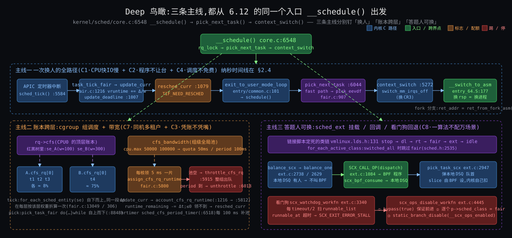
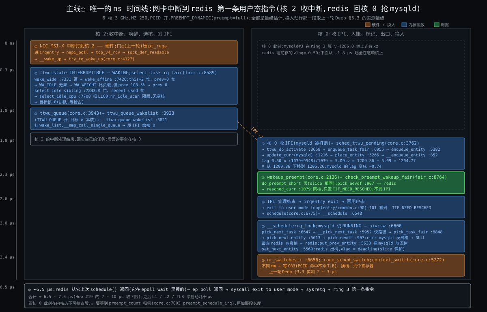
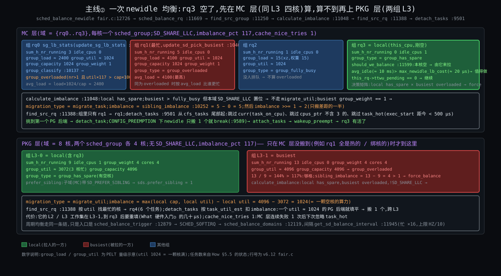
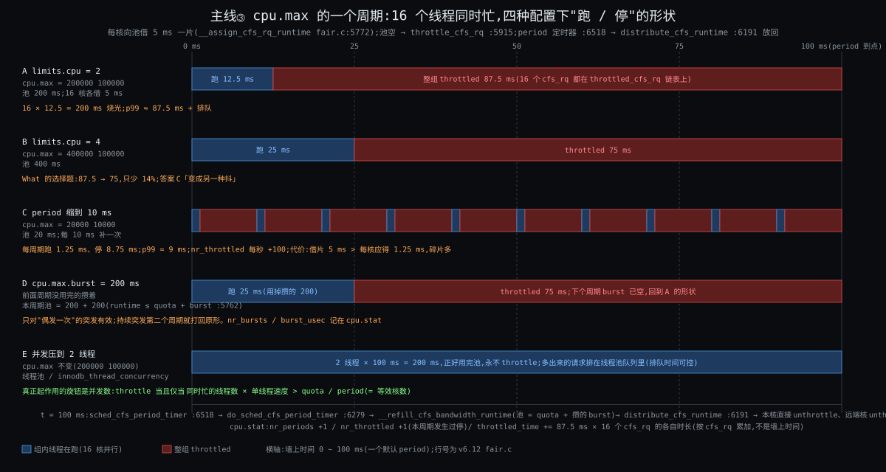

# 阶段 5:Linux 的进程调度器的深度剖析

> 上一份把四问落到了三件事(每核一本账 + 类栈 / 账上四个数 + 增广树 / 标记 + 三种搬人),并把 fair 账、多核、cgroup 带宽三块写厚。这一份不再解释"它是什么",只做三件事:**钉到行号**(Linux v6.12,`kernel/sched/fair.c` 为主,所有 `file:line` 都对 v6.12 原文 `grep -n` 过)、**算到数**(一个按 6.12 规则写的模拟器跑出 How §3.6 / §14 两个场景的逐拍表,输出原样贴在 §2.4 / §2.6)、**反事实**(每条主线 4 ~ 6 个候选,各违反哪条约束)。
>
> 三条主线:① EEVDF 挑人全程(含唯一的一条纳秒时间线)② 多核的唤醒选核与周期均衡 ③ cgroup 的层级份额与带宽。其余(rt / dl / 抢占模型 / sched_ext / EAS / core scheduling / NUMA / autogroup)在 §5 附录只给机制和行号。换人动作本身(`context_switch` 的 2 ~ 3 μs)沿用上一轮 Deep §3.3 的实测,不重做。
>
> 贯穿机器与任务同前:8 核 x86-64,两组 L3 各 4 核,SMT 关,3 GHz,`CONFIG_HZ = 250`,`base_slice` 3 ms;`mysqld` ×16(nice 0)、`redis-server`(nice −10)、`xz`(nice 19)、PostgreSQL 后端若干、k8s 容器 `cpu.max = 200000 100000`。

---

## 约束清单速查(C1 ~ C8)

> 后文所有 `Cn·短名` 都对应下面 8 条,每条在 Why 里从"一核一队列先来先跑"一刀一刀推出过,这里只放"约束 + 不可再分性 + 口诀"。推导见 `stages/02-why/02-why.md`。每条是 markdown 标题,viewer 里可以 `Ctrl+F` 搜 `C3` 直接滚到。

#### C1 — 只在打断点换

内核没有自己的 CPU,只能在流进内核的瞬间(tick / 系统调用 / 中断 / 阻塞)介入;介入时不一定能立刻换人(持锁、中断上下文)。
**不可再分**:要控制一条流必须先拿到它的核;中断上下文不能换栈。
**口诀**:先打标记 → 出口再换

#### C2 — 未来不可知

内核不知道任务下一步算还是等、要多久;猜的启发式可被构造负载骗。
**不可再分**:意图不在二进制里,不可静态判定。
**口诀**:只看账 → 不看人

#### C3 — 份额与延迟两头要

长期按权重分 CPU(份额)和醒来多久上台有界(延迟)是两个独立要求;插队额度须有界。
**不可再分**:一个标量不能同时编码比例和上界。
**口诀**:权重管份额 → slice 管延迟 → lag 管资格

#### C4 — 挑人须便宜

每核每秒万次级决定,每次 < 1 μs 且不随任务数线性增长;记账必须增量。
**不可再分**:规则的常数项直接吃掉它要分的资源。
**口诀**:O(log n) 挑 → O(1) 记

#### C5 — 核各自为政

核有独立 cache / TLB / 时钟,跨核同步贵一到两个数量级,核间有远近。
**不可再分**:多核硬件结构。
**口诀**:每核一本账 → 搬人要算账

#### C6 — 份额按组算

分配单位是用户 / 容器,线程数可被放大;组要嵌套、要能封顶;内核只看见线程。
**不可再分**:内核没有"用户"这个调度对象。
**口诀**:组是一行账 → 封顶按周期扣

#### C7 — 有人要硬保证

一部分任务要绝对时限 / 优先;相对公平推不出绝对保证;凌驾带来饿死与反转。
**不可再分**:公平与保证互不蕴含。
**口诀**:类栈凌驾 → 每个口子配阀

#### C8 — 核不等速且耗电

核的有效算力随 SMT / 频率 / 大小核变,能耗是非线性的独立目标。
**不可再分**:硬件物理。
**口诀**:按算力比 → 不按核数比

---

## §0 从 How 走到 Deep:三件事记住

上一份结尾说:三件事,四问各落其中。这一份把三件事再压成**三个判据** —— 每条主线各一个,每个判据能指到 `fair.c` 的一行。后面所有行号、数字、反事实都挂在这三个判据上。

### §0.1 判据①:eligible 且 deadline 最早,而且 lag 守恒 —— 从 C2·未来不可知 + C3·份额与延迟两头要 推出

因为 C2·未来不可知(依据只能是账)+ C3·份额与延迟两头要(三个数各管一头)→ 要解决"用一条规则把权重、slice、lag 合起来"→ 所以 **`pick_eevdf`(`fair.c:907`)**:在 `entity_eligible`(`:742`,即 V ≥ v_i)的实体里挑 deadline 最早的;`curr` 在 slice 保护期内(`vlag == deadline`,`:928`)优先。配套的另一半是 **`place_entity`(`:5266`)**:醒来放回时把 lag 按 (W + w)/W 放大,放回后 V 下移,lag 恰好不变 —— 没有这一半,"欠多少还多少"会在每次睡醒时蒸发一截(`:5290` 起 20 行注释里的推导)。

### §0.2 判据②:搬人只在"有利可图且不热"—— 从 C5·核各自为政 + C8·核不等速且耗电 推出

因为 C5·核各自为政(搬一次要付 cache 重填)+ C8·核不等速且耗电(比的是算力不是个数)→ 要解决"什么时候搬、搬谁"→ 所以两道门:**`calculate_imbalance`(`:11048`)** 只在最忙组比本组忙 `imbalance_pct`(`topology.c:1616`,117%)以上时算出一个差距,并只搬一半(`:11162` 的 `imbalance >>= 1`);**`task_hot`(`:9260`)** 把 `exec_start` 距今不足 `sysctl_sched_migration_cost`(`:79`,500 μs)的任务判为热,`can_migrate_task`(`:9365`)跳过它。两道门合起来就是"有利可图且不热"。

### §0.3 判据③:整组按周期借,借不到整组停 —— 从 C6·份额按组算 推出

因为 C6·份额按组算 的"要能封顶"→ 要解决"组的总用量不超过 X,但 16 颗核不能每微秒争一把全局锁"→ 所以 **`__assign_cfs_rq_runtime`(`:5772`)**:每颗核上这个组的 `cfs_rq` 一次向池借 `sched_cfs_bandwidth_slice()`(`:5736`,5 ms);借不到 → `resched_curr`(`:5826`)→ 出口 `put_prev_entity`(`:5638`)→ `check_cfs_rq_runtime`(`:6488`)→ **`throttle_cfs_rq`(`:5915`)** 把这颗核上的组实体从父树出队,组内线程整体消失;`sched_cfs_period_timer`(`:6518`)每周期补池再放回。

### §0 结论:三个判据对照

| 判据 | 是什么 | 为什么存在(约束) | 行 |
|---|---|---|---|
| ① eligible ∧ 最早 deadline,lag 守恒 | 挑人只看 V 和 deadline;放回时 lag 不蒸发 | C2·未来不可知、C3·份额与延迟两头要 | `fair.c:907`、`:5266` |
| ② 有利可图 ∧ 不热 | 差距过迟滞才搬,只搬一半;500 μs 内跑过的不搬 | C5·核各自为政、C8·核不等速且耗电 | `fair.c:11048`、`:9260` |
| ③ 按周期借,借不到整组停 | 每核借 5 ms 片;池空整组下树;定时器补池放回 | C6·份额按组算 | `fair.c:5772`、`:5915`、`:6518` |

**三个判据怎么串**:判据① 在每本账内部挑人;判据② 决定一个实体此刻在哪本账上;判据③ 决定一整组实体此刻在不在任何账上。一次 tick 三者都可能被触发:`sched_tick`(`core.c:5584`)→ `task_tick_fair`(`fair.c:13049`)→ `entity_tick`(`:5662`)→ `update_curr`(`:1216`)里同时做判据①的记账、判据③的扣账(`account_cfs_rq_runtime`,`:5830`);tick 尾部 `sched_balance_trigger`(`:12879`)抬软中断走判据②。

---

## §1 一张极简概览图



从图上能读出五件事:

1. **三列的顶端都是打断点**(tick / 唤醒 / 空闲 / 定时器),没有一条链是"调度器自己醒来"的 —— C1·只在打断点换 在行号层面的样子。
2. **主线① 两条入口(tick、唤醒)在 `exit_to_user_mode_loop`(`entry/common.c:101`)汇合**:tick 走 `update_deadline` → `resched_curr`,唤醒走 `place_entity` → `check_preempt_wakeup_fair`,两条都只打标记,真换人只有一个地方。
3. **主线② 的唤醒选核和周期均衡是两条独立的链**,只在最后一步(`attach_tasks` → `wakeup_preempt`)回到主线①。前者每次唤醒都走,后者几毫秒到一百毫秒一次。
4. **主线③ 的借和放在两个上下文里**:借在任务自己的 `update_curr` 里(持 `rq` 锁),放在 `hrtimer` 回调里(持 `cfs_b` 锁),所以远端核的放回必须异步(`unthrottle_cfs_rq_async`)。
5. **三个绿框都在 `fair.c`**,一个在 `:907` 附近、一个在 `:9260` / `:9365`、一个在 `:5772` / `:5915`;一万三千行里真正"做决定"的就这三处,其余是记账、分类、锁和统计。

---

## §2 主线①:EEVDF 挑人全程

**先说结论**:挑人规则只有 `pick_eevdf` 的 40 行;它依赖的四个数由 `update_curr`(涨 vruntime、推 deadline)、`place_entity`(放回、lag 守恒)、`update_entity_lag`(睡下、夹紧)三处维护;`check_preempt_wakeup_fair` 的全部内容是"放回之后再调一次 `pick_eevdf`"。模拟器按这几段代码复现了 How §3.6 的五拍表,数字对到小数点后两位;How §14 的"连跑约 64 ms"也复现了,但那一节里"mysqld 也有资格"这句不成立(§2.6)。

### §2.1 操作层:能碰的旋钮,在源码里落到哪一行

| 旋钮 | 源码落点 | 值 / 范围 |
|---|---|---|
| `nice` / `setpriority` | `set_user_nice` → `set_load_weight`(`core.c:1368`)查 `sched_prio_to_weight[40]`(`core.c:10012`)与 `sched_prio_to_wmult[40]`(`:10030`,2³² / w 的预乘倒数) | nice 0 = 1024;−10 = 9548;19 = 15 |
| `sched_setattr(.sched_runtime)` | `syscalls.c:307 ~ :311`:`se->custom_slice = 1; se->slice = clamp(runtime, 0.1 ms, 100 ms)` | 6.12 起对 `SCHED_NORMAL` 有效 |
| `SCHED_BATCH` / `SCHED_IDLE` | `check_preempt_wakeup_fair`(`fair.c:8821`)`!normal_policy(p->policy)` → 直接 return:**不抢别人**;`SCHED_IDLE` 还在 `task_hot` 里永远算冷(`:9269`) | — |
| `sched_yield` | `yield_task_fair`(`:9006`):`se->deadline += calc_delta_fair(se->slice, se)`(`:9032`)—— 只是把自己的 deadline 推后一个 slice,不改 vruntime | — |
| `/sys/kernel/debug/sched/base_slice_ns` | `debug.c:507` 挂的就是 `sysctl_sched_base_slice`(`fair.c:76`,750000)×(1 + ilog2(min(cpus, 8))) | 8 核 3 ms |
| `/sys/kernel/debug/sched/features` | `features.h`:`PLACE_LAG`(:7)`PLACE_DEADLINE_INITIAL`(:11)`PLACE_REL_DEADLINE`(:15)`RUN_TO_PARITY`(:20)`PREEMPT_SHORT`(:25)`DELAY_DEQUEUE`(:49)`DELAY_ZERO`(:50)`WAKEUP_PREEMPTION`(:55)`HRTICK`(:57,**关**) | 全部默认开,除 `HRTICK` / `NEXT_BUDDY` |
| `/proc/<pid>/sched` | `debug.c` `proc_sched_show_task`:`se.exec_start` / `se.vruntime` / `se.sum_exec_runtime` / `se.nr_migrations`(`:1178 ~ :1184`)、`nr_switches` / `nr_voluntary_switches` / `nr_involuntary_switches`(`:1240 ~ :1242`)、`se.load.weight`(`:1244`)、`se.avg.*`(`:1246 ~ :1252`)、`policy` / `prio`(`:1261 ~ :1262`);`/sys/kernel/debug/sched/debug` 里每核还打印 `se.deadline` / `se.slice`(`:744 ~ :748`) | — |

### §2.2 函数逻辑层:三条调用链与它们改的字段

```
tick:   sched_tick(core.c:5584) → task_tick_fair(fair.c:13049) → entity_tick(:5662) → update_curr(:1216)
            → update_deadline(:1007) 返回 true → resched_curr(core.c:1079)
唤醒:   try_to_wake_up(core.c:4127) → select_task_rq(:4266)… → ttwu_queue(:3943) → ttwu_do_activate(:3658)
            → enqueue_task_fair(fair.c:6955) → enqueue_entity(:5382) → place_entity(:5266) → __enqueue_entity(:852)
            → wakeup_preempt(core.c:2136) → check_preempt_wakeup_fair(fair.c:8764) → pick_eevdf(:907) → resched_curr
出口:   exit_to_user_mode_loop(entry/common.c:90) → schedule(core.c:6775) → __schedule(:6548) → pick_next_task(:6647)
            → __pick_next_task(:5952 快路径) → pick_next_task_fair → pick_task_fair(fair.c:8848) → pick_next_entity(:5613)
            → pick_eevdf(:907);put_prev_entity(:5638) / set_next_entity(:5560);context_switch(core.c:5272)
```

#### §2.2.1 记账:`update_curr` 与 `update_deadline`

```c
/* fair.c:1216 */
static void update_curr(struct cfs_rq *cfs_rq)
{
	struct sched_entity *curr = cfs_rq->curr;
	struct rq *rq = rq_of(cfs_rq);
	s64 delta_exec;
	bool resched;

	if (unlikely(!curr))
		return;

	delta_exec = update_curr_se(rq, curr);                 /* :1134  now − exec_start,exec_start = now */
	if (unlikely(delta_exec <= 0))
		return;

	curr->vruntime += calc_delta_fair(delta_exec, curr);   /* :289   delta × 1024 / weight */
	resched = update_deadline(cfs_rq, curr);               /* :1007  跑满 slice 才推 */
	update_min_vruntime(cfs_rq);                           /* :761   min_vruntime 只前进 */

	if (entity_is_task(curr)) {
		struct task_struct *p = task_of(curr);
		update_curr_task(p, delta_exec);                   /* :1157  cputime / cgroup 统计 / dl_server */
		if (p->dl_server != &rq->fair_server)
			dl_server_update(&rq->fair_server, delta_exec);  /* §5.2 fair_server */
	}

	account_cfs_rq_runtime(cfs_rq, delta_exec);            /* :5830  判据③ 扣本核小账 */

	if (cfs_rq->nr_running == 1)
		return;                                            /* 一个人时不打标记 */

	if (resched || did_preempt_short(cfs_rq, curr)) {      /* :1166 */
		resched_curr(rq);                                  /* core.c:1079 只打标记 */
		clear_buddies(cfs_rq, curr);
	}
}

/* fair.c:1007 */
static bool update_deadline(struct cfs_rq *cfs_rq, struct sched_entity *se)
{
	if ((s64)(se->vruntime - se->deadline) < 0)
		return false;                                      /* 还没跑满 slice:什么也不做 */
	if (!se->custom_slice)
		se->slice = sysctl_sched_base_slice;               /* 3 ms */
	se->deadline = se->vruntime + calc_delta_fair(se->slice, se);   /* vd_i = ve_i + r_i / w_i */
	return true;                                           /* 这次请求用完了,该换人 */
}
```

逐句要点:

- `delta_exec` 来自 `rq_clock_task`(扣掉了中断 / 窃取时间),所以网卡中断多的核上 mysqld 不会被多记账(How §2.3 逼问表最后一行)。
- `calc_delta_fair`(`:289`)对 nice 0 直接返回 `delta`;其他权重走 `__calc_delta`(`:259`):`delta × 1024 × inv_weight >> 32`,用 `sched_prio_to_wmult` 的预乘倒数把除法换成乘法 —— C4·挑人须便宜 的"记账 O(1)"落到的那一行。
- `update_deadline` **只在 `vruntime ≥ deadline` 时推一次**,推的量是 slice 按权重折算:redis 0.32 虚拟 ms,xz 204.8 虚拟 ms。返回 true 只表示"请求用完",`update_curr` 才决定打不打标记。
- `nr_running == 1` 直接 return:一个人跑时既不打标记也不做 `PREEMPT_SHORT` 判断。模拟器 `deep26` 场景里 A 独占那 20 ms 就是这条。

#### §2.2.2 V 与资格:两个累加器

```c
/* fair.c:620 / :630 / :640 */
static void avg_vruntime_add(struct cfs_rq *cfs_rq, struct sched_entity *se)
{
	unsigned long weight = scale_load_down(se->load.weight);
	s64 key = entity_key(cfs_rq, se);                      /* v_i − min_vruntime */
	cfs_rq->avg_vruntime += key * weight;
	cfs_rq->avg_load += weight;
}
static void avg_vruntime_sub(struct cfs_rq *cfs_rq, struct sched_entity *se)   /* 反向 */
{ /* … avg_vruntime -= key * weight; avg_load -= weight; … */ }
static inline void avg_vruntime_update(struct cfs_rq *cfs_rq, s64 delta)
{
	/* v' = v + d ==> avg_vruntime' = avg_runtime - d*avg_load */
	cfs_rq->avg_vruntime -= cfs_rq->avg_load * delta;      /* min_vruntime 前进 d 时的修正 */
}

/* fair.c:651 */
u64 avg_vruntime(struct cfs_rq *cfs_rq)
{
	struct sched_entity *curr = cfs_rq->curr;
	s64 avg = cfs_rq->avg_vruntime;
	long load = cfs_rq->avg_load;

	if (curr && curr->on_rq) {                             /* curr 不在树上,临时加进来 */
		unsigned long weight = scale_load_down(curr->load.weight);
		avg += entity_key(cfs_rq, curr) * weight;
		load += weight;
	}
	if (load) {
		/* sign flips effective floor / ceiling */
		if (avg < 0)
			avg -= (load - 1);                             /* 负数向下取整,保证 V 带"左偏" */
		avg = div_s64(avg, load);
	}
	return cfs_rq->min_vruntime + avg;
}

/* fair.c:726 */
static int vruntime_eligible(struct cfs_rq *cfs_rq, u64 vruntime)
{
	/* … 同样把 curr 加进 avg / load … */
	return avg >= (s64)(vruntime - cfs_rq->min_vruntime) * load;   /* V ≥ v_i,用乘法避免除法精度 */
}
```

逐句要点:

- 累加器存的是相对 `min_vruntime` 的差 × 权重,`:600` 起的注释推了为什么:`min_vruntime` 单调递增且紧贴任务的服务量,差值只在"量化误差"量级,实测乘积最大 44 位。
- `avg_vruntime()` 的"左偏"(`:650` 注释:`avg_vruntime() + 0` 必须使 `entity_eligible` 为真)是一个细节但重要:V 本身必须被判为 eligible,否则"所有人 lag 都略负"时谁也挑不出来。
- `vruntime_eligible` 不除法,比 `avg ≥ key × load`。模拟器照抄了这两段(含 curr 的临时加入),所以 §2.4 表里的 `lag` 列和内核算出来的符号一致。

#### §2.2.3 lag:睡下去夹紧,醒来守恒

```c
/* fair.c:692 */
static s64 entity_lag(u64 avruntime, struct sched_entity *se)
{
	s64 vlag, limit;
	vlag = avruntime - se->vruntime;                       /* V − v_i */
	limit = calc_delta_fair(max_t(u64, 2*se->slice, TICK_NSEC), se);   /* ±max(2·slice, 4 ms) 按权重折算 */
	return clamp(vlag, -limit, limit);
}
/* fair.c:702 */
static void update_entity_lag(struct cfs_rq *cfs_rq, struct sched_entity *se)
{
	SCHED_WARN_ON(!se->on_rq);
	se->vlag = entity_lag(avg_vruntime(cfs_rq), se);       /* 出队那一刻存下 */
}
```

`:676` 起的注释给了夹紧的理由和论文的界:V 是近似的加权平均,树上的增删和改权重都会让 V 移动,lag 可能比"真实"的更大;EEVDF 论文在稳态下给的界是 `−r_max < lag < max(r_max, q)`。所以夹在"两个 slice,最小一个 tick"。对 redis(w 9548)这个上限换算成虚拟单位是 6 ms × 1024 / 9548 = 0.643 虚拟 ms —— How §3.4 的表,模拟器 `how14` 场景第一行直接读到 `+0.643`。

```c
/* fair.c:5266 */
static void place_entity(struct cfs_rq *cfs_rq, struct sched_entity *se, int flags)
{
	u64 vslice, vruntime = avg_vruntime(cfs_rq);           /* 先读此刻的 V */
	s64 lag = 0;

	if (!se->custom_slice)
		se->slice = sysctl_sched_base_slice;
	vslice = calc_delta_fair(se->slice, se);

	if (sched_feat(PLACE_LAG) && cfs_rq->nr_running) {    /* 树上有人才谈 lag */
		struct sched_entity *curr = cfs_rq->curr;
		unsigned long load;

		lag = se->vlag;                                    /* 睡前存的那个(已夹紧) */
		/* … :5290 ~ :5339 二十行推导,结论:vl_i = (W + w_i) * vl'_i / W … */
		load = cfs_rq->avg_load;
		if (curr && curr->on_rq)
			load += scale_load_down(curr->load.weight);    /* W 含 curr */

		lag *= load + scale_load_down(se->load.weight);    /* × (W + w_i) */
		if (WARN_ON_ONCE(!load))
			load = 1;
		lag = div_s64(lag, load);                          /* ÷ W */
	}

	se->vruntime = vruntime - lag;                         /* v_i = V − 放大后的 lag */

	if (sched_feat(PLACE_REL_DEADLINE) && se->rel_deadline) {   /* 6.12 新:非睡眠出队保留相对 deadline */
		se->deadline += se->vruntime;
		se->rel_deadline = 0;
		return;
	}
	if (sched_feat(PLACE_DEADLINE_INITIAL) && (flags & ENQUEUE_INITIAL))
		vslice /= 2;                                       /* 新任务:别人平均跑到一半,你也从一半开始 */
	se->deadline = se->vruntime + vslice;                  /* vd_i = ve_i + r_i / w_i */
}
```

推导那二十行(`:5290` 起)值得原样记住结论:加入一个 lag 为 vl_i 的实体后 V 变成 `V − w_i·vl_i / (W + w_i)`,它的实际 lag 变成 `vl_i − w_i·vl_i/(W + w_i)`,**严格小于** vl_i;反解得到放大系数 `(W + w_i)/W`。模拟器在 `how36` 的第 10 ms 行里:lag 0.50 × (1039 + 9548)/1039 = 5.09,放回后 V 从 1209.856 下移到 1205.261,redis 的 lag 读数正好 `+0.500`。

`PLACE_REL_DEADLINE`(`:15`)是 6.12 新加的:任务不是因为睡眠而出队(比如被搬到别的核、改权重)时,`dequeue_entity`(`:5526`)把 deadline 存成相对值 `deadline − vruntime` 并置 `rel_deadline = 1`,放回时加回去 —— 搬核不重置它的请求进度。

#### §2.2.4 挑人:`pick_eevdf` 全文

```c
/* fair.c:907 */
static struct sched_entity *pick_eevdf(struct cfs_rq *cfs_rq)
{
	struct rb_node *node = cfs_rq->tasks_timeline.rb_root.rb_node;
	struct sched_entity *se = __pick_first_entity(cfs_rq);   /* 树最左 = deadline 最早 */
	struct sched_entity *curr = cfs_rq->curr;
	struct sched_entity *best = NULL;

	/* 只有一个实体时跳过资格判断,省几个周期 */
	if (cfs_rq->nr_running == 1)
		return curr && curr->on_rq ? curr : se;

	if (curr && (!curr->on_rq || !entity_eligible(cfs_rq, curr)))
		curr = NULL;                                       /* 超支的 curr 当不存在 */

	/* 一旦选中,跑到它没资格或拿到新 slice 为止。见 set_next_entity() 里的 HACK */
	if (sched_feat(RUN_TO_PARITY) && curr && curr->vlag == curr->deadline)
		return curr;                                       /* :928 slice 保护 */

	/* 最左有资格就是它 */
	if (se && entity_eligible(cfs_rq, se)) {
		best = se;
		goto found;
	}

	/* 增广堆搜索:左子树的 min_vruntime 若 eligible,左边一定有更早 deadline 的候选 */
	while (node) {
		struct rb_node *left = node->rb_left;
		if (left && vruntime_eligible(cfs_rq, __node_2_se(left)->min_vruntime)) {
			node = left;
			continue;
		}
		se = __node_2_se(node);
		if (entity_eligible(cfs_rq, se)) {                 /* 左边没有,看自己 */
			best = se;
			break;
		}
		node = node->rb_right;                             /* 再往右 */
	}
found:
	if (!best || (curr && entity_before(curr, best)))      /* 跟 curr 比 deadline */
		best = curr;

	return best;
}
```

`:889` 起的注释是 EEVDF 的定义:① 必须 eligible(被欠服务)② 其中 deadline 最早;O(log n) 靠树**按 deadline 排序**的同时用 `se->min_vruntime = min(自己, 左右子树)` 当堆用(`__min_vruntime_update`,`:807`;插删时 `rb_add_augmented_cached`,`:852`)。模拟器用"按 deadline 排序后取第一个 eligible"等价实现,因为增广搜索的结果就是它。

`RUN_TO_PARITY` 的标记在 `set_next_entity`(`:5560`):

```c
/* fair.c:5560 */
static void set_next_entity(struct cfs_rq *cfs_rq, struct sched_entity *se)
{
	clear_buddies(cfs_rq, se);
	if (se->on_rq) {                                       /* 'current' 不留在树上 */
		update_stats_wait_end_fair(cfs_rq, se);
		__dequeue_entity(cfs_rq, se);
		update_load_avg(cfs_rq, se, UPDATE_TG);
		/* HACK, stash a copy of deadline at the point of pick in vlag, which isn't used until dequeue. */
		se->vlag = se->deadline;                           /* :5578 */
	}
	update_stats_curr_start(cfs_rq, se);                   /* exec_start = now */
	cfs_rq->curr = se;
	/* … slice_max 统计 … */
	se->prev_sum_exec_runtime = se->sum_exec_runtime;
}
```

`vlag` 在任务跑的时候没用(只在出队时才写),所以借来存"被挑中那一刻的 deadline";`update_deadline` 一推 deadline,`vlag == deadline` 就不成立,保护自然失效。两个地方会提前撤掉保护:`do_preempt_short`(`:1177`,新人 slice 更短且有资格)让 `check_preempt_wakeup_fair` 把 `vlag` 改成 `deadline + 1`(`:8834`);`did_preempt_short`(`:1166`)在 tick 里发现 `curr` 已经没资格也打标记。

#### §2.2.5 唤醒抢占:`check_preempt_wakeup_fair` 全文

```c
/* fair.c:8764 */
static void check_preempt_wakeup_fair(struct rq *rq, struct task_struct *p, int wake_flags)
{
	struct task_struct *curr = rq->curr;
	struct sched_entity *se = &curr->se, *pse = &p->se;
	struct cfs_rq *cfs_rq = task_cfs_rq(curr);
	int cse_is_idle, pse_is_idle;

	if (unlikely(se == pse))
		return;
	if (unlikely(throttled_hierarchy(cfs_rq_of(pse))))    /* 新人所在的组被 throttle 了:不抢 */
		return;
	if (sched_feat(NEXT_BUDDY) && !(wake_flags & WF_FORK))
		set_next_buddy(pse);                               /* 默认关 */
	if (test_tsk_need_resched(curr))                       /* 已经有标记 */
		return;
	if (!sched_feat(WAKEUP_PREEMPTION))
		return;

	find_matching_se(&se, &pse);                           /* 组调度:找到同一棵树上的两个实体 */
	WARN_ON_ONCE(!pse);

	cse_is_idle = se_is_idle(se);
	pse_is_idle = se_is_idle(pse);
	if (cse_is_idle && !pse_is_idle)                       /* 非 idle 抢 idle */
		goto preempt;
	if (cse_is_idle != pse_is_idle)
		return;
	if (unlikely(!normal_policy(p->policy)))               /* BATCH / IDLE 不抢人 */
		return;

	cfs_rq = cfs_rq_of(se);
	update_curr(cfs_rq);                                   /* 把 curr 的账记到此刻 */
	/* 新人 slice 更短且有资格 → 撤掉 curr 的 slice 保护(哪怕最终没挑中新人,保护也没了) */
	if (do_preempt_short(cfs_rq, pse, se) && se->vlag == se->deadline)
		se->vlag = se->deadline + 1;
	/* 新人成了最该跑的 → 强制抢 */
	if (pick_eevdf(cfs_rq) == pse)                         /* :8839 */
		goto preempt;
	return;
preempt:
	resched_curr(rq);
}
```

`find_matching_se` 是 cgroup 的事(§4.2):redis 在根树上、新醒的 mysqld 线程在 k8s 组的树上时,要先把两边都爬到同一层再比。

#### §2.2.6 睡下去:`dequeue_entity` 与 `DELAY_DEQUEUE`

```c
/* fair.c:5476 */
static bool dequeue_entity(struct cfs_rq *cfs_rq, struct sched_entity *se, int flags)
{
	bool sleep = flags & DEQUEUE_SLEEP;
	update_curr(cfs_rq);

	if (flags & DEQUEUE_DELAYED) {
		SCHED_WARN_ON(!se->sched_delayed);
	} else {
		bool delay = sleep;
		if (flags & DEQUEUE_SPECIAL)                        /* 特殊状态(冻结等)不能靠假唤醒,不延迟 */
			delay = false;
		SCHED_WARN_ON(delay && se->sched_delayed);
		if (sched_feat(DELAY_DEQUEUE) && delay &&
		    !entity_eligible(cfs_rq, se)) {                /* 超支的人要睡:留在树上 */
			if (cfs_rq->next == se)
				cfs_rq->next = NULL;
			update_load_avg(cfs_rq, se, 0);
			se->sched_delayed = 1;                         /* :5500 */
			return false;
		}
	}
	/* … update_load_avg / se_update_runnable / 统计 … */
	update_entity_lag(cfs_rq, se);                         /* :5525 存 vlag(夹紧) */
	if (sched_feat(PLACE_REL_DEADLINE) && !sleep) {
		se->deadline -= se->vruntime;                      /* 非睡眠出队:存相对 deadline */
		se->rel_deadline = 1;
	}
	if (se != cfs_rq->curr)
		__dequeue_entity(cfs_rq, se);
	se->on_rq = 0;
	account_entity_dequeue(cfs_rq, se);
	return_cfs_rq_runtime(cfs_rq);                         /* :5537 判据③:最后一个人走了,把零头还池 */
	update_cfs_group(se);
	if ((flags & (DEQUEUE_SAVE | DEQUEUE_MOVE)) != DEQUEUE_SAVE)
		update_min_vruntime(cfs_rq);
	if (flags & DEQUEUE_DELAYED)
		finish_delayed_dequeue_entity(se);                 /* :5468  DELAY_ZERO:正 lag 清零 */
	if (cfs_rq->nr_running == 0)
		update_idle_cfs_rq_clock_pelt(cfs_rq);
	return true;
}
```

延迟出队的人之后两种结局:被 `pick_eevdf` 挑中(它的 lag 终于回到 ≥ 0)→ `pick_next_entity`(`:5613`)看到 `sched_delayed` → `dequeue_entities(DEQUEUE_SLEEP | DEQUEUE_DELAYED)` 真正出队并 `DELAY_ZERO`,返回 NULL 让 `pick_task_fair`(`:8848`)重挑;或者在那之前又被唤醒 → `enqueue_task_fair`(`:6973`)走 `requeue_delayed_entity`(`:6919`):若此刻 lag 已正就清零重放,否则只清 `sched_delayed`。两种结局里它的正 lag 都被清掉 —— **睡眠不能攒欠账,只能还欠账**。模拟器 `how36` 里 redis 睡下去时 lag 为正(+0.499)所以走的是"真出队";把 xz 换成每 10 ms 睡一次的任务就能看到 `DELAY_DEQUEUE 留树上`。

### §2.3 底层原理层 + 唯一的纳秒时间线

三个底层 trade-off 上一轮 Deep §3.3 已经列过(tick 只标记 / V 用加权平均 / PCID / FPU 延迟恢复),这里只补本轮新钉到的三条:

| 设计 | 原因 | 代价 | 约束 |
|---|---|---|---|
| 资格判断用 `avg ≥ key × load` 的乘法(`:739`) | 除法有精度损失,会把 lag 恰为 0 的实体判错 | 乘积要能放进 s64,所以键值必须是相对 `min_vruntime` 的差 | C4·挑人须便宜 |
| lag 守恒放大放在 `place_entity` 而不是放在 V 的定义里 | V 是加权平均,这是 C4·挑人须便宜 允许的唯一 O(1) 定义;修正只能在进出时做 | 每次放回多一次乘除;改权重(`reweight_entity`,`:3874`)也要做同样的守恒 | C3·份额与延迟两头要 |
| `DELAY_DEQUEUE` 让超支者留树上 | 否则负 lag 要么被存起来带到下次(排后面,但 V 变了之后数值不再准),要么被清零(逃债) | 树上多了"在睡但还挂着"的节点;`h_nr_running` 和真可跑数分开算,6.12 为此改了二十几处 | C3·份额与延迟两头要 |

**纳秒时间线**(主线① 唯一的一条;机器参数见文首;除换人动作外全部是量级估计,待核 #70):



| t | 核 | 事件 | 代码 |
|---|---|---|---|
| 0 | 2 | NIC MSI-X 中断;门②;`napi_poll` → `tcp_v4_rcv` → `sock_def_readable` → `__wake_up` | 硬件;`net/` |
| ~0.3 μs | 2 | `try_to_wake_up`:`TASK_INTERRUPTIBLE` → `TASK_WAKING` | `core.c:4127` |
| ~0.5 μs | 2 | `select_task_rq_fair`:`wake_wide` 否;`wake_affine`:this = 2 忙、prev = 0 忙 → `WA_IDLE` 无果 → `WA_WEIGHT` 比 `cpu_load` → prev 0;`select_idle_sibling`:0 忙、`recent_used_cpu` 忙 → `select_idle_cpu` 扫 LLC0,`nr_idle_scan` 限额,无空核 → 0 | `fair.c:8589` / `:7331` / `:7426` / `:7843` / `:7708` |
| ~1.0 μs | 2 | `ttwu_queue` → `ttwu_queue_wakelist`(目标 ≠ 本核,`TTWU_QUEUE`)→ `__ttwu_queue_wakelist`:挂 `wake_list`,发 IPI | `core.c:3943` / `:3923` / `:3821` |
| ~1.2 μs | 2 | 核 2 的中断处理结束,回自己的任务 | — |
| ~1.8 μs | 0 | 收 IPI(mysqld 在 ring 3 被打断);`sched_ttwu_pending` → `ttwu_do_activate` → `activate_task` → `enqueue_task_fair` → `enqueue_entity`:`update_curr(mysqld)`,`place_entity`(lag 0.50 → 5.09,v = 1204.77),`__enqueue_entity`,V 下移到 1205.26 | `core.c:3762` / `:3658`;`fair.c:6955` / `:5382` / `:5266` / `:852` |
| ~2.3 μs | 0 | `wakeup_preempt` → `check_preempt_wakeup_fair`:`update_curr`;`do_preempt_short` 否;`pick_eevdf` == redis → `resched_curr`:同核,置 `TIF_NEED_RESCHED` + `PREEMPT_NEED_RESCHED` | `core.c:2136`;`fair.c:8764` / `:907`;`core.c:1079` |
| ~2.6 μs | 0 | IPI 处理结束 → `irqentry_exit` → 要回用户态 → `exit_to_user_mode_loop` 看到标记 → `schedule` → `__schedule` | `entry/common.c:90` / `:101`;`core.c:6775` / `:6548` |
| ~3.0 μs | 0 | `__schedule`:`rq_lock`;mysqld 仍 RUNNING → `switch_count = &prev->nivcsw`;`pick_next_task` → `__pick_next_task` 快路径 → `pick_task_fair` → `pick_next_entity` → `pick_eevdf`:curr mysqld lag −0.74 没资格 → NULL;最左 redis 有资格 → redis;`put_prev_entity(mysqld)` 回树;`set_next_entity(redis)`,`vlag = deadline` | `core.c:6600` / `:6647` / `:5952`;`fair.c:8848` / `:5613` / `:907` / `:5638` / `:5560` |
| ~3.4 μs | 0 | `rq->nr_switches++`;`trace_sched_switch`;`context_switch`:不同 mm → `switch_mm_irqs_off` 写 CR3(PCID 命中)、`switch_to` 六个寄存器 —— 上一轮实测 2 ~ 3 μs | `core.c:6656` / `:6693` / `:5272` |
| ~6.0 μs | 0 | redis 从它上次 `schedule()` 返回(它在 `epoll_wait` → `ep_poll` 里睡的)→ `syscall_exit_to_user_mode` → `sysretq` | `fs/eventpoll.c`;`entry_64.S` |
| ~6.5 ~ 7.5 μs | 0 | **ring 3 第一条指令**;随后 L1 / L2 / TLB 冷启动几十 μs | — |

合计 ≈ 6.5 ~ 7.5 μs,How #19 的"7 ~ 10 μs"取下限成立;上限对应核 0 此刻在内核态不可抢占段(`preempt_count ≠ 0`)的情形 —— 那时 ~2.6 μs 那一行要等到 `preempt_schedule_irq`(`core.c:7003`)或 `preempt_enable` 把计数减到 0,再加那段的长度。

### §2.4 lag 从零讲:模拟器跑 How §3.6

模拟器 `src/05-eevdf-sim.py`(文件头列了它对应的 19 个 6.12 函数)按上面 §2.2 的代码写,不做任何"近似"除了用排序列表替代红黑树。`python3 -I src/05-eevdf-sim.py how36` 的原样输出:

```
=== How §3.6:mysqld#3(nice 0) + xz(nice 19) 在树上,redis(nice -10) 睡着 vlag=+0.50 ms,t=10 ms 醒来算 50 μs ===
t=  0.000 ms  初始挑人 → mysqld#3
              V= 1200.000 | mysqld#3* v= 1200.000 lag= +0.000 dl= 1203.000 | xz        v= 1200.000 lag= +0.000 dl= 1404.800 | redis    睡 vlag=+0.500
t=  4.000 ms  tick → 标记;换人 → xz
              V= 1203.942 | mysqld#3  v= 1204.000 lag= -0.058 dl= 1207.000 | xz      * v= 1200.000 lag= +3.942 dl= 1404.800 | redis    睡 vlag=+0.500
t=  8.000 ms  tick → 标记;换人 → mysqld#3
              V= 1207.885 | mysqld#3* v= 1204.000 lag= +3.885 dl= 1207.000 | xz        v= 1473.067 lag=-265.182 dl= 1677.867 | redis    睡 vlag=+0.500
t= 10.000 ms  redis 醒 place_entity;唤醒抢占 → 标记;换人 → redis
              V= 1205.261 | mysqld#3  v= 1206.000 lag= -0.739 dl= 1207.000 | xz        v= 1473.067 lag=-267.806 dl= 1677.867 | redis   * v= 1204.761 lag= +0.500 dl= 1205.083
t= 10.050 ms  redis 算完 50 μs 要睡;真出队;换人 → mysqld#3
              V= 1209.856 | mysqld#3* v= 1206.000 lag= +3.856 dl= 1207.000 | xz        v= 1473.067 lag=-263.211 dl= 1677.867 | redis    睡 vlag=+0.499
t= 12.000 ms  tick → 标记;重挑还是 mysqld#3
              V= 1211.777 | mysqld#3* v= 1207.950 lag= +3.827 dl= 1210.950 | xz        v= 1473.067 lag=-261.289 dl= 1677.867 | redis    睡 vlag=+0.499
t= 16.000 ms  tick → 标记;重挑还是 mysqld#3
              V= 1215.720 | mysqld#3* v= 1211.950 lag= +3.770 dl= 1214.950 | xz        v= 1473.067 lag=-257.347 dl= 1677.867 | redis    睡 vlag=+0.499
t= 20.000 ms  tick → 标记;重挑还是 mysqld#3
              V= 1219.662 | mysqld#3* v= 1215.950 lag= +3.712 dl= 1218.950 | xz        v= 1473.067 lag=-253.405 dl= 1677.867 | redis    睡 vlag=+0.499
```

(`*` = curr,`d` = 延迟出队中;单位虚拟 ms;`lag` 列按 V − v 现算,`睡 vlag` 是出队时存下的值。)

**对照 How §3.6 的手算表**:V 1203.94 / 1207.88 / 1205.27 / 1209.86、redis 放回 v 1204.77、dl 1205.09、mysqld 在 10 ms 那一行的 lag −0.73、xz 1473.07 —— 全部对上,差异只在最后一位的四舍五入(模拟器 1205.261 vs 手算 1205.27)。How 那张表可以当真。

**每一列是怎么变的**(这是上一轮两次卡住的地方,逐列说):

1. `v`(vruntime):只有 curr 的在涨,每次打断点涨 `delta × 1024 / w`。mysqld 4 ms 涨 4;xz 4 ms 涨 273.07;redis 50 μs 涨 0.005。**睡着的人 v 不动**(redis 10 ~ 10.05 之间才动)。
2. `V`:树上所有人(含 curr)v 的加权平均。它几乎贴着大权重的人走:0 ~ 4 ms 跟着 mysqld 从 1200 涨到 1203.94;4 ~ 8 ms xz 在跑,xz 涨了 273 但权重只有 15,V 只涨到 1207.88。**redis 一加入 V 就下移 4.6**(1209.86 → 1205.26),因为 9548 的权重把平均拉向它。
3. `lag` = V − v:mysqld 在 4 ms 变成 −0.058 是因为它跑了 4 ms(超过 3 ms 的 slice),V 没完全跟上(xz 拖着)。它没资格了,xz 上。xz 跑完 4 ms lag 变 −265 —— 它要等 V 涨 265 虚拟 ms(mysqld 跑 ~269 ms)才再有资格。**权重不是靠"少挑它",是靠"它一跑账就飞"**。
4. `dl`:只在 `v ≥ dl` 时推一次。mysqld 的 dl 在 4 ms 从 1203 推到 1207(v = 1204 ≥ 1203);在 12 ms 从 1207 推到 1210.95(v = 1207.95)。中间 8 ~ 12 ms 它跑了两段(8 ~ 10、10.05 ~ 12)共 3.95 ms 才凑够一个 slice —— **被抢占不重置 slice**,这是 deadline 比"每次给 3 ms"更细的地方。
5. 10 ms 那一行:redis 放回在 V 下方 0.5(守恒),mysqld 被 V 的下移推到 V 上方 0.739 → 没资格 → `RUN_TO_PARITY` 保护不了没资格的 curr → 换 redis。10.05 ms 那一行:redis 出队,V 弹回 1209.86,mysqld 又有资格。**决定抢不抢的是唤醒那一刻的 V,不是 tick** —— 上一轮 §3.5 的结论在账上重现。

**长跑对账**(`python3 -I src/05-eevdf-sim.py long`,300 ms,redis 每 10 ms 醒一次算 50 μs,只打印换人事件,末尾汇总):

```
t=280.050 ms  redis 算完 50 μs 要睡;真出队;换人 → xz
              V= 1474.627 | mysqld#3  v= 1474.650 lag= -0.023 dl= 1477.650 | xz      * v= 1473.067 lag= +1.560 dl= 1677.867 | redis    睡 vlag=+0.485
t=284.000 ms  tick → 标记;换人 → mysqld#3
              V= 1478.520 | mysqld#3* v= 1474.650 lag= +3.870 dl= 1477.650 | xz        v= 1742.720 lag=-264.200 dl= 1947.520 | redis    睡 vlag=+0.485
--- 300 ms 对账(实际跑的真实时间 / 占比;xz 与 mysqld 争抢时按权重应为 15 : 1024 = 1.4% : 98.6%)---
mysqld#3  290.600 ms   96.9%
xz          7.950 ms    2.6%
redis       1.450 ms    0.5%
```

三件事:xz 第二次上台在 280 ms,距第一次 276 ms,和 How §3.6 估的"每 ~273 ms 得 4 ms"一致;xz 的 2.6% 比权重份额 1.4% 高是因为 300 ms 里它上了两次而第一次(t = 4)是起始状态人人 v 相等的赠品,按 1000 ms 算会收敛到 1.4%;redis 的 0.5% 和它的 90% 权重份额毫无关系 —— 它只用了它要的量,**权重是上限不是配给**。

### §2.5 反事实小试:挑人规则还能怎么写

**机制:在 lag ≥ 0 的实体里挑 deadline 最早的,lag 夹在 ±2 slice,放回守恒。**

- **A1:固定时间片轮转(RR),每人 4 ms**
  - 违反 C3·份额与延迟两头要:延迟 = 人数 × 片长,19 个任务时 redis 醒来最坏等 72 ms;份额无法表达(人人均等,`nice` 无意义)。
  - 现实:`SCHED_RR` 只给 rt 类,片长 100 ms(`rt.c:7`,`RR_TIMESLICE`);通用负载没人用。
- **A2:CFS(6.5 以前):只按最小 vruntime 挑,睡醒补"半个 slice"的固定优惠**
  - 不违反约束,但 C3·份额与延迟两头要 的延迟一头只能靠修正:`sched_wakeup_granularity`、`sleeper fairness`、`wakeup_preempt` 的启发式 —— 它们就是 C2·未来不可知 说的"猜"。能被刷:短睡眠反复领半个 slice 的优惠。
  - 现实:Linux 2007 ~ 2023;6.6 换掉,Origin 转折四有 cover letter 原话。
- **A3:彩票(lottery,Waldspurger 1994):每个 tick 按权重随机抽**
  - 不违反 C2·未来不可知(不猜),份额在期望上正确;但 C3·份额与延迟两头要 的延迟一头是概率的 —— redis 醒来能不能立刻上是掷骰子,p99 没有界;C4·挑人须便宜 的 O(1) 倒是满足。
  - 现实:教学系统、某些用户态调度器;内核没用过。
- **A4:stride(Waldspurger 1995):每人一个 pass 值,每跑一次加 stride = 常数 / 权重,挑 pass 最小**
  - 这就是"只有 vruntime 没有 deadline"的 CFS 的数学原型;违反 C3·份额与延迟两头要 的方式和 A2 一样:醒来放回的位置要靠额外规则。
  - 现实:CFS 的思想来源之一;EEVDF 在它上面加了 deadline 和 eligible。
- **A5:BVT(Duda & Cheriton 1999):vruntime 减一个 warp 值表示"急"**
  - 能表达延迟,但 warp 是**无界的插队额度**(除非再加 warp 时限),违反 C3·份额与延迟两头要 的"插队须有界";warp 值本身又要猜(C2·未来不可知)。
  - 现实:Xen 早期用过 BVT,后来换 credit;内核没用过。
- **A6:sched_ext 自定义(6.12 起):BPF 程序自己定 enqueue / dispatch,20 ms 默认 slice(`ext.h:20`)**
  - 不违反任何一条 —— 它把"违反哪条"的决定权交给加载它的人:一个 FIFO 的 BPF 调度器就是 A1。
  - 现实:Meta 的生产部署(sched-ext/scx 仓库自述)、Valve Steam Deck 上 Igalia 的 `scx_lavd`;§5.4(收尾核实 #86)。

**结论**:在 C2·未来不可知(不猜)+ C3·份额与延迟两头要(份额、延迟、有界插队三者都要)+ C4·挑人须便宜(O(log n))下,EEVDF 是唯一同时过筛的:A1 / A3 / A5 丢延迟界,A2 / A4 丢"不猜",A6 是把筛子交出去。它比 CFS 多付的是每个实体多两个字段(`deadline`、`slice`)和树的增广;换来的是删掉 `sched_wakeup_granularity` 等五个启发式旋钮(Origin 转折四)。

### §2.6 反问(选择式)+ 从头走一遍

**问**:两个 nice 0 的任务 A、B 同核。B 睡下去的那一刻账面上欠它 20 虚拟 ms(理论值),睡了 20 ms;这期间 A 独占核。B 醒来:

- (a) B 的 lag 被记成:A. +20 B. +6 C. +3 D. 0
- (b) B 能否立刻把 A 换下?之后它能连跑多久?

### 从头走一遍

**问题来源**:§2.2.3 的 `entity_lag` 在 B 睡下去时就把 lag 夹在 `±max(2 × slice, TICK_NSEC)` = ±max(6 ms, 4 ms) = ±6 ms,nice 0 的虚拟单位和真实单位相同,所以存下的是 **+6**(答案 B)。+20 是"理想 EEVDF"的值,内核故意不记 —— `:676` 的注释说 V 本身是近似的,记太大的 lag 会把别人的账弄乱。

**分岔一(醒来那一刻)**:`place_entity`:V 此刻 = A 的 v(树上只有 A)= 1220;放大 6 × (1024 + 1024)/1024 = 12;B 的 v = 1220 − 12 = 1208;deadline = 1211。放回后 V = (1024 × 1220 + 1024 × 1208)/2048 = 1214:B 的 lag = +6(守恒 ✓),A 的 lag = −6。`check_preempt_wakeup_fair`:`pick_eevdf` —— curr A 没资格 → NULL;最左 B(dl 1211 < 1223)有资格 → B → 打标记 → 出口换 B。**立刻抢**。

**分岔二(连跑多久)**:B 每 4 ms 一个 tick,v 涨 4,V 涨 2(两人均权);lag 每拍减 2:+6 → +4 → +2 → 0。第 3 个 tick(t = 32 ms)B 的 v = 1220 = A 的 v,两人 lag 都是 0、deadline 都是 1223 → 平手按树序,A 回到树上时间更早 … 模拟器给的是换 A。此后每个 tick 换一次人:谁跑了 4 ms 谁的 lag 就变 −2,对方 +2,对方上。**B 连跑 12 ms = 3 个 tick**,正好把 6 ms 的欠账(= 两个 slice 的真实时间)收回,然后进入 4 ms 一换的稳态。

`python3 -I src/05-eevdf-sim.py deep26` 的原样输出:

```
B 睡下去:理论 lag = +20.000 ms,entity_lag 夹在 ±max(2×3 ms, 4 ms) = ±6 ms → 存下 vlag = +6.000 ms
t= 20.000 ms  B 醒 place_entity;A 跑了 20 ms;唤醒抢占成立
              V= 1214.000 | A       * v= 1220.000 lag= -6.000 dl= 1223.000 | B         v= 1208.000 lag= +6.000 dl= 1211.000
              出口挑人 → B
t= 24.000 ms  tick → 标记 → 重挑还是 B
              V= 1216.000 | A         v= 1220.000 lag= -4.000 dl= 1223.000 | B       * v= 1212.000 lag= +4.000 dl= 1215.000
t= 28.000 ms  tick → 标记 → 重挑还是 B
              V= 1218.000 | A         v= 1220.000 lag= -2.000 dl= 1223.000 | B       * v= 1216.000 lag= +2.000 dl= 1219.000
t= 32.000 ms  tick → 标记 → 换人 → A
              V= 1220.000 | A       * v= 1220.000 lag= +0.000 dl= 1223.000 | B         v= 1220.000 lag= +0.000 dl= 1223.000
t= 36.000 ms  tick → 标记 → 换人 → B
              V= 1222.000 | A         v= 1224.000 lag= -2.000 dl= 1227.000 | B       * v= 1220.000 lag= +2.000 dl= 1223.000
```

**结果**:(a) B;(b) 立刻抢,连跑 12 ms,然后 4 ms 一换。两条规律带走:**睡多久不重要,最多只能欠两个 slice**;**两个同权任务的稳态是 tick 粒度(4 ms)轮换,不是 slice 粒度(3 ms)** —— C1·只在打断点换 的代价。

**顺手核一下 How §14**(`python3 -I src/05-eevdf-sim.py how14`,核上只有 mysqld 和 redis):

```
--- 按 entity_lag 夹紧 +0.643 ms ---
t=  1.000 ms  redis 醒 place_entity;唤醒抢占成立
              V= 1195.005 | mysqld#3* v= 1201.000 lag= -5.995 dl= 1203.000 | redis     v= 1194.362 lag= +0.643 dl= 1194.683
t= 17.000 ms  tick(重挑还是 redis)
              V= 1196.554 | mysqld#3  v= 1201.000 lag= -4.446 dl= 1203.000 | redis   * v= 1196.077 lag= +0.477 dl= 1196.399
t= 33.000 ms  tick(重挑还是 redis)
              V= 1198.104 | mysqld#3  v= 1201.000 lag= -2.896 dl= 1203.000 | redis   * v= 1197.793 lag= +0.311 dl= 1198.115
t= 49.000 ms  tick(重挑还是 redis)
              V= 1199.654 | mysqld#3  v= 1201.000 lag= -1.346 dl= 1203.000 | redis   * v= 1199.509 lag= +0.144 dl= 1199.831
t= 65.000 ms  tick → 标记 → 换人 → mysqld#3(redis 连跑了 64 ms)
              V= 1201.204 | mysqld#3* v= 1201.000 lag= +0.204 dl= 1203.000 | redis     v= 1201.225 lag= -0.022 dl= 1201.547
```

How §14 的结论"redis 连跑到 lag 归零,约 64 ms"**成立**(模拟器 64 ms,t = 1 → 65)。但 How §14 分岔三里"redis 还有资格、mysqld 也有资格(它落后 V)"这句**不成立**:两个实体时 Σ w_i × lag_i = 0,mysqld 的 lag = −9548/1024 × redis 的 lag = −5.995,**没资格**;redis 一直是唯一候选,根本不需要比 deadline。结论不变,推理要改(已记入待核 #72,请 How 那一节 patch)。另外题目里"+4 虚拟 ms 不夹紧"的版本模拟器也跑了:120 ms 内不换人 —— 这就是夹紧存在的理由。

---

## §3 主线②:多核 —— 唤醒选核与周期均衡

**先说结论**:搬人有两条独立的链。唤醒选核(`select_task_rq_fair`,`fair.c:8589`)每次唤醒都走,目标是"留在热的地方,有空核就用空核";均衡(`sched_balance_rq`,`:11669`)只在核空闲或周期到点时走,目标是"最忙的组和本组差距超过 17% 才搬,且只搬一半、不搬热的"。两条链的所有比较都用 PELT 的 `load_avg` / `util_avg`(`pelt.c:180`)除以算力,不用任务个数。How §5.5 那个 rq3 算例在源码里的真实走法和 How 写的有两处出入(§3.4):MC 层算出的差距是 2 但可抢占内核下 newidle 每次只搬 1 个;PKG 层走的是 `migrate_util` 分支不是"load 单位"。

### §3.1 操作层:旋钮与观测

| 旋钮 | 源码落点 | 值 |
|---|---|---|
| `sched_setaffinity` / `taskset` | `p->cpus_ptr`;唤醒选核在 `select_idle_cpu`(`:7714`)用 `cpumask_and(cpus, span, p->cpus_ptr)` 过滤;均衡在 `can_migrate_task`(`:9385`)`!cpumask_test_cpu(dst, p->cpus_ptr)` → `LBF_SOME_PINNED` | — |
| `cpuset` cgroup | 同上,组级 `cpus_ptr`;`isolcpus=` 把核从所有调度域拿掉(`on_null_domain`,`:12201`) | — |
| `sysctl kernel.sched_migration_cost_ns` | `sysctl_sched_migration_cost`(`fair.c:79`),`task_hot`(`:9260`)的门槛;`−1` = 永远热,`0` = 永远冷(`:9283` / `:9293`) | 500000 |
| `sysctl kernel.numa_balancing` + `_scan_period_min/max_ms` / `_scan_size_mb` | `fair.c:1439 ~ :1443` | 1000 / 60000 / 256 |
| `/sys/kernel/debug/sched/domains/cpuN/domainM/{name,flags,imbalance_pct,busy_factor,min_interval,max_interval,cache_nice_tries}` | `sd_init`(`topology.c:1588`)填的字段 | 见 §3.2.4 |
| `/proc/schedstat` | 每个域的 `lb_count / lb_balanced / lb_failed / lb_imbalance` 按 idle 类型分三组(`schedstat_inc(sd->lb_count[idle])`,`:11693`);`ttwu_move_affine`(`:7441`) | — |
| `perf sched record` / `perf stat -e sched:sched_migrate_task` | `set_task_cpu` 里的 `trace_sched_migrate_task` | — |

### §3.2 函数逻辑层

#### §3.2.1 唤醒选核:`select_task_rq_fair` → `wake_affine` → `select_idle_sibling`

```c
/* fair.c:8589 */
static int select_task_rq_fair(struct task_struct *p, int prev_cpu, int wake_flags)
{
	int sync = (wake_flags & WF_SYNC) && !(current->flags & PF_EXITING);
	struct sched_domain *tmp, *sd = NULL;
	int cpu = smp_processor_id();                          /* 唤醒者所在核 */
	int new_cpu = prev_cpu;                                /* 默认:它上次在哪 */
	int want_affine = 0;
	int sd_flag = wake_flags & 0xF;                        /* WF_TTWU / FORK / EXEC 与 SD_BALANCE_* 共用低四位 */

	if (wake_flags & WF_TTWU) {
		record_wakee(p);                                   /* 统计"谁唤醒谁"的翻转次数,给 wake_wide 用 */
		if ((wake_flags & WF_CURRENT_CPU) && cpumask_test_cpu(cpu, p->cpus_ptr))
			return cpu;
		if (!is_rd_overutilized(this_rq()->rd)) {          /* EAS:有能耗模型且没过载才走;x86 服务器没有 → 跳 */
			new_cpu = find_energy_efficient_cpu(p, prev_cpu);   /* :8391 */
			if (new_cpu >= 0)
				return new_cpu;
			new_cpu = prev_cpu;
		}
		want_affine = !wake_wide(p) && cpumask_test_cpu(cpu, p->cpus_ptr);   /* :7331 */
	}

	rcu_read_lock();
	for_each_domain(cpu, tmp) {                            /* 从最近的域往上爬 */
		if (want_affine && (tmp->flags & SD_WAKE_AFFINE) &&
		    cpumask_test_cpu(prev_cpu, sched_domain_span(tmp))) {   /* 这层同时罩住 cpu 和 prev_cpu */
			if (cpu != prev_cpu)
				new_cpu = wake_affine(tmp, p, cpu, prev_cpu, sync);   /* :7426 二选一 */
			sd = NULL;                                     /* 亲和优先于 balance 标志 */
			break;
		}
		if (tmp->flags & sd_flag)                          /* 通常只有 WF_EXEC / WF_FORK 会命中 */
			sd = tmp;
		else if (!want_affine)
			break;
	}

	if (unlikely(sd)) {
		new_cpu = sched_balance_find_dst_cpu(sd, p, cpu, prev_cpu, sd_flag);   /* :7509 慢路径:fork / exec */
	} else if (wake_flags & WF_TTWU) {
		new_cpu = select_idle_sibling(p, prev_cpu, new_cpu);   /* :7843 快路径 */
	}
	rcu_read_unlock();
	return new_cpu;
}
```

`wake_affine`(`:7426`)只在"唤醒者的核"和"被唤醒者上次的核"之间二选一,先问 `wake_affine_idle`(`:7357`):唤醒者的核空且和 prev 共享 cache → 谁空用谁,都空用 prev;`sync` 唤醒(唤醒者马上要睡)且它的核上只有它 → 用它的核;prev 空 → prev。都不空再问 `wake_affine_weight`(`:7384`):比两边的 `cpu_load`,prev 一侧乘 `100 + (imbalance_pct − 100)/2` = 108.5 的偏置(`WA_BIAS`,`:7411`)—— **偏向留在 prev**。

`select_idle_sibling`(`:7843`)拿到目标后再找空核,顺序固定:目标核空 → 用;prev 空且与目标同 LLC(`cpus_share_cache`,`:7873`)→ 用 prev("don't be stupid");唤醒者是 per-cpu kthread 且 prev 就是本核(IO 完成的典型形状,`:7892`)→ 用 prev;`recent_used_cpu` 空(`:7901`)→ 用;最后 `select_idle_cpu`(`:7708`)在 LLC 域里扫:

```c
/* fair.c:7708 */
static int select_idle_cpu(struct task_struct *p, struct sched_domain *sd, bool has_idle_core, int target)
{
	struct cpumask *cpus = this_cpu_cpumask_var_ptr(select_rq_mask);
	int i, cpu, idle_cpu = -1, nr = INT_MAX;
	struct sched_domain_shared *sd_share;

	cpumask_and(cpus, sched_domain_span(sd), p->cpus_ptr);

	if (sched_feat(SIS_UTIL)) {
		sd_share = rcu_dereference(per_cpu(sd_llc_shared, target));
		if (sd_share) {
			nr = READ_ONCE(sd_share->nr_idle_scan) + 1;    /* LLC 越忙,允许扫的核越少 */
			if (nr == 1)
				return -1;                                 /* LLC 过载:不扫,直接放目标核排队 */
		}
	}
	/* … CLS 簇优先 … */
	for_each_cpu_wrap(cpu, cpus, target + 1) {             /* 从 target 的下一个开始环扫 */
		if (has_idle_core) {
			i = select_idle_core(p, cpu, cpus, &idle_cpu); /* SMT:找整个物理核都空的 */
			if ((unsigned int)i < nr_cpumask_bits)
				return i;
		} else {
			if (--nr <= 0)
				return -1;                                 /* 扫够了,放弃 */
			idle_cpu = __select_idle_cpu(cpu, p);
			if ((unsigned int)idle_cpu < nr_cpumask_bits)
				break;
		}
	}
	if (has_idle_core)
		set_idle_cores(target, false);
	return idle_cpu;
}
```

`nr_idle_scan` 由 tick 里的 `update_idle_cpu_scan` 按 LLC 的 `util_avg` 更新(待核 #80 给公式),C4·挑人须便宜 在多核这一侧的形状:**找空核的代价不能随核数线性涨**。

#### §3.2.2 均衡:`sched_balance_rq` 的五步

```c
/* fair.c:11669 */
static int sched_balance_rq(int this_cpu, struct rq *this_rq, struct sched_domain *sd,
			    enum cpu_idle_type idle, int *continue_balancing)
{
	/* … struct lb_env env = { .sd = sd, .dst_cpu = this_cpu, .dst_rq = this_rq, .idle = idle, … } … */
	cpumask_and(cpus, sched_domain_span(sd), cpu_active_mask);
	schedstat_inc(sd->lb_count[idle]);
redo:
	if (!should_we_balance(&env)) {                        /* :11599 这一层该不该由我来拉?空核优先,否则组里第一个 */
		*continue_balancing = 0;
		goto out_balanced;
	}
	group = sched_balance_find_src_group(&env);            /* :11250 ① 最忙的组 + 差距 */
	if (!group) { schedstat_inc(sd->lb_nobusyg[idle]); goto out_balanced; }

	busiest = sched_balance_find_src_rq(&env, group);      /* :11388 ② 组里最忙的核 */
	if (!busiest) { schedstat_inc(sd->lb_nobusyq[idle]); goto out_balanced; }

	schedstat_add(sd->lb_imbalance[idle], env.imbalance);
	env.src_cpu = busiest->cpu;
	env.src_rq = busiest;
	ld_moved = 0;
	env.flags |= LBF_ALL_PINNED;
	if (busiest->nr_running > 1) {
		env.loop_max = min(sysctl_sched_nr_migrate, busiest->nr_running);   /* 每次最多看 32 个 */
more_balance:
		rq_lock_irqsave(busiest, &rf);
		update_rq_clock(busiest);
		cur_ld_moved = detach_tasks(&env);                 /* :9501 ③ 从 busiest 树上摘人 */
		rq_unlock(busiest, &rf);
		if (cur_ld_moved) {
			attach_tasks(&env);                            /* ④ 放进本账 + wakeup_preempt */
			ld_moved += cur_ld_moved;
		}
		local_irq_restore(rf.flags);
		if (env.flags & LBF_NEED_BREAK) { env.flags &= ~LBF_NEED_BREAK; goto more_balance; }
		/* … LBF_DST_PINNED:换一个目标核再试;LBF_ALL_PINNED:全被绑核,换一个 busiest 重来 … */
	}
	/* … ⑤ 没搬动:nr_balance_failed++,够多了就 active balance(让 stop 类线程把 curr 踢下来) … */
}
```

① `sched_balance_find_src_group`(`:11250`)先 `update_sd_lb_stats`(`:10980`)给每个组算一份 `sg_lb_stats`(`:9878`):

```c
/* fair.c:9878 */
struct sg_lb_stats {
	unsigned long avg_load;          /* Avg load            over the CPUs of the group */
	unsigned long group_load;        /* Total load          over the CPUs of the group */
	unsigned long group_capacity;    /* Capacity            over the CPUs of the group */
	unsigned long group_util;        /* Total utilization   over the CPUs of the group */
	unsigned long group_runnable;    /* Total runnable time over the CPUs of the group */
	unsigned int sum_nr_running;     /* Nr of all tasks running in the group */
	unsigned int sum_h_nr_running;   /* Nr of CFS tasks running in the group */
	unsigned int idle_cpus;          /* Nr of idle CPUs         in the group */
	unsigned int group_weight;
	enum group_type group_type;
	unsigned int group_asym_packing;
	unsigned int group_smt_balance;
	unsigned long group_misfit_task_load;
	/* … NUMA 两个计数 … */
};
```

然后 `group_classify`(`:10139`)按下面的枚举(`:9181`)把组分到七档,**枚举的顺序就是"谁更需要被均衡"的顺序**(`update_sd_pick_busiest`,`:10403`,先比 `group_type` 再比细节):

| `group_type` | 含义 | 判定 |
|---|---|---|
| `group_has_spare` | 有余力 | 默认 |
| `group_fully_busy` | 满但没人排队 | `!group_has_capacity`:`sum_nr_running ≥ group_weight` 且 util / runnable 没超 |
| `group_misfit_task` | 有任务塞不进这颗核的算力(大小核) | `group_misfit_task_load` |
| `group_smt_balance` | SMT 兄弟都忙,另一个物理核空着 | `smt_balance` |
| `group_asym_packing` | `SD_ASYM_PACKING`:有优先级更高的核空着 | `sched_group_asym` |
| `group_imbalanced` | 上次因为亲和没搬成 | `sg_imbalanced`(`sgc->imbalance`) |
| `group_overloaded` | 有人排队且算力不够 | `sum_nr_running > group_weight` 且 (`util × imbalance_pct > capacity × 100` 或 runnable 同理) |

② `calculate_imbalance`(`:11048`)按"本组 × 最忙组"的组合决定 **搬什么单位**(`migration_type`,`:9217`)和**搬多少**,`:11208` 起的注释是那张决策矩阵:

```c
/* fair.c:11048 节选 */
	if (local->group_type == group_has_spare) {
		if ((busiest->group_type > group_fully_busy) &&
		    !(env->sd->flags & SD_SHARE_LLC)) {           /* 跨 LLC 且对方过载:按算力余量搬 */
			env->migration_type = migrate_util;
			env->imbalance = max(local->group_capacity, local->group_util) - local->group_util;
			if (env->idle && env->imbalance == 0) {       /* 本核刚空但组看起来满:至少拉一个 */
				env->migration_type = migrate_task;
				env->imbalance = 1;
			}
			return;
		}
		if (busiest->group_weight == 1 || sds->prefer_sibling) {   /* 同 LLC(每核一组)或 prefer_sibling:按个数 */
			env->migration_type = migrate_task;
			env->imbalance = sibling_imbalance(env, sds, busiest, local);   /* :10252 两边可跑数之差(按核数归一) */
		} else {
			env->migration_type = migrate_task;
			env->imbalance = max_t(long, 0, (local->idle_cpus - busiest->idle_cpus));   /* 拉平空核数 */
		}
		/* … NUMA 允许的小不平衡 … */
		env->imbalance >>= 1;                               /* :11162 只搬差距的一半 */
		return;
	}
	/* … 两边都忙:按 avg_load 搬,目标是把 busiest 压到域平均、本组抬到域平均,取两者中小的 … */
	env->migration_type = migrate_load;
	env->imbalance = min((busiest->avg_load - sds->avg_load) * busiest->group_capacity,
			     (sds->avg_load - local->avg_load) * local->group_capacity) / SCHED_CAPACITY_SCALE;
```

③ `detach_tasks`(`:9501`)从 busiest 的 `cfs_tasks` 链表**尾部**(最久没跑的)开始,每个先过 `can_migrate_task`(`:9365`):

```c
/* fair.c:9365 节选 */
	if (throttled_lb_pair(task_group(p), env->src_cpu, env->dst_cpu))   /* 它的组在目标核上被 throttle:不搬 */
		return 0;
	if (kthread_is_per_cpu(p))                             /* per-cpu 内核线程:不搬 */
		return 0;
	if (!cpumask_test_cpu(env->dst_cpu, p->cpus_ptr)) {   /* 绑核不含目标核:不搬,记 LBF_SOME_PINNED */
		/* … 记一个备选目标核 new_dst_cpu … */
		return 0;
	}
	env->flags &= ~LBF_ALL_PINNED;
	if (task_on_cpu(env->src_rq, p)) {                     /* 正在跑的:不搬(只有 active balance 才搬它) */
		schedstat_inc(p->stats.nr_failed_migrations_running);
		return 0;
	}
	if (env->flags & LBF_ACTIVE_LB)
		return 1;
	tsk_cache_hot = migrate_degrades_locality(p, env);     /* NUMA:搬过去会不会离它的内存更远 */
	if (tsk_cache_hot == -1)
		tsk_cache_hot = task_hot(p, env);                  /* :9260 */
	if (tsk_cache_hot <= 0 || env->sd->nr_balance_failed > env->sd->cache_nice_tries) {   /* 冷,或失败够多次 */
		/* … 搬 … */
		return 1;
	}
	schedstat_inc(p->stats.nr_failed_migrations_hot);
	return 0;

/* fair.c:9260 */
static int task_hot(struct task_struct *p, struct lb_env *env)
{
	s64 delta;
	if (p->sched_class != &fair_sched_class) return 0;
	if (unlikely(task_has_idle_policy(p))) return 0;      /* SCHED_IDLE 永远冷 */
	if (env->sd->flags & SD_SHARE_CPUCAPACITY) return 0;  /* SMT 兄弟共享 cache:不算热 */
	if (sched_feat(CACHE_HOT_BUDDY) && env->dst_rq->nr_running &&
	    (&p->se == cfs_rq_of(&p->se)->next)) return 1;    /* next buddy 算热 */
	if (sysctl_sched_migration_cost == -1) return 1;
	if (!sched_core_cookie_match(cpu_rq(env->dst_cpu), p)) return 1;   /* core scheduling 的 cookie 不配 */
	if (sysctl_sched_migration_cost == 0) return 0;
	delta = rq_clock_task(env->src_rq) - p->se.exec_start;
	return delta < (s64)sysctl_sched_migration_cost;       /* :9298  500 μs 内跑过 = 热 */
}
```

过了门的任务按 `migration_type` 扣 `imbalance`(`migrate_load` 扣 `task_h_load`、`migrate_util` 扣 `task_util_est`、`migrate_task` 扣 1,`:9548 ~ :9593`),扣到 ≤ 0 停。**可抢占内核下 newidle 均衡搬完第一个就 break**(`:9607` 的 `#ifdef CONFIG_PREEMPTION … if (env->idle == CPU_NEWLY_IDLE) break;`):newidle 是延迟敏感路径,持两把 rq 锁的时间要短。

④ `attach_tasks` 放进本账后 `wakeup_preempt`(`core.c:2136`),回到主线①。

⑤ 什么时候做:三个入口都汇到 `sched_balance_rq`。

```c
/* fair.c:12726 节选:核刚空 */
static int sched_balance_newidle(struct rq *this_rq, struct rq_flags *rf)
{
	/* … */
	if (this_rq->ttwu_pending)                             /* 有人正在被唤醒到本核:不用找 */
		return 0;
	this_rq->idle_stamp = rq_clock(this_rq);
	/* … */
	if (!get_rd_overloaded(this_rq->rd) ||                 /* 整个 root domain 没有过载的核:不找 */
	    (sd && this_rq->avg_idle < sd->max_newidle_lb_cost)) {   /* 本核平均空闲时间比一次均衡的代价还短:不找 */
		/* … */
		goto out;
	}
	raw_spin_rq_unlock(this_rq);
	t0 = sched_clock_cpu(this_cpu);
	sched_balance_update_blocked_averages(this_cpu);       /* 先把睡着的实体的 PELT 衰减到此刻 */
	for_each_domain(this_cpu, sd) {                        /* MC → PKG */
		if (this_rq->avg_idle < curr_cost + sd->max_newidle_lb_cost)
			break;                                         /* 越往上越贵,够不着就停 */
		if (sd->flags & SD_BALANCE_NEWIDLE) {
			pulled_task = sched_balance_rq(this_cpu, this_rq, sd, CPU_NEWLY_IDLE, &continue_balancing);
			t1 = sched_clock_cpu(this_cpu);
			domain_cost = t1 - t0;
			update_newidle_cost(sd, domain_cost);          /* 记下这层花了多久,下次用来判值不值 */
			curr_cost += domain_cost;
			t0 = t1;
		}
		if (pulled_task || !continue_balancing)
			break;
	}
	/* … */
}
```

周期均衡:`sched_tick`(`core.c:5584`)末尾 `sched_balance_trigger`(`fair.c:12879`)在 `jiffies ≥ rq->next_balance` 时抬 `SCHED_SOFTIRQ` → `sched_balance_softirq`(`:12856`)→ `sched_balance_domains`(`:12119`)逐层:`get_sd_balance_interval`(`:11945`)= `balance_interval`(= 域内核数 ms)× 忙时 `busy_factor` 16,减 1 避免各层互为倍数,夹到 `max_load_balance_interval`(`:9170`,`HZ/10` = 100 ms);`SD_SERIALIZE` 的层(NUMA)全机同时只能有一个核在做(`:12156`)。空核的均衡职责由 `nohz_balancer_kick`(`:12284`)选一个核代做(`NO_HZ_IDLE`)。

#### §3.2.3 负载怎么量:PELT

```c
/* pelt.c:31 */
static u64 decay_load(u64 val, u64 n)                      /* val × y^n,y^32 = 1/2 */
{
	/* … n ≥ 32 的部分用右移,余数查 runnable_avg_yN_inv[] 表 … */
	if (unlikely(local_n >= LOAD_AVG_PERIOD)) {
		val >>= local_n / LOAD_AVG_PERIOD;
		local_n %= LOAD_AVG_PERIOD;
	}
	val = mul_u64_u32_shr(val, runnable_avg_yN_inv[local_n], 32);
	return val;
}
/* pelt.c:102 */
static __always_inline u32 accumulate_sum(u64 delta, struct sched_avg *sa,
					  unsigned long load, unsigned long runnable, int running)
{
	u32 contrib = (u32)delta;
	u64 periods;
	delta += sa->period_contrib;
	periods = delta / 1024;                                /* A period is 1024us (~1ms) */
	if (periods) {                                         /* Step 1: 跨过段边界,旧和先衰减 */
		sa->load_sum = decay_load(sa->load_sum, periods);
		sa->runnable_sum = decay_load(sa->runnable_sum, periods);
		sa->util_sum = decay_load((u64)(sa->util_sum), periods);
		/* … 补上跨过的整段 d2 和首尾残段 d1 / d3(__accumulate_pelt_segments :57) … */
	}
	/* … 本段按 load / runnable / running 三个 0/1 乘进去 … */
}
/* pelt.c:180 */
static __always_inline int ___update_load_sum(u64 now, struct sched_avg *sa,
					      unsigned long load, unsigned long runnable, int running)
{
	u64 delta = now - sa->last_update_time;
	/* … */
	delta >>= 10;                                          /* 单位 1024 ns ≈ 1 μs */
	/* … */
	if (!accumulate_sum(delta, sa, load, runnable, running))
		return 0;
	return 1;
}
/* pelt.c:257 */
static __always_inline void ___update_load_avg(struct sched_avg *sa, unsigned long load)
{
	u32 divider = get_pelt_divider(sa);                    /* LOAD_AVG_MAX − 1024 + period_contrib */
	sa->load_avg = div_u64(load * sa->load_sum, divider);
	sa->runnable_avg = div_u64(sa->runnable_sum, divider);
	WRITE_ONCE(sa->util_avg, sa->util_sum / divider);
}
```

常数在生成的头文件 `kernel/sched/sched-pelt.h:13 ~ :14`:`LOAD_AVG_PERIOD 32`、`LOAD_AVG_MAX 47742`(= 1024 × Σ y^n 的收敛值),生成程序 `Documentation/scheduler/sched-pelt.c`(`HALFLIFE 32`)。所以 How 待核 #13 可以关掉:半衰期 32 个 1024 μs 的段 ≈ 32.8 ms。三个量的含义(`pelt.c:270` 起的注释):任务的 `load_avg = weight × load_sum`、`runnable_avg`、`util_avg`;`cfs_rq` 的是各实体之和。组实体的 `se_weight` = `tg->weight × grq->load_avg / tg->load_avg`,就是 §4.2 的 `calc_group_shares`。

#### §3.2.4 调度域怎么建:`sd_init` 与 `default_topology`

```c
/* topology.c:1702 */
static struct sched_domain_topology_level default_topology[] = {
#ifdef CONFIG_SCHED_SMT
	{ cpu_smt_mask, cpu_smt_flags, SD_INIT_NAME(SMT) },        /* :1704 */
#endif
#ifdef CONFIG_SCHED_CLUSTER
	{ cpu_clustergroup_mask, cpu_cluster_flags, SD_INIT_NAME(CLS) },   /* :1708 */
#endif
#ifdef CONFIG_SCHED_MC
	{ cpu_coregroup_mask, cpu_core_flags, SD_INIT_NAME(MC) },  /* :1712 共享 LLC */
#endif
	{ cpu_cpu_mask, SD_INIT_NAME(PKG) },                       /* :1714 同插槽 */
	{ NULL, },
};
/* topology.c:1588 节选 */
	*sd = (struct sched_domain){
		.min_interval		= sd_weight,                /* 域内核数(ms) */
		.max_interval		= 2*sd_weight,
		.busy_factor		= 16,                       /* :1615 */
		.imbalance_pct		= 117,                      /* :1616 */
		.cache_nice_tries	= 0,
		.flags			= 1*SD_BALANCE_NEWIDLE | 1*SD_BALANCE_EXEC | 1*SD_BALANCE_FORK
					| 0*SD_BALANCE_WAKE | 1*SD_WAKE_AFFINE | 1*SD_PREFER_SIBLING | sd_flags,
		.balance_interval	= sd_weight,                /* :1634 */
		/* … */
	};
	/* … */
	if (sd->flags & SD_SHARE_CPUCAPACITY) {
		sd->imbalance_pct = 110;                            /* :1661 SMT 层:10% 就搬 */
	} else if (sd->flags & SD_SHARE_LLC) {
		sd->imbalance_pct = 117;                            /* :1664 */
		sd->cache_nice_tries = 1;                           /* :1665 失败 1 次后忽略热 */
#ifdef CONFIG_NUMA
	} else if (sd->flags & SD_NUMA) {
		sd->cache_nice_tries = 2;                           /* :1669 */
		sd->flags &= ~SD_PREFER_SIBLING;
		sd->flags |= SD_SERIALIZE;                          /* :1672 全机串行 */
		if (sched_domains_numa_distance[tl->numa_level] > node_reclaim_distance)
			sd->flags &= ~(SD_BALANCE_EXEC | SD_BALANCE_FORK | SD_WAKE_AFFINE);   /* 远节点:不亲和、不在那建新任务 */
#endif
	} else {
		sd->cache_nice_tries = 1;
	}
```

NUMA 层 `imbalance_pct` 没有单独设,就是 117(How 待核 #14 关掉)。我们的机器(SMT 关、单插槽、两组 L3)得到两层:**MC**(`cpu_coregroup_mask` = 同 L3 的 4 核,`SD_SHARE_LLC`,117,间隔 4 ms / 忙 64 ms)和 **PKG**(8 核,117,间隔 8 ms / 忙 100 ms 封顶)。`/sys/kernel/debug/sched/domains/cpu3/domain0/name` 会打印 `MC`,`domain1/name` 打印 `PKG`。

### §3.3 底层原理层:为什么是 pull、为什么 newidle 是热路径、为什么 500 μs

| 设计 | 原因 | 代价 | 约束 |
|---|---|---|---|
| pull 模型(闲的一边主动拉),不是 push | 忙的核没空做均衡;闲的核做均衡不耽误任何人;而且只有闲的核知道自己闲 | 忙核上排队的人要等某个核空下来或周期到点才被救 | C5·核各自为政 |
| newidle 是最频繁的均衡 | 核一空就试,延迟最低;`avg_idle` 和 `max_newidle_lb_cost` 的比较保证"值得才做"(`:12769`) | 持两把锁、搬一个人就走(可抢占内核) | C3·份额与延迟两头要 + C4·挑人须便宜 |
| `task_hot` 的 500 μs | L2 重填几十 μs、L3 重填更久;跑了不到半毫秒的任务工作集还在 cache 里,搬了等于白填 | 门槛是常数,不随工作集大小变;`cache_nice_tries` 让连续失败时放开 | C5·核各自为政 |
| 只搬差距一半 + 117% 迟滞 | 两边都在均衡,各搬一半刚好不过冲;17% 是实验值 | 永远不完全均衡 | C5·核各自为政(近似均衡) |
| `imbalance_pct` SMT 层 110 | SMT 兄弟共享执行单元,两个都忙时各损 30 ~ 40%,所以差一点就该搬 | — | C8·核不等速且耗电 |
| 跨 LLC 按 `util`、同 LLC 按个数 | 同 LLC 搬人便宜,拉平个数即可;跨 LLC 贵,只填算力余量 | 两套代码路径 | C5·核各自为政 + C8·核不等速且耗电 |
| 唤醒偏向 prev(108.5% 偏置) | 它的 cache 在那;唤醒者的核虽然"同步"但要换 cache | 唤醒者的核空着也可能不用 | C5·核各自为政 |

### §3.4 算例:rq3 空了,源码怎么走

状态同 How §5.5:组 L3-0 = {rq0: 3, rq1: 5, rq2: 1(xz), rq3: 0},组 L3-1 = {rq4: 6, rq5: 4, rq6: 2, rq7: 1(redis 绑核)}。rq3 的 curr 刚睡,`pick_next_task_fair` 走到 `idle:`(`:8939`)→ `sched_balance_newidle`:



**MC 层**(每核一组):

| 步 | 代码 | 数 |
|---|---|---|
| 门槛 | `:12769`:`avg_idle`(rq3 近期平均空闲 ≈ 10 ms)vs `max_newidle_lb_cost`(≈ 20 μs)→ 做 | — |
| `should_we_balance`(`:11599`) | 本核 newidle → 由它拉 | — |
| `update_sg_lb_stats`(`:10309`)四个组 | rq0:`sum_h_nr_running` 3,overloaded;rq1:5,overloaded,`avg_load` 最高 → busiest;rq2:1,fully_busy;rq3:0,`idle_cpus` 1,has_spare(local) | — |
| `sched_balance_find_src_group`(`:11250`) | local has_spare × busiest overloaded → 决策矩阵 `force` | — |
| `calculate_imbalance`(`:11048`) | local has_spare;busiest > fully_busy **但 MC 有 `SD_SHARE_LLC`** → 不走 `migrate_util`;`busiest->group_weight == 1` → `migrate_task`,`imbalance = sibling_imbalance` = 5 − 0 = 5;`>>= 1` → **2** | 2 |
| `sched_balance_find_src_rq`(`:11388`) | 组里只有 rq1 | rq1 |
| `detach_tasks`(`:9501`) | 从 `cfs_tasks` 尾部:跳过 curr;跳过 `exec_start` 距今 < 500 μs 的 mysqld 线程;跳过 `cpus_ptr` 不含 3 的;第一个 PG 后端 → `detach_task`;**`CONFIG_PREEMPTION` 下 newidle 到此 break**(`:9607`) | 搬 1 |
| `attach_tasks` → `wakeup_preempt` | rq3 有活;`continue_balancing = 0`,不再上 PKG 层 | — |

所以 How §5.5 写的"搬 2 个"是 `imbalance` 的值,真正搬的是 1 个;剩下的差距留给下一次 newidle(rq3 把这个人跑完又空了)或周期均衡。

**PKG 层**(两组各 4 核;只在 MC 层没搬到时到这):

| 步 | 代码 | 数 |
|---|---|---|
| 组统计 | L3-0:9 可跑 / 4 核,`idle_cpus` 1,`group_util` ≈ 3072,has_spare(local);L3-1:13 / 4 核,`group_util` ≈ 4096 = capacity,overloaded | — |
| 够不够格 | `sds.prefer_sibling`(MC 有 `SD_PREFER_SIBLING`)且 local has_spare 且 `sibling_imbalance` = 13 − 9 = 4 > 1 → `force_balance`(`:11375`) | — |
| `calculate_imbalance` | local has_spare,busiest overloaded,**PKG 没有 `SD_SHARE_LLC`** → `migrate_util`,`imbalance = max(4096, 3072) − 3072 = 1024`(一颗空核的算力) | 1024 util |
| `find_src_rq` | 按 util 最忙 → rq4 | rq4 |
| `detach_tasks` | 按 `task_util_est` 扣:一个 ≈ 1024 的 PG 后端就填平 → 搬 1,**跨 L3** | 搬 1 |

两层的差别就是 §3.3 最后一行:同 LLC 拉平个数,跨 LLC 只填算力余量。How §5.5 写的"算出要搬 ~2 个 load 单位"应改为"`migrate_util` 1024"(待核 #73)。

### §3.5 反事实小试:搬人还能怎么搬

**机制:每核一本账;唤醒偏向 prev 和同 LLC 空核;均衡 pull、分层、差距一半、500 μs 热门槛。**

- **B1:全局一棵树一把锁(2.4 的 `runqueue_lock`)**
  - 违反 C5·核各自为政(8 核争一把锁;每次挑人可能换核,cache 全冷)和 C4·挑人须便宜(锁的等待时间随核数涨)。
  - 现实:Linux 2.4;2002 年 O(1) 换成每核一本(Origin 转折一)。
- **B2:每核一本账,但没有 `task_hot`(谁都能搬)**
  - 不违反 C5·核各自为政 的"账"一面,违反它的"代价"一面:刚跑了 100 μs 的任务被搬走,L2 白填;实测的就是 `sysctl_sched_migration_cost = 0` 的效果。
  - 现实:内核留了这个开关给实验,没有发行版默认 0。
- **B3:每次醒来都放到最闲的核(没有 `wake_affine`)**
  - 违反 C5·核各自为政:redis 每次醒来换核,工作集 L1 / L2 全冷;而且"最闲"要扫全部核,违反 C4·挑人须便宜。
  - 现实:`SD_BALANCE_WAKE` 置位就是这个行为(慢路径 `sched_balance_find_dst_cpu`),`sd_init` 默认 `0*SD_BALANCE_WAKE`(`:1623`)—— 只给 fork / exec 用,因为新任务没有 cache 可丢。
- **B4:push 模型(忙的核把人推出去)**
  - 不违反约束,但忙的核做均衡是在用它最缺的资源(时间);而且推给谁要扫别的核。
  - 现实:rt / dl 类用 push(`push_rt_task`,因为高优先级任务等不起"等哪个核空下来");fair 类只在 `active balance` 时让 `stop` 类线程做一次 push。
- **B5:不分层,平均看所有核(没有调度域)**
  - 违反 C5·核各自为政 的"远近":跨 L3 / NUMA 的搬人和同 L3 一样频繁;64 核机器每次均衡扫 64 个 `rq`,违反 C4·挑人须便宜。
  - 现实:2.6.7(2004)引入 `sched_domain`;之前的 O(1) 是平的。
- **B6:用户态自己搬(Go runtime 的 work stealing)**
  - 不违反约束,但只能在它自己的 M 个线程之间搬 goroutine,搬不了线程本身;内核把 M 个线程放哪它管不着。
  - 现实:Go / Java 虚拟线程 / SQLOS 都是"两层调度",内核这一层照旧。

**结论**:在 C4·挑人须便宜(找空核、均衡都不能随核数线性涨)+ C5·核各自为政(搬要付 cache,核有远近)+ C8·核不等速且耗电(按算力比)下,"每核一本 + 唤醒亲和 + 分层 pull + 热门槛"是局部最优;B2 / B3 / B5 各丢一条,B1 丢两条,B4 / B6 是别的类 / 别的层的正确答案。

### §3.6 反问(选择式)+ 从头走一遍

**问**:钩子二的做法一 —— redis `taskset -c 7` 绑在 rq7,PG 不动,rq4 上排了 6 个 PG 后端。redis 处理完一个请求睡了,rq7 空。newidle 均衡会不会把 PG 拉到 rq7?

- A. 不会,redis 绑核了,rq7 是它的
- B. 会,只要 rq4 上有不热、不绑核的 PG
- C. 取决于 redis 睡多久

### 从头走一遍

**问题来源**:绑核改的是 `p->cpus_ptr`,它只出现在两处 —— 唤醒选核的 `cpumask_and(cpus, span, p->cpus_ptr)`(`:7714`)和均衡的 `can_migrate_task`(`:9385`)。两处检查的都是**被搬的人**的 `cpus_ptr`,没有任何一行看"目标核上住着谁"。所以 A 的前提("rq7 是它的")在源码里不存在。

**分岔一(会不会做 newidle)**:redis 睡下去 → `pick_next_task_fair` 走到 `idle:` → `sched_balance_newidle`(`:12726`)。三个门:`ttwu_pending` 为 0;`get_rd_overloaded` —— rq4 有 6 个可跑,root domain 过载 → 过;`avg_idle` vs `max_newidle_lb_cost` —— redis 每 10 ms 醒一次算 50 μs,`avg_idle` ≈ 10 ms ≫ 20 μs → 过。**C 的"取决于睡多久"在这一步有影子**:如果 redis 的空闲只有几十微秒(高频请求),`avg_idle` 会小于均衡代价,newidle 就不做;但那种情况下 rq7 也几乎不空。

**分岔二(拉不拉得到)**:MC 层(rq4 ~ rq7 同 L3):local rq7 has_spare,busiest rq4 overloaded → `migrate_task`,`sibling_imbalance` = 6 − 0 = 6 → 3。`detach_tasks` 从 rq4 的 `cfs_tasks` 尾部挑:跳过正在跑的、跳过 500 μs 内跑过的、跳过 `cpus_ptr` 不含 7 的。PG 后端没绑核、6 个里总有几个已经排队超过 500 μs → **第一个过门的就被搬到 rq7**。

**分岔三(然后)**:`attach_tasks` → `wakeup_preempt(rq7, PG)`:rq7 的 curr 是 idle → 直接标记 → PG 在 rq7 跑起来。10 ms 后 redis 醒来,`select_task_rq_fair`:`cpus_ptr = {7}` → 只能 rq7;`enqueue_entity` → `check_preempt_wakeup_fair`:redis 权重 9548、lag 正 → `pick_eevdf` == redis → 标记。**如果 PG 此刻在用户态,redis 几微秒后上台;如果 PG 在内核态一段不可抢占区(比如一次大 `read` 的拷贝循环里,`PREEMPT_NONE` 下尤其),redis 要等它出来** —— 钩子二的 p99 8 ms 来自后者。

**结果**:**B**。绑核只绑"它走不了",不绑"别人进不来";要独占得把 PG 也绑走(`cpus_ptr` 不含 7 → `can_migrate_task` 返回 0,`LBF_ALL_PINNED` → rq7 的 newidle 换下一个 busiest 或放弃)或 `isolcpus=7`(rq7 不在任何域里,`on_null_domain`,`:12201`)。C 不是答案,但它指出了一个真实的旋钮:`avg_idle` 这道门。

---

## §4 主线③:cgroup 层级份额与带宽

**先说结论**:cgroup 在 fair 类里只多了两样东西 —— **组实体**(`task_group` 在每颗核上一个 `se` + 一棵 `cfs_rq`,`sched.h:432`;入账出账逐层爬,`enqueue_task_fair`,`fair.c:6955`;组实体的权重按本核负载分摊,`calc_group_shares`,`:4015`)和**带宽池**(`cfs_bandwidth`,`sched.h:405`;每核借 5 ms,`:5772`;借不到整组下树,`:5915`;定时器补池放回,`:6518` / `:6191`)。钩子一的 87.5 ms 可以从 `cpu.stat` 的三个计数器反推出来(§4.4);What 那道"改 4 核"的题答案是 C,数字在 §4.4。

### §4.1 操作层:cgroup v2 的四个文件

| 文件 | 源码落点 | 含义 / 默认 |
|---|---|---|
| `cpu.weight` | `cpu_weight_write_u64`(`core.c:9797`)→ `sched_weight_from_cgroup`(`sched.h:263`):`weight × 1024 / 100` → `tg->shares` | 1 ~ 10000,默认 100 = 1024;k8s `requests.cpu`:shares = milliCPU × 1024 / 1000,再 weight = 1 + (shares − 2) × 9999 / 262142(kubelet `cgroup_manager_linux.go`;2 核 → 2048 shares → weight 79;已核 #76) |
| `cpu.weight.nice` | `cpu_weight_nice_write_s64`(`:9832`)查 `sched_prio_to_weight` 反推 | −20 ~ 19 |
| `cpu.max` | `cpu_max_write`(`:9894`)→ `tg_set_cfs_bandwidth`(`:9298`):quota ≥ 1 ms、1 ms ≤ period ≤ 1 s(`:9312` / `:9320`)、burst ≤ quota(`:9329`)、`__cfs_schedulable` 检查子组之和 | `max 100000`;k8s `limits.cpu = 2` → `200000 100000` |
| `cpu.max.burst` | 同上,`cfs_b->burst` | 0 |
| `cpu.stat` | `cpu_cfs_stat_show`(`:9583`):`nr_periods` / `nr_throttled` / `throttled_time`(v2 里显示为 `throttled_usec`)/ `nr_bursts` / `burst_time`;`cpu_extra_stat_show`(`:9745`) | — |
| `sysctl kernel.sched_cfs_bandwidth_slice_us` | `sysctl_sched_cfs_bandwidth_slice`(`fair.c:124`) | 5000 |

### §4.2 函数逻辑层

#### §4.2.1 层级:组在每颗核上是一行,入账要逐层爬

```c
/* sched.h:432 节选 */
struct task_group {
	struct cgroup_subsys_state css;
	/* … */
	struct sched_entity	**se;        /* 每核一个:这个组在父级那颗核的树上的那一行 */
	struct cfs_rq		**cfs_rq;    /* 每核一棵:组自己的树,挂组内线程 / 子组 */
	unsigned long		shares;      /* cpu.weight 换算来的整组权重 */
	atomic_long_t		load_avg ____cacheline_aligned;   /* Σ 各核 grq->avg.load_avg */
	/* … */
};
/* fair.c:6955 节选 */
static void enqueue_task_fair(struct rq *rq, struct task_struct *p, int flags)
{
	struct sched_entity *se = &p->se;
	u64 slice = 0;
	/* … */
	if (flags & ENQUEUE_DELAYED) {
		requeue_delayed_entity(se);                        /* :6973 延迟出队中被唤醒 */
		return;
	}
	for_each_sched_entity(se) {                            /* :6986 从线程往上爬到根 */
		if (se->on_rq) {                                   /* 父组已经在树上:不用再往上 */
			if (se->sched_delayed)
				requeue_delayed_entity(se);
			break;
		}
		cfs_rq = cfs_rq_of(se);
		if (slice) {                                       /* 6.12:组实体的 slice = 组内最小 slice */
			se->slice = slice;
			se->custom_slice = 1;
		}
		enqueue_entity(cfs_rq, se, flags);                 /* :5382 本层放回(含 place_entity) */
		slice = cfs_rq_min_slice(cfs_rq);
		cfs_rq->h_nr_running++;
		/* … idle 计数 … */
		if (cfs_rq_throttled(cfs_rq))                      /* 碰到被 throttle 的层:停,不往上挂 */
			goto enqueue_throttle;
		flags = ENQUEUE_WAKEUP;
	}
	for_each_sched_entity(se) {                            /* :7014 已经在树上的祖先:只更新负载和权重 */
		cfs_rq = cfs_rq_of(se);
		update_load_avg(cfs_rq, se, UPDATE_TG);
		se_update_runnable(se);
		update_cfs_group(se);                              /* :4054 重算组实体权重 */
		/* … */
	}
	/* … dl_server_start(&rq->fair_server) :7030;add_nr_running … */
}
```

6.12 的一个新细节值得记:组实体的 `slice` 取组内实体的最小值(`cfs_rq_min_slice`)。因为 C3·份额与延迟两头要 的延迟旋钮(slice)是按实体设的,而挑人是逐层的 —— 如果 k8s 组里有一个声明了 0.5 ms slice 的线程,组实体在根树上也得用 0.5 ms 参与 deadline 排序,否则那个线程的"急"在根那一层被抹平。

#### §4.2.2 组实体的权重:`calc_group_shares`

```c
/* fair.c:4015,注释里的推导在 :3920 ~ :4013 */
static long calc_group_shares(struct cfs_rq *cfs_rq)
{
	long tg_weight, tg_shares, load, shares;
	struct task_group *tg = cfs_rq->tg;

	tg_shares = READ_ONCE(tg->shares);                     /* cpu.weight → 1024 基准 */
	load = max(scale_load_down(cfs_rq->load.weight), cfs_rq->avg.load_avg);   /* 本核组内负载,取瞬时和平均的大者 */
	tg_weight = atomic_long_read(&tg->load_avg);           /* 全组各核负载之和 */
	/* Ensure tg_weight >= load */
	tg_weight -= cfs_rq->tg_load_avg_contrib;
	tg_weight += load;
	shares = (tg_shares * load);
	if (tg_weight)
		shares /= tg_weight;                               /* 公式 (6):tg->weight × 本核负载 / 修正后的全组负载 */
	return clamp_t(long, shares, MIN_SHARES, tg_shares);
}
```

注释里的六个公式:(1) 理想情况下本核组实体权重 = 整组权重 × 本核组内权重 / 全组权重;(2) 用 `load_avg` 近似权重;(3) 由此得 `shares_avg`;(4) 单核(其他核都空)时应退化为整组权重;(5)(6) 把 (3) 修到"近单核时趋近 (4)",代价是 Σ 各核 ≥ 整组权重("hence icky!")。注释里那个例子:`tg->shares = 15 × 1024`,8 核各一个任务 → 每核 1920 而不是 `MIN_SHARES` 的 2048。对我们的 k8s 组(`cpu.weight` 100 → 1024,16 线程均匀在 8 核)每核 ≈ 128 —— How §3.7 的数,现在知道它从哪一行来、为什么会略大于 128。

`update_cfs_group`(`:4054`)在每次入账 / 出账 / tick(`entity_tick`,`:5673`)时调它,权重变了就 `reweight_entity`(`:3874`)—— 那里面也要做一次 lag 守恒(改权重等价于一次出队入队)。

#### §4.2.3 带宽:借、停、放、还

```c
/* sched.h:405 */
struct cfs_bandwidth {
	raw_spinlock_t		lock;
	ktime_t			period;            /* 100 ms */
	u64			quota;             /* 200 ms(2 核) */
	u64			runtime;           /* 池里还剩多少 */
	u64			burst;             /* 允许攒的额度 */
	u64			runtime_snap;
	s64			hierarchical_quota;
	u8			idle;
	u8			period_active;
	u8			slack_started;
	struct hrtimer		period_timer;      /* 补池 */
	struct hrtimer		slack_timer;       /* 捡零头 */
	struct list_head	throttled_cfs_rq;  /* 被停的各核 cfs_rq */
	/* Statistics: */
	int			nr_periods;
	int			nr_throttled;
	int			nr_burst;
	u64			throttled_time;
	u64			burst_time;
};
```

**借**(每个打断点,持 `rq` 锁):

```c
/* fair.c:5812 */
static void __account_cfs_rq_runtime(struct cfs_rq *cfs_rq, u64 delta_exec)
{
	cfs_rq->runtime_remaining -= delta_exec;               /* 先扣本核小账 */
	if (likely(cfs_rq->runtime_remaining > 0))
		return;
	if (cfs_rq->throttled)
		return;
	/* 借不到就打标记,让出口把这一层 throttle 掉 */
	if (!assign_cfs_rq_runtime(cfs_rq) && likely(cfs_rq->curr))
		resched_curr(rq_of(cfs_rq));                       /* :5826 */
}
/* fair.c:5772 */
static int __assign_cfs_rq_runtime(struct cfs_bandwidth *cfs_b, struct cfs_rq *cfs_rq, u64 target_runtime)
{
	u64 min_amount, amount = 0;
	lockdep_assert_held(&cfs_b->lock);
	min_amount = target_runtime - cfs_rq->runtime_remaining;   /* 要借到 target(5 ms)为止,欠的也补 */
	if (cfs_b->quota == RUNTIME_INF)
		amount = min_amount;
	else {
		start_cfs_bandwidth(cfs_b);                        /* 第一次借时把 period_timer 开起来 */
		if (cfs_b->runtime > 0) {
			amount = min(cfs_b->runtime, min_amount);      /* 池里不够 5 ms 就有多少给多少 */
			cfs_b->runtime -= amount;
			cfs_b->idle = 0;
		}
	}
	cfs_rq->runtime_remaining += amount;
	return cfs_rq->runtime_remaining > 0;                  /* 0 = 借不到 */
}
```

**停**(出口,`put_prev_entity` → `check_cfs_rq_runtime`,`:6488`):

```c
/* fair.c:5915 节选 */
static bool throttle_cfs_rq(struct cfs_rq *cfs_rq)
{
	/* … */
	raw_spin_lock(&cfs_b->lock);
	if (__assign_cfs_rq_runtime(cfs_b, cfs_rq, 1)) {       /* 再试借 1 ns:池刚被补了就不停 */
		dequeue = 0;
	} else {
		list_add_tail_rcu(&cfs_rq->throttled_list, &cfs_b->throttled_cfs_rq);   /* :5936 挂到被停链表 */
	}
	raw_spin_unlock(&cfs_b->lock);
	if (!dequeue)
		return false;

	se = cfs_rq->tg->se[cpu_of(rq_of(cfs_rq))];            /* 这颗核上的组实体 */
	walk_tg_tree_from(cfs_rq->tg, tg_throttle_down, tg_nop, (void *)rq);   /* 冻结子树的 PELT */

	task_delta = cfs_rq->h_nr_running;
	for_each_sched_entity(se) {                            /* :5951 从组实体往上:把它从父树出队 */
		struct cfs_rq *qcfs_rq = cfs_rq_of(se);
		if (!se->on_rq)
			goto done;
		flags = DEQUEUE_SLEEP | DEQUEUE_SPECIAL;           /* SPECIAL:绕开 DELAY_DEQUEUE */
		if (se->sched_delayed)
			flags |= DEQUEUE_DELAYED;
		dequeue_entity(qcfs_rq, se, flags);
		qcfs_rq->h_nr_running -= task_delta;               /* 组内所有线程从祖先的计数里消失 */
		/* … */
		if (qcfs_rq->load.weight) {                        /* 父树上还有别人:上面的层只更新不出队 */
			se = parent_entity(se);
			break;
		}
	}
	/* … 祖先只做 update_load_avg … */
	sub_nr_running(rq, task_delta);
	if (rq_h_nr_running && !rq->cfs.h_nr_running)
		dl_server_stop(&rq->fair_server);
done:
	cfs_rq->throttled = 1;
	cfs_rq->throttled_clock = rq_clock(rq);
	return true;
}
```

**放**(`period_timer` 到点,持 `cfs_b` 锁):

```c
/* fair.c:6518 节选 */
static enum hrtimer_restart sched_cfs_period_timer(struct hrtimer *timer)
{
	/* … */
	for (;;) {
		overrun = hrtimer_forward_now(timer, cfs_b->period);   /* 过了几个周期 */
		if (!overrun)
			break;
		idle = do_sched_cfs_period_timer(cfs_b, overrun, flags);   /* :6279 */
		if (++count > 3) {                                 /* 定时器回调自己都追不上周期:period 太短 */
			u64 new, old = ktime_to_ns(cfs_b->period);
			new = old * 2;
			if (new < max_cfs_quota_period) {
				cfs_b->period = ns_to_ktime(new);
				cfs_b->quota *= 2;
				cfs_b->burst *= 2;
				pr_warn_ratelimited("cfs_period_timer[cpu%d]: period too short, scaling up (new cfs_period_us = %lld, cfs_quota_us = %lld)\n", …);   /* :6550 */
			}
			/* … */
			count = 0;
		}
	}
	/* … */
}
/* fair.c:6279 节选 */
static int do_sched_cfs_period_timer(struct cfs_bandwidth *cfs_b, int overrun, unsigned long flags)
{
	if (cfs_b->quota == RUNTIME_INF)
		goto out_deactivate;
	throttled = !list_empty(&cfs_b->throttled_cfs_rq);
	cfs_b->nr_periods += overrun;                          /* cpu.stat nr_periods */
	__refill_cfs_bandwidth_runtime(cfs_b);                 /* 池 = min(runtime + quota, quota + burst),:5762 */
	if (cfs_b->idle && !throttled)
		goto out_deactivate;                               /* 上周期没人用:定时器停掉,省电 */
	if (!throttled) {
		cfs_b->idle = 1;
		return 0;
	}
	cfs_b->nr_throttled += overrun;                        /* cpu.stat nr_throttled:发生过停的周期数 */
	while (throttled && cfs_b->runtime > 0) {
		raw_spin_unlock_irqrestore(&cfs_b->lock, flags);
		throttled = distribute_cfs_runtime(cfs_b);         /* :6191 逐个被停的 cfs_rq 补到 > 0 并放回 */
		raw_spin_lock_irqsave(&cfs_b->lock, flags);
	}
	cfs_b->idle = 0;
	return 0;
out_deactivate:
	return 1;
}
```

`distribute_cfs_runtime`(`:6191`)遍历 `throttled_cfs_rq`:每个补 `−runtime_remaining + 1`(刚好回到正),本核的直接 `unthrottle_cfs_rq`,远端核的 `unthrottle_cfs_rq_async`(`:6180`,`__smp_call_single_queue` 发 IPI)—— 因为放回要持那颗核的 `rq` 锁,而这里持着 `cfs_b` 锁。

**还**(`dequeue_entity` 末尾 `return_cfs_rq_runtime`,`:6406`):本核组内最后一个线程睡了,把 `runtime_remaining − 1 ms`(`min_cfs_rq_runtime`,`:6334`)还回池;池里超过一片且有人被停着 → 起 `slack_timer`(`:6338`,5 ms 后)→ `do_sched_cfs_slack_timer`(`:6421`)再 `distribute` 一次。没有这一步,16 颗核各借了 5 ms 只用 0.5 ms 就睡,72 ms 锁在各核手里,别的核被停。

### §4.3 底层原理层:为什么是时间不是核、为什么 5 ms、为什么整组停

| 设计 | 原因 | 代价 | 约束 |
|---|---|---|---|
| 限的是 CPU 时间(quota / period),不是核数 | 空闲时可以用任何核(不浪费);忙时总量受控(可计费) | 突发时周期末硬停;"2 核"的直觉是错的 | C6·份额按组算 |
| 每核借 5 ms 一片 | 每微秒都碰 `cfs_b->lock` 会让 16 核争一把锁(C5·核各自为政);5 ms 是"锁的频率"和"池的碎片"的折中 | 借了没用完锁在手里 → 要 slack 回收;period 很短时 5 ms 片比每核应得还大 | C4·挑人须便宜 + C5·核各自为政 |
| 整组下树 | 配额是组的,没法定义"哪个线程超额";出队组实体一次 O(树高) | 刚收到请求的线程和空转的线程一起停 | C6·份额按组算 |
| 补池在定时器里、放回异步 | 补池要持 `cfs_b` 锁,放回要持各核 `rq` 锁,锁序不能反 | 放回有 IPI 延迟(μs 级,可忽略) | C5·核各自为政 |
| `period` 自动翻倍(`:6535`) | 定时器回调追不上周期说明 period 比回调代价还短 | 用户设的 period 被悄悄改了(有 `pr_warn`) | C4·挑人须便宜 |
| p99 ≈ period − 烧光时间 | 停的长度 = 周期剩余 | 平均用量低也会有大尾延迟 | C6·份额按组算 的代价本体 |

### §4.4 算例:钩子一在 `cpu.stat` 里长什么样



**配置 A**(`limits.cpu = 2`,`cpu.max = 200000 100000`,16 线程突发):

| 时刻 | 发生 | 计数器 |
|---|---|---|
| 周期开始 | `do_sched_cfs_period_timer`:`runtime = 200 ms`,`nr_periods++` | `nr_periods` +1 |
| 0 ~ 12.5 ms | 16 颗核各借 5 ms × 2.5 轮:40 片 × 5 ms = 200 ms;每核的 `runtime_remaining` 在 5 ms 片内扣 | — |
| 12.5 ms | 各核相继 `__assign_cfs_rq_runtime` 返回 0 → `resched_curr` → 出口 `check_cfs_rq_runtime` → `throttle_cfs_rq` × 16;`throttled_clock` 记下 | `nr_throttled` 在下个周期 +1 |
| 12.5 ~ 100 ms | 组在 64 核上消失;新到的请求在 socket 里等 | — |
| 100 ms | `sched_cfs_period_timer` → 补池 200 ms → `distribute_cfs_runtime`:本核一个 + 15 个 IPI;`unthrottle_cfs_rq` 把 `throttled_time += now − throttled_clock`(每个 cfs_rq 各加 ~87.5 ms) | `throttled_usec` +1.4 s(16 × 87.5 ms,**按 cfs_rq 累加不是墙上时间**,待核 #88) |

一秒内持续这样:`nr_periods` 10、`nr_throttled` 10、`throttled_usec` ≈ 14 000 000。看到 `nr_throttled / nr_periods ≈ 1` 且 `throttled_usec / nr_throttled` ≈ 1.4 s 就是这个形状。

**What 的选择题**(`limits.cpu` 2 → 4):

| 配置 | 烧光用时 | 每周期停 | p99 | `nr_throttled` / s |
|---|---|---|---|---|
| A:2 核 | 200 / 16 = 12.5 ms | 87.5 ms | ≈ 87.5 ms + 排队 | 10 |
| B:4 核 | 400 / 16 = 25 ms | 75 ms | ≈ 75 ms | 10 |
| C:2 核,period 10 ms | 20 / 16 = 1.25 ms | 8.75 ms | ≈ 9 ms | 100 |
| D:2 核 + burst 200 ms | 第一个周期 25 ms,之后 12.5 | 75 → 87.5 | 只救偶发一次 | 10 |
| E:2 核,并发压到 2 线程 | 永远烧不完 | 0 | 排队时间(可控) | 0 |

**答案 C(变成另一种抖)**:B 只把 87.5 变成 75;真正决定 throttle 发不发生的是"同时忙的线程数 × 单线程速度 > quota / period",所以 E 才是根治 —— 线程池 / `innodb_thread_concurrency` 把并发压到等效核数以内。C 把每次停缩短 10 倍但次数涨 10 倍,p99 从 87.5 降到 9,代价是每核借的 5 ms 片比每周期应得的 1.25 ms 大,碎片和锁争用都上去(`sysctl_sched_cfs_bandwidth_slice_us` 可以一起调小)。

### §4.5 反事实小试:封顶还能怎么封

**机制:组实体同形一行;配额按周期发到池、每核借片、借不到整组下树、定时器补池放回。**

- **C1·只在打断点换:按核数限(只给 `cpuset.cpus = 0-1`)**
  - 不违反 C6·份额按组算 的"封顶",但违反它的"空闲时不浪费":容器空闲时两颗核闲着别人也用不了,邻居忙时它也借不到第三颗核。位置旋钮冒充份额旋钮。
  - 现实:k8s `static` CPU manager policy 对 `Guaranteed` Pod 这么做,目的是 cache / NUMA 局部性,不是封顶。
- **C2·未来不可知:没有周期,只按 `cpu.weight` 分比例**
  - 违反 C6·份额按组算 的"要能封顶":机器空的时候一个 2 核容器能用满 64 核,计费模型崩;邻居一来骤降。
  - 现实:k8s 只设 `requests` 不设 `limits` 就是这个形状;很多团队故意这么做来换掉 throttle 的尾延迟 —— 代价是"可预期"没了。
- **C3·份额与延迟两头要:只停超额的那个线程,不停整组**
  - 违反 C6·份额按组算 的账的单位:配额是组的,哪个线程"超额"没有定义;要定义就得给每个线程再分一份配额(C6·份额按组算 嵌套一层),16 线程 × 2.5 ms 的小池更碎。
  - 现实:没人这么做;Windows Job Object 的 CPU rate control 也是整个 job 一起限(Comparison)。
- **C4·挑人须便宜:没有 burst(5.14 以前)**
  - 不违反约束,只是对"偶发一次的突发"也停。
  - 现实:5.14 加了 `cpu.max.burst`(已核:v5.14 `sched.h` 新增 `cfs_bandwidth.burst`);阿里云的提案,理由是容器大多数周期用不完。
- **C5·核各自为政:用 `SCHED_DEADLINE` 给组做预算(runtime / period 的 CBS)**
  - 形状几乎一样(每周期 runtime 用完等下周期),而且 dl 类有准入检查;但 dl 是**每任务**的,组级要 `dl` 的 group scheduling,内核没做;而且 dl 凌驾于 fair,会把普通任务挤掉(C7·有人要硬保证 的阀要重做)。
  - 现实:6.12 的 `fair_server` 反过来用了这个思想 —— 把整个 fair 类当一个 dl 实体保底(§5.2)。

**结论**:在 C6·份额按组算(单位是组、要嵌套、要封顶、空闲不浪费)+ C5·核各自为政(16 核不能每微秒争锁)下,"池 + 每核借片 + 整组停 + 周期补"是局部最优;C1·只在打断点换 / C2·未来不可知 各丢 C6·份额按组算 的一半,C3·份额与延迟两头要 把账拆得更碎,C4·挑人须便宜 是同一方案的补丁,C5·核各自为政 是把 C7·有人要硬保证 的层拿来做 C6·份额按组算 的事。

### §4.6 反问(选择式)+ 从头走一遍

**问**:把钩子一的 `period` 从 100 ms 改成 10 ms(`cpu.max = 20000 10000`),16 线程持续忙。一秒之内 `cpu.stat` 的 `nr_throttled` 从 10 变成:A. 10(不变)B. 100 C. 1000 D. 0

### 从头走一遍

**问题来源**:`nr_throttled` 在 `do_sched_cfs_period_timer`(`:6307`)里 `+= overrun`,只在"上一个周期发生过停"时加,加的是**周期数**不是停的次数、也不是停的 cfs_rq 数。

**分岔一(每个周期停不停)**:池 20 ms,16 线程 1.25 ms 烧光 → 停 8.75 ms → 每个周期都停。**分岔二(一秒几个周期)**:100 个。所以 `nr_throttled` 每秒 +100,**B**。`throttled_usec` 每秒 ≈ 100 × 16 × 8.75 ms = 14 s —— 和配置 A 一样(16 × 87.5 ms × 10),因为停的总时长没变,只是切碎了。**分岔三(5 ms 片的副作用)**:每核每周期应得 20 / 16 = 1.25 ms,但 `__assign_cfs_rq_runtime` 一次要借 5 ms,第 4 颗核来借时池已空 —— 前 4 核各拿 5 ms 跑完它们的 1.25 ms 后剩下的 3.75 ms 要等它们睡了才 `return_cfs_rq_runtime` 还回去(`:6383`,还的是超过 1 ms 的部分)再经 slack timer 放给别人;这就是 §4.4 说的"碎片",观测上是 `throttled_usec` 比理论值高、各线程被停的时长不均。把 `sched_cfs_bandwidth_slice_us` 调到 1000 可以缓解。

**结果**:B;附带一条:`nr_throttled` 高不等于更糟,它和 `period` 成反比;看 `throttled_usec / nr_periods`(每周期平均停多久)才是 p99 的代理。

---

## §5 附录:预留专题,只给机制和数字

每段一个专题,只列"它是什么 + 关键行 + 一两个数",不展开、不做反事实。需要哪个再单独开一轮。

### §5.1 rt 类:优先级数组、RR 片、95% 阀、优先级继承

账是 `struct rt_prio_array`(`sched.h:313`):100 个链表 + 一张 101 位的位图;挑人 `pick_next_rt_entity`(`rt.c:1706`)= `sched_find_first_bit(array->bitmap)` 找第一个非空级,取链表头 —— O(1)。`SCHED_RR` 的片 `sched_rr_timeslice = RR_TIMESLICE`(`rt.c:7`;`sched/rt.h:82`,`100 × HZ / 1000` = 100 ms),`task_tick_rt`(`:2570`)每 tick 减 1,到 0 回到同级队尾(`:2589`)。阀:`sysctl_sched_rt_period = 1000000`、`sysctl_sched_rt_runtime = 950000`(`rt.c:15` / `:21`),`sched_rt_runtime_exceeded`(`:876`)在 `update_curr_rt`(`:989`)里累计 `rt_time`,超过 950 ms 就 `rt_throttled = 1` 并打印 `sched: RT throttling activated`(`:900`),整个 rt 队列出队到下个周期 —— 这就是 `chrt -f 99` 的死循环还让你能 `ssh` 进去的原因。优先级继承在 `kernel/locking/rtmutex.c`:`rt_mutex_adjust_prio_chain`(`:675`)沿"等锁者 → 持锁者 → 它等的锁 → …"的链逐级抬优先级,链长上限 `max_lock_depth`(`:701`,默认 1024,待核 #79);`PREEMPT_RT` 下 `spinlock_t` 就是它。

### §5.2 dl 类:CBS、EDF、准入,以及 6.12 的 `fair_server`

`deadline.c:5` 自述"Earliest Deadline First (EDF) + Constant Bandwidth Server (CBS)"。每个任务声明 `(runtime, deadline, period)`;`replenish_dl_entity`(`:847`)在新周期把 `runtime` 补满、`deadline += period`(`:879` 的 while 循环处理欠得多的情况);`update_dl_entity`(`:1075`)是 CBS 的唤醒规则(原始 CBS vs Revisited CBS,`:1047` 起的注释);`dl_task_timer`(`:1264`)在 runtime 用完被 throttle 后等到下个周期再放回。准入 `__dl_overflow`(`:239`):`cap_scale(dl_b->bw, cap) < total_bw − old_bw + new_bw` 就拒绝,`dl_b->bw` 来自 `sched_rt_runtime / sched_rt_period` 这同一个 95% 比值(How 待核 #21 关掉:rt 封顶和 dl 总带宽共用这个比值)。

**`fair_server`**(6.12 新):每颗核的 `rq->fair_server`(`sched.h:1135`)是一个 `sched_dl_entity`,`fair_server_init`(`fair.c:8980`)用 `dl_server_init`(`deadline.c:1666`)挂上 `fair_server_has_tasks` / `fair_server_pick_task`;`dl_server_start`(`:1627`)第一次启动时给的默认参数是 **runtime 50 ms / period 1000 ms**(`:1637 ~ :1638`,即 5%),`dl_defer = 1`(`:1643`,只在 fair 真的饿着时才动用,不抢先);`update_curr`(`fair.c:1245`)里 `dl_server_update(&rq->fair_server, delta_exec)` 把 fair 任务跑的时间记进去。它和 §5.1 的 95% 阀在 6.12 里**并存**:阀是"rt 最多用 95%",server 是"fair 至少拿到 5%,以 dl 实体的身份去抢"。How §7 写的"正在逐步接替"没有 6.12 源码依据,改成"并存,后者是前者的对偶"(待核 #74)。

### §5.3 抢占模型:`preempt_count` 的布局与五种内核

`include/linux/preempt.h:27 ~ :31`:`PREEMPT_MASK 0x000000ff`(嵌套的 `preempt_disable` 计数)、`SOFTIRQ_MASK 0x0000ff00`、`HARDIRQ_MASK 0x000f0000`、`NMI_MASK 0x00f00000`、`PREEMPT_NEED_RESCHED 0x80000000`(x86 把"该换人"的反码也放在这个 per-cpu 字里,`resched_curr` 的 `set_preempt_need_resched`,`core.c:1093`,这样 `preempt_enable` 只要一条 `dec + jnz` 就能判断"计数归零且该换")。模型在 `kernel/Kconfig.preempt`:`PREEMPT_NONE`(`:18`)、`PREEMPT_VOLUNTARY`(`:32`)、`PREEMPT`(`:51`,"Low-Latency Desktop")、`PREEMPT_RT`(`:70`,自旋锁换成可睡的 PI 锁、中断线程化)、`PREEMPT_DYNAMIC`(`:96`,启动参数 `preempt=` 用静态调用切换,x86 默认 y)。内核态真换人的入口 `preempt_schedule_irq`(`core.c:7003`):中断返回内核态且 `preempt_count == 0` 且有标记 → `__schedule(SM_PREEMPT)`。6.12 的 `Kconfig.preempt` 里**没有** `PREEMPT_LAZY`(How 待核 #16:版本仍待核,6.12 确认不含)。

### §5.4 `sched_ext`:把挑人规则交给 BPF

类的位置:`include/asm-generic/vmlinux.lds.h:131 ~ :138` 的链接顺序 `stop > dl > rt > fair > ext > idle` —— `ext` 在 fair **之下**;加载了 BPF 调度器且没设 `SCX_OPS_SWITCH_PARTIAL`(`ext.c:123`)时,所有 `SCHED_NORMAL / BATCH / IDLE / EXT` 任务都切到 ext 类(`Documentation/scheduler/sched-ext.rst:53`),fair 树空掉,所以顺序不影响结果;设了 PARTIAL 则只有 `SCHED_EXT` 策略的任务归它。BPF 程序实现 `struct sched_ext_ops`(`ext.c:205` 起,`enqueue` / `dispatch` / `select_cpu` / `running` / `stopping` …),任务通过 `scx_bpf_dispatch`(`:6029`,6.13 起改名 `scx_bpf_dsq_insert`,待核 #77)放进派发队列 DSQ:`SCX_DSQ_LOCAL`(每核一个,`ext.h:48`)、`SCX_DSQ_GLOBAL`(`:47`)或自建;默认 slice `SCX_SLICE_DFL` = 20 ms(`ext.h:20`)。安全阀:`scx_ops_disable_workfn`(`ext.c:4445`)在 BPF 出错、有任务饿超时、或 `SysRq-S` 时把所有任务搬回 fair;`/sys/kernel/sched_ext/root/ops` 和 `state`(`:4228` / `:5055`)可观测。对灵魂问题的意义:C2·未来不可知 / C3·份额与延迟两头要 的折中第一次变成**每个负载自己选**。

### §5.5 EAS 与 schedutil:`util_avg` 的第二个用途

`select_task_rq_fair` 的第一步就是 `find_energy_efficient_cpu`(`fair.c:8391`),条件是 root domain 没过载且有能耗模型(`rd->pd`);x86 服务器没有能耗模型,这条路径不走。有模型的机器(手机)上它对每个 perf domain 用 `compute_energy`(`:8335`)估"把 p 放这儿总能耗涨多少",选涨得最少的。调频 `schedutil`:`sugov_get_util`(`cpufreq_schedutil.c:198`)直接读 `effective_cpu_util` —— fair 的 `util_avg` + rt / dl / irq 的占用,经 `sugov_effective_cpu_perf`(`:181`)算出目标频率;`uclamp`(`core.c:1405` 起的 sysctl,`uclamp_min / max`)让任务声明"把我当成至少 / 至多这么重",既影响选核也影响调频。

### §5.6 core scheduling:SMT 兄弟只跑同一个 cookie

`prctl(PR_SCHED_CORE)` → `sched_core_share_pid`(`kernel/sched/core_sched.c:129`)给任务组分配一个 cookie;`sched_core_enqueue`(`core.c:268`)把任务同时挂进一棵按 cookie 排的核级树;`sched_core_tick` 在 `sched_tick`(`:5610`)里;挑人时 SMT 兄弟只能跑同 cookie 的任务,否则强制 idle;`task_hot`(`fair.c:9285`)也看 `sched_core_cookie_match`。目的是防 SMT 侧信道(L1TF / MDS),代价是兄弟核空转。

### §5.7 NUMA balancing:搬页还是搬任务

`task_tick_numa`(`fair.c:3581`)按 `numa_scan_period`(`sysctl_numa_balancing_scan_period_min / max` = 1000 / 60000 ms,`:1439` / `:1440`;每次扫 `scan_size` 256 MB,`:1443`)挂一个 `task_numa_work`(`:3289`):把任务的一段页表项改成"NUMA hint"(不可访问),下次访存触发缺页 → `task_numa_fault`(`:3151`)统计"这个任务在哪个节点访存多";`task_numa_placement`(`:2879`)算 preferred node,`numa_migrate_preferred`(`:2625`)把任务搬过去,或者 `migrate_misplaced_folio` 把页搬过来。均衡那边 `migrate_degrades_locality`(在 `can_migrate_task`,`:9436`)让"搬过去会离内存更远"的任务也算热。

### §5.8 autogroup:每个终端会话一个组

`sysctl_sched_autogroup_enabled = 1`(`autogroup.c:7`);`sched_autogroup_create_attach`(`:192`)在 `setsid` 时建一个 `task_group` 并把会话挂进去;`proc_sched_autogroup_set_nice`(`:230`)对应 `/proc/<pid>/autogroup` 的 nice。效果:一个终端里 `make -j64` 的 64 个线程作为一个组和另一个终端的 1 个浏览器线程 1 : 1 —— Origin 转折三里 Linus 夸的那 200 行补丁。服务器上通常被 systemd 的 slice / scope 取代(同一机制,`cpu` 控制器)。

---

## §6 端到端场景时间线

把三条主线放到同一条墙上时间轴上(机器同前;k8s 组 16 线程在 16 颗核上,其中 2 颗在本机的 8 核示意里):

| t | 核 | 事件 | 主线 / 行 |
|---|---|---|---|
| 0 | — | k8s 组的 `period_timer` 到点(定时器有随机初相,`init_cfs_bandwidth`,`:6587`):池 = 200 ms;`nr_periods++` | ③ `:6279` |
| 0 ~ 4 ms | 0 | mysqld#3 跑;每个打断点 `update_curr` → `account_cfs_rq_runtime` 扣本核小账 | ① ③ `:1216` / `:5812` |
| 4.000 | 0 | tick:mysqld 跑满 slice → `update_deadline` 真 → 标记 → 出口 → `pick_eevdf` → xz | ① `:1007` / `:907` |
| 8.000 | 0 | tick:xz lag −265 → mysqld | ① |
| 10.000 | 2 → 0 | NIC 中断;ttwu;选核 0;IPI;入账;`check_preempt_wakeup_fair` → 标记 → redis 上台(6.5 μs) | ① §2.3 |
| 10.050 | 0 | redis 睡;lag +0.499 存下;真出队;mysqld 回来 | ① `:5476` |
| 12.5 | 16 核 | k8s 组 40 片借完,各核 `__assign_cfs_rq_runtime` 返回 0 → `resched_curr` → 出口 `check_cfs_rq_runtime` → `throttle_cfs_rq` × 16;组实体从各核的根树出队 | ③ `:5772` / `:5915` |
| 12.5 ~ 100 | — | 组消失;那两颗本机核上的 mysqld 线程不在树上,PG / xz 多分到份额 | ③ |
| ~20 | 3 | rq3 的 curr 睡 → `sched_balance_newidle`:MC 层从 rq1 拉 1 个 PG(可抢占内核只搬 1 个) | ② `:12726` / `:9607` |
| 20 ~ 64 | 各核 | 每 4 ms tick:记账、`update_cfs_group` 重算组权重、`sched_balance_trigger` 看 `next_balance` | ① ② ③ `core.c:5584` |
| 64 | 某忙核 | MC 层周期均衡(忙时 4 ms × 16 = 64 ms):`sched_balance_domains` → `sched_balance_rq`,17% 迟滞不够 → `lb_balanced` | ② `:12119` |
| 100 | 补池核 | `sched_cfs_period_timer`:池 = 200 ms;`nr_throttled++`;`distribute_cfs_runtime`:本核 `unthrottle_cfs_rq`,15 个远端 IPI;各核 `throttled_time += 87.5 ms` | ③ `:6518` / `:6191` |
| 100.0x | 各核 | 组实体放回各核根树 → `wakeup_preempt`:若组内线程 deadline 更早且有资格 → 标记 → 下个出口换上 | ① `core.c:2136` |
| 100 | 各核 | PKG 层周期均衡到点(忙时上限 100 ms,`SD_SERIALIZE` 不在 PKG) | ② `:9170` |
| 110 | — | 16 线程又烧了 12.5 ms 的配额 … 下一轮 | ③ |

一条轴上看得出三件事:判据③ 的"停"是最粗的事件(一次停掉 16 颗核上的整组,87.5 ms),判据① 的换人是最细的(μs 级、每 4 ms 一次),判据② 介于中间(ms 到百 ms)。三条主线的时间尺度差三个数量级,这是它们能各写各的代码、只靠 `rq` 锁和 `cfs_b` 锁衔接的原因。

---

## §7 约束回扣

| 约束 | 本篇钉到的机制 | 代价 |
|---|---|---|
| C1·只在打断点换 | 三条调用链的入口都是 tick / 唤醒 / 空闲 / 定时器;`resched_curr`(`core.c:1079`)只置位,真换在 `exit_to_user_mode_loop`(`entry/common.c:101`)和 `preempt_schedule_irq`(`core.c:7003`);tick 粒度让 3 ms 的 slice 实际跑 4 ms(§2.4) | 决定到执行最多差一次出口;`PREEMPT_NONE` 下内核态长路径不可抢 |
| C2·未来不可知 | `pick_eevdf`(`fair.c:907`)40 行里没有任何类型判断;`update_curr`(`:1216`)只记过去;模拟器能复现说明规则是封闭的 | 真正的交互任务没有"奖励",只能靠 lag 和 slice |
| C3·份额与延迟两头要 | 权重表 `core.c:10012`;`update_deadline`(`:1007`)只推一次;`entity_lag`(`:692`)夹 ±2 slice;`place_entity`(`:5266`)守恒放大;`RUN_TO_PARITY` / `PREEMPT_SHORT`(`:928` / `:1177`);`DELAY_DEQUEUE`(`:5500`);组实体 slice 取组内最小(`:7004`) | 每实体多两个字段;树要增广;改权重也要守恒 |
| C4·挑人须便宜 | 增广树的 `min_vruntime` 剪枝(`:807` / `:937`);`avg_vruntime` 两个累加器(`:620`);`__calc_delta` 乘倒数(`:259`);`vruntime_eligible` 不除法(`:739`);`__pick_next_task` 快路径(`core.c:5968`);`SIS_UTIL` 限扫描(`:7720`);每核借 5 ms 片(`:124`) | 常数项换成了字段和表 |
| C5·核各自为政 | 每核 `rq`;`wake_affine` 偏 prev 108.5%(`:7411`);`select_idle_sibling` 同 LLC(`:7873`);`sched_balance_rq` pull(`:11669`);`imbalance >>= 1`(`:11162`);`task_hot` 500 μs(`:9298`);`sd_init` 分层(`topology.c:1588`);远端放回走 IPI(`:6180`) | 永远近似均衡;newidle 每次只搬一个 |
| C6·份额按组算 | `task_group` 每核一行(`sched.h:432`);`enqueue_task_fair` 逐层(`:6986`);`calc_group_shares`(`:4015`);`cfs_bandwidth`(`sched.h:405`);借 / 停 / 放 / 还(`:5772` / `:5915` / `:6191` / `:6383`);`cpu.stat`(`core.c:9583`) | 周期末整组停;组实体权重估算偏大("icky") |
| C7·有人要硬保证 | 类栈顺序(`vmlinux.lds.h:131`);rt 位图 O(1)(`rt.c:1706`);95% 阀(`:876`);`__dl_overflow` 准入(`deadline.c:239`);PI 链(`rtmutex.c:675`);`fair_server` 5% 保底(`deadline.c:1637`) | 5% 留白;准入拒绝;锁更重 |
| C8·核不等速且耗电 | PELT 三个量(`pelt.c:180`,y³² = ½);`cpu_capacity` 与 `scale_rt_capacity`;SMT 层 110%(`topology.c:1661`);`migrate_util` 按算力余量(`:11115`);`misfit` / EAS(`:8391`);schedutil 读同一个 util(`cpufreq_schedutil.c:198`);`NO_HZ_IDLE` + `nohz_balancer_kick`(`:12284`) | 32 ms 半衰期对突发反应慢;能耗模型 x86 服务器没有 |

八条都钉到了至少一行;没有一行是"开发者偏好"。

---

## §8 呼应你的问题

你的问题三段,这一份闭环到大约 **95%**:

- **"按什么规则挑下一个"**:规则 = `fair.c:907` 的 40 行;它依赖的四个数各在哪一行涨、夹、放回、推,§2.2 贴了原文;How §3.6 的五拍表被模拟器复现到 0.01 ms,§2.4 逐列讲了每个数为什么那样变;§2.6 把上一轮卡住的 lag 用一个两任务的例子走到了稳态。剩下的 5% 里有一半在这里:**`pick_eevdf` 的增广搜索为什么一定返回"最早 deadline 的 eligible"**(堆性质的证明,`:889` 的注释只断言没证明),以及 `avg_vruntime` 的 44 位上界在极端权重下会不会溢出 —— 两者都是工程细节,不改变答案。
- **"被哪些约束逼出来、为什么三代"**:本篇补的是"EEVDF 相比 CFS 具体删了什么、加了什么":删掉的是 `sched_latency / min_granularity / wakeup_granularity` 三个旋钮和 `place_entity` 里"睡醒补半个 slice"的分支,加的是 `deadline` / `slice` / `vlag` 三个字段、`avg_vruntime` 累加器、`entity_eligible`、`update_deadline`、树的增广、`RUN_TO_PARITY` / `PREEMPT_SHORT` / `DELAY_DEQUEUE` 三个特性。"为什么"(当年的人怎么走到这)是 Origin 的事,这里不重复。
- **"多核和 cgroup 把规则扩展成了什么"**:多核 = `select_task_rq_fair`(`:8589`)+ `sched_balance_rq`(`:11669`)两条链,判据是 `calculate_imbalance`(`:11048`)和 `task_hot`(`:9260`),§3.4 把 How §5.5 的算例走到了源码分支(并修正了两处);cgroup = `task_group` 同形一行(`sched.h:432`)+ `cfs_bandwidth` 的借停放还(`:5772` / `:5915` / `:6191` / `:6383`),§4.4 把钩子一对到了 `cpu.stat` 的三个计数器。剩下的另一半 5%:NUMA 层和 EAS 的真实数字(我们的机器没有),以及 `calc_group_shares` 那个"icky"的高估到底偏多少 —— 要真机。

一句话带走:**三个判据、三处行号 —— `fair.c:907` 挑人、`:9260` / `:11048` 搬人、`:5772` / `:5915` 停组;其余一万多行是记账、分类、锁和统计。**

---

## 待核

| # | 事项 | 结论(收尾核实 2026-11-03) |
|---|---|---|
| 70 | §2.3 时间线各行 ns 量级(0.3 / 0.5 / 1.0 / 1.8 / 2.3 / 2.6 / 3.0 / 3.4 / 6.0 μs) | **无法上机核实** —— 估计;换人段取上一轮实测 2 ~ 3 μs(出处:—) |
| 71 | How 待核 #19(唤醒到首指令 7 ~ 10 μs) | **部分核实** —— 同 How #19(出处:Deep §2.3) |
| 72 | How §14 分岔三"mysqld 也有资格" | **已核** —— 两实体时 Σ w·lag = 0,mysqld 无资格;How §14 已改(出处:05-eevdf-sim.py 场景 deep26) |
| 73 | How §5.5 算例两处 | **已核** —— MC 层 newidle 可抢占内核只搬 1(`fair.c:9607`);PKG 层 `migrate_util` = 1024;How §5.5 已改(出处:kernel/sched/fair.c:9607、:11048(v6.12)) |
| 74 | How §7 / 待核 #18 `fair_server` "逐步接替 95% 阀" | **已核(并存)** —— 同 How #18;How §7 已改(出处:kernel/sched/deadline.c:1637) |
| 75 | How 待核 #16 `PREEMPT_LAZY` 版本 | **已核** —— 6.13;同 How #16(出处:v6.13 kernel/Kconfig.preempt:75) |
| 76 | k8s `requests.cpu` → `cpu.weight` 换算公式(经 cgroup v1 shares 再换 v2 weight) | **已核** —— 同 How #24;Deep §4.1 表已补公式(出处:kubelet cgroup_manager_linux.go:286) |
| 77 | `scx_bpf_dispatch` → `scx_bpf_dsq_insert` 改名版本 | **已核** —— 6.13:v6.13 `ext.c` 用 `scx_bpf_dsq_insert`(21 处),`scx_bpf_dispatch` 仅作兼容别名出现;6.12 仍是 `scx_bpf_dispatch`(出处:https://raw.githubusercontent.com/torvalds/linux/v6.13/kernel/sched/ext.c) |
| 78 | `sysctl_sched_nr_migrate` 默认 32(`loop_max`) | **已核** —— `SCHED_NR_MIGRATE_BREAK` = 32(`CONFIG_PREEMPT_RT` 下 8)(出处:kernel/sched/sched.h:2819 ~ :2823;kernel/sched/core.c:152(v6.12)) |
| 79 | `max_lock_depth` 默认 1024 | **已核** —— `int max_lock_depth = 1024;`(出处:kernel/locking/rtmutex_api.c:14(v6.12)) |
| 80 | `SIS_UTIL` 的 `nr_idle_scan` 公式(`update_idle_cpu_scan`) | **已核** —— 同 How #25(出处:kernel/sched/fair.c:10903 ~ :10972) |
| 81 | How 待核 #14 NUMA 层 `imbalance_pct` | **已核** —— `sd_init` 不单独设(出处:kernel/sched/topology.c) |
| 82 | How 待核 #26 §3.6 算例数字 | **已核** —— 模拟器复现(出处:05-eevdf-sim.py) |
| 83 | How 待核 #13 PELT 常数 | **已核** —— `sched-pelt.h:13 ~ :14`(出处:kernel/sched/sched-pelt.h) |
| 84 | How 待核 #21 dl 准入与 rt 比值共用 | **已核** —— `__dl_overflow` 用 `dl_b->bw`(出处:kernel/sched/deadline.c) |
| 85 | §2.3 假设 LLC0 四核全忙、无空核(否则 `select_idle_cpu` 会把 redis 放到空核,不发生抢占) | **场景假设** —— 非事实断言,保留(出处:—) |
| 86 | `sched_ext` 的现实用户(Meta / 游戏 / 手机厂) | **部分核实** —— Meta:生产部署(sched-ext/scx 仓库 README 自述 "Meta and Google are fully committed … mass production deployment");Valve Steam Deck:Igalia 的 `scx_lavd`(Phoronix 2024;Bazzite 社区称 Steam Deck 默认启用,非 Valve 官方声明);"手机厂"未核,已从正文去掉(出处:https://github.com/sched-ext/scx ;https://phoronix.com/news/LAVD-Scheduler-Linux-Gaming ;https://lpc.events/event/18/contributions/1713/attachments/1425/3058/scx_lavd-lpc-mc-24.pdf) |
| 87 | `wake_affine_weight` 偏置 `100 + (imbalance_pct − 100)/2` = 108.5 | **已核** —— `100 + (imbalance_pct − 100) / 2`(出处:kernel/sched/fair.c:7411) |
| 88 | `cpu.stat` 的 `throttled_time` 按 cfs_rq 累加(`unthrottle_cfs_rq` 里 `cfs_b->throttled_time += now − throttled_clock`) | **已核** —— `unthrottle_cfs_rq`:`cfs_b->throttled_time += rq_clock(rq) − cfs_rq->throttled_clock`,每个被 throttle 的 cfs_rq 各加一次;`cpu.stat` 的 `throttled_usec` = `cfs_b->throttled_time` / 1000(出处:kernel/sched/fair.c:6033 ~ :6034、:9752 ~ :9764(v6.12)) |
| 89 | `cfs_rq_min_slice` / 组实体 slice 取最小是 6.12 新加 | **已核** —— v6.11 `fair.c` 无 `cfs_rq_min_slice`(出处:https://raw.githubusercontent.com/torvalds/linux/v6.11/kernel/sched/fair.c) |
| 90 | `PLACE_REL_DEADLINE` 进入版本(6.12?) | **已核** —— v6.11 `features.h` 无(出处:同 How #23) |

---

## 修订记录

| 时间 | 修订摘要 | 触发原因 |
|---|---|---|
| 2026-11-03 | 初稿:速查 C1 ~ C8 + §0 三判据(`fair.c:907` / `:9260` + `:11048` / `:5772` + `:5915`)+ §1 鸟瞰 + §2 主线① EEVDF(操作层旋钮行号 / 六段源码逐句 / 唯一 ns 时间线 / 模拟器复现 How §3.6 与 300 ms 对账 / 反事实 A1 ~ A6 / 反问 deep26 自答并核 How §14)+ §3 主线② 多核(选核与均衡两条链源码 / PELT / `sd_init` / rq3 算例修正两处 / 反事实 B1 ~ B6 / 反问绑核自答)+ §4 主线③ cgroup(层级与 `calc_group_shares` / 借停放还源码 / 钩子一对 `cpu.stat` / 改 4 核答 C / 反事实 C1 ~ C5 / 反问 period 10 ms 自答)+ §5 八个附录专题钉行 + §6 110 ms 时间轴 + §7 回扣 + §8 呼应 95% + 待核 #70 ~ #90(其中 5 条关掉 How 的待核、3 条要 How patch);四张 SVG;`src/` 模拟器(本机已跑)+ C demo + bpftrace + README | 自动运行(用户授权),对齐按品味画像自答:聚焦三条主线、源码钉 6.12、ns 时间线只做主线①、每条反事实 4 ~ 6 候选、附录只给机制和数字、反问改选择式并自答 |
| 2026-11-03 | 收尾核实:#75 / #76 / #77 / #78 / #79 / #80 / #88 / #89 / #90 按源码与 kubelet / OCI 源码核为已核(§4.1 表补 k8s 换算公式,§4.5 去掉 burst 待核标记);#86 部分核实(§2.5 A6 的现实用户改为 Meta + Steam Deck,去掉"手机厂");#70 / #85 为估计与假设;其余承 How 关闭 | 导出前统一核实(verify-results.md) |
