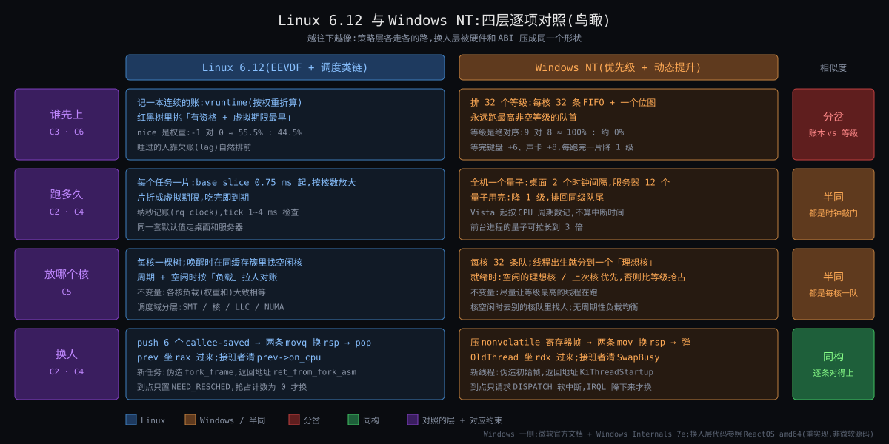
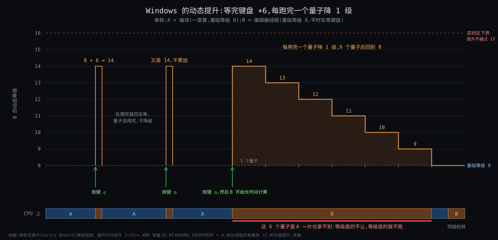

# 阶段 6:Linux 进程调度器 与 Windows NT 的对照

> 对照对象只选一家:**Windows NT**(对齐时选定,一家比到底)。压在四层:谁先上、跑多久、放哪个核、换人;cgroup 和 sched_ext 的对应物只给一段(§7)。
>
> **出处口径**:Windows 内核不开源,这一侧不能像 Linux 6.12 那样钉行号。依据分三档,正文里逐条标明:
> - 【文档】微软官方文档(learn.microsoft.com 的 Win32 / WDK / C++ ABI 文档),已逐条核对原文;
> - 【WI】《Windows Internals》第 7 版 Part 1 第 4 章(Russinovich 等),凭记忆引用的数字一律进待核;
> - 【ReactOS】ReactOS 的 amd64 内核源码。它是 NT 的净室重实现,函数名与微软公开符号一致,行为瞄准 NT 5.2(Server 2003),**不是微软源码**,现代 Windows 有出入。只用它看「形状」,不用它证明数字。
>
> Linux 一侧沿用上一节:源码钉 6.12,行号形如 `core.c:5328`。

## 约束清单速查(C1 ~ C8)

#### C1 — CPU快IO慢
核比它要等的东西快 10⁴ ~ 10⁷ 倍,等待是常态。
**不可再分**:物理事实。
**口诀**:等的时候换别人上。

#### C2 — 程序不让台
程序不会主动让,内核也猜不到它还要多久。
**不可再分**:程序不可信 + 未来不可知。
**口诀**:时钟来敲门,到点就换人。

#### C3 — 凭账不凭嘴
看不见未来,任务不自报也不可信,只能凭已发生的事。
**不可再分**:信息论事实。
**口诀**:记过去,不猜未来。

#### C4 — 调度不免费
换人直接 1~2 μs + 缓存冷几十 μs;选人代价须与任务数无关。
**不可再分**:CPU 微架构 + 没有专管调度的核。
**口诀**:换得少、选得快。

#### C5 — 核间不通气
核与核无共用桌面:跨核共享一行慢几十倍,打断对方慢上千倍。
**不可再分**:缓存一致性 + IPI 代价。
**口诀**:各管各的队,偶尔对账。

#### C6 — 有人等不起
份额 ≠ 时限:有一类任务要「某时刻前一定拿到」,公平记账只保份额。
**不可再分**:物理世界的期限。
**口诀**:公平之外另开一条道。

#### C7 — 同机多租户
租户在乎的公平单位是「我这一摊」,而租户可随意多开线程。
**不可再分**:应用 / 部署现实。
**口诀**:先分组,组内再分。

#### C8 — 一算法不配万场景
负载对三问的最优答案不同,且变化快于内核发布;策略须可换且错了不伤内核。
**不可再分**:应用多样性 + 社区流程。
**口诀**:策略可换,内核不倒。

---

## §0 从 Deep 走到 Comparison:三件事记住

前五节一直在 Linux 自己的院子里:三问怎么答(What / How)、怎么一步步变成今天这样(Origin)、换人那 14 条指令(Deep)。只看一家,容易把每个选择都当成必然。这一节拿一个血统完全不同的系统照一下 —— Windows NT 出自 DEC VMS 那一支(待核 #35),和 Unix 没有共同祖先 —— 看 C1 ~ C8 这八条约束在另一家手里被答成了什么样。

**第一件:策略层分岔 —— 账本对等级。** 因为 C3·凭账不凭嘴(调度器看不见未来)+ C6·有人等不起(交互任务不能排队)→ 要解决「凭什么判断谁更该先上」→ Linux 的答案是记一本连续的账(vruntime,谁欠得多谁先上);Windows 的答案是排 32 个等级,再让**发生的事件**临时改等级(等完键盘升 6 级,跑满一片降 1 级)。Windows 敢这么做,是因为它手里有一张 Linux 没有的牌:窗口系统和设备驱动都在内核里,「谁在前台、谁刚收到按键」是内核亲眼看见的事实,不是任务自报。

**第二件:机制层同构 —— 换人被硬件和 ABI 压成同一个形状。** 因为 C2·程序不让台(必须能强行换)+ C4·调度不免费(换得越少越省)→ 要解决「怎么把一个执行流冻住、换另一个上来」→ 两家都是:压被调用方保存的寄存器、两条指令换栈指针、弹寄存器;被换下去的人由接班者收尾;新线程靠一帧伪造的栈「假装被换下去过」;到点只置标志,等到安全点才真换。寄存器存几个不由内核定,由各自的 ABI 定。上一节你那句「进程 = 栈 + 寄存器」,在另一家**逐条成立**。

**第三件:「可调」放在了不同的地方。** 因为 C7·同机多租户 + C8·一算法不配万场景 → 要解决「一套默认策略不够用时怎么办」→ Linux 把策略本身做成可换的零件(调度类链、cgroup 树、sched_ext);Windows 把策略固定住,在外面给旋钮(进程优先级类、全机量子长短、Job 对象限 CPU),再允许应用在用户态自己调度自己(fiber、已下线的 UMS)。

| 三件事 | 是什么 | 为什么存在 |
|---|---|---|
| 账本对等级 | Linux:vruntime + 虚拟期限;Windows:32 级 + 事件提升 + 逐片衰减 | C3 + C6:看不见未来时凭什么排序。Windows 有内核内的窗口系统作「可信的嘴」,Linux 没有,只能记账 |
| 换人同构 | 压 nonvolatile 寄存器 → 换 rsp → 弹;接班者收尾;伪造初始帧;延迟到安全点 | C2 + C4:硬件只认栈指针,ABI 规定哪些寄存器归被调用方 —— 两家没有选择余地 |
| 可调的位置 | Linux:换策略(类 / 组 / BPF);Windows:调旋钮(类 / 量子 / Job)+ 应用自调度 | C7 + C8:开源社区能合入新策略,闭源内核只能预留参数 |

三件事的关系:第二件是地基(两家一样),第一件盖在上面(两家不一样),第三件决定以后还能不能改(两家改的地方不一样)。**越靠近硬件越像,越靠近人越不像。**

---

## §1 一张极简概览图



从图上能读出的五件事:

1. 四层自上而下,相似度从「分岔」到「同构」单调变化:谁先上最不像,换人逐条对得上。
2. 谁先上那一层,同一个「差一级」含义完全不同:Linux 的 nice 差 1 是 55.5% 对 44.5%;Windows 的等级差 1 是「高的不让,低的就不跑」。
3. 跑多久那一层,Linux 每个任务有自己的一片(毫秒级),Windows 全机一个量子(几十到上百毫秒)。Windows 的量子敢这么长,是因为交互线程不靠轮到,靠升级插队。
4. 放哪个核那一层,两家都是每核一队(C5·核间不通气 逼的),但守的不变量不同:Linux 守「各核负载相等」,Windows 守「等级最高的在跑」。
5. 换人那一层,左右两栏几乎可以逐词替换:rax ↔ rdx、on_cpu ↔ SwapBusy、fork_frame ↔ 初始帧、NEED_RESCHED ↔ DISPATCH 软中断。

---

## §2 设计动机简表:Windows NT 调度器为什么长这样

**初衷。** 1988 年微软请来 DEC 的 Dave Cutler 团队做一个新内核,团队把 VMS 的调度模型带了过来:32 个优先级,低 16 级分时、高 16 级实时,等待结束时临时提升(待核 #35)。它要解决的是 1990 年代初微软面对的具体问题:同一个内核既要跑图形桌面(用户敲键盘必须立刻有反应),又要跑文件和数据库服务器(吞吐优先),而且**窗口系统是它自己的**。所以它没有去追求「公平」这个抽象目标,而是直接问:此刻发生的这件事(按键、磁盘完成、窗口切到前台)说明谁更急?

**擅长。**
- 前台交互:按键、鼠标、音频这类「事件驱动、处理极短」的线程,靠提升立刻抢到 CPU,不受后台计算拖累。
- 明确的重要性分层:管理员或应用把进程标成 High / Realtime,就真的压过所有低等级线程,语义简单、可预期。
- 选人极快:每核 32 条队列加一个 32 位位图,一条「找最高位」指令就选出下一个(C4·调度不免费)。

**不擅长。**
- 份额控制:等级是绝对序,没法表达「A 拿 60%、B 拿 40%」;同级之间只有轮转。要份额得另外套 Job 对象(§7)。
- 低等级饥饿:一个不睡觉的高等级线程会让所有低等级线程停摆,只能靠每秒一次的扫描兜底(§3.4)。
- 启发式的边界:提升值是按设备类型写死的常量,负载不像 1990 年代设想的那样时(比如后台服务大量做网络 IO)会提升错对象,所以后来不断打补丁:MMCSS、AutoBoost、异构核策略。

**典型应用场景。**
- Windows 10 / 11 桌面和笔记本:前台窗口响应。
- Windows Server:IIS、Active Directory、文件服务;服务器版默认用长量子(§4)。
- SQL Server:它在 Windows 调度器之上又放了一层自己的协作式调度器 SQLOS(待核 #39)—— 这本身就是对「不擅长」的一个注脚,§7 再说。
- Windows 容器:进程隔离模式靠 Job 对象的 CPU 速率控制分 CPU(待核 #38)。

---

## §3 对照一:谁先上

### §3.1 节首结论

- Linux 的 fair 类回答「谁欠得最多」;Windows 回答「谁等级最高」。前者是比例,后者是绝对序。
- Windows 的 1 ~ 15 级不是 Linux fair 类的对应物。**它更像 2003 ~ 2007 年 Linux 自己的 O(1) 调度器**:优先级数组 + 位图 + 按行为加减分。Linux 在 2007 年离开了这个设计点(Origin §2.4 病根、§3 公平之争),Windows 留了下来。
- Windows 能留下来,是因为它的加减分依据比 Linux 当年的硬:不是「睡了多久」这种泛泛的统计,而是「哪种设备的 IO 完成了」「哪个窗口在前台」。

### §3.2 两家的数据结构

| | Linux 6.12(fair 类) | Windows NT |
|---|---|---|
| 调度单位 | `task_struct`(线程就是共享 mm 的任务) | `KTHREAD`;进程 `KPROCESS` 只是容器,给线程提供基础等级 |
| 排序依据 | `vruntime`(已跑时间按权重折算)+ 虚拟期限 `deadline` | 动态优先级 0 ~ 31;0 只给清零页线程,1 ~ 15 可变,16 ~ 31 实时【文档 Scheduling Priorities】 |
| 用户旋钮 | nice −20 ~ 19 → 权重表,相邻约 1.25 倍 | 进程优先级类(Idle 4 / Normal 8 / High 13 / Realtime 24 …)× 线程相对等级(±2、Idle、Time critical)→ 基础等级【文档】 |
| 就绪队列 | 每核一棵红黑树,按 `deadline` 排,节点带 `min_vruntime` 增广 | 每核 32 条 FIFO 链表 `DispatcherReadyListHead[32]` + 32 位位图 `ReadySummary`【ReactOS `KiSelectReadyThread`】 |
| 选人 | `pick_eevdf`:树上找「有资格(lag ≥ 0)且期限最早」,O(log n) | 位图找最高位(`BitScanReverse`)→ 取该级队首,O(1) |
| 临时调整 | 无显式提升;睡眠者醒来保留 lag,自然排前 | 等待结束时按事件提升;每用完一个量子降 1 级,降到基础等级为止【文档 Priority Boosts】 |
| 不饿死的保证 | 结构性的:账总会追平 | 兜底性的:后台线程每秒扫一次就绪队列(§3.4) |

Windows 的选人代码短到可以整段贴(ReactOS,`ntoskrnl/include/internal/ke_x.h`):

```c
PrioritySet = Prcb->ReadySummary >> Priority;          /* 32 位位图:第 n 位 = 第 n 级队列非空 */
if (!PrioritySet) goto Quickie;
BitScanReverse((PULONG)&HighPriority, PrioritySet);   /* 一条指令找最高非空等级 */
HighPriority += Priority;
ListEntry = Prcb->DispatcherReadyListHead[HighPriority].Flink;    /* 取该级队首 */
Thread = CONTAINING_RECORD(ListEntry, KTHREAD, WaitListEntry);
if (RemoveEntryList(&Thread->WaitListEntry))
    Prcb->ReadySummary ^= PRIORITY_MASK(HighPriority);            /* 这一级空了,清位 */
```

读过 Origin §2.3 的话会觉得眼熟:这就是 Ingo Molnár 2002 年的 O(1) 调度器(140 级数组 + 位图 + `sched_find_first_bit`)。两家在同一个时期各自到达了同一个设计点,因为 C4·调度不免费 对「选人要 O(1)」的压力是一样的。

### §3.3 动态提升:Windows 怎么回答 C6·有人等不起

**概念引入**:因为 C6·有人等不起(敲键盘的人不能等后台算完)+ 等级是绝对序(同级只能轮转,交互线程和计算线程默认同为 8 级)→ 要解决「不改基础等级,却能让刚等到事件的线程立刻上」→ 所以引入**动态优先级**:每个线程除了基础等级,还有一个调度器实际使用的当前等级;事件发生时把当前等级临时抬高,之后逐片降回去。

提升的来源【文档 Priority Boosts + WDK 头文件常量】:

| 事件 | 提升 | 依据 |
|---|---|---|
| 等待的 IO 完成 | 驱动在完成 IO 时给出增量:磁盘 / 光驱 / 显卡 +1,网络 / 串口 / 管道 +2,键盘 / 鼠标 +6,声卡 +8 | `IO_DISK_INCREMENT 1`、`IO_NETWORK_INCREMENT 2`、`IO_KEYBOARD_INCREMENT 6`、`IO_SOUND_INCREMENT 8`(WDK 公开常量;ReactOS `iotypes.h` 同值) |
| 等待的事件 / 信号量被置位 | +1 | `EVENT_INCREMENT 1`、`SEMAPHORE_INCREMENT 1` |
| 所属进程在前台 | 上述提升之外再加最多 2 | 【ReactOS `KiDeferredReadyThread`:`OldPriority += PsPrioritySeparation`】;文档只说「前台进程的优先级类被抬到不低于后台」(待核 #33) |
| 窗口收到输入(定时器 / 鼠标 / 键盘消息) | 提升拥有该窗口的线程 | 【文档】 |
| 持锁者挡住了高等级等待者 | 把持锁者抬到等待者的等级,直到放锁(AutoBoost) | 【文档 Priority Inversion】 |

三条硬规则【文档】:提升只作用于基础等级 0 ~ 15 的线程,16 ~ 31 的实时线程从不提升;提升后**每用完一个时间片降 1 级**,降到基础等级为止;动态等级永不低于基础等级。



**算例 1(交互)**:单核。A 是编译器,一直算,基础等级 8。B 是编辑器线程,基础等级 8,平时在等键盘。

- Windows:你按下一个键 → 键盘驱动完成 IO,带增量 6 → B 的当前等级变成 8 + 6 = 14(在前台再加,封顶 15)→ 14 > 8,**立刻抢占** A → B 用不到 1 ms 处理完按键,回去等 → A 继续。B 的量子没用完,下次按键又从 8 + 6 算起,不累加。如果 B 这次不回去等、开始长时间计算,它会 14 → 13 → … → 8 逐片降,6 个量子之后和 A 平起平坐(图右半)。
- Linux:你按下一个键 → B 被唤醒,`place_entity` 让它保留睡前的 lag,落在平均水位略后面 → 它有资格,且虚拟期限比 A 早 → `wakeup_preempt` 给 A 置 NEED_RESCHED → 下一个检查点换上 B。

两家都在一次换人的时间内响应了按键。**理由不同**:Windows 是「因为刚才发生的是键盘事件」,Linux 是「因为 B 一直没用掉自己的份额」。

**算例 2(看出分岔)**:单核,两个都一直算的线程。Linux 上 X 是 nice −1,Y 是 nice 0;Windows 上 X 是 9 级,Y 是 8 级。都是「差一档」。

| | X | Y | 为什么 |
|---|---|---|---|
| Linux | 55.5% | 44.5% | 权重 1277 : 1024,vruntime 按权重倒数增长,两人轮流到期 |
| Windows | ≈ 100% | 千分之几(待核 #41) | 9 > 8,X 永远在最高非空队列;Y 只在每隔几秒被防饥饿扫描抬到 15 时跑一个短量子(§3.4) |

想在 Linux 上得到 Windows 这种结果,得把 X 放进 rt 类(`SCHED_FIFO`)。也就是说:**Windows 的整个 1 ~ 15 级,行为上是一个「带衰减的软实时类」;Linux 把这种严格优先语义单独关在 rt 类里,默认的 fair 类则是 Windows 默认没有的东西** —— 比例份额。

### §3.4 不饿死靠什么

**概念引入**:因为等级是绝对序(算例 2 里 Y 会停摆)+ C2·程序不让台(X 不会主动让)→ 要解决「低等级线程永远排不上」→ 所以引入一个每秒醒一次的系统线程(平衡集管理器)扫描就绪队列:等得太久的线程直接抬到 15 级,给一个短量子,跑完立刻落回原等级(待核 #32)。

ReactOS 的 `KiScanReadyQueues`(`ntoskrnl/ke/balmgr.c`)把这几个数写在了明面上:

```c
ULONG Count = 10, Number = 16;                       /* 每趟最多抬 10 个、最多看 16 个 */
ULONG WaitLimit = KeTickCount.LowPart - 300;         /* 等了 300 个时钟滴答以上才算饿 */
...
if (WaitLimit >= Thread->WaitTime) {
    Thread->PriorityDecrement += (THREAD_BOOST_PRIORITY - Thread->Priority);
    Thread->Priority = THREAD_BOOST_PRIORITY;        /* 抬到 15 */
    Thread->Quantum = WAIT_QUANTUM_DECREMENT * 4;    /* 只给一个很短的量子 */
    KiInsertDeferredReadyList(Thread);
```

对照 Linux:EEVDF 不需要这个扫描。Y 的 vruntime 涨得比 X 慢是不可能的 —— 谁跑谁涨 —— 所以 Y 的 lag 只会越攒越多,必然轮到它。**饥饿在 Linux fair 类里是结构上不存在的;在 Windows 里是结构上存在、靠巡逻兜住的。** 这是 C3·凭账不凭嘴 两种答法的直接后果:记了账,公平是账本的性质;不记账,公平要另派人查。

### §3.5 为什么 Windows 这么选(解读,非出处)

Origin §2.4 讲过,Linux 的 O(1) 调度器也有一套「交互性启发式」:按睡眠时间占比(`sleep_avg`)给任务加减几级动态优先级(待核 #44)。它在 2007 年被整体放弃(Origin §3),原因是这个启发式会判错、会被骗:一个故意小睡的计算任务能骗到加分,一个偶尔算一阵的交互任务会被扣分。那场争论的结论是 C3:**调度器看不见任务的意图,泛泛的行为统计不可信,只能记账。**

Windows 面对同一条 C3,却没有走到记账,因为它的约束组合里多一项 Linux 没有的:

| | Linux | Windows |
|---|---|---|
| 窗口系统在哪 | 用户态(X / Wayland),内核不知道哪个窗口在前台 | 内核态(win32k),内核知道前台窗口和输入焦点 |
| 「谁是交互的」的信号 | 只能从睡眠 / 运行比例**猜** | 由驱动和窗口系统**告知**:这是键盘 IO、这是前台进程 |
| 信号能不能被应用伪造 | 能(小睡即可) | 难(应用没法让键盘驱动替它完成一次 IO) |
| 所以 | 启发式不可信 → 改为记账(CFS / EEVDF) | 启发式有可信来源 → 留在等级 + 提升 |

换句话说,C3 说的是「不能凭任务的嘴」。Windows 没有违反它,它凭的是**内核自己的另一只眼睛**。代价是这只眼睛只认识 1990 年代的设备分类;后来出现的负载(多媒体、大小核、容器)每来一种就得再补一条规则。

---

## §4 对照二:跑多久

### §4.1 节首结论

- 两家都靠时钟中断敲门(C2·程序不让台),都按「换人有成本」来定片长(C4·调度不免费)。
- 差别在片长归谁:Linux 每个任务一片,毫秒级;Windows 全机一个量子,桌面约 31 ms、服务器约 187 ms(待核 #30)。
- Windows 的量子敢长一个数量级,是 §3 的直接推论:交互线程靠升级插队,不靠轮到,量子只在**同级线程之间**起作用。

### §4.2 逐项

| | Linux 6.12 | Windows NT |
|---|---|---|
| 片长默认值 | `sysctl_sched_base_slice` 0.75 ms(fair.c:76),启动时乘以 `1 + ilog2(min(核数, 8))`(fair.c:191 ~ 205),8 核以上即 3 ms | 量子 = 桌面版 2 个时钟间隔、服务器版 12 个;时钟间隔在 x64 多核上约 15.6 ms(【WI】待核 #30) |
| 记在哪 | 每个任务自己的 `se->slice`;6.12 起可用 `sched_setattr` 给单个任务设片长 | 线程的 `Quantum`,初值来自进程的 `QuantumReset`;全机一个注册表值决定长短和是否给前台加长(待核 #33) |
| 计量单位 | 纳秒(rq clock),`update_curr` 每次记账 | 内部以 1/3 时钟间隔为单位(【ReactOS】`CLOCK_QUANTUM_DECREMENT 3`、`WAIT_QUANTUM_DECREMENT 1`);Vista 起改按 CPU 周期数,被中断占去的时间不算在线程头上(【WI】待核 #31) |
| 到期怎么判 | `update_deadline`:`vruntime ≥ deadline` 即吃完一片(fair.c:1007) | 时钟中断里 `Quantum -= 3`,≤ 0 即到期(【ReactOS `KeUpdateRunTime`】) |
| 到期之后 | 期限后推一片,`resched_curr` 置标志;下次选人按期限重排 | 当前等级降 1(不低于基础等级),量子重置,排到**同级队尾**;若同级和更高级都没人,原线程接着跑(【ReactOS `KiQuantumEnd`】) |
| 主动等待 | 剩余的片作废;醒来按 lag 重新定位 | 剩余量子作废【文档 Context Switches:"relinquishes the remainder of its time slice"】 |

**算例**:8 核以上的机器,某个核上有 3 个一直算的同级线程。

| | 每人一次跑多久 | 轮一圈 | 每秒换人 |
|---|---|---|---|
| Linux(nice 0 × 3) | 约 3 ms | 约 9 ms | 约 330 次 |
| Windows 桌面(8 级 × 3) | 约 31 ms | 约 94 ms | 约 32 次 |
| Windows 服务器 | 约 187 ms | 约 560 ms | 约 5 次 |

Linux 多换了十倍的人。这不是谁更会算账,而是两家用片长在解不同的问题:

- 在 Linux,一个刚醒的任务最坏要等当前任务把片跑完(`RUN_TO_PARITY`),所以**片长就是延迟上界**,必须短。
- 在 Windows,刚醒的交互线程靠提升直接抢占,根本不等量子;量子只决定同级的计算线程多久换一次班,那当然越长越省(C4)。服务器版干脆拉到 12 个间隔,因为服务器上没有「前台」。

所以「跑多久」不是一个独立的问题。**它的答案被「谁先上」的答法决定**:用抢占保延迟的系统可以长片,用轮转保延迟的系统必须短片。

---

## §5 对照三:放哪个核

### §5.1 节首结论

- C5·核间不通气 在两家逼出了同一个骨架:每核一套就绪队列,线程尽量留在上次跑过的核。Windows 在 Server 2003 才从全局队列改成每核队列(待核 #34),和 Linux 2.6 的 O(1) 是同一个年代。
- 守的不变量不同:Linux 守「各核负载大致相等」,Windows 守「尽量让等级最高的线程在跑」。前者要周期性对账,后者只在线程就绪和核空闲这两个时刻做决定。

### §5.2 逐项

| | Linux 6.12 | Windows NT |
|---|---|---|
| 队列 | 每核一个 `rq`,里面每个调度类一套结构 | 每核一个 `KPRCB`,里面 32 条就绪队列 + 位图(待核 #34:Windows 8 起部分系统几个核共享一组队列) |
| 线程的「家」 | 无固定的家;`prev_cpu`(上次的核)是强提示 | **理想核**:创建时按进程内轮转分配,可用 `SetThreadIdealProcessor` 改;另记「上次的核」【文档 Multiple Processors】 |
| 硬约束 | `sched_setaffinity` 亲和掩码;cpuset cgroup | 亲和掩码;CPU Sets 是「软」亲和,与电源管理兼容【文档 CPU Sets】 |
| 就绪时选核 | `select_task_rq_fair`:先看能否贴着唤醒者(`wake_affine`),再在同一个末级缓存簇里找空闲核(`select_idle_sibling`) | 有空闲核就用空闲核,其中优先理想核;没有空闲核就看理想核上正在跑的线程:等级比它低就抢占,否则排进理想核的队列(【ReactOS `KiSelectNextProcessor` / `KiDeferredReadyThread`】;【WI】真实顺序更细:理想核 → 上次核 → 同 NUMA 节点,待核 #36) |
| 平时对账 | tick 里周期性 `sched_balance_rq`:按调度域层级比负载,从最忙的核拉任务;核变空闲时也拉 | 没有周期性的负载均衡;核变空闲时去别的核的队列里找能跑的线程(待核 #36) |
| 衡量什么 | 负载 = 权重 × 最近利用率(PELT),连续值 | 等级,离散值;队列长短不直接参与 |
| 拓扑意识 | 调度域:SMT → 核 → LLC → NUMA,逐层放宽 | NUMA 节点优先、处理器组(超过 64 核)、核心休眠、大小核策略【文档 Processor Groups;异构调度待核 #40】 |

**算例**:4 核,线程 T 的理想核是 2 号,T 等的 IO 完成了。此刻 0、1 号核空闲,2 号核正在跑一个 8 级线程,T 提升后是 10 级。

- Windows(按 ReactOS 的逻辑):空闲集合非空 → 只在空闲核里选 → 理想核 2 号不空闲 → 落到 0 号。**有空闲核就不抢人**,哪怕 T 的等级更高、哪怕要离开理想核。
- Linux:`select_idle_sibling` 先看 `prev_cpu` 空不空,不空就在同簇里扫空闲核 → 同样落到某个空闲核。

两家结论一样。分岔出现在**没有空闲核**的时候:

- Windows 只跟理想核上的那一个线程比等级。比得过就抢;比不过就排在理想核的队列里等。这时别的核上可能正跑着等级比 T 还低的线程 —— Windows 不保证全局最高的 N 个线程一定在跑,它只做到「大致」。
- Linux 把 T 放进选中的 rq,由那个核的 EEVDF 决定何时上;以后周期均衡发现这个核负载偏高,再把人拉走。

两种做法是 C5 的两种折中:Windows 少做跨核动作(只在就绪和空闲两个时刻看别人),代价是全局优先序只能近似;Linux 定期对账,代价是对账本身要拿别人的锁、跨核搬任务。

---

## §6 对照四:换人 —— 检验「进程 = 栈 + 寄存器」

### §6.1 节首结论

上一节 §2.5 的结论是:换人就是换栈指针;寄存器里只有被调用方保存的那几个需要手工存,其余的早就在栈上;接班者替前任收尾;新任务靠伪造的栈帧启动;到点只置标志,到安全点才换。

拿 Windows 逐条检验,**五条全部成立**,只有名字和寄存器清单不同。清单不同的原因不在内核,在 ABI。

### §6.2 核心指令并排看

Linux(entry_64.S:177,上一节 §2.3.3):

```asm
__switch_to_asm:
	pushq %rbp ; pushq %rbx ; pushq %r12 ; pushq %r13 ; pushq %r14 ; pushq %r15
	movq  %rsp, TASK_threadsp(%rdi)        /* 存 prev 的栈指针 */
	movq  TASK_threadsp(%rsi), %rsp        /* 取 next 的栈指针 —— 这一条之后就是另一个人 */
	popq  %r15 ; popq %r14 ; popq %r13 ; popq %r12 ; popq %rbx ; popq %rbp
	jmp   __switch_to
```

Windows(ReactOS `ntoskrnl/ke/amd64/ctxswitch.S`,删注释):

```asm
KiSwapContext:
	GENERATE_EXCEPTION_FRAME               /* 压 rbp rbx rdi rsi r12~r15 + xmm6~xmm15 */
	mov  r8, gs:[PcCurrentThread]          /* r8 = 新线程 */
	call KiSwapContextInternal
	RESTORE_EXCEPTION_STATE                /* 弹回来 —— 弹的是新线程当年压的 */
	ret

KiSwapContextInternal:                     /* rdx = 旧线程,r8 = 新线程 */
	...
	mov  [rdx + KTHREAD_KernelStack], rsp  /* 存旧线程的栈指针 */
	mov  rsp, [r8 + KTHREAD_KernelStack]   /* 取新线程的栈指针 —— 这一条之后就是另一个人 */
	call KiSwapContextResume               /* C 函数:换 CR3、存取浮点状态、清 SwapBusy … */
	...
	ret
```

中间那两条 `mov`,两家一个字都不用改。

### §6.3 逐条对照

| 上一节的结论 | Linux 6.12 | Windows(ReactOS amd64) | 成立吗 |
|---|---|---|---|
| ① 换人 = 换栈指针 | `movq %rsp, TASK_threadsp(%rdi)` / `movq TASK_threadsp(%rsi), %rsp`;存在 `task->thread.sp` | `mov [rdx+KTHREAD_KernelStack], rsp` / `mov rsp, [r8+KTHREAD_KernelStack]`;存在 `KTHREAD.KernelStack` | 成立,连指令条数都一样 |
| ② 手工只存被调用方保存的寄存器(§2.5.1) | 6 个:rbx rbp r12 ~ r15(System V ABI) | 8 个通用 + 10 个向量:rbx rbp **rdi rsi** r12 ~ r15 + **xmm6 ~ xmm15**(微软 x64 ABI 的 nonvolatile 集合【文档 x64 calling convention】) | 成立。**清单不同是因为 ABI 不同,不是内核的选择** |
| ②' 其余通用寄存器 | 编译器在 `call` 之前压进 prev 的栈 | 同:rax rcx rdx r8 ~ r11 + xmm0 ~ xmm5 是 volatile,由调用方负责【文档】 | 成立 |
| ②'' 用户态现场 | 进内核时压成栈底的 `pt_regs` | 进内核时压成栈上的 `KTRAP_FRAME` | 成立 |
| ②''' 浮点 / 向量大状态 | `__switch_to` 里 `switch_fpu_prepare`,XSAVES 存进 task_struct | `KiSwapContextResume` 里 `KiSaveXState` / `KiRestoreXState`,存进线程的 `StateSaveArea` | 成立 |
| ③ 接班者替前任收尾(§2.5.2) | prev 坐 rax 过来(`last`);`finish_task_switch(prev)` 清 `prev->on_cpu` | 旧线程坐 rdx 过来(换栈前后都在 rdx);`KiSwapContextResume` 里 `OldThread->SwapBusy = FALSE` | 成立。信使都是寄存器;标志位一个叫 `on_cpu` 一个叫 `SwapBusy`,用途相同:别的核看到它为真就得等 |
| ③' 别的核怎么等 | `try_to_wake_up` 里 `smp_cond_load_acquire(&p->on_cpu, !VAL)`(core.c:4318) | `KiSwapContextInternal` 开头 `cmp byte ptr [r8+ThSwapBusy], 0` 不为 0 就 `pause` 自旋 | 成立 |
| ④ 新任务靠伪造栈帧启动(§2.6) | `copy_thread` 造 `fork_frame`:`ret_addr = ret_from_fork_asm`,上面是一份 `pt_regs` | `KiInitializeContextThread` 造初始帧:切换帧 + 启动帧(返回地址 `KiThreadStartup`,再返回到 `KiUserThreadStartupExit` → `KiServiceExit3`)+ 异常帧 + `KTRAP_FRAME` | 成立,而且都是**一串链起来的假返回地址** |
| ④' 新任务的用户态现场从哪来 | 整份抄父进程的 `pt_regs`,只改 `ax = 0`(§2.6.1) | 由创建者提供的一份 `CONTEXT` 填进 `KTRAP_FRAME`(`TrapFrame->Rip = Context->Rip` …) | **这里不同**,见 §6.4 |
| ⑤ 到点只置标志,到安全点才换(§2.3.1.1) | tick 里 `resched_curr` 置 `TIF_NEED_RESCHED`;抢占计数为 0 的出口检查点才 `schedule()` | 时钟中断里 `Prcb->QuantumEnd = 1` + `HalRequestSoftwareInterrupt(DISPATCH_LEVEL)`;IRQL 降到 DISPATCH_LEVEL 以下,软中断才送达、才进 `KiQuantumEnd` | 成立。「抢占计数」在 Windows 叫 IRQL |
| ⑤' 在不该换的位置换了 | `BUG: scheduling while atomic`(core.c:5864) | 蓝屏 `ATTEMPTED_SWITCH_FROM_DPC`(【ReactOS `KiSwapContextResume`】待核 #42) | 成立,连「发现了就让机器停下」都一样 |
| 换地址空间 | `switch_mm_irqs_off` 写 CR3,在换栈**之前**(core.c:5312) | `__writecr3(NewProcess->DirectoryTableBase[0])`,在换栈**之后**,且只在进程不同才写 | 顺序相反,都对:内核栈在所有地址空间里映射相同,先换后换都踩不空 |

**IRQL 是什么**(概念引入):因为 C2·程序不让台 要求能强行换人 + 换人要冻栈、只能在安全点做(上一节 §2.3.1.1)→ 要解决「此刻能不能换」的判断 → Linux 给每个任务一个抢占计数,持自旋锁就加一;Windows 给每个核一个中断请求级别(IRQL),0 是普通线程代码,1 是 APC,2 是 DISPATCH,更高是各设备中断。拿自旋锁就把 IRQL 抬到 2,而线程调度本身是第 2 级的软中断,所以**IRQL ≥ 2 时调度器被自己的级别挡在门外**。两家用不同的数字表达了同一件事:栈上有冻不得的东西时不许换。

### §6.4 唯一真不同的地方:Windows 没有 fork

第 ④' 行是这张表里唯一一处实质差异,而它不是调度器的差异。

Linux 的新任务来自 fork:复制父进程。所以子进程的用户态现场是「抄一份父亲的 `pt_regs`,改一个格子」,地址空间靠 COW 推迟复制(上一节 §2.6.1 / §2.6.2)。

Windows 没有 fork。新进程从一个可执行映像建一个全新的地址空间,新线程的起点由创建者显式给出(起始地址 + 参数),内核把它们填进一份 `CONTEXT`,再由 `KiInitializeContextThread` 抄进新线程栈上的陷阱帧。没有「父子从同一条指令醒来」这回事,自然也没有「rax = 0」的把戏,没有 fork 时的写保护和 COW。

但请注意这只改了**伪造的那帧里填什么**,没改**要不要伪造**:两家的新线程第一次上 CPU,走的都是和老线程完全一样的「换栈、弹寄存器、ret」,只是弹出来的是创建者事先摆好的值。「新任务 = 一根看起来像刚被换下去的栈」这个结论,在没有 fork 的系统里照样成立。

### §6.5 这一层为什么会同构

三样东西两家都没得选:

1. **CPU 只认栈指针和指令指针**。要让一个核转去执行另一段冻住的代码,唯一的办法是换 rsp,让 `ret` 从新栈上弹出别人的返回地址。
2. **ABI 规定了哪些寄存器归被调用方**。换人在编译器眼里是一次函数调用,编译器已经替调用方存好了它那一半;内核只需补上另一半。System V 那一半是 6 个,微软那一半是 8 + 10 个。
3. **多核下「它还在不在那个核上」必须有人说了算**。被换下的线程自己说不了(它已经停了),只能接班者说,于是都有一个 `on_cpu` / `SwapBusy`。

这三样分别来自硬件、工具链、并发的基本事实,和「Unix 还是 VMS 血统」无关。所以这一层是上一节那句话最硬的证据:**「进程 = 栈 + 寄存器」不是 Linux 的实现细节,是这类机器上换人的唯一做法。**

---

## §7 cgroup 和 sched_ext 在 Windows 的对应物(只给一段)

这两块你打算以后各自单独做,这里只留路标。

**C7·同机多租户 → Job 对象。** Windows 的分组单位是 Job:把若干进程放进一个 Job,对整个 Job 设限。CPU 这一项叫 CPU 速率控制【文档 `JOBOBJECT_CPU_RATE_CONTROL_INFORMATION`】,有三种互斥的模式:按权重(1 ~ 9,默认 5,对应 `cpu.weight`)、硬上限(每个调度间隔最多用万分之几的周期,到了就整组停到下个间隔,对应 `cpu.max`)、最小 / 最大保证。Windows 容器的进程隔离模式靠它分 CPU(待核 #38)。和 cgroup 的差别:Job 的速率控制是**叠在**优先级调度器外面的一层节流,不像 Linux 把组做成调度树里的一个实体、让组间公平和组内公平用同一套算法递归(上一节 §3)。

**C8·一算法不配万场景 → 没有对应物,只有绕行。** Windows 内核里没有可插拔的调度策略,闭源也意味着没有「合入一个新调度类」这条路。它给的是两样别的东西。一是旋钮:进程优先级类、全机量子策略、MMCSS(多媒体线程登记后由系统服务代为调高等级【文档】)、CPU Sets。二是让应用**在用户态自己调度自己**:fiber(协作式,应用自己切栈)和 UMS(Windows 7 引入,内核在线程阻塞时把控制权还给应用的调度器;Windows 11 起不再支持,所有调用返回 `ERROR_NOT_SUPPORTED`【文档 User-Mode Scheduling】)。最有名的用户是 SQL Server:它的 SQLOS 在 Windows 线程之上做了一层协作式调度,每个逻辑 CPU 一个调度器,工作线程跑一小段就主动让出(待核 #39)。

把两家放一起看:面对「默认策略不合我的负载」,Linux 的回答是**把策略请进内核、出错有看门狗兜底**(sched_ext);Windows 的回答是**内核策略不动,应用在上面再盖一层自己的**。前者改的是「谁先上」的定义,后者改不了定义,只能在内核分给自己的时间里再分一次。

### §7.1 追问:SQL Server 为什么非要自己再盖一层

**结论先行**:Windows 回答「谁先上、跑多久、何时换」凭的三样东西,数据库一样都用不上;Windows 又不让人改它的答法。SQL Server 的办法是让 Windows 在每个核上**没得选**,自己在上面把这三问重答一遍。它换掉的只是策略,换人这个动作仍然是 §6 那段 Windows 内核代码在做。

**事实**【文档 SQL Server Thread and task architecture guide,已核原文】:每个逻辑 CPU 对应一个调度器;一个工作线程最多连续跑 4 ms(文档叫 quantum),到点主动让出,排进一个先进先出的可运行队列;文档自己把这叫协作式调度(cooperative scheduling),也叫非抢占式调度;SQL Server 实例的线程默认都在 Windows 的等级 7。

**从前面三张对照表推出的三条理由**(推导是我的;微软自己陈述的历史动机见待核 #46):

| Windows 的答法 | 数据库里的情况 | 后果 |
|---|---|---|
| 谁先上:等级 + 事件提升(§3) | 所有工作线程同在等级 7;没有前台窗口、没有键盘;IO 完成带来的提升和「这条查询重不重要」无关 | §3.5 那张「可信的嘴」在这里是哑的,Windows 分不出谁该先上。这正是 C8·一算法不配万场景 |
| 跑多久:服务器版量子约 187 ms(§4,待核 #30) | 一条点查只要几十微秒到几毫秒 | 同等级轮一圈太久。SQLOS 自己定成 4 ms,和 Linux 默认的 3 ms 落在同一个量级 |
| 何时换:量子到点或更高等级就绪就换,不看被换的人手里拿着什么(§6) | 工作线程经常拿着闩锁(latch,保护缓冲页的短锁)或自旋锁,正常只拿 1 微秒上下 | 拿着锁被换下,要这把锁的人全部白等 |

**第三条的算例**:4 核机器,核 0 上有 A、B、C 三个同等级的工作线程。A 拿着一把自旋锁(正常持有约 1 微秒)时量子到点。

- 交给 Windows 直接管:A 被换下,B、C 各自可以跑满一个量子,A 最坏要等 2 × 187 ms ≈ 374 ms 才回来放锁。这段时间里核 1 ~ 3 上凡是要这把锁的线程都拿不到。持锁时间从 1 微秒放大到 374 ms,约 37 万倍。(这是最坏量级。真实实现里等锁的人会退避、睡眠,但那又是额外的换人,回到 C4·调度不免费。)
- 交给 SQLOS:A 只在自己选的让出点让出,让出点不落在持锁区间里,自己人之间不会出现这种放大。(别的进程里等级更高的线程照样能抢 A,这一条只消除了 SQL Server 自己人之间的互抢。)

这和 Deep §2.3.1.1 是同一个原则往上搬了一层。内核「到点只置标志、到安全点才换」,安全点是内核自己知道的:不在中断里、没拿自旋锁。数据库的安全点是「手里没闩」,只有数据库自己知道,内核看不见。协作式调度就是让知道安全点的人来决定何时换。

**怎么让 Windows 没得选**(待核 #45):每个调度器名下,任一时刻只让一个工作线程在 Windows 眼里是「能跑的」,其余工作线程都阻塞在各自的事件对象上。Windows 在这个核上只看见一个候选人,等级、提升、量子全都无从发挥。让出 = 叫醒队头那个人的事件 + 自己回去等自己的事件。

**旁证:主要矛盾在策略,不在换人的开销**【同一篇文档,已核】。SQL Server 另有一个 fiber 模式(`lightweight pooling`),连换人也搬到用户态。文档对它的评价是:切换线程上下文的开销可能并不大,大多数实例开不开这个选项没有性能差别;从 SQL Server 2025 起该模式标为弃用。换人本身(§6)两家同构、也都够便宜,值得另盖一层的是上面的策略。

**代价:C2·程序不让台 又回来了。** 协作式的前提是每段代码都自觉让出。SQL Server 敢这么做,靠两条:

- 跑在工作线程上的几乎全是它自己的代码。一旦要跑管不住的外部代码(扩展存储过程、链接服务器查询、调 Windows API),就把这个线程从「非抢占模式(SQL Server 调度)」切到「抢占模式(操作系统调度)」,交还给 Windows 管【文档 `sys.dm_os_wait_stats`,`PREEMPTIVE_*` 等待类型,已核】。
- 自己的代码真不让出时,它手里没有时钟中断,不能强行把人换下,只能事后报「调度器不让出」的错误(待核 #45)。

对比 sched_ext(Deep §4):BPF 调度器把任务饿住,看门狗超时后把整个策略踢掉,退回内核自带的公平调度器,因为内核始终握着时钟中断和最后的抢占权。同样是回应 C8·一算法不配万场景,**盖在内核上面的那一层靠「自己的代码都自觉」担保,请进内核的那一层由内核保留抢占权担保**。

**反问 2:某个工作线程在两个让出点之间死循环,Windows 照常在量子到点时把它换下,同一个调度器名下的其他工作线程能跑吗**

用户的猜测:「应该可以跑吧,不然调度器的作用不是没有了」。

答案是跑不了。但后半句的直觉是对的:**这个核上那层协作式调度器的作用,确实就这样没了**。这正是 C2·程序不让台 的原样重现,也是操作系统内核当年放弃协作式调度的原因。要分清的是这里有两个调度器,失效的是上面那个:

| 层 | 它从哪里挑人 | 死循环时它看见什么 | 还在不在工作 |
|---|---|---|---|
| Windows 内核调度器 | 就绪队列 `DispatcherReadyListHead`(§3.2),只装「就绪」状态的线程 | 这个核上 SQL Server 的线程只有 W1 一个是就绪的;W2、W3 在「等待」状态,不在队列里 | 在。时钟中断照来,量子照到,别的进程、别的核上的调度器都不受影响 |
| SQLOS 调度器 | 自己的可运行队列(先进先出) | W2、W3 排在队里等着 | 不在。它没有自己的时钟中断,只在有人走到让出点时才运转,而 W1 永远走不到 |

**时间线算例**(量子取 187 ms,待核 #30):

- 0 ms:W1 进入死循环。W2、W3 各自阻塞在自己的事件对象上。
- 187 ms:时钟中断,W1 量子到点。Windows 去就绪队列找同等级的人,没有(W2、W3 不在就绪队列里),于是给 W1 续一个量子接着跑。就算中间插进来别的进程的线程,跑完回来的还是 W1。
- 374 ms、561 ms……:同上。

W2 要回到就绪队列,唯一的途径是有人对它的事件做一次「置位」,而这个动作写在让出点的代码里。W1 不到让出点,就永远没人做。

用 Linux 的话说是同一件事:睡在等待队列上的任务不在运行队列里,`pick_next_task` 看不见它,CPU 再空也轮不到它,只有一次 `wake_up` 能把它放回去。

所以**抢占只保证「把人换下」,不保证「换谁上」**。换谁上要求候选人先在就绪队列里;SQLOS 恰恰是靠「不让别人进就绪队列」才让 Windows 没得选的。它的好处和它的风险是同一个机关。受损范围是这一个调度器名下的任务,其他核上的调度器照常(细节待核 #45)。

**反问 3:起一个监视线程,发现 W1 超时不让出就替它叫醒 W2,这样修会破坏什么**

用户的回答:「W1 自己也是通过内核调度的,所以会出现不能稳定替换的场景。」

这句话抓住了前一半:**叫醒 W2 不等于换下 W1**。监视线程能做的只是往 Windows 的就绪队列里多放一个人;W1 并没有停,它和 W2 现在同时是就绪的,谁上、上多久重新归 Windows 说了算。SQL Server 做不到「稳定地把 W1 换成 W2」。

要补的后一半是:这一下破坏的正是 §7.1 的地基。

- 「每核只有一个能跑的」不成立了 → Windows 重新有得选 → 它按量子在 W1、W2 之间轮换,不看谁手里拿着什么 → 第三条理由(拿着闩被换下)原样回来。
- 监视线程在外面,不知道 W1 此刻手里有没有闩。它叫醒 W2 的那一刻,可能正好是 W1 的持锁区间。
- 想真正「换下」W1,只能把它强行挂起。挂在任意一条指令上,若它正拿着闩,要这把闩的人全部死等。

**合法的版本其实存在,就是前面说的「抢占模式」**:W1 要去跑外部代码之前,自己先把调度器让给下一个人,然后继续在 Windows 的调度下跑。此时同样是 W1、W2 同时就绪,但这是 W1 **自己在安全点上**做的决定,它知道手里没闩。同一个动作,由知道安全点的人做是安全的,由外面的监视者做就不安全。

这也反过来解释了内核为什么**能**做强制抢占。时钟中断就是那个「外面的监视者」,它之所以敢换人,是因为内核里每拿一把自旋锁都会记进 `preempt_count`(Deep §2.3.1.1):监视者换人之前查一眼这本账,不为 0 就只置标志、等它归零。SQL Server 的监视线程手里没有这本账,也没有「在用户态打断另一个线程、到它的安全点再换」的手段,所以现实里它只报错、不动手(待核 #45)。

三次反问收成一句:**强制换人 = 外部的时钟 + 一本「现在能不能换」的账**。内核两样都有;SQLOS 两样都没有,于是只能协作;sched_ext 把策略放进内核,借用的正是内核这两样东西。

这个做法不是 Windows 独有。Linux 上也有人在线程之上自己再调度一层(Go 运行时的协程调度、ScyllaDB 每核一线程的协作式调度,待核 #46),理由主要是第三条:应用知道的安全点,内核看不见。

---

## §8 约束回扣

| 约束 | Linux 6.12 的答法 | Windows NT 的答法 | 分岔的根源 |
|---|---|---|---|
| C1·CPU快IO慢 | 等待即出队,醒来保留 lag | 等待即出队,醒来按事件提升 | 无分岔;提升值恰好按「等的是什么设备」分档 |
| C2·程序不让台 | tick → NEED_RESCHED → 出口检查点 | 时钟中断 → DISPATCH 软中断 → IRQL 降下时 | 无分岔,同构(§6.3 ⑤) |
| C3·凭账不凭嘴 | 记账:vruntime,不信任何行为统计 | 不记账:信内核自己看见的事件(哪种 IO、哪个窗口) | 窗口系统在不在内核里(§3.5) |
| C4·调度不免费 | 红黑树 O(log n) 选人,短片;换人 6 push | 位图 O(1) 选人,长量子;换人 8 + 10 压栈 | 片长取决于延迟靠什么保(§4.2);寄存器数取决于 ABI |
| C5·核间不通气 | 每核一 rq,周期按负载对账 | 每核一组队列,只在就绪和空闲时看别的核 | 守的不变量不同:负载相等 对 高等级在跑(§5) |
| C6·有人等不起 | fair 之外另开 rt / dl 类;fair 内靠 lag 和短片 | 16 ~ 31 实时区;1 ~ 15 内靠提升 + MMCSS + AutoBoost | Linux 分类隔离,Windows 同一把尺子上分区 |
| C7·同机多租户 | cgroup:组是调度树里的实体,递归同一算法 | Job 对象速率控制:叠在调度器外的一层节流 | 公平是不是调度器的原生概念 |
| C8·一算法不配万场景 | 调度类链 + sched_ext:策略可换,看门狗兜底 | 旋钮 + 用户态自调度(fiber / UMS / SQLOS) | 开源可合入新策略 对 闭源只能预留参数 |

八条约束,两条的答法同构(C1、C2),一条只差参数(C4),五条分岔。分岔的五条全部集中在「信息从哪来」和「改动从哪进」这两件事上,**没有一条是因为硬件不同**。

---

## §9 呼应灵魂问题

灵魂问题的前半截是「调度器替系统做什么、怎么做」。前五节给的是 Linux 的答案;这一节让它多了一个参照,于是可以把答案分成两层:

- **不得不这样的部分**:每核一队、时钟敲门、到点只置标志、换人就是换栈、接班者收尾、新任务靠假栈帧。两个没有共同祖先的内核在这些地方逐条重合,说明它们是 C2、C4、C5 加上这类硬件逼出来的,换谁来写都一样。入门时这部分值得当成「机器的性质」来记。
- **可以不这样的部分**:凭账还是凭等级、片长几毫秒还是几十毫秒、按负载均衡还是按等级抢占。这部分是约束权重不同时的不同落点,Linux 的 EEVDF 只是其中一个。读 Linux 源码时这部分值得带着「它也可以是另一个样子」去读。

后半截是「cgroup 和 sched_ext 增强了什么、为什么需要」。对照给了一个从外面看的回答:它们增强的恰好是 Windows 的调度器**结构上给不了**的两样东西 —— 把「份额」做成调度器的原生概念并能分层(Windows 只能在外面套一层 Job 节流),以及把「谁先上」的定义本身交给使用者而内核不倒(Windows 只能让应用在上面再盖一层)。这两样之所以在 Linux 上做得成,前提正是 fair 类本来就在记账(份额才有意义)、调度类链本来就把策略和换人分开了(策略才换得动)。

到这里,「是什么、为什么、怎么做、怎么来的、源码长什么样、别家怎么做」都有了。剩下的是把这一路用过的方法本身拎出来。

---

## 待核清单(导出前统一核实)

(2026-11-12 导出前已统一核实,逐条结果见综合长文末尾《收尾核实》。)

(#1 ~ #29 见前面各节文档。)

- #30 Windows 量子:桌面版 2 个时钟间隔、服务器版 12 个;x64 多核时钟间隔约 15.6 ms(《Windows Internals》7e Part 1 Ch.4)。§4 算例的 31 ms / 187 ms / 每秒换人次数都由它推出
- #31 Vista 起量子按 CPU 周期数计、不把中断时间算在线程头上(同上)
- #32 防饥饿扫描:平衡集管理器每秒一次;就绪超过约 4 秒的线程抬到 15、给一个短量子;每趟看 16 个、最多抬 10 个(同上;ReactOS `balmgr.c` 是 300 滴答 / 16 / 10,已核对代码)
- #33 前台加成:`PsPrioritySeparation` 0 ~ 2;前台量子可拉长到 3 倍;由注册表 `Win32PrioritySeparation` 控制
- #34 每核就绪队列自 Windows Server 2003 起;Windows 8 起部分系统若干核共享一组就绪队列
- #35 NT 调度模型承自 VMS(Dave Cutler 团队,1988 年加入微软);VMS 为 32 级,0 ~ 15 分时、16 ~ 31 实时;NT 3.1 发布于 1993 年 7 月
- #36 Windows 选核的真实顺序(理想核 → 上次核 → 同节点 …)、理想核按进程内轮转分配、无周期性负载均衡而由空闲核扫描别核队列
- #37 ReactOS 代码取自 master 分支(2026-11-11 抓取),未钉提交号;其行为瞄准 NT 5.2,现代 Windows 的换人路径另有影子栈、KPTI 下的 CR3 处理等,未覆盖
- #38 Job 对象 CPU 速率控制自 Windows 8 / Server 2012 起;Windows 容器进程隔离模式使用它;更早的 DFSS(远程桌面会话间公平)自 Server 2008 R2
- #39 SQL Server 的 SQLOS:每逻辑 CPU 一个调度器、协作式(非抢占式)、量子最多 4 ms、可运行队列先进先出、实例默认等级 7;fiber 模式(lightweight pooling)自 SQL Server 2025 起弃用 —— 已核(Thread and task architecture guide,2026-11-11)
- #40 Windows 11 的异构核(大小核)调度与 Intel Thread Director 的配合
- #41 §3.3 算例 2「9 级对 8 级 ≈ 100% 对千分之几」的量级,由 #32 的扫描周期和短量子推出
- #42 蓝屏代码 `ATTEMPTED_SWITCH_FROM_DPC`(0xB8)在真实 Windows 中的触发条件
- #43 Linux 一侧:nice −1 权重 1277、nice 0 权重 1024(`sched_prio_to_weight`,core.c:10013 起,已核);base slice 放大系数 `1 + ilog2(min(ncpus, 8))`(fair.c:191 ~ 205,已核,顺带闭合 How 待核 #5)
- #44 Linux O(1) 调度器交互性加减分的幅度(`sleep_avg` → 动态优先级 ±5)与出处
- #45 SQLOS 的实现细节:每个调度器任一时刻只有一个工作线程在 Windows 眼里可运行、其余阻塞在各自的事件对象上;「调度器不让出」错误(17883)及其判定阈值(出处:Ken Henderson / Slava Oks 的 UMS、SQLOS 文章,凭记忆)
- #46 微软自己陈述的引入动机(UMS 始于 SQL Server 7.0,1998 年;SQLOS 始于 2005);Linux 上 Go 运行时、ScyllaDB(Seastar)用户态调度的动机表述。§7.1 的三条理由是从本文对照表推出来的,不是引文

**已核对原文的出处**(2026-11-11 抓取 Markdown 源):

- Scheduling Priorities / Priority Boosts / Context Switches / Priority Inversion / Multiple Processors / CPU Sets / User-Mode Scheduling / Multimedia Class Scheduler Service:`learn.microsoft.com/windows/win32/procthread/<页名>`
- `JOBOBJECT_CPU_RATE_CONTROL_INFORMATION`:`learn.microsoft.com/windows/win32/api/winnt/ns-winnt-jobobject_cpu_rate_control_information`
- x64 调用约定(volatile / nonvolatile 寄存器):`learn.microsoft.com/cpp/build/x64-calling-convention`
- SQL Server:Thread and task architecture guide(`learn.microsoft.com/sql/relational-databases/thread-and-task-architecture-guide`)、`sys.dm_os_wait_stats`(`learn.microsoft.com/sql/relational-databases/system-dynamic-management-views/sys-dm-os-wait-stats-transact-sql`)
- ReactOS:`github.com/reactos/reactos` 下 `ntoskrnl/ke/amd64/ctxswitch.S`、`ntoskrnl/ke/amd64/thrdini.c`、`ntoskrnl/ke/thrdschd.c`、`ntoskrnl/ke/dpc.c`、`ntoskrnl/ke/time.c`、`ntoskrnl/ke/balmgr.c`、`ntoskrnl/include/internal/ke_x.h`、`sdk/include/xdk/iotypes.h`、`sdk/include/ndk/ketypes.h`

## 修订记录

| 时间 | 修订摘要 | 触发原因 |
|---|---|---|
| 2026-11-11 | 初稿:对象 Windows NT,一家比到底;四层对照(谁先上 / 跑多久 / 放哪个核 / 换人)各一张逐项表 + 算例;§3.5 解读「窗口系统在内核里 = 可信的嘴」;§6 用 ReactOS amd64 检验「进程 = 栈 + 寄存器」五条全成立,唯一差异是没有 fork;§7 cgroup / sched_ext 对应物一段;两张 SVG;待核 #30 ~ #44 | 对齐 Q1 ~ Q4(同领域 / 一家比到底 / Windows NT / 三问 + 换人)+ reconfirm 后用户「没有了」 |
| 2026-11-11 | 新增 §7.1「SQL Server 为什么非要自己再盖一层」:结论(让 Windows 每核没得选,自己重答三问;只换策略不换机制)+ 三条理由表(等级与提升用不上 / 187 ms 量子太长 / 拿着闩被换下)+ 算例(持锁 1 微秒 → 374 ms)+ 与 Deep §2.3.1.1「安全点才换」同一原则上搬一层 + fiber 模式旁证 + 代价(C2·程序不让台 回来,抢占模式兜外部代码,无时钟中断只能事后报错,对比 sched_ext 看门狗);待核 #39 已核,新增 #45、#46 | 反问 1 用户未作答,回复「继续」后选 1:跳过问题直接讲答案,留在本话题 |
| 2026-11-11 | §7.1 新增「反问 2」一段:记录用户猜测「应该可以跑吧,不然调度器的作用不是没有了」;纠:跑不了(W2、W3 在等待状态、不在 Windows 就绪队列里,唯一的置位动作在让出点);认:后半句直觉成立,失效的正是上层协作式调度器 = C2·程序不让台 重现;两层调度器对照表 + 时间线算例 + Linux 等待队列类比;结论「抢占只保证把人换下,不保证换谁上」 | 反问 2 用户回答(半对:结论错,反证的直觉对) |
| 2026-11-11 | §7.1 新增「反问 3」一段:记录用户回答「W1 自己也是通过内核调度的,所以会出现不能稳定替换的场景」;认:叫醒 W2 ≠ 换下 W1,两人同时就绪后归 Windows 说了算;补:破坏的是「每核只有一个能跑的」这个地基,第三条理由(拿着闩被换下)回来,强行挂起会死等;合法版本 = 抢占模式(W1 自己在安全点让出);内核能强制抢占是因为有 `preempt_count` 这本账;收束句「强制换人 = 外部的时钟 + 一本现在能不能换的账」 | 反问 3 用户回答(前一半对,补后一半) |
| 2026-11-12 | 导出前核实:本文正文无改动;待核 #30 ~ #46 的逐条结果(已核 / 推算 / 未核实)记入综合长文末尾《收尾核实》 | 导出前统一核实 |
