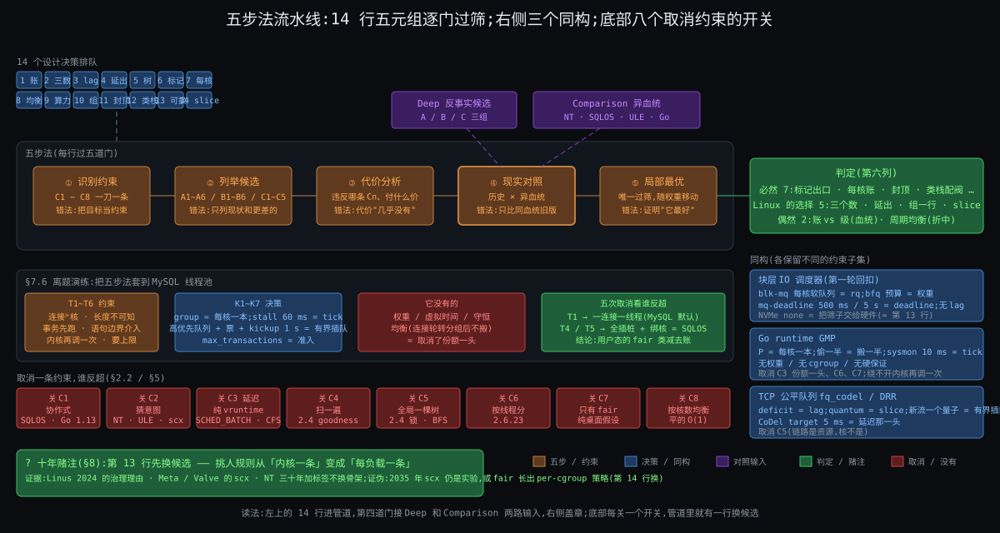

# 阶段 7:Linux 的进程调度器的设计哲学与方法论沉淀

> 硬核模式(Deep + Comparison 都走完)。读者定位:教学分享,但起点是读过内核书的人 —— 不铺背景,只给方法和结论,每条结论都带前六份的 § 指针。这一份不是摘要:它的四样新产出是五元组表(每个决策过一遍筛)、必然 / 偶然判别法(从 Comparison 抽出来)、五步法(从前六份的生成过程本身抽出来)和一次离题演练(把五步法套到 MySQL 线程池上)。最后是一个十年赌注。
>
> 贯穿机器与任务同前:8 核两组 L3,HZ = 250,Linux 6.12;mysqld ×16、redis ×1、xz(nice 19)、k8s 容器限 2 核。

---

## 约束清单速查(C1 ~ C8)

> 后文所有 `Cn·短名` 都对应下面 8 条,每条在第二份里从"一核一队列先来先跑"一刀一刀推出过,这里只放"约束 + 不可再分性 + 口诀"。推导见 `stages/02-why/02-why.md`。每条是 markdown 标题,viewer 里可以 `Ctrl+F` 搜 `C3` 直接滚到。

#### C1 — 只在打断点换

内核没有自己的 CPU,只能在流进内核的瞬间(tick / 系统调用 / 中断 / 阻塞)介入;介入时不一定能立刻换人(持锁、中断上下文)。
**不可再分**:要控制一条流必须先拿到它的核;中断上下文不能换栈。
**口诀**:先打标记 → 出口再换

#### C2 — 未来不可知

内核不知道任务下一步算还是等、要多久;猜的启发式可被构造负载骗。
**不可再分**:意图不在二进制里,不可静态判定。
**口诀**:只看账 → 不看人

#### C3 — 份额与延迟两头要

长期按权重分 CPU(份额)和醒来多久上台有界(延迟)是两个独立要求;插队额度须有界。
**不可再分**:一个标量不能同时编码比例和上界。
**口诀**:权重管份额 → slice 管延迟 → lag 管资格

#### C4 — 挑人须便宜

每核每秒万次级决定,每次 < 1 μs 且不随任务数线性增长;记账必须增量。
**不可再分**:规则的常数项直接吃掉它要分的资源。
**口诀**:O(log n) 挑 → O(1) 记

#### C5 — 核各自为政

核有独立 cache / TLB / 时钟,跨核同步贵一到两个数量级,核间有远近。
**不可再分**:多核硬件结构。
**口诀**:每核一本账 → 搬人要算账

#### C6 — 份额按组算

分配单位是用户 / 容器,线程数可被放大;组要嵌套、要能封顶;内核只看见线程。
**不可再分**:内核没有"用户"这个调度对象。
**口诀**:组是一行账 → 封顶按周期扣

#### C7 — 有人要硬保证

一部分任务要绝对时限 / 优先;相对公平推不出绝对保证;凌驾带来饿死与反转。
**不可再分**:公平与保证互不蕴含。
**口诀**:类栈凌驾 → 每个口子配阀

#### C8 — 核不等速且耗电

核的有效算力随 SMT / 频率 / 大小核变,能耗是非线性的独立目标。
**不可再分**:硬件物理。
**口诀**:按算力比 → 不按核数比

---

## §0 从 Comparison 走到 Synthesis:三件事记住

上一份结尾说:八条约束里五样两边同形(必然),三样是血统和折中点(偶然)。这一份把"怎么得出这个判定"本身做成工具。三件事:

### §0.1 事一:五元组 —— 从 C2·未来不可知 + C4·挑人须便宜 的"规则必须封闭"推出

因为规则只看账(C2·未来不可知)、每一步都有预算(C4·挑人须便宜)→ 每个设计决策都可以被问同样五个问题:它解了哪条约束、付了什么代价、不这么做还能怎么做、现实里谁那么做了、它是不是在这组约束下唯一过筛的 → 所以引入**五元组**(决策 / 约束 / 代价 / 反事实 / 现实对照)+ 第六列"必然 / 偶然"。Deep 的三组反事实(A1 ~ A6、B1 ~ B6、C1 ~ C5)填第四列,Comparison 的 13 行判定填第五、六列。

### §0.2 事二:必然 vs 偶然判别法 —— 从 Comparison 的"同 / 异"推出

因为同一组约束下另一套血统(VMS → NT)独立做了一遍 → 要解决"哪些是约束逼的、哪些是 Linux 选的"→ 所以引入判别法:**同约束下另一血统也这么做 = 必然;只有一边这么做而两边都没违反约束 = 偶然(血统或折中点);一边取消了某条约束才不这么做 = 该约束的证据**。SQLOS 是第三种的样本(取消 C2·未来不可知 后的另一个局部最优,Comparison §7)。

### §0.3 事三:五步法 —— 从前六份的生成过程推出

因为前六份就是按"约束 → 候选 → 代价 → 对照 → 局部最优"写的 → 把它抽成可带走的五步:识别约束 / 列举候选 / 代价分析 / 现实对照 / 局部最优证明。§7 每步配本轮实例和常见错误,§7.6 拿 MySQL 线程池离题验一次。

### §0 结论:三件事对照

| 件 | 是什么 | 为什么存在 |
|---|---|---|
| ① 五元组 | 14 个决策各过一遍五问 + 判定 | 规则封闭(C2·未来不可知 + C4·挑人须便宜)才能逐行审 |
| ② 判别法 | 同约束下另一血统是否同形 | 单看 Linux 分不清约束和血统 |
| ③ 五步法 | 五问的生成顺序 | 方法离开主题才叫方法 |

三件事怎么串:① 是②的输入(每行先填"现实对照"再判),③ 是①②的生成器;§8 的赌注是用①②预测未来,§7.6 是用③离题。

---

## §1 一张极简概览图

从图上能读出五件事:

1. **中间的管道是五步法**,左进右出:约束进去,局部最优出来;14 行五元组在管道里排队,每行要过五道门。
2. **第四道门(现实对照)有两个入口**:Deep 的反事实候选和 Comparison 的 NT / SQLOS / ULE / Go,判定就在这道门后面盖章。
3. **右侧三个侧栏是同构**:块层 IO 调度器、Go runtime、TCP 公平队列,各自的"账 / 片 / 每核一本 / 有界插队"都能对回管道里的某一行。
4. **底部是取消约束的八个开关**:关掉任何一个,管道里就有一行换候选(§2.2),这是局部最优"随权重移动"的证据。
5. **左下角一个问号是十年赌注**:五元组里哪一行最先换候选(§8)。

---

## §2 五元组表:14 次过筛

**先说结论**:14 个决策里,7 个在 NT 上有同形对应(必然),5 个是 Linux 自己的选择(两边都没违反约束),2 个是折中点或治理决定(偶然)。EEVDF 不是最聪明的设计,是 2023 年权重下唯一过得了八道筛的那个;2007 年的 CFS 在 2007 年的权重下也过了筛。

### §2.1 表

| # | 设计决策(出处) | 解决的约束 | 付出的代价 | 反事实候选 | 现实对照 | 判定 |
|---|---|---|---|---|---|---|
| 1 | 只按账挑人,`pick_eevdf` 40 行里没有类型判断(Deep §2.2.4,`fair.c:907`) | C2·未来不可知 | 真正的交互任务没有奖励,只能靠账小 + slice 小(Why insight 1) | A2 CFS 睡醒补半 slice;A5 BVT warp(Deep §2.5) | NT 事件提升 +1 ~ +8(猜);SQLOS 2016 转向 deficit(Comparison §3、§7.2) | 偶然(血统):同约束下 NT 选了猜 |
| 2 | 份额 / 延迟 / 资格拆成权重、slice·deadline、lag 三个数(How §3.1 ~ §3.4) | C3·份额与延迟两头要 | 每实体多两个字段,树要按 deadline 排并增广(Deep §7) | A3 彩票(延迟是概率);A4 stride(只有 vruntime) | NT 一个数(级),"急"只能抬级(Comparison §3.4) | Linux 的选择;"插队有界"那一半是必然 |
| 3 | lag 睡下去夹在 ±max(2·slice, tick) = ±6 ms,醒来按 (W + w)/W 放大守恒放回(Deep §2.2.3,`:692` / `:5266`) | C3·份额与延迟两头要 | 睡再久只欠 6 ms;大权重任务还 6 ms 要跑 64 ms(How §14) | 不夹紧:模拟器 120 ms 不换人(Deep §2.6);CFS 固定优惠 | NT 提升 ≤ 15、每片 −1 回基线(Comparison §3.6) | 有界 = 必然;"守恒放大"是 Linux 的算术选择 |
| 4 | 超支者去睡不出队,留树上到 lag 归零(`DELAY_DEQUEUE`,Deep §2.2.6,`:5500`) | C3·份额与延迟两头要 | 树上有"在睡但挂着"的节点;`h_nr_running` 与真可跑分开算 | 6.11 以前存负 lag 带到下次;或清零(逃债) | NT 无对应(级不记欠账) | Linux 的选择(2024 年才定) |
| 5 | 按 deadline 排的增广树 + `avg_vruntime` 两个累加器 + 乘倒数不除法(Deep §2.2.2,`:620` / `:259`) | C4·挑人须便宜 | 常数项变成字段和表;44 位累加器有上界 | 2.4 的 goodness 扫一遍;O(1) 位图(只对级有效) | NT 32 位位图 O(1)(Comparison §8) | 必然(O(log n) 或 O(1)),数据结构形状偶然 |
| 6 | tick / 唤醒只打 `TIF_NEED_RESCHED`,真换在两个出口(How §4.2,`core.c:1079` / `entry/common.c:101`) | C1·只在打断点换 | 决定到执行差一次出口;3 ms slice 实跑 4 ms(Deep §2.4) | 中断里直接换栈(不可能);协作式 yield(信任) | NT DeferredReady → Standby,IRQL ≥ 2 不换(Comparison §6.1) | 必然 |
| 7 | 每核一本账;唤醒偏 prev 108.5%、同 LLC 找空核(Deep §3.2.1,`:7411` / `:7873`) | C5·核各自为政 | 永远只是近似均衡 | B1 全局树一把锁;B3 每次放最闲(Deep §3.5) | NT 理想 / 上次处理器 + 每处理器队列(Comparison §5) | 必然 |
| 8 | 分层 pull:117% 迟滞、只搬一半、500 μs 热门槛、newidle 只搬一个(Deep §3.2.2 / §3.4,`:11048` / `:11162` / `:9260` / `:9607`) | C5·核各自为政 + C4·挑人须便宜 | 跨 L3 永远有残差;newidle 每次只搬一人 | B2 无热门槛;B4 push;B5 不分层 | NT 无周期均衡,只在就绪时选核(待核 #100);ULE pull + push(Comparison §5.5、§7.3) | 偶然(C5·核各自为政 vs C4·挑人须便宜 的折中点) |
| 9 | 跨核一切比较除以算力;PELT 32 ms 半衰期做重量;跨 LLC 走 `migrate_util`(Deep §3.2.3 / §3.4,`pelt.c:180`,`:11115`) | C8·核不等速且耗电 | 32 ms 对突发反应慢;x86 服务器无能耗模型 | 按核数均衡(SMT 兄弟挤一起) | NT efficiency class + QoS 标签 + `SchedulingPolicy`(Comparison §6.3) | 按算力比 = 必然;估计量 vs 标签 = 偶然 |
| 10 | 组在父树上是同形一行,权重按本核负载分摊 `calc_group_shares`(How §3.7,Deep §4.2.2,`:4015`) | C6·份额按组算 | 每层入账逐层爬;组权重估算偏大("icky") | 按线程分(2.6.23);只贴标签不记账 | NT Job 权重 1 ~ 9 不嵌套;DFSS 按会话(Comparison §4) | 组一行 = Linux 的选择;嵌套是它的推论 |
| 11 | 带宽 = 池 + 每核借 5 ms 片 + 借不到整组停 + 100 ms 定时器补(Deep §4.2.3,`:5772` / `:5915` / `:6518`) | C6·份额按组算 | 周期末整组停 87.5 ms(How §6.3) | Deep §4.5 候选一 ~ 五:cpuset 按核限 / 无封顶只按比例 / 只停超额线程 / 无 burst / dl 式预算 | NT Job HARD_CAP 整 job 停到 next interval;kubelet Windows 312 ‰(Comparison §4.3) | 必然(形状);周期与片长偶然 |
| 12 | 类栈 `stop > dl > rt > fair > ext > idle` + rt 95% 阀 + fair 5% server + PI + dl 准入(Deep §5.1 / §5.2,`rt.c:876`,`deadline.c:239` / `:1637`) | C7·有人要硬保证 | 5% 留白;准入拒绝;PI 锁更重 | 全走公平(音频爆音);凌驾无阀(2.4) | NT 16 ~ 31 无阀无准入;MMCSS 留 20%;AutoBoost 地板(Comparison §6.2) | 凌驾 + 阀 + 继承 = 必然;准入与阀的位置偶然 |
| 13 | 挑人规则可替换:`ext` 类在 fair 之下,BPF 定 enqueue / dispatch,watchdog 回退(Deep §5.4,`vmlinux.lds.h:131`,`ext.c:4445`) | C2·未来不可知(让知道负载的人定)+ C7·有人要硬保证 的阀 | "正确"没有唯一答案;治理成本 | 树外补丁;可加载调度器(Linus 多次 NAK) | Meta / Valve 的 scx;NT 无(Origin §8) | 偶然(治理决定,2024-06-11) |
| 14 | slice 可自定 0.1 ~ 100 ms(`sched_attr::sched_runtime`)+ `PREEMPT_SHORT` 让短 slice 抢长 slice(Deep §2.1,`syscalls.c:307`,`:1177`) | C3·份额与延迟两头要 | 接口暴露了可滥用的旋钮(小 slice 换插队权) | latency-nice(再加一个 nice) | NT 只能抬级(Comparison §3.4) | Linux 的选择(拆成三个数之后的自然接口) |

读法:第 1 行和第 13 行都挂在 C2·未来不可知 下,却一个"不猜"一个"让别人猜"—— 这不是矛盾:内核自己不猜,但允许知道负载的人在树内猜。

### §2.2 逐条取消一条约束看谁反超

| 取消的约束 | 哪个候选反超 | 现实里谁这么做了 |
|---|---|---|
| C1·只在打断点换(假设流会自己让台) | 协作式:打断点由调度器自己埋,到处都是,不需要 tick 和标记 | SQLOS(Comparison §7);Go 1.13 以前(函数调用处才能抢,死循环挂调度器,Comparison §7.3) |
| C2·未来不可知(假设意图可读) | 猜:事件提升、睡眠比评分、或者干脆让负载自己写规则 | NT 的 boost;FreeBSD ULE 的交互性评分;sched_ext 把猜交给加载者(第 13 行) |
| C3·份额与延迟两头要 的延迟一头(只要份额) | 纯轮转或纯 vruntime,不需要 deadline / lag | `SCHED_BATCH`(不抢占)/ `SCHED_IDLE`;2007 年 CFS 的本体(延迟靠修正偷渡) |
| C4·挑人须便宜(假设预算无限) | 扫一遍算 goodness,或者每层维护理想 EEVDF 的完整 lag | 2.4 的 `goodness`(Origin §2);2008 年 Peter 的 fair-group EEVDF 被搁置的原因之一(Origin §9) |
| C5·核各自为政(假设单核或跨核免费) | 全局一棵树、不要调度域、不要热门槛 | 2.4 的 `runqueue_lock`;BFS / MuQSS 单队列(Con 自述 16 逻辑核上限,Origin 交接) |
| C6·份额按组算(假设单位就是线程) | 没有 `task_group`,没有带宽;`make -j64` 压扁浏览器 | 2.6.23 的 CFS(组调度三个月后才补,Origin §10) |
| C7·有人要硬保证(假设没人要绝对时限) | 只有 fair 一个类,不需要类栈、阀、PI | 纯桌面假设;Con 的 "absolute fairness at all costs"(Origin §4) |
| C8·核不等速且耗电(假设对称 SMP) | 按核数均衡,不要 capacity / PELT / EAS | 2.6 早期的 O(1) 均衡(平的);手机上 2019 年前的大小核靠厂商补丁 |

八次取消各有一个现实样本 —— 这是"局部最优随权重移动"的全部证据:同一份代码,在取消某条约束的世界里不是最优,而且那个世界真的存在过。

---

## §3 洞察清单

**先说结论**:前六份能抽出 24 条独立洞察;按"读者带走后能用在别的系统上"挑 11 条必保,每条一节。

### 全部 24 条

| # | 洞察(一句话) | 出处 |
|---|---|---|
| 1 | 调度器 = 四问:何时换 / 换谁 / 各多少 / 在哪换;规则只看账 | What |
| 2 | 份额、延迟、位置是三个独立旋钮,拧错了没用甚至更糟 | What 钩子二,How §5.6 / §11 |
| 3 | 配额是时间不是核;p99 抖动的粒度 = 周期,根治是并发数 | What 钩子一,How §6.3,Deep §4.4 |
| 4 | 约束一刀一条跟着痛点走;"公平"是目标不是约束 | Why |
| 5 | 把"猜意图"换成"记账":账越纯,规则越站得住 | Why insight 1,Origin §4 / §7 |
| 6 | 份额与延迟拆成两个数,lag 是缝合的第三个数 | Why insight 2,How §3.4 |
| 7 | 一本账变 N × H 本:每核一本(水平)× 组嵌套(垂直),上一层是同形一行 | Why insight 3,How §3.7 / §5 |
| 8 | 凌驾要配阀:给特权和限特权成对出现 | Why insight 4,Deep §5.1 / §5.2 |
| 9 | 标记与真换分开:决定在打断点,执行在出口 | How §4,Deep §2.3 |
| 10 | 睡再久只能欠两个 slice;欠账守恒,放回时按 (W + w)/W 放大 | How §3.4,Deep §2.2.3 |
| 11 | 两个同权任务的稳态是 tick 粒度轮换,不是 slice 粒度 | Deep §2.6 |
| 12 | 高权重任务的"欠账"是服务量不是时间:还 6 ms 的账要跑 64 ms | How §14 |
| 13 | 睡眠不能逃债:超支者留树上到 lag 归零 | How §3.4,Deep §2.2.6 |
| 14 | 搬人只在"有利可图且不热":117% 迟滞、搬一半、500 μs | Deep §0.2 / §3 |
| 15 | 同 LLC 拉平个数,跨 LLC 只填算力余量 | Deep §3.4 |
| 16 | newidle 均衡是热路径,可抢占内核下每次只搬一个 | Deep §3.3 / §3.4 |
| 17 | 绑核分"不能走"和"不能来"两半,只绑一半更糟 | How §5.6,Deep §3.6 |
| 18 | 组的封顶按周期借还,整组停;池 + 每核借片是 16 核不争锁的代价 | Deep §4.2.3 / §4.3 |
| 19 | 三代换代各改写一条约束的权重:2002 C4·挑人须便宜 + C5·核各自为政、2007 C2·未来不可知、2023 C3·份额与延迟两头要 | Why 呼应,Origin |
| 20 | 同一份代码,约束权重变了就从"没必要"变成"必然"(EEVDF 2008 vs 2023) | Origin §9 |
| 21 | 规则可替换之后,"正确"没有唯一答案;合并它的理由是参与门槛不是算法 | Origin §8,Deep §5.4 |
| 22 | 猜意图 vs 记账是血统差异;"插队有界"是约束,两边同形 | Comparison §3、§10 |
| 23 | 取消一条约束(C2·未来不可知)在用户态能得到另一个局部最优,但 C3·份额与延迟两头要 和 C6·份额按组算 的解形状不变 | Comparison §7 |
| 24 | NT 三十年只加标签不换骨架;它之上的 SQLOS 自己长出了 deficit | Comparison §9 |

### §3.1 必保十一条

| 必保 | 条目 | 为什么保 |
|---|---|---|
| ① | #5 记账不猜 | 它是三代换代的方向,也是和 NT 的分界线 |
| ② | #6 三个数 + lag 缝合 | 灵魂问题第一段的答案本身 |
| ③ | #10 欠账有界且守恒 | 上一轮卡住的那一点,这轮用模拟器钉死 |
| ④ | #9 标记与真换分开 | C1·只在打断点换 的全部内容,所有系统同形 |
| ⑤ | #7 N × H 本账 | 多核和 cgroup 都是它的推论 |
| ⑥ | #3 配额是时间不是核 | 开场钩子一的答案,DB 工程师每天会碰 |
| ⑦ | #14 有利可图且不热 | 搬人判据,第一次系统讲多核 |
| ⑧ | #8 凌驾配阀 | 任何有优先级的系统都用得上 |
| ⑨ | #22 猜意图 vs 记账是血统,有界是约束 | 判别法的样板 |
| ⑩ | #19 + #20 换代 = 权重变化 | 灵魂问题第二段的答案 |
| ⑪ | #21 规则可替换 | 十年赌注的根据 |

未保但有价值的:#2 三个旋钮(并入⑥⑦)、#11 tick 粒度稳态(并入③)、#12 服务量 vs 时间(并入③)、#13 睡眠不逃债(并入③)、#15 / #16 / #17 多核细节(并入⑦)、#18 带宽机制(并入⑥)、#23 / #24 SQLOS 与 NT(并入⑨)、#1 / #4 是骨架不是洞察。

### §3.2 ① 记账不猜

**陈述**:挑人规则不判断任务是什么,只回答谁欠得多。**证据**:`pick_eevdf`(`fair.c:907`)40 行没有一个分支读任务类型(Deep §2.2.4);EEVDF 删掉的正是 `sched_latency / min_granularity / wakeup_granularity` 和睡醒补半 slice(Deep §8);Ingo 2007 的公告原话 "no heuristics whatsoever",Peter 2023 的 "delete a whole much of icky heuristics code"(Origin §4、§7)。**边界**:账只能表达"欠多少",表达不了"急不急";6.12 用可自定的 slice 补这一头(第 14 行),代价是接口可被滥用。**反例**:NT 的 +1 ~ +8 提升三十年没换,桌面口碑不差 —— 猜在单一负载类型(桌面)上并不吃亏,它吃亏在负载混合时参数调不平(Origin §4 的 `fiftyp.c`)。**带走**:凡是要对负载类型中立的分配器,先把"猜"删掉,再看账能不能表达你要的。

### §3.3 ② 三个数,lag 缝合

**陈述**:权重管份额、slice / deadline 管顺序与粒度、lag 管资格;没有 lag,延迟旋钮会吃掉份额旋钮。**证据**:How §3.6 五拍表被模拟器复现到 0.01 ms(Deep §2.4);redis nice −10 争满 CPU 时 9.3 : 1(份额),醒来能不能立刻上只看 V 和 lag(延迟),两者数值上互不影响(How §11 误解一)。**边界**:三个数只在 fair 类内有定义;rt / dl 是另一套(级和截止期)。**反例**:Stoica 1995 的论文已经有 eligible,但 28 年没人要 —— 没有延迟需求时第三个数是负担(Origin §5、§9)。**带走**:要同时保证比例和上界,先承认它们是两个量,再找把它们缝回去的那个不变量(这里是 Σ w·lag = 0)。

### §3.4 ③ 欠账有界且守恒

**陈述**:睡下去 lag 夹在 ±max(2·slice, tick),醒来按 (W + w)/W 放大放回,放回后 V 下移、lag 恰好不变。**证据**:`entity_lag`(`:692`)、`place_entity`(`:5266`)及其 20 行注释推导(Deep §2.2.3);两个 nice 0 任务 B 睡 20 ms 醒来只记 +6、立刻抢、连跑 12 ms 后进入 4 ms 轮换(Deep §2.6 模拟器原样输出);不夹紧的版本 120 ms 不换人。**边界**:上限是服务量不是时间 —— redis 的 6 ms 账要 64 ms 才还清(How §14),因为它每跑 1 ms 只还 0.01 虚拟 ms。**反例**:这一块是整个 EEVDF 最新、最不稳定的(delayed dequeue 6.12 才收口,Origin §7),上限 2 个 slice 是 Peter 2023 年拍的,没有理论最优证明。**带走**:给"插队"定额度时,额度要跟延迟量纲(slice)挂钩,不跟份额(权重)挂钩,并且加入 / 退出队列这个动作本身不能改账。

### §3.5 ④ 标记与真换分开

**陈述**:tick、唤醒、让出只置 `TIF_NEED_RESCHED`;真换人只在回用户态前和内核态允许抢占的点。**证据**:`resched_curr`(`core.c:1079`)只置位,`exit_to_user_mode_loop`(`entry/common.c:101`)和 `preempt_schedule_irq`(`core.c:7003`)才 `__schedule`(Deep §7);`preempt_count` 把"该换"的反码放在同一个字里,`preempt_enable` 一条 `dec + jnz` 就能判(Deep §5.3)。**代价**:3 ms 的 slice 实际跑到下一个 tick 的 4 ms;`PREEMPT_NONE` 下内核态长路径不可抢。**反例**:NT 的 DeferredReady → Standby + dispatch 中断、IRQL ≥ 2 不换,形状一模一样(Comparison §6.1)—— 这是判别法里最干净的"必然"。**带走**:任何"决定者没有自己的执行线程"的系统(中断驱动、事件循环),决定和执行都得分开成标记 + 出口。

### §3.6 ⑤ N × H 本账

**陈述**:账按核拆 N 本,每本按组嵌 H 层;上一层在父层是"同形的一行",所以挑人规则只写一遍。**证据**:`task_group` 每核一个 `se` + `cfs_rq`(`sched.h:432`),`enqueue_task_fair` 逐层爬(`:6986`),`pick_eevdf` 不区分线程和组(How §3.7,Deep §4.2.1);核与核之间用同一个负载量比较(PELT,Deep §3.2.3)。**代价**:每层都要 `update_cfs_group`,组权重按本核负载分摊的估算"icky"(`calc_group_shares` 注释);核间永远近似。**反例**:NT 的 Job 权重 1 ~ 9 和 DFSS 不嵌套、互斥(Comparison §4),所以 Comparison 判"组一行"是 Linux 的选择 —— 但封顶(整 job 停)两边同形,是必然。**带走**:要支持嵌套分配,把"组"做成和"叶子"同一个数据类型,比给组另写一套规则便宜得多。

### §3.7 ⑥ 配额是时间不是核

**陈述**:`cpu.max = 配额 周期` 限的是每周期的 CPU 时间;16 个线程 12.5 ms 烧光 200 ms,整组停 87.5 ms;根治是并发数,不是配额。**证据**:How §6.3 的 A ~ E 五个选项(改 4 核只把 87.5 变 75;period 10 ms 把一次 8.75 ms 但每秒 100 次;并发压到 2 线程永不 throttle);Deep §4.4 把它对到 `cpu.stat` 的 `nr_periods / nr_throttled / throttled_usec`;机制在 `__assign_cfs_rq_runtime`(`:5772`)借 5 ms 片、`throttle_cfs_rq`(`:5915`)整组下树。**边界**:位置旋钮(`cpuset`)和用量旋钮(`cpu.max`)是两件事,k8s 的 `static` policy 才绑核。**反例**:Windows Job 的 HARD_CAP 也是"整 job 停到 next interval",kubelet 在 Windows 节点上算成 312 ‰(Comparison §4.3)—— 周期制封顶是必然的形状。**带走**:给任何资源做"上限"时,先问清楚单位是容量还是速率;速率上限必然带来周期末的停顿,停顿长度 = 周期 − 烧光用时。

### §3.8 ⑦ 有利可图且不热

**陈述**:搬人只在最忙组比本组忙 117% 以上(`imbalance_pct`)、只搬差距的一半、且目标任务 500 μs 内没跑过。**证据**:`calculate_imbalance`(`:11048`)、`imbalance >>= 1`(`:11162`)、`task_hot`(`:9260` / `:9298`,`sysctl_sched_migration_cost` 500000)(Deep §0.2);rq3 的 newidle 算例:MC 层算出 2 只搬 1(`:9607` break),PKG 层走 `migrate_util` 填 1024 算力余量(Deep §3.4)。**代价**:永远近似;唤醒偏 prev 108.5% 让忙核更忙一点。**反例**:NT 不做周期均衡,只在就绪时选核(待核 #100);ULE 拉 + 推都做(Comparison §5.5、§7.3)—— 这一行是折中点,偶然。**带走**:跨"账本"搬东西时,要同时有迟滞(别来回搬)和热度(别搬刚用过的);两个参数都是量级估计,没有理论最优。

### §3.9 ⑧ 凌驾配阀

**陈述**:类栈让 rt / dl 凌驾 fair;每开一个凌驾口子就配一个阀:rt 95% 封顶、dl 准入 Σ runtime/period ≤ 95%、fair 5% server、PI。**证据**:`sched_rt_runtime_exceeded`(`rt.c:876`)、`__dl_overflow`(`deadline.c:239`)、`fair_server` 默认 50 ms / 1000 ms(`:1637`)、`rt_mutex_adjust_prio_chain`(`rtmutex.c:675`)(Deep §5.1 / §5.2);阀和 server 在 6.12 并存,后者是前者的对偶。**反例**:NT 的 16 ~ 31 无阀无准入,靠 MMCSS 留 20% 和 AutoBoost 地板(Comparison §6.2)—— 凌驾、阀、继承三样两边都有,位置不同。**带走**:设计优先级时,同时设计"最高优先级能占多少"和"它等低优先级时怎么办",否则火星探路者。

### §3.10 ⑨ 猜意图 vs 记账是血统,有界是约束

**陈述**:NT 的 +2 取决于事件类型,Linux 的放回位置取决于欠账;两边共享的"插队有界"(NT ≤ 15 且每片 −1,Linux ±2 slice)是 C3·份额与延迟两头要 逼的。**证据**:Comparison §10 的从头走一遍(答 A);redis 场景 NT 两片 ≈ 374 ms 优先 vs Linux ≤ 6 ms(Comparison §3.3);关掉 NT 的提升退化成同级轮转最坏 2.8 s,关掉 Linux 的 `PLACE_LAG` 仍按 deadline 排。**边界**:判别法要求"同约束";NT 面对的 C2·未来不可知 和 Linux 一样硬,所以"猜"是它的选择不是它的约束。**带走**:比较两个系统时,先把两边都做的那一半剥出来(那是约束),剩下的才是可以争论的设计。

### §3.11 ⑩ 换代 = 约束权重变化

**陈述**:2002 年 C4·挑人须便宜 + C5·核各自为政 的权重上升(任务上千、核上八)逼出 O(1);2007 年 C2·未来不可知 的账到期逼出 CFS;2023 年 C3·份额与延迟两头要 被正面承认逼出 EEVDF;同一份 EEVDF 代码 2008 年被搁置、2023 年必然。**证据**:Origin §3 / §4 / §7 的一手引语;§9 按八条约束逐条算 2008 年的权重;§10 回扣表每代欠下一代的债。**边界**:C1·只在打断点换 从未被任何一代"解决",只是被更短的 slice 逼得更显眼(6.13 的 `PREEMPT_LAZY`,待核)。**带走**:看一个系统为什么换代,别问"新算法好在哪",问"哪条约束的权重变了";同一算法在不同年份的命运不同,是权重的函数。

### §3.12 ⑪ 规则可替换

**陈述**:sched_ext 让挑人规则由 BPF 程序定,内核只保底;合并它的理由是参与门槛,不是算法。**证据**:`ext` 类在 fair 之下(`vmlinux.lds.h:131`),`scx_ops_disable_workfn`(`ext.c:4445`)在出错 / 停滞 / SysRq-S 时回退;Linus 2024-06-11 "the main thing that keeps people from participating is too high barriers to participation",Peter 2022 "I hate all of this"(Origin §8)。**代价**:"正确"没有唯一答案;维护者反对。**反例**:NT 从未允许替换 dispatcher,它用标签(QoS、SchedulingPolicy)扩展(Comparison §6.3)。**带走**:当一条约束(C2·未来不可知)在不同负载上权重差异太大时,把决定权下放比在内核里找一个全局折中更稳 —— 这也是 §8 赌注的根据。

---

## §4 同构系统:这套形状在哪里又出现过

**先说结论**:块层 IO 调度器、Go runtime、TCP 公平队列各自独立地长出了"账 / 片 / 每核一本 / 有界插队"四样里的三到四样;它们没有的那一样,恰好对应它们取消了的那条约束。

### §4.1 块层 IO 调度器:bfq 与 mq-deadline(回扣你的第一轮)

你第一轮 How §4.4 讲过电梯与 deadline 双索引。对回本轮:

| 调度器概念 | 块层对应 | 同 / 异 |
|---|---|---|
| 每核一本账 `rq` | blk-mq 每核一个软件队列 + 硬件队列 | 同(C5·核各自为政) |
| 权重 / 虚拟时间 | bfq 的每队列预算(budget)与 B-WF2Q+ 虚拟时间;cgroup `io.weight` | 同(C3·份额与延迟两头要 份额一头) |
| deadline | mq-deadline 的 `read_expire` 500 ms / `write_expire` 5 s 两条 FIFO 索引(6.12 `block/mq-deadline.c:30 ~ :38`,已核) | 同(C3·份额与延迟两头要 延迟一头),但按方向分 |
| 插队有界 | mq-deadline `writes_starved` 2:读最多让写饿两批;`fifo_batch` 16 | 同(有界) |
| lag / eligible | 无 —— 块层没有"欠账守恒",bfq 用 idling 等待同一队列的下一个请求 | 异:C2·未来不可知 在块层更弱(请求已经在队列里,长度已知) |
| 组封顶 | `io.max`(按 IOPS / BPS 封顶,不按周期) | 形状异:块层按速率令牌不按周期池 |

NVMe 默认 `none`:硬件队列深 1024、FTL 自己重排,内核这一层的挑人被整个取消 —— 相当于 C4·挑人须便宜 的预算被设备拿走,同构于 sched_ext 把规则交出去(第 13 行),只是交给了硬件。

### §4.2 Go runtime GMP

| 调度器概念 | Go 对应 | 同 / 异 |
|---|---|---|
| 每核一本账 | P(`GOMAXPROCS` 个),每个 P 一条 256 槽的本地 runq + 一条全局 runq | 同(C5·核各自为政) |
| 均衡:pull、搬一半 | work stealing:空闲 P 从别的 P 偷**一半** runq | 同,连"搬一半"都一样(第 8 行) |
| tick + 标记 | sysmon 每 10 ms 检查,跑超 10 ms 的 G 被标 preempt;1.14 起用信号异步抢占(go1.23 `runtime/proc.go:6031` sysmon / `:6047` 睡到 10 ms / `:6187` `forcePreemptNS` 10 ms / `:6878` 偷一半;`runtime2.go:671` runq 256,已核) | 同(C1·只在打断点换):1.13 以前没有 tick,死循环挂调度器(Comparison §7.3) |
| 权重 / 份额 | 无 —— goroutine 没有 nice | 异:取消了 C3·份额与延迟两头要 的份额一头(runtime 信任自己的 goroutine 同等重要) |
| 组 / 封顶 | 无;`GOMAXPROCS` 长期不感知 `cpu.max`,1.25 起按 cgroup CPU 带宽上限自动设(只看 limit 不看 requests,并周期性更新;Go 1.25 发布说明,已核) | 异:取消 C6·份额按组算,靠内核那一层 |
| 硬保证 | 无 | 异:取消 C7·有人要硬保证 |

Go 取消了三条约束(C3·份额与延迟两头要 的份额、C6·份额按组算、C7·有人要硬保证),保留了 C1·只在打断点换 / C4·挑人须便宜 / C5·核各自为政 —— 所以它长出来的是"每核一本 + 偷一半 + 10 ms tick",没有账。它绕不开的是内核再调度一次:M 被内核放哪、什么时候被换下,runtime 管不着(双层调度,§7.6 会再碰到)。

### §4.3 TCP 公平队列:fq_codel 与 DRR

| 调度器概念 | fq_codel / DRR 对应 | 同 / 异 |
|---|---|---|
| 每实体一行账 | 每条流一个队列(1024 个桶,哈希) | 同 |
| slice | DRR 的 quantum(默认 `psched_mtu` = MTU 1500 + 以太头 14 = 1514 字节,`sch_fq_codel.c:479`) | 同:一次最多发一个量子 |
| lag / 资格 | deficit counter:发不出整包就把剩余额度攒到下一轮;攒的额度有上限(一个 quantum) | 同:deficit 就是 lag,上限就是 ±2 slice 的同构 |
| 睡醒插队有界 | 新流进 `new_flows` 链先服务,但只给一个 quantum,然后降到 `old_flows` | 同:有界插队 |
| 延迟那一头 | CoDel:每流 sojourn 超过 target 5 ms 持续 interval 100 ms 就丢包(`codel_impl.h:56 ~ :57`) | 同(C3·份额与延迟两头要 延迟一头),但用丢包不用 deadline |
| 权重 | fq_codel 无(各流均等);HTB / CAKE 有 | 部分异 |
| 每核一本 | 无 —— qdisc 是每网卡队列一本,跨核锁 | 异:取消 C5·核各自为政(发包的核不是资源,链路才是) |

(fq_codel 默认值已按 6.12 源码核实,见待核 #127。)三个同构摆在一起,规律是:**每系统保留的约束集不同,长出的部件集就不同,但同一条约束对应的部件形状相同** —— 这是判别法在跨领域上的版本。

---

## §5 局部最优论证

**先说结论**:给定 {C1 ~ C8},"打断点标记 + 账(三个数 + 有界守恒的 lag)+ 增广树 + 每核一本 + 分层 pull + 同形组 + 周期池 + 类栈配阀 + 算力归一"是唯一同时过八道筛的形状;它不是最聪明的,是筛剩下的。

论证分两步:

**第一步:每道筛各砍掉谁。** §2.2 的表已经给了八个"取消某条约束后反超的候选";反过来读,就是八条约束各淘汰了哪个候选:C1·只在打断点换 淘汰协作式(SQLOS、Go 1.13);C2·未来不可知 淘汰猜(NT boost、ULE 评分、O(1) `sleep_avg`);C3·份额与延迟两头要 淘汰纯轮转、纯 vruntime、彩票、无界 warp(Deep A1 / A2 / A3 / A5);C4·挑人须便宜 淘汰扫描和理想 EEVDF(2.4、2008 年的 RFC);C5·核各自为政 淘汰全局队列和不分层(B1 / B5、BFS);C6·份额按组算 淘汰按线程分和只贴标签;C7·有人要硬保证 淘汰纯 fair;C8·核不等速且耗电 淘汰按核数均衡。剩下的候选集里,每一项都在 §2.1 的表中,且都有 NT 或别的系统的独立佐证。

**第二步:权重变了,筛剩下的就变。** 2007 年 C3·份额与延迟两头要 的延迟一头权重低(桌面靠睡眠时间就够,服务器不在乎),CFS 在那年的筛下也是唯一剩下的;2008 年的 EEVDF RFC 被 C4·挑人须便宜 和 C6·份额按组算 的当年权重筛掉(Origin §9);2023 年容器混部把延迟需求推到台前,C4·挑人须便宜 的预算涨了一个量级,EEVDF 才过筛。所以"局部最优"是相对于一组权重的;§8 的赌注是在预测下一次权重移动。

两个不该被误读的点:第 13 行(sched_ext)不是"筛剩下的",是"把筛子交出去";第 8 行(周期均衡)和第 12 行的阀位置是折中点,在筛之内有多个解 —— 判别法把它们标成偶然,不是贬义。

---

## §6 时代局限与演化

**先说结论**:每一代都在当年的权重下过筛,也各欠下一代一笔债;今天的权重(容器、大小核、BPF)和 2007 年差在三处,还没还的债有四笔。

| 代 | 当年过筛靠的权重 | 欠下的债 | 谁来还 |
|---|---|---|---|
| V7 / 4.3BSD 衰减优先级 | C1·只在打断点换 + "按过去推" | 猜交互性的世界观 | 2007 年 CFS;NT 至今没还 |
| 2.4 `goodness` | C1·只在打断点换、C2·未来不可知 | O(n) + 全局锁 | 2002 年 O(1) |
| O(1) 2002 | C4·挑人须便宜、C5·核各自为政 | `sleep_avg` 可被 `fiftyp.c` 骗 | 2007 年 CFS |
| CFS 2007 | C2·未来不可知 | 延迟靠睡醒补偿偷渡;组三个月后补 | 2023 年 EEVDF;2008 组调度 |
| 带宽 2011 | C6·份额按组算 封顶 | 周期末停顿 | 2021 年 burst 部分还;并发数是用户自己还 |
| PELT 2012 | C8·核不等速且耗电 | 32 ms 对突发慢 | `util_est`(`UTIL_EST` 特性)部分还 |
| EEVDF 2023 | C3·份额与延迟两头要 | 睡眠时 lag 怎么办 | 2024 年 delayed dequeue,仍在改 |

今天的权重和 2007 年差在三处:**容器**让 C6·份额按组算 从桌面会话变成计费单位(封顶的周期末停顿成了 p99 的主要来源);**大小核 / 频率**让 C8·核不等速且耗电 从手机专属变成 x86 桌面也有(P / E core);**BPF** 让"规则可换"的成本从"维护树外补丁"降到"加载一个程序"。

还没还的四笔债:① lag 的睡眠处理(delayed dequeue 6.12 刚收口,`DELAY_ZERO` 清零是否最优无证明);② 内核态抢占(slice 越短 C1·只在打断点换 越显眼,`PREEMPT_LAZY` 6.13,待核);③ 组实体权重估算的高估(`calc_group_shares` 自己注释 "icky");④ sched_ext 的治理 —— 规则可换之后,谁对"正确"负责。

---

## §7 方法论沉淀:五步法

**先说结论**:五步法是前六份的生成顺序;每一步都有一个本轮实例和一个最常见的错法。

### §7.1 第一步:识别约束 —— 不可再分的物理 / 数学 / 工程边界

本轮实例:从"一核一队列先来先跑"起八刀,每刀一条(Why)。**常见错误**:把目标当约束 —— "公平"、"响应快"、"高性能"都是目标;真正的约束是 C3·份额与延迟两头要(两个量冲突)和 C4·挑人须便宜(预算 1 μs)。检验法:写不出"不可再分性"那一栏的,不是约束(Why「这些不算约束」)。

### §7.2 第二步:列举候选 —— 抽象层面的所有可能解

本轮实例:Deep 的 A1 ~ A6(挑人)、B1 ~ B6(搬人)、C1 ~ C5(封顶)。**常见错误**:只列"现在这个"和"明显更差的那个";正确做法是把别的系统的解也列进来(NT 的 boost、SQLOS 的协作式、Go 的偷一半),它们都是候选。

### §7.3 第三步:代价分析 —— 每个候选违反哪条约束、付什么价

本轮实例:§2.1 的第四、第五列;How §10 朴素 vs 真实。**常见错误**:代价写成"几乎没有"—— EEVDF 的代价是每实体两个字段、树增广、lag 夹紧参数无理论依据;写不出代价说明没分析到位。

### §7.4 第四步:现实对照 —— 历史与别的系统是天然的对照实验

本轮实例:Origin 的五个转折点(时间维度)+ Comparison 的 NT / SQLOS / ULE / Go(血统维度)。**常见错误**:只对照同血统的(Linux 的旧版本),那只能看到权重变化看不到血统差异;判别法需要至少一个异血统样本。

### §7.5 第五步:局部最优证明 —— 为什么是它而不是别的

本轮实例:§5。**常见错误**:证明"它最好"—— 不存在;只能证明"在这组权重下它是唯一过筛的",并且说清权重变了会怎样(§8)。

### §7.6 泛化演练:MySQL 线程池

把五步法套到一个你更熟的系统上:MySQL 的线程池(Percona Server 的 `thread_pool` 和 MySQL Enterprise 的 thread pool plugin;参数默认值引自官方文档并已复核,见待核 #120 ~ #123)。

#### 第一步:识别约束(T1 ~ T6)

| # | 约束 | 不可再分性 | 对应本轮的 |
|---|---|---|---|
| T1·连接数 ≫ 核数 | 几千个连接,16 ~ 64 颗核;一连接一线程时内核要在几千个线程间换 | 连接数由应用定,核数由硬件定 | C5·核各自为政(每核一本账的动机)+ C4·挑人须便宜 |
| T2·语句长度不可知 | 线程池收到一条 SQL 时不知道它跑 50 μs 还是 5 分钟 | 优化器估计可被骗 | C2·未来不可知 |
| T3·事务中的语句要先跑 | 持有锁的事务多等 1 ms,等它的所有连接各多等 1 ms | 锁的传递性 | C3·份额与延迟两头要 的延迟一头(+ 一点 C7·有人要硬保证 的 PI) |
| T4·线程池只在语句边界介入 | 线程池的回调只在语句开始 / 结束 / 已插桩的阻塞点;没插桩的阻塞(某些锁、文件系统)它看不见 | 不是所有代码都走回调 | C1·只在打断点换 |
| T5·内核在下面还会再调一次 | 线程池把语句放到某个 group 的线程上,线程放哪颗核、何时被换下是内核的事 | 用户态不控核 | 本轮没有的约束(双层调度) |
| T6·多租户 / 过载要有上限 | 线程数、事务数不能无限涨 | 内存和锁 | C6·份额按组算 的封顶 + C7·有人要硬保证 的准入 |

#### 第二步:列举候选(K1 ~ K7,线程池实际做了的)

| # | 决策 | 参数(Enterprise / Percona) | 解的约束 |
|---|---|---|---|
| K1 | 把连接按轮转分到 thread group,每 group 一本账 | `thread_pool_size`:Enterprise 默认 16,Percona 默认 = 核数 | T1(每核一本账) |
| K2 | 每 group 默认一次只跑一个语句(其余排队) | `thread_pool_query_threads_per_group` 默认 1;Percona `thread_pool_oversubscribe` 默认 3(每 group 额外活跃线程的软上限,超了就让线程歇下,不控制线程创建) | T1 + T4(cache 局部性;协作式) |
| K3 | 跑超时限的语句算 stalled:它继续跑,但 group 另起一个线程接别的语句 | Enterprise `thread_pool_stall_limit` 默认 6(单位 10 ms,即 60 ms),范围 4 ~ 600;Percona 默认 500 ms | T2 + T4(tick + 标记:只在定时器到点才介入) |
| K4 | 两条队列:事务进行中的语句进高优先队列,其余进低优先队列;高优先队列先挑 | Enterprise `thread_pool_high_priority_connection`;Percona `thread_pool_high_prio_mode` 默认 `transactions` | T3(延迟那一头) |
| K5 | 低优先队列里等太久的语句升到高优先队列,每 group 每 10 ms 最多升一条 | `thread_pool_prio_kickup_timer` 默认 1000 ms | T3 的反面:插队者不能把排队者饿死(有界) |
| K6 | 每连接高优先执行次数有上限(票) | Percona `thread_pool_high_prio_tickets` 默认 4294967295(即不限) | T3 的额度(有界插队) |
| K7 | 线程总数 / 事务总数上限;新事务可延迟 | `thread_pool_max_unused_threads` 默认 0、`thread_pool_max_transactions_limit` 默认 0、`thread_pool_transaction_delay` 默认 0;Percona `thread_pool_max_threads` 默认 100000 | T6(准入 + 封顶) |

#### 第三步:代价分析

| 决策 | 代价 | 违反了谁 |
|---|---|---|
| K1 轮转分组 | 分组不看负载:一个 group 可能攒了 10 个长事务,隔壁空着;没有"均衡",连接一旦分到 group 不再搬 | T5 没解:group 的线程放哪颗核由内核决定,"每 group 一核"只是期望 |
| K2 一次一个 | 一个没插桩的阻塞把整个 group 卡住到 stall limit 到期 | T4 |
| K3 stall limit | 60 ms 之内短语句被长语句挡住;调短则 stall 频繁、线程数涨(文档:overhead from extra context switches) | T2(不知道长度,只能用超时猜) |
| K4 / K5 两条队列 + kickup | 高优先队列如果一直有事务,低优先的要等 kickup;每 group 每秒最多升 100 条,文档给的最坏例子 222 s | T3 的延迟一头保了,份额一头没有(没有权重) |
| K6 票 | 默认不限 = 没有额度;设了额度后事务里的连接用完票就掉到低优先 | 有界插队只在手动设置时成立 |
| K7 上限 | 拒绝连接 / 延迟事务 | T6 的硬停,同 cgroup 的 throttle |

#### 第四步:现实对照(纵横表)

| 调度器概念 | 线程池参数 | 同 / 异 |
|---|---|---|
| 每核一本账 `rq` | thread group(`thread_pool_size` = 核数) | 同,但 group 不绑核,T5 让它只是期望 |
| 唤醒选核 / 新建放最闲 | 连接轮转分组,不看负载 | 异:相当于 Deep 的 B3 反面(不搬也不看闲) |
| tick + need_resched | stall limit 定时器 + "stalled 后另起线程" | 同:决定(标 stalled)与执行(起新线程)分开 |
| slice | 没有;一个语句跑到完或到 stall limit | 异:取消了 C3·份额与延迟两头要 的份额一头(没有权重,没有账) |
| lag / 有界插队 | 高优先队列 + 票(`high_prio_tickets`)+ kickup 每 10 ms 一条 | 同形:插队、额度、反饥饿三样都有,只是没有守恒 |
| 95% 阀 / 反饥饿 | `prio_kickup_timer` 1000 ms:低优先最多等 1 s 再被抬 | 同:NT 的 4 s balance set、Linux 的 95% 阀的同构 |
| 准入 / 封顶 | `max_transactions_limit`、`max_threads`、`transaction_delay` | 同形(C6·份额按组算 的封顶 + C7·有人要硬保证 的准入) |
| 协作式 vs 抢占式 | 协作式(语句不被抢,只能等它结束或 stall) | 同 SQLOS(取消 C2·未来不可知 的内核版本) |

#### 第五步:局部最优证明(五次取消看谁反超)

| 取消的约束 | 反超的候选 | 现实 |
|---|---|---|
| T1(连接数 ≤ 核数) | 一连接一线程,不需要线程池 | MySQL 默认 `thread_handling = one-thread-per-connection` |
| T2(语句长度已知) | 短作业优先排队,不需要 stall 定时器 | 没人能做到;优化器的估计不可信 |
| T3(没有事务,或锁不传递) | 单队列 FIFO | `autocommit` 下每条语句都是低优先,文档明说 |
| T4(所有阻塞都插桩) | 不需要 stall limit,阻塞即让台 | SQLOS:自己写的 worker 全部插桩,所以能纯协作 |
| T5(内核不再调度 / 独占核) | group 绑核 + 协作式 = SQLOS | SQL Server 的 scheduler 每核一个,worker 绑死 scheduler(Comparison §7.1) |

**演练的结论**:MySQL 线程池是用户态的 fair 类减去"账":它重做了 C1·只在打断点换(stall 定时器)、C3·份额与延迟两头要 的延迟一头(两条队列 + 票 + kickup)、C5·核各自为政(每 group 一本)、C6·份额按组算 / C7·有人要硬保证 的封顶与准入,但没有权重、没有虚拟时间、没有守恒 —— 因为它取消了份额一头(所有连接同等重要)。它绕不开的是 T5:group 的线程放哪、什么时候被换下,是内核按本轮的八条约束再做一次决定;两层各猜一次,这就是双层调度的代价,也是 SQLOS 用协作式 + 绑核把 T5 取消掉的理由。五步法在这里能用,而且第五步的"取消看谁反超"给出的五个现实样本都对得上 —— 方法可以带走。

---

## §8 十年赌注:五元组里哪一行最先换候选

**问**(选择式):§2.1 的 14 行里,十年内最可能换候选的是哪一行?

- A. 第 13 行:挑人规则被 sched_ext 按负载替换,fair 类对大部分服务器负载不再是默认
- B. 第 3 / 4 行:lag 的睡眠处理(夹紧上限、delayed dequeue)再改一次
- C. 第 11 行:带宽控制从周期池改成 dl 式预算
- D. 第 8 行:周期均衡被唤醒时选核完全取代

### 从头走一遍

**问题来源**:§5 说局部最优随权重移动;要预测哪一行换,就要预测哪条约束的权重在动。四个选项各押一条:A 押 C2·未来不可知(不同负载对"猜"的需求差异),B 押 C3·份额与延迟两头要(延迟一头还没收口),C 押 C6·份额按组算(周期末停顿是 p99 主因),D 押 C5·核各自为政 vs C4·挑人须便宜 的折中点。

**分岔一:B 和 C 是"改参数"还是"换候选"?** B 的 delayed dequeue 已经在 6.12 落地,夹紧上限 2 个 slice 没有理论依据,十年内几乎肯定再调 —— 但调的是同一个候选(有界守恒的 lag)的参数,不是换成 CFS 的固定优惠或无界 warp;C 的 dl 式组预算在 Deep §4.5 被判为"把 C7·有人要硬保证 的层拿来做 C6·份额按组算 的事",dl 的 group scheduling 内核没做,且 Paul Turner 2011 年就拒绝过复用 rt 带宽代码(Origin 交接);更可能的是 burst 和更短周期这类参数调整。两者都是"同候选改参数",不算换。

**分岔二:D 的证据在反方。** NT 不做周期均衡(待核 #100)说明"只在唤醒时选核"在同约束下可行;但 Linux 这一行是 C5·核各自为政 偏向"准"的折中,而且 newidle 均衡正是 Linux 低延迟的热路径(Deep §3.3);核数越多、LLC 越碎(chiplet),周期均衡的价值越高不是越低。D 的方向和硬件趋势相反。

**分岔三:A 的证据链。** 三条:① 治理 —— Linus 2024-06-11 合并 sched_ext 的理由是参与门槛,不是算法;"work on those concerns when it's in-tree" 意味着后续演化在树内发生(Origin §8);② 现实 —— Meta、Valve(Steam Deck)、手机厂商已经在用,第一批生产负载是"知道自己是什么"的负载(游戏、单一服务),正是 C2·未来不可知 权重最低的地方;③ 对照 —— NT 三十年加了 DFSS、Job 权重、AutoBoost、QoS、SchedulingPolicy 五层标签,骨架还是级(Comparison §9):当"一条规则服务所有负载"撑不住时,级的世界加标签,账的世界放规则 —— 两边都在往"按负载分别决定"走。

**结果**:**A**。押第 13 行:十年内 fair 类仍是桌面和通用服务器的默认,但在超大规模部署(单一负载、自知意图)上,默认挑人规则会是某个 scx 调度器,而且发行版会带着它一起发。fair 类自己会继续收口 lag(B),但不会换候选。

**什么会证伪它**:到 2035 年,① scx 仍只在实验和少数厂商内部(没有发行版默认启用任何 scx 调度器,生产节点占比不到个位数百分比);或 ② fair 类自己长出了"按 cgroup 配置挑人规则"的接口(比如 per-cgroup slice / latency 策略),把 A 的需求在树内吸收掉 —— 那就是第 14 行换候选,不是第 13 行。两种情况任何一种出现,这个赌注输。

---

## §9 约束回扣

| 约束 | 本篇哪个产物用到了它 |
|---|---|
| C1·只在打断点换 | 五元组第 6 行;洞察④;同构 Go 的 sysmon、线程池的 stall 定时器;取消它 → SQLOS |
| C2·未来不可知 | 五元组第 1、13 行;洞察①⑨⑪;赌注 A 押它的权重差异;取消它 → NT / ULE / sched_ext 加载者 |
| C3·份额与延迟两头要 | 五元组第 2、3、4、14 行;洞察②③;同构 fq_codel 的 deficit、线程池的票与 kickup;取消延迟一头 → `SCHED_BATCH` |
| C4·挑人须便宜 | 五元组第 5、8 行;局部最优第一步;同构 NVMe `none`(预算交给硬件);取消它 → 2.4 goodness |
| C5·核各自为政 | 五元组第 7、8 行;洞察⑤⑦;同构 Go 的 P、blk-mq 软件队列、线程池 group;取消它 → BFS |
| C6·份额按组算 | 五元组第 10、11 行;洞察⑥;同构 `io.max`、线程池的 `max_transactions_limit`;取消它 → 2.6.23 |
| C7·有人要硬保证 | 五元组第 12 行;洞察⑧;线程池的 kickup 作为反饥饿;取消它 → 纯 fair 桌面 |
| C8·核不等速且耗电 | 五元组第 9 行;时代局限的 P / E core;取消它 → 平的 O(1) 均衡 |

---

## §10 呼应你的问题

三段,每段可以直接复述:

**"按什么规则挑下一个"**:在 lag ≥ 0 的实体里挑 deadline 最早的(`fair.c:907`)。lag = 加权平均虚拟时间减它的虚拟时间,睡下去夹在 ±2 个 slice,醒来守恒放回;deadline = 虚拟时间 + slice ÷ 权重;权重来自 nice,每级 1.25 倍。规则只看这三个数,不看任务是谁。它是 C2·未来不可知 + C3·份额与延迟两头要 + C4·挑人须便宜 下唯一过筛的候选(§5)。

**"被哪些约束逼出来、为什么三代"**:八条约束一刀一条;三代换代各是一条约束的权重上升 —— 2002 年 C4·挑人须便宜 + C5·核各自为政(O(1)),2007 年 C2·未来不可知(CFS 删掉猜),2023 年 C3·份额与延迟两头要(EEVDF 承认两个量)。同一份 EEVDF 代码 2008 年被筛掉、2023 年过筛,是权重不是算法变了(§6)。判别法说:标记 + 出口、每核队列、周期封顶、凌驾配阀、插队有界是必然;账还是级、周期均衡、嵌套权重、准入是 Linux 的选择或折中点(§2)。

**"多核和 cgroup 把规则扩展成了什么"**:账按核拆 N 本,按组嵌 H 层,上一层是同形的一行,所以规则只写一遍(洞察⑤);搬人只在有利可图且不热(117%、一半、500 μs),组封顶按周期借还、整组停(洞察⑥⑦)。这两处 NT 也同形,Go 和线程池各长出了一半 —— 它们是 C5·核各自为政 和 C6·份额按组算 的函数,不是 Linux 的发明。

闭环 100%。剩下的不是问题而是赌注:规则会不会从"内核一条"变成"每负载一条"(§8)。

一句话带走:**调度器 = 四问八约束;规则只看账,账有三个数,lag 缝合;每核一本账、组是一行、凌驾配阀;换代是权重变化,必然 / 偶然看另一血统 —— 这套问法拿去问线程池,一样能走通。**

---

## 待核

| # | 条目 | 状态 |
|---|---|---|
| #120 | MySQL Enterprise:`thread_pool_size` 默认 16(1 ~ 512);`thread_pool_stall_limit` 默认 6(单位 10 ms,范围 4 ~ 600);`thread_pool_prio_kickup_timer` 默认 1000 ms;`thread_pool_query_threads_per_group` 默认 1;`thread_pool_max_unused_threads` / `thread_pool_max_transactions_limit` / `thread_pool_transaction_delay` 默认 0;每 group 每 10 ms 最多升一条到高优先队列 | 已核:MySQL 8.4 Reference Manual「Server System Variables」https://dev.mysql.com/doc/refman/8.4/en/server-system-variables.html 与「Thread Pool Operation」https://dev.mysql.com/doc/refman/8.4/en/thread-pool-operation.html(2026-11-03 取)(2026-11-03 复核 Server System Variables 属性表:size 16 / 1 ~ 512;stall_limit 6 / 4 ~ 600,单位 10 ms;prio_kickup_timer 1000 ms / 0 ~ 4294967294;query_threads_per_group 1 / 1 ~ 4096;max_unused_threads 0 / 0 ~ 4096;max_transactions_limit 0 / 0 ~ 1000000;transaction_delay 0 / 0 ~ 300000;algorithm 0 / 0 ~ 1) |
| #121 | Percona Server 8.0:`thread_pool_size` 默认 = 核数;`thread_pool_stall_limit` 默认 500 ms(页内示例用 100);`thread_pool_oversubscribe` 默认 3;`thread_pool_high_prio_tickets` 默认 4294967295;`thread_pool_high_prio_mode` 默认 `transactions`(另有 `statements` / `none`);`thread_pool_max_threads` 默认 100000;`thread_pool_idle_timeout` 60 s;8.0.12-1 引入 | 已核:https://docs.percona.com/percona-server/8.0/threadpool.html(2026-11-03 复核:表与正文都写 500 ms,示例 `= 100` 只是示例;"6" 是 MySQL Enterprise 的默认,不在 Percona 页上,原稿"另一构建的文档写 6"系混淆,已从正文去掉) |
| #122 | Percona / MariaDB `thread_pool_oversubscribe` 的精确语义 | 部分核实:Percona 页只写"per-group queue saturation threshold";MariaDB Thread Groups 文档写它是"一个 group 允许的额外活跃工作线程数"的上限,超过即让线程歇下,**不参与新线程的创建**(https://mariadb.com/kb/en/thread-groups-in-the-unix-implementation-of-the-thread-pool/);§7.6 K2 已按此改写为"软上限" |
| #123 | MySQL 文档的最坏等待例子 222 s(kickup 10 s + stall 1 s)与 "100 per second" 的升级速率 | 已核:Thread Pool Tuning https://dev.mysql.com/doc/refman/8.4/en/thread-pool-tuning.html(2026-11-03 复核:"a maximum of 100 statements per second are moved to the high-priority queue"、"it takes 222 seconds before the new statement starts executing";该页 kickup 用 10000 ms 只是例子,默认 1000 见 #120) |
| #124 | mq-deadline 默认 `read_expire` 500 ms / `write_expire` 5 s / `writes_starved` 2 / `fifo_batch` 16;bfq 用 B-WF2Q+ | 已核:v6.12 `block/mq-deadline.c:30` `read_expire = HZ / 2`、`:31` `write_expire = 5 * HZ`、`:37` `writes_starved = 2`、`:38` `fifo_batch = 16`;`block/bfq-iosched.c:31 ~ :33` 注释 B-WF2Q+ |
| #125 | Go sysmon 每 10 ms 检查、抢占阈值 10 ms;1.14 异步抢占(SIGURG);work stealing 偷一半;本地 runq 256 | 已核:go1.23.0 `src/runtime/proc.go:6031` `func sysmon()`、`:6047` 睡眠上限 10 ms(`if delay > 10*1000`)、`:6187` `forcePreemptNS = 10 * 1000 * 1000`、`:6216` `retake` 判超、`:6878` `runqgrab` 的 `n = n - n/2`、`:6928` `runqsteal`;`runtime2.go:671` `runq [256]guintptr`;1.14 异步抢占见 Comparison 已引的发布说明 |
| #126 | Go 1.25 起 `GOMAXPROCS` 按 cgroup `cpu.max` 自动设 | 已核:Go 1.25 发布说明「Container-aware GOMAXPROCS」https://go.dev/doc/go1.25:Linux 上按 cgroup CPU bandwidth limit(即 k8s 的 limit,不看 requests)取较小值,并在所有 OS 上周期性更新;`GODEBUG=containermaxprocs=0,updatemaxprocs=0` 可关 |
| #127 | fq_codel 默认 quantum 1514、target 5 ms、interval 100 ms、1024 流桶;新流先服务一个 quantum | 已核:v6.12 `net/sched/sch_fq_codel.c:479` `q->quantum = psched_mtu(qdisc_dev(sch))`(`include/net/pkt_sched.h:137 ~ :140` = `dev->mtu + dev->hard_header_len`,以太网 1500 + 14 = 1514)、`:476` `flows_cnt = 1024`、`:475` `limit = 10*1024`、`:212` 新流 `deficit = quantum`;`include/net/codel_impl.h:56 ~ :57` `interval = MS2TIME(100)`、`target = MS2TIME(5)` |
| #128 | NT 无周期均衡(本篇第 8 行、§8 分岔二依赖) | 随 Comparison #100 的结论:未见 ≠ 已证无;本篇措辞保持"几乎不做周期 pull" |
| #129 | "Meta / Valve / 手机厂商在生产使用 scx"(§8 分岔三) | 随 Deep #86 的结论;本篇不单独核 |

---

## 修订记录

| 时间 | 修订摘要 | 触发原因 |
|---|---|---|
| 2026-11-03 | 初稿:三件事(五元组 / 判别法 / 五步法)+ 概览图 + 五元组 14 行 + 八次取消约束 + 24 条洞察与必保 11 条各一节 + 三个同构(块层 IO 调度器 / Go GMP / fq_codel)+ 局部最优论证 + 时代局限与四笔债 + 五步法每步配实例 + MySQL 线程池演练(T1 ~ T6 / K1 ~ K7 / 纵横表 / 五次取消)+ 十年赌注(A,附证伪条件)+ 回扣 + 呼应 100% | 自动运行(用户授权),对齐按品味画像自答:教学分享但起点是读过内核书的人、先列全部洞察再挑必保、泛化演练 MySQL 线程池、同构回扣第一轮块层、详尽版、十年赌注、反问选择式 + 从头走一遍 |
| 2026-11-03 | 收尾核实:#120 ~ #127 已核(mq-deadline / fq_codel / Go 运行时按 6.12 与 go1.23 源码行号钉死;Go 1.25 容器感知 GOMAXPROCS 按发布说明;Percona 默认值复核,去掉"另一构建写 6"的混淆),#122 部分核实(oversubscribe = 额外活跃线程软上限,不控创建;§7.6 K2 改写),#128 / #129 随 Comparison #100 / Deep #86;§4.1 / §4.2 / §4.3 四处把"待核"标签换成行号出处 | 导出前统一核实 |
